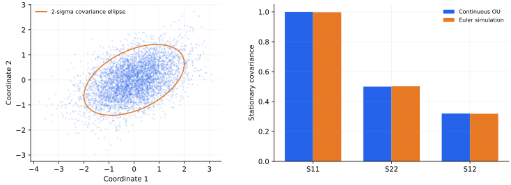

> **IV · 记忆与集体动力学 · Note 14**
>
> ← [Note 13](/notes/neural_network_theory/grokking/) · [系列目录](/notes/neural_network_theory/) · [Note 15](/notes/neural_network_theory/hopfield/) →

**可解性层次：** 局部线性噪声模型精确；SGD 扩散为近似。

## 1. 小批量训练里的随机性来自哪里

同一个参数点，抽取不同批次会得到不同梯度。靠近稳定极小点时，可以把平均梯度线性化、把批次噪声暂时冻结，得到 Ornstein–Uhlenbeck（OU）过程。这个近似能精确解释局部协方差，却不能把整段神经网络训练自动变成热平衡。

尤其要分清三个量：学习率、批次梯度协方差，以及真正满足涨落耗散关系的温度。它们并非同义词。

## 2. 从离散更新到局部扩散

设总体经验损失 $\mathcal L=D^{-1}\sum_\mu\ell_\mu$，单样本梯度 $g_\mu$ 的均值为 $g$，定义

$$
C(w)=\frac1D\sum_\mu(g_\mu-g)(g_\mu-g)^\top.
$$

大小为 $B$、有放回独立采样的批次均值满足 $\operatorname{Cov}(g_B)=C/B$。无放回采样则为 $(D-B)C/[B(D-1)]$。SGD 更新为

$$
w_{k+1}=w_k-\eta g(w_k)+\eta\xi_k,
\qquad \operatorname{Cov}(\xi_k\mid w_k)=C(w_k)/B.
$$

取时间 $t=k\eta$，匹配每单位时间的一、二阶矩，得到小步长扩散近似

$$
dw=-\nabla\mathcal L(w)dt+
\sqrt{\frac\eta B C(w)}\,dW_t.
$$

它省略高阶批次累积量、离散误差与批次间相关。Brownian 近似要求相应小步长与局部统计条件，不能只因算法名字是 SGD 就直接使用。

### 批次协方差的有限总体修正

有放回采样时，批次均值的交叉协方差因独立而消失，留下 $C/B$。无放回采样中，不同抽样项具有负相关，协方差为 $-C/(D-1)$，所以

$$
\operatorname{Cov}(g_B)
=\frac1{B^2}\left[BC-B(B-1)\frac{C}{D-1}\right]
=\frac{D-B}{B(D-1)}C.
$$

当 $B=D$ 时噪声严格消失。只有 $B\ll D$ 时，两种采样才近似给出同样的 $1/B$ 缩放。不同批次若共享样本或按固定顺序循环，时间相关还会改变白噪声近似；只给出一个批次大小并不足以完全指定随机动力学。

### 扩散系数为何带一个学习率

单步随机位移是 $\eta\xi$，方差为 $\eta^2C/B$。每单位连续时间包含约 $1/\eta$ 步，因此总方差率为 $\eta C/B$，噪声振幅为其平方根。若保持优化时间不变而令 $\eta\to0$，这里的 SGD 扩散也趋于零；若希望得到有限强度扩散，需要另外指定噪声或批次的联合缩放。

这与直接给优化方程添加固定温度 Langevin 噪声不同。后者可以独立调节漂移和扩散，前者的噪声来自实际样本梯度，通常既各向异性又状态依赖。

## 3. 二次极小点附近的精确 OU 模型

令 $u=w-w_*$，$\mathcal L\simeq\mathcal L_*+u^\top Hu/2$，$H\succ0$。冻结扩散矩阵 $A=\eta C(w_*)/(2B)$，得到

$$
du=-Hu\,dt+\sqrt{2A}\,dW_t.
$$

均值满足 $\dot m=-Hm$。协方差 $S=\mathbb E[(u-m)(u-m)^\top]$ 用 Itô 公式得到

$$
\dot S=-HS-SH+2A.
$$

长期驻态满足连续 Lyapunov 方程

$$
\boxed{HS+SH=2A,\qquad
S=2\int_0^\infty e^{-Ht}Ae^{-Ht}dt.}
$$

在 $H$ 的本征基里，$S_{ij}=2A_{ij}/(h_i+h_j)$。若两矩阵同时对角化，则 $S_{ii}=A_{ii}/h_i$：软方向涨落大，还要看该方向的噪声注入有多强。仅凭 Hessian 不能决定驻态占据。

### 协方差积分解与曲率基底

线性 SDE 的路径解为 $u_t=e^{-Ht}u_0+\int_0^t e^{-H(t-s)}\sqrt{2A}\,dW_s$。利用 Itô 等距，

$$
S_t=e^{-Ht}S_0e^{-Ht}
+2\int_0^t e^{-Hs}Ae^{-Hs}ds.
$$

$H\succ0$ 时第一项消失，积分收敛。对它左乘和右乘 $H$，积分被积项成为一个总导数，立刻得到 Lyapunov 方程。这个推导显示协方差由过去所有噪声注入经确定性恢复滤波后的累积组成。

若 $C=cH$，则 $A=\eta cH/(2B)$，驻态反而是 $S=\eta cI/(2B)$，各方向宽度相同；只有 $A$ 各向同性时才有 $S\propto H^{-1}$。因此“软方向涨落更大”的结论同时依赖噪声方向分布，不能仅从二次损失得出。

## 4. 什么时候可以说“有效温度”

如果 $A=TI$，驻态为 $p_*(u)\propto\exp[-u^\top Hu/(2T)]$，$S=TH^{-1}$，满足详细平衡。一般各向异性 $A$ 产生的 Gaussian 驻态仍然存在，但未必是关于原损失的单温度 Gibbs 分布。

Fokker–Planck 概率流为

$$
j(u)=(-H+A S^{-1})u\,p_*(u).
$$

详细平衡要求 $HS=A$。对称 $H,A$ 不对易时，这通常不成立，驻态可以持续有旋转概率流；“分布不再随时间变”不等于“没有非平衡流”。即使 $H,A$ 对易但 $A\neq TI$，也往往只有逐方向温度，不能用一个标量温度乘原损失。

若 $H$ 有零模、而 $A$ 沿零模仍注入噪声，该方向是扩散，没有可归一化的 OU 驻态。若有负曲率，则局部线性模型不稳定。将这些方向硬塞进 $S=A/H$ 没有意义。

### 概率流可以存在于一个完全稳定的 Gaussian 分布中

对常系数扩散，Fokker–Planck 方程是 $\partial_tp=-\nabla\cdot j$，$j=-Hu\,p-A\nabla p$。代入 Gaussian 驻态 $\nabla p=-S^{-1}up$，就得到前面的流。驻态只要求散度为零，而不是流在每一点为零。

本文数值例中 $HS-A=\begin{pmatrix}0&-0.48\\0.48&0\end{pmatrix}$，不为零。这个反对称结构对应概率质量在稳定椭圆上的循环，不改变总体密度，却破坏时间反演的详细平衡。

当 $A\succ0$ 时，可以用

$$
\dot S_{\rm prod}=\int\frac{j^\top A^{-1}j}{p}\,du
=\operatorname{Tr}(B_0^\top A^{-1}B_0S),
\quad B_0=-H+AS^{-1},
$$

量化这个 OU 过程的不可逆概率流。它非负，详细平衡时为零。这里使用的是给定扩散模型的概率流定义，不应直接将它等同于神经网络硬件消耗的热量。

### 状态依赖噪声下的 Gibbs 条件

若 $dw=b(w)dt+\sqrt{2A(w)}dW$ 按 Itô 解释，概率流变成

$$
j_i=b_i p-\sum_j\partial_j(A_{ij}p).
$$

扩散矩阵导数也进入流。若希望 $p_*\propto e^{-\mathcal L/T}$ 且详细平衡，必须有
$b=\nabla\cdot A-(A/T)\nabla\mathcal L$。对于 $A=TM(w)$，漂移要含 $T\nabla\cdot M-M\nabla\mathcal L$。普通 SGD 的漂移通常只有 $-\nabla\mathcal L$，其梯度噪声并没有自动满足这个匹配关系。

因此把 $\eta/B$ 称为温度，至多是一个局部、定性或指定方向下的比喻。它可能帮助比较同一训练协议的小变化，但不能单独导出真实网络在所有极小值之间的 Gibbs 权重。

## 5. 离散时间的修正

对于冻结噪声的真实离散线性更新

$$
u_{k+1}=(I-\eta H)u_k+\eta\xi_k,
$$

驻态满足离散 Lyapunov 方程

$$
S=(I-\eta H)S(I-\eta H)+\eta^2 C/B.
$$

若同时对角化，

$$
\boxed{S_{ii}=\frac{\eta C_{ii}}{B h_i(2-\eta h_i)}.}
$$

在 $\eta h_i\ll1$ 时恢复连续近似；接近 $\eta h_i=2$ 的稳定边界时涨落显著增强。把 OU 近似用于大步长训练，可能恰好错过这种离散效应。

### 局部驻态不等于全局极小值选择

上述计算都条件在某个稳定盆地附近。它给出该盆地内的涨落宽度，却没有给出从其他盆地进入它的概率，也没有给出逃逸时间。全局占据还依赖鞍点、势垒路径、噪声退化、参数空间连通性与训练中不断变化的学习率。

这也是“SGD 偏好平坦极小值”不能仅由 $S=TH^{-1}$ 证明的原因。即使局部扩散近似成立，比较不同盆地仍需要额外的全局动力学；若噪声本身随 Hessian 变化，连盆地内的协方差也可能完全不同。局部 OU 模型提供了一套可以精确核对的基线，而不是将非平衡训练整体化约成平衡热力学。

## 6. 数值图与实验

*图 1 · 自制 OU 模型。* 使用 $H=\operatorname{diag}(1,4)$、$A=\begin{pmatrix}1&0.8\\0.8&2\end{pmatrix}$，理论 $S=\begin{pmatrix}1&0.32\\0.32&0.5\end{pmatrix}$。左图为 5000 条独立 Euler–Maruyama 轨迹在 $t=7$ 的终点及理论两倍标准差椭圆；右图比较协方差。步长 0.002，故存在小离散误差和有限采样误差。

复现命令为 `python experiments.py --note 14`。本次相对协方差误差约为 $0.28\%$。当 $A$ 为标量单位阵时恢复单温度 Gibbs 关系；当前非对易的 $H,A$ 则需要同时考察协方差和驻态概率流。

## 7. 理论边界与相关文献

真实 SGD 的 $C(w)$ 会变，噪声可能低秩、非 Gaussian，与曲率耦合；在插值且每个样本梯度都为零的点，批次噪声甚至消失。学习率与批次大小之比只能在明确近似下充当噪声尺度，不能无条件当作热力学温度。

**相关文献。** [Mandt、Hoffman 与 Blei，Stochastic Gradient Descent as Approximate Bayesian Inference](https://arxiv.org/abs/1704.04289)使用局部近似研究 SGD 的分布。本文的 OU 模型在所给条件下精确，SGD 到 OU 的替换则保留近似身份。

---

← [Note 13](/notes/neural_network_theory/grokking/) · [系列目录](/notes/neural_network_theory/) · [Note 15](/notes/neural_network_theory/hopfield/) →
