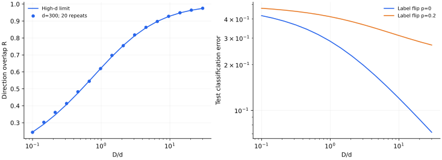

> **I · 泛化与高维模型 · Note 04**
>
> ← [Note 03](/notes/neural_network_theory/random_features/) · [系列目录](/notes/neural_network_theory/) · [Note 05](/notes/neural_network_theory/gaussian_process/) →

**可解性层次：** Hebbian 基线渐近可解；副本为方法框架。

## 1. 让生成规则已知，才能分清“恢复了什么”

真实数据的潜在规则通常不可见。Teacher–student 模型先给定一个教师，再让学生用有限样本学习：研究者知道教师，训练算法只见到样本。这使参数恢复、预测泛化和算法动力学可以分开测量。

它不是一种特定网络架构，而是一类问题设定。改变教师、学生约束、噪声或采样方式，就会改变样本复杂度乃至相变性质。先从一个没有突变阈值的可解例子开始，有助于避免把“相变”当成所有学习曲线的必然结论。

## 2. 感知机教师与方向重叠

取 $x\sim\mathcal N(0,I_d)$，单位教师向量 $u_*$ 给出 $y=\operatorname{sign}(u_*^\top x)$。学生方向 $u$ 也归一化，定义

$$
R=u^\top u_*\in[-1,1].
$$

测试输入的局部场 $h=u^\top x$、$h_*=u_*^\top x$ 是联合 Gaussian，协方差矩阵为 $\begin{pmatrix}1&R\\R&1\end{pmatrix}$。输入在两方向张成的平面里旋转对称；两条分类直线夹角 $\theta=\arccos R$，符号不同的区域占角度比例 $\theta/\pi$。因此

$$
\boxed{\epsilon_g(R)=\mathbb P(hh_*\lt 0)=\frac1\pi\arccos R.}
$$

$R=0$ 对应随机猜测，$R=1$ 对应完全恢复方向。分类误差只依赖方向，与正数倍权重范数无关。这已经说明参数欧氏距离与泛化不必等价。

## 3. 一个完整可解的样本学习器

考虑简单 Hebbian 估计，不做损失优化：

$$
v=\frac1D\sum_{\mu=1}^D y_\mu x_\mu,
\qquad u=v/\|v\|.
$$

将输入分解为 $x=zu_*+x_\perp$，$z\sim\mathcal N(0,1)$，便有

$$
\mathbb E[yx]=\mathbb E|z|\,u_*=c\,u_*,
\qquad c=\sqrt{2/\pi}.
$$

每个正交方向的样本均值方差为 $1/D$，共约 $d$ 个这样的方向。令 $D/d\to\alpha\gt 0$，大数集中给出

$$
v^\top u_*\to c,\qquad
\|v_\perp\|^2\to\alpha^{-1},
$$

$$
\boxed{R(\alpha)=\frac{c}{\sqrt{c^2+\alpha^{-1}}},
\qquad\epsilon_g(\alpha)=\frac1\pi\arccos R(\alpha).}
$$

这是特定学习规则的高维渐近曲线，不是 Bayes 最优误差，也不是感知机梯度下降的通式。小 $\alpha$ 时 $R\simeq c\sqrt\alpha$；大 $\alpha$ 时，$\epsilon_g\simeq1/(\pi c\sqrt\alpha)$。幂律在这里来自平均掉 $d$ 个正交噪声分量。

## 4. 标签噪声怎样改变有效信号

如果标签以概率 $p\lt 1/2$ 独立翻转，令 $y=\zeta\operatorname{sign}(u_*^\top x)$，其中 $\mathbb E\zeta=1-2p$，则 $c$ 被替换为 $c_p=(1-2p)c$，正交噪声方差仍为 $1/D$。

相对干净教师的分类误差仍是 $\arccos R/\pi$；相对新的有噪声测试标签则是

$$
\epsilon_{\rm noisy}=p+(1-2p)\frac{\arccos R}{\pi}.
$$

两种风险的不可约下限不同。若把有噪声测试误差误当方向恢复误差，就会错误判断学生永远无法接近教师。

## 5. 从可解估计走向版本空间与学习相变

对球面学生 $\|w\|^2=d$，可定义零训练错误的版本空间体积

$$
Z(X,y)=\int d\mu(w)\prod_{\mu=1}^D
\Theta\!\left(y_\mu\frac{w^\top x_\mu}{\sqrt d}\right).
$$

其中 $d\mu$ 是球面归一化测度。若希望研究典型样本而非罕见样本主导的平均，应研究 $\mathbb E\log Z$。副本方法形式上使用

$$
\mathbb E\log Z=\lim_{n\to0}\frac{\mathbb E Z^n-1}{n}.
$$

对正整数 $n$，引入副本间重叠 $q_{ab}=w^a\cdot w^b/d$ 和教师重叠 $R_a=w^a\cdot w_*/d$，Gaussian 输入平均只依赖这些协方差，于是高维积分可转为序参量鞍点问题。

这一步解释了自洽方程为什么出现，但**从整数副本继续到 $n=0$ 并不是由该恒等式自动证明的**。还要选择对称性假设、检查稳定性，必要时处理副本对称破缺。本篇不给未推导的鞍点方程贴上“严格精确”的标签。

无噪声、匹配的教师数据保证教师自己始终可行；任意随机标签的可满足性容量是另一个问题。对连续球面、零间隔感知机，经典随机标签阈值 $D/d=2$ 不能直接解释为“有结构教师在两倍样本前完全不能泛化”。离散学生、稀疏先验、非单调激活等设定才可能产生不同的恢复阈值或突变。

## 6. 数值图：平滑恢复也是重要基线

*图 1 · 自制 teacher–student 实验。* 输入维数 $d=300$，独立 Gaussian 样本，20 次重复。左图比较高维 $R(\alpha)$ 与有限维测量；右图比较干净标签与 $p=0.2$ 标签翻转时的理论泛化曲线。图中的噪声曲线按有噪声测试标签评分，极限为 $p$。

复现命令为 `python experiments.py --note 4`。当 $\alpha=1$，无噪声理论给出 $R\simeq0.624$、$\epsilon_g\simeq0.286$。有限尺寸比较需要固定 $D/d$；固定 $D$ 而增大 $d$，同时也改变了样本比例。

训练准确率与独立测试准确率也对应不同的局部场分布。相同样本既参与构造 $v$ 又参与打分时，局部场不再服从独立测试的二元 Gaussian 分布，角度公式不能不加修改地用于训练误差。

## 7. 开放问题

最小模型将泛化压缩成一个重叠，但真实表征可能有多个可交换隐藏单元；届时需要重叠矩阵，而非单个 $R$。这在 Note 11 会变成专门化动力学。

**相关文献。** [Gardner（1988），The space of interactions in neural network models](https://doi.org/10.1088/0305-4470/21/1/030)是版本空间方法的经典来源；[Biehl、Riegler 与 Stechert（1995），Learning from noisy data: An exactly solvable model](https://journals.aps.org/pre/abstract/10.1103/PhysRevE.52.R4624)研究有噪声感知机在线学习。这里的批量 Hebbian 推导明确独立于那些算法的具体动力学。

---

← [Note 03](/notes/neural_network_theory/random_features/) · [系列目录](/notes/neural_network_theory/) · [Note 05](/notes/neural_network_theory/gaussian_process/) →
