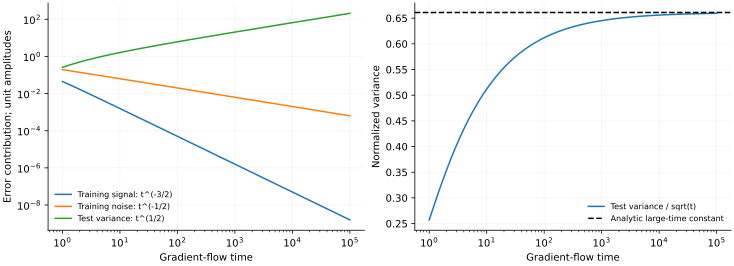

> **V · Scaling Laws · Note 17**
>
> ← [Note 16](/notes/neural_network_theory/random_rnn/) · [系列目录](/notes/neural_network_theory/) · [Note 18](/notes/neural_network_theory/data_scaling/) →

**可解性层次：** 固定谱模型精确；连续谱为渐近。

## 1. 指数模态怎样叠加成幂律

一个模态按指数衰减，不代表总损失也只能是单个指数。若模型含有跨越许多量级的松弛速率，快模态先消失、慢模态逐渐接管，总损失可以在一段很宽的时间窗口里近似幂律。

本篇从精确固定谱动力学出发，推导损失加权速率谱与时间指数的关系。它解释优化曲线的形状，不直接给出样本规模或模型规模的泛化指数。

## 2. 有限模态的精确表达

在线性回归、固定随机特征或冻结 NTK 下，残差可写成

$$
r_k(t)=a_ke^{-\lambda_kt},\qquad
\mathcal L(t)=\frac12\sum_k a_k^2e^{-2\lambda_kt}.
$$

常数 $1/D$ 可吸收进 $a_k^2$；必须在整篇计算中保持一致。零模态给出永久平台 $\mathcal L_0=\frac12\sum_{\lambda_k=0}a_k^2$。

定义损失加权的谱测度

$$
d\mu(\lambda)=\sum_{\lambda_k\gt 0}a_k^2\delta(\lambda-\lambda_k)d\lambda.
$$

于是 $\mathcal L(t)-\mathcal L_0=\frac12\int e^{-2\lambda t}d\mu(\lambda)$，是谱测度的 Laplace 变换。仅知道特征值计数密度还不够：初始化或目标在各模态上的能量同样进入权重。

## 3. 连续谱小速率端决定长时间指数

假设相关窗口内 $d\mu/d\lambda\simeq A\lambda^{\nu-1}$，$\nu\gt 0$。若下边缘为零且其他部分可控，则

$$
\mathcal L(t)-\mathcal L_0\simeq
\frac A2\int_0^\infty\lambda^{\nu-1}e^{-2\lambda t}d\lambda.
$$

令 $u=2\lambda t$，得到

$$
\boxed{\mathcal L(t)-\mathcal L_0
\sim\frac{A\Gamma(\nu)}{2^{\nu+1}}t^{-\nu}.}
$$

指数来自小速率端的**加权**谱。若计数密度 $\rho(\lambda)\sim\lambda^a$、每模态平均初始能量 $\mathbb E[a_k^2\mid\lambda]\sim\lambda^b$，则 $\nu=a+b+1$。忽略目标权重会把时间指数算错。

当 $\nu\leq0$ 时，该连续密度在零端不可积；有限初始损失需要截断或不同权重，不能沿用这个公式再声称得到负指数增长。

### 从谱推导曲线，与从曲线反推谱

前面的计算是 Abelian 方向：给定小速率端的规则谱，推出长期损失。反方向需要额外的 Tauberian 条件，例如正测度的适当正则变化性质。有限时间窗内一条近似直线，并不足以唯一重建微观谱；不同谱、若干离散时间尺度，甚至时变核都可能产生相似曲线。

若 $d\mu/d\lambda=A\lambda^{\nu-1}\ell(1/\lambda)$，其中 $\ell$ 是缓变函数，损失也会带上 $\ell(t)$ 的缓慢修正。有限尺度拟合把对数因子吸收到有效指数里，可能误以为指数随时间变化。区分真正不同的幂次与缓变修正，需要比一次线性拟合更多的尺度信息。

### 局部斜率对应正在主导损失的速率

对去掉零模平台后的损失 $L_+(t)$，定义随时间倾斜的概率测度

$$
dP_t(\lambda)=\frac{e^{-2\lambda t}d\mu(\lambda)}{2L_+(t)}.
$$

直接微分可得

$$
\beta_{\rm eff}(t)=-\frac{d\log L_+}{d\log t}
=2t\langle\lambda\rangle_t,
\qquad
\frac{d\beta_{\rm eff}}{d\log t}
=\beta_{\rm eff}-4t^2\operatorname{Var}_t(\lambda).
$$

纯幂律加权谱对应随时间尺度化的 Gamma 分布：均值 $\nu/(2t)$、方差 $\nu/(4t^2)$，局部指数因而保持 $\nu$。物理上是损失权重不断从快模态转移到速率约为 $1/t$ 的慢模态，每个单模态始终仍为指数松弛。

## 4. 有限窗口、谱隙与极限顺序

若谱仅在 $[\lambda_{\min},\lambda_{\max}]$ 上近似该幂律，那么幂律通常需要

$$
\lambda_{\max}^{-1}\ll t\ll\lambda_{\min}^{-1}.
$$

太早时，所有模态都未明显变化，损失接近初值；太晚时，谱下边缘或最慢单模态支配。连续密度若在正下边缘附近为 $B(\lambda-\lambda_{\min})^a$，长时间会出现 $e^{-2\lambda_{\min}t}t^{-(a+1)}$，而非无限延续的纯幂律。

任何有限正定矩阵最终都有最慢指数。先取系统规模无穷、再取时间无穷，才可能得到无谱隙幂律；反过来则一般得到最慢模态指数。两个极限不应默默交换。

## 5. 用模态编号也能推导指数

若 $\lambda_k\sim k^{-p}$、$a_k^2\sim k^{-q}$，$p\gt 0,q\gt 1$，则

$$
\mathcal L(t)\simeq\frac12\int_1^\infty
k^{-q}e^{-2t k^{-p}}dk.
$$

变量替换 $u=2t k^{-p}$ 给出

$$
\boxed{\mathcal L(t)\sim
\frac{\Gamma((q-1)/p)}{2p}(2t)^{-(q-1)/p}.}
$$

直观上，时间 $t$ 大致学会 $k\lesssim t^{1/p}$ 的快模态，剩余尾部 $\sum_{k\gt t^{1/p}}k^{-q}\sim t^{-(q-1)/p}$。精确积分与这个移动截止尺度给出同一指数。

同一核谱的时间指数还依赖目标系数；后续数据指数又包含估计噪声与正则化，二者不能只因共享一个谱就直接相等。

### 插值临界点中的三个不同时间指数

取 Note 02 的 Gaussian 回归，$d/D\to1$，小谱端为 $\rho(s)\simeq1/(\pi\sqrt s)$。零初始化，教师相对样本方向各向同性，平均信号能量为 $r^2$。训练信号损失带有额外的 $H$ 权重：参数误差映射到输出时乘 $\sqrt s$，平方后再乘 $s$。因此

$$
\mathbb E\mathcal L_{\rm train,signal}
\simeq\frac{r^2}{2}\int s\rho(s)e^{-2st}ds
\propto t^{-3/2}.
$$

标签噪声在训练预测空间近似各向同性，其残差损失则为

$$
\mathbb E\mathcal L_{\rm train,noise}
\simeq\frac{\sigma^2}{2}\int\rho(s)e^{-2st}ds
\propto t^{-1/2}.
$$

同一谱的两种初始能量权重产生不同训练指数。测试参数偏差没有训练损失中的额外 $s$，所以 $R_{\rm bias}\propto t^{-1/2}$。拟合噪声造成的测试方差更特别：

$$
R_{\rm var}(t)\simeq\sigma^2\int
\frac{\rho(s)}s(1-e^{-st})^2ds
\propto t^{1/2}.
$$

变量替换 $u=st$，并对积分分部，可以得到领先系数

$$
R_{\rm var}(t)\sim
\frac{4\sigma^2}{\sqrt\pi}
\left(1-\frac1{\sqrt2}\right)\sqrt t.
$$

临界谱既使训练损失幂律下降，也使测试噪声风险持续增长。训练幂律因而不是泛化改善的充分证据。有限矩阵最终还有最小正本征值，这些幂律仍受时间窗和极限顺序限制。

### 学习率日程改变优化时钟

离散模态为 $r_{k,n}=r_{k,0}\prod_{j\lt n}(1-\eta_j\lambda_k)$。当所有相关 $\eta_j\lambda_k$ 足够小，$\log r_{k,n}\simeq-\lambda_k\sum_j\eta_j$，自然优化时间是 $t_n=\sum_j\eta_j$。

若 $\eta_j\propto j^{-a}$，$0\leq a\lt 1$ 时 $t_n\propto n^{1-a}$，原先的 $t^{-\nu}$ 表现为更新数上的 $n^{-\nu(1-a)}$；$a=1$ 时则可能表现为 $(\log n)^{-\nu}$。同一固定谱仅因时钟变化，就能产生不同的表观指数。实验横轴采用更新数、样本处理量还是累计学习率，会直接影响理论比较。

*补充图 · 同一个谱对应不同风险指数。* 使用 $\gamma=1$ 的完整 MP 密度，信号与噪声幅度均取 1，直接积分三个风险式。左图的晚期拟合斜率约为 $-1.5000,-0.5000,+0.5028$；右图将测试方差除以 $\sqrt t$，趋向解析常数 0.66099。图中没有训练非线性网络，也没有重新拟合谱。它展示的是误差权重和谱反演怎样改变同一谱的时间表现。

## 6. 数值图与诊断

*图 1 · 自制积分。* 左图取 $d\mu/d\lambda=\lambda^{\nu-1}$、$0\lt \lambda\lt 1$，$\nu=0.5,1,2$，用不完全 Gamma 函数计算完整曲线；右图在 $\nu=1$ 时加入 $\lambda_{\min}=10^{-3}$，用 1500 点谱积分比较无下截断结果。幂律窗口和最终偏离都来自同一个谱模型。

复现命令为 `python experiments.py --note 17`。$\nu=1$ 时积分简化为 $\mathcal L(t)=(1-e^{-2t})/(4t)$，短时极限为 $1/2$，长时为 $1/(4t)$，与完整数值曲线一致。

实验拟合应同时报告局部斜率 $\beta_{\rm eff}(t)=-d\log(\mathcal L-\mathcal L_0)/d\log t$。若未知平台未减去、指数窗过短或时间横轴采用更新数而学习率在变化，直线拟合可能给出没有机制意义的指数。

## 7. 特征学习怎样超出固定谱解释

若核随时间改变，模态会旋转，能量在方向间转移，不能一般写成同一组 $a_k^2e^{-2\lambda_kt}$。即使瞬时谱变化缓慢，还需控制基底旋转和非对易性。观察到幂律既不能证明固定谱机制，也不能证明特征学习；两者需要独立测量区分。

**相关文献。** 固定谱优化可与 [Advani 与 Saxe](https://arxiv.org/abs/1710.03667)的高维学习动力学联系；更广的幂律机制比较见 [Bahri 等，Explaining Neural Scaling Laws](https://arxiv.org/abs/2102.06701)。本篇的 Laplace 推导独立给出，不把某个时间指数宣称为所有网络的普适定律。

---

← [Note 16](/notes/neural_network_theory/random_rnn/) · [系列目录](/notes/neural_network_theory/) · [Note 18](/notes/neural_network_theory/data_scaling/) →
