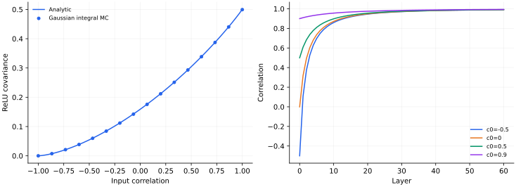
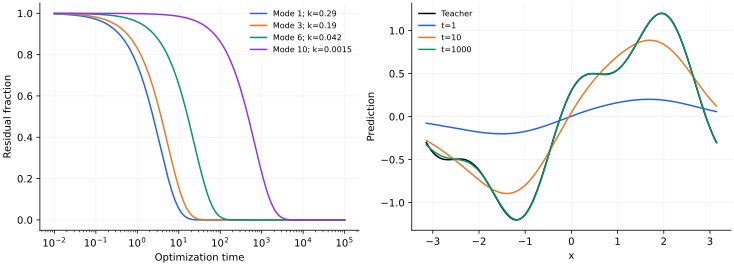

> **II · 无限宽与特征学习 · Note 03**
>
> ← [Note 02](/notes/neural_network_theory/kernel_methods/) · [系列目录](/notes/neural_network_theory/) · [Note 04](/notes/neural_network_theory/lazy_and_mean_field/) →

**可解性层次：** 有限输入集上的 GP 极限；精确时变核恒等式与条件性冻结动力学。

## 前言：同一个无限宽网络，先验与训练是两种问题

Gaussian process 与 NTK 常以相似的核矩阵公式出现，却保留随机网络的不同对象。前者研究初始化生成怎样的随机函数，后者研究参数梯度怎样改变函数。将二者放在同一篇中，可以从同一个两层网络出发，逐步看见前向协方差与切线核各自来自哪里，以及为什么均值公式相似并不意味着训练等同于 Bayesian 推断。

这里先用有限输入集上的中心极限定理得到函数先验，再分析深度如何改变输入相关性。随后从有限网络精确链式法则推导时变 NTK，明确加入冻结条件以后才求解训练与测试预测。这样，概率极限与动力学近似各自承担的假设不会被一句“无限宽就是核方法”遮蔽。

最后把初始化集合、GP 后验与核回归逐项比较。均值、方差、初始函数、噪声和优化度量都需要对照；只看一个逆矩阵，无法判断它们是否描述同一种学习过程。

## 1. 函数先验：宽度怎样产生 Gaussian process {#gaussian-process}

### 两层网络的向量中心极限定理

设

$$
f_N(x)=\frac{\sigma_a}{\sqrt N}\sum_{j=1}^N
a_j\phi(w_j^\top x/\sqrt d)+b,
$$

其中 $a_j\sim\mathcal N(0,1)$、$w_j\sim\mathcal N(0,\sigma_w^2I_d)$、$b\sim\mathcal N(0,\sigma_b^2)$，各组独立。对固定 $x_1,\ldots,x_D$，每个神经元贡献一个 $D$ 维随机向量。若其二阶矩有限，多元中心极限定理给出

$$
(f_N(x_1),\ldots,f_N(x_D))
\Rightarrow\mathcal N(0,K),
$$

$$
K(x,x')=\sigma_b^2+\sigma_a^2
\mathbb E_w[\phi(w^\top x/\sqrt d)\phi(w^\top x'/\sqrt d)].
$$

输出均值为零来自读出权重的零均值，并不要求 ReLU 特征自身零均值。独立性、有限矩与 $N^{-1/2}$ 归一化都是结论的一部分。

#### 条件 Gaussian 与混合分布的区别

由于 $a_j$ 本身是 Gaussian，固定全部隐藏权重以后，有限宽输出向量已经严格为 Gaussian，条件协方差为一个随机经验核。但对隐藏权重再平均，得到的是协方差随机变化的 Gaussian 混合，一般不再严格 Gaussian。无限宽的作用，是让这个随机协方差集中到确定核，而不只是让单点输出“看上去像钟形”。

单个输入的高阶累积量可以显示有限宽修正。写 $b_j=\phi(w_j^\top x/\sqrt d)$，暂去偏置并取 $\sigma_a=1$，则

$$
\mathbb E f_N^2=\mathbb E b^2,\qquad
\operatorname{cum}_4(f_N)
=\frac3N\left[\mathbb E b^4-(\mathbb E b^2)^2\right].
$$

这里使用了 $\mathbb E a^4=3$ 和独立求和时累积量可加。有限四阶矩下，非 Gaussian 性通常以 $1/N$ 衰减；如果四阶矩发散，这条有限宽估计就不成立。对一组输入，还需要对应的联合高阶累积量一起消失，不能仅检查一个输入的峰度。

“固定有限输入集”也有实际含义。宽度无穷时，对任意事先给定的有限样本集都有联合分布极限；若样本数、网络深度或所观察的极端输入随宽度增长，需要对误差作一致控制。有限维分布收敛本身没有给出所有这些同时增长极限。

### 多层条件 Gaussian 与协方差递推

对于全连接网络，令第 $\ell+1$ 层预激活为

$$
h_i^{\ell+1}(x)=\frac{\sigma_w}{\sqrt{n_\ell}}
\sum_jW_{ij}^{\ell+1}\phi(h_j^\ell(x))+b_i^{\ell+1},
$$

其中 $W$ 为单位方差独立 Gaussian，偏置方差为 $\sigma_b^2$。给定上一层激活，下一层预激活严格是条件 Gaussian，其条件协方差为一个经验平均。宽度趋于无穷时，该平均集中到确定值，从而得到递推

$$
\boxed{q^{\ell+1}(x,x')=\sigma_b^2+
\sigma_w^2\mathbb E_{(u,v)\sim\mathcal N(0,Q^\ell)}
[\phi(u)\phi(v)],}
$$

$$
Q^\ell=\begin{pmatrix}
q^\ell(x,x)&q^\ell(x,x')\\
q^\ell(x',x)&q^\ell(x',x')
\end{pmatrix}.
$$

这一步的要点是先条件化再取集中极限。直接说“每层都是许多独立量相加”会忽略不同神经元共享前层随机性的事实。固定深度、固定有限输入集是最干净的极限设置；深度、样本数也增长时需要额外控制。

#### 递推闭合究竟省略了哪些相关性

在有限宽网络中，不同层的经验核存在涨落，后层神经元也通过前层经验分布发生统计耦合。对固定层数，逐层条件化后，经验协方差的集中使这些涨落在极限中消失，从而只需传播 $q^\ell$。闭合在二阶统计量上，依赖的是预激活 Gaussian 极限及权重独立性，而不是任意非线性随机过程只由协方差决定。

这个区别在训练后尤其重要。全参数训练会使权重依赖样本标签，层间独立结构不再保持初始化时的形式；把训练后的权重方差代入同一前向递推，通常不足以描述其函数分布。NNGP 的直接对象是初始化先验，后验推断或训练动力学需要分别建立。

### ReLU 核的显式积分与深度极限

若 $u,v$ 方差分别为 $q,q'$，相关系数 $c=\cos\theta$，对二维 Gaussian 的极坐标积分给出

$$
\mathbb E[\operatorname{ReLU}(u)\operatorname{ReLU}(v)]
=\frac{\sqrt{qq'}}{2\pi}
[\sin\theta+(\pi-\theta)\cos\theta].
$$

端点结果为：$c=1$ 时等于 $\sqrt{qq'}/2$；$c=-1$ 时为零；$c=0$ 时为 $\sqrt{qq'}/(2\pi)$。最后一个数不是零，因为 ReLU 有正均值。

取零偏置和 He 方差 $\sigma_w^2=2$，若两输入方差相等，方差逐层保持，相关系数满足

$$
c_{\ell+1}=F(c_\ell)
=\frac{\sqrt{1-c_\ell^2}+(\pi-\arccos c_\ell)c_\ell}{\pi}.
$$

$F(1)=1$，不同输入的相关性逐渐趋近 1，深层先验可能越来越难区分输入。这里 $F'(1)=1$，不能套用严格收缩映射的指数收敛。展开得到

$$
F(c)-c\simeq\frac{2\sqrt2}{3\pi}(1-c)^{3/2},
$$

所以连续深度近似给出 $1-c_\ell\sim\ell^{-2}$。这是本例的边缘情况，并不是所有激活的普适深度指数。

#### 二维极坐标积分的展开

将标准二维 Gaussian 写成半径 $r$ 和角度 $\alpha$，$\alpha$ 均匀、$\mathbb E r^2=2$。令 $u=\sqrt q\,r\cos\alpha$、$v=\sqrt{q'}\,r\cos(\alpha-\theta)$，其中 $\theta\in[0,\pi]$ 是两个输入方向的夹角。ReLU 乘积只在两个余弦同时为正的交叠角区非零，区间长度为 $\pi-\theta$。

在该区间直接积分，

$$
\int_{\rm overlap}\cos\alpha\cos(\alpha-\theta)d\alpha
=\frac12[\sin\theta+(\pi-\theta)\cos\theta].
$$

再乘上 $\sqrt{qq'}\mathbb E r^2/(2\pi)$，就得到前面的核公式。它的非线性来自截断后的角区重叠：两个方向越接近，同一批神经元同时激活的比例越大。核并不是对输入距离随意拟合的函数，而是激活区域几何的平均。

#### 深度极限的代数退化

对 He 归一化 ReLU，令 $\epsilon_\ell=1-c_\ell$。从 $c=\cos\theta$ 的小角展开，$\sin\theta-\theta\cos\theta\simeq\theta^3/3$，以及 $\theta\simeq\sqrt{2\epsilon}$，得到

$$
\epsilon_{\ell+1}-\epsilon_\ell
\simeq-a\epsilon_\ell^{3/2},\qquad
a=\frac{2\sqrt2}{3\pi}.
$$

把深度视为缓变变量，积分 $d\epsilon/d\ell=-a\epsilon^{3/2}$，给出

$$
\epsilon_\ell^{-1/2}\simeq\epsilon_0^{-1/2}+\frac a2\ell,
\qquad \epsilon_\ell\sim\frac{9\pi^2}{2\ell^2}.
$$

这是足够深处的渐近式，常数不能拿到很浅的层数直接使用。相关性趋于 1 意味着归一化核接近所有输入共享的常量方向，小的区分模态逐渐受压制；它不意味着有限深度时函数严格为常数，而是核的条件数和可分辨方向可能越来越不利。

## 2. 深度传播：相关性稳定不等于训练稳定 {#signal-propagation}

### 方差、相关性与导数传播

对一般激活，在方差固定点 $q_*$ 附近，小相关差异的线性放大率常写为

$$
\chi=\sigma_w^2\mathbb E_{z\sim\mathcal N(0,1)}
[\phi'(\sqrt{q_*}z)^2].
$$

在适用的递推条件下，$\chi\lt 1$ 表示相关差异收缩，$\chi\gt 1$ 表示其在该点附近增长。这个前向相关分析也与梯度尺度有关，但它没有单独证明优化成功或泛化优良；还需看任务、读出核谱以及训练造成的分布变化。

#### 方差稳定性与相关稳定性不是一个条件

若等范数输入的对角方差趋向 $q_*$，它满足

$$
q_* =\sigma_b^2+\sigma_w^2\int Dz\,\phi(\sqrt{q_*}z)^2.
$$

对角方差映射的导数，在光滑及可积条件下为 $\sigma_w^2\mathbb E[\phi'^2+\phi\phi'']$。相关系数接近 1 时的导数则是前面的 $\chi=\sigma_w^2\mathbb E\phi'^2$。二者来自不同的扰动：前者同时改变两个变量的方差，后者固定边缘方差而改变共同协方差。

这里可用 Gaussian 分部积分，也称 Price 恒等式：对固定方差的二元 Gaussian，$\partial_C\mathbb E[\phi(u)\phi(v)]=\mathbb E[\phi'(u)\phi'(v)]$。将 $C=q_*c$ 代入，归一化时的 $q_*$ 抵消，才得到 $\chi$。因此“方差不爆炸”并不足以保证输入之间的差异能跨很多层保留。

文献中前向传播的有序/混沌区域，指输入差异随层数的放大或收缩；这里层数扮演迭代方向。Note 10 的循环网络混沌则是同一个网络状态随真实动力学时间的敏感依赖。两种分析共享平均场思想，但不能将临界线、Lyapunov 指数或记忆时间直接互换。

### 相关性坍缩怎样改变函数几何

设归一化相关性 $c_\ell$ 接近 1。不同输入的前向表示几乎同向，会使 Gram 矩阵接近常数矩阵。如果 $K\approx a\mathbf1\mathbf1^\top+\delta B$，常数标签方向仍有大特征值，区分输入差异的方向则可能只有 $O(\delta)$ 的特征值。于是先验函数主要随整体均值变化，对精细差异的先验方差很小。

这能产生两个不同现象：在有限噪声 GP 中，这些差异被强烈收缩；在无噪声插值中，逆矩阵则会放大它们。前者表现为欠拟合某些目标方向，后者表现为对微小标签扰动敏感。相关性坍缩因此不能简单翻译成“所有学习都失败”，而要与任务是否需要区分这些方向一起看。

对 ReLU 的临界归一化递推，$1-c_\ell$ 可能按 $\ell^{-2}$ 缓慢衰减。有限深度下仍存在可辨别差异，但其幅度随深度改变。若先令深度无穷再研究训练，与在有限深度上增加数据或调整正则化，可能进入不同条件数区间。这再次说明宽度极限提供可算核，深度极限却可能改变这个核的有效秩。

### 前向核的数值结果

*图 1 · 自制核计算。* 左图比较二维 Gaussian Monte Carlo 积分与上述 ReLU 解析式，方差均为 1，使用 200000 个基础随机样本。右图取零偏置、$\sigma_w^2=2$，对 $c_0=-0.5,0,0.5,0.9$ 迭代 60 层。曲线表示随机初始化的先验相关，不是训练损失。

$c=0$ 时的积分值为 $1/(2\pi)$。有限宽网络的经验核还随初始化波动，平均核的收敛与单个网络的函数分布收敛需要分别考察。

## 3. 切线动力学：从精确时变核到冻结 NTK {#ntk}

前向先验没有使用标签，也没有指定训练算法。现在让参数按平方损失梯度流变化，先写出始终成立的链式法则，再加入切线特征稳定的条件。

### 训练集上的精确核恒等式

对标量输出 $f_\theta(x)$，平方损失为

$$
\mathcal L(\theta)=\frac1{2D}\sum_{\mu=1}^D
[f_\theta(x_\mu)-y_\mu]^2.
$$

记 $J_{\mu a}=\partial_{\theta_a}f_\theta(x_\mu)$，残差 $r=f_X-y$。梯度流满足 $\dot\theta=-J^\top r/D$，链式法则给出

$$
\boxed{\dot r=-K_t r,\qquad K_t=\frac1D J_tJ_t^\top.}
$$

任意向量 $v$ 满足 $v^\top K_tv=\|J_t^\top v\|^2/D\geq0$，所以训练损失单调不增：$\dot{\mathcal L}=-r^\top K_tr/D$。但只要 $K_t$ 随参数改变，这仍然不是闭合的常系数线性系统。

文献有时把 $JJ^\top$ 本身叫 NTK，此时方程右侧多一个 $1/D$。本文把它吸收进 $K_t$，所有时间尺度都以这个约定为准。

### 两类梯度贡献与冻结条件

在初始化处展开

$$
f_\theta(x)\simeq f_{\theta_0}(x)+
\nabla_\theta f_{\theta_0}(x)^\top(\theta-\theta_0).
$$

如果训练过程中 Jacobian 的变化可以忽略，便得到 $K_t\simeq K_0$。适当 NTK 参数化下，固定数据集、固定深度、足够宽网络可以在相应条件下趋向这个极限。其成立需要控制参数移动、Jacobian 稳定性、训练时间和核的退化；“宽度很大”不是一个脱离这些条件的独立证明。

例如两层网络 $f=N^{-1/2}\sum_j a_j\phi(w_j^\top x/\sqrt d)$，训练 $a,w$ 时，未除以 $D$ 的极限核为

$$
\Theta(x,x')=\mathbb E[\phi(u)\phi(v)]
+\frac{x^\top x'}d\mathbb E[a^2\phi'(u)\phi'(v)].
$$

第一项来自读出权重，第二项来自隐藏权重。因此它通常不同于仅有前向协方差的 NNGP。激活非光滑时，导数与收敛条件也需相应处理。

#### 两层网络的核项逐个来自什么参数

令 $u_j(x)=w_j^\top x/\sqrt d$，则

$$
\frac{\partial f(x)}{\partial a_j}=\frac1{\sqrt N}\phi(u_j(x)),
\qquad
\frac{\partial f(x)}{\partial w_j}
=\frac{a_j}{\sqrt{Nd}}\phi'(u_j(x))x.
$$

对所有参数内积求和，未除以 $D$ 的有限宽核就是

$$
\Theta_N(x,x')=\frac1N\sum_j\phi(u_j(x))\phi(u_j(x'))
+\frac{x^\top x'}{Nd}\sum_j a_j^2\phi'(u_j(x))\phi'(u_j(x')).
$$

第一项与随机特征输出层训练相同；第二项使隐藏参数的切线贡献进入预测。这里虽然把隐藏参数也纳入了训练，冻结核理论仍只保留它们在初始化处提供的方向。可以训练隐藏层与发生有限幅度表征重组，因而是不同的陈述。

若各参数组使用不同学习率，核相应变为 $J M J^\top/D$，其中 $M$ 是参数迁移率矩阵。即使架构和初始函数分布相同，优化度量不同也会产生不同的切线核。比较 NNGP、随机特征核和 NTK 时，必须同时说明训练哪些参数、使用怎样的参数归一化与学习率。

#### 函数线性化的余项在哪里

对参数位移 $\Delta\theta$，Taylor 余项含有 $\frac12\Delta\theta^\top\nabla_\theta^2f(x;\tilde\theta)\Delta\theta$。小参数位移要转化成小函数线性化误差，还需控制 Hessian 和观察输入集。总参数范数随宽度增大，可能使相对位移看起来很小，而特定任务方向的绝对位移仍不可忽略。

因此可验证的对象应是预测余项或 Jacobian 漂移，而不是仅报告 $\|\theta_t-\theta_0\|/\|\theta_0\|$。无限宽证明把这些量在某个时间区间和概率事件上控制住；有限网络实验则需要实际测量其大小。

### 残差谱解、噪声拟合与冻结误差

在冻结核模型内，分解 $K_0=U\operatorname{diag}(\kappa_i)U^\top$，便有

$$
r(t)=e^{-K_0t}r(0),\qquad
r_i(t)=e^{-\kappa_it}r_i(0),
$$

$$
\boxed{\mathcal L(t)=\frac1{2D}\sum_i r_i(0)^2e^{-2\kappa_it}.}
$$

大 $\kappa_i$ 模态快，小模态慢；$\kappa_i=0$ 的标签分量完全不学。核正定时训练残差最终归零，但训练集外误差还需要核的总体谱和目标对齐，不能只从 $\kappa_{\min}\gt 0$ 推出泛化好。

若 $K_t$ 不同时间之间不对易，真实解需要时间有序指数，不能将它写成 $\exp[-\int K_tdt]r(0)$。这也是用“平均一个核”替代完整特征学习动力学的潜在错误。

#### 两个训练点就能看见条件数与噪声放大

取未归一化 Gram 矩阵 $\Theta=\begin{pmatrix}1&c\\c&1\end{pmatrix}$，$0\leq c\lt 1$，并使用本文的 $K=\Theta/2$。对称与反对称标签模态的速率分别为 $(1+c)/2$ 和 $(1-c)/2$。当两个训练点在特征空间几乎相同，$c\to1$，共同标签分量很快拟合，标签差异则极慢。

测试点的交叉核为 $(u,v)$，零初始化下的预测可以完整写为

$$
f_t(x)=\frac{(u+v)(y_1+y_2)}{2(1+c)}
[1-e^{-(1+c)t/2}]
+\frac{(u-v)(y_1-y_2)}{2(1-c)}
[1-e^{-(1-c)t/2}].
$$

这把“学习慢”和“反演敏感”放在同一个分母里。但 $u,v,c$ 不能任意独立指定，因为包含测试点的完整核矩阵还必须半正定。一个明确合法的例子，是训练特征 $(1,\epsilon)/\sqrt{1+\epsilon^2}$ 和 $(1,-\epsilon)/\sqrt{1+\epsilon^2}$，测试特征 $(0,1)$。

此时 $c=(1-\epsilon^2)/(1+\epsilon^2)$、$u=-v=\epsilon/\sqrt{1+\epsilon^2}$。若训练标签为 $(1,-1)$，长期测试预测为 $\sqrt{1+\epsilon^2}/\epsilon$，随 $\epsilon\to0$ 发散。两个极相近特征上的标签差异，被解释成一个巨大且缓慢学习的函数斜率。早停或 ridge 压制这个方向，可以降低其外推幅度；单纯训练到插值则没有这种保护。

#### 核只近似冻结时，误差怎样积累

设 $K_t=K_0+\Delta K_t$，真实残差为 $r$，冻结核残差为 $\bar r=e^{-K_0t}r_0$。两式相减，并用常数变易法，得到精确恒等式

$$
r(t)-\bar r(t)
=-\int_0^t e^{-K_0(t-s)}\Delta K_s r(s)ds.
$$

若 $K_0$ 最小本征值为 $\kappa\gt 0$，且整个区间内 $\|\Delta K_s\|_{\rm op}\leq\delta\lt \kappa$，则 $K_s\succeq(\kappa-\delta)I$，所以 $\|r(s)\|\leq e^{-(\kappa-\delta)s}\|r_0\|$。代回积分，得到

$$
\|r(t)-\bar r(t)\|
\leq[e^{-(\kappa-\delta)t}-e^{-\kappa t}]\|r_0\|.
$$

这一界说明冻结近似的自然小参数是核漂移相对于谱隙的大小。核 Frobenius 相对变化只有百分之一，不代表它比最小本征值小；若核非常病态，慢模态仍可有显著变化。相对残差误差还可能随 $\delta t$ 积累，即使绝对误差仍趋于零。

当初始核有零模时，没有统一正谱隙。核演化可能打开此前不可学习的方向，此时变化再小，也可能在足够长时间改变可拟合空间。这正是固定时间近似与无限训练时间极限需要分别讨论的原因。

#### 噪声拟合在训练点上也能清楚分解

对零初始函数，设训练标签 $y=f_*+\varepsilon$，$S_t=I-e^{-K_0t}$。训练预测为 $f_t=S_ty$，相对训练点上无噪声函数值的误差满足

$$
\frac1D\mathbb E\|f_t-f_*\|^2
=\frac1D\|e^{-K_0t}f_*\|^2
+\frac{\sigma^2}{D}\operatorname{Tr}S_t^2.
$$

训练残差损失则是

$$
\mathbb E\mathcal L_{\rm train}(t)
=\frac1{2D}\|e^{-K_0t}f_*\|^2
+\frac{\sigma^2}{2D}\operatorname{Tr}e^{-2K_0t}.
$$

核正定且训练很久时，后者趋于零，前者的噪声部分却趋于 $\sigma^2$。这还不是新输入上的泛化风险，只是同一批输入相对干净标签的误差；但它已经显示出“插值有噪声标签”和“恢复干净函数”之间的区别。训练集外风险需要下一节的交叉核以及总体输入分布。

## 4. 训练集外预测：初始化修正与函数范数 {#prediction}

### 预测延拓与最小参数修正

定义训练点与测试点的归一化交叉核

$$
k_0(x,X)_\mu=\frac1D
\nabla f_{\theta_0}(x)^\top\nabla f_{\theta_0}(x_\mu).
$$

由于 $\dot f(x)=-k_0(x,X)^\top r(t)$，积分得到

$$
\boxed{f_t(x)=f_0(x)+k_0(x,X)^\top K_0^+
(I-e^{-K_0t})(y-f_0(X)).}
$$

交叉核对训练 Gram 矩阵零空间正交，所以伪逆表达没有遗漏一项线性增长。若 $f_0=0$、$K_0$ 可逆，长期预测就是无正则化核插值。更一般地，学到的是相对随机初始函数的最小切线范数修正，而非自动得到零均值 GP 后验。

这一公式把两种问题分开：训练集上的模态拟合速度由经验核决定；测试预测是否正确，取决于测试点如何与这些模态耦合。插值只是第一步。

#### 最小参数修正与 RKHS 解选择

在线性化模型中，令 $J_0\Delta\theta=y-f_0(X)$。若这些约束可满足，从 $\Delta\theta=0$ 出发的欧氏梯度流选择最小 $\|\Delta\theta\|^2$ 的解。任意其他参数解都相差一个 $J_0$ 零空间向量，不改变训练输出，却增加参数修正的范数。

对函数修正 $g(x)=\nabla f_0(x)^\top\Delta\theta$，定义其范数为所有表示它的参数修正中最小的范数。这就构成切线特征诱导的 RKHS。最小参数修正与最小 RKHS 范数修正，是同一个优化问题在参数与函数空间中的表达。

关键在于优化的对象是 $f-f_0$。随机初始函数并不总属于这个 RKHS，也不一定随宽度消失；因此长期解可以写成

$$
f_\infty(x)=f_0(x)+
\Theta_0(x,X)\Theta_0(X,X)^+
[y-f_0(X)],
$$

而不是自动等于 $\Theta_0(x,X)\Theta_0(X,X)^+y$。只有零初始函数或相应初始函数贡献被消除时，后一个表达才成立。实践中通过成对对称初始化构造零输出，也是在控制这一解选择差异。

#### 为什么谱偏置仍然依赖数据分布

经验本征向量是训练样本上的向量，并不直接是一条全输入空间函数。将它延拓到测试点，需要 $\Theta(x,X)$。只有在样本充足、经验算子近似总体核算子等条件下，才能把训练模态和总体本征函数对应起来。

因此一个很快降低的经验高本征值模态，未必在总体任务中承载最主要信号。NTK 给出的是“相对这个核的快慢”，其是否符合任务归纳结构，仍是数据谱和目标系数的问题。这个逻辑把训练可解性与泛化可解性分成了两步，也解释为什么核动力学解得很精确，测试误差仍可能很差。

### 最小函数修正的 RKHS 变分证明

设 $g=f-f_0$ 属于切线核的 RKHS，约束 $g(X)=y-f_0(X)=b$。将任意 $g$ 正交分解为训练核截面张成的部分与其正交补：

$$
g=\sum_{\mu=1}^D c_\mu\Theta(x_\mu,\cdot)+g_\perp,
\qquad \langle g_\perp,\Theta(x_\mu,\cdot)\rangle_{\mathcal H}=0.
$$

再生性质给出 $g_\perp(x_\mu)=0$，所以正交补不帮助满足任何训练约束，却增加范数：

$$
\|g\|_{\mathcal H}^2=c^\top\Theta_Xc+\|g_\perp\|_{\mathcal H}^2.
$$

最小解取 $g_\perp=0$，并解 $\Theta_Xc=b$。训练核可逆时 $c=\Theta_X^{-1}b$，正好恢复梯度流的长期修正。奇异时还需约束可行性，并以伪逆处理冗余表示。

这项变分解释明确了被最小化的是相对于 $f_0$ 的函数修正范数，而不是完整函数相对于零的范数。只有 $f_0=0$ 或采用合适中心化模型时，才能直接写成最小 $\|f\|_{\mathcal H}$。初始化在训练点之外留下的部分，也因此不是一个可以随意忽略的常数。

参数空间的解释与之相容：线性化约束为 $J\Delta\theta=b$，零位移开始的欧氏梯度流选择最小 $\|\Delta\theta\|$。若使用迁移率矩阵 $M$，被最小化的变成 $\Delta\theta^\top M^{-1}\Delta\theta$，相应核为 $JMJ^\top$。核函数范数由参数几何诱导，而不是独立于优化器存在的装饰。

## 5. Bayesian 条件化与梯度训练怎样比较 {#bayesian-comparison}

同样的训练输入，GP 条件化首先指定函数先验与观测噪声；切线训练首先指定初始函数、参数度量与损失。以下将分布与动力学两侧的均值和协方差写开。

### GP 后验来自联合 Gaussian 的条件分布

取训练函数向量 $f_X$，新点函数值 $f_*$。零均值先验和独立 Gaussian 观测噪声下，联合协方差为

$$
\operatorname{Cov}\begin{pmatrix}y\\f_*\end{pmatrix}
=\begin{pmatrix}
K+\sigma_n^2I&k_*\\
k_*^\top&k_{**}
\end{pmatrix}.
$$

令 $A=K+\sigma_n^2I$。将联合二次型完成平方，或定义残差 $\zeta=f_*-k_*^\top A^{-1}y$，就有 $\operatorname{Cov}(\zeta,y)=0$。联合 Gaussian 下不相关意味着独立，于是

$$
\mathbb E[f_*\mid y]=k_*^\top A^{-1}y,
\qquad \operatorname{Var}(f_*\mid y)
=k_{**}-k_*^\top A^{-1}k_*.
$$

后验方差非负来自分块协方差的 Schur 补。它并不依赖观测到的标签值，只依赖输入覆盖、核与噪声水平。这不是说标签对学习没有用，而是这个共轭模型把标签用于移动均值，把几何用于决定不确定性。若核超参数也通过标签拟合，方差会间接依赖标签，但那是另一层推断。

无噪声且 $K$ 可逆时，训练点上的潜在函数方差降到零。远离训练数据的点若与训练输入核相关很弱，均值回到先验均值，方差接近先验方差。于是预测的外推行为已经由核决定；无限宽本身并没有提供一种不依赖先验的“理解”。

### NTK 训练集合的初始化协方差

令冻结训练核 $\Theta$ 确定，初始化函数 $f_0$ 为零均值 GP，协方差记为 $C$。无噪声、可逆训练核下，定义 $A(x)=\Theta(x,X)\Theta_X^{-1}$，便有

$$
f_\infty(x)=A(x)y+f_0(x)-A(x)f_0(X).
$$

对初始化平均，均值为 $A(x)y$；两个测试点的协方差为

$$
\begin{aligned}
C_\infty(x,x')={}&C(x,x')-A(x)C(X,x')
-C(x,X)A(x')^\top\\
&+A(x)C(X,X)A(x')^\top.
\end{aligned}
$$

若 $\Theta=C$，后三项合并，得到无噪声 GP 条件协方差 $C(x,x')-C(x,X)C_X^{-1}C(X,x')$。但一般 NNGP 与 NTK 不同，此合并不成立。初始化集合的方差只是某种算法集合的不确定性，不能未经检查便称作 Bayesian 后验方差。

带标签噪声时，还需区分训练用的确定标签、观测模型中的噪声和后验抽样需要的随机项。只把 $\Theta_X^{-1}$ 换成正则化逆矩阵，并不自动把整个随机函数集合变成正确 GP 后验。这是均值公式相似最容易掩盖的部分。

### 核超参数选择与边缘似然

GP 还允许把核的幅度、长度尺度或噪声方差放进超参数 $\vartheta$。积分掉训练函数值后，标签边缘分布为 $y\sim\mathcal N(0,A_\vartheta)$，其中 $A_\vartheta=K_\vartheta+\sigma_n^2I$，所以

$$
-\log p(y\mid\vartheta)
=\frac12y^\top A_\vartheta^{-1}y
+\frac12\log\det A_\vartheta
+\frac D2\log(2\pi).
$$

第一项奖励能够解释观测标签的协方差，第二项惩罚把先验方差无差别地铺到太多方向。两项不能分别解释为纯粹的拟合与纯粹的参数数目：它们都依赖完整核谱，以及标签在这些方向上的投影。

对任意超参数分量，利用 $\partial A^{-1}=-A^{-1}(\partial A)A^{-1}$ 与 $\partial\log\det A=\operatorname{Tr}(A^{-1}\partial A)$，得到

$$
\partial_\vartheta\log p(y\mid\vartheta)
=\frac12\operatorname{Tr}\!\left[
(\alpha\alpha^\top-A^{-1})\partial_\vartheta A\right],
\qquad \alpha=A^{-1}y.
$$

这一步已经使用标签调整核，因此不再是完全固定先验的预测，但也不是一般意义上训练所有神经元。它在一个事先规定的核族里选择相关结构。若核族不能表达任务需要的不变性，调长度尺度只能在这个族内折中；若核族过于灵活、数据很少，点估计超参数又可能低估不确定性。

一个极简例子是 $K=aI$，且暂时忽略噪声。边缘负对数似然为 $\|y\|^2/(2a)+(D/2)\log a+\mathrm{const}$，最优幅度 $a=\|y\|^2/D$。它能匹配标签能量，却没有学到不同输入之间任何关系。边缘似然优化有所改善，不等于一定发现了有用表征；仍要检查改变的是全局尺度、局部相关，还是任务所需的结构。

另一方面，若两训练点相关系数接近 1，差分标签方向对应的小核特征值会同时进入二次型与行列式。一个与先验不符的大标签差异会强烈压低边缘似然，推动长度尺度减小或噪声增大。这里模型可能选择“输入不够相似”，也可能选择“观测噪声更强”；仅凭有限数据，这两种解释有时难以区分。超参数后验能够保留这种不确定性，单次最优值则会把它压缩掉。

因此 GP 的解析性并没有消除模型选择问题，而是把它写成一个可计算的协方差推断问题。先验固定时的闭式预测、超参数拟合后的经验 Bayes 预测，以及对超参数再积分的完整预测，应当分别命名和评价。

后验均值与核 ridge 的对应还依赖损失归一化：在平均平方损失约定下，相同核的 $D\lambda$ 对应 Gaussian 观测噪声方差。这个对应首先是均值层面的；它不会自动给一般梯度训练赋予正确的后验样本分布。非零先验均值则需要先对 $y-m(X)$ 条件化，再加回 $m(x)$。

## 6. 有限网络检验与固定核描述的边界 {#finite-width}

### 网络与切线模型的直接比较

至少比较三个可观测量：真实网络与初始化切线模型的预测差 $\|f_t-f_t^{\rm lin}\|$、核漂移 $\|K_t-K_0\|_F/\|K_0\|_F$、隐藏特征的任务对齐。总参数范数的相对变化很小，仍可能在某些低维关键方向造成显著函数变化。

核整体变化小，也不自动保证逆核预测变化小；若初始核接近奇异，小特征值方向尤其敏感。应同时报告谱和正则化条件。

*图 2 · 自制冻结核计算。* 训练点为 $[-\pi,\pi]$ 上 24 点，目标 $\sin x+0.3\cos3x$，RBF 核长度尺度 0.8；采用 $K=\Theta/D$、零初始函数。左图为经验核上几个非零模态的衰减，右图直接用测试公式计算 $t=1,10,1000$ 的预测。这里计算的是精确固定核模型，不把 RBF 核冒称为某个特定架构的 NTK。

有限网络与切线模型的比较需要共享初始化、训练数据与优化时间；改变学习率而未换算时间，会混入与宽度极限无关的差异。

### 核谱稳定仍可能遗漏本征方向转动

记训练预测向量 $f_X(t)$。精确方程 $\dot f_X=-K_t(f_X-y)$ 看似只有 $D$ 个自由度，但 $K_t$ 仍由全部参数决定，所以并未消除原系统。冻结核假设使右侧只依赖当前 $f_X$ 和固定矩阵，才得到真正闭合的线性动力学。

若不同时间的核不对易，连瞬时本征值都不足以确定残差演化。一个简单例子是两个正半定矩阵交替作用：

$$
r(2\delta)=e^{-K_2\delta}e^{-K_1\delta}r(0),
\qquad e^{-K_2\delta}e^{-K_1\delta}
=e^{-(K_1+K_2)\delta+\frac12[K_2,K_1]\delta^2+O(\delta^3)}.
$$

交换子项记录本征方向转动的效应。即使两段时间具有同样的谱，也可能产生不同最终残差。由此看，测量核的谱随时间几乎不变，还不能单独证明特征几何冻结；还应考察子空间和标签方向的变化。

### 换一个损失，参数线性化不保证时间线性

对任意可微训练损失 $\mathcal L(f_X)$，冻结切线核给出

$$
\dot f_X=-\Theta_X\nabla_{f_X}\mathcal L.
$$

平方损失使梯度关于残差线性，才有矩阵指数解。二元 logistic 损失下，若 $z_\mu=y_\mu f_\mu$，则

$$
\dot f_X=\frac1D\Theta_X
\left(\frac{y_\mu}{1+e^{y_\mu f_\mu}}\right)_{\mu=1}^D.
$$

这仍是固定核中的非线性输出动力学。对可分数据，函数范数可能持续增大，方向则与相应 RKHS 最大间隔问题相关。因而“NTK 线性化”指参数到函数的映射被线性化，不表示任何损失下的时间演化都成为线性 ODE。

把损失也作为模型的一部分，可以连接平方回归的最小范数修正与分类的最大间隔方向；它们共享特征几何，却由不同尾部梯度选择不同渐近对象。

有限宽中的协方差涨落、长时间核漂移和目标相关方向的变化，都可能使初始化极限不足以预测最终风险。宽度应相对于所关心的对象讨论：前向分布、训练预测、测试外推或不确定性，并不要求相同的近似精度。进一步允许特征发生有限移动，就进入平均场与表征学习的问题。

## 相关文献

GP 描述的是随机函数的有限维分布。非 Gaussian、相关或重尾初始化，残差结构、卷积权重共享以及深宽同时增长，都可能需要不同论证。先验相似也不能保证训练后的分布相同。

**相关文献。** [Lee 等，Deep Neural Networks as Gaussian Processes](https://arxiv.org/abs/1711.00165)建立深层 NNGP 递推；[Schoenholz 等，Deep Information Propagation](https://arxiv.org/abs/1611.01232)研究方差和相关性传播。本文将核积分、极限条件和训练解释分别处理。

NTK 的价值是给出一个训练可解析的基准。它解释固定切线特征能够学什么、学多快；不能仅凭该极限描述隐藏单元向教师特征专门化。固定核泛化的计算见[核方法篇](/notes/neural_network_theory/kernel_methods/)，[平均场篇](/notes/neural_network_theory/lazy_and_mean_field/)进一步改变极限以保留表示演化。

**原始文献。** [Jacot、Gabriel 与 Hongler（2018），Neural Tangent Kernel](https://arxiv.org/abs/1806.07572)提出 NTK 极限；这里的有限训练集恒等式与冻结核解均从损失直接推导，极限成立的架构和初始化条件需与原论文逐项匹配。

## 结语：保留核公式背后的随机对象

无限宽提供两条可算路线：前向叠加给出函数先验，参数导数给出切线特征。二者从同一个网络出发，却通常产生不同核，也对应不同的推断与训练过程。

我会把 GP 与 NTK 一起用作有限网络的参照：前者揭示架构和初始化的函数偏好，后者揭示固定切线空间中的恢复路径。真实网络偏离这些参照时，仍需追踪核如何转动、目标怎样对齐，以及这种变化为何有助于新样本预测。公式相似是开始比较的理由，不是结束比较的结论。

---

← [Note 02](/notes/neural_network_theory/kernel_methods/) · [系列目录](/notes/neural_network_theory/) · [Note 04](/notes/neural_network_theory/lazy_and_mean_field/) →
