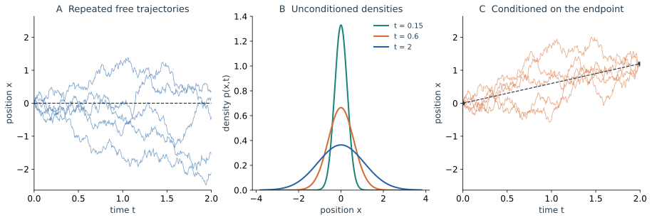

下面先看同一自由 Brownian 动力学的三个统计对象。左侧保留每次实验的时间记录，中间在不同时刻统计所有实验的位置，右侧再加上一个终点条件。

*图｜三幅图均取 $x(0)=0$、$D=0.3$、观察至 $T=2$。左：五条自由轨迹，虚线为零均值。中：同一自由过程在三个时刻的密度 $p(x,t)$，包含所有可能终点。右：额外给定 $x(T)=1.2$ 的 Brownian bridge 样本，虚线为条件平均；路径由 Gaussian 条件化构造，并非左图样本的直接筛选。左右两图采用相同位置范围。* [查看大图](figures/14_brownian_views.svg)

中间的光滑曲线不会告诉我们某一次运动怎样折返；右边固定两端，也没有固定中途的路线。前三篇将依次计算这些对象之间的联系。
