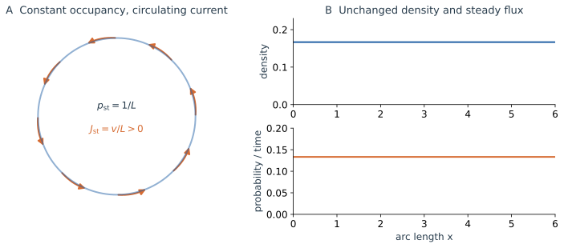

一条自由 Brownian 轨迹反复折返，许多次独立运动却形成规则展宽的概率云。上一节从受力和环境涨落计算了单个粒子的运动；现在我们不再逐条跟随样本，而问：一个区间中的概率在同一段时间里怎样变多或变少？

先把一团粒子集中在空间的一小块区域，让它们向左、向右无偏地运动。没有粒子知道哪边更拥挤，整团分布却会展宽。要理解这件事，跟着某一颗粒子走还不够；需要数清一个界面两侧各有多少概率通过。我们先研究没有噪声时的搬运，再加入随机位移。

## 2.1 从一条轨道转向一团概率分布 {#density-ensemble}

### 单次运动随机，分布为什么可以确定地演化

考虑大量相互独立、具有相同动力学的粒子，初始位置按同一密度 $p_0(x)$ 制备。独立性意味着它们分别采样环境噪声，而不会通过相互作用改变彼此的运动；也可以把它们理解为同一系统的许多次独立实现。这里的粒子群用来表示概率集合，不额外引入粒子间作用。

令 $p(x,t)dx$ 表示时刻 $t$ 位于 $[x,x+dx]$ 的概率。无吸收时，$\int p(x,t)dx=1$。记其中一条随机轨道为 $X_t$，密度也可以写成

$$
p(x,t)=\left\langle\delta(x-X_t)\right\rangle.
$$

这个式子的意思可以通过一个有限区域读取：对区域积分，$\delta(x-X_t)$ 判断该条轨道此时是否位于其中；再取平均，就得到该区域的占据概率。平均同时包含初始条件分布与后续噪声。如果初态固定在 $x_0$，则只对噪声平均，初始密度为 $\delta(x-x_0)$。

单条轨迹在下一步去哪里并不确定，但各个去向的条件概率已经由模型规定。把所有出发位置、所有可能增量按这些概率平均，下一时刻的分布就被确定下来。随机性保留在这份分布内部；平均以后，不必再为“分布的平均演化”额外抽取一次噪声。

例如，若模型规定从一个格点出发，下一步一半向左、一半向右，那么初始全在这里的概率就被确定地分成两半。一次实验只选择其中一边，十次实验也未必恰好各五次；只有重复足够多次，直方图才接近这份确定的分配。后面的演化方程描述后者，有限样本的取样起伏仍然存在。

这里选择的是已经闭合的过阻尼状态 $X_t$。相同位置的下一步统计由当前位置决定，而无需另行知道一个尚未消去的速度。这个前提沿用第一篇的时间尺度近似；位置密度总能定义，并不意味着它总有一条独立闭合的演化方程。

## 2.2 确定性动力学也会输运概率 {#probability-conservation}

### 从概率守恒建立连续性方程

考虑确定性运动

$$
\dot x=b(x).
$$

指定一个初始位置会选定一条轨道；指定一份初始密度，则由流场同时搬运所有初始位置的概率。只要轨道不会在内部被创建或删除，一个区域的概率增加就只能来自边界的净流入。

用 $J(x,t)$ 记向右的净概率流，对固定区间 $[\ell,r]$ 有

$$
\frac d{dt}\int_{\ell}^{r}p(x,t)dx
=J(\ell,t)-J(r,t).
$$

这个收支对任意区间都成立，便得到

$$
\boxed{\frac{\partial p(x,t)}{\partial t}
+\frac{\partial J(x,t)}{\partial x}=0.}
$$

对确定性运动，短时间 $h$ 内通过某个截面的粒子，来自上游宽度约为 $|b(x)|h$ 的区域。该区域的概率约为密度乘以宽度；按方向带上符号，再除以时间，得到 $J_{\mathrm{drift}}(x,t)=b(x)p(x,t)$。因此

$$
\boxed{\frac{\partial p(x,t)}{\partial t}
=-\frac{\partial}{\partial x}\left[b(x)p(x,t)\right].}
$$

这是一维确定性动力学诱导的 Liouville 型输运方程。它不需要微观运动具有随机性，初态中的概率已经足以成为输运对象。对于一般非 Hamiltonian 流，局部体积可以收缩或膨胀；这里使用的是概率守恒的广义输运含义。

### 平移、拉伸与压缩分别意味着什么

若 $b(x)=v_0$ 为常数，所有位置经过相同时间都移动同样距离，于是

$$
p(x,t)=p_0(x-v_0t).
$$

整个概率峰被平移，峰的形状和宽度保持不变。已有的不确定性随流场移动，没有新的位置差异被注入。

若 $b(x)=-\gamma x$，每条轨道满足 $x(t)=x_0e^{-\gamma t}$。初始区间的长度缩短为原来的 $e^{-\gamma t}$ 倍，但该段轨道携带的概率不变，所以密度需要相应增高：

$$
p(x,t)=e^{\gamma t}p_0(xe^{\gamma t}).
$$

对初始均值 $m_0$、方差 $v_0$，有 $m_t=m_0e^{-\gamma t}$、$v_t=v_0e^{-2\gamma t}$。概率向原点聚集，宽度不断收缩。若初态恰好是一点，所有实现此后仍位于同一条确定性轨道上，不会自行分裂出一团新宽度。

更一般地，将输运方程展开为 $\partial_t p+b\partial_xp=-b'p$，便能看出沿轨道的密度变化。$b'\lt0$ 时，相邻轨道会靠近，原有概率被压进更小的空间，密度增大；$b'>0$ 时，相邻轨道分开，密度降低。**确定性动力学可以拉伸已有分布，但拉伸的来源是初始位置差异，不是后来持续注入的随机增量。**

若只有线性回复，所有轨道最终都挤到原点附近，初始概率云可以越来越窄。热环境显然不会让粒子最终全停在同一点；现在看看碰撞产生的随机位移怎样改变这幅图像。

## 2.3 左右无偏的随机游走，怎样产生扩散流 {#random-walk}

设某个界面左边准备了较多粒子，右边只有较少粒子。每个粒子下一步仍以相同概率选择左右，会不会有净输运？要比较的不是一个粒子向哪边的概率，而是两边分别有多少粒子参与选择。

先让粒子每隔 $\tau$ 向左或右跳一步，步长 $a$，两方向概率各为 $1/2$。到达 $x$ 的粒子只能来自两个邻点，密度满足

$$
p(x,t+\tau)=\frac12p(x-a,t)+\frac12p(x+a,t).
$$

对时间展开到一阶，对空间展开到二阶，左右一次导数相消：

$$
\tau\frac{\partial p(x,t)}{\partial t}
=\frac{a^2}{2}\frac{\partial^2p(x,t)}{\partial x^2}
+\text{higher-order terms}.
$$

取 $a,\tau\to0$ 而 $D=a^2/(2\tau)$ 固定，便得到扩散方程。这里二阶项留下来，正是随机步长平方与时间同阶的结果。

再看两个格点之间的界面。若占据概率为 $P_i\simeq a p(x_i,t)$，一个步长内的向右净流为

$$
J_{i+1/2}=\frac{P_i-P_{i+1}}{2\tau}
\longrightarrow-D\frac{\partial p(x,t)}{\partial x}.
$$

例如左格点平均有 100 个粒子、右格点有 20 个，一步里平均有 50 个向右通过界面，10 个向左通过，净值为 40 个向右。两种跳跃率相等，两种通量却不相等。连续极限中，格点占据差变成密度梯度，得到 Fick 定律与概率扩散：

$$
\boxed{J_{\mathrm{diff}}(x,t)=-D\frac{\partial p(x,t)}{\partial x},
\qquad\frac{\partial p(x,t)}{\partial t}
=D\frac{\partial^2p(x,t)}{\partial x^2}.}
$$

若从一点 $x_0$ 出发，第一篇的独立 Gaussian 增量给出

$$
\boxed{G(x,t\mid x_0,0)=\frac1{\sqrt{4\pi Dt}}
\exp\left[-\frac{(x-x_0)^2}{4Dt}\right],\qquad t>0.}
$$

$G$ 是给定初态的转移密度。它的中心保持 $x_0$，方差为 $2Dt$，与轨迹计算一致。密度峰降低并不表示概率消失，整条曲线面积仍为一；同样，即使平均位置不动，各次样本仍在不断离开原点。

连续 Brownian 路径会反复触及同一位置，概率流要通过有限区间的收支或连续性方程理解。它不是无限精细的触碰计数，$J/p$ 也不是每条 Brownian 轨迹的普通瞬时速度。

## 2.4 漂移与扩散共同作用：Fokker–Planck 方程 {#drift-diffusion}

先把两种机制放在同一张图中。相同的初始概率云，在回复漂移下向中心移动并收缩，在纯噪声下保持中心而展宽；两者并存时，中心返回而宽度趋向有限值。什么样的守恒方程能同时描述这些现象？

*图 2a｜三图采用同一个初始高斯分布，均值为 $2$、方差为 $0.04$。只保留 $b=-x$ 时，概率向原点移动并持续收缩；只保留 $D=0.4$ 的扩散时，中心不动而宽度增加；两者结合时，中心返回，宽度接近有限值。各图纵轴标度独立，以看清不同的峰形变化。*

恢复漂移以后，确定性部分以速度 $b(x)$ 搬运概率，随机部分按密度梯度扩散。将两份流相加并代入连续性方程，得到完整形式

$$
\boxed{\begin{aligned}
\frac{\partial p(x,t)}{\partial t}
&=-\frac{\partial}{\partial x}[b(x)p(x,t)]
+D\frac{\partial^2p(x,t)}{\partial x^2},\\
J(x,t)&=b(x)p(x,t)-D\frac{\partial p(x,t)}{\partial x}.
\end{aligned}}
$$

这就是这里的 Fokker–Planck 方程。漂移 $b(x)$ 给出局部搬运的速度，$D$ 决定随机展宽的强度。二阶导数读取相邻截面扩散流的差：密度峰向两侧输出概率，峰顶降低，周围获得补充。整个方程始终是一份概率收支。

对热浴中的过阻尼粒子，$b=\mu F$、$\mu=1/\zeta$。若力来自真实势能 $V(x)$，$F=-V'$，并且热浴满足 Einstein 关系 $D=\mu k_{\mathrm B}T$，还可写成 Smoluchowski 形式

$$
\boxed{\frac{\partial p(x,t)}{\partial t}
=\frac1\zeta\frac{\partial}{\partial x}
\left[V'(x)p(x,t)
+k_{\mathrm B}T\frac{\partial p(x,t)}{\partial x}\right].}
$$

这个形式直接连接了势能、摩擦、温度与概率演化；一般有效模型的漂移和扩散则未必具有这种热浴解释。

### 常漂移：中心移动与扩散宽度可以分开

若 $b(x)=v$ 为常数，换到随漂移运动的坐标 $y=x-vt$，方程就化为纯扩散。将自由核平移回来，得到

$$
G(x,t\mid x_0,0)=\frac1{\sqrt{4\pi Dt}}
\exp\left[-\frac{(x-x_0-vt)^2}{4Dt}\right].
$$

因此中心为 $x_0+vt$，标准差为 $\sqrt{2Dt}$。漂移决定概率云整体向哪里去，噪声决定围绕中心分散多宽。这个简单分离还会在下一篇解释罕见终点的代价。

状态依赖噪声需要改变扩散流，不能只将常数 $D$ 替换成一个函数；准确的 Itô/Stratonovich 约定和一般密度方程见[第四篇](/notes/nonequilibrium_statistical_physics/stochastic_dynamics/stochastic_processes/#ito-calculus)。

## 2.5 OU：概率云怎样形成有限宽度的稳态 {#ou-density}

### 中心移动与宽度变化是两种演化

取 $b=-\gamma x$，把确定性的线性收缩与加性扩散放到同一个模型中：

$$
\partial_t p=\gamma\partial_x(xp)+D\partial_x^2p.
$$

对两端衰减足够快的密度，将方程分别乘以 $x$、$x^2$ 再积分。分部积分消去边界项，得到

$$
\frac d{dt}\langle X\rangle=-\gamma\langle X\rangle,
\qquad
\frac d{dt}\langle X^2\rangle=-2\gamma\langle X^2\rangle+2D.
$$

这里可以看清两个系数从何而来。扩散项对一阶矩的贡献为 $D\int x\,p_{xx}dx=0$，所以无偏噪声不移动中心；对二阶矩则有 $D\int x^2p_{xx}dx=2D\int p\,dx=2D$，平方位移不会被左右对称抵消。从二阶矩减去均值平方，记中心为 $m$、方差为 $v$，得到

$$
\dot m=-\gamma m,\qquad \dot v=-2\gamma v+2D.
$$

想象先关掉噪声：相对于中心的每个偏离都按 $e^{-\gamma t}$ 缩小，偏离平方便按 $e^{-2\gamma t}$ 缩小，所以方差损失率中有一个 2。再打开噪声，每一小段又增加 $2Ddt$ 的方差。这份收支可以让宽度增加，也可以让它减小，取决于初始概率云有多宽；“一直受噪声驱动”并不意味着“一直展宽”。

对初态 $p(x,0)=\delta(x-x_0)$，$t>0$ 的精确解为

$$
G(x,t\mid x_0,0)=\frac1{\sqrt{2\pi\sigma_t^2}}
\exp\left[-\frac{(x-m_t)^2}{2\sigma_t^2}\right],
$$

$$
m_t=x_0e^{-\gamma t},\qquad
\sigma_t^2=\frac D\gamma(1-e^{-2\gamma t}).
$$

点初态的宽度为零，因此它只能从窄的一侧接近稳态。下面的滑块显示这个特例。先看中心离原点还有多远，再看曲线宽度是否已接近稳态虚线；两个变化并不以同一速率完成。

  
<strong>OU 过程中概率云的演化</strong>γt = 1.75

  
当前概率云其他时刻稳态

  <svg viewBox="0 0 700 310" role="img" aria-label="OU 概率分布随时间移动和展宽；拖动下方滑块可更新曲线" data-ou-plot></svg>
  <label class="ou-cloud-control">无量纲时间 γt<input type="range" min="0" max="4" step="0.05" value="1.75" aria-label="OU 无量纲时间 γt" data-ou-slider></label>
  
均值：0.434 ℓ方差：0.970 ℓ²

  
初始位置为 2.5ℓ。拖动时间，观察分布中心返回原点、宽度接近稳态；ℓ = √(D/γ)。

图中选择自然长度 $\ell=\sqrt{D/\gamma}$、无量纲时间 $\tau=\gamma t$，初态固定在 $2.5\ell$。$t=0$ 时用箭头表示 $\delta$ 初态，它没有普通的有限峰高；任意正时间后才出现连续高斯密度。灰色曲线保留几个时刻的参考形状，便于同时比较中心移动和宽度变化。

到 $\gamma t=1$ 时，中心仍保留初始偏移的约 $37\%$，方差却已达到稳态值的约 $86\%$。宽度看起来已经接近最终形状，并不保证分布已经居中。峰降低时向两侧增加的面积补回了峰附近减少的面积，归一化始终保持。

### 概率流怎样同时表示平移与变宽

初始分布若为一般高斯 $\mathcal N(m_0,v_0)$，OU 演化仍为高斯，且

$$
m(t)=m_0e^{-\gamma t},\qquad
v(t)=v_0e^{-2\gamma t}+\frac D\gamma(1-e^{-2\gamma t}).
$$

现在可以做一次参数突变实验。先让系统在噪声 $D_0$ 下达到稳态，再于 $t=0$ 将噪声改为 $D_1$，保持 $\gamma$ 不变。此时 $v_0=D_0/\gamma$，上式变为 $v(t)=D_1/\gamma+(D_0-D_1)e^{-2\gamma t}/\gamma$。若 $D_1>D_0$，概率云展宽；若 $D_1\lt D_0$，它收窄。即使中心一直在零点，系统仍有这段弛豫过程。物理热浴中固定摩擦而改变温度，就是这类实验。

将高斯导数 $p_x=-(x-m)p/v$ 代入概率流，有

$$
\frac Jp=-\gamma x+\frac Dv(x-m)
=\dot m+\frac{\dot v}{2v}(x-m).
$$

若 $m$ 在变而 $v$ 已固定，$J/p=\dot m$ 在各处相同，整团高斯只平移；若 $m=0$、$\dot v>0$，净流在两侧分别朝外；$\dot v\lt0$ 时则朝内。这是用概率流读出形状变化的方法，不能把 $J/p$ 当成每条粗糙随机轨道的瞬时速度。下图取居中的窄初态，专门观察宽度变化，并把向内的漂移流与向外的扩散流画开。

*图 2b｜$\gamma=1,D=0.4$，从零均值、方差 $0.04$ 的窄高斯分布出发。左图显示密度展宽；右图分解早期的漂移流、扩散流与净流。右半轴上向外扩散较强，推动概率向外重新分配；接近稳态后，两项流逐点相消。*

对于任意初始分布，有限时间内未必保持高斯。OU 的精确轨道表达说明，$X_t$ 是缩放后的初始变量 $e^{-\gamma t}X_0$ 与一个独立高斯增量之和。旧的初态形状因缩放而逐渐失去影响，噪声产生的高斯部分逐渐主导。固定点初态和高斯初态只是这条一般传播规律的两种可显式计算的情况。

图 2b 的早期分布以零均值、窄于稳态的 Gaussian 为初态。此时各位置的流方向可直接读成箭头：

| 概率流 | 左半轴 $x<0$ | 右半轴 $x>0$ |
| --- | --- | --- |
| 回复漂移流 | $\rightarrow$ 朝中心 | $\leftarrow$ 朝中心 |
| 扩散流 | $\leftarrow$ 离开中心 | $\rightarrow$ 离开中心 |
| 当前净流（窄于稳态） | $\leftarrow$ | $\rightarrow$ |

宽度达到 $D/\gamma$ 后，两项流逐点相消。稳态密度为

$$
\boxed{p_{\mathrm{st}}(x)=\sqrt{\frac\gamma{2\pi D}}
\exp\left[-\frac{\gamma x^2}{2D}\right].}
$$

在这份高斯密度中，$p_x=-(\gamma x/D)p$，所以 $-Dp_x=\gamma xp$ 恰好抵消 $-\gamma xp$。这里每个位置的**净**流为零，并非每个方向都没有粒子通过：热粒子仍来回移动，统计上两个方向的通量相抵。离开稳态、例如突然升温以后，这种逐点抵消被打破，才会有改变宽度的净流。

## 2.6 分布不再变化，概率还可以持续流动吗 {#stationary-current}

先看受限热平衡系统。反射边界要求净流为零，稳态的一维常数流因此处处为零。对 $b=-\mu V'$、$D=\mu k_{\mathrm B}T$，零流方程为

$$
-\mu V'(x)p_{\mathrm{eq}}(x)
-D\frac{dp_{\mathrm{eq}}(x)}{dx}=0,
\qquad
p_{\mathrm{eq}}(x)=Z^{-1}e^{-V(x)/(k_{\mathrm B}T)}.
$$

归一化要求势能和边界足以限制粒子。这时零净流来自漂移与扩散的局部平衡，不意味着粒子停止接受热扰动。

稳态本身只要求流的散度为零。在一维，$\partial_xJ_{\mathrm{ss}}=0$ 意味着流是常数；封闭区间的反射边界再将常数限定为零，但周期状态空间允许非零流。例如长度为 $L$ 的圆环上，

$$
dX_t=vdt+\sqrt{2D}\,dW_t\pmod L,
\qquad p_{\mathrm{ss}}=\frac1L,\qquad
J_{\mathrm{ss}}=\frac{v}L.
$$

每段圆弧的流出由上游流入补充，分布均匀而概率持续循环。把驱动方向反转，均匀分布保持不变，流却改变方向；关掉驱动，同样可以得到均匀分布，净流则为零。因而仅凭稳态占据不能确定动力学中的输运方向。在多维空间，稳态条件相应为 $\nabla\cdot\boldsymbol J=0$，也可以存在无散度的环流。

### 零流与详细平衡说明了什么

对这里仅含位置的过阻尼扩散，详细平衡要求平衡系综中两个区域之间正、反向转移的统计权重相配：不仅每个区域的占据不再改变，运动记录也不带持续的方向偏好。在适当的封闭边界和正则条件下，这与稳态概率流处处为零相联系。热浴中的 OU 属于这种情形。

圆环上有恒定驱动时，顺驱动方向的转移与反向转移不再相配，粒子持续绕行，所以即使密度均匀，也不满足这种详细平衡。密度不变只检查每块区域的收支是否相抵；详细平衡还约束正反运动之间的对应，因而是更强的要求。

这里的零流判据针对位置型、时间反演下为偶的状态变量。保留惯性时，时间反演还必须反转速度；平衡相空间中仍有位置方向的运动，不能仅凭 $J_x=v\rho$ 非零就判断系统处于非平衡稳态。

下图把这份区别画出来：沿圆周追踪箭头，可以看到每一小段都有概率通过；把密度按弧长展开，又找不到任何随位置增减的峰。

*图 2c｜取周长 $L=6$、漂移速度 $v=0.8$、$D=0.4$。左图的箭头标出稳态净流的循环方向；右图显示以弧长为坐标时密度 $1/L$ 与流 $v/L$ 均为空间常数，使用不同纵轴以区分量纲。密度的流入与流出相抵，仍允许概率持续绕圈。*

若只保存这段实验的位置直方图，便会丢掉驱动方向的信息。需要保留时间顺序，或统计绕圈的净次数，才能区分 $v=0$ 与 $v\ne0$。第三篇将用同一个圆环比较顺向、逆向历史的权重。

## 2.7 边界条件怎样改变同一内部运动 {#boundaries}

同一组漂移和扩散，在反射端被留在系统内，在吸收端则第一次碰到目标后退出。对普通非退化位置扩散，反射条件是 $J=0$，吸收端通常是 $p=0$；这不是方程之外无关紧要的选择，而是定义了不同实验。

例如 $[0,L]$ 上双端吸收的自由扩散，内部密度不再保持总质量为一。它的积分是尚未碰到任一端的存活概率：

$$
S(t)=\int_0^L p(x,t)dx,\qquad
f_\tau(t)=-\frac{dS(t)}{dt}=J(L,t)-J(0,t).
$$

右端流出向右，左端流出向左，所以总流出是二者之差。$f_\tau$ 记录第一次碰边界的时间；“时刻 $t$ 在哪里”不能区分先前曾碰到边界又返回的历史，必须同时规定到达即停止。

### 一个直接算出的平均退出时间

固定起点 $x$，令 $T(x)$ 为第一次碰到任一端的平均时间。从内部点先走一小步 $h$，已经花掉 $h$，此后还需平均 $T(X_h)$。自由扩散增量满足 $\mathbb E\Delta X=0$、$\mathbb E(\Delta X)^2=2Dh$，故 Taylor 展开给出

$$
T(x)=h+T(x)+DhT''(x)+o(h).
$$

于是 $DT''(x)=-1$，两端已到目标，所以 $T(0)=T(L)=0$。积分两次即得

$$
\boxed{T(x)=\frac{x(L-x)}{2D}.}
$$

越靠近边界，等待越短；从中点出发平均为 $L^2/(8D)$。将整个区间放大一倍，退出时间增加为四倍；将 $D$ 增大一倍，退出时间减半。这正是扩散探索一个给定距离所需的时间尺度。上面的短时递推没有求完整密度，却直接算出了事件平均；更一般的受力、单端目标和罕见等待放在[首次到达选读](/notes/nonequilibrium_statistical_physics/stochastic_dynamics/markov_generators/)。

## 2.8 传播核：从单时刻分布走向整条历史 {#propagators}

### 把任意初态分解成点初态

前面 OU 的 $G(x,t\mid x_0,0)$ 固定了一个起点，回答的是“从这里出发，后来到达各处的概率是多少”。将一般过程的这类条件密度记为传播核

$$
G(x,t\mid x_0,0),\qquad
G(x,0\mid x_0,0)=\delta(x-x_0).
$$

它作为终点 $x$ 和时长 $t$ 的函数，满足同一个 Fokker–Planck 方程及相应边界条件。对守恒过程，$\int G(x,t\mid x_0,0)dx=1$；对吸收过程，该积分则给出从 $x_0$ 出发到时刻 $t$ 仍存活的概率。

任意初始分布都可看成许多点初态的加权组合。Fokker–Planck 方程对密度是线性的，因此每个初始点贡献的传播结果可以相加：

$$
\boxed{p(x,t)=\int dx_0\,
G(x,t\mid x_0,0)p_0(x_0).}
$$

这里没有要求轨道动力学对 $x$ 是线性的。即使 $b(x)$ 非线性，只要粒子独立、漂移与扩散系数不由密度反馈决定，给定过程的密度演化仍然线性。它表达的是不同初始样本的概率可以直接混合。

对 OU，这个积分就是“先把初始分布按 $e^{-\gamma t}$ 缩放，再与噪声产生的高斯核卷积”。因此传播核同时解释了任意初态的演化与前面高斯特例的来由。

### 在中间时刻接上两段传播

对于正确状态空间上的 Markov 过程，可以把从 $0$ 到 $t$ 的传播在中间时刻 $s$ 拆开。先到达所有可能的中间位置 $y$，再从每个 $y$ 继续演化，将中间位置积分掉：

$$
\boxed{G(x,t\mid x_0,0)
=\int dy\,G(x,t\mid y,s)G(y,s\mid x_0,0),
\qquad 0\lt s\lt t.}
$$

这就是 Chapman–Kolmogorov 关系。它说明有限时间的概率传播可以由连续的条件传播连接起来。若尚未消去速度，单独的位置不具备所需闭合性，应当在 $(x,v)$ 上连接传播核；前面对状态空间的选择在这里仍然重要。

### 保留中间位置，就得到多时刻概率

上式把中间位置积分掉，得到了单一终点的分布；若暂时保留它，就已经在研究两个时刻的联合统计。继续保留更多时刻的位置，得到

$$
p(x_0,\ldots,x_N)
=p_0(x_0)\prod_{i=0}^{N-1}
G(x_{i+1},t_{i+1}\mid x_i,t_i),
\qquad t_0=0.
$$

每一步都只使用给定当前状态的条件传播。对任意未观测的中间位置积分，便恢复相应的边缘分布；保留中间位置或对它们加上约束，则能比较不同运动历史。时间分割越来越细时，这套构造自然通向下一篇的路径概率和路径积分。

一份单时刻密度告诉我们当时的占据，却不单独标记此前的最大偏离或沿途停留时间。给定完整转移核的 Markov 过程可以重建多时刻统计；下一篇保留这些中间位置，改变表示与计算对象，研究整条历史的权重。

## 选读附录：惯性粒子的相空间 Kramers 方程 {#kramers-equation}

如果速度尚未快速弛豫，同样的概率守恒应当应用到完整状态 $(X_t,v_t)$。位置相同而速度不同，短时未来仍然不同。定义相空间密度 $\rho(x,v,t)=\langle\delta(x-X_t)\delta(v-v_t)\rangle$，位置密度只是它的边缘 $p(x,t)=\int\rho(x,v,t)dv$。令确定性力为 $F(x)=-V'(x)$，采用相同的常数摩擦系数 $\zeta$ 与平衡热浴：

$$
dX_t=v_tdt,\qquad
dv_t=\left[\frac{F(X_t)}m-\frac\zeta m v_t\right]dt
+\sqrt{2D_v}\,dW_t,
\qquad D_v=\frac{\zeta k_{\mathrm B}T}{m^2}.
$$

在相空间里，速度把概率沿位置方向搬运，确定性力与阻尼把概率沿速度方向搬运。噪声直接作用于速度，因此随机展宽首先发生在速度方向。相应的两分量概率流为

$$
J_x=v\rho,\qquad
J_v=\left(\frac{F(x)}m-\frac\zeta m v\right)\rho
-D_v\partial_v\rho.
$$

将它们放进相空间连续性方程，得到

$$
\boxed{
\partial_t\rho=-\partial_x(v\rho)
-\partial_v\left[\left(\frac{F(x)}m-\frac\zeta m v\right)\rho\right]
+D_v\partial_v^2\rho.}
$$

这就是 Kramers 方程，也是完整状态 $(x,v)$ 上的 Fokker–Planck 方程。它清楚地区分了空间搬运和速度扩散：没有直接的 $\partial_x^2\rho$ 项，位置仍会因随机速度的累积而分散。

若对速度积分，并假设速度方向边界流在无穷远消失，只得到

$$
\partial_t p=-\partial_x\left(\int v\rho(x,v,t)dv\right).
$$

括号里是按位置分辨的速度一阶矩，等于 $p(x,t)\mathbb E[v_t\mid X_t=x]$；其中的条件平均速度不能只凭位置密度 $p$ 推出。因此，“对速度积分”本身不会自动给出封闭的位置扩散方程。进一步使用速度弛豫比位置演化快的过阻尼近似，才得到上一节的位置过程

$$
dX_t=b(X_t)dt+\sqrt{2D}\,dW_t,
\qquad b=F/\zeta,\qquad D=k_{\mathrm B}T/\zeta.
$$

这就回到了本篇前面使用的闭合位置过程，也说明为什么必须先说明过阻尼近似，不能直接将速度积分等同于消去惯性。Kramers 方程与过阻尼约化的系统联系可参见 [Tong 的随机过程讲义](https://www.damtp.cam.ac.uk/user/tong/kintheory/three.pdf)。这里的 $D_v$ 是速度平方／时间，$D$ 是位置平方／时间，两者不应混用。

选读：[随机过程与 Itô 微积分](/notes/nonequilibrium_statistical_physics/stochastic_dynamics/stochastic_processes/#ito-calculus)。

选读：[双稳亚稳态与概率交换](/notes/nonequilibrium_statistical_physics/stochastic_dynamics/rare_events/#bistability)。

**上一篇：**[Langevin Dynamics](/notes/nonequilibrium_statistical_physics/stochastic_dynamics/langevin/) · **下一篇：**[Path Integrals：从终点分布到随机历史](/notes/nonequilibrium_statistical_physics/stochastic_dynamics/path_integrals/)。
