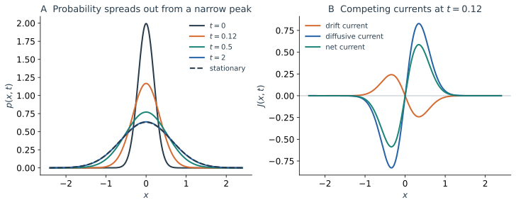

在同一势场中释放很多粒子，单条轨道不断抖动，粒子群的分布却以确定的方式演化。分布的峰可能移动，宽度可能增加，也可能先在一个势阱附近迅速稳定，再以很慢的速度向另一个势阱转移。

Fokker–Planck 描述关心的是这种概率输运。它让我们直接计算“多少概率从一个区域进入另一个区域”，把轨迹中的漂移和噪声分别变成概率流的不同部分。边界条件、稳态流与多个弛豫时间尺度，都可以从这个角度理解。

## 2.1 从随机增量到概率密度演化

考虑一维 Itô 过程

$$
dX_t=b(X_t)dt+\sigma(X_t)dW_t,
\qquad a(x)=\frac12\sigma^2(x).
$$

对光滑测试函数 $f$，Itô 公式给出

$$
\frac d{dt}\mathbb E[f(X_t)]
=\mathbb E[b(X_t)f'(X_t)+a(X_t)f''(X_t)].
$$

若 $X_t$ 有概率密度 $p(x,t)$，左边是 $\int f\partial_t p\,dx$。右边分别分部积分一次和两次，在边界项消失或匹配给定边界条件时，得到

$$
\int f\partial_t p\,dx
=\int f\left[-\partial_x(bp)+\partial_x^2(ap)\right]dx.
$$

因为等式对一组足够丰富的 $f$ 成立，密度满足

$$
\boxed{\partial_t p=-\partial_x[b(x)p]+\partial_x^2[a(x)p].}
$$

它可以写成连续性方程

$$
\boxed{\partial_t p=-\partial_xJ,\qquad
J=bp-\partial_x(ap).}
$$

当 $a=D$ 为常数时，$J=bp-D\partial_xp$。乘性噪声情形必须保留整个 $\partial_x(ap)$；漏掉 $a'p$ 就会改变分布和稳态。若从 Stratonovich 方程出发，要先转换到同一 Itô 漂移，再使用这个表达式。

## 2.2 概率流对应怎样的运动

对区间 $[\ell,r]$ 积分，

$$
\frac d{dt}\Pr(\ell\lt X_t\lt r)=J(\ell,t)-J(r,t).
$$

$J$ 是穿过某个位置截面的净概率输运率。它把大量样本中两个方向的穿越合并后，记录其净差；对连续扩散，不能把 $J/p$ 理解为每条 Brownian 轨道的瞬时速度，因为后者并不存在。

漂移流 $bp$ 随局部确定性速度移动概率；扩散流 $-D p_x$ 则沿概率密度下降方向输运。扩散所读取的是分布梯度，而不是势能梯度。即使没有外力，只要初始分布不均匀，也会有扩散流。

对梯度漂移 $b=-U'$，

$$
J=-U'p-Dp_x.
$$

若概率比稳态更集中在阱底，扩散把它向外推，回复漂移把它向内拉；若分布已经过宽，回复作用可以占上风。分布展宽或收缩，由两项在当前位置的竞争决定。

### 边界规定了概率能否离开

在有限区间内，反射边界要求 $J=0$，把概率保持在系统内部；吸收边界对于普通非退化扩散通常取 $p=0$，允许概率流出；周期边界把两端的密度和流接起来。在无穷空间则需要密度可积，并具有与物理问题相容的无穷远条件。

吸收问题中，内部总概率

$$
S(t)=\int_{\ell}^{r}p(x,t)dx
$$

是尚未退出的存活概率，满足 $S'(t)=J(\ell,t)-J(r,t)$。首退时间的密度为 $-S'(t)$。因此同一条概率连续性方程，既可以描述封闭系统的弛豫，也可以把边界流变成事件发生的时间分布。

## 2.3 OU：分布怎样建立有限的宽度

令 $b=-\gamma x$，则

$$
\partial_t p=\gamma\partial_x(xp)+D\partial_x^2p.
$$

对于初始高斯分布 $\mathcal N(m_0,v_0)$，它在演化中保持高斯。把

$$
p(x,t)=\frac{1}{\sqrt{2\pi v(t)}}
\exp\left[-\frac{(x-m(t))^2}{2v(t)}\right]
$$

代入方程、比较 $(x-m)$ 的不同次幂，得到

$$
\dot m=-\gamma m,\qquad \dot v=-2\gamma v+2D.
$$

这里重新得到上一篇的矩方程，但概率流还可以说明分布内部发生了什么。高斯分布满足 $p_x=-(x-m)p/v$，所以

$$
\frac Jp=-\gamma x+\frac Dv(x-m)
=\dot m+\frac{\dot v}{2v}(x-m).
$$

第一项整体平移分布中心；第二项使分布相对于中心展宽或收缩。若 $m=0$ 且 $v\lt D/\gamma$，$J/p$ 在右侧为正、左侧为负，概率向两侧流；若 $v>D/\gamma$，方向反转。

稳态时

$$
p_{\mathrm{ss}}(x)=\sqrt{\frac{\gamma}{2\pi D}}
e^{-\gamma x^2/(2D)},\qquad J_{\mathrm{ss}}=0.
$$

漂移流和扩散流分别不为零，二者逐点相消。零净流并不表示粒子不再运动；它表示概率占据不再因两个方向的输运而改变。

*图 2｜$\gamma=1,D=0.4$，从零均值、方差 $0.04$ 的窄高斯分布出发。左图显示密度向稳态展宽；右图显示早期漂移流向内、扩散流向外，净流推动分布展宽。所有曲线由高斯精确解计算。*

任意初始分布不必在有限时间变成高斯。OU 的精确表示说明，它等于缩放后的初始随机变量与一个独立高斯变量之和；在稳定性和相应收敛条件下，初始影响逐渐消失，才趋向上述高斯稳态。保持高斯的封闭计算需要初始分布本来就是高斯。

## 2.4 零流稳态、详细平衡与持续输运

在一维封闭区间内，稳态要求 $\partial_xJ_{\mathrm{ss}}=0$。反射边界再把这个常数限定为零。常数 $D$、梯度漂移的零流条件给出

$$
-U'p_{\mathrm{ss}}-Dp_{\mathrm{ss}}'=0,
\qquad
p_{\mathrm{ss}}=Z^{-1}e^{-U/D}.
$$

这个结果要求 $Z=\int e^{-U/D}dx$ 有限。比如无穷直线上的自由扩散没有可归一化的均匀稳态；形式上求到一个常数，并不等于找到了稳态概率分布。

在这里的过阻尼位置变量和适当边界条件下，零流梯度扩散满足详细平衡：

$$
p_{\mathrm{ss}}(x)P_t(y\mid x)
=p_{\mathrm{ss}}(y)P_t(x\mid y).
$$

从平衡集合中选取两端点，在任意给定时间间隔内，正向和反向的联合转移权重相同。下一篇对爬坡路径与下坡弛豫的比较，会使用这一可逆结构。

### 稳态为什么仍然可以有流

考虑长度为 $L$ 的圆环，坐标按 $x\bmod L$ 识别，粒子受恒定驱动：

$$
dX_t=v\,dt+\sqrt{2D}\,dW_t\pmod L.
$$

周期边界允许

$$
p_{\mathrm{ss}}=\frac1L,\qquad J_{\mathrm{ss}}=\frac vL.
$$

分布已经均匀，概率仍持续绕环流动。稳态条件约束的是流的散度为零；在圆环上，概率可以循环而不积累。在高维空间也可以存在闭合环流。因此“稳态”只表示单时刻分布不变，不能单独证明过程可逆。相同直方图还可能对应不同驱动和不同时间统计。

## 2.5 双稳扩散：局部弛豫与全局弛豫为什么分开

选择无量纲势

$$
U(x)=\frac14(x^2-1)^2,
\qquad b(x)=x-x^3.
$$

$x=\pm1$ 为稳定点，$x=0$ 为不稳定点。$U(\pm1)=0$、$U(0)=1/4$。在左阱附近写 $x=-1+y$，则 $b(-1+y)=-2y+O(y^2)$，局部过程近似

$$
dy=-2y\,dt+\sqrt{2D}\,dW,
\qquad \tau_{\mathrm{local}}\sim\frac12,
\qquad \operatorname{Var}_{\mathrm{local}}y\simeq\frac D2.
$$

当 $D\ll\Delta U=1/4$ 时，典型涨落远小于两阱间距，多数轨道在一个阱内停留很久。它们可以在 $O(1)$ 的时间内忘掉阱内初始位置，却仍然记得自己属于哪个阱。跨越势垒需要罕见涨落，平均等待时间具有 $e^{\Delta U/D}$ 的指数尺度；指数来源将在第三篇由路径代价推导，前因子将在第四篇由首达方程计算。[Berglund 的 Kramers 综述](https://arxiv.org/abs/1106.5799)说明了这种尺度分离以及势垒近似所需的非退化条件。

*图 3｜$D=0.07$，初始密度集中在左阱的 $x=-0.55$ 附近。上图为势函数；中图显示概率先移向左阱底并建立局域宽度，再逐渐分配到右阱；下图比较左右阱占据随时间的变化。数值演化使用保持概率和离散详细平衡的空间离散，并在生成脚本中检查网格收敛。*

### 局域稳态仍然携带缓慢变化的权重

在阱内已经弛豫、阱间仍未充分交换的时间窗口，可以近似写成

$$
p(x,t)\simeq w_L(t)\rho_L(x)+w_R(t)\rho_R(x),
\qquad w_L+w_R=1.
$$

$\rho_L,\rho_R$ 是各阱内归一化的近似局域平衡形状，近阱底为高斯，更一般地与限制在各阱的 $e^{-U/D}$ 对应。它们在势垒附近的拼接不能简单忽略，但阱内主要形状可以比权重变化快得多地建立。

以势垒位置分界，$w_L(t)=\int_{-\infty}^0p(x,t)dx$，精确收支为

$$
\dot w_L=-J(0,t),\qquad \dot w_R=J(0,t).
$$

在清楚的亚稳态尺度分离下，这个小流可进一步近似为两个稀有转移的差：

$$
J(0,t)\simeq k_{LR}w_L-k_{RL}w_R.
$$

于是

$$
\dot w_L=-k_{LR}w_L+k_{RL}w_R.
$$

对称势中 $k_{LR}=k_{RL}=k$，从左阱出发，

$$
w_L(t)\simeq\frac12(1+e^{-2kt}),\qquad
w_R(t)\simeq\frac12(1-e^{-2kt}).
$$

一次成功转移的平均等待约为 $1/k$，占据偏离平衡的弛豫时间则为 $1/(2k)$。后者同时受到两个方向的转移影响，因此二者相差一个因子 $2$。阱内分布很快接近固定形状时，缓慢的权重变化仍然保存了长时间记忆。

### 稳态权重还受到阱宽影响

若势不对称，弱噪声下第 $i$ 个非退化极小值 $x_i$ 周围的稳态质量近似为

$$
w_i^{\mathrm{ss}}\propto
\sqrt{\frac{2\pi D}{U''(x_i)}}e^{-U(x_i)/D}.
$$

指数偏向更深的阱，前因子反映阱底可占据区域的宽度。稳态质量和离开速率是不同量：前者由各区域的统计权重决定，后者还依赖连接它们的势垒。对于两态可逆近似，二者通过 $k_{LR}w_L^{\mathrm{ss}}=k_{RL}w_R^{\mathrm{ss}}$ 联系。

## 2.6 概率密度能告诉我们什么，又留下了什么问题

给定完整的转移核和 Markov 性，可以恢复多时刻统计；但只看某个初始准备对应的 $p(x,t)$ 或稳态分布，通常不能直接看出轨迹怎样完成一次特定事件。两个端点之间可能有大量历史，某些历史沿确定性方向运动，另一些必须长期由噪声支撑。

双稳扩散把这个区别具体化了。概率流告诉我们左右阱的交换速率；若要求“在已经发生跨阱的轨迹中，爬坡阶段通常怎样走”，则需要对整条历史赋予概率。下一篇就从这个问题建立路径表示。

**上一篇：**[Langevin Dynamics](/notes/nonequilibrium_statistical_physics/stochastic_dynamics/langevin/) · **下一篇：**[Path Probabilities and Path Integrals](/notes/nonequilibrium_statistical_physics/stochastic_dynamics/path_integrals/)。
