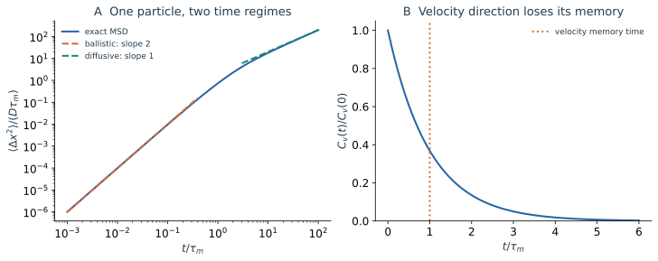
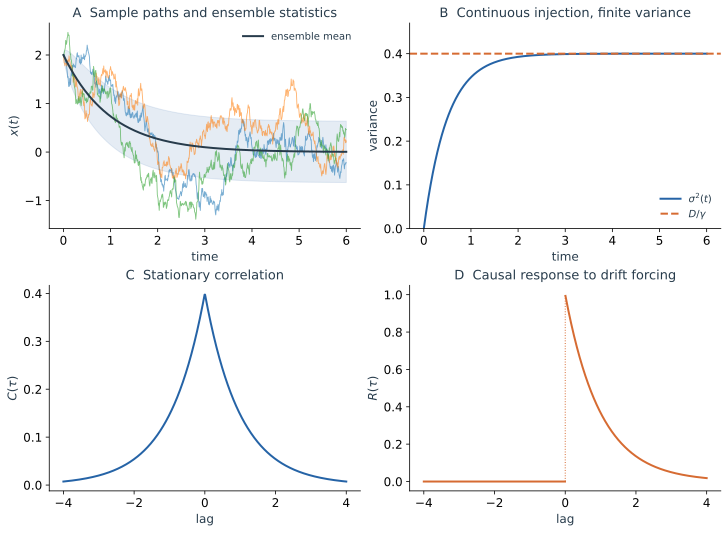

在统计物理中，我们通常不需要追踪系统的全部微观自由度，在非平衡统计物理中我们将延续这个想法。我们真正关心的往往只是其中一小部分，例如粒子的位置和速度、局部密度变化，或某些集体行为等。但这些变量并不是孤立演化的，它们始终受到其余大量自由度的影响。即使完整系统遵循确定性的微观动力学，仅凭我们所关心变量的当前状态，通常也不足以确定它们未来的运动，因为那些未被显式描述的自由度仍然参与着系统的演化。如何在不追踪全部微观细节的情况下，建立少数变量的有效动力学，是统计物理中的一个基本问题。

一种自然的思路是将未解析自由度的影响进行统计处理。环境的作用往往包含相对稳定、可以重复的平均部分，也包含因微观状态不同而产生的涨落。例如，流体会对运动的粒子产生阻力，同时又不断通过分子碰撞向它传递动量。但仅仅区分平均作用与涨落还不够：这些涨落有多强？不同时刻的扰动是否相关？环境对粒子过去运动的影响能够持续多久？在什么条件下，复杂的环境作用可以近似为简单的阻尼和随机力？这些都是建立有效描述时需要回答的物理问题。

随机动力学为研究这类问题提供了一种方法。我们不再试图仅凭少数变量预测唯一的运动轨迹，而是描述它们可能经历的不同运动，以及这些运动所服从的统计规律。虽然单次运动可能难以预测，但大量轨迹的统计性质，例如关联函数、弛豫时间和扩散系数，却可以具有明确而可重复的规律。

本篇将从最经典的 Brownian 运动出发，以流体中的微粒为例，考察如何从牛顿方程得到 Langevin 方程。我们将看到，环境引起的阻尼与涨落并不是彼此无关的两种作用；它们共同决定粒子的热运动，并使粒子从短时间的弹道运动逐渐过渡到长时间的扩散。

## 1.1 牛顿方程、未解析环境与记忆 {#bath-memory}

### 从完整受力开始

设关注的粒子质量为 $m$，位置记为 $x(t)$，环境坐标统记为 $\boldsymbol q(t)=(q_1(t),\ldots,q_N(t))$。外力 $F(x)=-V'(x)$ 来自外部势能，粒子还与环境相互作用：

$$
m\ddot x(t)=-V'(x(t))
+F_{\mathrm{bath}}(x(t),\boldsymbol q(t),\dot{\boldsymbol q}(t)).
$$

环境本身也满足动力学方程，例如

$$
m_i\ddot q_i(t)=F_i(x(t),\boldsymbol q(t)),\qquad i=1,\ldots,N.
$$

到这里没有任何随机项。给定全部位置、速度及相互作用后，目标粒子和环境共同构成一个确定性系统。但第一条方程还不是只关于 $x(t)$ 的封闭方程：不知道环境当前处于什么状态，就不知道它此刻施加多大的力。

### 为什么不能只用平均环境力

缓慢拖动粒子时，液体平均会产生反向阻力。即使不拖动，来自不同方向的碰撞仍会使粒子加速；正、负冲量在平均里抵消，在动量平方中却都留下正贡献。只用平均阻力，最终会把粒子减速到静止，漏掉热运动本身。

因此我们保留环境的两种作用：可重复的平均反作用，以及每次准备环境时不同的剩余力。对各向同性液体中的慢运动，平均阻力的最低阶是 $-\zeta\dot x(t)$；把平衡环境造成的保守平均力吸收到 $V$ 中，便有熟悉的受力形式

$$
m\ddot x(t)=-V'(x(t))-\zeta\dot x(t)+\eta(t).
$$

其中 $\eta$ 来自未被记录的分子运动。给出全部环境初态时，这份力仍可由确定性动力学决定；对不同环境初态作统计描述时，才把它作为随机过程处理。接下来还需给出这份力的统计：它有多强？两次冲量会相关多久？

这里先讨论环境关联时间 $\tau_{\mathrm{bath}}$ 很短的情形。在比它长、又比粒子状态显著变化的时间短的窗口里，许多弱碰撞合成近似独立的 Gaussian 冲量。这需要环境充分混合且冲量方差有限；若有慢环境模式，就要保留有色噪声甚至记忆力。相应的广义 Langevin 方程及近似条件放在[篇末选读](#消去环境以后为什么还留下过去的影响)。先用短记忆模型做两个计算：确定热噪声强度，再跟踪速度记忆如何变成位置扩散。

## 1.2 阻尼和随机力怎样共同决定热速度 {#thermal-noise}

先不预设随机力有多强。将短记忆近似放回受力式，写成

$$
m\ddot x(t)=-\zeta\dot x(t)-V'(x(t))+\eta(t),
\qquad \langle\eta(t)\rangle=0,
\qquad \langle\eta(t)\eta(s)\rangle=A\delta(t-s).
$$

$A$ 的单位是力平方乘时间。白噪声通过冲量才有意义：$\langle[\int_t^{t+h}\eta(s)ds]^2\rangle=Ah$；$\eta(t)$ 没有普通的有限逐点方差。随机冲量的典型大小按 $\sqrt h$ 增长，与固定外力的冲量按 $h$ 增长不同。

撤去外势，令 $v(t)=\dot x(t)$、$\tau_m=m/\zeta$。先乘积分因子再积分，得到

$$
v(t)=v(0)e^{-t/\tau_m}
+\frac1m\int_0^t e^{-(t-s)/\tau_m}\eta(s)ds.
$$

初速度与未来噪声独立时，初始方差和后来随机力的贡献相加。使用 Delta 关联计算双重积分，

$$
\begin{aligned}
\operatorname{Var}(v(t))
&=\operatorname{Var}(v(0))e^{-2t/\tau_m}
+\frac A{m^2}\int_0^t e^{-2(t-s)/\tau_m}ds\\
&=\operatorname{Var}(v(0))e^{-2t/\tau_m}
+\frac{A}{2\zeta m}(1-e^{-2t/\tau_m}).
\end{aligned}
$$

如果初始速度完全确定，第一项为零，速度的分散全部由后来的碰撞产生。若初始分布已经很宽，第一项则随阻尼减小。无论从哪一种准备出发，长期速度方差都是 $A/(2\zeta m)$：越早的冲量衰减得越多，所以新冲量可以不断到来，方差却不必无限积累。

现在才引入**平衡热浴**的物理条件。温度为 $T$ 的液体不能把重粒子的长期动能任意调大或调小；均分定理要求 $m\langle v^2\rangle_{\mathrm{st}}/2=k_{\mathrm B}T/2$，因此

$$
A=2\zeta k_{\mathrm B}T.
$$

将这个强度代回受力式，便得到惯性 Langevin 方程：

$$
\boxed{m\ddot x(t)=-\zeta\dot x(t)-V'(x(t))
+\sqrt{2\zeta k_{\mathrm B}T}\,\xi(t)}.
$$

$\xi$ 表示单位强度 Gaussian 白噪声，$\langle\xi(t)\xi(s)\rangle=\delta(t-s)$。方程保留牛顿式的受力结构，同时将环境细节改写为摩擦和随机力。噪声幅度由热平衡与方差收支共同固定。主动环境或外部随机驱动也能写类似方程，但 $A$ 不必满足这个平衡约束。

## 1.3 同一颗粒子：从弹道运动到扩散 {#inertial-msd}

把同一段位置记录不断放大：在很短的一段里，粒子应当沿已有速度运动；在长记录里，却看不到一个始终保持的运动方向。两种印象都来自同一条自由 Langevin 方程。控制跨越的是 $\tau_m=m/\zeta$，它衡量阻力显著改变速度所需的时间。

选 $x(0)$ 固定、初速度从零均值热平衡分布采样，$\langle v(0)^2\rangle=k_{\mathrm B}T/m$，并与未来噪声独立。这使速度过程从一开始就平稳。将上节的解乘以 $v(0)$ 再平均，噪声部分不贡献交叉平均，故

$$
C_v(t)=\langle v(t)v(0)\rangle_{\mathrm{st}}
=\frac{k_{\mathrm B}T}{m}e^{-|t|/\tau_m}.
$$

即使 $\langle v(t)\rangle=0$，$C_v(t)$ 也不为零：若粒子现在向右，过很短时间仍较可能向右。平均速度把左右方向抵消了，关联函数保留了方向持续的信息。

位置位移 $\Delta x=x(t)-x(0)$ 是速度的时间积分。将它平方，需要统计两个时刻的速度乘积；相隔 $s$ 的时间对在整段记录中共有长度 $t-s$ 的取法。利用平稳性和对称性，把正方形积分区域折成一个三角形：

$$
\begin{aligned}
\langle[x(t)-x(0)]^2\rangle
&=\int_0^tdu\int_0^tds\,C_v(u-s)\\
&=2\int_0^t(t-s)C_v(s)ds\\
&=2D\left[t-\tau_m(1-e^{-t/\tau_m})\right],
\qquad D=\frac{k_{\mathrm B}T}{\zeta}.
\end{aligned}
$$

展开指数，就能读出两段不同的物理图像：

$$
\begin{aligned}
t\ll\tau_m:&\quad \langle\Delta x^2\rangle\simeq\frac{k_{\mathrm B}T}{m}t^2,\\
t\gg\tau_m:&\quad \langle\Delta x^2\rangle\simeq2Dt.
\end{aligned}
$$

在 $t\ll\tau_m$ 时，同一段内的速度几乎相同，位移近似 $v(0)t$，平方平均便为 $\langle v(0)^2\rangle t^2$。这里仍可能发生很多分子碰撞；“弹道”要求的是粒子速度尚未显著改变，并不要求一次碰撞都没有。白噪声模型下可分辨的短时窗口实际上是 $\tau_{\mathrm{bath}}\ll t\ll\tau_m$。

到 $t\gg\tau_m$ 时，可以把长记录分成许多时长远大于 $\tau_m$ 的片段。相邻片段的速度关联只在接缝附近一小段内显著，相比整段位移的贡献较小；粗粒化后，各段便近似不相关。位移平方的贡献按片段数相加，MSD 就与总时间成正比。精确式中的 $-2D\tau_m(1-e^{-t/\tau_m})$ 保留了有限观测时长内速度记忆的影响；只在长时的主导项里才可略去。若初速度固定为零，最早的运动必须先由噪声建立速度，不能直接套用热初态的弹道系数。

看下图时，先沿左图从小时间走到大时间，再与右图比较：MSD 的斜率转折，发生在速度关联显著衰减的同一尺度上。

*图 1a｜以 $\tau_m$ 为时间单位、$D\tau_m$ 为均方位移单位。左图的精确 MSD 在短时接近斜率 2、长时接近斜率 1；右图的速度关联在 $\tau_m$ 尺度上衰减。初速度为平稳热准备，图中两条渐近线只在各自的时间极限有效。*

图中长时扩散的斜率也可以不做完整积分就读出。对 MSD 求时间导数，得到 $2\int_0^t C_v(s)ds$；当记录远长于关联时间，这个积分已接近一个常数。因此

$$
\boxed{D=\int_0^\infty C_v(s)\,ds
=\frac{k_{\mathrm B}T}{m}\tau_m=\mu k_{\mathrm B}T}.
$$

这里 $\mu=\zeta^{-1}$ 是迁移率。积分表达式就是当前模型的 Green–Kubo 关系：速度涨落越强、同一方向保持越久，位置扩散越快。质量较大的粒子热速度平方较小，记忆时间却较长；在这个模型里两种质量依赖恰好抵消，长时 $D$ 不依赖 $m$，短时跨越仍依赖它。

为什么最后的式子还包含受力响应？施加恒力 $f$ 后，平均速度满足 $m\,d\langle v\rangle/dt=-\zeta\langle v\rangle+f$，长期漂移速度为 $f/\zeta$，所以迁移率 $\mu=\partial\langle v\rangle_{\mathrm{st}}/\partial f=1/\zeta$。同一个液体既阻碍受力运动，也提供热冲量；用热动能固定冲量强度后，扩散系数便满足 $D=\mu k_{\mathrm B}T$。这就是 Einstein 关系在当前模型中的来由。[Tong 的讲义](https://davidtong.org/pdfs/teaching/kinetic-theory/kinetic3.pdf)也从速度记忆讨论了这一计算。

## 1.4 过阻尼运动与 Wiener 增量 {#overdamped}

如果只关心 $t\gg\tau_m$ 的运动，并且力和位置在速度弛豫期间变化很小，就可消去快速速度。对常摩擦和加性热噪声，得到

$$
\boxed{dx(t)=\mu F(x(t))dt+\sqrt{2D}\,dW_t}.
$$

这里仍取 $F(x)=-V'(x)$、$D=\mu k_{\mathrm B}T$，$W_t$ 是标准 Wiener 过程。$dx(t)$ 表示粗粒化位置的随机增量，沿用 $x(t)$ 记号不要求轨迹具有普通导数；$dW_t$ 则保留随机微积分的标准写法。读懂方程所需的第一条规则是：不相交时间窗的 $\Delta W$ 独立，且 $\Delta W\sim\mathcal N(0,\Delta t)$。所以一小步由平均位移 $\mu F(x)\Delta t$ 和方差 $2D\Delta t$ 的随机位移组成。它的准确含义是将这些增量积分累加；形式记号 $\xi=\dot W$ 不代表普通可微函数。

自由情形 $x(t)=x_0+\sqrt{2D}W_t$ 立即给出 $\langle x(t)\rangle=x_0$、$\langle(x(t)-x_0)^2\rangle=2Dt$，与上一节长时极限相符。接下来把平均漂移速度记为 $b(x)$；当前热浴模型中 $b(x)=\mu F(x)$，一般有效模型也可写成 $dx(t)=b(x(t))dt+\sqrt{2D}\,dW_t$，但 $b,D$ 不一定具有热平衡解释。

Brownian 位置在这个理想极限下几乎处处不可微；真实惯性粒子在短时仍有速度。白噪声速度、过阻尼位置与微观牛顿轨迹的光滑性不同，因为消去了不同的时间尺度。完整的 Wiener 定义、Itô 公式和状态依赖噪声留在[第四篇](/notes/nonequilibrium_statistical_physics/stochastic_dynamics/stochastic_processes/#ito-calculus)，这里继续用加性增量计算受回复力的运动。

## 1.5 谐势中的 OU：旧扰动怎样被遗忘 {#ou-trajectories}

前面已经从牛顿方程得到过阻尼位置扩散。现在选择最简单的势能 $V=\kappa x^2/2$，确定性力为 $-\kappa x$；除以摩擦系数后，回复漂移为 $-\gamma x$，其中 $\gamma=\kappa/\zeta$。于是从普通力学中的线性回复，直接得到一个可精确求解的随机模型。

向右偏离越多，向左的回复作用越强；向左偏离时则相反。如果没有热扰动，每次偏离都会逐渐减小，最终停在稳定点。加入环境后，返回过程中又会出现新的随机位移，刚消除的一部分偏离会不断被重新产生。

把线性回复与随机增量放到同一条方程中，得到

$$
dx(t)=-\gamma x(t)\,dt+\sqrt{2D}\,dW_t,
\qquad \gamma>0.
$$

它既可描述谐势中的过阻尼粒子，也可描述一般稳定固定点附近的线性涨落：若 $b(x_*)=0$ 且 $b'(x_*)=-\gamma$，将位置原点移到 $x_*$，并在噪声振幅近似常数的局部区域保留线性项，就得到上述 OU 方程。这个近似只覆盖典型小涨落，不自动适用于远离固定点的跨势垒运动。

### 当前位置是过去扰动的衰减叠加

为了理解过去一次扰动如何影响现在，先想象在时刻 $s$ 把小球向右移动一点，然后不再施加额外扰动。这次位移会被回复作用逐渐消除，到时刻 $t$ 只剩下原来的 $e^{-\gamma(t-s)}$ 倍。真实轨迹则在每个时刻都接受新扰动，因此当前位置是初始偏离的残余，再加上所有后续扰动各自衰减后的总和。

乘以积分因子 $e^{\gamma t}$，可以把上述叠加关系准确写成

$$
x(t)=e^{-\gamma t}x(0)
+\sqrt{2D}\int_0^t e^{-\gamma(t-s)}\,dW_s.
$$

积分中的指数就是每一次过去扰动留下的权重。比如隔一个回复时间 $\gamma^{-1}$ 再看，一次位移只剩原来的 $e^{-1}$；隔几个回复时间，它便很难从后来的噪声中辨认出来。自由 Brownian 位置会保留每次位移，OU 位置却只显著保留最近一段时间的扰动。

若 $x(0)=x_0$ 固定，噪声积分是高斯变量。下面用 $\mathbb E[\cdot\mid x_0]$ 表示在这个固定起点下对噪声的条件平均。将不同时段的独立噪声方差相加，得到

$$
\mathbb E[x(t)\mid x_0]=x_0e^{-\gamma t},\qquad
\operatorname{Var}(x(t)\mid x_0)=\frac D\gamma(1-e^{-2\gamma t}).
$$

刚释放时 $\operatorname{Var}(x(t)\mid x_0)\simeq2Dt$；位置还没有明显回复，轨迹看起来接近自由扩散。很久以后方差停在 $D/\gamma$，但粒子仍不断穿过中心、离开中心。饱和的是不同实现之间的分散程度；单条轨迹不会沿着均值线逐渐静止。

### 宽度的收支与物理参数

将噪声强度 $D$ 增大一倍，每次独立冲量的标准差增大为原来的 $\sqrt2$ 倍；整条轨迹的典型偏离也随之增大。若保持 $D$ 不变、增大 $\gamma$，则过去冲量更快衰减，位置只积累更短时间内的噪声，稳态方差因而减小。一般初始宽度如何接近 $D/\gamma$，下一篇将从[概率云的收支](/notes/nonequilibrium_statistical_physics/stochastic_dynamics/fokker_planck/#ou-density)计算。

同一个标量 OU 方程还描述没有外势时的惯性粒子速度。把所描述的变量换成速度，并取 $\gamma=\zeta/m$、$D=\zeta k_{\mathrm B}T/m^2$，稳态方差 $D/\gamma$ 就给出 $k_{\mathrm B}T/m$。这直接验证了前面 Langevin 热浴振幅与动能尺度的联系；位置束缚和速度阻尼由同一线性随机结构处理。

下面把几条实际轨迹与均值放在一起。留意均值经过中心附近以后，样本是否也停下来；下方两图则为下一节的问题做准备：不施加外力时的自然涨落，能告诉我们多少受力响应的信息？

*图 1b｜取 $\gamma=1,D=0.4$。左上为从 $x(0)=2$ 出发的样本轨道和集合均值，阴影为理论均值两侧一个标准差；右上显示方差向 $D/\gamma$ 饱和。下方将稳态关联与因果响应并列，二者有相同衰减率，却有不同定义。轨道用 OU 精确转移采样。*

左上图中的某条样本可能一度远离正在返回的平均线。回复力并不保证位置在每一步都更靠近中心：在足够短的步长内，噪声位移按 $\sqrt{dt}$ 缩放，完全可能压过按 $dt$ 缩放的平均回复。只有将许多次这样的运动平均，才得到平滑的指数衰减线。

### 改变摩擦，会把涨落压小吗

上面把 $D$ 和 $\gamma$ 当作可独立改变的有效参数。对温度固定的热浴与刚度固定的谐势，还要记得它们来自同一个摩擦系数。若真实势能为 $\kappa x^2/2$，则 $\gamma=\kappa/\zeta$、$D=k_{\mathrm B}T/\zeta$，稳态位置方差 $\sigma_{\mathrm{st}}^2$ 与回复时间 $\tau$ 为

$$
\sigma_{\mathrm{st}}^2=\frac{k_{\mathrm B}T}{\kappa},
\qquad \tau=\frac{\zeta}{\kappa}.
$$

增大摩擦会同时减慢随机扩散与回复运动。二者都变慢，最终的位置分布宽度却保持不变；变化的是小球多快探索这份分布。温度决定热涨落尺度，弹簧刚度决定位移的能量代价，摩擦决定探索这些位置的速度。

若只保存位置直方图，两种摩擦下的记录可以无法区分。保留时间顺序，便能看出高摩擦的轨迹变化更慢。下一节用时间关联把这份信息提取出来。

## 1.6 自发关联、频谱与受控响应 {#correlation-response}

### 系统保留信息多久

在稳态记录中挑出小球恰好位于中心右侧的时刻，再观察一段时间之后的位置。很短时间后，它通常仍较可能在右侧，因为回复还没有完全消除这次偏离；间隔足够长以后，新的随机扰动已取代旧的偏离，知道它先前在右侧对预测现在帮助不大。相关函数就是把这种“先前状态还剩多少预测价值”做成定量统计。

稳态初始条件满足 $\langle x(0)\rangle=0$、$\langle x^2(0)\rangle=D/\gamma$。对 $t\ge s$，把精确解从 $s$ 开始写出，后续噪声积分与 $x(s)$ 独立，于是

$$
C(t-s)=\langle x(t)x(s)\rangle_{\mathrm{st}}
=\frac D\gamma e^{-\gamma|t-s|}.
$$

相关时间 $1/\gamma$ 描述偏离的信息多久以后仍然可见。它同时决定时间平均的统计效率。令 $\overline x_{\mathcal T}=\mathcal T^{-1}\int_0^{\mathcal T}x(t)dt$，则

$$
\operatorname{Var}(\overline x_{\mathcal T})
=\frac{2}{\mathcal T^2}\int_0^{\mathcal T}(\mathcal T-s)C(s)\,ds
\simeq\frac{2D}{\gamma^2\mathcal T}
\quad(\mathcal T\gg\gamma^{-1}).
$$

例如，每隔 $0.01/\gamma$ 记录一次，邻近点大多只是同一次偏离的延续；把采样间隔继续缩短，并不能按同样比例减小平均位置的误差。要提高精度，还需要延长到包含许多个相关时间的记录。若两段实验的稳态宽度相同，相关时间较长的那一段，平均位置通常收敛得更慢。

采用双边 Fourier 变换 $S(\omega)=\int_{-\infty}^{\infty}e^{i\omega t}C(t)dt$，得到

$$
S(\omega)=\frac{2D}{\gamma^2+\omega^2}.
$$

OU 对低频扰动跟随得较充分，对快于回复时间的驱动响应较弱，形成 Lorentzian 频谱。测量稳态宽度和时间关联，分别给出 $D/\gamma$ 与 $\gamma$；只测稳态直方图则无法把二者分开。

### 响应需要一次受控扰动

普通确定性动力学可以通过加入一个小外力，研究原轨道怎样改变。随机动力学也可以做同样的事，只是所比较的对象可以选为平均位置、方差或其他轨迹统计。自然涨落描述未改变动力学时的状态变化，响应则描述改变动力学以后统计量的变化。

在漂移中加入小外源 $h(t)$：

$$
dx(t)=[-\gamma x(t)+h(t)]dt+\sqrt{2D}\,dW_t.
$$

平均值的变化为

$$
\delta\langle x(t)\rangle=\int_{-\infty}^t e^{-\gamma(t-s)}h(s)ds,
\qquad
R(t,s)=\frac{\delta\langle x(t)\rangle}{\delta h(s)}
=\Theta(t-s)e^{-\gamma(t-s)}.
$$

关联是在未施加扰动时比较两个时刻；响应比较改变驱动前后的平均运动。二者在这个模型中满足 $R(\tau)=-C'(\tau)/D$（$\tau>0$），可以直接由上面的公式验证。若扰动是物理力 $f$，$h=\mu f$，热浴条件下 $R_f(\tau)=-C'(\tau)/(k_{\mathrm B}T)$。这种对应依赖相应的平衡条件和扰动耦合方式，不能仅凭两个量都指数衰减就推广到一般非平衡过程。

在 OU 中，一次受控位移与一次自然偏离，后来都由同一个回复规律消除，所以它们呈现相同的衰减时间。区别在于前者知道扰动来自哪一次外力，后者要把自然噪声对两个时刻的共同影响平均出来。平衡涨落耗散关系进一步把二者的幅度联系起来，使未受控的热涨落也能提供力学响应的信息。

若持续施加一个恒定小驱动，平均位置最终偏移到 $h/\gamma$，而加性噪声产生的稳态方差保持 $D/\gamma$。这时，驱动改变的是分布中心，噪声与回复决定的是中心周围的宽度。一次具体计算因此能把“平均受力响应”和“随机涨落大小”清楚地区分开。

单次轨迹的涨落、速度记忆和回复已经可以计算。现在把初态按相同方式准备许多次：怎样直接预测所有位置组成的概率云，而不必逐条生成轨迹？下一篇从区间概率的收支进入这个问题。

## 附录 A：数值小步怎样保留正确涨落

对加性噪声，记 $x_n=x(t_n)$、$t_n=nh$。Euler–Maruyama 更新为 $x_{n+1}=x_n+b(x_n)h+\sqrt{2Dh}Z_n$，其中每步的 $Z_n$ 独立服从标准高斯。随机项必须按 $\sqrt h$ 缩放，才能使固定时长内累积的方差保持有限。

OU 可用精确更新作为基准：

$$
x_{n+1}=e^{-\gamma h}x_n
+\sqrt{\frac D\gamma(1-e^{-2\gamma h})}\,Z_n.
$$

Euler 版本为 $x_{n+1}=(1-\gamma h)x_n+\sqrt{2Dh}Z_n$，稳态方差

$$
\sigma_h^2=\frac{D}{\gamma(1-\gamma h/2)},\qquad0\lt\gamma h\lt2.
$$

稳定并不等于精确：接近稳定边界时，方差会显著偏大。比较减半步长后的宽度和关联时间，比判断一条轨迹“看起来会抖”更有判别力。复现本专题图与数值核对可使用[原有计算脚本](../generate_figures.py)和[本次新增图的脚本](../generate_intro_figures.py)。

## 选读：环境记忆的平衡约束

正文先采用了短记忆环境。若粒子运动后在介质中留下的扰动来不及消失，当前反作用就会依赖过去；这时怎样修改受力方程？以下保留这条约化思路，首次阅读可直接接第二篇。

### 消去环境以后，为什么还留下过去的影响

粒子先前的运动可以扰动周围介质，介质随后继续反过来推它。在可解的谐振子热浴模型中，先解出环境坐标，再代回目标粒子的牛顿方程，可以得到广义 Langevin 方程的一种标准形式：

$$
m\ddot x(t)=-V'(x(t))
-\int_0^t K(t-s)\dot x(s)\,ds+\eta(t).
$$

记忆核 $K$ 给出过去的速度对当前反作用的权重；$\eta(t)$ 保留环境初态中不能由目标粒子初态确定的部分。给定全部环境初态以后，$\eta$ 仍由确定性运动决定；对环境初态赋予分布以后，它才成为随机过程。线性速度卷积适用于相应热浴模型，更一般的约化还可能留下非线性、状态依赖的记忆。[Zwanzig 的工作](https://link.springer.com/article/10.1007/BF01008729)给出了这类精确约化。

耗散也可在这里理解：粒子的能量转移到大量环境自由度，散布在不再追踪的运动中。完整系统可以守恒能量，被保留粒子的能量却减少。若环境很小、能量会显著返回，便不能始终将环境当成无限热库。

### 什么时候记忆可以近似为瞬时阻尼

设环境记忆只维持到 $\tau_{\mathrm{env}}$ 左右，而速度在这段时间内变化很小。在积分有显著权重的范围里，把 $\dot x(s)$ 换成 $\dot x(t)$，得到

$$
\int_0^t K(t-s)\dot x(s)\,ds\simeq\zeta\dot x(t),
\qquad \zeta=\int_0^\infty K(s)ds.
$$

这里默认核可积且已离开初始瞬态。黏滞阻力只读取当前速度，是短记忆近似的结果；消去变量本身并不保证这一点。

类似地，要将随机力近似为 Gaussian 白噪声，需在 $\tau_{\mathrm{bath}}\ll h\ll\tau_{\mathrm{system}}$ 的窗口内有许多弱扰动，且关联、方差和混合条件允许中心极限定理式的粗粒化。环境“大而复杂”并不足够：少量强冲击或长记忆都可能破坏它。

当状态选为 $(x(t),v(t))$ 且这些近似成立时，当前状态才可能足以预测下一步的条件分布，即具有 Markov 性。不要把它同“两个时刻不相关”混淆：正文 OU 中的旧偏离需要时间才消退，却只需当前值便可继续演化。[第四篇的 OU 例子](/notes/nonequilibrium_statistical_physics/stochastic_dynamics/stochastic_processes/#ou-model)会直接比较这两个判断。

### 阻尼与涨落为什么必须一起保留

对平衡热浴，随机力的关联与同一个记忆核有关；在上述标准模型和相应平衡初态下，有 $\langle\eta(t)\eta(s)\rangle=k_{\mathrm B}T K(|t-s|)$。记忆核一方面决定环境怎样消除粒子的动量，另一方面决定环境动量涨落怎样返回粒子。

只保留阻尼会使自由速度最终归零，只保留持续随机驱动则会不断增大速度方差。温度固定的平衡环境应把动能维持在相应热尺度，因此两种作用的强度受到共同约束。对于非热或主动环境，仍然可以研究阻尼与随机力，但不能自动使用同一平衡关系。

从确定性开放系统到记忆核，再到短记忆近似的推导，可参见 [Pavliotis 的非平衡统计力学讲义](https://www.ma.ic.ac.uk/~pavl/noneqstatmech.pdf)。这里先保留这些近似的物理意义，不展开完整的投影算子方法。

选读：[随机过程与 Itô 微积分](/notes/nonequilibrium_statistical_physics/stochastic_dynamics/stochastic_processes/#ito-calculus)。

选读：[双稳亚稳态与概率交换](/notes/nonequilibrium_statistical_physics/stochastic_dynamics/rare_events/#bistability)。

**下一篇：**[Fokker–Planck Dynamics：从随机轨迹到概率流](/notes/nonequilibrium_statistical_physics/stochastic_dynamics/fokker_planck/)。
