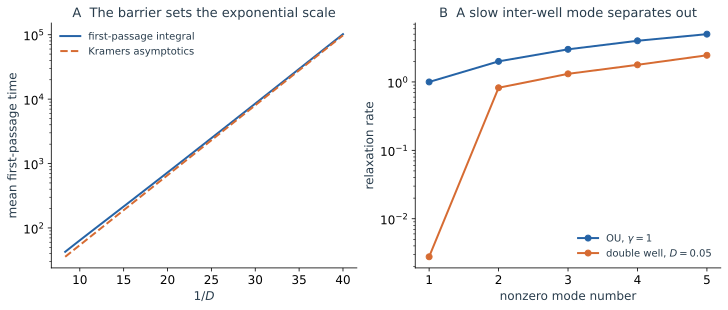

把粒子放在双稳势的左阱。前面已经知道它会快速形成局部涨落分布，也知道成功越垒的历史具有 $e^{-\Delta U/D}$ 的小权重。现在只问一件事：**从当前的位置出发，平均还要等多久，才第一次到达右阱？**

可以给 Fokker–Planck 方程设置吸收边界，先求所有时刻的存活概率，再对时间积分。也可以在路径系综中记录每条历史的首次到达时刻。两种方法都成立；但如果最终只想得到一个依赖初始位置的平均等待时间，能否直接为它写一条方程？

本篇从这个问题出发，先用下一小步的条件统计推导首达方程，再比较前向的概率输运与后向的未来预测。首达时间、去向概率、弛豫谱和累计量将逐步展示同一局部规律的不同用途。最后再用 Markov 结构与生成元说明这些计算为何相容：它们提供前三种描述的共同数学基础，并不是与轨迹、概率、历史完全并列的第四种物理对象。

## 4.1 从左阱到右阱：先为平均等待时间写方程

首次到达把“某一时刻在哪里”改成了“什么时候第一次完成一个事件”。一条轨迹在指定时刻可能已经离开目标又返回，所以终点位置不能单独回答这个问题。我们可以把到达后立即停止的规则加入模型，并直接求每个起点的平均剩余时间。

先看图中需要解释的现象：噪声只减小一些，左阱到右阱的等待就能增加许多个数量级。

*图 5｜先看左图：它比较双稳势从 $-1$ 到 $0.8$ 的精确积分首达时间和弱噪声 Kramers 近似，左端 $-2$ 反射。指数尺度一致，前因子近似在较弱噪声时更准确。右图留待 4.5 节解释，比较 OU 的整数间隔弛豫率与 $D=0.05$ 双稳扩散的前几个非零弛豫率；双稳最慢率远小于其余模式。右图的双稳谱采用 $[-2,2]$ 上的反射边界，对应封闭系统的弛豫，与左图的吸收首达问题使用不同边界。*

为把这个问题写清楚，设粒子满足 $dX_t=b(X_t)dt+\sqrt{2D}\,dW_t$，目标位置为 $r$，在区间 $[\ell,r]$ 中左端反射、右端吸收。对双稳例子可取 $\ell=-2$、$r=0.8$，从 $x=-1$ 出发。定义

$$
\tau_r=\inf\{t\ge0:X_t=r\},\qquad T(x)=\mathbb E_x\tau_r.
$$

如果沿前向路线计算，要先求从 $x$ 出发、到时刻 $t$ 仍未吸收的存活概率 $S(t\mid x)$，再用 $T(x)=\int_0^\infty S(t\mid x)dt$。下面直接从平均剩余时间的收支出发。

在内部点先走很短的 $h$，已经花掉这段时间，接下来平均还需 $T(X_h)$。这里使用的条件是：给定当前的完整状态，未来统计不再额外依赖更早的历史。这正是 Markov 性，4.8 节将回到它的适用条件。于是从内部点取 $h\to0$，

$$
T(x)=h+\mathbb E_x[T(X_h)]+o(h).
$$

在这一小步内，增量满足 $\mathbb E_x\Delta X=b(x)h+o(h)$、$\mathbb E_x(\Delta X)^2=2Dh+o(h)$。对 $T(x+\Delta X)$ 展开，便有

$$
\mathbb E_xT(X_h)=T(x)
+h\left[b(x)\frac{dT(x)}{dx}
+D\frac{d^2T(x)}{dx^2}\right]+o(h).
$$

把它代回并消去两侧相同的 $T(x)$，得到

$$
\boxed{b(x)\frac{dT(x)}{dx}
+D\frac{d^2T(x)}{dx^2}=-1,\qquad
T(r)=0,\quad T'(\ell)=0.}
$$

吸收端的剩余时间为零；反射端给出 Neumann 条件。这个推导也可由 Dynkin 公式与停止时间论证严格化，条件包括所需的正则性和首达时间可积性。

右端的 $-1$ 来自时间的持续流逝。先演化一小步，不管这一小步走向哪里，都已经花掉了时间 $h$；所以“当前平均剩余时间”应比“下一步后的平均剩余时间”多出 $h$。左边的微分表达式读取后一变化率，因而等于 $-1$。它不是额外假定的力或概率源。

一个最简单的检验是区间 $[0,L]$ 上的自由扩散，左端反射、右端吸收。没有漂移时方程变成 $DT''=-1$，直接积分得到

$$
T(x)=\frac{L^2-x^2}{2D}.
$$

从左端出发平均需要 $L^2/(2D)$。扩散系数加倍，平均时间减半；区间长度加倍，平均时间变成四倍。这和自由扩散距离随时间平方根增长的运动图像一致。这一步只用一条关于起点的方程，就算出了整个随机到达事件的平均时间。

## 4.2 前向与后向：概率流向终点，预测依赖起点

首达方程的未知函数是 $T(x)$：在不同位置重新启动同一动力学，各自需要多久？第二篇的未知量却是 $p(x,t)$：固定一份初始准备以后，概率在各个终点怎样分配？将两个完整方程放在一起看，差别很清楚：

$$
\begin{aligned}
\frac{\partial p(x,t)}{\partial t}
&=-\frac{\partial}{\partial x}[b(x)p(x,t)]
+D\frac{\partial^2p(x,t)}{\partial x^2},\\
b(x)\frac{dT(x)}{dx}+D\frac{d^2T(x)}{dx^2}&=-1.
\end{aligned}
$$

前一个方程中的导数读取终点邻域的概率流收支，后一个读取起点稍变以后，未来平均等待怎样改变。它们都由同一份短时漂移 $b(x)$ 和增量方差 $2Dh$ 决定。

### 先认识作用，再命名算子

将反复出现的微分表达式记为

$$
\boxed{(\mathcal Lf)(x)=b(x)\frac{df(x)}{dx}
+D\frac{d^2f(x)}{dx^2},}
$$

$$
\boxed{(\mathcal L^\dagger p)(x,t)
=-\frac{\partial}{\partial x}[b(x)p(x,t)]
+D\frac{\partial^2p(x,t)}{\partial x^2}.}
$$

$\mathcal L$ 称为后向生成元，作用于关于起点的预测函数；$\mathcal L^\dagger$ 推进终点的密度。它们的伴随关系来自分部积分，并须使用相互匹配的边界条件。于是已有的两条方程简写为 $\partial_t p=\mathcal L^\dagger p$ 和 $\mathcal LT=-1$。算子记号在这里组织的是已经理解的物理收支。

### 一般的未来观测量也满足后向方程

若只关心经过时长 $t$ 后的读数 $f(X_t)$，为每个起点定义 $u(x,t)=\mathbb E_x[f(X_t)]$。先走一小步 $h$，再从新的位置预测余下时长，得到 $u(x,t+h)=\mathbb E_x[u(X_h,t)]$。使用与首达问题相同的条件增量展开，便有

$$
\frac{\partial u(x,t)}{\partial t}
=b(x)\frac{\partial u(x,t)}{\partial x}
+D\frac{\partial^2u(x,t)}{\partial x^2},
\qquad u(x,0)=f(x).
$$

这就是后向 Kolmogorov 方程。空间导数作用于起点 $x$；$t$ 是预测时长，仍向正方向增加。若改用日历时间 $s$ 到固定终点 $T$ 的记法 $v(x,s)=\mathbb E[f(X_T)\mid X_s=x]$，则写成 $\partial_sv+\mathcal Lv=0$，终值为 $v(x,T)=f(x)$。这里没有把粒子的真实时间倒转。

例如，取 $f$ 为右阱的指示函数，$u(x,t)$ 就给出“从 $x$ 出发，经过时长 $t$ 位于右阱”的概率；这不同于“在此之前已经第一次到过右阱”的概率。给模型加上首次到达即停止的规则，才能把到过又离开的历史正确处理。

前向和后向最终计算同一个平均：

$$
\int f(x)p(x,t)dx=\int u(x,t)p_0(x)dx.
$$

前向先传播初始概率，再读取终点；后向先为每个起点预测终点读数，再按初始准备平均。选择哪种计算，取决于要保留的是一份终点分布，还是一张关于起点的预测函数。

## 4.3 从首达方程到 Kramers 等待时间

回到开篇的双稳问题。上一篇给出了罕见上坡的指数代价，现在用首达方程补上平均等待的完整积分表达式，再解释其前因子来自哪里。

### 一维梯度扩散的积分解

对 $b=-U'$、扩散常数 $D$，方程为

$$
DT''-U'T'=-1.
$$

乘以积分因子 $e^{-U/D}$，有

$$
\frac d{dx}\left(e^{-U(x)/D}T'(x)\right)
=-\frac1D e^{-U(x)/D}.
$$

先从反射端 $\ell$ 积分到 $y$，再利用 $T(r)=0$ 积分，得到

$$
\boxed{
T(x)=\frac1D\int_x^rdy\,e^{U(y)/D}
\int_{\ell}^y dz\,e^{-U(z)/D}.}
$$

这个表达式在指定有限区间和边界下是精确的，不需要弱噪声。内层积分累积出发阱里的统计质量，外层积分对高势垒附近给予大权重。势阱占据和穿越障碍在同一公式中共同决定等待时间。

若从阱内较远的位置开始，粒子常会先较快地滑向阱底，再经历较长的越垒等待。弱噪声时，后半段远长于前半段，因此同一个阱内许多不同起点具有相近的平均越垒时间。只有接近势垒或吸收目标的起点，才会显著改变到达前的主要过程。这正与阱内快速混合的物理判断相符。

### 从精确积分得到 Kramers 前因子

令 $x_a$ 为出发阱底，$x_s$ 为相邻势垒顶。左端反射位置足够远离阱底，右端目标位于势垒之后、另一个阱内；两端与有关驻点保持固定距离。在 $D\to0$ 且极值非退化时，

$$
U(z)\simeq U(x_a)+\frac12U''(x_a)(z-x_a)^2,
$$

$$
U(y)\simeq U(x_s)-\frac12|U''(x_s)|(y-x_s)^2.
$$

内、外积分分别由一个完整高斯峰主导，得到

$$
\boxed{
T(x_a)\simeq
\frac{2\pi}{\sqrt{U''(x_a)|U''(x_s)|}}
e^{[U(x_s)-U(x_a)]/D}.}
$$

对本文双稳势，$U''(-1)=2$、$U''(0)=-1$，所以

$$
T_{L\to R}\simeq\sqrt2\pi\,e^{1/(4D)},\qquad
k\simeq\frac{1}{\sqrt2\pi}e^{-1/(4D)}.
$$

这补上了路径大偏差未给出的曲率前因子：阱底的回复强度与势垒顶的不稳定性共同影响尝试越垒的时间尺度。[Berglund 的综述](https://arxiv.org/abs/1106.5799)给出了这一公式及其多维推广的条件。

指数来自两处权重的比较：出发阱的大量占据在低势能区域，而穿越必须经过高势能区域。两者相差的势能除以噪声强度，产生了巨大的尺度比。曲率则控制这些主导区域在空间中有多宽：阱底多宽的范围贡献主要占据，势垒顶多宽的范围构成主要障碍。因此只知道势垒高度能够估计指数，却尚不能固定完整等待时间。
如果目标恰好就是势垒顶 $r=x_s$，外层 Gaussian 只积分到峰顶，前因子变成 $\pi/\sqrt{U''(x_a)|U''(x_s)|}$。第一次触及分界面与成功进入另一势阱是两个事件；在对称局部极限中，到顶后的运动仍可能返回，因而它们的平均时间不能使用同一个前因子。

## 4.4 到达哪个目标：分裂概率

在相同动力学里，等待时间与最终去向是不同问题。增加噪声可能使运动整体变快，却未必改变对称问题中先到左端还是右端的概率。生成元可以通过改变所求函数与边界值，把两种问题分别表述。

现在换一个边界问题：$\ell,r$ 两端都吸收。令

$$
q(x)=\Pr_x(\tau_r\lt\tau_{\ell}).
$$

这次短时间步不累积等待时间，因而 $q(x)=\mathbb E_x[q(X_h)]+o(h)$，得到

$$
\mathcal Lq=0,\qquad q(\ell)=0,\qquad q(r)=1.
$$

对于梯度扩散，解为

$$
\boxed{q(x)=
\frac{\int_{\ell}^{x}e^{U(y)/D}dy}
{\int_{\ell}^{r}e^{U(y)/D}dy}.}
$$

在双稳系统中，它衡量当前状态对两个去向的承诺程度，常称 committor。弱噪声时，$q$ 通常主要在势垒附近从接近 $0$ 变到接近 $1$：一旦已经深入某个阱，接下来的去向较确定；势垒附近则对微小噪声很敏感。

同一个 $\mathcal L$，右端为 $-1$ 时计算平均时间，右端为 $0$ 且边界值不同则计算事件概率。局部规律没有改变，目标观测量改变了方程与边界条件。

例如在 $[0,L]$ 上的无漂移扩散，两端都吸收，分裂概率为 $q(x)=x/L$，与 $D$ 无关。更大的 $D$ 加快到达，却没有打破左右对称性。位置 $x$ 相对于两端的比例决定去向，扩散强度决定运动的时间尺度。这个例子把“发生哪件事”与“多久发生”清楚地区分开。

## 4.5 弛豫谱：不同时间尺度从哪里出现

这里回到未吸收的封闭系统，研究归一化概率如何趋近稳态。一个概率分布可以以多种方式偏离稳态：中心偏移、整体过宽、左右阱占据不平衡，或者阱内还有较细的结构。这些偏离不必以同样的速度消失。谱分解要寻找的是形状保持不变、只按固定速率衰减的基本偏离，再把一般初始条件分解到这些形状上。

这里的模式并不表示粒子沿某种周期轨道振动。一个前向弛豫模式可以在某些区域取正、另一些区域取负，表示相对于稳态的概率增加和减少；它本身不是独立的概率密度。总分布才需要非负，非零模式的总质量则为零，以便保持归一。

若生成元具有合适的离散谱，可将后向演化的某个模式写成

$$
\mathcal L\phi_n=-\lambda_n\phi_n,\qquad
P_t\phi_n=e^{-\lambda_nt}\phi_n.
$$

零模对应常数观测量与总概率守恒，非零 $\lambda_n$ 决定不同形状的偏离衰减多快。并非所有 Markov 过程都有可直接使用的纯离散谱；无穷空间的自由扩散等问题还需要连续谱。这里先看受限的可逆模型。

### OU 的整数谱与可观测量

把 OU 坐标缩放为 $y=\sqrt{\gamma/D}\,x$，则

$$
\mathcal L=\gamma(\partial_y^2-y\partial_y).
$$

概率论约定的 Hermite 多项式 $\mathrm{He}_n$ 满足

$$
(\partial_y^2-y\partial_y)\mathrm{He}_n=-n\mathrm{He}_n,
\qquad \lambda_n=n\gamma.
$$

前两个非平凡模式可直接在原坐标验证：

$$
\mathcal Lx=-\gamma x,\qquad
\mathcal L(x^2-D/\gamma)=-2\gamma(x^2-D/\gamma).
$$

所以均值和方差偏离的两种弛豫率来自不同的谱模式。在稳态加权内积中展开 $f-\langle f\rangle_{\mathrm{ss}}=\sum_{n\ge1}c_n\phi_n$，若模式正交归一，则

$$
\langle f(X_t)f(X_0)\rangle_c
=\sum_{n\ge1}c_n^2e^{-\lambda_nt}.
$$

时间关联既取决于系统有哪些模式，也取决于观测量与哪些模式重叠。OU 的位置只投影到第一模，因此关联是单指数；$x^2$ 的连通关联读取第二模，衰减率为 $2\gamma$。

从分布形状看，把稳态高斯整体稍微平移，会制造一个一侧增加、另一侧减少的偏离，位置均值对它很敏感；把分布对称地压窄或展宽，均值仍为零，位置平方却能识别它。两个观测量读取的模式不同，所以同一个系统能够给出不同的关联衰减率。

### 双稳系统的慢模是阱间质量不平衡

弱噪声双稳扩散中，第一非零率近似为

$$
\lambda_1\simeq k_{LR}+k_{RL},
$$

其余主要阱内模式的率保持在局部回复尺度。最慢的后向特征函数在两个阱内分别近似常数、符号相反，读取“粒子属于哪个阱”；相应前向模式则把概率从一个阱搬到另一个阱，而保持总质量不变。

因此阱内初始形状很快被遗忘，阱间占据差却长期保留。第二篇看到的概率输运、第三篇计算的势垒代价和这里的谱隙，描述了同一慢过程的不同方面。

这说明谱隙很小具有怎样的运动含义：系统很快把每个阱内部整理成近似稳定的形状，此后仍有一项全局信息需要很久才能消除——左右两团概率分配得是否正确。最慢模式读取的是这份占据不平衡。若观测量主要区分左右阱，就会看到长关联；若只读取某个阱内的快速细节，看到的时间尺度可以短得多。

## 4.6 离散状态空间：主方程自然来自同一生成元

当局部细节已经快速衰减，我们有时只保留“处于哪个亚稳态”。这时状态之间不再表现为连续位置的小位移，而是偶尔发生的跳跃。要建立动力学，仍然可以问每一小段时间有哪些事件、各以多大速率发生，以及事件使观测量改变多少。

连续扩散不是 Markov 过程的唯一形式。若系统处于离散状态 $i$，以速率 $k_{ij}$ 从 $i$ 跳到 $j$，则

$$
(\mathcal Lf)_i=\sum_{j\ne i}k_{ij}(f_j-f_i).
$$

每项都是“发生速率乘以观测量的变化”。对偶的概率方程为

$$
\dot p_i=\sum_{j\ne i}(k_{ji}p_j-k_{ij}p_i).
$$

这是主方程。若把 $p$ 写成列向量，矩阵的第 $i,j$ 个非对角元应为从 $j$ 到 $i$ 的速率 $k_{ji}$，每列和为零；后向生成元则作用于状态函数。说明向量和指标约定可以避免把速率方向写反。

双稳系统的两态约化正是这个形式，但它只在阱内混合显著快于阱间跳跃时合理。若在到达势垒附近后仍保留长时间的历史依赖，仅按左右位置归类未必已经产生精确 Markov 链。

离散生成元还可以导出连续近似。若跳跃幅度为 $\delta$，左右速率为 $r_\pm(x)$，Taylor 展开给出

$$
\mathcal Lf\simeq
\delta(r_+-r_-)f'
+\frac{\delta^2}{2}(r_++r_-)f''.
$$

漂移来自两个方向事件率的差，扩散来自它们的和。扩散极限要求跳幅缩小、速率相应缩放，高阶项可忽略；不能只因主方程和 Fokker–Planck 形式相似，就认为任意少量大跳跃都可替换为高斯噪声。

即使左右速率相同、平均位移为零，两边事件依然都在发生，所以扩散强度可以很大。这个“差决定漂移、和决定涨落”的结构，和第二篇无偏运动产生扩散流的解释相呼应。生成元使连续噪声与离散事件之间的联系可以通过明确的尺度极限建立。

## 4.7 Feynman–Kac：路径上的累计量怎样变成算子演化

前面的问题只在终点或首次到达时读取结果，还可以沿途不断累计某个量。例如粒子在势垒附近总共停留多久，或者在某个有吸收能力的区域里暴露多久。这些量不能由终点位置单独决定，需要给整条历史附加权重。

最后考虑一个真正依赖整段历史的量：

$$
G(x,t)=\mathbb E_x\left[
e^{-\int_0^t V(X_s)ds}f(X_t)
\right].
$$

这里 $V$ 是给定的路径权重率，与前文的势函数 $U$ 无关；例如 $V=\alpha\,\mathbf1_R$ 可以记录粒子在区域 $R$ 中累计停留时间的 Laplace 变换。

当 $V\ge0$ 时，还有一个直观实现：让运动粒子在当前位置以速率 $V(x)$ 被移除。一段很短时间里的存活因子约为 $1-V(x)h$，沿一条路径把这些因子相乘，就得到 $e^{-\int Vds}$。因此，上式同时累积了位置随机运动和沿途存活权重。对一般符号的 $V$，保留加权统计的数学解释即可。

先拆出最初一段 $h$，用 Markov 性接上剩余未来：

$$
G(x,t+h)\simeq\mathbb E_x[(1-hV(x))G(X_h,t)].
$$

展开条件平均，得到

$$
\boxed{\partial_tG=(\mathcal L-V)G,\qquad G(x,0)=f(x).}
$$

这就是这一形式的 Feynman–Kac 关系。它在适当的正则性、可积性和边界条件下，把路径累计量转成一个确定的算子问题。[Goodman 的随机微积分讲义](https://math.nyu.edu/faculty/goodman/teaching/StochCalc2004/notes/l6.pdf)用短时间条件平均发展了这种对应。

令 $f=1$、$V=\alpha\mathbf1_R$，对 $\alpha$ 在零点求导，即得

$$
-\left.\partial_\alpha G(x,t)\right|_{\alpha=0}
=\mathbb E_x\int_0^t\mathbf1_R(X_s)ds.
$$

所以相同的局部生成元还能计算一段历史里积累的驻留时间。由于 $(\mathcal L-V)1=-V$，加权演化通常不再守恒概率；它在这里用于统计路径权重，而不是直接替代原过程的 Markov 生成元。

路径表示与算子表示因而在这里直接相接。路径一侧对每条历史记录停留时间并求平均，算子一侧只需在每个短时间步中加入相应的局部加权率。二者能够互相转换，正是因为整段历史仍可通过局部条件演化逐步连接。

## 4.8 这些计算为什么相容：Markov 结构与局部生成元

到这里，同一对 $b,D$ 已经计算了终点密度、未来读数、等待时间、去向、弛豫与路径累计量。它们都依靠同一个步骤：先走一小段时间，给定新的状态，再连接剩余未来。现在把一直使用的结构明确写出来。

### 当前状态何时已经包含所需的过去

Markov 性要求：给定 $X_t$ 后，未来的条件分布不再依赖更早的完整历史。这是对状态选择的要求。惯性粒子若只记录位置，同样的当前位置仍可能配有不同速度，随后会有不同去向；保留 $(X,V)$ 才能闭合。环境若还有重要慢记忆，也需要保留相应历史，或扩充状态空间。过阻尼位置模型只在第一篇讨论的尺度窗口内成立。

这不要求不同时刻彼此独立。OU 当前偏大时，稍后也较可能偏大，因此位置有时间关联；但当前值一旦已知，更早历史就不再增加预测信息。有时间关联和需要在当前状态之外保留历史，是两件事。

### 有限时间传播怎样由局部规律复合

这里先对未吸收的守恒过程说明结构；首达问题使用相应的停止规则与目标边界。时间齐次时，把转移核记为 $P_t(dy\mid x)$，有密度时它就是前两篇的 $K(y,t\mid x,0)dy$。对观测量定义

$$
(P_tf)(x)=\mathbb E_x[f(X_t)].
$$

对中间位置求和再连接两段未来，就是 Chapman–Kolmogorov 关系。对函数的作用相应满足

$$
P_{t+s}=P_tP_s,\qquad P_0=\mathrm{Id}.
$$

这族算子称为 Markov 半群。名称概括的是前面已使用多次的短时传播复合，并没有额外添加一套运动规律。第二篇积分中间位置得到传播核，第三篇保留中间位置得到路径系综，使用的正是同一组条件核。

在适当定义域内，读取一小步的平均变化率，便得到生成元的一般定义

$$
\boxed{(\mathcal Lf)(x)
=\lim_{h\downarrow0}\frac{\mathbb E_x[f(X_h)]-f(x)}h.}
$$

对本篇扩散，增量均值和二次变差给出 $\mathcal Lf=bf'+Df''$。对守恒过程，常数在定义域内时取 $f=1$ 得到 $\mathcal L1=0$，读取总概率守恒；取 $f=x$ 读取平均漂移；取 $f=x^2$ 还会读出随机展宽。第一篇的 Itô 公式在这里将同一局部物理组织成算子。

一般一维 Itô 过程 $dX=b(X)dt+\sigma(X)dW$ 则有 $\mathcal Lf=bf'+\sigma^2f''/2$，离散跳跃过程对应 4.6 节的速率求和。生成元的表达式、定义域与边界条件共同指定演化；相同内部漂移和扩散，配上反射或吸收边界，会产生不同的未来事件统计。[Pavliotis 教材](https://www.ma.imperial.ac.uk/~pavl/PavliotisBook.pdf)第 2 章系统介绍了这层结构。

因此，这个统一适用于正确状态空间中闭合、并满足所需适定性条件的 Markov 动力学。若重要的环境记忆尚未消失，只用位置的一条局部生成元就不足以复原全部历史；需要回到第一篇重新检查保留变量和时间尺度。

## 4.9 同一个物理机制，在不同描述中怎样出现

统一框架的价值，是同一局部随机规律能够按问题组织成不同的计算。并非每个问题都需要同时使用全部表示：

| 要预测什么 | 直接计算的对象 | 方程或方法 |
| --- | --- | --- |
| 某时刻的概率分布 | 终点密度 $p(x,t)$ | 前向 Fokker–Planck 方程 |
| 未来观测量的平均 | 起点函数 $u(x,t)$ | 后向 Kolmogorov 方程 |
| 平均首次到达时间 | 起点函数 $T(x)$ | $\mathcal LT=-1$ 及目标边界 |
| 先到哪个目标 | 分裂概率 $q(x)$ | $\mathcal Lq=0$ 及两端边界值 |
| 弛豫和关联的时间尺度 | 模式及其投影 | 生成元谱 |
| 沿途累计的量 | 加权预测 $G(x,t)$ | Feynman–Kac 方程 |

OU 中，回复力消除旧偏离，噪声注入新偏离。轨迹给出这种持续运动，概率云给出有限稳态宽度，路径关联记录不同时间共享的涨落；生成元谱则解释为什么均值、方差偏离分别按 $\gamma$、$2\gamma$ 衰减。这些结果都来自同一个线性回复机制。

双稳系统把联系显示得更鲜明。Langevin 轨迹在阱内反复涨落，极少数历史完成逆漂移上坡；路径代价把这份稀有性量化为 $\Delta U/D$。在概率描述中，它表现为阱间交换对占据差的响应极小；在首达描述中，表现为等待极长；在谱中，则表现为一个极小的全局弛豫率。

对称、弱噪声且具有明确两态尺度分离时，

$$
\begin{gathered}
k\sim\frac{\sqrt{U''(x_a)|U''(x_s)|}}{2\pi}e^{-\Delta U/D},\\
T_{L\to R}\simeq\frac1k,\qquad
\lambda_1\simeq2k,\qquad
\tau_{\mathrm{relax}}\simeq\frac1{2k}.
\end{gathered}
$$

**罕见跨越、缓慢概率交换、长等待与小谱隙，是同一势垒机制的不同表现。** 其中的净流还依赖当前占据是否偏离平衡：在平衡时，两方向的稀有转换依然存在，净流却相消为零；所以不能把“转换很少”与“稳态净流很小”无条件等同。

从第一篇的牛顿运动到这里，始终保留的是同一个物理系统。轨迹、概率云和路径历史突出不同信息；Markov 结构解释它们如何相容，生成元又让许多全局问题可以从局部条件演化直接计算。读到一个新问题时，先明确所求的是分布、历史、关联、去向还是等待，再选择最直接的描述。

## 附录 A：用 Schrödinger 型算子计算弛豫谱

对于常数 $D$ 的梯度扩散，还可以令 $p=e^{-U/(2D)}\psi$，把前向方程变换为

$$
\partial_t\psi=-H\psi,\qquad
H=-D\partial_x^2+\frac{(U')^2}{4D}-\frac12U''.
$$

对封闭的可逆扩散，使用自然边界或由反射条件变换而来的边界条件，$H$ 是自伴的 Schrödinger 型算子，基态为 $e^{-U/(2D)}$、本征值为零。它提供了计算弛豫谱的另一种方式。这里的时间演化是指数衰减，物理对象仍然是概率分布。

若改用吸收边界，$e^{-U/(2D)}$ 通常不再满足目标边界条件，最低本征值也不再为零；存活概率会衰减。封闭系统的弛豫谱与吸收系统的退出谱需要使用各自的边界，不能只沿用内部算子的形式。

**上一篇：**[Path Integrals](/notes/nonequilibrium_statistical_physics/stochastic_dynamics/path_integrals/) · **[返回专题目录](/notes/nonequilibrium_statistical_physics/stochastic_dynamics/)**。
