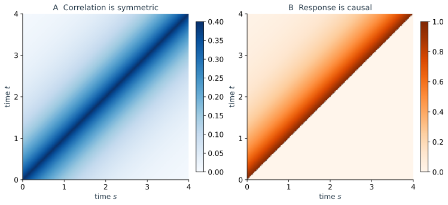

上一节用传播核 $K(x_f,T\mid x_0,0)$ 描述从初态到终点的概率传播。这个核已经合并了所有中间运动：粒子可以先向左再向右，也可以多次折返，最后到达相同的终点。若暂时保留中间位置，就能把这些不同历史分开；将中间位置重新积分掉，又回到原来的传播核。

路径积分沿着这条构造发展。它先回答一个概率问题：**每段随机历史的权重来自哪里，所有历史怎样共同组成一个终点概率？** 然后进一步组织计算：如果所求量依赖整段历史，或者需要比较受扰动前后的运动，怎样在同一份路径统计中计算它？

本篇前半段从时间切片建立路径系综，推导 Onsager–Machlup 表示，再用带漂移的 Brownian 运动分析端点约束、参考路径和粗糙涨落。后半段引入生成泛函，以 OU 过程计算关联与累计观测量，最后从动力学约束推导 MSRJD，说明响应场为何能够计算外力响应。双稳越垒作为弱噪声的一个延伸，用来联系前后两篇。

## 3.1 从转移概率到路径系综

### 终点概率如何合并不同的历史

固定起点 $x_0$ 与观察时长 $T$，传播核给出终点附近的概率密度。它并没有选定一条连接起终点的轨道。若还指定一个中间位置，就在所有历史里选出了经过该位置的一类；指定更多中间位置，则越来越详细地记录了这类运动怎样发生。

把时间等分为 $N$ 段，记 $\varepsilon=T/N$、$t_k=k\varepsilon$，$x_N=x_f$。对时间齐次 Markov 过程，反复使用 Chapman–Kolmogorov 关系可得

$$
\boxed{
K(x_f,T\mid x_0,0)
=\int\prod_{k=1}^{N-1}dx_k
\prod_{k=0}^{N-1}K_\varepsilon(x_{k+1}\mid x_k).}
$$

这里每个短时核先回答“从当前状态到下一状态的概率是多少”。沿着指定的离散历史，把这些条件密度相乘，便得到它的联合权重；对所有中间位置积分，便将所有可能历史的贡献合并起来。对精确转移核，这个公式在任意有限切片数下都成立，还不需要任何连续路径积分的形式操作。

这个构造也说明了路径表示为何自然。普通多变量概率论中，不关心哪个变量，就对它积分；这里的中间变量恰好是不同时间的位置。路径积分把这种有限维的概率边缘化延伸到越来越密的时间记录上，运动规律仍来自同一个转移过程。

### 固定终点以后，路径权重还要归一化

上式的乘积包含到达指定终点的密度。若进一步问“在已经到达 $x_f$ 的历史中，中间位置如何分布”，就要除以这个终点密度：

$$
p(x_1,\ldots,x_{N-1}\mid x_0,x_f)
=\frac{\prod_{k=0}^{N-1}K_\varepsilon(x_{k+1}\mid x_k)}
{K(x_f,T\mid x_0,0)}.
$$

这种给定两端的条件过程称为 bridge。它与只指定初态、终点自由的系综回答不同问题：后者比较终点有多可能，前者比较到达这个终点的不同方式。后面讨论参考路径时会使用 bridge；计算通常的因果响应时，则回到固定初始准备、终点自由的系综。

连续位置中，一个精确终点通常具有零概率，条件过程应通过转移密度或相应的正规条件分布理解。同样，单条精确连续路径通常具有零概率。谈论某条历史的权重时，实际比较的是离散观测值的密度、路径邻域或一类受约束历史，而不是某条精确曲线的普通概率。

## 3.2 从噪声统计到 Onsager–Machlup 作用量

### 每一步的高斯增量怎样给路径赋权

传播核的拼接给出了框架，还需要知道局部转移规律。现在接回上一节已经建立的加性噪声模型

$$
dX_t=b(X_t)dt+\sqrt{2D}\,dW_t.
$$

采用前点 Itô 的 Euler 离散，

$$
x_{k+1}-x_k=b(x_k)\varepsilon+\sqrt{2D\varepsilon}\,\xi_k,
\qquad \xi_k\overset{\mathrm{iid}}\sim\mathcal N(0,1).
$$

对给定的出发位置 $x_k$，先由漂移预期一段位移 $b(x_k)\varepsilon$，再加上本步随机位移。将标准高斯变量换成下一步位置，得到离散模型的精确一步密度

$$
K_\varepsilon^{\mathrm E}(x_{k+1}\mid x_k)
=\frac1{\sqrt{4\pi D\varepsilon}}
\exp\left[-\frac{[\Delta x_k-b(x_k)\varepsilon]^2}
{4D\varepsilon}\right].
$$

上标 $\mathrm E$ 表明这是 Euler 模型的核。对一般非线性漂移，它在有限步长下不等于原连续过程的精确核；在适当正则性与收敛条件下，缩小步长才恢复原过程。常漂移 Brownian 运动的一步核则恰好就是这份高斯。

将各步高斯相乘，指数相加，便得到

$$
\mathcal P_\varepsilon(x_1,\ldots,x_N\mid x_0)
=(4\pi D\varepsilon)^{-N/2}e^{-S_\varepsilon[x]},
$$

$$
\boxed{S_\varepsilon[x]
=\sum_{k=0}^{N-1}
\frac{[\Delta x_k-b(x_k)\varepsilon]^2}{4D\varepsilon}.}
$$

这一步给出了作用量的具体来源。分子是实现指定运动所需要的随机位移平方，分母是本步噪声方差尺度的两倍；它就是每步高斯负对数权重中的位置相关部分。整条历史的代价来自这些局部贡献的累加。

归一化因子同样重要。若最终固定 $x_N=x_f$，对 $x_1,\ldots,x_{N-1}$ 积分就得到离散传播核；若让终点也自由积分，则所有 $N$ 个下一步位置都被积分，条件密度的归一化保证总权重为一。连续记号 $\mathcal D x$ 必须连同这些离散因子一起理解。

### 作用量描述的是噪声代价

假设当前位置的确定性漂移向左。一条历史若大致沿着它向左移动，本步只需要较小的随机修正；若要求它停留，噪声就要抵消向左的趋势；若要求它向右移动，则还要提供额外的反向位移。端点即使相同，中间怎样停留和移动也会改变累计权重。

对光滑候选曲线，离散平方和形式上对应

$$
S_0[x]=\frac1{4D}\int_0^T[\dot x-b(x)]^2dt.
$$

$\dot x-b(x)$ 是为了实现候选曲线，随机驱动需要补上的有效速度。噪声是高斯的，因此这种补偿的平方决定指数代价。对同一离散化、同一分辨率下的两段历史，作用量差直接决定其密度权重之比中的指数部分。

这与牛顿力学中的作用量需要区别开来。机械作用量具有能量乘时间的量纲，其驻值条件给出确定性运动方程；这里的 $S$ 无量纲，出现在实权重 $e^{-S}$ 中，衡量随机历史的统计权重。最小化它可以在明确的约束与近似条件下识别主导历史，但不能据此断言系统实际选择一条光滑极值轨道。

典型 Brownian 路径不可微，普通意义下的平方速度积分并不是一个可以直接逐条计算的有限量。连续表达式要依托时间切片、路径测度和相应极限。它对光滑参考曲线的含义，与整份粗糙路径系综的定义属于两个需要联系起来的层次。

### Jacobian 为什么会进入中点表示

前点离散中，定义随机位移 $q_k=x_{k+1}-x_k-b(x_k)\varepsilon$。固定 $x_0$ 后，从 $x_1,\ldots,x_N$ 到 $q_0,\ldots,q_{N-1}$ 的 Jacobian 矩阵是三角的，对角元均为一，因此没有额外的路径依赖因子。

若采用中点规则，漂移改为 $b(\bar x_k)$，$\bar x_k=(x_k+x_{k+1})/2$。这时改变下一步位置，也同时改变了本步用来评估漂移的位置。小步局部换元给出

$$
\left|\frac{\partial q_k}{\partial x_{k+1}}\right|
=\left|1-\frac\varepsilon2b'(\bar x_k)\right|,
\qquad
\prod_k\left|1-\frac\varepsilon2b'(\bar x_k)\right|
\simeq e^{-\frac12\sum_k\varepsilon b'(\bar x_k)}.
$$

因而常用的中点 Onsager–Machlup 表示写为

$$
\boxed{S_{\mathrm{OM}}[x]
=\int_0^Tdt\left[
\frac{(\dot x-b(x))^2}{4D}+\frac12b'(x)
\right],}
$$

并配合该规则的测度。Jacobian 补偿了变量换元时邻域体积的伸缩；它没有增加一种新的物理力。对这里的加性噪声，前点与中点方案可以收敛到同一扩散，但各自的漂移求值、测度和 Jacobian 必须一致使用。

对于光滑曲线附近的小管概率，Onsager–Machlup 泛函也有相应解释，仍需指定邻域与参考测度。这里不展开一般几何随机微积分，只保留关键区别：**平方噪声代价给出了核心权重结构，完整的有限噪声路径表示还包含换元和测度信息。** 关于这些构造的进一步讨论，可参见 [Chow 与 Buice 的综述](https://link.springer.com/article/10.1186/s13408-015-0018-5)。

## 3.3 从路径权重到物理可观测量

### 带漂移的 Brownian 运动：固定终点改变了什么

先选择一个可以完整计算的模型，

$$
dX_t=v\,dt+\sqrt{2D}\,dW_t,\qquad
X_0=x_0,\qquad X_T=x_f.
$$

没有终点约束时，平均位置沿 $x_0+vt$ 运动；指定终点以后，我们从全部历史中选出到达 $x_f$ 的一类。即使 $x_f$ 偏离自然漂移的终点，也仍有随机历史能够抵达，只是它们的总权重可能较小。

常漂移满足 $b'=0$，作用量为 $S=\int_0^T(\dot x-v)^2dt/(4D)$。为了找出满足端点的最小代价光滑曲线，令 $x\to x+\delta x$，并保持两端不动。一次变分后分部积分，

$$
\delta S=\frac1{2D}\int_0^T(\dot x-v)\delta\dot x\,dt
=-\frac1{2D}\int_0^T\ddot x\,\delta x\,dt.
$$

因此极值满足 $\ddot x=0$，相应直线和代价为

$$
x_*(t)=x_0+\frac{x_f-x_0}{T}t,\qquad
S_{\min}=\frac{(x_f-x_0-vT)^2}{4DT}.
$$

直线的斜率由两端的位置和总时长决定，未必等于 $v$。这是因为已经加入一个关于未来终点的条件；若仍坚持只按自然漂移走，就不一定能满足这个条件。$S_{\min}$ 读取的是指定终点偏离自然漂移多远，而不是说确定性力忽然改变了方向。

### 参考路径之外，还必须积分所有涨落

将任意满足两端条件的历史分解为 $x=x_*+q$，其中 $q(0)=q(T)=0$。因为 $\dot x_*-v$ 为常数，交叉项只含 $q(T)-q(0)$，因此消失：

$$
S[x]=S_{\min}+\frac1{4D}\int_0^T\dot q^2dt.
$$

这份分解在时间切片上也成立。终点所需的整体偏离由 $S_{\min}$ 提供指数代价，周围仍有无数个中途折返的 $q$ 需要求和。对于本模型，后者正是无漂移、两端回到零的 Gaussian 路径积分，给出

$$
\boxed{K(x_f,T\mid x_0,0)
=\frac1{\sqrt{4\pi DT}}e^{-S_{\min}}.}
$$

前因子随 $D,T$ 改变，保证终点密度归一。只保留最小作用量，能够读取指数中终点的相对代价，却没有完成整份传播概率的计算。这个 Gaussian 例子中的分解是精确的，不依赖弱噪声近似；对一般非线性作用量，围绕主导历史的展开通常才是一种近似。

*图 4a｜取 $x_0=0,x_f=1.5,T=2,v=0.3,D=0.2$。左图中多条条件轨道共享起终点，黑线为条件平均 $x_*$；橙色虚线为未加终点条件时的平均运动，末端并不到达指定目标。右图为未条件化的终点密度，分别标出自然均值和所选终点。曲线由高斯增量构造，采用有限时间采样。*

### 条件平均是一条直线，真实轨迹仍然粗糙

给定两端后的过程可以具体写为

$$
X_t=x_*(t)+\sqrt{2D}\left(W_t-\frac tT W_T\right),
$$

其均值为 $x_*(t)$，连通协方差为

$$
C_{\mathrm{bridge}}(t,s)
=2D\left[\min(t,s)-\frac{ts}{T}\right].
$$

两端方差为零，是因为起终点已经固定；中间仍有非零涨落，方差在中点最大。这个约束没有使任意一条样本变成直线，只使很多受约束样本的平均沿着直线。对比图中样本与黑线，可以直接看出条件平均和典型轨迹的不同。

本模型还有一个可解释的结果：给定相同两端后，bridge 的均值和协方差不再依赖常漂移 $v$。不同 $v$ 改变抵达该终点的总密度，但在到达这一终点的历史内部，漂移对权重的影响已归入同一个端点因子。这与前面的作用量分解一致。

所以“最小作用量路径”需要附带条件来理解。在这里它是条件均值和一个光滑参考历史；实际样本仍具有 Brownian 粗糙性。弱噪声时，固定两端的路径系综会集中到这个参考历史附近，才可以进一步谈论主导路径的近似。有限噪声下仍需保留整个涨落集合。

### 一个延伸：双稳势中的上坡代价

把常漂移换成 $b=-U'$，弱噪声下对光滑候选历史定义 $I[x]=D S_0[x]$，有

$$
I[x]=\frac14\int_0^T(\dot x+U')^2dt
=U(x_T)-U(x_0)+\frac14\int_0^T(\dot x-U')^2dt.
$$

从阱底向相邻势垒爬升的代价至少为势差 $\Delta U$。在允许足够长时间、端点邻域趋小的意义下，反向漂移 $\dot x=+U'$ 可以逼近这份最小代价。精确从稳定点出发的反向确定性解仍停在该固定点，因此不能把这个极限误读成一条在有限时间内从固定点自动启动的轨道。

过阻尼系统没有被保留的惯性能量来维持上冲，向上位移需要噪声持续抵抗回复漂移；到达势垒后，沿另一侧确定性下坡不再付出相同的指数代价。因此弱噪声转换率具有 $e^{-\Delta U/D}$ 的主导指数。有限噪声 OM 的测度因素与弱噪声主导指数要区分，完整平均等待时间及前因子留到下一篇计算。这个例子展示路径代价的用途，本篇随后回到更一般的路径观测量。

### 从一个终点到沿途的累计量

两条历史即使有相同两端，也可能在中间长期停留在不同区域，因而给出不同的时间积分

$$
A_T=\int_0^T X_tdt.
$$

两时关联 $\langle X_tX_s\rangle$ 同样读取历史中的多个位置。对一个正确归一化的路径系综，这些量统一写成 $\langle\mathcal O[X]\rangle=\int\mathcal D x\,\mathcal O[x]e^{-S[x]}$，其中测度包含初始准备、终点条件及前面讨论的归一化因素。

要研究通常的关联和外力响应，以下固定初始分布 $p_0$，将终点自由积分，因而未扰动总路径权重为一。若研究 bridge 下的累计量，就改用前面除以终点传播核后的条件系综。观测量可以相同，平均所使用的历史集合必须说明。

### 生成泛函：一次组织所有多时刻统计

对一个随机变量，可以用矩母函数生成各阶矩。对随机历史，需要在不同时间分别读取位置，于是把单个参数推广为时间函数 $J(t)$：

$$
Z[J]=\left\langle e^{\int_0^T J(t)X_tdt}\right\rangle,
\qquad W[J]=\ln Z[J],\qquad Z[0]=1.
$$

在有限时间切片上，指数就是 $\sum_k\varepsilon J(t_k)x_k$；对某个时刻的源求导，会从指数中取出相应的位置因子。连续极限中，

$$
\left.\frac{\delta W}{\delta J(t)}\right|_0=\langle X_t\rangle,
\qquad
\left.\frac{\delta^2W}{\delta J(t)\delta J(s)}\right|_0
=\langle X_tX_s\rangle_c.
$$

这里 $\langle X_tX_s\rangle_c=\langle X_tX_s\rangle-\langle X_t\rangle\langle X_s\rangle$。对 $Z$ 求导生成原始矩，对 $\ln Z$ 求导会扣除均值等可分解部分，得到连通关联或更高阶累积量。生成泛函因而把许多不同的多时刻问题组织成同一个对象的导数。

$J$ 在这里是提取统计的记账工具。它暂时按观测量给历史加权，求导后再设为零；并没有在原运动方程中施加一个真实外力。下一节的驱动 $h(t)$ 才会改变运动规律，两种源的作用需要区分。

### OU 的 Gaussian 生成泛函，以及一次具体计算

对 Gaussian 过程，任意有限组时刻的位置联合分布都是多元高斯。有限维高斯积分的配方给出“源乘均值，加上源的二次型”；取时间切片极限，就得到

$$
W[J]=\int_0^T J(t)m(t)dt
+\frac12\int_0^Tdt\int_0^Tds\,J(t)C(t,s)J(s),
$$

其中 $m(t)$ 为均值、$C$ 为连通协方差。这个结果同时保留所有时刻，而非只描述某个终点。

先选取稳态准备的零均值 OU：$dX=-\gamma Xdt+\sqrt{2D}\,dW$，$X_0$ 从方差 $D/\gamma$ 的稳态分布采样，并与未来噪声独立。于是

$$
\boxed{W[J]=\frac D{2\gamma}
\int_0^Tdt\int_0^Tds\,
J(t)e^{-\gamma|t-s|}J(s).}
$$

两次源导数立即恢复 $C(t,s)=(D/\gamma)e^{-\gamma|t-s|}$。由于 $W$ 只有二次项，三阶及以上连通累积量为零；Gaussian 多时刻统计已由均值与协方差完整确定。

现在令整段时间内 $J(t)=\lambda$，则 $Z[J]$ 就变成累计量 $A_T$ 的矩母函数。将上述核积分，得到 $A_T$ 为零均值高斯变量，方差为

$$
\boxed{\operatorname{Var}(A_T)
=\frac{2D}{\gamma^2}
\left[T-\frac{1-e^{-\gamma T}}\gamma\right].}
$$

当 $T\ll\gamma^{-1}$，位置尚未显著失去记忆，$A_T$ 近似为 $TX_0$，方差按 $(D/\gamma)T^2$ 增长；当 $T\gg\gamma^{-1}$，许多相隔较远的时间段近似失去关联，方差的主导项改为与 $T$ 成正比。这是沿整条历史累计的涨落，从同一个生成泛函即可算出。

初始准备会改变这个计算。若固定 $X_0=x_0$，则 $m(t)=x_0e^{-\gamma t}$，协方差为 $(D/\gamma)[e^{-\gamma|t-s|}-e^{-\gamma(t+s)}]$；把它们代入一般 Gaussian 公式即可。不能只因后续方程相同，就将固定初态与稳态准备的有限时间统计混用。

## 3.4 从路径积分到响应场理论

### 保留动力学约束，为什么有助于计算响应

Onsager–Machlup 直接用位置历史表达权重。若还想系统地研究驱动变化，或把非线性漂移组织成可展开的项，先保留运动方程的约束通常更方便。约束中漂移只出现一次，外源怎样进入也更加直接。

以 $\dot x=b(x)+h(t)+\eta(t)$ 为例，$\langle\eta(t)\eta(s)\rangle=2D\delta(t-s)$。以下仍用前点 Itô 离散，并保持初始准备固定、终点自由；因此不会对未来终点另加条件。将本步实际位移记为 $\Delta x_k$，噪声位移 $\eta_k$ 的方差为 $2D\varepsilon$，方程约束为

$$
\delta\left(\Delta x_k-\varepsilon b(x_k)-\varepsilon h_k-\eta_k\right).
$$

这里的 $h$ 是外部驱动，时间步长始终记为 $\varepsilon$。给定一组噪声实现，这份 Delta 约束只允许符合动力学的下一步位置；再按高斯噪声权重平均，就恢复原过程的转移概率。

### 从 Delta 约束完成一次基本推导

令 $q_k=\Delta x_k-\varepsilon b(x_k)-\varepsilon h_k$。对约束使用 Fourier 表示，再积分噪声：

$$
\delta(q_k-\eta_k)
=\int\frac{d\hat x_k}{2\pi}e^{-i\hat x_k(q_k-\eta_k)},
\qquad
\left\langle e^{i\hat x_k\eta_k}\right\rangle
=e^{-D\varepsilon\hat x_k^2}.
$$

各步相乘后的指数因此为

$$
\sum_k\left[-i\hat x_k
(\Delta x_k-\varepsilon b(x_k)-\varepsilon h_k)
-D\varepsilon\hat x_k^2\right].
$$

取 $\widetilde x_k=i\hat x_k$，并转为连续记号，得到 Martin–Siggia–Rose–Janssen–de Dominicis（MSRJD）作用量

$$
\boxed{S_h[x,\widetilde x]
=\int_0^Tdt\left[
\widetilde x(\dot x-b(x)-h)-D\widetilde x^2\right].}
$$

于是可将生成泛函写成

$$
Z[J,h]=\int dx_0\,p_0(x_0)
\int_{x(0)=x_0}\mathcal Dx\,\mathcal D\widetilde x\;
e^{-S_h[x,\widetilde x]+\int_0^T Jx\,dt},
$$

终点自由积分，测度按上述离散构造规定，归一化为 $Z[0,h]=1$。对前点加性噪声，方程约束到位置变量的 Jacobian 没有额外路径依赖；换用别的规则时仍需相应调整。

这份作用量的两个部分具有不同来源。$\widetilde x(\dot x-b-h)$ 实施动力学约束，$-D\widetilde x^2$ 来自高斯噪声的特征函数。$\widetilde x$ 是引入约束时出现的辅助变量，并不是新增的物理坐标或独立噪声。[Chow 与 Buice 的综述](https://link.springer.com/article/10.1186/s13408-015-0018-5)也从离散 Delta 约束建立了这类响应场表示。

### 与 Onsager–Machlup 怎样相接

由于 $\hat x$ 沿实轴积分，$\widetilde x=i\hat x$ 的积分轮廓沿虚轴。作用量中 $-D\widetilde x^2$ 的符号必须连同这个轮廓理解，不能将它作为实轴上可归一化的普通概率密度。

如果重新积分辅助 Fourier 变量，每一步恰好给出

$$
\int\frac{d\hat x_k}{2\pi}
e^{-D\varepsilon\hat x_k^2-i\hat x_kq_k}
=\frac1{\sqrt{4\pi D\varepsilon}}
e^{-q_k^2/(4D\varepsilon)}.
$$

这就是前面的高斯一步权重，包括归一化因子。因此 OM 与 MSRJD 是同一随机动力学的不同表示：积分响应场得到位置路径权重，保留响应场则能更直接地提取驱动作用。与中点 OM 比较时，还要同时转换离散规则和 Jacobian。

### 辅助场为什么称为响应场

外力在作用量中只增加一项

$$
S_h=S_0-\int_0^T\widetilde x(s)h(s)ds.
$$

对 $h(s)$ 求导，会在路径平均中取出 $\widetilde x(s)$。令 $W[J,h]=\ln Z[J,h]$，便得到

$$
\boxed{R(t,s)
=\left.\frac{\delta\langle X_t\rangle_h}{\delta h(s)}\right|_{h=0}
=\left.\frac{\delta^2W}{\delta J(t)\delta h(s)}\right|_0
=\langle x(t)\widetilde x(s)\rangle_c.}
$$

归一化 $Z[0,h]=1$ 还给出 $\langle\widetilde x(s)\rangle=0$，因而这里也可以省略连通下标。响应场的物理作用正由这个导数关系定义：改变真实驱动怎样影响位置统计，可以在扩展路径表示中用一次混合关联计算。

因果性要求早于扰动的观测不受其影响，$t\lt s$ 时 $R(t,s)=0$。这里使用的是没有未来终点约束的原过程；bridge 中对未来结果的筛选不能与这种无条件因果响应混淆。前点 Itô 规则还规定了等时求值，本篇按离散约定取 $\Theta(0)=0$。

### OU：在同一泛函中恢复关联与响应

取 $b=-\gamma x$，未扰动作用量为

$$
S_0=\int_0^Tdt\left[
\widetilde x(\partial_t+\gamma)x-D\widetilde x^2\right].
$$

二次作用量中的确定性算子为 $\partial_t+\gamma$。其迟致 Green 函数满足 $(\partial_t+\gamma)R(t,s)=\delta(t-s)$，并在 $t\lt s$ 为零，所以

$$
\boxed{R(t,s)=\Theta(t-s)e^{-\gamma(t-s)}.}
$$

扰动产生的位移会按与普通弛豫相同的速率消失。对固定初始准备的小驱动，平均改变为 $\delta m(t)=\int_0^tR(t,s)h(s)ds$，与第一篇直接解运动方程的结果一致。

对前面选定的稳态初始分布，协方差包含初始涨落的残余，以及后来噪声的共同贡献：

$$
C(t,s)=\frac D\gamma e^{-\gamma(t+s)}
+2D\int_0^{\min(t,s)}R(t,u)R(s,u)du
=\frac D\gamma e^{-\gamma|t-s|}.
$$

一次早于两个观测时刻的噪声，会分别通过两个响应核影响它们；对共同来源累加，就得到两时关联。晚于其中一个观测时刻的噪声不能改变已经发生的位置，因此积分只到两时刻的较小值。关联读取共同涨落，响应读取一次受控扰动的后果，二者在同一个 Gaussian 理论中有清楚的不同作用。

*图 4b｜$\gamma=1,D=0.4$，横轴为时刻 $s$、纵轴为时刻 $t$。左图的稳态关联关于 $t=s$ 对称，两侧的时刻都可以共享过去噪声；右图的响应只在 $t>s$ 一侧有权重。色标分别表示各自的数值，关联与响应的量纲和幅度不相同。*

外部 $h$ 对 OU 只改变均值，不改变未扰动的协方差。因此其完整 Gaussian 生成泛函还可写为

$$
W[J,h]=\int_0^Tdt\,J(t)\int_0^t ds\,R(t,s)h(s)
+\frac12\int_0^Tdt\int_0^Tds\,J(t)C(t,s)J(s).
$$

两次 $J$ 导数读取 $C$，一次 $J$ 和一次 $h$ 导数读取 $R$。这将前面的路径统计与真实动力学响应放进了同一个计算结构，而不是在得到一个形式作用量后便结束。

### 非线性怎样进入，以及下一篇要统一什么

若漂移改成 $b(x)=-\gamma x-gx^3$，作用量在 Gaussian 部分之外增加 $g\int\widetilde x x^3dt$。这类非线性项会耦合不同阶的涨落，在微扰组织中称为相互作用顶点。生成泛函仍然定义关联与响应，Gaussian 理论提供展开的起点；这里不继续发展图形计算或重整化。

至此，路径方法已经给出两种互补能力：OM 展示一段历史怎样由噪声统计赋权，MSRJD 保留动力学约束，使关联、响应和非线性项能够统一组织。它们与 Fokker–Planck 描述共同依赖短时间条件转移及其拼接规律。

为什么正确状态空间里的局部演化足以决定有限时间概率、整段历史与未来事件？下一篇将用 Markov 半群和生成元系统建立这层结构，并将同一套局部规律用于首次到达和弛豫谱的计算。

**上一篇：**[Fokker–Planck Dynamics](/notes/nonequilibrium_statistical_physics/stochastic_dynamics/fokker_planck/) · **下一篇：**[Markov Processes and Generators](/notes/nonequilibrium_statistical_physics/stochastic_dynamics/markov_generators/)。
