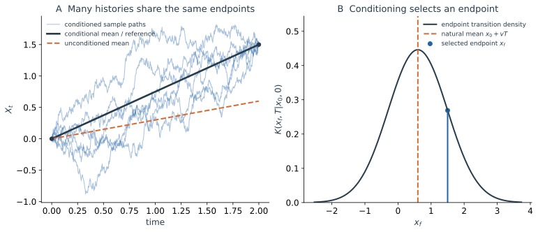
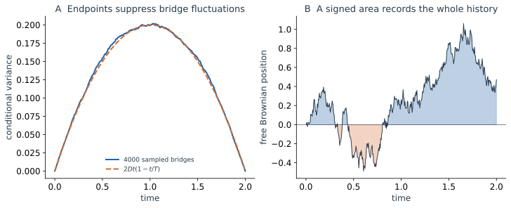

从同一个起点出发、在同一时刻抵达同一终点，并没有规定中途怎样走。两条记录可以有不同的最大偏离、停留时间和轨迹下方的面积。第二篇的传播核已经把这些历史合并成一个终点密度；现在我们将中间位置保留下来，问每段运动怎样被赋予统计权重。

## 3.1 终点相同，中间的运动仍然不同 {#history-question}

*图 3a｜取 $x_0=0,x_f=1.5,T=2,v=0.3,D=0.2$。左图中多条条件轨道共享起终点，黑线为条件平均 $x_*$；橙色虚线为未加终点条件时的平均运动，末端并不到达指定目标。右图为未条件化的终点密度，分别标出自然均值和所选终点。曲线由高斯增量构造，采用有限时间采样。*

左图的粗糙样本共享两端，黑线却只是这些条件历史的平均；右图的未条件化终点密度则回答“抵达这里有多可能”。这两幅图使用不同的系综：一个筛选已经抵达的样本，另一个允许所有终点。路径方法让这两种统计通过同一份短时运动规律联系起来。

圆环上还有一个更明显的例子：相同的取模终点，可以由顺时针绕一圈、逆时针绕一圈，或根本没有绕圈的历史抵达。若关心运动方向，终点位置之外还要保留绕圈的信息。

## 3.2 时间切片：路径求和从普通概率乘积开始 {#time-slicing}

先只插入一个中间时刻 $s$。给定起点 $x_0$，先到 $y$、再到 $x_f$ 的条件密度相乘；将所有 $y$ 的可能性相加：

$$
G(x_f,T\mid x_0,0)
=\int dy\,G(x_f,T\mid y,s)G(y,s\mid x_0,0).
$$

把时间等分为 $N$ 段，记 $\varepsilon=T/N$、$t_k=k\varepsilon$，$x_N=x_f$。对时间齐次 Markov 过程，反复使用 Chapman–Kolmogorov 关系可得

$$
\boxed{
G(x_f,T\mid x_0,0)
=\int\prod_{k=1}^{N-1}dx_k
\prod_{k=0}^{N-1}G_\varepsilon(x_{k+1}\mid x_k).}
$$

这里每个短时核先回答“从当前状态到下一状态的概率是多少”。沿着指定的离散历史，把这些条件密度相乘，便得到它的联合权重；对所有中间位置积分，便将所有可能历史的贡献合并起来。对精确转移核，这个公式在任意有限切片数下都成立，还不需要任何连续路径积分的形式操作。

这个构造也说明了路径表示为何自然。普通多变量概率论中，不关心哪个变量，就对它积分；这里的中间变量恰好是不同时间的位置。路径积分把这种有限维的概率边缘化延伸到越来越密的时间记录上，运动规律仍来自同一个转移过程。

固定起点与终点时，乘积还包含到达该终点的密度。若问“在已经到达的样本中，中间位置如何分布”，需要除以 $G(x_f,T\mid x_0,0)$。连续位置上的精确终点和单条精确路径通常具有零概率；这里使用条件密度、有限分辨率记录或路径邻域，而非某条曲线的普通概率。

## 3.3 Gaussian 小步怎样累加成路径代价 {#gaussian-weights}

### 每一步的高斯增量怎样给路径赋权

传播核的拼接给出了框架，还需要知道局部转移规律。对前两篇的加性噪声模型

$$
dX_t=b(X_t)dt+\sqrt{2D}\,dW_t.
$$

采用前点 Itô 的 Euler 离散，

$$
x_{k+1}-x_k=b(x_k)\varepsilon+\sqrt{2D\varepsilon}\,\xi_k,
\qquad \xi_k\overset{\mathrm{iid}}\sim\mathcal N(0,1).
$$

对给定的出发位置 $x_k$，先由漂移预期一段位移 $b(x_k)\varepsilon$，再加上本步随机位移。将标准高斯变量换成下一步位置，得到离散模型的精确一步密度

$$
G_\varepsilon^{\mathrm E}(x_{k+1}\mid x_k)
=\frac1{\sqrt{4\pi D\varepsilon}}
\exp\left[-\frac{[\Delta x_k-b(x_k)\varepsilon]^2}
{4D\varepsilon}\right].
$$

上标 $\mathrm E$ 表明这是 Euler 模型的核。对一般非线性漂移，它在有限步长下不等于原连续过程的精确核；在适当正则性与收敛条件下，缩小步长才恢复原过程。常漂移 Brownian 运动的一步核则恰好就是这份高斯。

将各步高斯相乘，指数相加，便得到

$$
\mathcal P_\varepsilon(x_1,\ldots,x_N\mid x_0)
=(4\pi D\varepsilon)^{-N/2}e^{-S_\varepsilon[x]},
$$

$$
\boxed{S_\varepsilon[x]
=\sum_{k=0}^{N-1}
\frac{[\Delta x_k-b(x_k)\varepsilon]^2}{4D\varepsilon}.}
$$

这一步给出了作用量的具体来源。分子是实现指定运动所需要的随机位移平方，分母是本步噪声方差尺度的两倍；它就是每步高斯负对数权重中的位置相关部分。整条历史的代价来自这些局部贡献的累加。

归一化因子同样重要。若最终固定 $x_N=x_f$，对 $x_1,\ldots,x_{N-1}$ 积分就得到离散传播核；若让终点也自由积分，则所有 $N$ 个下一步位置都被积分，条件密度的归一化保证总权重为一。连续记号 $\mathcal D x$ 必须连同这些离散因子一起理解。

### 作用量描述的是噪声代价

假设当前位置的确定性漂移向左。一条历史若大致沿着它向左移动，本步只需要较小的随机修正；若要求它停留，噪声就要抵消向左的趋势；若要求它向右移动，则还要提供额外的反向位移。端点即使相同，中间怎样停留和移动也会改变累计权重。

对光滑候选曲线，离散平方和形式上对应

$$
\boxed{S_0[x]=\frac1{4D}\int_0^T
\left[\frac{dx(t)}{dt}-b(x(t))\right]^2dt.}
$$

$\dot x-b(x)$ 是为了实现候选曲线，随机驱动需要补上的有效速度。噪声是高斯的，因此这种补偿的平方决定指数代价。对同一离散化、同一分辨率下的两段历史，作用量差直接决定其密度权重之比中的指数部分。

这与牛顿力学中的作用量需要区别开来。机械作用量具有能量乘时间的量纲，其驻值条件给出确定性运动方程；这里的 $S$ 无量纲，出现在实权重 $e^{-S}$ 中，衡量随机历史的统计权重。最小化它可以在明确的约束与近似条件下识别主导历史，但不能据此断言系统实际选择一条光滑极值轨道。

典型 Brownian 路径不可微，普通意义下的平方速度积分并不是一个可以直接逐条计算的有限量。连续表达式要依托时间切片、路径测度和相应极限。它对光滑参考曲线的含义，与整份粗糙路径系综的定义属于两个需要联系起来的层次。

在弱噪声极限中，这个光滑历史代价给出主导指数；完整的有限噪声 OM 表示还要指定漂移求值与换元因子。例如中点规则带有 $b'/2$ 的修正，推导见[OM Jacobian 选读](/notes/nonequilibrium_statistical_physics/stochastic_dynamics/path_integral_methods/#om-jacobian)。下面先在自由和常漂移 Brownian 中计算；其 $b'=0$，可以集中研究端点约束和路径涨落。

时间切片越来越细时，人们把这份多重积分简写为路径积分：

$$
\boxed{G(x_f,T\mid x_0,0)
=\int_{x(0)=x_0}^{x(T)=x_f}\mathcal D x\;e^{-S[x]}.}
$$

$S$ 与 $\mathcal D x$ 成对规定完整权重，包括离散 Gaussian 的归一化。这个记号概括的是刚刚构造的概率乘积与中间位置求和，没有添加新的运动规律。

## 3.4 Brownian bridge：直线是条件平均 {#brownian-bridge}

先取自由 Brownian。若已知 $X_0=x_0$、$X_T=x_f$，中间时刻的条件密度就是两段传播相乘，再除以抵达终点的密度：

$$
p(x,t\mid x_0,0;x_f,T)
=\frac{G(x_f,T\mid x,t)G(x,t\mid x_0,0)}
{G(x_f,T\mid x_0,0)}.
$$

将两个 Gaussian 的指数相加，关于中间位置的二次项满足

$$
\frac{(x-x_0)^2}{4Dt}+\frac{(x_f-x)^2}{4D(T-t)}
=\frac{T[x-m_t]^2}{4Dt(T-t)}
+\frac{(x_f-x_0)^2}{4DT},
$$

其中 $m_t=x_0+(x_f-x_0)t/T$。右边第二项由分母的终点核抵消，所以条件密度仍是 Gaussian，并读出

$$
\boxed{\begin{aligned}
\mathbb E[X_t\mid x_0,x_f]&=x_0+\frac tT(x_f-x_0),\\
\operatorname{Var}(X_t\mid x_0,x_f)&=2Dt\left(1-\frac tT\right).
\end{aligned}}
$$

两端的方差为零，中间最大；固定终点限制了能保留下来的涨落，却没有消除中途的折返。开篇黑线是一条直线，而每条实际样本仍粗糙，不能把条件平均称为典型 Brownian 路径。

将 $x_*(t)=m_t$ 记为这条条件平均，给定两端后的过程可构造为

$$
X_t=x_*(t)+\sqrt{2D}\left(W_t-\frac tT W_T\right),
$$

其均值为 $x_*(t)$，连通协方差为

$$
C_{\mathrm{bridge}}(t,s)
=2D\left[\min(t,s)-\frac{ts}{T}\right].
$$

两端方差为零，是因为起终点已经固定；中间仍有非零涨落，方差在中点最大。这个约束没有使任意一条样本变成直线，只使很多受约束样本的平均沿着直线。对比图中样本与黑线，可以直接看出条件平均和典型轨迹的不同。

本模型还有一个可解释的结果：给定相同两端后，bridge 的均值和协方差不再依赖常漂移 $v$。不同 $v$ 改变抵达该终点的总密度，但在到达这一终点的历史内部，漂移对权重的影响已归入同一个端点因子。这与前面的作用量分解一致。

所以“最小作用量路径”需要附带条件来理解。在这里它是条件均值和一个光滑参考历史；实际样本仍具有 Brownian 粗糙性。弱噪声时，固定两端的路径系综会集中到这个参考历史附近，才可以进一步谈论主导路径的近似。有限噪声下仍需保留整个涨落集合。

## 3.5 罕见终点：用最简单的漂移计算参考历史 {#rare-endpoints}

不需要复杂势阱，也能看到作用量的用途。常漂移 Brownian 的典型终点是 $x_0+vT$；若要求在同样时长内抵达相距许多个扩散宽度的 $x_f$，这类样本的总权重会很小。现在问：满足这个端点的光滑参考历史需要多大噪声补偿？

常漂移满足 $b'=0$，作用量为 $S=\int_0^T(\dot x-v)^2dt/(4D)$。为了找出满足端点的最小代价光滑曲线，令 $x\to x+\delta x$，并保持两端不动。一次变分后分部积分，

$$
\delta S=\frac1{2D}\int_0^T(\dot x-v)\delta\dot x\,dt
=-\frac1{2D}\int_0^T\ddot x\,\delta x\,dt.
$$

因此极值满足 $\ddot x=0$，相应直线和代价为

$$
x_*(t)=x_0+\frac{x_f-x_0}{T}t,\qquad
S_{\min}=\frac{(x_f-x_0-vT)^2}{4DT}.
$$

直线的斜率由两端的位置和总时长决定，未必等于 $v$。这是因为已经加入一个关于未来终点的条件；若仍坚持只按自然漂移走，就不一定能满足这个条件。$S_{\min}$ 读取的是指定终点偏离自然漂移多远，而不是说确定性力忽然改变了方向。

### 参考路径之外，还必须积分所有涨落

将任意满足两端条件的历史分解为 $x=x_*+q$，其中 $q(0)=q(T)=0$。因为 $\dot x_*-v$ 为常数，交叉项只含 $q(T)-q(0)$，因此消失：

$$
S[x]=S_{\min}+\frac1{4D}\int_0^T\dot q^2dt.
$$

这份分解在时间切片上也成立。终点所需的整体偏离由 $S_{\min}$ 提供指数代价，周围仍有无数个中途折返的 $q$ 需要求和。对于本模型，后者正是无漂移、两端回到零的 Gaussian 路径积分，给出

$$
\boxed{G(x_f,T\mid x_0,0)
=\frac1{\sqrt{4\pi DT}}e^{-S_{\min}}.}
$$

前因子随 $D,T$ 改变，保证终点密度归一。只保留最小作用量，能够读取指数中终点的相对代价，却没有完成整份传播概率的计算。这个 Gaussian 例子中的分解是精确的，不依赖弱噪声近似；对一般非线性作用量，围绕主导历史的展开通常才是一种近似。

## 3.6 沿途累计的量：Brownian 轨迹下方的面积 {#path-observables}

知道某个粒子的终点，仍不能知道它此前在原点上方和下方各待了多久。最简单的历史观测量是带符号的轨迹面积

$$
A_T=\int_0^T X_tdt.
$$

令自由 Brownian 从 $X_0=0$ 出发。对 $t\ge s$，$X_t=X_s+\sqrt{2D}(W_t-W_s)$，后续增量与 $X_s$ 独立，所以 $\langle X_tX_s\rangle=2D\min(t,s)$。面积平均为零，方差却不会抵消：

$$
\begin{aligned}
\operatorname{Var}(A_T)
&=2D\int_0^Tdt\int_0^Tds\,\min(t,s)\\
&=4D\int_0^Tdt\int_0^t s\,ds
=\boxed{\frac{2D}{3}T^3}.
\end{aligned}
$$

面积的单位是长度乘时间，$DT^3$ 的单位正是其平方。典型位置按 $\sqrt T$ 增长，再积累一段时长 $T$，面积的典型大小便按 $T^{3/2}$ 增长；平方就是 $T^3$。这个累计量需要多时刻相关，不能从某一个终点密度单独读取。

*图 3b｜左图将 bridge 的采样方差与 $2Dt(1-t/T)$ 对照；右图给出一条从零出发的自由 Brownian 样本，填色区分正负面积。取 $D=0.2,T=2$，左图使用 4000 条独立 bridge，右图选取一条兼有正负偏离的历史以说明面积收支，不能用它代替面积的系综方差。*

如果改为固定两端的 bridge，仍有非零的面积涨落：同一个协方差积分给出平均 $T(x_0+x_f)/2$、方差 $DT^3/6$。端点条件改变了所平均的历史集合，因此累计量也随之改变。

## 3.7 选读：密度相同，历史仍可具有时间方向 {#time-reversal}

回到第二篇周长 $L$ 的驱动圆环。初始位置从均匀稳态 $1/L$ 采样，取完整的连续路径，并把它提升为未取模的坐标 $x(t)$，以保留绕圈数。时间反演的历史定义为将位置记录次序倒转；位置为偶变量，动力学的常漂移参数 $v$ 保持不变。

在同一有限时间分割上，正向历史增量为 $\Delta x_k$，反向为 $-\Delta x_k$。初始稳态密度相同而相消，Gaussian 一步权重给出

$$
\begin{aligned}
\log\frac{\mathbb P[\mathrm{history}]}{\mathbb P[\mathrm{reversed\ history}]}
&=\sum_k\frac{(\Delta x_k+v\varepsilon)^2-(\Delta x_k-v\varepsilon)^2}{4D\varepsilon}\\
&=\boxed{\frac vD\,\Delta x_{\mathrm{unwrapped}}}.
\end{aligned}
$$

这里比较的是匹配的离散历史密度或路径权重，不是两条单独曲线的非零概率。总位移必须包含绕圈的 $nL$，不能只用取模终点减起点；只看圆环终点会把不同权重的历史混合掉。若 $v=\mu F$、$D=\mu k_{\mathrm B}T$，右边就是恒力沿未取模位移所做的功除以 $k_{\mathrm B}T$。

这只针对稳态、加性常漂移模型与上述反演定义，不能直接推广成任意非平稳、位置依赖漂移的通式。它说明一个清楚的事实：密度一动不动，顺向与逆向历史仍可有不同权重。

## 3.8 三种视角以后，还会遇到哪些运动 {#further-reading}

Langevin 给出局部运动，Fokker–Planck 展示概率云与流，路径积分则把同一规律组织成整段历史的统计。它们回答不同问题，并由短时条件转移相容地联系起来。

如果要同时提取许多时刻的关联，可以选读生成泛函 $Z[j]=\langle e^{\int_0^Tj(t)X_tdt}\rangle$：对 $j$ 求导会取出相应时刻的位置因子。完整 Gaussian 计算、响应场与 OM 测度细节保存在[路径积分进阶](/notes/nonequilibrium_statistical_physics/stochastic_dynamics/path_integral_methods/)；双稳上坡与越垒代价保存在[罕见事件选读](/notes/nonequilibrium_statistical_physics/stochastic_dynamics/rare_events/)，都不是本篇必读前提。

前三篇主要依靠连续 Gaussian 扰动。若粒子突然长跳、持续直行、长时间停滞，或其增量彼此相关，哪些假设已经改变？下一篇以这些运动规则为线索，介绍常见随机过程与所需微积分。

选读：[罕见上坡历史与势垒代价](/notes/nonequilibrium_statistical_physics/stochastic_dynamics/rare_events/#uphill-paths)。

选读：[Gaussian 生成泛函与累计涨落](/notes/nonequilibrium_statistical_physics/stochastic_dynamics/path_integral_methods/#gaussian-functional)。

选读：[MSRJD 响应场与因果响应](/notes/nonequilibrium_statistical_physics/stochastic_dynamics/path_integral_methods/#msrjd)。

选读：[OM 测度与 Jacobian](/notes/nonequilibrium_statistical_physics/stochastic_dynamics/path_integral_methods/#om-jacobian)。

**上一篇：**[Fokker–Planck Dynamics](/notes/nonequilibrium_statistical_physics/stochastic_dynamics/fokker_planck/) · **下一篇：**[Stochastic Processes：随机过程与随机微积分导览](/notes/nonequilibrium_statistical_physics/stochastic_dynamics/stochastic_processes/)。
