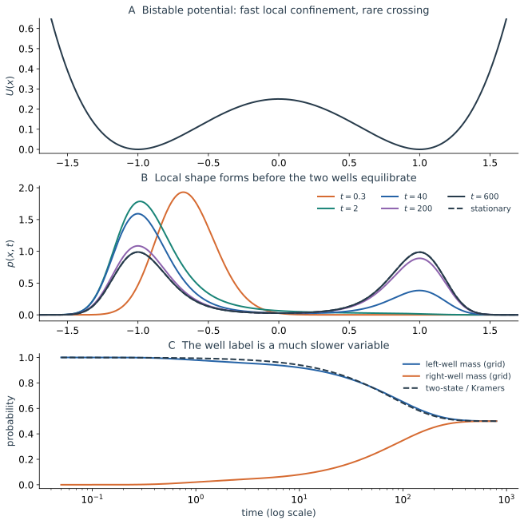
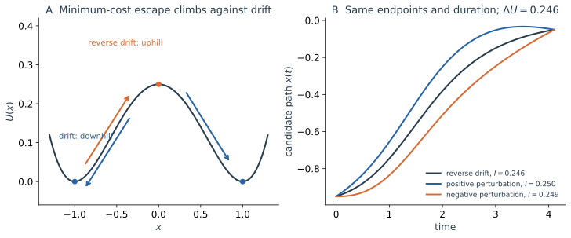

本页供希望进一步理解罕见转换的读者选读。主讲义以自由 Brownian 与 OU 建立轨迹、概率和历史三种描述；这里再把同一方法应用到两个势阱之间的慢交换。阅读本页不影响继续阅读[随机过程导览](/notes/nonequilibrium_statistical_physics/stochastic_dynamics/stochastic_processes/)。

本页采用无量纲 $U(x)=(x^2-1)^2/4$、漂移 $b=-U'$。在有量纲的常迁移率热浴模型中，$U=\mu V$、$D=\mu k_{\mathrm B}T$；真实势能仍记为 $V$，不可把 $U$ 与能量混用。稳定点为 $\pm1$，势垒顶为 $0$，$\Delta U=1/4$。

## A.1 双稳势：局部弛豫与缓慢概率交换 {#bistability}

[第一篇的 OU](/notes/nonequilibrium_statistical_physics/stochastic_dynamics/langevin/) 只有一个稳定区域，局部回复也就能逐渐消除全部初始位置信息。现在把单阱换成左右两个势阱，中间隔着一座势垒。若只保留确定性运动，放在左边的粒子会滑向左阱底，此后一直留在左边。随机扰动带来了新的可能：粒子会在阱底附近反复偏离，大多数偏离被拉回去，极少数偏离却能一路发展到势垒附近，再进入右阱。

长记录中常能看到很直观的两层运动：一层是每个阱内持续的小幅起伏，另一层是偶尔发生的阱间转换。前者决定每一团概率的局部宽度，后者决定左右两团各自包含多少概率。它们由同一噪声驱动，却面对很不同的空间障碍。

选择无量纲势

$$
U(x)=\frac14(x^2-1)^2,
\qquad b(x)=x-x^3.
$$

$x=\pm1$ 为稳定点，$x=0$ 为不稳定点。$U(\pm1)=0$、$U(0)=1/4$。在左阱附近写 $x=-1+y$，则 $b(-1+y)=-2y+O(y^2)$，局部过程近似

$$
dy=-2y\,dt+\sqrt{2D}\,dW,
\qquad \tau_{\mathrm{local}}\sim\frac12,
\qquad \operatorname{Var}_{\mathrm{local}}y\simeq\frac D2.
$$

当 $D\ll\Delta U=1/4$ 时，典型涨落远小于两阱间距，多数轨道在一个阱内停留很久。它们可以在 $O(1)$ 的时间内忘掉阱内初始位置，却仍然记得自己属于哪个阱。跨越势垒需要罕见涨落，平均等待时间具有 $e^{\Delta U/D}$ 的指数尺度；指数来源在本页 A.2 由路径代价推导，前因子在[生成元与首次到达选读](/notes/nonequilibrium_statistical_physics/stochastic_dynamics/markov_generators/#43-从首达方程到-kramers-等待时间)中计算。[Berglund 的 Kramers 综述](https://arxiv.org/abs/1106.5799)说明了这种尺度分离以及势垒近似所需的非退化条件。

“在阱内忘掉初始位置”可以通过一个对照实验理解：把两组粒子分别准备在左阱的不同位置。经过几个局部回复时间，两组都会在左阱底附近形成近似相同的分布，已经很难区分原先准备在哪里。但如果另一组一开始放在右阱，此时它仍主要位于右边，两组之间的差别依然显著。位置的局部记忆已丢失，所属势阱的记忆却仍在。

这也解释了亚稳态的含义。在中等长度的观察窗里，一个阱内的分布看起来已经稳定；延长观察时间，仍然会发现它在缓慢漏出并改变全局占据。是否“已经达到稳态”，必须连同观测时间与所分辨的变量一起判断。

*图 A1｜$D=0.07$，初始密度集中在左阱的 $x=-0.55$ 附近。上图为势函数；中图显示概率先移向左阱底并建立局域宽度，再逐渐分配到右阱；下图比较左右阱占据随时间的变化。数值演化使用保持概率和离散详细平衡的空间离散，并在生成脚本中检查网格收敛。*

图 A1 中，早期曲线先向左阱底移动并调整形状。后来的主要变化，是左峰慢慢降低、右峰慢慢升高；各峰附近的局部形状变化已经较小。下图因而用两个占据数就捕捉到了大部分后期演化。这种少量慢变量的出现，来自快速的阱内细节已经被消除。

若只取一条很短的单粒子记录，并将沿途位置做成直方图，可能只看见左峰；即使真正的平衡分布对称地具有两个峰，也不矛盾。记录尚未覆盖足够多次阱间转换，时间采样没有探索全局分布。亚稳态因此也会造成实际测量中的取样困难。
### 局域稳态仍然携带缓慢变化的权重

在阱内已经弛豫、阱间仍未充分交换的时间窗口，可以近似写成

$$
p(x,t)\simeq w_L(t)\rho_L(x)+w_R(t)\rho_R(x),
\qquad w_L+w_R=1.
$$

$\rho_L,\rho_R$ 是各阱内归一化的近似局域平衡形状，近阱底为高斯，更一般地与限制在各阱的 $e^{-U/D}$ 对应。它们在势垒附近的拼接不能简单忽略，但阱内主要形状可以比权重变化快得多地建立。

权重 $w_L$ 的下降并不意味着左阱里的所有粒子都整体缓慢向右移动。大多数粒子仍然反复在左阱起伏，少量样本偶尔完成转换，改变了两边的样本比例。密度中的平滑概率流，是许多稀有随机转换平均后的结果；平均过程很慢，也不意味着每次真正的跨越都同样慢。

以势垒位置分界，$w_L(t)=\int_{-\infty}^0p(x,t)dx$，精确收支为

$$
\dot w_L=-J(0,t),\qquad \dot w_R=J(0,t).
$$

在清楚的亚稳态尺度分离下，这个小流可进一步近似为两个稀有转移的差：

$$
J(0,t)\simeq k_{LR}w_L-k_{RL}w_R.
$$

于是

$$
\dot w_L=-k_{LR}w_L+k_{RL}w_R.
$$

对称势中 $k_{LR}=k_{RL}=k$，从左阱出发，

$$
w_L(t)\simeq\frac12(1+e^{-2kt}),\qquad
w_R(t)\simeq\frac12(1-e^{-2kt}).
$$

一次成功转移的平均等待约为 $1/k$，占据偏离平衡的弛豫时间则为 $1/(2k)$。后者同时受到两个方向的转移影响，因此二者相差一个因子 $2$。阱内分布很快接近固定形状时，缓慢的权重变化仍然保存了长时间记忆。

例如开始时左边概率比平衡多一点、右边少一点，那么左到右的转移会消除这份偏差；同时，因为右边出发的样本偏少，右到左的返回也比平衡时少，同样有助于消除偏差。占据差的恢复同时包含这两个贡献，所以不能直接把一次单向跳跃的平均等待时间当作全局弛豫时间。

### 稳态权重还受到阱宽影响

若势不对称，弱噪声下第 $i$ 个非退化极小值 $x_i$ 周围的稳态质量近似为

$$
w_i^{\mathrm{st}}\propto
\sqrt{\frac{2\pi D}{U''(x_i)}}e^{-U(x_i)/D}.
$$

指数偏向更深的阱，前因子反映阱底可占据区域的宽度。稳态质量和离开速率是不同量：前者由各区域的统计权重决定，后者还依赖连接它们的势垒。对于两态可逆近似，二者通过 $k_{LR}w_L^{\mathrm{st}}=k_{RL}w_R^{\mathrm{st}}$ 联系。

这一区别可以通过改变势垒来体会。若阱底附近的深度和形状几乎不变，只把中间势垒抬高，在弱噪声下两个阱的平衡质量可以几乎不变；粒子在阱间交换的等待时间却会显著增加。占据告诉我们长期会怎样分配，势垒告诉我们达到这种分配有多困难。

## A.2 双稳越垒：罕见历史怎样克服回复作用 {#uphill-paths}

### 从“右阱有多少概率”转向“它怎样过去”

上节看到，概率先在左阱底附近形成局域分布，随后才极缓慢地转移到右阱。概率云揭示了交换有多慢；现在追问一次成功转换需要怎样的运动。对同一个模型，

$$
\dot x(t)=-U'(x(t))+\eta(t),\qquad
\langle\eta(t)\eta(s)\rangle=2D\delta(t-s),
\qquad U(x)=\frac14(x^2-1)^2.
$$

从左阱底 $x_a=-1$ 向势垒 $x_s=0$ 运动时，确定性漂移始终把粒子拉回左阱。普通小涨落因此多次失败。一次成功转换要求噪声在一段时间中提供恰当的反向偏离，使粒子不被回复作用拉回去；它不必每一瞬间单调上升，但在弱噪声极限下，有一类代价最小的历史支配指数尺度。

这里的状态已采用过阻尼约化，没有独立保留的惯性动能帮助粒子继续上冲。越垒所需的持续偏离，要由随机驱动提供。路径代价正适合读取这份要求。

### 上坡需要付出代价，下坡可以顺着动力学完成

把噪声强度从指数代价中分离，定义 $I[x]=D S_0[x]$。对光滑候选历史，配方得到

$$
\begin{aligned}
I[x]&=\frac14\int_0^T[\dot x+U'(x)]^2dt\\
&=U(x_T)-U(x_0)
+\frac14\int_0^T[\dot x-U'(x)]^2dt.
\end{aligned}
$$

第二项非负，所以从阱底爬到势垒的代价至少是 $\Delta U=U(x_s)-U(x_a)$。若上坡历史沿反向漂移 $\dot x=+U'(x)$，平方余项可以消失：这条曲线在上坡过程中持续要求噪声抵抗原漂移。到达另一侧以后，沿原漂移 $\dot x=-U'(x)$ 下坡，原式中的平方直接为零，不再支付同样的指数代价。

*图 A2｜左图区分反向漂移的上坡和自然漂移的下坡。右图固定从 $-0.95$ 到 $-0.05$ 的端点与时长，黑线沿反向漂移，代价 $I=0.246375$ 恰等于两端势差；两条扰动曲线代价更高。这些是用于比较弱噪声代价的光滑候选曲线，不是实际随机样本。*

精确从稳定点出发的反向确定性解仍停在该固定点，精确到达势垒顶也需要极限处理。因此“最小代价为势垒高”指允许足够长时间、端点邻域趋小后的代价下确界，不能将它解释成一条有限时间内从固定点自动启动的反向轨道。噪声模型的实际路径仍然粗糙，主导历史描述的是路径系综集中在哪类运动附近。

### 势垒为什么决定转换率的指数尺度

历史权重含 $e^{-I/D}$，最小上坡代价为 $\Delta U$。在弱噪声、阱内混合远快于换阱的亚稳态条件下，成功转换率因而具有

$$
\boxed{k\asymp \exp\left(-\frac{\Delta U}{D}\right).}
$$

这里 $\asymp$ 只表示主导指数尺度；在固定无量纲时间单位下，可更准确地写成 $D\log k\to-\Delta U$。它尚未给出尝试频率和曲率前因子。[Berglund 的综述](https://arxiv.org/abs/1106.5799)讨论了从路径大偏差到越垒时间的联系及其条件。

这解释了上节的慢概率交换：多数历史在阱内反复起伏，能够协调完成上坡的历史所占权重极小。很长的等待时间主要花在这些失败尝试之间；它与一次已成功转换的运动持续多久是两个统计量。路径分析确定了罕见转换的机制和指数代价，平均等待的完整数值仍需计算。

从真实势能 $V_{\mathrm{pot}}$ 出发，$U=\mu V_{\mathrm{pot}}$、$D=\mu k_{\mathrm B}T$，于是同一个指数成为 $\Delta V_{\mathrm{pot}}/(k_{\mathrm B}T)$。势垒与噪声的比值决定难度，迁移率还会进入时间前因子。[生成元与首次到达选读](/notes/nonequilibrium_statistical_physics/stochastic_dynamics/markov_generators/)将用首次到达方程计算它，而不必逐条枚举这些罕见历史。

**继续选读：**[首次到达、Kramers 前因子与弛豫谱](/notes/nonequilibrium_statistical_physics/stochastic_dynamics/markov_generators/) · [返回专题首页](/notes/nonequilibrium_statistical_physics/stochastic_dynamics/)。
