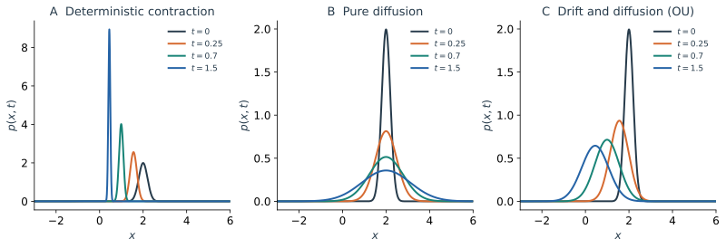

前三篇从不同的观察方式出发，研究了同一种随机运动：Langevin 方程描述粒子怎样一步步运动，Fokker–Planck 方程描述一群粒子的概率怎样重新分配，路径积分则保留一整段历史的统计权重。这一章把它们放在一起，重新问一次：给定其中一种描述，如何得到另外两种？每一步又需要哪些信息？

我们先在最熟悉的情形下工作：位置已经是闭合的 Markov 状态，漂移为 $b(x)$，扩散系数 $D>0$ 为常数，空间为整条实轴。这样可以看清主要关系；边界、惯性和状态依赖噪声会在最后单独讨论。

## 4.1 从一小步看三种描述 {#one-step}

想象在时刻 $t$ 找到粒子位于 $x$。再过很短时间 $h$，它向哪里走尚不确定，但下一步的**条件分布**可以确定。对加性噪声的 Langevin 方程

$$
dx=b(x)dt+\sqrt{2D}\,dW_t,
$$

短时间增量的条件均值和方差分别为

$$
\langle\Delta x\mid x\rangle=b(x)h+o(h),\qquad
\langle(\Delta x)^2\mid x\rangle=2Dh+o(h).
$$

平均位移按 $h$ 缩放，典型随机位移却按 $\sqrt h$ 缩放。前者决定概率云的搬运，后者的平方与时间同阶，决定概率云的扩散。把这一步从所有可能的出发位置累加，得到密度演化；把连续各步的条件概率相乘，得到历史的权重。

| 描述 | 要保留的对象 | 回答的问题 |
| --- | --- | --- |
| Langevin | 当前状态与随机增量 | 一次运动如何随噪声发展？ |
| Fokker–Planck | 每个位置的概率密度及其流 | 初始概率云如何移动、展宽或弛豫？ |
| 路径积分 | 一系列中间位置及其联合权重 | 满足条件的历史有哪些，各占多大权重？ |

共同的桥梁是转移密度 $G(x,t\mid x_0,0)$。它给定起点以后终点的分布。对一个 Markov 模型，知道所有时间间隔的转移核，便可把多个时刻的条件分布依次拼接；而仅有某一个时刻的密度，通常不足以恢复时间顺序。

## 4.2 从 Langevin 到 Fokker–Planck {#langevin-to-fp}

先从一条轨道计算可观测量 $f(x)$ 的变化。虽然 $\Delta x$ 很小，它的平方却不能忽略：$\langle(\Delta x)^2\rangle$ 与 $h$ 同阶。对光滑的 $f$ 展开并取条件平均，

$$
\langle f(x+\Delta x)-f(x)\mid x\rangle
=\left[b(x)\frac{df}{dx}+D\frac{d^2f}{dx^2}\right]h+o(h).
$$

一次导数来自平均位移，二次导数来自随机位移的方差。这正是 Itô 公式中二次变差的物理作用：位移的正负在平均时抵消，位移平方却持续积累。再对所有当前位置按 $p(x,t)$ 平均，得到

$$
\frac{d}{dt}\int f(x)p(x,t)dx
=\int\left(b\frac{df}{dx}+D\frac{d^2f}{dx^2}\right)p(x,t)dx.
$$

在无穷远处边界项消失的条件下，将导数通过分部积分移到密度上。由于上式对任意合适的测试函数成立，

$$
\boxed{\frac{\partial p}{\partial t}=-\frac{\partial}{\partial x}(bp)+D\frac{\partial^2p}{\partial x^2}}.
$$

它也可以写成概率守恒 $\partial_t p=-\partial_xJ$，其中 $J=bp-D\partial_xp$。第一项将概率随漂移搬运，第二项描述随机位移在密度不均匀时造成的净流。轨迹上的随机方程因此给出确定的密度方程；这里的确定性指给定初始分布和动力学以后，分布的演化确定，而不是每次实验的结果相同。

反过来看，如果已知上式对**所有**初始分布成立，且已规定常数 $D$、状态空间及边界行为，就读出了局部漂移 $b$ 和扩散强度 $D$，可以构造相应的 Langevin 过程。只有某一次测得的 $p(x,t)$ 则一般不够：不同动力学可能产生相同的一时刻分布，多维情形还可能有不改变密度的环流。要恢复动力学，需要更多关于时间演化和流的信息。

## 4.3 从概率传播到路径权重，再回到概率密度 {#fp-to-path}

Fokker–Planck 方程配上初态 $\delta(x-x_0)$，给出传播核 $G(x,h\mid x_0,0)$。对 Markov 过程，中间时刻 $s$ 的位置若未观测，就要对所有可能的 $y$ 积分：

$$
G(x,T\mid x_0,0)=\int dy\,G(x,T\mid y,s)G(y,s\mid x_0,0).
$$

这是概率的收支：每条从 $x_0$ 到 $x$ 的历史都在时刻 $s$ 经过某个位置，把这些位置的贡献相加便得到终点密度。继续插入更多时刻，记 $t_k=kh$、$Nh=T$，得到

$$
G(x_N,T\mid x_0,0)=\int\prod_{k=1}^{N-1}dx_k\prod_{k=0}^{N-1}G(x_{k+1},h\mid x_k,0).
$$

保留中间位置时，核的乘积就是这组位置的联合条件密度；对中间位置积分，便回到只问终点的传播核。再对初始位置按 $p_0(x_0)$ 平均，即得 $p(x,T)=\int G(x,T\mid x_0,0)p_0(x_0)dx_0$。这就是从路径统计回到概率云的方式。

对于第一篇的 Langevin 模型，也可以直接从每一步的 Gaussian 噪声构造同一乘积。以前点 Euler 规则记 $\Delta x_k=x_{k+1}-x_k$，一步密度为

$$
G_h^{\mathrm E}(x_{k+1}\mid x_k)=\frac{1}{\sqrt{4\pi Dh}}
\exp\left[-\frac{[\Delta x_k-b(x_k)h]^2}{4Dh}\right].
$$

独立的噪声增量使各步密度相乘，指数中的代价便逐步相加：

$$
S_h[x]=\sum_{k=0}^{N-1}\frac{[\Delta x_k-b(x_k)h]^2}{4Dh},\qquad
\mathcal P_h=(4\pi Dh)^{-N/2}e^{-S_h[x]}.
$$

这里 $\mathcal P_h$ 是给定 $x_0$ 时关于后续 $N$ 个位置的密度。对一般漂移，这是一份**离散 Euler 模型的精确权重**，不等于原连续过程在有限 $h$ 下的精确核；在适当条件下，缩小步长才得到连续过程。路径积分是这套带归一化的时间切片构造的简写，而不是忽略归一化后的普通曲线求和。

对光滑参考曲线，$S_h$ 形式上对应 $\int_0^T[\dot x-b(x)]^2dt/(4D)$，表达实现该曲线所需的噪声代价。但典型 Brownian 路径不可微，不能把它直接作为普通光滑曲线代入；完整有限噪声的连续权重还取决于离散约定与相应因子。比较不同推导时，先确认它们使用的是同一时间切片和测度。

## 4.4 从短时路径权重回到 Fokker–Planck {#path-to-fp}

这条联系也可以倒过来检验。先将路径乘积中最后一步保留，其余中间位置全部积分。一步传播满足

$$
p(x,t+h)=\int dy\,G_h^{\mathrm E}(x\mid y)p(y,t).
$$

对这个式子直接展开 Gaussian 核会遇到依赖 $y$ 的漂移；更清楚的做法是再次用测试函数。给定出发点 $y$，Euler 增量 $\Delta x=b(y)h+\sqrt{2Dh}\,Z$，$Z$ 是标准 Gaussian。于是

$$
\int f(x)p(x,t+h)dx
=\int p(y,t)\left[f(y)+h\bigl(b(y)f'(y)+Df''(y)\bigr)\right]dy+o(h).
$$

两侧相减、除以 $h$ 并取极限，再把导数从 $f$ 移到 $p$，便重新得到 4.2 的 Fokker–Planck 方程。这里没有额外假定新的概率流：漂移流和扩散流都来自路径权重的一步均值与方差。

在常漂移 $b=v$ 时，还可以直接完成整段路径的积分。每一步都是均值 $vh$、方差 $2Dh$ 的独立 Gaussian 增量；将 $N$ 步相加，终点的均值为 $x_0+vT$，方差为 $2DT$。因此路径权重对所有中间位置积分的结果是

$$
G(x,T\mid x_0,0)=\frac{1}{\sqrt{4\pi DT}}
\exp\left[-\frac{(x-x_0-vT)^2}{4DT}\right].
$$

它正是漂移扩散方程从点初态出发的解：每一步的偏移累加成云的平移，每一步的方差累加成云的展宽。

因此，路径积分与密度方程之间不是两套互不相干的规则。前者保留中间位置，后者将这些位置积分掉并追踪剩下的单时刻分布。如果想求已经到达终点的样本在时刻 $s$ 的分布，则保留 $s$ 处的位置并除以终点密度：

$$
p(y,s\mid x_0,0;x_f,T)
=\frac{G(x_f,T\mid y,s)G(y,s\mid x_0,0)}{G(x_f,T\mid x_0,0)}.
$$

分子是经过 $y$ 再抵达终点的权重；分母完成条件化。这也说明，未条件化的传播和固定终点后的路径系综虽然使用同一动力学，回答的问题并不相同。

## 4.5 用 OU 过程对照三种计算 {#ou-comparison}

把抽象联系落到同一个例子。对 $\gamma>0$，考虑从固定位置 $x_0$ 出发的 OU 过程：

$$
dx=-\gamma x\,dt+\sqrt{2D}\,dW_t.
$$

**轨道视角：**积分因子给出

$$
x(t)=x_0e^{-\gamma t}+\sqrt{2D}\int_0^t e^{-\gamma(t-s)}dW_s.
$$

初始偏离指数衰减，每一次新的随机位移也会被随后的回复逐渐削弱。噪声积分为 Gaussian，其均值为零，方差是各时段独立贡献之和。因此位置的均值和方差为

$$
m(t)=x_0e^{-\gamma t},\qquad
\sigma^2(t)=\frac D\gamma(1-e^{-2\gamma t}).
$$

**概率视角：**同一个过程的密度满足

$$
\partial_t p=\gamma\partial_x(xp)+D\partial_x^2p,\qquad p(x,0)=\delta(x-x_0).
$$

轨道解告诉我们位置服从 Gaussian，所以传播核是

$$
G(x,t\mid x_0,0)=\frac{1}{\sqrt{2\pi\sigma^2(t)}}
\exp\left[-\frac{(x-m(t))^2}{2\sigma^2(t)}\right].
$$

将它代入密度方程即可检验：均值以速率 $\gamma$ 回到原点，方差先增长、最终停在 $D/\gamma$。前者体现回复，后者体现回复对扩散展宽的限制。对一般初始密度，用这个核按初始位置积分；有限时间的结果不一定仍是 Gaussian。

也可以直接从密度方程读取这两个结果：分别乘以 $x$ 和 $x^2$ 积分，边界项消失时，

$$
\frac{d\langle x\rangle}{dt}=-\gamma\langle x\rangle,\qquad
\frac{d\sigma^2}{dt}=-2\gamma\sigma^2+2D.
$$

点初态给出 $\langle x\rangle(0)=x_0$、$\sigma^2(0)=0$；解这两个收支式，就得到轨道计算中的均值和方差。密度方程中的 $-2\gamma\sigma^2$ 是回复造成的压缩，$2D$ 是噪声持续注入的宽度。

下面重看第二篇的概率云：三幅图从同一个有有限宽度的初态出发，分别展示单独的回复、单独的扩散和二者共同作用。它与上面的点初态不同，但竞争机制是相同的。

*图｜初始均值为 $2$、方差为 $0.04$。左图只有回复，中图只有扩散，右图将回复与扩散结合；三图的纵轴标度各自独立。*

**历史视角：**将同一个 OU 核按时间相乘，就得到任意有限组中间位置的联合密度。对其中未观测的位置积分，可回到上面的终点核；若固定终点，再按上一节的条件密度保留中间位置，就能讨论 OU bridge。单时刻的稳态 Gaussian 不能单独告诉我们粒子多快探索它；时间序列中的关联，以及由转移核构造的路径统计，保留了这份信息。

## 4.6 这些对应何时需要修改 {#scope}

首先要选对状态。第一篇的惯性方程 $m\ddot x=-dV/dx-\zeta\dot x+\eta(t)$ 中，相同位置的粒子可能有不同速度，因此单独的 $x$ 通常不能闭合为 Markov 过程。完整状态是 $(x,v)$；相应的密度在相空间演化。只有在速度弛豫足够快、满足过阻尼近似时，才可以使用上面的位置方程和位置传播核。

例如在平衡白噪声热浴中，$\langle\eta(t)\eta(s)\rangle=2\zeta k_{\mathrm B}T\delta(t-s)$，相空间密度 $P(x,v,t)$ 满足 Kramers 方程

$$
\partial_tP=-v\partial_xP+\frac1m\partial_v\!\left[\left(\frac{dV}{dx}+\zeta v\right)P\right]
+\frac{\zeta k_{\mathrm B}T}{m^2}\partial_v^2P.
$$

位置流由速度产生，摩擦和热噪声则分别在速度方向带来漂移与扩散。相空间的转移核同样可以拼成历史权重；消去速度得到位置描述时，还必须检查时间尺度和边界条件。

其次，局部方程必须配合初始条件与边界。反射边界限制概率流，吸收边界允许概率流出；同一个内部漂移扩散方程会因此得到不同的传播核和路径集合。对吸收问题，核的积分可小于一，缺少的概率对应已被吸收的历史。仅检查离散时刻是否越界，可能漏掉两次采样之间的穿越。

最后，如果噪声幅度依赖位置，必须明确随机积分约定。例如 Itô 方程 $dx=b(x)dt+\sqrt{2D(x)}dW_t$ 对应

$$
\partial_t p=-\partial_x(bp)+\partial_x^2[D(x)p],\qquad
J=bp-\partial_x[D(x)p].
$$

这时不能简单把常数扩散流中的 $D$ 换成 $D(x)$；不同积分约定下相同符号的漂移项也可能代表不同过程。[第五篇的随机微积分](/notes/nonequilibrium_statistical_physics/stochastic_dynamics/stochastic_processes/#ito-calculus)会解释这些规则。如果存在长记忆、跳跃或重尾等待，也需要重新选择完整状态或传播规律；第五篇将沿运动机制继续讨论。

回看整条主线：运动方程规定局部随机增量；增量的条件统计决定概率如何输运；条件转移的拼接则组织起整段历史。转换时明确状态、初态、边界和离散约定，三种描述便可以彼此检验，也各自保留最适合回答的问题。

**上一篇：**[Path Integrals：从终点分布到随机历史](/notes/nonequilibrium_statistical_physics/stochastic_dynamics/path_integrals/) · **下一篇：**[Stochastic Processes：随机过程与随机微积分导览](/notes/nonequilibrium_statistical_physics/stochastic_dynamics/stochastic_processes/)。
