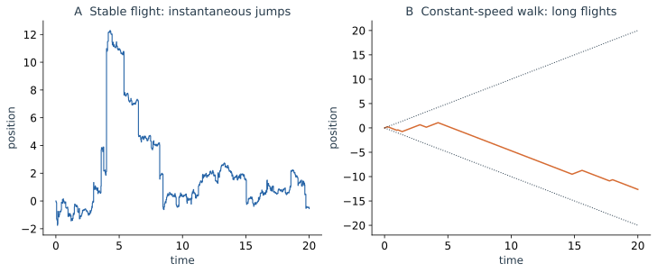
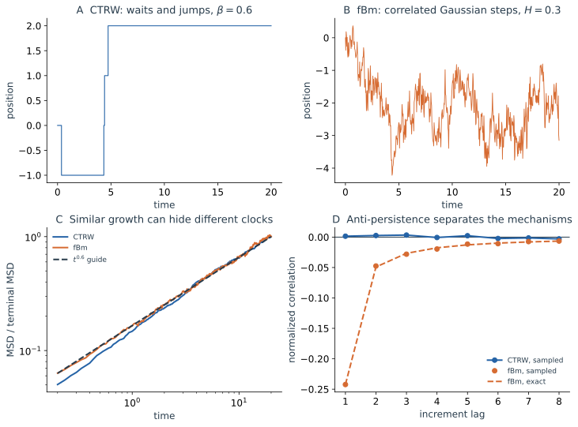

把几段随机运动记录放在一起：一段连续地细碎折返，一段长时间沿同一方向走，一段偶尔跳到很远，还有一段停在原地很久。仅用“受到了随机扰动”无法解释它们的区别。需要问清每一步有多大、何时发生，以及是否受到此前运动的影响。

前三篇以 Brownian 小步为基础，计算了轨迹、概率云和历史。这里沿用这份起点，逐一改变运动规则。先补足 Wiener 与 Itô 语言，再看回复、事件时钟、方向持续、重尾和相关增量各自带来什么。

## 4.1 先看运动机制，再看数学标签 {#process-map}

先回想普通无偏游走：等时间间隔、独立选方向、有限步长方差。在扩散极限中，它成为 Wiener 运动。只要改动其中一条规则，就可能离开普通扩散；不一定需要把所有规则同时换掉。

把固定的步进时间改为随机事件时刻，得到 Poisson 更新；让方向在事件之间保持，得到持续游走。若远距离位移远比 Gaussian 预言的常见，就要检查跳幅的重尾；若这份长位移必须花相应时间完成，又会从 flight 转向 walk。最后还可以让慢运动来自长等待，或来自相邻增量互相抵消。这两种机制都能使 MSD 增长变慢，却留下很不一样的记录。

前三篇一直用 $x(t)$ 描述粒子的运动。在概率论中，通常把同一随机过程记为 $\{X_t\}_{t\ge0}$：每个 $X_t$ 是给定时刻的随机变量，固定一次实验的初态与噪声实现，便得到一条具体的样本路径。下面采用这种过程记号；$X_t$ 与前面的 $x(t)$ 描述的是同一种随机运动。

本篇用 $\mathbb E[\cdot]$ 表示期望，它与前三篇的系综平均 $\langle\cdot\rangle$ 含义相同；竖线后的条件说明在哪一组已筛选的实验中平均。此前的条件平均也保留过 $\mathbb E[\cdot\mid\cdot]$ 写法。稳态仍统一用下标 $\mathrm{st}$，不另用符号区分有流与无流的稳态。

下表可在阅读后返回查找性质，无需先记住所有标签。

| 标准或典型模型 | 路径与运动机制 | Markov 状态 | 代表性统计 |
| --- | --- | --- | --- |
| Wiener / Brownian | 连续粗糙；独立 Gaussian 增量 | 位置本身 | MSD 正比于 $t$；位置非平稳 |
| OU | 连续粗糙；线性回复与 Gaussian 扰动 | 位置本身 | 可有平稳分布，时间关联非零 |
| 齐次 Poisson / 复合 Poisson | 计数或位置瞬时跳跃 | 计数或位置 | 指数等待；独立平稳增量 |
| 一维 run-and-tumble | 有限速度；随机翻向 | $(X,\sigma)$；单独 $X$ 通常不够 | 短时弹道、长时扩散 |
| 对称稳定 Lévy flight | 重尾增量；含瞬时跳跃 | 位置本身 | $0\lt \alpha\lt 2$ 时二阶矩发散 |
| 经典恒速 Lévy walk | 长飞行；位移与时长耦合 | 单独位置通常不够 | 有限传播范围，可超扩散 |
| 重尾等待 CTRW | 平台与跳跃；长时间陷获 | 单独位置通常不够 | 次扩散、年龄依赖 |
| fBm，$H\ne1/2$ | 连续 Gaussian；相关增量 | 一般非 Markov | 方差 $t^{2H}$，可持续或反持续 |

判断 Markov 性，需要问当前完整状态是否已包含预测未来所需的信息。惯性粒子只记录位置会漏掉速度；加入速度以后才可能闭合。不能从轨迹“抖动得很随机”判断 Markov 性，也不能从直方图像 Gaussian 就推断增量独立。下面 OU 和 fBm 的比较会用到这些区别。

这里的“平稳”还须区分对象：位置本身的联合分布不随整体平移时间改变，才叫过程平稳；只要求等时长增量的分布相同，则是增量平稳。Wiener 属于后者，稳态准备的 OU 才属于前者。过程模型还须同计算工具分开：Itô/Stratonovich 是积分规则，Fokker–Planck 描述密度，路径积分组织历史；它们不是与 OU、Poisson 并列的运动模型。

## 4.2 Wiener：连续扩散怎样由小步组成 {#wiener}

要具体生成一条自由 Brownian 记录，选择步长 $h$，独立抽取 $Z_k\sim\mathcal N(0,1)$，令 $\Delta W_k=\sqrt h Z_k$，再累加这些增量。缩小步长时，这个构造趋向标准 Wiener 过程：

$$
W_0=0,\qquad W_t-W_s\sim\mathcal N(0,t-s)\quad(t>s),
$$

不相交区间上的增量独立，样本路径连续。对 $t\ge s$，写 $W_t=W_s+(W_t-W_s)$，后面的增量与 $W_s$ 独立且均值为零，因而

$$
\mathbb E[W_tW_s]=\min(t,s),\qquad
\mathbb E[(W_t-W_s)^2]=|t-s|.
$$

$\operatorname{Var}(W_t)=t$ 持续增大，所以位置并不平稳；任意等时长增量却有相同分布。乘上 $\sqrt{2D}$ 并加上初态，就得到[第一篇的自由位置过程](/notes/nonequilibrium_statistical_physics/stochastic_dynamics/langevin/)。

例如，将采样间隔缩短到原来的四分之一，典型位移缩小为一半，但“位移除以间隔”的典型大小反而加倍。这份差商不会趋向有限速度；Brownian 路径几乎处处没有普通切线。形式白噪声 $\xi=\dot W$ 因而只能通过时间积分理解。计算位置的非线性函数时，这份短时粗糙性会留下可以测量的结果。

## 4.3 Itô：随机增量的平方为什么不能丢掉 {#ito-calculus}

Itô 不是另一种运动模型，而是用什么信息定义随机积分、怎样对该积分运算的规则。最短的例子是平方：每一步有

$$
W_{k+1}^2-W_k^2=2W_k\Delta W_k+(\Delta W_k)^2.
$$

对整段时间相加，最后一项不会像光滑运动那样消失：在分割变细时，$\sum_k(\Delta W_k)^2\to t$（依概率收敛）。所以

$$
d(W_t^2)=2W_t\,dW_t+dt.
$$

这是二次变差的作用。把固定时长切成 $N$ 份，每个随机位移平方约为 $1/N$，总共 $N$ 份，贡献仍有限；光滑位移的平方则约为 $1/N^2$，总和趋于零。

考虑 Itô 扩散

$$
dX_t=b(X_t,t)\,dt+\sigma(X_t,t)\,dW_t.
$$

这里 $\sigma(X,t)$ 是噪声振幅，单位为位置除以时间的平方根；$\sigma^2(X,t)dt$ 给出一步噪声的条件方差。前三篇的 $\sigma^2(t)$ 则表示整个位置分布的方差，两处记号可由自变量和单位区分。

先对 $f(X,t)$ 作 Taylor 展开。一次项保留 $f_x\Delta X$，二次项 $f_{xx}(\Delta X)^2/2$ 的主要部分为 $f_{xx}\sigma^2\Delta t/2$；$\Delta t\Delta W$ 和更高阶项在适当正则条件下消失。因此

$$
\boxed{df(X_t,t)=
\left[f_t+b f_x+\frac{\sigma^2}{2}f_{xx}\right]dt
+\sigma f_x\,dW_t}.
$$

这就是 Itô 公式。额外的二阶导数项把随机轨道的粗糙性转化成了可观测量的系统性变化。

也可以从测量函数的曲率理解这个项。把一个点左右对称地随机移动一点，位置的平均值没有改变；但若探测器读数是位置平方，两边移动都会让读数增大。对于一般弯曲的 $f(x)$，正负位移对读数的影响也不完全抵消，留下的量由局部曲率 $f_{xx}$ 决定。Itô 修正记录了这种“零平均扰动经过非线性测量后产生平均变化”的效应。

例如自由扩散 $dX=\sqrt{2D}\,dW$ 的平均位置不动，但

$$
d(X^2)=2D\,dt+2\sqrt{2D}X\,dW,
\qquad \frac{d}{dt}\langle X^2\rangle=2D.
$$

噪声平均为零，并不意味着它对二阶量没有平均效应。扩散展宽正来自独立随机增量的平方累积。

第二篇 OU 方差收支中的 $2D$ 就来自这里。若沿用光滑曲线的链式法则而漏掉二次项，会错误地得到方差只衰减、不再补充的结果。首次阅读掌握 Itô 公式及这个例子，就足以继续使用前面的加性噪声模型；以下积分约定用于处理噪声强度也依赖状态的情况，等距关系的细算放在本节末选读框。

### 随机积分约定与乘性噪声

对于普通积分，区间左端或中点取值在极限中通常没有差别。对于随机积分，被积函数也会随同一个噪声变化，这种差别能够留下有限贡献。

物理上的关键在于：这一小步的随机扰动，是作用在扰动到来之前的状态上，还是用已经被这一步改变过的状态来计算它的作用强度？如果噪声振幅处处相同，这个差别无关紧要；如果振幅依赖位置，同一次扰动既改变位置，又改变它自身被计入的幅度，相关性就可能累积成可观测的漂移。

Itô 积分使用每步左端的状态：

$$
\int_0^t X_s\,dW_s
=\lim\sum_n X_{t_n}(W_{t_{n+1}}-W_{t_n}).
$$

在适应性和平方可积条件下，左端系数不使用未来增量，所以这份积分均值为零。Stratonovich 积分以对称取值定义，记作 $\circ dW$，保留普通形式的链式法则，但其中的系数已经与本步噪声相关，均值未必为零。若要让两种写法描述同一过程，就得把这份额外的平均效果补偿进漂移。

对于一维乘性噪声，相同过程的两种表达为

$$
dX=b_{\mathrm S}(X)\,dt+\sigma(X)\circ dW
$$

和

$$
dX=\left[b_{\mathrm S}(X)+\frac12\sigma(X)\sigma'(X)\right]dt
+\sigma(X)\,dW.
$$

选择约定时要同时转换漂移。若 $\sigma$ 为常数，两者的方程相同；若 $\sigma$ 依赖状态，保持同一漂移再改变积分约定就改变了模型。由平滑有色外力取某类短关联时间极限时常得到 Stratonovich 形式；由离散跳跃过程的条件增量得到扩散近似时常自然得到 Itô 形式。具体粗粒化和同时消去哪些变量，决定正确的极限，不能仅靠“物理噪声”四个字选择。
使用转换后的 Itô 漂移 $b_{\mathrm I}=b_{\mathrm S}+\sigma\sigma'/2$，一般密度方程是

$$
\frac{\partial p(x,t)}{\partial t}
=-\frac{\partial}{\partial x}[b_{\mathrm I}(x)p(x,t)]
+\frac12\frac{\partial^2}{\partial x^2}[\sigma^2(x)p(x,t)].
$$

导数作用于整个 $\sigma^2p$，不能将常数扩散流机械替换为 $-D(x)p_x$。当 $\sigma=\sqrt{2D}$ 为常数时，转换修正为零，二阶项就是第二篇的 $Dp_{xx}$。用 Itô 公式核对密度方程的分部积分过程保留在[选读附录 B](#用-itô-公式核对概率输运)。

选读计算：Itô 等距与左端、对称求值的差别

要计算一个加权噪声积分的方差，可先在有限分割上令 $I=\sum_k H_{t_k}\Delta W_k$。系数可以由此前的随机运动决定，但不能提前使用本步噪声。对不同步的交叉项，先对较晚的新增量取条件平均，结果为零；平方项则贡献 $\mathbb E[H_{t_k}^2]\Delta t_k$。取适当的均方极限，得到 **Itô 等距**

$$
\mathbb E\left[\left(\int_0^t H_s\,dW_s\right)^2\right]
=\mathbb E\int_0^t H_s^2\,ds.
$$

第一篇 OU 的加权噪声方差就是这条关系的确定性系数特例。它把随机积分的平方平均，转成普通的时间积分。

再取 $H=W$。由本节开头的离散平方恒等式直接得到

$$
\int_0^t W_s\,dW_s=\frac12(W_t^2-t).
$$

若改用区间两端的平均值，则每一步恰好满足 $\tfrac12(W_{k+1}+W_k)\Delta W_k=\tfrac12\Delta(W_k^2)$，因而

$$
\int_0^t W_s\circ dW_s=\frac12W_t^2.
$$

前一积分均值为零，后一积分均值为 $t/2$。二者的差由被求值系数与当前噪声的关联产生，正是乘性噪声转换不能省去漂移修正的一个具体例子。

## 4.4 OU：有回复、有关联，为什么仍然 Markov {#ou-model}

Wiener 位置会不断展宽。加上线性回复后，位置可以在稳定点附近长期涨落，仍保留连续路径与 Gaussian 驱动：

$$
dX_t=-\gamma(X_t-\bar x)dt+\sqrt{2D}\,dW_t,
\qquad\gamma>0.
$$

[第一篇](/notes/nonequilibrium_statistical_physics/stochastic_dynamics/langevin/#ou-trajectories)已求过解，[第二篇](/notes/nonequilibrium_statistical_physics/stochastic_dynamics/fokker_planck/#ou-density)已解释概率云。此处的问题是：回复造成的时间关联，是否意味着预测未来必须保存过去的整段记录？先比较平稳性。Wiener 从固定点出发没有位置稳态，OU 在稳态准备时却有均值 $\bar x$、方差 $D/\gamma$，连通关联只依赖时间差，为 $(D/\gamma)e^{-\gamma|t-s|}$。若 OU 也从固定点出发，最初仍有弛豫，并非一开始就平稳。

从当前时刻向后看一小段，

$$
X_{t+h}-\bar x=e^{-\gamma h}(X_t-\bar x)+Z_{t,h},
\qquad
\operatorname{Var}(Z_{t,h})=\frac D\gamma(1-e^{-2\gamma h}),
$$

其中 $Z_{t,h}$ 是均值为零、与此前历史独立的 Gaussian 新增量。挑两条此前走法完全不同、但时刻 $t$ 恰好到达相同位置的记录：它们接下来的条件分布完全一样。更早的记录不再提供额外预测信息，这就是 Markov 性。

若不告知当前值，只告知较早位置，仍可预测当前值偏向哪边，所以两个时刻有关联。关联比较未条件化的读数，Markov 性则问在**已知当前值以后**，过去还提供什么。OU 的位置增量也不像 Wiener 那样彼此独立：当前位置偏右时，下一段平均增量会偏左。

### 将 OU 当作有色噪声，又会怎样

若环境扰动本身要经过时间 $\tau_c$ 才遗忘，可以令

$$
d\eta_t=-\frac{\eta_t}{\tau_c}dt+\sigma_\eta dW_t,
\qquad dX_t=[b(X_t)+\eta_t]dt.
$$

稳态环境的关联为 $(\sigma_\eta^2\tau_c/2)e^{-|t-s|/\tau_c}$，在时间 $\tau_c$ 内保持同向驱动的倾向，因此称为有色噪声。对粒子运动而言，不能把这段持续性当作每一步都重新抽样的白噪声。

联合状态 $(X_t,\eta_t)$ 可闭合为 Markov 过程；只知道 $X_t$，一般还不知道当前的驱动偏向。同一位置可能由正的环境驱动推来，也可能由负的驱动推来，紧接着的运动会不同。此时过去的位置记录能帮助推测隐藏的 $\eta_t$，于是单独位置显出记忆。过程是否 Markov，始终要连同所记录的状态一起说。

## 4.5 Poisson 与跳跃：随机性也可以是一件件事件 {#poisson-jumps}

现在改变运动的时钟。格点游走规定每隔固定时间迈一步，但一次反应或一次跃迁未必按钟点发生。最简单的假设是事件有恒定发生率 $r$：短时间 $h$ 内发生一次的概率为 $rh+o(h)$，多次事件的概率为 $o(h)$，不相交时间窗的事件独立。这定义齐次 Poisson 计数。

令 $P_n(t)=\Pr(N_t=n)$。计数从 $n-1$ 流入 $n$，又会由下一次事件流出 $n$，两份速率都是 $r$：

$$
\frac{dP_n(t)}{dt}=rP_{n-1}(t)-rP_n(t),
\qquad P_n(0)=\mathbf1_{n=0}.
$$

先解 $P_0=e^{-rt}$，再逐个积分，得到

$$
\Pr(N_t=n)=e^{-rt}\frac{(rt)^n}{n!},
\qquad\mathbb EN_t=\operatorname{Var}(N_t)=rt.
$$

从 $P_0(t)$ 还可读出首次等待的密度 $\psi(\tau)=re^{-r\tau}$。已经等了一个平均等待时间 $1/r$，并不意味着事件“该来了”：下一小段仍以相同的率发生。这份无记忆性使当前计数足以预测后续统计。$N_t$ 本身随时间增加，非平稳；增量分布却只依赖时间窗长度。后面 CTRW 将专门改变这条等待规则。

### 计数发生一次，与位置跳一步是不同对象

若第 $k$ 次事件带来独立位移 $Y_k$，且跳幅与事件时间独立，则

$$
X_t=X_0+\sum_{k=1}^{N_t}Y_k
$$

是复合 Poisson 过程。对有限二阶矩的跳幅，$\mathbb E(X_t-X_0)=rt\mathbb EY$，$\operatorname{Var}(X_t-X_0)=rt\mathbb E(Y^2)$。后一式同时包含跳幅随机和事件数随机；即使每次同向跳固定距离，计数起伏仍会造成位置方差。

对离散状态 $i\to j$ 的事件率 $w_{i\to j}$，概率收支推广为主方程

$$
\boxed{\frac{dp_i(t)}{dt}
=\sum_{j\ne i}\left[w_{j\to i}p_j(t)-w_{i\to j}p_i(t)\right]}.
$$

每一项都是流入减流出，与第二篇的守恒思路相同。连续 Gaussian 小步不是唯一机制：有限的大跳需要保持非局部转移；只有跳幅变小、事件加快并有适当矩条件时，才可取漂移扩散极限。不能把重尾大跳无条件截成局部二阶 Fokker–Planck 方程。

## 4.6 持续游走：方向不必每一瞬间重新选择 {#persistent-walk}

Poisson 事件也可以改变方向，而不直接改变位置。让粒子在两次事件之间以速率 $v$ 直行，事件到来时将方向 $\sigma_t=\pm1$ **翻转**，翻转率记为 $\alpha$。这是一维 run-and-tumble 模型。刚开始的一小段里，粒子通常还未换向，不能把相邻位移当作独立 Brownian 小步。从左右等概率的方向初态出发，平均位移为零，单条路径却先是一段段直行：

$$
dX_t=v\sigma_t\,dt.
$$

若到时刻 $t$ 翻转 $N_t$ 次，$\sigma_t\sigma_0=(-1)^{N_t}$。Poisson 求和给出 $\mathbb E[(-1)^{N_t}]=e^{-2\alpha t}$，因此方向的关联时间为 $1/(2\alpha)$。这里的 $\alpha$ 指翻转率；若文献规定“重新随机选方向”的事件率，数值中的因子 2 会随约定改变。

像第一篇积分速度关联一样，

$$
\begin{aligned}
\langle[X_t-X_0]^2\rangle
&=2v^2\int_0^t(t-s)e^{-2\alpha s}ds\\
&=\frac{v^2}{\alpha}t
-\frac{v^2}{2\alpha^2}(1-e^{-2\alpha t}).
\end{aligned}
$$

短时为 $v^2t^2$，长时为 $2D_{\mathrm{eff}}t$，其中 $D_{\mathrm{eff}}=v^2/(2\alpha)$。保持速度不变而减少翻转率，粒子沿同一方向走得更久，长时扩散反而更快。这里没有靠增大每步噪声来加快展宽，改变的是方向持续的时间。

这个跨越与[惯性粒子的图 1a](/notes/nonequilibrium_statistical_physics/stochastic_dynamics/langevin/#inertial-msd)形式相同；将相关时间换成 $1/(2\alpha)$、速度方差换成 $v^2$，速度关联的积分便相同。但一个来自热速度弛豫，一个来自随机换向；即使完整 MSD 恰好一致，速度分布和单条记录仍能区分它们。

单独的位置一般不足以预测下一小步，因为还需要知道向哪边走；联合状态 $(X,\sigma)$ 才闭合。最简模拟也不必每步抽 Gaussian 数：独立抽指数等待 $-\log U/\alpha$，沿当前方向走完这一段，再翻转方向。持续游走和扩散近似的联系可对照 [MIT 随机游走讲义](https://ocw.mit.edu/courses/18-366-random-walks-and-diffusion-fall-2006/pages/lecture-notes/)。

## 4.7 Lévy flight 与 walk：长跳不等于长时间飞行 {#levy-flight-walk}

持续游走已经放弃了独立方向，但速度有限、翻向等待仍为指数分布。若实验里还频繁出现特别长的一次位移，需要继续问：是跳幅本身很大，还是粒子沿同一方向走了特别久？先只改变增量的尾部，再检查有限速度会增加什么限制。

### Lévy flight：重尾增量和瞬时跳跃

选择典型的一维对称稳定 Lévy 过程，其独立平稳增量满足

$$
\mathbb E\,e^{ik(X_t-X_0)}=e^{-Kt|k|^\alpha},
\qquad K>0,\quad0\lt \alpha\lt 2.
$$

$K$ 的单位是长度的 $\alpha$ 次方除以时间。特征函数依赖 $k(Kt)^{1/\alpha}$，故分位宽度等典型尺度正比于 $t^{1/\alpha}$。独立小步相加后仍保持这种稳定分布的形状，只改变尺度；普通 Gaussian 极限所需的有限步长方差在这里已失效。

因此这个宽度不能解释成均方位移：$\alpha\lt2$ 时二阶矩发散。有限样本当然能算出一个平方平均，但偶然出现的一次极大跳跃就可能将它大幅改写；增加样本也不会使它收敛到一个有限理论 MSD。较合适的是分位宽度或 $0\lt q\lt\alpha$ 的绝对矩。

这个过程是非 Gaussian、含跳跃的 Markov 过程，有独立增量；它没有规定最大传播速度。不能因平均图像像“更快扩散”，就继续使用 Brownian 的局部小步解释。

### Lévy walk：位移与飞行时长耦合

经典恒速模型每次选择方向和飞行时长 $\tau$，以速度大小 $v$ 持续前进，飞行结束再更新。若 $\psi(\tau)\sim\tau^{-1-\alpha}$，会出现长直行；位移大小 $|\ell|=v\tau$ 与耗时相连，因此任意有限时间都有传播范围 $|X_t-X_0|\le vt$。

在常见的一维恒速、独立对称方向更新模型中，当 $1\lt\alpha\lt2$，平均飞行时长有限、二阶矩却发散，长时可有 $\langle\Delta X^2\rangle\propto t^{3-\alpha}$。极少数持续很久的直行对 MSD 贡献显著，普通扩散因而不再成立。但在任意给定时刻，有限速度前沿都截住了可达距离，所以这里的 MSD 有限。这个结论针对上述模型和指数区间；改变速度规则、等待或初始年龄时需重新计算。

看下图时，先分辨长距离是怎样出现在记录上的：左侧是一跃而过，右侧是一段有斜率的长直线。右侧的虚线同时给出任何样本都不能越过的速度前沿。

*图 4a｜两图取尾指数 $\alpha=1.3$、$X_0=0$、观察时长 20。左图为 $K=1$ 的对称稳定 flight，在网格上采样，以阶梯连线标出跳跃；它没有画出每格内部更小的跳跃，阶梯不代表额外陷获。右图从新飞行开始，速度大小 $v=1$，飞行时长取尺度 $\tau_0=0.3$ 的 Lomax 分布、方向独立等概率；虚线为有限速度前沿。这里展示路径机制，不用 flight 的样本 MSD 推断不存在的理论二阶矩。*

右图的大位移必须占用相应时长；若把它误画成瞬时跳跃，就会丢掉位移与耗时的关联。反过来，若事件本来只是短于观测分辨率的一次跃迁，跳跃模型又可能是合适的有效描述。[Zaburdaev、Denisov 与 Klafter 的综述](https://doi.org/10.1103/RevModPhys.87.483)系统区分了这些模型。

## 4.8 CTRW：有时次扩散是因为很久没有迈出一步 {#ctrw}

Lévy walk 的长时段仍在走；重尾等待 CTRW 却可以很久不动。每次先等一个独立时间 $\tau_k$，再跳一个独立、零均值、有限方差 $\sigma_Y^2$ 的位移 $Y_k$，两组随机量彼此独立。从时刻零开始一次新的等待，令完成的步数为 $N(t)$：

$$
X_t-X_0=\sum_{k=1}^{N(t)}Y_k,
\qquad \psi(\tau)\sim c\tau^{-1-\beta},\quad0\lt \beta\lt 1.
$$

这里改变的是 Poisson 模型的指数等待，跳幅本身可以和普通无偏游走完全相同。因为 $\beta\lt1$，平均等待发散，某些记录会被极长的平台占据；不能再用一个有限平均等待时间将物理时间换算为步数。

### 从等待分布算出步数标度

先给定完成步数 $N=n$。独立零均值跳幅的交叉项平均为零，位移方差就是 $n\sigma_Y^2$；再对随机步数平均，得到

$$
\langle[X_t-X_0]^2\rangle=\sigma_Y^2\,\mathbb EN(t).
$$

所以不用改变每一步的空间运动，就能改变扩散律。对上述等待尾部，平均步数 $m(t)=\mathbb EN(t)$ 在长时按 $t^\beta$ 增长，MSD 也按 $t^\beta$ 增长。次扩散来自走完的步数太少，不是每一步都被一个回复力拉回。这个结论要求无偏、有限方差且与等待独立的跳幅；有偏或耦合更新需要另外计算。

选读计算：用 Laplace 变换确定平均步数及其系数

至少走完 $n$ 步，需要前 $n$ 次等待之和不超过 $t$。对任意非负整数计数，$\mathbb EN=\sum_{n\ge1}\Pr(N\ge n)$。将这些完成概率作时间 Laplace 变换，每个累积概率带来 $1/s$，独立等待的卷积变为乘积：

$$
\widetilde m(s)
=\frac1s\sum_{n=1}^\infty[\widetilde\psi(s)]^n
=\frac{\widetilde\psi(s)}{s[1-\widetilde\psi(s)]}.
$$

对上述重尾，低频行为为 $1-\widetilde\psi(s)\sim a_\beta s^\beta$，$a_\beta>0$ 的单位是时间的 $\beta$ 次方。于是 $\widetilde m(s)\sim1/(a_\beta s^{1+\beta})$，利用 $t^\beta$ 的 Laplace 变换，得到长时

$$
m(t)\sim\frac{t^\beta}{a_\beta\Gamma(1+\beta)},
\qquad\langle[X_t-X_0]^2\rangle
=\sigma_Y^2m(t)\propto t^\beta.
$$

系数 $a_\beta$ 取决于等待分布的具体尺度，指数 $\beta$ 由长尾决定。例如本专题数值图使用 $\psi(\tau)=\beta\tau_0^\beta/(\tau+\tau_0)^{1+\beta}$，这时 $a_\beta=\Gamma(1-\beta)\tau_0^\beta$。低频渐近对应长时；有限时数值不必处处落在一条纯幂律上。[MIT 的 CTRW 讲义](https://ocw.mit.edu/courses/18-366-random-walks-and-diffusion-fall-2006/f3713d068fc4f5de471d599badfa9691_lec23_chris_06.pdf)从同一更新结构展开。

### 已经等了多久，可能影响接下来多久会动

Poisson 等待满足 $\Pr(\tau>a+h\mid\tau>a)=e^{-rh}$，与已经等了多久的 $a$ 无关。重尾等待一般做不到。例如，Lomax 等待的存活概率为 $\Pr(\tau>a)=[\tau_0/(\tau_0+a)]^\beta$，$\tau_0$ 为正的时间尺度；其条件存活概率便是 $[(\tau_0+a)/(\tau_0+a+h)]^\beta$。已经等得越久，未来一段给定时长里继续不动的概率反而越大。

整段记录也会显出年龄。系统从制备开始已经过 $t_a$，未来观察窗长为 $T$ 时，平均新增步数为 $m(t_a+T)-m(t_a)$。在上述长时区间，相应位移平方平均正比于 $(t_a+T)^\beta-t_a^\beta$；固定 $T$、增大 $t_a$，活动会减少。比较运动快慢时，只写观察窗长度而不写何时开始观察，已不足以定义同一份统计。

只记录位置通常不是 Markov，因为还缺当前等待的年龄；加入它可以建立扩充状态的更新模型。若把一条记录中的长平台误当作许多独立的“零位移步”，便会丢掉这份年龄信息。

## 4.9 fBm：同样的幂律，也可能来自相关增量 {#fractional-brownian}

保留 Gaussian 增量，也能得到次扩散：不再让它们独立，而让刚才的位移容易被后来的位移抵消。这个模型不需要等待时钟。标准化的 fractional Brownian motion $B_H(t)$ 是零均值 Gaussian 过程，$B_H(0)=0$，具有连续路径与协方差

$$
\mathbb E[B_H(t)B_H(s)]
=\frac12\left[t^{2H}+s^{2H}-|t-s|^{2H}\right],
\qquad0\lt H\lt 1.
$$

它给出 $\operatorname{Var}(B_H(t))=t^{2H}$；位置非平稳，增量平稳。恢复物理单位可用 $X_t=X_0+\sqrt{2K_H}B_H(t)$，其中 $K_H$ 的单位是长度平方除以时间的 $2H$ 次方。$H=1/2$ 恰好恢复 Wiener。

等时长增量 $\Delta B_k=B_H((k+1)h)-B_H(kh)$ 的相关性，可以直接从协方差相减得到。相隔 $n\ge1$ 步时，标准化关联为

$$
\rho(n)=\frac12\left[(n+1)^{2H}+|n-1|^{2H}-2n^{2H}\right].
$$

$H>1/2$ 时正相关，前一步的方向较易延续；$H\lt1/2$ 时负相关，较易反向抵消。可以把总位移方差写成各步方差之和再加所有步对的协方差：正关联增加展宽，负关联压低展宽。每段时间都可以有新的位移，慢扩散却来自它们相互抵消，与 CTRW 的少走几步完全不同。除 $H=1/2$ 外，fBm 一般非 Markov，也不能直接照搬普通 Wiener 驱动的 Itô 规则。

### 相同次扩散指数的两种运动

取 $\beta=2H=0.6$，两种过程都有系综 MSD 正比于 $t^{0.6}$。下面先看上排：CTRW 在长平台之间更新，fBm 持续起伏；再看下排，MSD 的相似增长是否掩盖了增量关联的差别。

*图 4b｜CTRW 从新等待开始，$\beta=0.6$、Lomax 等待尺度 $\tau_0=0.05$、独立对称单位跳幅；fBm 取 $H=0.3$，用相关 Gaussian 增量的协方差矩阵生成。上方为各一条样本；下方使用 1024 条实现，分别比较归一化 MSD 的趋势与等间隔增量的关联。MSD 各自除以终值以比较形状，CTRW 在有限时间仍有更新瞬态；平台与反持续关联已能区分机制。*

下排右图里，CTRW 的无偏独立跳幅不产生非零延迟的有符号增量关联，但这绝不表示更新时钟没有记忆；记忆藏在活动何时发生。fBm 则直接留下负的增量关联。若将所有记录压成一条 MSD 曲线，两份信息都会丢失。

## 4.10 怎样从记录中诊断运动，而非只拟合一个指数 {#diagnosis}

有限采样会把很快的运动压成一个跳跃，也会把微小位移藏成平台。先明确时间分辨率、定位误差和事件识别规则，再比较多种统计：

| 观察对象 | 能帮助识别什么 | 不能单独断言什么 |
| --- | --- | --- |
| 轨迹形状 | 长直行、平台、跳跃或连续粗糙 | 有限分辨率不能证明真正瞬时跳跃 |
| MSD 与有效斜率 | 展宽随时间增长的快慢 | 相同指数不固定机制；稳定 flight 无有限二阶矩 |
| 位移尾部、分位宽度 | Gaussian、重尾、有限速度前沿 | 有限样本尾部拟合可能很不稳定 |
| 速度或增量关联 | 持续、反持续与记忆时间 | 有关联不等于非 Markov |
| 等待和停留时间 | 陷获与年龄依赖 | 需要先定义一次事件或一个区域 |
| 条件转移 | 当前状态是否足够 | 隐藏速度或内部态可能制造表观记忆 |
| 时间平均与系综平均 | 准备、年龄和测量时长的作用 | 单条短记录不足以确立遍历性质 |

不必同时拟合所有模型。若看到了明显长直行，先测方向关联和速度；若看到了长平台，先检查事件识别与等待分布，再比较制备后不同时段的活动。若轨迹连续却有次扩散，可以测等时间增量的正负关联。前面的 CTRW 与 fBm 便会在这些检查中分开。

另一个实用问题是：把同一条记录延长，测得的活动强度会不会系统改变？这需要把“许多次实验在同一时刻平均”与“同一条实验沿时间平均”区分开。以下给出一种具体计算，初次阅读可以先接选读附录或返回专题首页。

选读计算：时间平均 MSD 怎样区分 CTRW 与 fBm

固定延迟 $\Delta$，在一条总长 $\mathcal T$ 的记录上滑动时间窗，定义

$$
\overline{\delta^2}(\Delta)
=\frac1{\mathcal T-\Delta}\int_0^{\mathcal T-\Delta}
[X_{t+\Delta}-X_t]^2dt.
$$

对标准 fBm，每个滑动窗的平方位移平均都为 $\Delta^{2H}$，所以

$$
\mathbb E\,\overline{\delta^2}(\Delta)=\Delta^{2H}.
$$

这个期望不依赖测量总时长 $\mathcal T$，因为增量平稳。它并不保证每条有限记录都给出相同结果；记录之间的起伏还需单独分析。

对从新等待开始、无偏且有限跳幅方差的 CTRW，时间窗内的平方位移平均为 $\sigma_Y^2[m(t+\Delta)-m(t)]$。先对轨迹集合平均，再整理时间积分，有

$$
\begin{aligned}
\mathbb E\,\overline{\delta^2}(\Delta)
&=\frac{\sigma_Y^2}{\mathcal T-\Delta}
\int_0^{\mathcal T-\Delta}[m(t+\Delta)-m(t)]dt\\
&=\frac{\sigma_Y^2}{\mathcal T-\Delta}
\left[\int_{\mathcal T-\Delta}^{\mathcal T}m(u)du
-\int_0^\Delta m(u)du\right]\\
&\sim\frac{\sigma_Y^2}{a_\beta\Gamma(1+\beta)}
\Delta\mathcal T^{\beta-1}.
\end{aligned}
$$

最后一步取 $\mathcal T\gg\Delta$ 的长时极限，使用 $m(t)\sim t^\beta/[a_\beta\Gamma(1+\beta)]$。固定延迟时，测量值的期望随记录延长而减小，因为后期窗口平均包含的更新更少。它还对 $\Delta$ 近似线性，而非系综 MSD 的 $\Delta^\beta$。同一个幂律系综展宽，可以伴随不同的时间平均行为；更完整的有限记录统计可参见 [Deng 与 Barkai 的原始研究](https://arxiv.org/abs/0809.2430)。

图 4b 的复现脚本还输出两种过程在前后等长观察窗内的平均新增步数或位移平方，以及改变测量总时长后的时间平均量。

在图 4b 的同一组无量纲记录里，取延迟 $\Delta=0.2$，1024 条实现给出下表。比较同一行随测量时长的变化，而非将不同模型的绝对幅度相互等同：

| 过程 | 测量时长 $\mathcal T=10$ | 测量时长 $\mathcal T=20$ |
| --- | --- | --- |
| CTRW 的平均时间平均量 | 0.265 | 0.199 |
| fBm 的平均时间平均量 | 0.381 | 0.380 |

fBm 理论值为 $0.2^{0.6}\simeq0.381$；CTRW 则随记录延长而减小。这里先对每条轨迹作时间平均，再对 1024 条实现取集合平均，与上面的期望对应。有限样本值用于区分机制，不能替代对任意时长的渐近证明。完整参数、代码与输出见[复现脚本](../generate_intro_figures.py)和[数值记录](../intro_numerical_checks.json)。

从 Brownian 游走出发，我们依次改动了回复、事件时刻、方向持续、跳幅尾部、长位移的耗时、等待分布和增量关联。选择模型时，可以沿相反顺序工作：先找记录中普通独立小步解释不了的特征，再决定应当修改哪条运动规则。方差随时间的幂律只是其中一项证据。

## 选读附录 A：乘性涨落的平均增长与典型增长

一个能直接看出差异的例子是几何 Brownian 运动：

$$
dX=aX\,dt+sX\,dW,\qquad X_0>0.
$$

对 $\log X$ 用 Itô 公式，得到

$$
X_t=X_0\exp\left[(a-s^2/2)t+sW_t\right].
$$

其均值为 $X_0e^{at}$，而中位数为 $X_0e^{(a-s^2/2)t}$。取 $0\lt a\lt s^2/2$，均值随时间增长，中位数却随时间减小：少量增长很大的轨迹抬高了平均，至少一半样本却落在越来越小的中位数以下。若只画平均轨迹，会漏掉多数实验中很不同的经历。[Pavliotis 的教材](https://www.ma.imperial.ac.uk/~pavl/PavliotisBook.pdf)第 3 章给出了随机积分和转换公式的系统处理。

一个直观原因是，乘性起伏的增减不对称地影响长期结果。一个量先乘以 $1+\varepsilon$，再乘以 $1-\varepsilon$，最后得到的是原值的 $1-\varepsilon^2$ 倍；相同幅度的一次相对增长和一次相对下降，不能相互复原。连续极限中，这种二阶积累正对应对数增长率里的修正。少数极大的结果又会抬高算术平均，所以平均轨迹和多数样本的经历可以明显不同。

## 选读附录 B：多变量状态与密度方程的核对

进一步把所保留的状态统记为 $\boldsymbol Z$，许多白噪声驱动的 Markov 扩散都可以写成

$$
d\boldsymbol Z_t=\boldsymbol a(\boldsymbol Z_t,t)dt
+B(\boldsymbol Z_t,t)d\boldsymbol W_t.
$$

这是 Itô 随机微分方程的一般形式。漂移 $\boldsymbol a$ 规定给定当前状态时的平均增量，矩阵 $B$ 规定各变量的随机增量如何由同一组独立 Wiener 驱动产生。小时间窗内的条件协方差为 $BB^{\mathsf T}h+o(h)$，所以噪声怎样耦合不同自由度也包含在这个表达式中。

它的准确含义是积分关系

$$
\boldsymbol Z_t=\boldsymbol Z_0
+\int_0^t\boldsymbol a(\boldsymbol Z_s,s)ds
+\int_0^t B(\boldsymbol Z_s,s)d\boldsymbol W_s.
$$

普通时间积分积累漂移，随机积分积累噪声增量。对 Itô 积分，每一小步的系数使用该步新噪声到来前的信息。状态依赖的系数仍然可以是随机的，但不会提前使用尚未发生的噪声；4.3 节已经解释这个先后关系如何影响微积分规则。

用这套写法，惯性 Langevin 可将位置和速度都放进 $\boldsymbol Z$，前面的有色噪声模型则将 $X$ 和 $\eta$ 都保留为状态。受力、耗散和涨落决定系数 $\boldsymbol a,B$，Itô 方程规定白噪声增量怎样累加。有一般记忆核的广义 Langevin 方程还可能需要保留历史，未必有有限维的闭合 Itô 表述。

### 用 Itô 公式核对概率输运

物理收支给出了方程的结构，Itô 公式则将它与轨道模型精确对照。对一般一维 Itô 过程 $dX=b(X)dt+\sigma(X)dW$，令 $a(x)=\sigma^2(x)/2$。对足够光滑的函数 $f$，

$$
\frac d{dt}\langle f(X_t)\rangle
=\int p(x,t)[b(x)f'(x)+a(x)f''(x)]dx.
$$

同一个平均也等于 $\int f(x)p(x,t)dx$。在边界项消失或与边界条件相容时，对右侧分部积分一次和两次，得到

$$
\int f\,\partial_t p\,dx
=\int f[-\partial_x(bp)+\partial_x^2(ap)]dx.
$$

等式对足够丰富的 $f$ 成立，因而

$$
\partial_t p=-\partial_x(bp)+\partial_x^2(ap),
\qquad J=bp-\partial_x(ap).
$$

常数 $a=D$ 时恢复前面的漂移扩散流；状态依赖时，导数必须作用于整个 $ap$。改变噪声强度的空间分布，会改变各处随机增量的统计，不能只在常数 $D$ 的 Fick 形式里替换一个符号。若原方程采用 Stratonovich 约定，还需先换成相应的 Itô 漂移。

**上一篇：**[Path Integrals](/notes/nonequilibrium_statistical_physics/stochastic_dynamics/path_integrals/) · **[返回专题首页](/notes/nonequilibrium_statistical_physics/stochastic_dynamics/)**。

需要继续计算事件与响应时，可分别查阅[生成元与首达选读](/notes/nonequilibrium_statistical_physics/stochastic_dynamics/markov_generators/)、[罕见事件选读](/notes/nonequilibrium_statistical_physics/stochastic_dynamics/rare_events/)和[MSRJD 选读](/notes/nonequilibrium_statistical_physics/stochastic_dynamics/path_integral_methods/)。
