# 从单细胞分裂差异到群体增长
## size inheritance、细胞周期调控与 lineage 相关性

> 西湖大学 2026 年秋季《定量生物学导论》课程学习笔记。

> **核心问题：** 单细胞的分裂时间波动能否转化为群体长期增长的差异？

<!-- Legacy heading anchors below preserve links to relocated sections. -->

## 概述 {#main-lecture}

在相同环境中，即使基因型相同，细胞也不会同时分裂：有些分裂间隔短，有些分裂间隔长。同时，cell size 虽然波动，却能够维持稳定的分布。单细胞追踪使这两类现象可以一起测量，也带来了一个预测问题：**知道单细胞分裂间隔时间的分布，是否足以推算群体的繁殖速度？**

最直接的估计是把沿 lineage 测得的平均分裂间隔时间当作群体倍增时间。但群体中各条 lineage 的后代数量并不相同，早分裂的祖先通常留下更多后代。[Hashimoto 等（2016）](https://doi.org/10.1073/pnas.1519412113)观察到，群体倍增时间可以短于平均分裂间隔时间；相关实验结果见正文第 2.2 节的[图 4](#experimental-doubling-time-comparison)。这一观测说明，单细胞的平均分裂间隔不一定等于群体倍增时间，要联系这两个量，需要考虑不同 lineage 对群体增长的贡献。

另一个关键问题是：**一次提前分裂，能否变成持续许多代的时间领先？** 分裂得早，可能源于更快的生物量积累，也可能只是细胞在较小的时候就分裂。在后一种情况下，子细胞的 birth size 也会较小。如果细胞分裂的分布和 size 相关，那么 birth size 就会影响它下一次分裂所需的时间：较小的子细胞需要更长时间才能满足这些分裂条件。这样，母细胞提前分裂带来的时间领先，可能被子细胞较长的分裂间隔部分抵消。

文中，**size homeostasis** 强调细胞能够纠正 size 偏差；**stationarity** 则指统计分布不随分裂间隔改变。以及两个增长率：**群体增长率** $\Lambda=\lim\limits_{t\to\infty}t^{-1}\ln N(t)$（假定此极限存在），以及所有细胞共有的**单细胞的 size growth rate** $\lambda$，满足 $\dot v=\lambda v$。**chronological lineage** 指每次分裂时以 $1/2$ 的概率选择一个子细胞，沿着这条 lineage 继续追踪，选择时不考虑它后来会有多少后代。**retrospective lineage** 则是在较晚时刻的群体中抽取一个细胞，再向前追溯其祖先。两种抽样方式通常会得到不同的统计结果。

---

## 1. 实验起点：分裂间隔有波动，size 却保持稳定 {#1-cell-size-homeostasis-and-the-failure-of-a-timer}

单细胞追踪不仅记录每次分裂的时间，也能记录 birth size、division size 以及两次分裂之间的生长轨迹。birth size 偏离稳态均值时，后续几代细胞的平均 birth size 会逐渐向稳态均值靠近。同时，birth size 较大的细胞往往具有较短的分裂间隔，较小的细胞则往往需要更长时间才分裂。[Taheri-Araghi 等（2015）](https://doi.org/10.1016/j.cub.2014.12.009)的实验为比较不同分裂规则提供了依据：不同的分裂规则决定了 birth size 如何影响分裂间隔。例如，timer 规定细胞经过固定时间后分裂，与 birth size 无关；sizer 则规定细胞达到固定的 division size 后分裂，因此在相同的指数生长率下，birth size 较小的细胞需要更长时间。要解释分裂时间的差异，就需要同时考虑 birth size 和分裂规则。

### 1.1 指数生长与对称分裂 {#11-exponential-growth-and-symmetric-division}

在某些细菌培养条件下，可以近似认为所有细胞都以相同的恒定速率 $\lambda>0$ 生长：

$$
\frac{dv}{dt}=\lambda v,\qquad v(t)=v_n e^{\lambda t}.
$$

如果细胞经过 $\tau_n$ 后分裂，两个子细胞各获得母细胞一半的体积，那么

$$
v_n^{\mathrm d}=v_n e^{\lambda\tau_n},\qquad
v_{n+1}=\frac12v_n e^{\lambda\tau_n}.\tag{1.1}
$$

这里，分裂规则决定 $\tau_n$；细胞如何生长、体积如何分配，则由上面的关系描述。在 birth size 相同、$\lambda$ 相同的条件下，提前分裂意味着 division size 更小，子细胞也更小。一次分裂的时序变化因此会改变下一代的初始状态。

### 1.2 i.i.d.分裂时间模型 {#12-a-timer-is-a-random-walk-in-log-size}

考虑与 size 无关的定时分裂模型（timer），假设每个细胞的分裂时间都是独立同分布（i.i.d.）的正随机变量，均值为 $\mu$，方差为 $\sigma_\tau^2$。令 $y_n=\ln v_n$，对式（1.1）取对数并迭代，得到

$$
y_{n+1}-y_n=\lambda\tau_n-\ln2,\Rightarrow
y_n-y_0=\sum_{j=0}^{n-1}(\lambda\tau_j-\ln2).\tag{1.2}
$$

由于各代时间独立，均值和方差分别为

$$
\mathbb E[y_n-y_0]=n(\lambda\mu-\ln2),\qquad
\operatorname{Var}(y_n-y_0)=n\lambda^2\sigma_\tau^2.\tag{1.3}
$$

式（1.2）表明，log size 每代增加一个独立的随机量 $\lambda\tau_n-\ln2$，沿 lineage 形成 random walk ）。当 $\lambda\mu>\ln2$ 时，这个 random walk 平均向较大的 size 漂移；当 $\lambda\mu<\ln2$ 时，则平均向较小的 size 漂移。

若 $\mu=\ln2/\lambda$ ，每一步随机增量的均值为零，log size 成为无漂移的 random walk 。但只要 $\sigma_\tau^2>0$，这些随机增量就会不断累积：从固定的 initial size 出发，log size 的均值保持不变，方差随 $n$ 线性增长。因此，消除平均漂移仍不能维持稳定的 size distribution。

原因在于，timer 的分裂间隔不随 birth size 改变：细胞偏大或偏小时，都没有相应的调整来纠正偏差。即使去掉全部噪声，并令分裂间隔固定为 $\ln2/\lambda$，也只能得到 $v_{n+1}=v_n$，使每条 lineage 保持各自的 initial size；已有的 size 偏差不会缩小。要纠正这些偏差，分裂规则还需要随 birth size 作出相应调整。

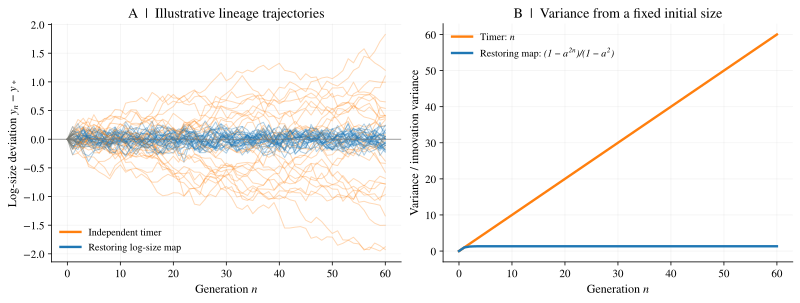

*图 1. 为什么需要反馈。* 橙色轨迹遵循式（1.2）中无漂移的 log size timer；蓝色轨迹采用 $a=1/2$ 的恢复性**log size**映射，两者使用相同的随机扰动。蓝色模型仅用于示意，并不是以 added size 定义的精确 adder 模型。B 图比较从固定 initial size 出发时的理论方差。所有轨迹均为模拟结果。

### 1.3 Timer、adder 与 sizer：三种分裂规则 {#13-timer-adder-and-sizer}

size feedback 可以用三种理想化规则描述。其中 adder 指“增加固定 size 后分裂”，sizer 指“达到固定 size 后分裂”：

| 规则 | 分裂条件 | 无噪声时，平衡附近的 birth size 如何变化 |
|---|---|---|
| 定时分裂（timer） | 等待固定时间，与 birth size 无关 | $v_{n+1}=v_n$：偏差保持不变，斜率为 $1$ |
| 定增量分裂（adder） | size 增加固定量 $\Delta$ | $v_{n+1}=(v_n+\Delta)/2$：偏差逐代缩小，斜率为 $1/2$ |
| 定 size 分裂（sizer） | 达到固定 division size $v_*$ | $v_{n+1}=v_*/2$：不再继承 size 偏差，斜率为 $0$ |

这些斜率描述的是 size memory 消退的速度，不能据此唯一确定背后的分子机制。带噪声的 adder 或 sizer 可以维持平稳的 size distribution；在上述生长和分配关系下，带噪声的独立 timer 做不到这一点。[附录 F](#appendix-f)给出了统一的局部线性模型。

*图 2. 实验中的 size control。* 引自 [Taheri-Araghi 等（2015）](https://doi.org/10.1016/j.cub.2014.12.009)的原图 1。D 图显示，出生越大的细胞，分裂间隔时间越短，分裂时的 size 却越大。这两种趋势分别与 size 无关的 timer 和固定阈值的 sizer 不符。A–C 图展示显微成像结果和培养条件。

这些实验与模型说明，分裂间隔时间不能随意脱离 birth size 来指定。接下来暂时把 size feedback 放在一边，用独立分裂时间模型建立一个预测基准：为什么从单细胞平均时间出发，会低估这个模型中的群体繁殖速度？

---

## 2. 从单细胞统计预测群体增长：独立模型的基准 {#2-division-time-noise-and-the-population-growth-paradox}

设沿 chronological lineage 测得平均分裂间隔时间 $\mu$，最简单的估计是 $\Lambda=\ln2/\mu$。独立分枝模型说明了这一估计为什么会遗漏群体中的后代数量差异：不同分裂间隔时间的 lineage，对后来群体的贡献不同。这个模型首先回答统计上的预测问题；将它用于具有 size control 的细胞时，还要检查生长与分裂的生理约束。

### 2.1 Euler–Lotka 方程与抽样偏倚 {#21-eulerlotka-and-sampling-bias}

考虑一个没有死亡的二叉分枝模型：每个新生细胞独立地从密度 $p(\tau)$ 中抽取一个正的分裂间隔时间，到时产生两个遵循相同规则的子细胞。模型中没有共同作用于所有细胞的随机环境。这里的“寿命”（lifetime）特指细胞从出生到分裂的时间，也就是分裂间隔时间。设 $M(t)$ 为一个新生细胞在时刻 $t$ 的存活后代数的期望。按它首次分裂的时间分类，可以写出

$$
M(t)=\mathbb P(\tau>t)+2\int_0^t p(\tau)M(t-\tau)\,d\tau.\tag{2.1}
$$

在指数增长的解中，分裂推迟 $\tau$，就意味着后代少了 $\tau$ 的繁殖时间，对应权重 $e^{-\Lambda\tau}$。将这一时间权重与每次分裂带来的两倍繁殖因子平衡，得到 **Euler–Lotka 方程（欧拉–洛特卡方程）**：

$$
\boxed{2\mathbb E_p[e^{-\Lambda\tau}]=1.}\tag{2.2}
$$

左侧随 $\Lambda$ 连续地从 $2$ 减小到 $0$，因此正根唯一。[附录 A](#appendix-a)用拉普拉斯变换推导该方程，并讨论更新方程解的渐近振幅与同步分裂的特殊情况。

同样的时间权重也解释了群体抽样中的偏倚。在这个独立模型中，回溯抽样得到的祖先完整分裂间隔时间的密度为

$$
q(\tau)=2e^{-\Lambda\tau}p(\tau),\qquad \int_0^\infty q(\tau)\,d\tau=1.\tag{2.3}
$$

分裂较快的祖先留下更多后代，因此被抽中的权重更大。这里的 $q$ 描述的是**祖先已经完成的分裂间隔时间**，不能把它当成当前所有存活细胞的年龄分布，或这些细胞最终的完整分裂间隔时间分布。在具有相关性的模型中，加权作用于整段 lineage 历史，不一定能简化成式（2.3）。

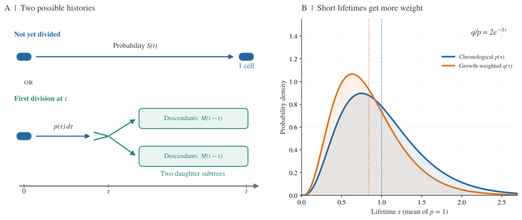

*图 3. 分裂越早，留下的后代越多。* A 图展示式（2.1）中尚未分裂的细胞，以及分裂后两棵后代子树的贡献。B 图使用形状参数和速率参数均为 $4$ 的伽马分布，平均分裂间隔时间为 $1$，对应的 Euler–Lotka 增长率为 $4(2^{1/4}-1)$。按增长贡献加权后，祖先的分裂间隔时间分布向较短时间偏移。虚线标出两种分布的均值。

### 2.2 Jensen 不等式与比较基准 {#22-jensens-inequality-and-the-reference-population}

如果所有细胞的分裂间隔时间都固定为 $\mu$，群体增长率就是 $\ln2/\mu$。若分裂间隔时间有波动，但**沿 chronological lineage 测得的均值仍为同一个** $\mu<\infty$，利用凸性可得

$$
\frac12=\mathbb E_p[e^{-\Lambda\tau}]
\ge e^{-\Lambda\mathbb E_p[\tau]}=e^{-\Lambda\mu}.
$$

取对数，得到

$$
\boxed{\Lambda\ge\frac{\ln2}{\mu}.}\tag{2.4}
$$

只要独立的分裂间隔时间分布不是集中在一个值上，这个不等式就是严格的。在平均时间不变的条件下，早分裂的细胞对后续群体的贡献更大，而晚分裂造成的损失无法完全抵消这一收益。对于弱噪声，若 $\Lambda\sigma_\tau\ll1$，且关于波动幅度的展开是正则的，高阶累积量在二阶近似中可以忽略，则有

$$
\Lambda\simeq\frac{\ln2}{\mu}
+\frac{(\ln2)^2}{2\mu^3}\sigma_\tau^2.\tag{2.5}
$$

逐步展开见[附录 B](#appendix-b)，信息论解释见[附录 H](#appendix-h)。[Hashimoto 等（2016）](https://doi.org/10.1073/pnas.1519412113)对平均分裂间隔时间与群体倍增时间的实验比较见图 4。要注意，式（2.4）的比较基准是平均分裂间隔时间为 $\mu$ 的独立分裂模型，**不能直接把它等同于单细胞的 size growth rate 为 $\lambda$ 的群体**。

*图 4. 实验中的平均分裂间隔时间与群体倍增时间。* 引自 [Hashimoto 等，*PNAS*（2016）](https://doi.org/10.1073/pnas.1519412113)的原图 3。B 图比较平均分裂间隔时间与群体倍增时间；二者的比值大于一，表示群体倍增更快。C 图展示增长增益与分裂间隔时间变异的关系，E 图比较 Euler–Lotka 预测和测量结果。A、D 图分别展示分裂间隔时间分布和模型。原图未经修改；来源：[PMC](https://pmc.ncbi.nlm.nih.gov/articles/PMC4812751/#fig03)。

**符号与适用范围。** 这篇论文在定义增益时采用 $\lambda=\ln2/\langle\tau\rangle_g$，而本笔记的 $\lambda$ 表示 cell size 的指数增长率。把该图与式（2.7）比较时，必须区分这两种定义。这张图支持的是倍增时间的实验比较，不能据此声称：一个维持 size homeostasis、且所有细胞共有恒定 size growth rate 的群体违反了质量守恒。

### 2.3 数量增长与生物量增长：比较时固定了什么 {#23-the-conservation-constraint}

式（2.4）固定的是平均分裂间隔时间 $\mu$，并未固定 cell size 或生物量积累速度。为了区分提前分裂与更快生长，现在回到所有细胞都以同一个恒定速率 $\lambda$ 增长的情形。定义

$$
V_{\mathrm{tot}}(t)=\sum_{i\text{在 }t\text{ 时存活}}v_i(t).
$$

两次分裂之间，$\dot V_{\mathrm{tot}}=\lambda V_{\mathrm{tot}}$。分裂瞬间，两个子细胞的体积之和等于母细胞体积，因此总体积没有跳变。只要没有死亡、生物量损失，也不会在有限时间内发生无限次分裂（即分裂过程非爆炸），就有

$$
\boxed{V_{\mathrm{tot}}(t)=V_{\mathrm{tot}}(0)e^{\lambda t}.}\tag{2.6}
$$

分裂增加了细胞数量，却只是重新分配已有体积。把某一时刻群体中所有细胞的 mean size 记作 $\overline v_{\mathrm{snap}}(t)=V_{\mathrm{tot}}(t)/N(t)$，则严格有

$$
\frac{\ln N(t)}t=\lambda+
\frac{\ln V_{\mathrm{tot}}(0)-\ln\overline v_{\mathrm{snap}}(t)}t.
$$

因此，

$$
\boxed{\Lambda=\lambda\quad\text{若}\quad
\lim_{t\to\infty}\frac{\ln\overline v_{\mathrm{snap}}(t)}t=0.}\tag{2.7}
$$

如果这个群体瞬时平均值收敛到有限的正数，上述条件就成立；有界的周期变化也足够。仅仅知道**沿 chronological lineage 的 birth size**服从平稳分布，并不能保证这一条件，因为群体瞬时抽样对细胞的加权方式不同。

这个关系说明，在固定 $\lambda$ 的条件下，若数量增长指数 $\Lambda>\lambda$，群体瞬时 mean size 就必须以指数速度减小。因而，独立 timer 相对于相同平均分裂间隔时间基准的增长增量，不能直接解释为维持 size homeostasis 的细胞可以获得的繁殖收益，也不能据此推断 size control 具有增长代价。

作为模型一致性检查，若 chronological lineage 是平稳的，且 $\mathbb E|\ln v|<\infty$，对式（1.2）取期望可得 $\mu=\ln2/\lambda$。将这个均值代入有噪声的独立模型会预测 $\Lambda>\lambda$，与满足群体瞬时 size 条件的式（2.7）不相容。第 1 节已说明原因：独立 timer 本身不能维持 size homeostasis。要从单细胞测量预测真实群体，还需要描述分裂时间如何响应继承的 size，以及这种响应如何影响整段 lineage。

---

## 3. 一次提前分裂能否形成长期领先？size inheritance 与 adder {#3-size-feedback-the-adder-and-exact-cancellation}

现在追踪一次时序变化的后果。在 birth size 相同、生长率固定的条件下，某一代较早分裂会留下较小的子细胞；若下一代按增加固定 size 的规则分裂，较小的 birth size 就倾向于延长它的分裂间隔时间。Adder 提供了这种反馈的具体例子。我们先计算 size 偏差如何恢复，再问它是否能使多代累计时间偏离正常节奏。

### 3.1 随机映射与 mean size 的恢复 {#31-the-stochastic-map-and-recovery-of-mean-size}

Adder 的分裂条件为

$$
v_n^{\mathrm d}=v_n+\Delta+\eta_n,\qquad
v_{n+1}=\frac12(v_n+\Delta+\eta_n).\tag{3.1}
$$

其中 $\eta_n$ 是独立同分布的 added size 波动，均值为零，方差 $\sigma_\eta^2$ 有限，且与继承的 size 独立。要求 $\Delta+\eta_n>0$，以保证增量和分裂间隔时间都为正。未经截断的高斯噪声只能作为小波动下的理想化近似。实验支持的是增量近似不依赖 birth size，不能单凭这一观察就认定噪声独立同分布。

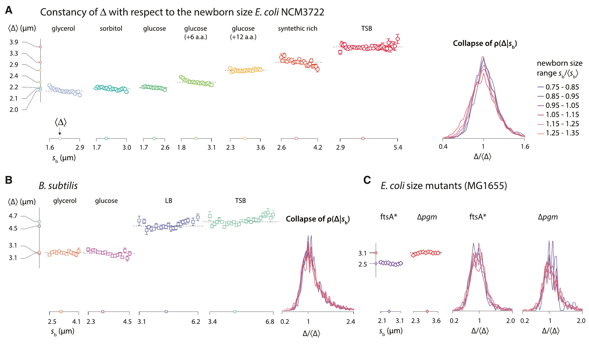

*图 5. Adder 模型的实验依据。* 引自 [Taheri-Araghi 等（2015）](https://doi.org/10.1016/j.cub.2014.12.009)的原图 2。在各培养条件下，平均 added size 近似不依赖 birth size；重新缩放后，不同 birth size 对应的条件分布近似重合。A–C 图分别涉及大肠杆菌（*E. coli*）、枯草芽孢杆菌（*B. subtilis*）和 cell size 相关突变株。

对式（3.1）取期望，得到

$$
\mathbb E[v_n]-\Delta=2^{-n}(\mathbb E[v_0]-\Delta).\tag{3.2}
$$

因此，稳态均值为 $\Delta$，mean size 的偏差每代减半。令 $x_n=v_n-\Delta$，映射变为 $x_{n+1}=x_n/2+\eta_n/2$。在平稳状态下，新加入的噪声与已有 size 独立，故 $\sigma_x^2=\sigma_x^2/4+\sigma_\eta^2/4$，从而

$$
\operatorname{Var}(v)=\frac{\sigma_\eta^2}{3},\qquad
\rho_v(k)=2^{-k},\quad k\ge0.\tag{3.3}
$$

自相关可通过迭代上述映射求出：后续加入的随机扰动与 $x_n$ 的协方差为零，因此 $\operatorname{Cov}(x_n,x_{n+k})=2^{-k}\sigma_x^2$。噪声决定分布有多宽，反馈决定 size memory 消退得多快。[附录 E](#appendix-e)给出完整计算及实验中的恢复过程。

### 3.2 分裂间隔时间如何记录 size 变化 {#32-from-growth-to-generation-time}

指数生长和对称分裂要求

$$
v_ne^{\lambda\tau_n}=v_n^{\mathrm d}=2v_{n+1}.
$$

取对数，得到 $\lambda\tau_n=\ln2+\ln v_{n+1}-\ln v_n$，即

$$
\boxed{\tau_n=\frac{\ln2}{\lambda}
+\frac{\ln v_{n+1}-\ln v_n}{\lambda}.}\tag{3.4}
$$

分裂间隔时间中包含相邻两代 log size 的**差值**。只要 size 为正、所有细胞共有恒定的 $\lambda$，且分裂对称，这就是精确恒等式。推导没有用到 adder 假设、stationarity 或弱噪声展开。

### 3.3 从单代快慢到多代累计时间：逐项相消 {#33-telescoping-the-theoretical-core}

把式（3.4）从 $0$ 到 $n-1$ 相加，得到

$$
\begin{aligned}
T_n&=\sum_{j=0}^{n-1}\tau_j\\
&=\frac{n\ln2}{\lambda}
+\frac1\lambda\big[(\ln v_1-\ln v_0)
 +(\ln v_2-\ln v_1)+\cdots+(\ln v_n-\ln v_{n-1})\big].
\end{aligned}
$$

每个中间时刻的 size 都以正负号各出现一次，最终只剩

$$
\boxed{T_n=\frac{n\ln2}{\lambda}
+\frac{\ln v_n-\ln v_0}{\lambda}.}\tag{3.5}
$$

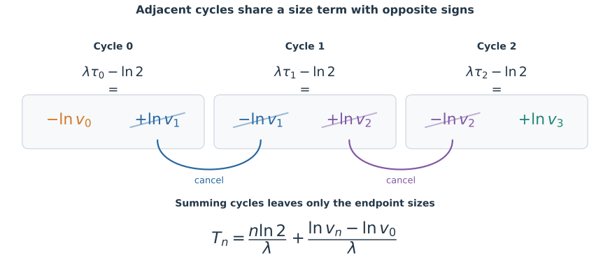

*图 6. 时间波动化为边界项。* 蓝色和紫色的 log size 项在相邻分裂间隔间抵消，只留下橙色的初始项和绿色的末尾项。这种抵消对每一个 $n$ 都严格成立。式（3.5）称为逐项相消恒等式（telescoping identity），也常称望远镜求和恒等式。

**单个分裂间隔时间有波动，并不意味着这些波动会经过许多代不断累积。** 如果各代时间独立，每一代都会给累计时间增加一份新的不确定性。而这里，同一个继承的 size 在相邻分裂间隔中以相反符号出现。反馈使起点和终点的 size 保持在平稳分布内，因此边界项的方差不会随分裂间隔数成比例增长。

更准确地说，设 $y_n=\ln v_n$ 是方差有限的平稳过程。由式（3.5）可得

$$
\operatorname{Var}(T_n)
=\frac{2\operatorname{Var}(y)-2\operatorname{Cov}(y_n,y_0)}{\lambda^2}
\le\frac{4\operatorname{Var}(y)}{\lambda^2}.\tag{3.6}
$$

所以 $D_\tau\equiv\lim_{n\to\infty}\operatorname{Var}(T_n)/n=0$。这个方差上界不需要混合性（mixing，即间隔足够远的状态逐渐失去统计依赖）。若两端的协方差趋于零，累计时间的方差就趋于 $2\operatorname{Var}(\ln v)/\lambda^2$。stationarity 加上有限的一阶对数矩，还能精确给出 $\mu=\ln2/\lambda$；遍历性则保证单条长记录的时间平均得到同样结果。注意，birth size 的方差有限，并不保证其对数的方差有限，问题可能出在接近 $v=0$ 的区域。

### 3.4 群体增长的精确结论及其条件 {#34-the-exact-growth-consequence-and-its-conditions}

群体增长会对异常快速的**整段 lineage 历史**赋予更大权重，所以仅有方差上界，还不足以控制这些历史的指数权重。从精确恒等式出发，

$$
\mathbb E[e^{-sT_n}]
=e^{-ns\ln2/\lambda}
\mathbb E\left[\left(\frac{v_n}{v_0}\right)^{-s/\lambda}\right].\tag{3.7}
$$

如果 $s$ 在所选增长率附近时，两端 size 比值的期望取对数后为 $o(n)$，那么每代的指数率就是 $-s\ln2/\lambda$。繁殖产生 $2^n$ 条路径；当 $\ln2-s\ln2/\lambda=0$ 时，路径数的指数增长与时间权重的指数衰减达到平衡。在第 4 节及[附录 C](#appendix-c)明确的分枝过程条件下，这给出 **$\Lambda=\lambda$**。

一个清楚的充分条件是：cell size 始终为正且服从平稳分布，并且在 $s=\lambda$ 附近，正阶矩 $\mathbb E[v^{2s/\lambda}]$ 和负阶矩 $\mathbb E[v^{-2s/\lambda}]$ 都有限。Cauchy–Schwarz 不等式给出该期望与 $n$ 无关的上界，Jensen 不等式则给出下界 $1$。size 有上界、又与零保持一定距离，是最简单的例子。这些是额外的充分条件，不能仅从 adder 的 size 方差有限推出；各层条件的区别见[附录 G](#appendix-g)。

这个 lineage 解释与第 2.3 节对实际群体总体积的论证相互补充。两者都能给出精确的增长约束，但各自需要额外条件。Sizer 或其他维持 size homeostasis 的规则，也可以满足同样的逐项相消关系。真正属于 adder 的特定结果，是斜率 $1/2$、方差 $\sigma_\eta^2/3$ 和 birth size 的自相关函数（ACF）$2^{-k}$，而不是恒等式（3.5）本身。

### 3.5 size 呈正相关，分裂间隔时间却呈负相关 {#35-positive-size-memory-negative-timing-memory}

当相对 size 波动很小时，$\ln(\Delta+x_n)\simeq\ln\Delta+x_n/\Delta$，因此

$$
\delta\tau_n\equiv\tau_n-\frac{\ln2}{\lambda}
\simeq\frac{x_{n+1}-x_n}{\lambda\Delta},\qquad
\rho_\tau(k)\simeq-2^{-(k+1)},\quad k\ge1.\tag{3.8}
$$

在线性化的 adder 中，birth size 保持正相关，分裂间隔时间却呈负相关。某一代耗时较长，通常会产生较大的子细胞；这个子细胞要再增加同样的 size，就只需要较短时间。这个解释针对的是上述模型。分裂间隔时间的负自相关公式是近似结果，而逐项相消关系是精确的。

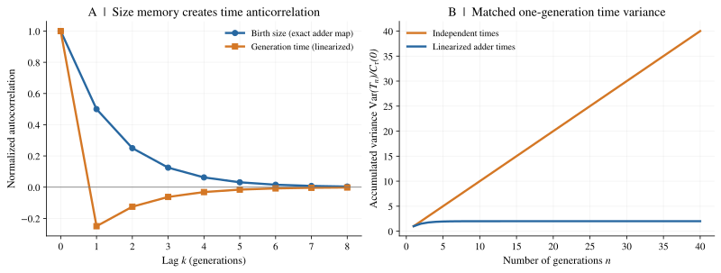

*图 7. 每次分裂有噪声，长期累计时间噪声却可以为零。* A 图比较 adder 精确的 birth size 相关性与式（3.8）中线性化的分裂间隔时间相关性。在单代时间方差相同的条件下，B 图显示：独立时间模型满足 $\operatorname{Var}(T_n)/C_\tau(0)=n$，线性化的平稳 adder 则满足 $2(1-2^{-n})$。完整协方差计算见附录 E。

---

## 4. 预测群体增长需要哪些 lineage 统计量？ {#4-temporal-correlations-and-long-time-fluctuations}

Adder 表明，一张单代分裂间隔时间直方图并不告诉我们，较快的一代之后会继续较快，还是会被较慢的一代补偿。一般地，增长计算需要整段 lineage 历史的统计；在二阶弱噪声近似中，这一信息可以归结为跨分裂间隔的协方差总和。下面给出这两个层次的关系，说明何时可以由相关函数预测增长。

### 4.1 有时间相关性时的 Euler–Lotka 关系 {#41-correlated-eulerlotka}

设 $T_n$ 是沿 chronological lineage 到达第 $n$ 代出生时的累计时间。二叉繁殖产生 $2^n$ 条路径。即使这些路径共享祖先，按出生时间加权后，权重之和的期望仍为 $2^n\mathbb E_{\mathrm{chron}}[e^{-sT_n}]$。定义

$$
\psi(s)=\lim_{n\to\infty}\frac1n\ln\mathbb E_{\mathrm{chron}}[e^{-sT_n}].
$$

假定分枝过程的规则由局部状态决定、过程非爆炸、任意有限时间区间内的出生数期望有限，且极限 $\psi$ 存在；同时，增长指数由加权出生数级数的收敛边界确定。那么

$$
\boxed{\ln2+\psi(\Lambda)=0.}\tag{4.1}
$$

仅有 lineage 统计的 stationarity 和遍历性还不够：上面的极限必须存在，而且它确实要与群体增长指数相联系。共同随机环境或非遍历的混合过程，都可能使期望增长率与典型实现中的增长率不同。[附录 C](#appendix-c)给出多对一恒等式的推导和具体收敛论证，[附录 D](#appendix-d)提供完整的有限状态马尔可夫模型例子。

独立时，$\mathbb E[e^{-sT_n}]=(\mathbb E[e^{-s\tau}])^n$，于是回到式（2.2）。相关性改变的则是整段历史的权重。对 $T_n$ 使用 Jensen 不等式，仍可得 $\psi(s)\ge-s\mu$；当式（4.1）成立时，便有 $\Lambda\ge\ln2/\mu$。与独立的有噪声分裂间隔时间不同，相关的有噪声分裂间隔时间可以取到等号，第 3 节已经展示了具体机制。

### 4.2 跨分裂间隔协方差的总和 {#42-the-integrated-covariance}

对于方差有限的平稳分裂间隔时间过程，定义 $C_\tau(k)=\operatorname{Cov}(\tau_j,\tau_{j+k})$。将所有成对协方差相加，得到

$$
\operatorname{Var}(T_n)=nC_\tau(0)
+2\sum_{k=1}^{n-1}(n-k)C_\tau(k).\tag{4.2}
$$

对角线上有 $n$ 项；间隔为 $k$ 的配对有 $n-k$ 对，每一对按两个顺序计算。若 $\sum_{k\ge1}|C_\tau(k)|<\infty$，除以 $n$ 并取极限，得到

$$
\boxed{D_\tau=C_\tau(0)+2\sum_{k=1}^\infty C_\tau(k).}\tag{4.3}
$$

$D_\tau$ 表示长期累计时间的方差除以分裂间隔数 $n$ 后得到的极限，单位为时间的平方。因为它是非负量的极限，所以 $D_\tau\ge0$。单代方差描述局部噪声；协方差总和则描述后续分裂间隔会放大还是补偿当前波动。独立时间满足 $D_\tau=\sigma_\tau^2$；持续的正相关通常会增大这个量，负相关则可能将它抵消。协方差绝对可和保证了求和表达式成立；即使级数不收敛，直接通过方差极限定义 $D_\tau$ 仍可能有意义。

如果渐近累积量具有正则的弱噪声展开，独立模型的结果（2.5）可推广为

$$
\boxed{\Lambda\simeq\frac{\ln2}{\mu}
+\frac{(\ln2)^2}{2\mu^3}D_\tau.}\tag{4.4}
$$

这一替换有明确的物理含义：长历史的二阶累积量是 $\operatorname{Var}(T_n)$，而不是 $n\operatorname{Var}(\tau)$。[附录 B](#appendix-b)给出推导，并说明交换极限和控制高阶累积量率所需的条件。如果相关性持续很久，仅有很小的单代方差并不足以保证近似有效。

**$D_\tau=0$ 只能消除弱噪声展开中的二阶修正，不能单凭这一点就断言精确地有 $\Lambda=\lambda$。** 第 3 节的精确等式依赖更强的端点结构和指数矩条件，也可以由独立的总体积论证得到。只保留累积量展开中的二次项，无法推出这两种精确结论。

### 4.3 从零频分量看同一个机制 {#43-zero-frequency-is-the-same-mechanism}

对减去均值后的分裂间隔时间波动，采用如下双边功率谱密度（power spectral density，PSD）约定：

$$
S_\tau(\omega)=\sum_{k=-\infty}^\infty C_\tau(k)e^{-i\omega k},
\qquad -\pi\le\omega\le\pi.
$$

若协方差绝对可和，则

$$
\boxed{S_\tau(0)=D_\tau.}\tag{4.5}
$$

零频分量描述的是能够持续许多代的波动。令 $y_n=\ln v_n$，分裂间隔时间的精确关系为 $\delta\tau_n=(y_{n+1}-y_n)/\lambda$。差分使每个傅里叶模态乘以 $e^{i\omega}-1$，因此，对于具有正则谱密度的平稳 log size 过程，

$$
S_\tau(\omega)=\frac{4\sin^2(\omega/2)}{\lambda^2}S_y(\omega).\tag{4.6}
$$

若 $S_y$ 在零频处有限，差分就会消除分裂间隔时间的零频噪声。缓慢变化的 size 偏差在相邻周期中几乎相同，作差后便相互抵消。逐项相消、协方差总和为零、零频噪声被抑制，是同一机制的三种表达。完整的一阶自回归模型（AR(1)）频谱见[附录 F](#appendix-f)；非零频率的振荡模态回答的是另一个问题，见[进阶专题](#further-topic)。

---

## 5. 回到生物问题：哪些单细胞差异能够影响长期增长？ {#5-synthesis-and-outlook}

### 5.1 单代分裂差异与长期繁殖差异

沿 lineage 测得的平均分裂间隔时间，通常不足以预测群体倍增时间。独立模型中的早分裂祖先留下更多后代，Euler–Lotka 方程给出了相应的统计加权。但在固定 size growth rate 的细胞中，提前分裂还会改变子细胞的 birth size；后续分裂间隔如何响应这种变化，决定了单代时间差异是否会累积。

Adder 展示了具体机制：size feedback 纠正继承的偏差，并在小波动极限下产生分裂间隔时间的负相关。更一般地，当 $\lambda$ 恒定且分裂对称时，多代累计时间偏差只取决于起点与终点的 log size。若 log size 是方差有限的平稳过程，累计时间方差就保持有界，$D_\tau=0$。单代分裂仍然有快有慢，但这种时序波动没有持续累积的方差分量。

要进一步得到精确的群体增长率，还需要群体瞬时 mean size 的稳态条件，或者次指数的端点权重与有效的相关分枝增长关系。在相应条件下有 $\Lambda=\lambda$。这是固定生长率与 size 稳定性的共同约束；本文没有建立 size control 与繁殖速度之间的代价关系。对于更一般的相关时间模型，$D_\tau$ 或 $S_\tau(0)$ 只在有效的二阶弱噪声展开中决定增长修正，不能单凭其为零就推出任意噪声下的精确结论。

### 5.2 从单代分布到 lineage 历史

单代分裂间隔时间分布描述的是快慢各出现多少次，却没有说明它们如何沿 lineage 排列。[附录 D](#appendix-d)的两状态模型把这种区别展示得很清楚：短分裂间隔与长分裂间隔严格交替时，每两代的总时间固定；若同一种状态倾向于延续，就会出现连续多代较快或较慢的历史。单代分布可以完全相同，整段历史的时间权重和群体增长率却不同。因此，从单细胞到群体的推理必须保留分裂间隔之间的联系。

size control 进一步限制了哪些时间历史能够出现。在本文的生长与分配条件下，一条 lineage 若持续积累分裂时间的领先或落后，其 birth size 就必须相应地持续变小或变大。size homeostasis 约束了这种长期积累，而不仅是 size distribution 的宽度。Adder 使这个约束的实现机制具体可算；逐项相消关系则适用于相同生长与分配条件下的其他 size control 规则。核心区别在于：单代分布给出局部波动，size inheritance 与反馈决定这些波动能否形成长期的 lineage 差异。

### 5.3 从分裂时序延伸到生长能力的波动

正文固定 $\lambda$，考察的是生物量积累规律给定时，分裂调控如何重新安排时间。下一步的生物问题是：**如果细胞之间的生物量积累速度本身不同，而且这种差异能够传给子代，群体增长会如何改变？** 当生长率随分裂间隔变化时，分裂间隔时间与 log size 变化之间不再有统一的比例系数，累计时间也不能按本文的方式逐项相消。生长率差异及其代际相关性由此进入增长问题，超出了固定 $\lambda$ 模型的结论。[Lin 和 Amir（2020）](https://doi.org/10.1103/PhysRevE.101.012401)讨论了这类效应；生长率波动与随机不对称分配如何改变本文的关系，见[附录 G](#appendix-g)。

---

## 技术附录 {#technical-appendices}

附录整理完整推导、可解模型和结论的适用条件。公式编号使用附录字母，图号接续正文。

### 附录 A. 更新理论、群体抽样与渐近振幅 {#appendix-a}

这里补充第 2 节所用的更新过程计算。首先得到的是群体数量期望的增长指数；要把它等同于典型实现中的增长指数，还需要年龄依赖分枝过程通常采用的非爆炸、超临界等条件。

#### A.1 用拉普拉斯变换推导 {#a1-laplace-transform-derivation}

对式（2.1）做拉普拉斯变换，可以求出群体增长率。

记 $S(t)=\mathbb P(\tau>t)$，并定义

$$
\widehat M(s)=\int_0^\infty e^{-st}M(t)\,dt,
\qquad
\widehat p(s)=\int_0^\infty e^{-s\tau}p(\tau)\,d\tau
             =\mathbb E[e^{-s\tau}],
$$

先取足够大的 $s$，使积分收敛。由于 $S(t)=\int_t^\infty p(\tau)\,d\tau$，其变换为 $\widehat S(s)=[1-\widehat p(s)]/s$。式（2.1）的卷积变为乘积，得到

$$
\widehat M(s)=\widehat S(s)+2\widehat p(s)\widehat M(s)
\quad\Rightarrow\quad
\widehat M(s)=\frac{1-\widehat p(s)}{s[1-2\widehat p(s)]}.
$$

分母在正值 $s=\Lambda$ 处为零，此时满足 **Euler–Lotka 方程**：

$$
\boxed{2\,\mathbb E[e^{-\Lambda\tau}]=1.}
$$

在正实轴上，$2\widehat p(s)$ 连续且严格地从 $2$ 减小到 $0$，所以这个根唯一。它是 $\widehat M(s)$ 的主导极点。因为 $1/(s-\Lambda)$ 是 $e^{\Lambda t}$ 的拉普拉斯变换，在这里假定的分裂间隔时间密度条件下，更新过程的渐近结果给出

$$
M(t)\sim Ae^{\Lambda t},
\qquad
\Lambda=\lim_{t\to\infty}\frac{\log M(t)}{t}.
$$

其中 $A=\lim_{t\to\infty}e^{-\Lambda t}M(t)>0$ 是从一个新生细胞出发时的渐近振幅；$\sim$ 表示 $M(t)/(Ae^{\Lambda t})\to1$。下面计算振幅，并说明同步分裂时需要怎样修正。

#### A.2 更新方程的渐近振幅与格点分布例外 {#a2-the-renewal-amplitude-and-lattice-exception}

第 2.1 节通过 $1-2\widehat p(s)=0$ 的正根 $\Lambda$ 得到群体增长指数。它右侧没有其他极点，因为

$$
|2\widehat p(s)|\le2\widehat p(\operatorname{Re}s)<1
\qquad\text{当 }\operatorname{Re}s>\Lambda.
$$

对于具有密度的分裂间隔时间分布，当 $\omega\ne0$ 时，$|2\widehat p(\Lambda+i\omega)|<1$ 也成立，所以同一条竖直线上没有其他极点。此外，

$$
-2\widehat p'(\Lambda)
=2\mathbb E_p[\tau e^{-\Lambda\tau}]
=\mathbb E_q[\tau]>0,
$$

因此这是一个简单极点。将第 2.1 节的变换在该极点附近展开，得到

$$
\widehat M(s)=\frac{A}{s-\Lambda}+O(1),
\qquad
A=\frac{1-\widehat p(\Lambda)}{\Lambda[-2\widehat p'(\Lambda)]}.
\tag{A.1}
$$

利用 $\widehat p(\Lambda)=1/2$，留数变为

$$
\boxed{
A=\frac{1}{4\Lambda\,\mathbb E_p[\tau e^{-\Lambda\tau}]}
 =\frac{1}{2\Lambda\,\mathbb E_q[\tau]}.
}\tag{A.2}
$$

有密度的分裂间隔时间分布满足非格点条件，即时间取值不局限于某个固定步长的整数倍。相应的更新理论渐近结果给出 $e^{-\Lambda t}M(t)\to A$。这个振幅针对的是从一个新生细胞出发的群体，不必等于 $M(0)=1$，因为初始暂态并不由长期的指数渐近式描述。

固定分裂间隔时间是恒定渐近振幅的一个例外。如果所有细胞都在恰好经过 $\tau_0$ 后分裂，所有分裂事件就会同步发生，此时

$$
M(t)=2^{\lfloor t/\tau_0\rfloor},
\qquad
\Lambda=\frac{\ln2}{\tau_0}.
\tag{A.3}
$$

对数增长率仍趋于 $\Lambda$，但 $e^{-\Lambda t}M(t)$ 会周期性变化，而不会收敛到常数。因此，第 2.2 节所用的无噪声增长指数仍然有效；要使定义 $A$ 的更强极限成立，则需要非格点条件。

### 附录 B. 独立与相关情形下的弱噪声计算 {#appendix-b}

下面两种展开使用同一个思路：对 chronological lineage 历史权重的对数进行展开。式（2.5）对应独立情形，式（4.4）则是长历史下的推广。

#### B.1 独立分裂间隔时间的展开 {#b1-independent-lifetime-expansion}

不等式只能说明，相对于平均分裂间隔时间相同的定时基准，独立分枝模型的增长率更大，不能给出增量有多大。为估计增长率的增量，先把 chronological lineage 分裂间隔时间分布的均值和方差写出来：

$$
\mu=\bar\tau=\int_0^\infty \tau p(\tau)\,d\tau,
\qquad
\sigma_\tau^2=\int_0^\infty (\tau-\mu)^2p(\tau)\,d\tau.
$$

我们在平均分裂间隔时间附近展开，因此指数中的小量为 $\Lambda(\tau-\mu)$。假定 $\Lambda\sigma_\tau\ll1$，且关于波动幅度的展开是正则的，三阶及更高阶中心矩在二阶近似中可以忽略。先提出 $e^{-\Lambda\mu}$，再展开剩下的指数项：

$$
\begin{aligned}
\mathbb E_p[e^{-\Lambda\tau}]
&=\int_0^\infty p(\tau)e^{-\Lambda\tau}\,d\tau\\
&=e^{-\Lambda\mu}\int_0^\infty p(\tau)e^{-\Lambda(\tau-\mu)}\,d\tau\\
&\simeq e^{-\Lambda\mu}\int_0^\infty p(\tau)
  \left[1-\Lambda(\tau-\mu)+\frac{\Lambda^2}{2}(\tau-\mu)^2\right]d\tau\\
&=e^{-\Lambda\mu}\left(1+\frac{\Lambda^2}{2}\sigma_\tau^2\right).
\end{aligned}
$$

常数项积分为 $1$；一次项由于 $\int_0^\infty(\tau-\mu)p(\tau)\,d\tau=0$ 而消失；二次项给出方差。取对数，并在 $x=\Lambda^2\sigma_\tau^2/2$ 时使用 $\ln(1+x)=x+O(x^2)$，得到

$$
\ln\mathbb E_p[e^{-\Lambda\tau}]
\simeq-\Lambda\mu+\ln\left(1+\frac{\Lambda^2}{2}\sigma_\tau^2\right)
\simeq-\Lambda\mu+\frac{\Lambda^2}{2}\sigma_\tau^2.
$$

这里的 $x$ 已经是波动幅度的二阶量，因此对数展开中新增的 $x^2$ 项属于四阶。代入 Euler–Lotka 方程的对数形式，得到二阶累积量展开。累积量（cumulant）是对数矩母函数展开中的系数；一阶为均值，二阶为方差：

$$
0=\ln2+\ln\mathbb E_p[e^{-\Lambda\tau}]
\simeq\ln2-\Lambda\mu+\frac{\Lambda^2}{2}\sigma_\tau^2.
\tag{B.1}
$$

为求增长率，令 $\Lambda=\Lambda_0+\delta\Lambda$，其中 $\Lambda_0=\ln2/\mu$ 是无噪声增长率。式（B.1）没有噪声的一阶项，所以 $\delta\Lambda$ 也从二阶开始。代入并保留到二阶，得到

$$
\begin{aligned}
0
&\simeq\ln2-\mu(\Lambda_0+\delta\Lambda)
       +\frac{(\Lambda_0+\delta\Lambda)^2}{2}\sigma_\tau^2\\
&\simeq-\mu\,\delta\Lambda+\frac{\Lambda_0^2}{2}\sigma_\tau^2.
\end{aligned}
$$

乘积 $\delta\Lambda\,\sigma_\tau^2$ 是四阶量，可以舍去；因此方差项中的 $\Lambda^2$ 可用 $\Lambda_0^2$ 替代。解得 $\delta\Lambda\simeq\Lambda_0^2\sigma_\tau^2/(2\mu)$，于是

$$
\Lambda\simeq
\frac{\ln2}{\mu}
+\frac{(\ln2)^2}{2\mu^3}\sigma_\tau^2.
$$

在独立模型中，最低阶修正由分裂间隔时间方差决定。下面的相关情形则会把单代方差替换为累计时间的长期方差率。

#### B.2 如何计算协方差的贡献 {#b2-covariance-bookkeeping}

假设 $\tau_n$ 构成平稳过程，记

$$
C_\tau(k)
=\operatorname{Cov}(\tau_n,\tau_{n+k}),
\qquad C_\tau(-k)=C_\tau(k).
$$

由于 $T_n=\sum_{j=0}^{n-1}\tau_j$，

$$
\operatorname{Var}(T_n)
=\sum_{i,j=0}^{n-1}
\operatorname{Cov}(\tau_i,\tau_j).
$$

把这个求和看作协方差矩阵，就很容易数清每一项：对角线贡献各代自身的方差，非对角项则成对、对称地出现。

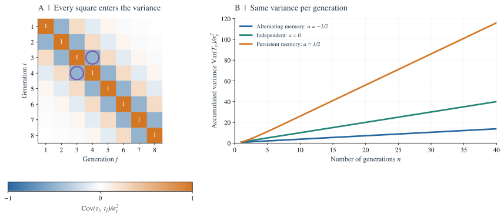

*图 8. 哪些波动会累积？* A 图的每个方格都对 $\operatorname{Var}(T_n)$ 有贡献。圈出的两个方格，是同一个协方差按 $(i,j)$ 和 $(j,i)$ 分别计数，因而产生下式中的系数 $2$。B 图对 $C_\tau(k)=\sigma_\tau^2a^{|k|}$ 使用式（4.2），其中 $a=-1/2,0,1/2$；A 图对应 $a=-1/2$。三个过程的单代方差相同，但长期斜率 $D_\tau/\sigma_\tau^2=(1+a)/(1-a)$ 不同。图中协方差均来自平稳模型的解析结果。

间隔为零的项共有 $n$ 个，间隔为 $k$ 的有序配对共有 $2(n-k)$ 个。因此，对有限的 $n$，精确地有

$$
\operatorname{Var}(T_n)
=nC_\tau(0)
+2\sum_{k=1}^{n-1}(n-k)C_\tau(k).
$$

如果协方差绝对可和，除以 $n$ 再取极限，得到

$$
\boxed{
D_\tau
\equiv\lim_{n\to\infty}\frac{\operatorname{Var}(T_n)}{n}
=C_\tau(0)+2\sum_{k=1}^{\infty}C_\tau(k).
}
$$

$D_\tau$ 的单位是时间平方/分裂间隔。它描述的是*累计分裂时间的长期波动*，而不只是单个分裂间隔的波动。它是方差除以 $n$ 后的极限，因此非负。

当各代分裂时间独立时，所有非零滞后的协方差都为零，所以 $D_\tau=\sigma_\tau^2$。正相关会增大 $D_\tau$；负相关则能减小它，甚至将其降为零。

#### B.3 渐近累积量 {#b3-asymptotic-cumulants}

一种足以支持上述计算的设定，是考虑 $\tau_j=\mu+\epsilon u_j$ 这一族正分裂间隔时间过程，保持相关尺度不变，并要求按分裂间隔数归一化的累积量生成函数在 $s=\ln2/\mu$ 附近能对 $\epsilon$ 作一致展开。相应的累积量率必须存在，满足 $K_m=O(\epsilon^m)$，且该邻域内的高阶余项可控。对大 $n$ 极限求导，或把累积量级数与极限交换，都需要这种正则性；仅有协方差可和并不够。即使每个分裂间隔时间的方差很小，若噪声减小时相关时间反而发散，近似也可能失效。

当 $s$ 足够小，且过程的渐近累积量满足所需正则性时，

$$
\begin{aligned}
\frac1n\ln\mathbb E[e^{-sT_n}]
&=-s\frac{\mathbb E[T_n]}{n}
 +\frac{s^2}{2}\frac{\operatorname{Var}(T_n)}{n}\\
&\quad-\frac{s^3}{6}\frac{\kappa_3(T_n)}{n}+\cdots.
\end{aligned}
$$

令 $n\to\infty$，得到

$$
\psi(s)=-s\mu+\frac{s^2}{2}D_\tau
-\frac{s^3}{6}K_3+\cdots,
\tag{B.2}
$$

其中 $K_3=\lim_{n\to\infty}\kappa_3(T_n)/n$，假定这个极限存在。

将 $s=\Lambda$ 代入式（C.6）：

$$
0=\ln2-\Lambda\mu
 +\frac{\Lambda^2}{2}D_\tau+O(\text{三阶累积量项}).
\tag{B.3}
$$

以 $\Lambda_0=\ln2/\mu$ 为无噪声解，得到

$$
\boxed{
\Lambda\simeq\frac{\ln2}{\mu}
+\frac{(\ln2)^2}{2\mu^3}D_\tau.
}
$$

这个近似要求波动足够弱、展开具有正则性。若相关状态持续很久，或分裂间隔时间分布很宽，它在数值上可能不再准确。

**累计噪声与群体增长：**

$$
\text{群体增长取决于沿 lineage 累积的噪声，}
\;\text{而不只是单代噪声。}
$$

这反映的是 chronological lineage 过程的*长时间、长波长*性质。

### 附录 C. 多对一恒等式与相关 Euler–Lotka 关系 {#appendix-c}

#### C.1 从一个分裂间隔时间到整段 lineage {#c1-from-one-lifetime-to-an-entire-lineage}

考虑一条 chronological lineage，其分裂时间之间存在相关性：

$$
\tau_0,\tau_1,\ldots,\tau_{n-1}.
$$

到达第 $n$ 代出生（即沿该 lineage 完成第 $n$ 次分裂）的时间为

$$
T_n=\sum_{j=0}^{n-1}\tau_j.\tag{C.1}
$$

单代直方图只记录每种分裂间隔时间出现的频率，不记录它们的先后顺序。例如，设短时间 $\tau_s$ 和长时间 $\tau_\ell$ 各以 $1/2$ 的概率出现。下面的比较展示了不同排列如何改变总时间的分布。

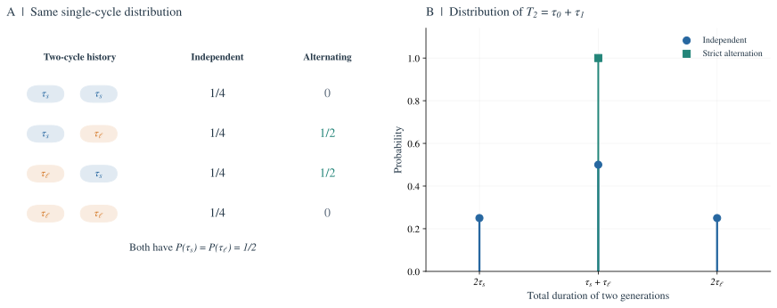

*图 9. 分裂间隔时间分布不能完全描述 lineage 历史。* 两种情形中，两种时间各自的概率都是 $1/2$。A 图列出有序时间对的概率：独立抽样允许全部四种配对，严格交替则只允许一长一短的两种配对。因此，B 图中独立抽样有三种可能的总时间，而交替配对的总时间始终为 $\tau_s+\tau_\ell$。有相关性时，必须使用取决于联合历史的 $T_n$ 分布。

经过 $n$ 代二叉分裂，有 $2^n$ 条可能的后代路径。对于规则由局部状态决定的分枝过程，若每代均匀选择一个子细胞得到的路径服从 chronological lineage 的统计规律，利用期望的线性性可得

$$
\mathbb E\!\left[\sum_{\text{第 }n\text{ 代后代}}
   e^{-s\,T_{n,\mathrm{path}}}\right]
=2^n\,\mathbb E_{\mathrm{chron}}[e^{-sT_n}].
\tag{C.2}
$$

这就是基本的*多对一恒等式（many-to-one identity）*：把许多后代路径上的求和期望，转化为一条随机 lineage 上的期望。它不要求所有后代路径相互独立，只要求随机选出的子细胞路径具有正确的边缘分布。

定义按出生时间加权后的第 $n$ 代出生数期望：

$$
Z_n(s)=2^n\mathbb E_{\mathrm{chron}}[e^{-sT_n}].
\tag{C.3}
$$

全部出生事件的拉普拉斯变换取期望后，形式上可写为

$$
\widehat B(s)=\sum_{n=0}^{\infty}Z_n(s).
\tag{C.4}
$$

指数增长率对应这个级数的收敛与发散边界。如果相关过程存在适当的大 $n$ 极限，并满足分枝过程所需的正则性条件，定义

$$
\psi(s)=\lim_{n\to\infty}
\frac1n\ln\mathbb E[e^{-sT_n}].
\tag{C.5}
$$

那么 $Z_n(s)$ 的指数率为 $\ln2+\psi(s)$。临界值由下式确定：

$$
\boxed{\ln2+\psi(\Lambda)=0.}\tag{C.6}
$$

等价地，

$$
\ln2+
\lim_{n\to\infty}\frac1n
\ln\mathbb E\!\left[
\exp\left(-\Lambda\sum_{j=0}^{n-1}\tau_j\right)
\right]=0.
\tag{C.7}
$$

这就是后面使用的相关 lineage 推广式。对于附录 D 的有限状态马尔可夫模型，其推导尤其清楚，而且在数学上是精确的。

**检查假设。** 式（C.7）是渐近关系，不能无条件套用于任意相关群体或受随机环境驱动的群体。这里假定 lineage 的统计规律平稳且遍历，按分裂间隔数归一化的累积量生成函数具有适当极限，并且出生时间加权条件确实选出了分枝群体的马尔萨斯增长指数（Malthusian exponent，即长期指数增长率）。强烈的共同环境噪声、非遍历混合过程，以及增长无界等病态情况，都需要单独分析。

可以把收敛论证写得更具体。假设分裂间隔时间严格为正、分枝过程非爆炸，且任意有限时间区间内的出生数期望有限。令 $B_{\mathrm{cum}}(t)$ 统计截至 $t$ 的全部出生数，包括最初的细胞。在没有死亡的二叉群体中，每次分裂产生两个新生细胞，并使存活数增加一个，因此对每条实现都有 $N(t)=[B_{\mathrm{cum}}(t)+1]/2$。对非负权重使用 Tonelli 定理，当实数 $s>0$ 时得到

$$
\int_0^\infty e^{-st}M(t)\,dt
=\frac{1+\widehat B(s)}{2s}.\tag{C.8}
$$

因此，存活数期望与加权出生数级数具有相同的正收敛边界。如果 $r(s)=\ln2+\psi(s)<0$，根值判别法保证 $\sum_n Z_n(s)$ 收敛；如果 $r(s)>0$，级数的项甚至不趋于零。在 $r(s)=0$ 处，根值判别法无法决定该点本身是否收敛。不过，只要 $r$ 连续，且在唯一的正值 $s_*$ 处穿过零，收敛边界仍然是 $s_*$。若 $\lim_{t\to\infty}t^{-1}\ln M(t)$ 存在，通过与指数函数比较，就能把该边界等同于此极限，从而证明式（C.6）描述的是**期望**增长率。仅知道 $\psi$ 存在，却没有连续性、过零条件或期望增长率极限，还不足以完成论证。

要在典型的实际群体中得到同一指数，还需要针对具体模型的分枝过程定理，包括适当的不可约性、可积性，以及繁殖由局部规则而非共同随机环境支配。例如，有限状态、不可约的年龄依赖分枝过程，如果分裂间隔时间有上界且与零保持距离，每次产生两个子细胞，且给定状态后两个子树相互独立，就是一组标准的充分条件。多对一恒等式的期望计算本身不要求姐妹细胞独立；但若繁殖存在依赖，要声称典型增长率相同，就必须另行给出条件。某些恒定渐近振幅的极限需要非格点条件，但并非所有对数增长指数都需要它。$\psi$ 使用的是平稳的 chronological lineage 规律；若初始细胞的分布不同，要使用同一个根，必须保证指数渐近行为相同。

#### C.2 独立时间是一个特例 {#c2-independent-times-reappear-as-a-special-case}

若 $\tau_0,\ldots,\tau_{n-1}$ 相互独立，

$$
\mathbb E[e^{-sT_n}]
=\prod_{j=0}^{n-1}\mathbb E[e^{-s\tau_j}]
=\big(\mathbb E[e^{-s\tau}]\big)^n.
$$

于是

$$
\psi(s)=\ln\mathbb E[e^{-s\tau}],
$$

式（C.6）立即化为

$$
2\mathbb E[e^{-\Lambda\tau}]=1.
$$

原来的 Euler–Lotka 方程依然适用，它就是这个推广计算在无相关性时的结果。

#### C.3 平均时间给出的不等式仍成立 {#c3-the-mean-time-inequality-still-holds}

对于均值为 $\mu=\mathbb E[\tau_n]$ 的平稳分裂间隔时间过程，把 Jensen 不等式用于*整个时间之和*，得到

$$
\begin{aligned}
\frac1n\ln\mathbb E[e^{-sT_n}]
&\ge-\frac{s}{n}\mathbb E[T_n]\\
&=-s\mu.
\end{aligned}
$$

因此 $\psi(s)\ge-s\mu$。在 $s=\Lambda$ 处，

$$
-\ln2=\psi(\Lambda)\ge-\Lambda\mu,
$$

所以

$$
\Lambda\ge\frac{\ln2}{\mu}.\tag{C.9}
$$

与独立情形不同，**即使每个 $\tau_n$ 的方差都非零**，这里仍然可以取等号。关键在于：随着 $n$ 增大，$T_n$ 的波动是否按分裂间隔数成比例累积。

### 附录 D. 完整的两状态马尔可夫分枝模型 {#appendix-d}

这个模型在**保持单代分布不变**的条件下，单独考察时间相关性的作用。它是一个唯象分枝模型，不能直接视为具有恒定 $\lambda$ 且维持 size homeostasis 的物理细胞模型。

#### D.1 模型定义 {#d1-definition}

分裂间隔时间只有两个可能值：

$$
\tau_s=\mu-\delta,
\qquad
\tau_\ell=\mu+\delta,
\qquad 0\lt \delta\lt \mu.
$$

细胞处于 $s$（短）或 $\ell$（长）状态。从一代到下一代，以概率 $p$ 保持原状态：

$$
P=
\begin{pmatrix}
p&1-p\\
1-p&p
\end{pmatrix}.
\tag{D.1}
$$

状态为 $i$ 的细胞经过 $\tau_i$ 后产生两个子细胞。给定母细胞状态，每个子细胞的状态遵循转移矩阵 $P$。当 $0\lt p\lt 1$ 时，chronological lineage 的平稳状态概率为 $(1/2,1/2)$，与 $p$ 无关。因此

$$
\mathbb P(\tau=\tau_s)=\mathbb P(\tau=\tau_\ell)=\tfrac12,
\quad
\mathbb E[\tau]=\mu,
\quad
\operatorname{Var}(\tau)=\delta^2.
\tag{D.2}
$$

改变 $p$，改变的**只有分裂时间沿 lineage 的排列和相关性**。

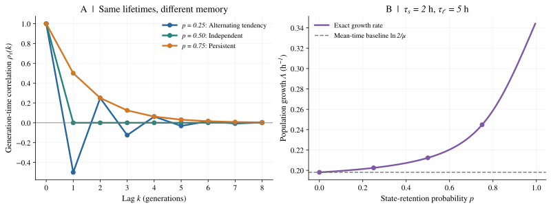

*图 10. 时间分布不变，相关性仍能改变增长率。* A 图绘制 $\rho_\tau(k)=(2p-1)^k$。B 图使用与下表相同的 2 小时和 5 小时分裂间隔时间，求解精确的 Perron 特征值条件（D.7）；圆点对应表中的四行。虚线为 $\ln2/\mu$。曲线在 $p=1$ 之前结束，因为该点的链变为可约。这些是两状态分枝模型的预测，不是维持 size homeostasis 的细胞的实验测量。

#### D.2 精确自相关 {#d2-exact-autocorrelation}

令 $s$ 状态对应 $z_n=-1$，$\ell$ 状态对应 $z_n=+1$，则

$$
\tau_n=\mu+\delta z_n.
$$

给定当前状态，

$$
\mathbb E[z_{n+1}\mid z_n]
=p z_n+(1-p)(-z_n)
=(2p-1)z_n.
$$

令

$$
a=2p-1.
$$

迭代条件期望，得到

$$
\mathbb E[z_{n+k}\mid z_n]=a^k z_n.
$$

由于 $\mathbb E[z_n]=0$ 且 $z_n^2=1$，

$$
C_\tau(k)=\delta^2 a^{|k|},\qquad a=2p-1.\tag{D.3}
$$

当 $0\lt p\lt 1$ 时，$|a|\lt 1$。由式（4.3）得到

$$
\begin{aligned}
D_\tau
&=\delta^2\left(1+2\sum_{k=1}^\infty a^k\right)\\
&=\delta^2\frac{1+a}{1-a}\\
&=\delta^2\frac{p}{1-p}.
\end{aligned}
\tag{D.4}
$$

因此有三种情形：

- $p\lt 1/2$：相邻分裂间隔时间倾向于交替，在奇数滞后处呈负相关。
- $p=1/2$：分裂间隔时间相互独立，$D_\tau=\delta^2$。
- $p>1/2$：状态倾向于持续，$D_\tau>\delta^2$。

恰好在 $p=0$ 时，状态确定性交替，式（4.3）中的协方差绝对值级数不收敛；但直接计算 $T_n$ 可得 $\operatorname{Var}(T_n)=O(1)$，所以 $D_\tau=0$。在 $p=1$ 时，链不再遍历，两个互不连通的子群体需要分别处理。

#### D.3 用转移矩阵求精确群体增长率 {#d3-exact-population-growth-via-a-transfer-matrix}

状态路径 $i_0,i_1,\ldots,i_n$ 的联合概率包含各步转移概率的乘积，按出生时间加权的因子则包含

$$
\exp\left(-\Lambda\sum_{j=0}^{n-1}\tau_{i_j}\right).
$$

每一代的二叉分裂贡献因子 2，状态继承贡献转移概率，母细胞的分裂间隔时间贡献指数衰减因子，如下图所示。

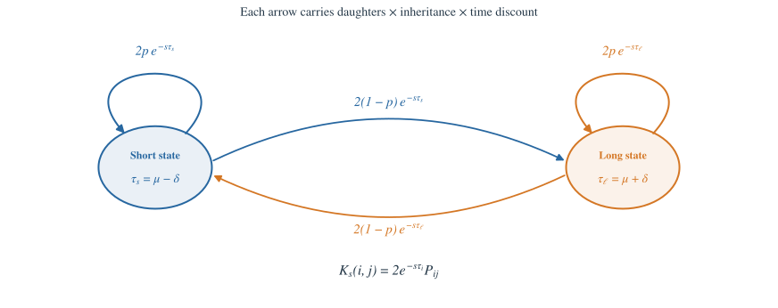

*图 11. 将转移矩阵理解为分枝图。* 从状态 $i$ 出发的每条箭头，其权重为子细胞数的期望 $2P_{ij}$ 乘以 $e^{-s\tau_i}$。沿路径将这些权重相乘，便得到该路径对 $Z_n(s)$ 的贡献。图中使用试探增长率 $s$；在选定的增长率 $s=\Lambda$ 处，主特征值为 $1$，即式（D.7）。

因此，用来传播后代时间权重的期望的矩阵为

$$
K_\Lambda=
2\begin{pmatrix}
e^{-\Lambda\tau_s}&0\\
0&e^{-\Lambda\tau_\ell}
\end{pmatrix}P.
\tag{D.5}
$$

定义

$$
A=e^{-\Lambda\tau_s},\qquad B=e^{-\Lambda\tau_\ell}.
$$

则

$$
K_\Lambda=
2\begin{pmatrix}
pA&(1-p)A\\
(1-p)B&pB
\end{pmatrix}.
\tag{D.6}
$$

若初始状态概率写成行向量 $\boldsymbol\pi$，第 $n$ 代的时间权重为

$$
Z_n(\Lambda)=\boldsymbol\pi K_\Lambda^n\mathbf 1.
$$

当 $0\lt p\lt 1$ 时，Perron–Frobenius 理论给出主导增长因子 $\rho(K_\Lambda)^n$，其中 $\rho$ 表示谱半径，也就是特征值模的最大值。因此，式（C.6）等价于以下**精确特征值条件**：

$$
\rho(K_\Lambda)=1.\tag{D.7}
$$

为显式计算，先写出迹和行列式：

$$
\operatorname{tr}K_\Lambda=2p(A+B),
\qquad
\det K_\Lambda=4AB(2p-1).
$$

Perron 特征值为

$$
\rho(K_\Lambda)
=p(A+B)+\sqrt{p^2(A-B)^2+4(1-p)^2AB}.
\tag{D.8}
$$

对 $\Lambda$ 求解 $\rho(K_\Lambda)=1$，即可得到群体增长率。对这里定义的模型，这个计算是精确的，没有使用累积量近似。

#### D.4 两个容易解析的极限 {#d4-two-analytically-transparent-limits}

**情形 1：$p=1/2$，各代独立。** 此时

$$
\rho(K_\Lambda)=A+B,
$$

因此式（D.7）变为

$$
e^{-\Lambda\tau_s}+e^{-\Lambda\tau_\ell}=1.
\tag{D.9}
$$

这恰好就是两点分布对应的 $2\mathbb E[e^{-\Lambda\tau}]=1$。

**情形 2：$p=0$，严格交替。** 此时

$$
\rho(K_\Lambda)=2\sqrt{AB}
=2e^{-\Lambda(\tau_s+\tau_\ell)/2}.
$$

因此

$$
\Lambda=\frac{\ln2}{(\tau_s+\tau_\ell)/2}
      =\frac{\ln2}{\mu}.\tag{D.10}
$$

单代分布仍有方差 $\delta^2>0$，但增长优势消失了，因为每两个相邻分裂间隔的总时间完全相同。

当 $p\to1^-$ 时，状态长时间保持不变，使快速 lineage 逐渐主导群体，增长指数趋于 $\ln2/\tau_s$。但 $p=1$ 本身是可约情形，观察到的增长指数取决于初始群体包含哪些状态类别。

#### D.5 数值例子：边缘分布相同，增长率不同 {#d5-numerical-example-same-marginal-distribution-different-growth}

取

$$
\tau_s=2\ \mathrm h,
\qquad
\tau_\ell=5\ \mathrm h,
\qquad
\mu=C.5\ \mathrm h.
$$

求解式（D.8）与（D.7），得到

| 状态保持概率 $p$ | 相关结构 | $\Lambda$（$\mathrm h^{-1}$） | 倍增时间 $\ln2/\Lambda$（小时） |
|---:|---|---:|---:|
| 0 | 严格交替 | 0.198042 | 3.500 |
| 0.25 | 倾向于切换状态 | 0.202456 | 3.424 |
| 0.50 | 相互独立 | 0.212289 | 3.265 |
| 0.75 | 倾向于保持状态 | 0.244769 | 2.832 |

每一行都有**相同的** $p(\tau)$、$\bar\tau$ 和 $\operatorname{Var}(\tau)$，只有相关性不同。这个分枝模型用来隔离相关性的统计作用，并未要求各组同时满足固定 size growth rate 与 size homeostasis，不能将这些行直接解释为同一生理条件下的细胞对照。

> **时间分布与相关性：** 单代直方图不足以预测群体增殖率。同样的随机变量，沿 lineage 以不同方式排列，就能产生不同的群体增长率。

### 附录 E. Adder 的方差、size memory 与协方差抵消 {#appendix-e}

对于第 3 节中 added size 独立同分布的模型，以 $\Delta$ 为中心定义 $v_n$ 的偏差，写成

$$
x_{n+1}=a x_n+\xi_n,\qquad a=1/2,\quad\xi_n=\eta_n/2.\tag{E.1}
$$

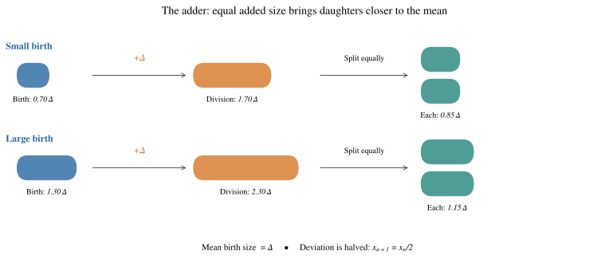

*图 12. Adder 如何通过反馈恢复 size。* 这个无噪声示意中，birth size 为 $0.70\Delta$ 和 $1.30\Delta$ 的细胞都增加 $\Delta$，然后对称分裂。它们的子细胞 birth size 为 $0.85\Delta$ 和 $1.15\Delta$，相对均值的偏差减半。胶囊形状的长度只示意相对 size，不是显微图像。加入 added size 噪声后，就得到随机映射（E.1）。

#### E.1 精确的稳态方差 {#e1-exact-stationary-variance}

在平稳状态下，$\xi_n$ 是新抽取的噪声，因此 $x_n$ 与 $\xi_n$ 独立。于是

$$
\operatorname{Var}(x_{n+1})
=a^2\operatorname{Var}(x_n)+\operatorname{Var}(\xi_n).
$$

令 $\sigma_x^2=\operatorname{Var}(x_n)$，则

$$
\sigma_x^2=a^2\sigma_x^2+\sigma_\xi^2,
$$

即

$$
\sigma_x^2=\frac{\sigma_\xi^2}{1-a^2}.\tag{E.2}
$$

对于 $a=1/2$、$\sigma_\xi^2=\sigma_\eta^2/4$，

$$
\operatorname{Var}(v_n)=\frac{\sigma_\eta^2}{3}.\tag{E.3}
$$

与 timer 不同，adder 的稳态 size 方差有限。映射中的确定性部分使偏差每代减半。

#### E.2 精确的 birth size 自相关 {#e2-exact-birth-size-autocorrelation}

将式（E.1）迭代 $k$ 次，得到

$$
x_{n+k}
=a^k x_n+
\sum_{j=0}^{k-1}a^{k-1-j}\xi_{n+j}.
\tag{E.4}
$$

后续噪声与 $x_n$ 独立，因此

$$
\operatorname{Cov}(x_n,x_{n+k})
=a^k\sigma_x^2.
$$

除以 $\sigma_x^2$，得到

$$
\rho_v(k)
\equiv\operatorname{Corr}(v_n,v_{n+k})
=a^k=2^{-k}.
\tag{E.5}
$$

例如，

$$
\rho_v(1)=\frac12,
\qquad
\rho_v(2)=\frac14.
$$

这些数值与 [Ho 实验室资料](https://ho.lab.westlake.edu.cn/teaching_en.html)第 5 页列出的相关性 $\approx0.49$ 和 $\approx0.24$ 很接近（该资料引用 Ho 等，*Annual Review of Biophysics*，2018）。

关键不只是数值吻合，而是确定性的恢复系数决定了相关函数如何衰减。噪声决定方差，反馈决定记忆持续的时间。

*图 13. birth size 向稳态值恢复的实验观察。* 引自 [Taheri-Araghi 等（2015）](https://doi.org/10.1016/j.cub.2014.12.009)的原图 3。A 图给出固定增量下的收敛预测，B、C 图分别与大肠杆菌和枯草芽孢杆菌的实验比较，展示式（E.1）的恢复系数。条件均值的恢复与稳态自相关函数（E.5）彼此相关，但它们是不同的测量量。

#### E.3 小波动极限下的分裂间隔时间协方差 {#e3-generation-time-covariances-in-the-small-fluctuation-limit}

在 adder 中，相邻分裂间隔的 birth size 满足

$$
\rho_v(k)=2^{-k}>0.
$$

那么分裂时间之间是什么关系？

当 size 波动较小，即 $|x_n|\ll\Delta$，将式（3.4）中的对数展开：

$$
\ln v_n=\ln(\Delta+x_n)
\simeq\ln\Delta+\frac{x_n}{\Delta}.
$$

因此

$$
\delta\tau_n
\equiv\tau_n-\frac{\ln2}{\lambda}
\simeq\frac{x_{n+1}-x_n}{\lambda\Delta}.
\tag{E.6}
$$

对一般的平稳 AR(1) 过程，

$$
C_x(k)=\sigma_x^2 a^{|k|},\qquad 0\lt a\lt 1,
$$

可以显式计算差分的协方差。在零滞后处，

$$
\begin{aligned}
C_{\delta\tau}(0)
&\simeq\frac1{(\lambda\Delta)^2}
\mathbb E[(x_{n+1}-x_n)^2]\\
&=\frac{2\sigma_x^2(1-a)}{(\lambda\Delta)^2}.
\end{aligned}
\tag{E.7}
$$

对于 $k\ge1$，

$$
\begin{aligned}
C_{\delta\tau}(k)
&\simeq\frac1{(\lambda\Delta)^2}
\operatorname{Cov}(x_{n+1}-x_n,\,x_{n+k+1}-x_{n+k})\\
&=\frac{2C_x(k)-C_x(k-1)-C_x(k+1)}{(\lambda\Delta)^2}\\
&=-\frac{\sigma_x^2(1-a)^2 a^{k-1}}{(\lambda\Delta)^2}.
\end{aligned}
\tag{E.8}
$$

除以式（E.7），得到

$$
\rho_\tau(k)
\simeq-\frac{1-a}{2}a^{k-1},
\qquad k\ge1.
\tag{E.9}
$$

对于 adder，$a=1/2$：

$$
\rho_\tau(k)\simeq-2^{-(k+1)},\qquad k\ge1.\tag{E.10}
$$

于是

$$
\rho_\tau(1)\simeq-\tfrac14,
\qquad
\rho_\tau(2)\simeq-\tfrac18,
\qquad
\rho_\tau(3)\simeq-\tfrac1{16}.
$$

**需要明确区分两种自相关：** 在这个模型中，birth size 在不同分裂间隔间呈正相关，而相邻*分裂间隔时间的波动*呈负相关。把这两个自相关函数混为一谈，就会看不清抵消机制。

负相关有一个直观解释：某个细胞的分裂时间比通常更长时，往往会产生较大的子细胞，而这个子细胞下一次分裂通常需要更短时间。

#### E.4 显式验证抵消关系 {#e4-an-explicit-check-of-the-cancellation}

利用式（E.7）–（E.8），

$$
\begin{aligned}
D_\tau
&\simeq C_{\delta\tau}(0)+2\sum_{k=1}^\infty C_{\delta\tau}(k)\\
&=\frac{2\sigma_x^2(1-a)}{(\lambda\Delta)^2}
-\frac{2\sigma_x^2(1-a)^2}{(\lambda\Delta)^2}
\sum_{k=1}^\infty a^{k-1}\\
&=\frac{2\sigma_x^2(1-a)}{(\lambda\Delta)^2}
-\frac{2\sigma_x^2(1-a)}{(\lambda\Delta)^2}\\
&=0.
\end{aligned}
\tag{E.11}
$$

所有非零滞后的负协方差之和，恰好抵消正的单代方差。式（3.5）进一步说明，在累计时间层面，这个抵消其实是精确的；即使式（E.6）所用的小噪声近似不再适用，逐项相消关系仍成立。

> **size homeostasis 的动力学约束：** size homeostasis 不只是 size distribution 比较窄，它还约束整段 lineage 历史的动力学。在恒定指数生长和对称分裂下，这一约束消除了累计分裂间隔时间波动中随分裂间隔数成比例增长的部分。

### 附录 F. 一般线性 size control 与完整频谱 {#appendix-f}

第 1.3 节已经比较了不同调控策略，这里给出统一的线性描述，并补充完整的频域计算。

#### F.1 局部线性反馈规则 {#f1-local-linear-feedback-laws}

统一的局部描述为

$$
x_{n+1}=a x_n+\xi_n,
\tag{F.1}
$$

其中 $x_n$ 为 birth size 相对稳态均值的偏差。

| 策略 | 典型 size 映射的斜率 $a$ | 物理行为 |
|---|---:|---|
| Sizer（定 size 分裂） | $0$ | division size 与 birth size 无关，不继承线性 size memory |
| Adder（定增量分裂） | $1/2$ | 继承 birth size 偏差的一半 |
| Timer（在平衡 size 附近线性化） | $1$ | 没有恢复性反馈，表现为 random walk 或偏差不变 |

当 $|a|\lt 1$ 时，

$$
\operatorname{Var}(x)=\frac{\operatorname{Var}(\xi)}{1-a^2},
\qquad
\rho_x(k)=a^{|k|}.
$$

这些调控策略的差别，在于**birth size 的扰动消退得多快**。观测到的斜率能约束有效动力学，但无法唯一确定具体的生化实现方式。

表中的 timer 是局部或加性近似；精确的乘性 timer 映射，对应第 1 节推导的 log size  random walk 。

下面给出第 4.3 节所用的完整频谱，频率以分裂间隔数为基准。

#### F.2 自协方差与 Wiener–Khinchin 关系 {#f2-autocovariance-and-the-wienerkhinchin-relation}

对平稳离散时间过程 $y_n$，定义

$$
C_y(k)=\mathbb E[(y_n-\bar y)(y_{n+k}-\bar y)].
$$

其双边功率谱密度为

$$
S_y(\omega)=\sum_{k=-\infty}^{\infty}
C_y(k)e^{-i\omega k},
\qquad -\pi\le\omega\le\pi.
\tag{F.2}
$$

逆变换关系为

$$
C_y(k)=\frac1{2\pi}\int_{-\pi}^{\pi}
S_y(\omega)e^{i\omega k}\,d\omega.
\tag{F.3}
$$

这就是离散时间的 Wiener–Khinchin 关系（维纳–辛钦关系）：自协方差与功率谱密度互为傅里叶变换。这里 $\omega$ 是**以分裂间隔数为基准**的角频率。比较按分裂间隔编号的 lineage 记录与按实际时间间隔采样的测量时，必须注意这一点。

在零频处，

$$
S_\tau(0)=\sum_{k=-\infty}^{\infty}C_\tau(k)
=C_\tau(0)+2\sum_{k=1}^\infty C_\tau(k).
$$

因此，只要协方差级数收敛，就有

$$
S_\tau(0)=D_\tau.
$$

式（4.4）便可写成频谱形式：

$$
\Lambda\simeq
\frac{\ln2}{\mu}
+\frac{(\ln2)^2}{2\mu^3}S_\tau(0).
$$

**频域中的增长修正：** 在二阶近似下，长期群体增长由*分裂间隔时间噪声的零频分量*决定；完整功率谱还可以告诉我们，系统是否存在特征性的动力学时间尺度。

#### F.3 AR(1) size control 模型的频谱 {#f3-spectrum-of-the-ar1-size-control-model}

再次考虑

$$
x_{n+1}=a x_n+\xi_n,
\qquad |a|\lt 1,
$$

其中噪声 $\xi_n$ 相互独立、均值为零、方差为 $\sigma_\xi^2$。在平稳状态下，

$$
x_n=\sum_{j=0}^\infty a^j\xi_{n-1-j}.
\tag{F.4}
$$

这相当于对白噪声进行线性滤波。在频域中，包含一代延迟的传递函数为

$$
H(\omega)=\frac{e^{-i\omega}}{1-ae^{-i\omega}},
$$

因此

$$
\begin{aligned}
S_x(\omega)
&=\sigma_\xi^2|H(\omega)|^2\\
&=\frac{\sigma_\xi^2}
{1+a^2-2a\cos\omega}.
\end{aligned}
\tag{F.5}
$$

对于 adder，$a=1/2$。size 频谱在 $\omega=0$ 附近最大，随后向 $\pi$ 平滑下降，不存在内禀的*非零频率*振荡共振。

这对应于单调、正值的自相关：

$$
C_x(k)=\sigma_x^2(1/2)^{|k|}.
$$

#### F.4 分裂间隔时间的频谱：差分滤掉零频噪声 {#f4-spectrum-of-generation-time-feedback-filters-out-zero-frequency}

由式（E.6），

$$
\delta\tau_n\simeq\frac{x_{n+1}-x_n}{\lambda\Delta}.
$$

作差会使傅里叶模态 $e^{i\omega n}$ 乘以 $e^{i\omega}-1$，所以

$$
\begin{aligned}
S_\tau(\omega)
&\simeq\frac{|e^{i\omega}-1|^2}{(\lambda\Delta)^2}S_x(\omega)\\
&=\boxed{
\frac{4\sin^2(\omega/2)}{(\lambda\Delta)^2}S_x(\omega).
}
\end{aligned}
\tag{F.6}
$$

在零频处，分子为零：

$$
S_\tau(0)=0.\tag{F.7}
$$

同一个结果，已经在式（3.5）的逐项相消和式（E.11）的协方差抵消中出现过。这是**同一个物理机制**的三种数学描述。

要注意，即使原本的 size 过程没有振荡模态，差分也可能使高频波动更突出。因此，奈奎斯特频率 $\omega=\pi$ 附近的谱值较大，本身不足以证明存在生物振荡器。这里的奈奎斯特频率对应离散采样能分辨的最高频率。

#### F.5 补充联系：马尔可夫模型的频谱 {#f5-an-extra-connection-the-markov-models-spectrum}

对于附录 D 的两状态马尔可夫模型，$C_\tau(k)=\delta^2a^{|k|}$，其中 $a=2p-1$。在 $|a|\lt 1$ 时，将傅里叶级数求和，得到

$$
S_\tau(\omega)
=\delta^2\frac{1-a^2}{1+a^2-2a\cos\omega}.
\tag{F.8}
$$

特别地，

$$
S_\tau(0)=\delta^2\frac{1+a}{1-a}
=\delta^2\frac{p}{1-p},
$$

这样无需单独对协方差求和，就回到式（D.4）。

因此，两种模型都能从频谱角度理解：

- 马尔可夫模型通过改变状态持续性，改变低频分裂时间噪声。
- Adder 将 size 波动转化为差分，抑制分裂时间噪声的零频分量。

### 附录 G. 精确抵消的适用范围与充分的渐近条件 {#appendix-g}

#### G.1 恒等式、矩条件与增长结论是三个层次 {#g1-identity-moments-and-growth-are-different-levels-of-assertion}

只要 size 为正、细胞共有恒定的指数增长率、分裂对称，恒等式（3.5）就对每个有限的 $n$ 成立。即使 size 过程不平稳，它也成立：size homeostasis 的作用是限制端点项，而不是让求和能够逐项相消。在平稳过程中，$\mathbb E|\ln v|$ 有限可确定平均时间；$\operatorname{Var}(\ln v)$ 有限可保证 $\operatorname{Var}(T_n)$ 有界，并给出 $D_\tau=0$。混合性进一步给出第 3.3 节的方差极限。但这些矩条件都不能单独控制式（3.7）的指数倾斜，也就是按指数因子对概率重新加权。

对平稳的正 size 过程，令 $q=s/\lambda>0$。控制该指数加权的一个实用充分条件是

$$
1\le\mathbb E[(v_n/v_0)^{-q}]
\le\big(\mathbb E[v^{2q}]\mathbb E[v^{-2q}]\big)^{1/2}<\infty.\tag{G.1}
$$

下界来自 Jensen 不等式和 $\mathbb E[\ln v_n-\ln v_0]=0$；上界来自 Cauchy–Schwarz 不等式，不需要两端独立。这些矩条件也保证对数可积，而且上下界对所有 $n$ 都成立。因此，$\lim_n n^{-1}\ln\mathbb E[(v_n/v_0)^{-q}]=0$。若这些条件对 $\lambda$ 邻域内的 $s$ 都成立，出生时间权重的期望在该邻域内就具有指数率 $\ln2-s\ln2/\lambda$，并在附录 C 的条件下选出增长率 $\lambda$。固定 initial size 也可用相应的端点一致界处理，但不能仅凭平稳边缘分布的假设就覆盖这一情形。

如果 adder 的 added size 有上界，且与零保持一定距离，就能构造一个满足全部这些矩条件的简单平稳过程。只要求增量为正、增量方差有限，并不自动保证负阶矩有限，也不保证群体瞬时 mean size 的条件成立。另一条守恒证明使用 $t^{-1}\ln\overline v_{\mathrm{snap}}(t)\to0$，直接适用于一次实际群体演化。不能把 chronological lineage 的 stationarity 和群体瞬时 size 的稳态条件当成同一件事。

#### G.2 在给定生长与分配条件下的普适性 {#g2-universality-within-the-stated-kinematics}

式（3.4）只用到了

$$
v_n^{\mathrm d}=v_n e^{\lambda\tau_n},
\qquad
v_{n+1}=\frac12v_n^{\mathrm d}.
$$

推导没有用到 division size 调控规则的具体函数形式。因此，任何满足这两个关系的平稳正 size 过程都满足式（3.5）。Sizer、adder 或其他反馈规则，只要能提供足够的 size homeostasis，都可能出现同样的抵消。

如果分裂不对称，所追踪的子细胞获得母 cell size 的比例为 $r_n$，那么

$$
v_{n+1}=r_n v_ne^{\lambda\tau_n},
$$

于是

$$
\tau_n=\frac{-\ln r_n+\ln v_{n+1}-\ln v_n}{\lambda}.
$$

累计时间变为

$$
T_n=\frac1\lambda\sum_{j=0}^{n-1}(-\ln r_j)
+\frac{\ln v_n-\ln v_0}{\lambda}.
\tag{G.2}
$$

当分配比例有波动时，第一项就不再是确定性的。因此，在随机不对称分裂下，不能仅由 size homeostasis 推出 $D_\tau=0$。不过，只要每次分裂都保持总 size 守恒，且群体瞬时 mean size 保持平稳，群体层面的质量守恒仍给出 $\Lambda=\lambda$。此时，正确的 lineage 增长计算必须考虑子细胞分配比例，以及抽样时采用的权重。

单细胞生长率有波动时也需要注意。若第 $n$ 代中满足

$$
\dot v=\lambda_n v
$$

则

$$
\tau_n=\frac{\ln2+\ln v_{n+1}-\ln v_n}{\lambda_n},
$$

此时求和各项没有统一的前因子，因而不能再按原来的方式逐项相消。生长率波动由此可能带来新的增长与调控效应。

### 附录 H. 分裂间隔时间分布与轨迹分布的 KL 散度 {#appendix-h}

第 2.1 节引入的加权密度 $q$，可以用信息论表示相对于平均分裂间隔时间基准的增长增量。对于独立的分裂间隔时间，若 $\bar\tau=\mathbb E_p[\tau]\lt\infty$，$p$ 与 $q$ 之间的 Kullback–Leibler 散度（KL 散度，也称相对熵）为

$$
\begin{aligned}
D_{\mathrm{KL}}(p\|q)
&=\int_0^\infty p(\tau)\ln\frac{p(\tau)}{q(\tau)}\,d\tau\\
&=\int_0^\infty p(\tau)(\Lambda\tau-\ln2)\,d\tau\\
&=\Lambda\bar\tau-\ln2.
\end{aligned}
\tag{H.1}
$$

KL 散度非负，因此回到式（2.4）的 Jensen 下界；$D_{\mathrm{KL}}(p\|q)/\bar\tau$ 则精确给出 $\Lambda$ 比 $\ln2/\bar\tau$ 大多少。同一种分布偏倚，既可以从抽样角度理解，也可以用 KL 散度表示。

对于相关分裂间隔时间，第 4.1 节说明增长率取决于完整的分裂历史。因此，KL 恒等式需要使用分裂间隔时间的联合分布。令 $\boldsymbol\tau=(\tau_0,\ldots,\tau_{n-1})$，用 $p_n(\boldsymbol\tau)$ 表示 chronological lineage 的联合概率分布，并记 $T_n=\sum_{j=0}^{n-1}\tau_j$。定义加权轨迹分布

$$
q_n(\boldsymbol\tau)
=\frac{2^n e^{-\Lambda T_n}p_n(\boldsymbol\tau)}{Z_n(\Lambda)},
\quad
Z_n(\Lambda)=2^n\mathbb E_p[e^{-\Lambda T_n}].
\tag{H.2}
$$

这个定义已经保证归一化。若分裂间隔时间独立，则 $Z_n(\Lambda)=1$，且 $q_n(\boldsymbol\tau)=\prod_{j=0}^{n-1}q(\tau_j)$，得到第 2.1 节中的单代加权。对于一般联合分布，KL 散度为

$$
\begin{aligned}
D_{\mathrm{KL}}(p_n\|q_n)
&=\mathbb E_p\!\left[
\ln\frac{p_n}{q_n}\right]\\
&=\Lambda\mathbb E_p[T_n]-n\ln2+\ln Z_n(\Lambda).
\end{aligned}
\tag{H.3}
$$

若 $\mathbb E[T_n]=n\bar\tau$，且 $\lim_{n\to\infty}\ln Z_n(\Lambda)/n=0$，除以 $n$ 后得到

$$
\lim_{n\to\infty}\frac1nD_{\mathrm{KL}}(p_n\|q_n)
=\Lambda\bar\tau-\ln2.
\tag{H.4}
$$

非负的 KL 散度*率*把式（H.1）推广到相关历史，并得到第 4.1 节的广义 Jensen 下界。这里“率”指长轨迹的 KL 散度除以分裂间隔数后的极限。对于相关过程，$q_n$ 是按指数权重重新加权的轨迹系综；要把它等同于某种具体回溯抽样得到的分布，还可能需要处理边界效应和额外假设。

在维持 size homeostasis、$\lambda$ 恒定的模型中，在保证 $\Lambda\bar\tau=\ln2$ 的同一组条件下，KL 散度除以分裂间隔数后的极限为零，但有限长度路径的两个分布仍不必完全相同。

---

## 进阶专题：随机波动与振荡模态 {#further-topic}

时间噪声的零频抵消与非零频率的振荡模态，是两个不同的问题。前者描述波动是否长期累积，后者涉及系统是否存在特征性的振荡时间尺度。

### FT.1 弛豫不等于振荡 {#ft1-relaxation-is-not-oscillation}

当 $0\lt a\lt 1$ 时，AR(1) 模型只有一个正实特征值 $a$，扰动按 $a^n$ 衰减。这种向稳态恢复的过程称为弛豫（relaxation）。归一化自相关函数单调衰减：

$$
\rho_x(k)=a^{|k|}.
$$

频谱中没有独立的非零频率共振模态。随机轨迹看起来可能时升时降，但这并不能单独证明存在周期性的动力学机制。

如果 $-1\lt a\lt 0$，自相关函数 $\rho_x(k)=a^{|k|}$ 的符号会交替，谱峰位于 $\omega=\pi$，对应每两代一次的交替。这已经说明，*反馈的符号和特征值结构*比噪声轨迹看起来有多规律更重要。

### FT.2 能产生阻尼振荡的最简模型 {#ft2-a-minimal-model-capable-of-damped-oscillations}

引入一个延迟反馈项：

$$
x_{n+1}=2r\cos\omega_0\,x_n-r^2x_{n-1}+\xi_n,
\qquad 0\lt r\lt 1,
\quad0\lt \omega_0\lt \pi.
\tag{FT.1}
$$

确定性递推的特征方程为

$$
z^2-2r\cos\omega_0\,z+r^2=0.
$$

其根为

$$
z_\pm=re^{\pm i\omega_0}.\tag{FT.2}
$$

模长 $r$ 控制阻尼，辐角 $\omega_0$ 决定特征角频率。因此，确定性响应中含有如下形式的项：

$$
x_n\sim r^n\cos(n\omega_0+\phi).
\tag{FT.3}
$$

白噪声不断激发这些阻尼模态，使系统形成平稳的含噪振荡过程。

在非零滞后处，平稳自协方差满足同一个二阶递推关系：

$$
C_x(k+1)=2r\cos\omega_0\,C_x(k)-r^2C_x(k-1),
\quad k\ge1.
\tag{FT.4}
$$

因此，归一化自相关函数具有如下形式：

$$
\rho_x(k)=r^{|k|}
\big[\cos(k\omega_0)+b\sin(|k|\omega_0)\big],
$$

系数 $b$ 由 stationarity 确定。对这个二阶自回归模型（AR(2)），

$$
b=\frac{1-r^2}{1+r^2}\cot\omega_0.
\tag{FT.5}
$$

功率谱为

$$
S_x(\omega)=\frac{\sigma_\xi^2}
{\left|1-2r\cos\omega_0\,e^{-i\omega}
+r^2e^{-2i\omega}\right|^2}.
\tag{FT.6}
$$

当阻尼足够弱，且频率不靠近边界时，频谱会在 $\omega_0$ 附近出现共振峰。阻尼不为零时，精确峰位不一定等于 $\omega_0$。

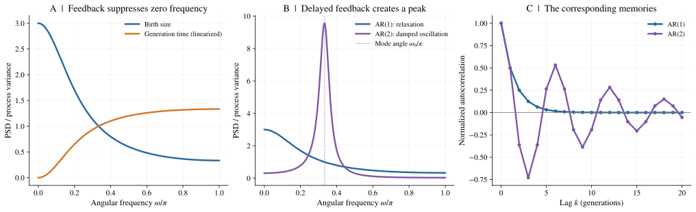

*图 14. 零频抵消与振荡模态回答不同的问题。* A 图使用 adder 的 $a=1/2$ 和线性化分裂间隔时间关系（F.6），每条频谱除以各自过程的方差。B 图比较 AR(1) size 过程与 AR(2) 模型（FT.1），参数为 $r=0.9$、$\omega_0=\pi/3$ 弧度/分裂间隔。虚线标出模态的辐角，实际谱峰可能因阻尼而偏移。C 图展示相应的解析自相关。所有频谱都以分裂间隔数为基准，不是按实际时间定义的频率。

### FT.3 频谱能说明什么，不能说明什么 {#ft3-what-the-spectrum-can-and-cannot-establish}

非零频率谱峰提示系统存在特征性的动力学时间尺度，但不能单独确定唯一的分子机制。含噪声的线性稳定振荡器、加入噪声的确定性极限环，或具有适当结构并能代际传递的环境波动，都可能产生表面相似的频谱。

同样，独立或相关噪声的有限长度记录，也可能在估计功率谱时出现偶然的凸起。要得到可靠结论，需要足够长的记录、多条 lineage 或重复实验、不确定性估计，并区分数据是按分裂间隔数还是按实际时间采样。

> **零频与非零频率：** 零频分量决定分裂间隔时间噪声如何长期累积，非零频率结构则帮助识别动力学模态。两者都来自同一个相关函数，但回答的问题不同。

---

## 补充推导与阅读 {#problems-further-reading}

### 1. 如何消除 size memory？ {#problem-1-what-does-it-take-to-remove-size-memory}

对于 $x_{n+1}=ax_n+\xi_n$，size memory 可以用条件期望 $\mathbb E[x_{n+k}\mid x_n]$、稳态方差和自相关函数描述。反馈系数 $a$ 决定偏差如何衰减；$a\lt 0$ 时，偏差还会交替变号。

**结果：** $\mathbb E[x_{n+k}\mid x_n]=a^kx_n$，$\operatorname{Var}(x)=\sigma_\xi^2/(1-a^2)$，$\rho(k)=a^{|k|}$。对于方差有限且非零的独立噪声，要有有限稳态方差，需满足 $|a|\lt 1$。负的 $a$ 会使相关性的符号交替。

### 2. 直方图不变，相关性如何改变？ {#problem-2-correlation-without-changing-a-histogram}

两状态马尔可夫模型在任意 $0\lt p\lt 1$ 时，都具有相同的边缘分布 $\tfrac12\delta_{\tau_s}+\tfrac12\delta_{\tau_\ell}$，但式（D.3）中的相关性随 $p$ 改变。因此，式（4.4）的增长率修正也随 $p$ 改变，并在 $p\to1^-$ 时失去近似的有效性。

**结果：** 转移矩阵对称，因此平稳概率为 $1/2,1/2$。相关性按 $(2p-1)^k$ 衰减，所以 $D_\tau=\delta^2p/(1-p)$。当 $p\to1^-$ 时，相关时间发散，弱噪声或截断累积量展开不再一致有效，应改用精确矩阵条件。

### 3. 每代时间有噪声，长期噪声还能为零吗？ {#problem-3-can-noisy-lifetimes-have-zero-long-run-noise}

对于具有混合性、且 $\operatorname{Var}(\ln v)$ 有限的平稳 size 过程，式（3.5）保证 $n\to\infty$ 时 $\operatorname{Var}(T_n)$ 仍然有界，而不要求每个 $\tau_n$ 都是确定性的。

**结果：** $T_n-n\ln2/\lambda=(\ln v_n-\ln v_0)/\lambda$。如果两端逐渐失去相关性，其方差趋于 $2\operatorname{Var}(\ln v)/\lambda^2$。每个分裂间隔时间仍有噪声，但跨分裂间隔协方差的总和抵消了方差的累积。

### 4. 自相关函数与功率谱密度 {#problem-4-acf-versus-psd}

AR(1) 频谱也可以直接从自协方差函数求出。结合式（F.6），可以看出分裂间隔时间频谱在 $\omega=0$ 处为零的原因。

**结果：** 对几何级数求和，$\sum_{k=-\infty}^{\infty}a^{|k|}e^{-i\omega k}=(1-a^2)/(1+a^2-2a\cos\omega)$，再乘以 $\sigma_x^2=\sigma_\xi^2/(1-a^2)$。差分使每个傅里叶分量乘以 $e^{i\omega}-1$，该因子在零频处为零。

### 5. 频谱的哪一部分影响增长？ {#problem-5-which-part-of-a-spectrum-matters-for-growth}

两个随机 lineage 过程即使具有相同的 $\bar\tau$ 和 $\operatorname{Var}(\tau)$，也可能因相关函数不同而具有不同的增长率。非零频率谱峰的高度，不能单独确定群体增长率；在二阶弱噪声近似下，增长修正由 $S_\tau(0)$ 决定。

**结果：** 非零频率谱峰与零频噪声回答不同的问题。在有效的弱噪声累积量展开中，二阶增长修正正比于 $S_\tau(0)$，而不是非零频率谱峰的高度。超出这一近似后，高阶累积量率也可能产生影响。

### 进一步阅读 {#further-reading}

实验背景可以先读 Taheri-Araghi 等（2015）和 Hashimoto 等（2016）。关于相关历史的增长关系，可读 [Pigolotti（2021）](https://doi.org/10.1103/PhysRevE.103.L060402)，并结合附录 C 对期望增长率与典型增长率的区分。[Lin 和 Amir（2020）](https://doi.org/10.1103/PhysRevE.101.012401)进一步讨论了单细胞生长率波动对群体增长的影响。下列机制研究则有助于理解：为什么唯象模型中的 size control 斜率，不能唯一确定分子调控机制。

### 参考文献 {#references}

- Taheri-Araghi, S., et al. (2015). *Cell-size control and homeostasis in bacteria*. **Current Biology, 25**(3), 385–391. [doi:10.1016/j.cub.2014.12.009](https://doi.org/10.1016/j.cub.2014.12.009)。原图 1–3 对应本笔记的图 2、5、13。
- Ho 等，*Annual Review of Biophysics*（2018）：cell size 调控、lineage 相关性与波动。
- Godin 等，*Nature Methods*（2010）：单细胞生长测量。
- Hashimoto, M., et al. (2016). *Noise-driven growth rate gain in clonal cellular populations*. **PNAS, 113**(12), 3251–3256. [doi:10.1073/pnas.1519412113](https://doi.org/10.1073/pnas.1519412113)。原图 3 对应本笔记的图 4。
- Wallden 等，*Cell*（2016）；Ho 和 Amir，*Frontiers in Microbiology*（2015）；Micali 等，*Cell Reports*（2018）：与复制相关的模型，以及唯象 size control 和分子实现之间的区别。
- [Ho 实验室资料](https://ho.lab.westlake.edu.cn/teaching_en.html)
- Pigolotti, S. (2021). *Generalized Euler–Lotka equation for correlated cell divisions*. **Physical Review E, 103**, L060402. [doi:10.1103/PhysRevE.103.L060402](https://doi.org/10.1103/PhysRevE.103.L060402)。
- Lin, J., and Amir, A. (2020). *From single-cell variability to population growth*. **Physical Review E, 101**, 012401. [doi:10.1103/PhysRevE.101.012401](https://doi.org/10.1103/PhysRevE.101.012401)。
