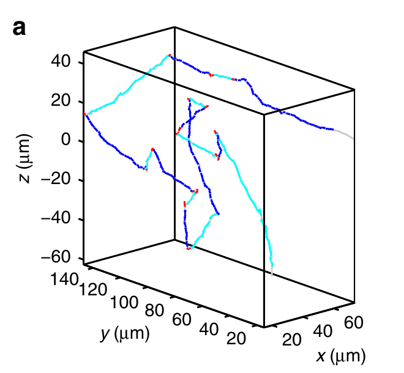
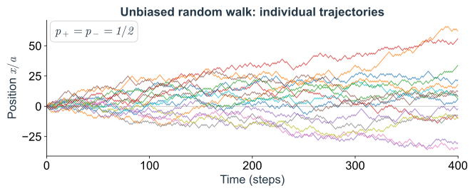
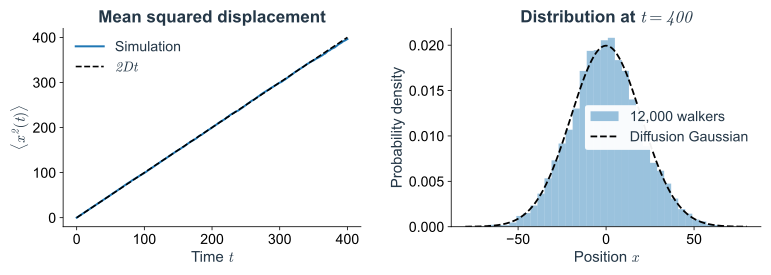
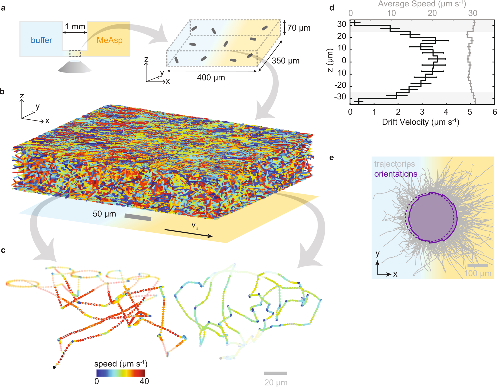
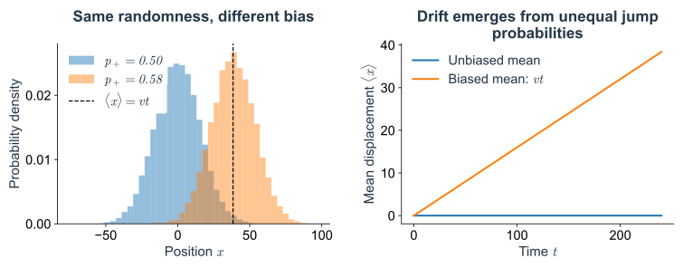
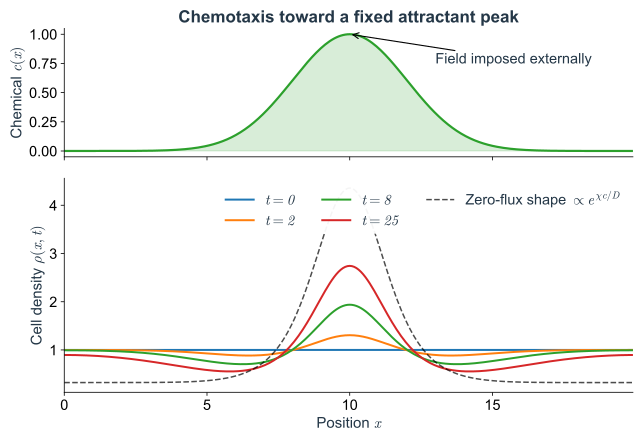

# 趋化：从随机游走到集体模式形成
## 细菌不断随机转向，群体为什么还能聚起来

> 西湖大学 2026 年秋季《定量生物学导论》课程学习笔记。

> **核心问题：** 随机游动通常使细菌散开。如果细菌自己产生并追随化学信号，原本很小的密度差异能否长成聚集体？

## 概述 {#main-lecture}

在显微镜下追踪一只大肠杆菌，会看到它游动一段、转向，再沿新的方向前进。在均匀环境中，没有一个方向一直更有利。重复许多次转向后，一团起初集中的细菌通常会逐渐散开，原有的密度差异也会减小。

但细菌也能逐渐聚到一起。[Laganenka 等（2016）](https://doi.org/10.1038/ncomms12984)在大肠杆菌中观察了这种聚集，并通过干预运动、趋化与黏附来研究其来源，实验图见[第 3 节](03_collective_patterns.md#collective-feedback)。要解释这个现象，需要先区分：细菌是游向外界已经存在的吸引物峰，还是通过自己产生的信号，逐渐形成一个原本不存在的聚集位置？

后者可能来自一个简单的过程。某处偶然多一点细菌，就产生更多吸引物；周围细菌游向那里，该处又会产生更多信号。不过，随机游动始终在使细菌散开。聚集是否出现，取决于向内的趋化输运能否超过向外的扩散。

下面从同一个运动模型逐步加入这些过程。第 1 节先用无方向偏好的随机游走计算散开；第 2 节加入运动偏置，计算细菌在给定吸引物场中怎样迁移；第 3 节让细菌成为信号源，建立密度与浓度相互影响的 Keller–Segel 模型；第 4 节再判断什么尺度的微小起伏会增长。这样既能从单细胞运动写出群体方程，也能分清每一步增加的生物学假设。

[技术附录](#technical-appendices)补充连续时间随机过程、随机轨迹与密度方程的对应、完整增长率和信号的空间传播。

---

追踪一只细菌时，转向看起来带有很强的随机性；同时追踪许多只，却能测到沿化学梯度的平均漂移。要把这两种观察联系起来，可以先在均匀环境中算出散开的基准，再问化学信号改变了哪一项运动统计。

这一篇先固定外界的化学场，让细菌成为读取和响应它的粒子。这样，运动模型每增加一个偏置，都能与平均位移、扩散系数或稳态积累逐项比较。

## 1. 没有化学梯度时，细菌怎样散开 {#random-migration}

### 1.1 从游动轨迹到随机游走与主方程 {#run-and-tumble}

先看一段[大肠杆菌游动的显微视频](https://commons.wikimedia.org/wiki/File:High-throughput-3D-tracking-of-bacteria-on-a-standard-phase-contrast-microscope-ncomms9776-s2.ogv)（Taute 等，2015，Supplementary Movie 1；实时播放，标尺 $50\,\mu\mathrm{m}$）。选一只细菌跟着看：它持续游动一段，随后改变方向。前者称为直游（run），短暂的转向过程称为 tumble。

*Fig. 1. 一只大肠杆菌的三维游动轨迹。* 深、浅蓝色交替标记相邻的直游段，红色标记转向。摘自 [Taute 等（2015），原文 Fig. 4a](https://doi.org/10.1038/ncomms9776)。

Fig. 1 将细胞的位置记录连成了轨迹，坐标表示实际空间距离。蓝色直游段保留了一段时间的方向，红色部分则改变了后续运动的方向。沿着轨迹走，并没有一个始终朝向的目标位置。

即使没有化学梯度，细菌也在主动游动。短时间内它保留原来的方向；经过多次转向，方向记忆逐渐消失，许多次位移的平均才接近零。因此，“没有净漂移”并不等于“没有运动”。

如果只关心经过很多次转向以后，细胞团在多大范围内散开，可以先略去短时的方向记忆，用各步独立的一维随机游走近似。模型中的一步代表经过粗粒化的一段位移，不直接对应一次真实直游；短时方向记忆在[附录 A.8](#stochastic-a8)中再加回来。

这种省略对应一次观察尺度的选择。如果刚看到细胞向右游，就问它下一瞬间在哪里，朝向显然不能丢；若隔了许多次转向再观察，最初的朝向通常已不能帮助预测，此时才有机会只记录位置。随机游走先从这个较慢、较大的尺度开始。后面写出扩散方程时，描述的也是这份被平滑后的运动统计。

在这个尺度下，两段轨迹只要有相同的长时位移统计，就会被写进同一个模型。这是有意舍弃细节：方程要解释一团细胞如何散开，不负责复现某只细菌每次转向的角度。以后若要预测它能否穿过很窄的通道，或者一次短刺激会怎样改变下一段直游，被舍弃的朝向和持续时间就可能重新变得必要。模型的简繁要由准备测量的现象决定。

先只记录沿通道的一维位置 $x$，让模型细胞从原点出发。将多次转向后的运动简化为：每经过时间 $\tau$，位置向左或向右改变 $a$，概率各为 $1/2$。各步方向相互独立。这里的 $a$ 和 $\tau$ 是简化模型的位移与时间尺度。

前两步的路径与位置概率为：

| 步数 | 所有路径（右记为 R，左记为 L） | 最后的位置与概率 |
|---|---|---|
| 0 | 尚未移动 | $0$，概率 $1$ |
| 1 | R、L | $+a$、$-a$，各 $1/2$ |
| 2 | RR、RL、LR、LL | $+2a$：$1/4$；$0$：$1/2$；$-2a$：$1/4$ |

两步后，回到原点有 RL 和 LR 两条路径，每条的概率都是 $(1/2)(1/2)=1/4$，所以总概率是 $1/2$。算某个位置的概率，就是把能到达它的互斥路径的概率加起来。

在这个模型中，同时从原点释放 $1000$ 个独立细胞，两步后平均约有 $500$ 个回到原点，左右两端各有 $250$ 个。单次实验的计数会在这些平均值附近波动。

每一步都抛一次公平硬币，决定向左还是向右。$n$ 步中若有 $k$ 次向右，末位置就是 $(2k-n)a$；因此同一个位置可以由许多条不同路径到达。每条路径的概率为 $2^{-n}$，而其中有 $\binom nk$ 条含 $k$ 次右跳，所以

$$
\Pr\{X_n=(2k-n)a\}=\binom nk\,2^{-n},\qquad k=0,\ldots,n.
$$

这给出有限步数的精确位置分布。它先是格点上的概率，还没有变成空间连续的浓度或细胞密度。

*Fig. 2. 均匀化学环境中的模型细胞轨迹。* 将每条轨迹看成一个模型细胞在均匀化学环境中的位置记录：规则相同，实际路径却不同。

步数多了以后，逐条列出路径会很繁琐。但到达一个格子，只可能来自它的两个邻居，因此可以直接更新每个位置的概率。将位置记作 $x_i=ia$，时刻记作 $t_n=n\tau$，定义

$$
P_i^n=\text{第 }n\text{ 步，模型细胞位于格子 }i\text{ 的概率}.
$$

上标 $n$ 表示时间编号，下标 $i$ 表示位置编号。初值为 $P_0^0=1$，其余为零。

要在下一步出现在格子 $i$，只有两个来源：

- 现在在 $i-1$，再向右走，概率是 $P_{i-1}^n\times 1/2$；
- 现在在 $i+1$，再向左走，概率是 $P_{i+1}^n\times 1/2$。

所以

$$
\boxed{P_i^{n+1}=\frac12 P_{i-1}^n+\frac12 P_{i+1}^n.}
\tag{1.1}
$$

式（1.1）称为主方程：根据当前位置概率，计算下一步的位置概率。

这一步也把模型从“列出可能轨迹”变成了“逐格做收支”。我们不再保存每个细胞此前走过哪条路，而只保留它现在可能在哪里。各步独立保证了这些信息足以更新下一步；如果运动还记得朝向，同一个位置上向左和向右游的细胞就不能合并，必须为两种方向分别记账。主方程能写得这样简单，依赖的正是前面的粗粒化假设。

*Fig. 3. 两步位移与概率收支。* 左：回到原点有两条路径，各贡献 $1/4$。右：从左右邻居进入目标格子的概率相加，得到下一步的概率。

例如 $P_0^2=(P_{-1}^1+P_1^1)/2=1/2$，与逐条数路径一致。把式（1.1）对所有格子求和，右边只是把原来的概率各分成两半再相加，因此总概率始终为 $1$。

也可以用平均细胞数 $N_i^n=NP_i^n$ 写出完全相同的更新规则。这个等式对概率与平均个数精确成立；一次实验中的实际个数还带有随机波动。

### 1.2 连续密度、扩散方程与通量 {#diffusion-limit}

显微图像里，细胞仍是一只只分开的，密度曲线则已经把它们在小区域内平均过。若要用一次实验的计数近似平滑密度，最好找得到这样一个尺度：区域内有足够多的细胞，同时区域又比整个图案细得多，还能分辨峰和谷。细胞很少时，也可以先对重复实验中的计数取平均。下面让格点间距趋小，是计算大尺度规律的办法；实际应用时要检查微观游动尺度与图案尺度之间是否留有足够的间隔。

在式（1.1）两边减去 $P_i^n$：

$$
P_i^{n+1}-P_i^n
=\frac12\bigl(P_{i-1}^n-2P_i^n+P_{i+1}^n\bigr).
$$

右边比较的是中间格子与两侧邻居。若中间比两侧都高，下一步流入的少于流出的，中间的平均细胞数就降低；中间比两侧都低时则相反。这给出了密度峰被抹平的局部原因。

同步跳跃时，单格计数可能交替变化。下面的连续描述适用于空间上足够平滑的分布。

格子变小后，每格容纳的概率也会变小，因此先定义概率密度 $p(x,t)$：

$$
P_i^n\simeq a\,p(x_i,t_n),\qquad \int p(x,t)\,dx=1.
$$

密度乘以一小段长度，才是落在这段内的概率。对 $N$ 个独立模型细胞，平均数密度为 $\rho(x,t)=Np(x,t)$，满足 $\int\rho\,dx=N$。从这里起统一用 $\rho$，其单位是一维中的“细胞数／长度”，就是沿通道统计细胞位置直方图时所测量的量。在给定外场、细胞彼此独立的条件下，两种密度满足相同的线性输运方程；细胞自己改变化学场后，还需要讨论相互作用与平均场近似，见[附录 A.7](#stochastic-a7)。

将离散收支式除以 $a$，再整理成

$$
\underbrace{\frac{\rho(x,t+\tau)-\rho(x,t)}{\tau}}_{\text{单位时间内密度的改变}}
=\frac{a^2}{2\tau}
\underbrace{\frac{\rho(x-a,t)-2\rho(x,t)+\rho(x+a,t)}{a^2}}_{\text{中心比邻居高，还是低？}}.
$$

左边在 $\tau$ 很小时变成时间导数 $\partial_t\rho$。“偏导数”在这里表示固定位置 $x$，只看密度怎样随时间变。右边的差商在密度足够平滑时变成空间二阶导数 $\partial_x^2\rho$。直接展开可见：

$$
\begin{aligned}
\rho(x+a,t)&=\rho+a\partial_x\rho+\frac{a^2}{2}\partial_x^2\rho+\cdots,\\
\rho(x-a,t)&=\rho-a\partial_x\rho+\frac{a^2}{2}\partial_x^2\rho+\cdots.
\end{aligned}
$$

相加再减去 $2\rho$，一阶项抵消，剩下 $a^2\partial_x^2\rho$。因此，当观察长度远大于 $a$、时间远大于 $\tau$，并且所观察的密度分布已足够平滑时，得到

$$
\boxed{\partial_t\rho=D\partial_x^2\rho,\qquad D=\frac{a^2}{2\tau}.}
\tag{1.2}
$$

这就是扩散方程。局部峰顶有 $\partial_x^2\rho\lt0$，所以密度下降；谷底有 $\partial_x^2\rho\gt0$，所以密度上升。$D$ 的单位是“长度平方／时间”，控制这团细胞在无化学方向提示时摊开的快慢。正文趋化模型中的 $D\partial_x^2\rho$ 就来自这个对照过程。

严格的扩散极限是让 $a,\tau\to0$，同时保持 $a^2/(2\tau)=D$ 有限；不能固定 $a$ 却单独把 $\tau$ 取到零。原来的同步格点游走还有奇偶性：第 $n$ 步只到达与 $n$ 同奇偶的格点。连续密度描述的是把这些微观格点细节平均掉后的光滑分布。

这里的扩散来自细菌的主动游动与多次转向。连续方程省略了一次次方向选择，$D$ 则保留了它们对长时散开速度的影响。因而实验中的 $D$ 要由细胞轨迹测量，不能直接用被动颗粒的热扩散系数代替。

沿用上面的平均数密度 $\rho(x,t)$。相邻两格的细胞数为 $N_i\simeq a\rho_i$、$N_{i+1}\simeq a\rho_{i+1}$。每步各有一半向对面走，向右为正的净穿越数除以时间就是

$$
J_{i+1/2}=\frac{N_i-N_{i+1}}{2\tau}
=\frac{a}{2\tau}(\rho_i-\rho_{i+1})
\simeq-D\partial_x\rho.
$$

*Fig. 4. 无方向偏置时的扩散通量。* 每个圆点代表一个模型细胞，左格有 12 个、右格有 4 个。每个细胞向左右跳的概率都是 $1/2$，但穿过两格共同边界的平均数量分别是 6 和 2，因此每步净向右 4 个。通量还要除以一步的时间 $\tau$。图中数字都是平均预测。

左边有 12 个细胞，平均有 6 个向右；右边只有 4 个，平均有 2 个向左。每个细胞的规则相同，穿过边界的数量却不同。因此，净通量可以从密处流向稀处，细胞本身无需感知拥挤程度。

再对一小段 $[x,x+\Delta x]$ 做收支：细胞数的改变等于左边流入减去右边流出，

$$
\partial_t\rho\,\Delta x=J(x,t)-J(x+\Delta x,t).
$$

除以 $\Delta x$ 并取连续极限，得到

$$
\boxed{\partial_t\rho=-\partial_xJ,\qquad J_{\rm diff}=-D\partial_x\rho,
\qquad \partial_t\rho=D\partial_x^2\rho.}
\tag{1.3}
$$

第一式是局部细胞数守恒，第二式是菲克定律，两者合起来得到与第 1.2 节相同的扩散方程。使用通量的好处是，加入趋化时可以直接计算它将多少细胞送过同一条边界，再与扩散通量相加。

这里没有细胞的出生和消失，观察区域里数量的变化都要能追溯到边界上的穿越。若实验只拍一个小视野，从画面中离开的细胞并没有从系统中消失；若细胞在基底上黏住，则它仍在画面里，却可能已经退出游动群体。将哪一些细胞算进密度、怎样记录跨边界事件，会直接决定能否用这条守恒方程描述数据。

### 1.3 从单细胞轨迹测量扩散系数 {#mean-squared-displacement}

还可以从单条轨迹检验同一个 $D$。以下尖括号表示对重复实验取平均。记第 $k$ 步位移为 $\Delta X_k$，总位移为 $X_n-X_0=\sum_{k=1}^n\Delta X_k$。每步平均位移为零、均方为 $a^2$；各步独立，故交叉项 $\langle\Delta X_k\Delta X_j\rangle=0$（$k\ne j$）。于是

$$
\langle(X_n-X_0)^2\rangle
=\sum_k\langle\Delta X_k^2\rangle
+2\sum_{k\lt j}\langle\Delta X_k\Delta X_j\rangle=na^2.
$$

用 $t=n\tau$ 和连续极限中的 $D=a^2/(2\tau)$，得到

$$
\boxed{\langle X(t)-X_0\rangle=0,\qquad
\langle[X(t)-X_0]^2\rangle=2Dt,\qquad D=\frac{a^2}{2\tau}.}
\tag{1.4}
$$

典型位移 $\sqrt{2Dt}$ 随时间增大，细胞团因此展宽。这个 $D$ 是主动游动经多次转向产生的有效扩散系数，单位为长度平方／时间。[附录 A.8](#stochastic-a8)保留了方向状态，并说明短时的均方位移正比于 $t^2$，长时才正比于 $t$。

*Fig. 5. 均方位移与位置分布。* 左：模拟均方位移与 $2Dt$ 比较；右：许多模型细胞在同一时刻的位置直方图，与连续扩散方程的高斯分布比较。对集中在原点的初值，高斯分布为 $p(x,t)=(4\pi Dt)^{-1/2}\exp[-x^2/(4Dt)]$；它描述长时间、大尺度下的光滑分布。

实际拟合要在一段合适的时间间隔上进行。间隔过短，看到的主要是尚未转向的持续游动，定位误差也可能占据很大比例；间隔过长，最快离开视野的细胞常常已不在完整轨迹样本中，剩下的记录未必代表原来的群体。可以先检查均方位移随时间的形状，再选择近似线性的区间，而不是从任意两个时刻的位移就算出一个扩散系数。

实验中可以在无梯度时，由长时间轨迹的均方位移斜率估计 $D$。对一个很小的余弦密度起伏 $\delta\rho=A(t)\cos(qx)$，扩散方程给出 $\dot A=-Dq^2A$：所有非零波数都衰减，细而尖的起伏衰减得更快。

游速相同也未必对应相同的有效扩散。若每次直游能保持方向较久，前后位移更容易相互加强，一段时间内就能走得较远；若方向频繁改变，许多位移会互相抵消。因此 $D$ 同时概括了运动的快慢和方向保持多久。两种运动方式即使在长时间给出相同的 $D$，短时间轨迹仍可能很不一样；只用扩散方程时，这些区别已被平均掉了。

因此，扩散本身不会让一个小密度峰越长越高。要形成聚集，还需要使细胞向峰内迁移的机制。先看一个由外界给定的化学梯度能否做到这一点。

---

## 2. 化学梯度怎样改变随机迁移 {#chemical-bias}

加入梯度后，最先要测量的是沿梯度方向的平均速度。[Grognot 与 Taute（2021）](https://doi.org/10.1038/s42003-021-02190-2)在微流控装置中建立近似线性的 MeAsp（甲基天冬氨酸，一种吸引物）梯度，再追踪其中的大肠杆菌。

*Fig. 6. 单个细胞游得很快，沿梯度的净迁移却较慢。* a：梯度与观察区域；b、c：群体轨迹与两条单细胞轨迹；d：黑线为沿梯度的平均漂移速度，灰线为平均游速，分别读下、上横轴；e：将轨迹起点对齐后得到的轨迹与方向分布。引自 [Grognot 与 Taute（2021），原文 Fig. 1](https://doi.org/10.1038/s42003-021-02190-2)。

先比较 Fig. 6c 的两条单细胞轨迹和 d 中的两种速度。单个细胞仍向不同方向游动，游速较大；将许多细胞沿梯度的位移平均后，才得到较小但非零的漂移速度。因此，模型可以保留随机位移，同时给有利方向稍高一点的权重。

### 2.1 信号比较与有偏运动 {#chemotactic-response}

大肠杆菌的重要策略是在游动时比较近期与较早的化学信号，通过感知与适应调节转向。在静态吸引物梯度中，朝高浓度方向游动的细胞经历浓度上升，倾向于延长这次直游；转向后仍会尝试不同方向。持续处于均匀浓度中时，适应使响应趋向恢复基线，因此一次浓度升高与持续的空间导航需要区分（见[Segall 等（1986）的时间刺激实验](https://doi.org/10.1073/pnas.83.23.8987)；[Grognot 与 Taute（2021）](https://doi.org/10.1038/s42003-021-02190-2)）。

先用两个运动方向计算这种不对称。只允许以速度 $u$ 向右或向左游，右转左的率为 $r_+$，左转右为 $r_-$。在局部条件近似不变时，方向状态平衡给出 $r_+f_+=r_-f_-$、$f_++f_-=1$，于是平均速度为

$$
v=u(f_+-f_-)=u\frac{r_--r_+}{r_++r_-}.
$$

吸引物向右增加时，若有效地有 $r_+\lt r_-$，右行更持久，就产生 $v\gt0$。这只是方向切换的简化示例，真实转向并不总是完全反向；完整两状态推导在[附录 A.8](#stochastic-a8)。

这个方向比例也可以理解为停留时间的差别。细胞不必在每次转向时更常选中右方；即使左右的尝试次数接近，只要右行段平均保持得更久，随机拍下一帧时就更容易遇到一只正在右行的细胞。把所有行程按它们实际占用的时间加权，便会得到非零平均速度。因而，统计转向后的方向与统计任意时刻的朝向，回答的是不同的问题。

接下来可以利用方向对称性约束有效漂移。均匀环境没有可选的空间方向，平均漂移应为零；把一个很弱的梯度反过来，漂移也应反向。在响应平滑的范围内，最先保留的就是正比于梯度的一项。这个线性近似由此把复杂的感知与转向过程压缩为一个比例系数。它描述细胞怎样分配主动游动的方向和时长，不需要另假定一种把细胞直接拉过去的机械力。

在弱梯度、信号变化缓慢、方向和内部状态已充分调整的范围内，进一步假设平均漂移与局部梯度成正比：

$$
\boxed{v(x,t)\simeq\chi\partial_xc(x,t),\qquad\chi\gt0.}
\tag{2.1}
$$

$\chi$ 是有效趋化敏感系数，综合感知、适应与游动统计的影响。本文没有从受体网络算出它，也不假定它能在任意背景浓度下保持常数。固定 $\chi$ 描述的是选定实验条件附近的响应。

受体怎样保留过去的输入，以及这段记忆怎样进入漂移，可接着读[感知一篇](02_chemosensing.md#sensing-adaptation-memory)。

把沿途的时间比较写成当前位置的梯度响应，还要求环境变化得足够慢。在一个近似静止的梯度里，向哪边游与近期浓度是升是降有稳定联系，内部记忆调整以后，才可能得到这样的局部关系。如果化学场突然整体升高，或在一次直游期间就明显改变，同样的位置和梯度也可能对应不同的内部状态。那时需要把感知历史加回来，不能单凭眼前的斜率决定运动。

下面仍使用第 1 节的左右步进，只将两个方向的概率改得略有不同。先计算这种偏置产生的漂移，再用一个有效规则将它与化学梯度相连。真实细胞怎样比较沿途信号，已被简化进这个规则及 $\chi$ 中。

设吸引物向右增加，细胞的有效位移略偏向右侧。在梯度近似恒定的一小段区域内，先将偏置视为常数。保持步长 $a$、步时 $\tau$，令

$$
p_+=\frac12+\varepsilon,\qquad p_-=\frac12-\varepsilon,
\qquad |\varepsilon|\leq\frac12.
$$

例如 $p_+=0.6$、$p_-=0.4$。一步的平均位移是 $0.6a-0.4a=0.2a$；$n$ 步就是 $0.2na$。一般地，

$$
\langle\Delta X\rangle=a(p_+-p_-)=2a\varepsilon,
\qquad
\boxed{v=\frac{2a\varepsilon}{\tau},\quad
\langle X(t)-X_0\rangle=vt.}
\tag{2.2}
$$

$v$ 是漂移速度，描述细胞团中心的移动。单个细胞仍可能向左走，群体的定向迁移来自多次位移中积累的概率偏差。

微弱的偏好也能在较长时间后变得明显：随机的左右位移部分相互抵消，分布宽度按时间的平方根增长；平均偏置却每一步都朝同一方向累加，中心位移正比于时间。只要这个偏置能够持续，中心的定向移动就会逐渐从随机展宽中显出来。于是，单条轨迹看起来曲折，与许多轨迹平均后具有清楚的漂移方向，可以同时成立。

*Fig. 7. 方向偏置与细胞团漂移。* 用位置分布对比无梯度对照与向右存在有效运动偏置的模型。仅将向右概率从 $0.50$ 改为 $0.58$，分布中心便向右移动。右图画出理论平均位移，左图显示模拟分布；有漂移的细胞团依然会展宽，正如定向趋化与随机迁移可以同时存在。

宽度要围绕移动的中心计算。一步位移的方差是“平方的平均减去平均的平方”，所以

$$
\operatorname{Var}(\Delta X)=a^2-(2a\varepsilon)^2,
\qquad
\operatorname{Var}(X_n-X_0)=na^2(1-4\varepsilon^2).
$$

对有限步长，强偏置确实会改变展宽速率；在 $\varepsilon=1/2$ 时每一步都向右走，方差为零。

接下来研究弱偏置的扩散极限：因为 $\tau$ 随 $a^2$ 缩小，为使式（2.2）的 $v$ 有限，需要 $\varepsilon$ 随 $a$ 缩小。此时方差中的 $4\varepsilon^2$ 修正趋于零，主导扩散系数仍是 $D=a^2/(2\tau)$。这说明连续模型里的有限漂移，可以来自每一步都很微弱的方向偏好。

### 2.2 从有偏主方程到趋化通量 {#drift-diffusion}

向右的概率现在是 $p_+$，所以式（1.1）的主方程变成

$$
\rho(x,t+\tau)=p_+\rho(x-a,t)+p_-\rho(x+a,t).
$$

使用第 1.2 节的空间展开，并用 $p_++p_-=1$，右边为

$$
\rho-a(p_+-p_-)\partial_x\rho+\frac{a^2}{2}\partial_x^2\rho+\cdots.
$$

减去 $\rho$、除以 $\tau$，取上述弱偏置极限：

$$
\boxed{\partial_t\rho=D\partial_x^2\rho-v\partial_x\rho}
\qquad (v\text{ 为常数}).
\tag{2.3}
$$

在局部恒梯度的趋化近似中，扩散项让细胞团变宽，漂移项让它的中心向高浓度一侧移动。若一开始集中在原点，连续解是以 $vt$ 为中心、方差为 $2Dt$ 的高斯分布。

中心移动与分布展宽可以同时发生。刚释放的一团细胞即使已有正确方向的平均偏置，大多数轨迹仍可能与无梯度时相似，群体也不会立即排成一列朝前游。随着观察时间延长，平均偏移不断积累，重复轨迹的平均才更容易将它从随机散开中分辨出来。因此，判断有无趋化需要足够的轨迹与对照，单条“游对方向”的记录并不能估计漂移。

实际趋化环境的坡度会随位置改变，例如吸引物峰左边的高浓度方向向右、右边则向左。于是有效方向偏好也要随位置改变，记为 $\varepsilon=\varepsilon(x)$。到达格子 $i$ 的两批细胞分别从 $i-1$ 和 $i+1$ 出发，必须使用出发位置的跳跃概率：

$$
P_i^{n+1}=p_+(x_{i-1})P_{i-1}^n+p_-(x_{i+1})P_{i+1}^n.
\tag{2.4}
$$

这次要展开整个乘积。记 $f_\pm(x)=p_\pm(x)\rho(x,t)$，右边是 $f_+(x-a)+f_-(x+a)$，因此

$$
\tau\partial_t\rho
=-a\partial_x\bigl[(p_+-p_-)\rho\bigr]
+\frac{a^2}{2}\partial_x^2\bigl[(p_++p_-)\rho\bigr]+\cdots.
$$

用 $p_++p_-=1$ 和 $v(x)=2a\varepsilon(x)/\tau$，得到

$$
\boxed{\partial_t\rho=D\partial_x^2\rho-\partial_x[v(x)\rho],
\qquad J=-D\partial_x\rho+v(x)\rho.}
\tag{2.5}
$$

“速度乘以密度”为什么是漂移通量？短时间 $\Delta t$ 内，若 $v\gt0$，边界左侧宽约 $v\Delta t$ 内的细胞会穿过它，数量约为 $\rho v\Delta t$；除以 $\Delta t$ 就是 $\rho v$。

乘积求导给出 $-\partial_x(v\rho)=-v\partial_x\rho-\rho\partial_xv$。第二项不能丢：在吸引物峰两侧，细胞的平均趋化方向相向，即使初始细胞密度均匀，也会在中间积累。只写 $-v\partial_x\rho$ 会错误地预测这时密度不变。

实验测到的平均位移还可能包含液体的整体流动。对随液体一起移动的观察者，细菌相对液体的趋化偏置与实验室中看到的位移可以不同。这里把环境看作静止，省去了流体输运；应用到微流控装置时，需要先确认沿梯度的运动有多少来自游动，多少来自流动。否则，即使细胞没有改变转向，画面中也可能出现一股很整齐的净迁移。

最后用 $c(x)$ 表示化学吸引物浓度，把方向偏好与细胞所感受到的化学信号连起来。先假设这个浓度由外界固定，细胞不能改变它。

为了把这一步也具体算出来，先指定一个比较左右浓度的有效玩具规则：

$$
\Delta c(x)=c(x+a)-c(x-a),\qquad
p_\pm(x)=\frac12\pm\frac{b}{2}\Delta c(x),\quad b\gt0.
$$

$b$ 的单位是浓度的倒数。右边更浓时 $\Delta c\gt0$，向右概率就更大；浓度处处相同时，仍是无偏随机游走。这个线性规则只在 $|b\Delta c|\leq1$ 时给出合法概率，下面取弱偏置情形。

*Fig. 8. 浓度差与运动方向偏好。* 色块高度表示左右两侧的浓度。浓度相同时，两个方向各占一半；右侧更浓时，向右概率增大，向左概率减小。图中的 $0.35/0.65$ 只用于说明规则，左右概率之和仍为 1；连续推导取更弱的偏置。

浓度变化平缓时，$\Delta c\simeq2a\partial_xc$。把它代入一步平均位移：

$$
v=\frac{a}{\tau}(p_+-p_-)
=\frac{ab}{\tau}\Delta c
\simeq\frac{2ba^2}{\tau}\partial_xc.
$$

将比例系数记作 $\chi$，在这个规则下得到

$$
\boxed{v(x)=\chi\partial_xc(x),\qquad
\chi=\frac{2ba^2}{\tau}=4bD\gt0.}
\tag{2.6}
$$

$\partial_xc$ 是浓度梯度：每向右移动单位距离，浓度增加多少。$\chi$ 叫趋化敏感系数。它的单位使 $\chi\partial_xc$ 恰好是速度；正文的连续模型可分别调节 $D$ 和 $\chi$，相当于同时允许改变这个微观响应参数 $b$。

用 $\chi$ 重写跳跃概率，得到与前面的漂移模型衔接的形式：

$$
p_\pm(x)\simeq\frac12\pm\frac{\chi\tau}{2a}\partial_xc(x).
\tag{2.7}
$$

这个比较左右浓度的规则用于计算一个有效运动偏置。真实大肠杆菌通过沿途的时间信号调节直游与转向（见[Berg 与 Brown（1972）](https://doi.org/10.1038/239500a0)），其内部感知过程并未写入模型。因此 $\chi=4bD$ 只属于这里指定的跳跃规则；在后面的连续模型中，$\chi$ 仍作为独立的有效响应参数。

现在将 $v=\chi\partial_xc$ 代入已经由主方程推出的式（2.5），得到

$$
\boxed{\begin{aligned}
J&=-D\partial_x\rho+\chi\rho\partial_xc,\\
\partial_t\rho&=D\partial_x^2\rho-\partial_x(\chi\rho\partial_xc).
\end{aligned}}
\tag{2.8}
$$

第一项将细胞从密处送向稀处，第二项将细胞送向吸引物较多的地方。若细胞密度峰与吸引物峰重合，两股通量就会相反。先固定吸引物峰，计算它与扩散平衡以后，能使多少细胞积累在那里。

### 2.3 固定吸引物峰下的细胞积累 {#fixed-field-accumulation}

假设 $c(x)$ 在空间中心有一个峰，例如

$$
c(x)=c_{\max}\exp\left[-\frac{(x-x_0)^2}{2w^2}\right]
$$

（这里为了直观省略了有限边界的处理；代码使用周期边界下的对应光滑剖面）。若初始细胞密度为常数，演化后会在 $x_0$ 附近增加。

*Fig. 9. 固定吸引物峰下的细胞积累。* 上：外界给定的浓度 $c(x)$。下：细胞向峰附近积累。黑色虚线为零通量稳态，$t=25$ 的分布仍在演化。

零通量稳态满足 $D\partial_x\rho=\chi\rho\partial_xc$，即 $\partial_x\ln\rho=(\chi/D)\partial_xc$。积分并用细胞总数归一化，得到

$$
\boxed{\rho_{\rm st}(x)=\frac{N e^{\chi c(x)/D}}{\int_0^L e^{\chi c(y)/D}\,dy}.}
\tag{2.9}
$$

两处的稳态密度之比为 $\rho_{\rm st}(x_1)/\rho_{\rm st}(x_2)=e^{\chi[c(x_1)-c(x_2)]/D}$。例如 $\chi[c(x_1)-c(x_2)]/D=\ln2$ 时，前一处的密度就是后一处的两倍。可见积累取决于浓度差与扩散强度。若给各处浓度都加上同一个常数，梯度和归一化后的稳态均不变；第 4.3 节会用实验检查这项预测。

零通量也不要求细胞停止游动。稳态下仍有细胞离开峰，也有细胞游入峰，只是平均穿过每条边界的两股数量相抵。这个指数形状看起来像玻尔兹曼分布，但这里的 $D$ 来自主动游动，$\chi$ 来自感知和运动偏置，二者并没有在本文中由热平衡关系联系起来。因此，这个解来自输运收支，不能据此把吸引物浓度当成真实的机械势能，或把 $D/\chi$ 直接当成温度。

还可以做一个暂时移走吸引物峰的思想实验。若细胞始终保持运动，原先维持向内输运的偏置消失以后，积累应重新散开；若峰已经移开，细胞团却仍长时间停在原地，就要检查是否出现了黏附、运动停止或另外的环境变化。相似的密度照片未必具有相同的维持方式，扰动以后怎样松弛，往往比稳态形状提供更多机制上的区别。

式（2.9）还给出一个与集体反馈不同的预测：固定外场和运动参数以后，细胞总数翻倍，只会让各处密度都翻倍，归一化的位置分布不变。每个细胞仍独立地响应同一幅外场。后面让细胞自己产生信号以后，增加总数却会改变反馈强度，甚至使原来会散开的群体开始聚集。比较密度改变后曲线是否仅作比例放大，是区分这两层机制的一条线索。

即使没有方向选择，空间上不同的运动快慢也可能造成不均匀。例如在 [Tailleur 与 Cates（2008）](https://doi.org/10.1103/PhysRevLett.100.218103)讨论的持续游动模型中，细胞进入低速区域后离开得较慢，长期便会在那里积累。这种机制需要另写位置依赖的运动规则，不能直接套用当前常数扩散系数的结论。要把它与趋化区分，可以分别测局部游速、直游时长及其对浓度变化方向的依赖，而不只问细胞最后聚在哪里。

Fig. 9 中，细胞的确积累了，但 $x_0$ 在放入细胞以前就由化学场指定。即使每次只放一个细胞，重复实验也能得到同样的位置分布。开头问的却是聚集位置本身怎样出现，因此还需要让细胞改变化学场。

---

有偏的随机运动已经足以在一个外加吸引物峰附近形成积累，但它还没有解释细胞如何获得这份方向偏置，也没有解释吸引物峰的位置从哪里来。[下一篇](02_chemosensing.md#sensing-temporal-comparison)先沿受体、适应记忆和内部噪声追踪感知过程；随后再让细菌成为信号源，研究密度与浓度相互改变时的集体聚集。

随机过程描述、扩散近似与输运计算

## 技术附录 {#technical-appendices}

附录 A 将正文的离散步进扩展到连续时间，并联系位置概率、随机轨迹和平均密度；附录 B 保留化学场的有限响应时间，计算完整增长率；附录 C 推导点源信号及多个源的空间叠加。

### 附录 A. Master、Fokker–Planck 与 Langevin 描述 {#appendix-a}

本附录将细胞的跳跃规则、位置分布和随机轨迹联系起来，对应 Master equation、Fokker–Planck 与 Langevin 描述。进一步推导见[Dunkel 的讲义](https://math.mit.edu/~dunkel/Teach/18.S995_2017F/slides/lec05_BM.pdf)和[Bazant 的课程资料](https://math.mit.edu/classes/18.366/lec06/)。

**A.1 轨迹、概率与细胞数密度**

仍看一条狭长通道，先由外界给定光滑化学场 $c(x,t)$，细胞响应的平均漂移为 $v(x,t)=\chi\partial_xc(x,t)$。把同样条件下的实验独立重复很多次：

| 描述 | 记录什么 | 在趋化实验里对应什么 |
|---|---|---|
| Master equation | 各离散位置的概率 $P_i(t)$ | 规定细胞从哪格跳到哪格，计算每格概率的收支 |
| Fokker–Planck equation | 连续位置的概率密度 $p(x,t)$ | 预测同一条件下许多次位置记录的分布 |
| Langevin equation | 一次随机实现的位置 $X(t)$ | 生成或描述一条模型细胞轨迹 |

$X(t)$ 的一次取值是一个位置；$p(x,t)\,dx$ 是重复实验中落在一小段的概率，两者不能当成同一种变量。对于给定外场中 $N$ 个独立、同分布的细胞，平均数密度为 $\rho=Np$。

主方程在给定跳跃规则下是精确的；Fokker–Planck 方程描述它的适当扩散极限。Langevin 方程与对应的 Fokker–Planck 方程，在相同初值、边界条件及适当正则性条件下给出同一个扩散过程的轨迹和分布。有限步长的跳跃过程则还保留了离散细节，只能在相应尺度下与连续过程比较。

**A.2 连续时间跳跃与 Master equation**

正文每隔固定 $\tau$ 跳一次，是离散时间模型。现在让跳跃发生的时刻也随机：位于 $x_i$ 的细胞，在很短时间 $dt$ 内

$$
\begin{aligned}
\Pr(i\to i+1)&=r_+(x_i,t)\,dt+o(dt),\\
\Pr(i\to i-1)&=r_-(x_i,t)\,dt+o(dt),\\
\Pr(\text{不跳})&=1-[r_+(x_i,t)+r_-(x_i,t)]dt+o(dt).
\end{aligned}
$$

$r_\pm$ 是跳跃率，单位为“每单位时间”，不是无量纲概率；$o(dt)$ 表示比 $dt$ 更高阶的小量。时间越短，不跳的概率越接近 1。若在某格的两项率不随时间变，在该格等待下一次跳跃的时间服从指数分布，平均为 $1/(r_++r_-)$。

下一时刻位于 $i$ 的细胞，可能原来就在这里而没有跳，也可能从邻格进入。写出这三批概率、减去当前概率并除以 $dt$，得到

$$
\boxed{\frac{dP_i}{dt}
=r_+(x_{i-1},t)P_{i-1}+r_-(x_{i+1},t)P_{i+1}
-[r_+(x_i,t)+r_-(x_i,t)]P_i.}
\tag{A.1}
$$

前两项是进入，最后一项是离开。对所有格子求和，进入和离开逐项抵消，所以概率守恒。对更一般的离散状态，若 $W_{i\leftarrow j}$ 表示从 $j$ 到 $i$ 的转移率，同一规则写成

$$
\frac{dP_i}{dt}=\sum_{j\ne i}
\bigl[W_{i\leftarrow j}P_j-W_{j\leftarrow i}P_i\bigr].
$$

在趋化问题中，化学信号可以通过改变这些方向相关的转移率产生漂移。但跳跃率增大与趋化偏置不同：左右率相等地增大时，在该位置的一阶平均位移仍为零；真正的方向偏置由左右之差决定。若速率还随位置变，稳态分布也要由完整收支计算。

固定步时与随机跳时在有限尺度上是两种模型，即使令 $r_\pm=p_\pm/\tau$，等待时间统计也不相同；下面是在各自的弱偏置扩散极限中将它们联系起来。

**A.3 跳跃矩展开与 Fokker–Planck 方程**

令 $P_i(t)\simeq a p(x_i,t)$。与第 2.2 节的位置依赖偏置推导一样，对式（A.1）中的整个乘积 $r_\pm p$ 做空间展开，零阶项抵消，留下

$$
\partial_t p
=-\partial_x\!\left[a(r_+-r_-)p\right]
+\partial_x^2\!\left[\frac{a^2}{2}(r_++r_-)p\right]+\cdots.
$$

为什么恰好出现这两个组合？条件是细胞当前在 $x$，一小段时间内的位移只有 $+a,-a,0$ 三种，因此

$$
\begin{aligned}
v(x,t)&=\lim_{dt\to0}\frac{\mathbb E[\Delta X\mid X(t)=x]}{dt}
=a(r_+-r_-),\\
K(x,t)&=\lim_{dt\to0}\frac{\mathbb E[(\Delta X)^2\mid X(t)=x]}{2dt}
=\frac{a^2}{2}(r_++r_-).
\end{aligned}
$$

$\mathbb E$ 与正文的尖括号都表示平均。$v$ 衡量局部平均迁移，$K$ 衡量局部随机展宽；这里用 $K$ 是为了允许它随位置变化。取小步长极限，并让这两项有限、高阶跳跃矩的单位时间贡献消失，得到一维 Fokker–Planck 方程：

$$
\boxed{\partial_t p=-\partial_x(vp)+\partial_x^2(Kp).}
\tag{A.2}
$$

这类从跳跃矩展开的做法称为 Kramers–Moyal 展开；二阶截断需要相应的小跳跃与尺度分离条件。若大量运动由长距离跳跃支配，就不能仅凭前两项写下局部扩散方程。

对正文的趋化模型，取 $K=D$ 为常数、$v=\chi\partial_xc$：

$$
\partial_t p=-\partial_x(\chi p\partial_xc)+D\partial_x^2p.
$$

乘以 $N$，正好回到式（2.8）。在给定光滑外场中，一组明确实现这个极限的跳跃率是

$$
r_\pm(x,t)=\frac{D}{a^2}\pm\frac{\chi\partial_xc(x,t)}{2a}.
$$

有限 $a$ 时必须保证两项非负；在有界梯度区域可取足够小的 $a$。左右共同的 $D/a^2$ 造成随机迁移，较小的差值造成趋化漂移，正是正文“随机散开叠加微弱偏好”的连续时间版本。

**A.4 Langevin 方程与轨迹采样**

若想在计算机上生成一条轨迹，就不必先求整张位置分布。对正文的常数 $D$ 模型，在时间网格上可用

$$
X_{n+1}=X_n+\underbrace{\chi\partial_xc(X_n,t_n)\,\Delta t}_{\text{趋化平均位移}}
+\underbrace{\sqrt{2D\Delta t}\,Z_n}_{\text{随机位移}},
\qquad Z_n\sim\mathcal N(0,1).
$$

各 $Z_n$ 相互独立，是均值为零、方差为 1 的标准正态随机数。给定当前位置，一步位移的平均是 $\chi\partial_xc\,\Delta t$，方差是 $2D\Delta t$。噪声前必须是 $\sqrt{\Delta t}$；若误写成 $\Delta t$，固定总时间后随机展宽会在细化时间步时消失。

把无限细时间步的极限记为

$$
\boxed{dX_t=\chi\partial_xc(X_t,t)\,dt+\sqrt{2D}\,dW_t.}
\tag{A.3}
$$

$W_t$ 是标准 Wiener 过程，也叫标准布朗运动：其不相交时间段的增量独立，$W_{t+\Delta t}-W_t$ 服从均值零、方差 $\Delta t$ 的正态分布。式（A.3）是位置层次的 Langevin 随机微分方程；它已经平均掉短时速度与改向过程，没有把细胞当作受一个化学机械力加速的质点。

物理文献也常形式地写成

$$
\dot X=\chi\partial_xc(X,t)+\sqrt{2D}\,\xi(t),\qquad
\langle\xi(t)\rangle=0,\quad
\langle\xi(t)\xi(t')\rangle=\delta(t-t').
$$

$\xi$ 叫高斯白噪声，右边的 $\delta(t-t')$ 是狄拉克 delta，表示理想化的零相关时间。白噪声不是普通的光滑函数；实际计算使用上面的随机增量，不能把 $\dot X$ 理解为每一时刻都存在的普通速度。

作为趋化实验的局部恒梯度近似，取 $\partial_xc=g$，并固定 $X_0=x_0$，则

$$
X_t=x_0+\chi gt+\sqrt{2D}\,W_t,
\qquad
\mathbb E[X_t-x_0]=\chi gt,\quad
\operatorname{Var}(X_t-x_0)=2Dt.
$$

这同时给出细胞团中心的趋化移动和围绕中心的随机展宽。$g=0$ 时回到正文无梯度对照；$g$ 变号时中心漂移反向，而展宽仍然存在。

**A.5 轨迹与概率密度方程的对应**

可以不先学整套随机微积分，而是比较它们对任意光滑测试函数 $f(x)$ 的预测。设更一般的 Itô 随机微分方程为

$$
dX_t=v(X_t,t)\,dt+\sqrt{2K(X_t,t)}\,dW_t.
$$

Itô 的含义是：每个短时间步都在步初位置取 $v,K$，再产生该步的独立噪声。展开 $f(X+\Delta X)$，用条件平均 $\mathbb E[\Delta X\mid X=x]=vdt+o(dt)$、$\mathbb E[(\Delta X)^2\mid X=x]=2Kdt+o(dt)$，得到

$$
\frac{d}{dt}\mathbb E[f(X_t)]
=\mathbb E[vf'+Kf'']
=\int [vf'+Kf'']p\,dx.
$$

另一方面，左边等于 $\int f\partial_t p\,dx$。在无限空间边界项消失，或使用相容的周期条件时，对右边分部积分一次、两次：

$$
\int f\partial_t p\,dx
=\int f\bigl[-\partial_x(vp)+\partial_x^2(Kp)\bigr]\,dx.
$$

该等式对任意测试函数 $f$ 成立，因此得到 Fokker–Planck 方程（A.2）（见[Dunkel 的课程讲义](https://math.mit.edu/~dunkel/Teach/18.S995_2017F/slides/lec05_BM.pdf)）。

固定吸引物场下，取 $K=D$，Fokker–Planck 的概率流为 $j=\chi p\partial_xc-D\partial_xp$；零流稳态又给出 $p_{\rm st}\propto e^{\chi c/D}$，与正文式（2.9）一致。形式上可把 $-\chi c$ 看成一个有效势，但这并不说明主动游动细胞处于热平衡，也没有为 $D,\chi$ 强加热平衡的 Einstein 关系。

**A.6 位置依赖噪声与随机积分约定**

正文取 $D$ 为常数，因此 Itô 与 Stratonovich 两种约定不会造成差别。若要模拟不同位置上游动随机性不同的细胞，令 $K=K(x)$，并按 Itô 写

$$
dX=v_I(x)dt+\sqrt{2K(x)}\,dW_t,
$$

对应的是 $\partial_t p=-\partial_x(v_Ip)+\partial_x^2(Kp)$，其概率流为

$$
j=v_Ip-\partial_x(Kp)=[v_I-K']p-K\partial_xp.
$$

因此，如果要保留物理上指定的菲克型通量 $j=\chi p\partial_xc-K\partial_xp$，Itô 方程的漂移就必须取 $v_I=\chi\partial_xc+K'$。直接把式（A.3）中的常数 $D$ 改成 $K(x)$，却保持原来的漂移，会定义另一个过程。

若采用 Stratonovich 约定，以圆圈记为 $\sqrt{2K}\circ dW_t$，同一个过程的两种漂移满足 $v_I=v_S+K'/2$（见[Dunkel 的课程讲义](https://math.mit.edu/~dunkel/Teach/18.S995_2017F/slides/lec05_BM.pdf)）。这个差异来自噪声幅度随位置变化，并不会把常数 $D$ 的正文模型改成另一套方程。研究具体细胞时，应从更细的运动规则或观测确定通量，再选择一致的随机方程。

**A.7 共享化学场与平均场闭合**

给定外场时，各细胞可以独立遵循式（A.3）。若吸引物由细胞产生，那么第 $j$ 个细胞的运动要改成

$$
dX_j=\chi\partial_xc_N(X_j,t)dt+\sqrt{2D}\,dW_j,
\qquad j=1,\ldots,N,
$$

其中 $c_N$ 由这一批细胞共同产生，$W_j$ 是独立的噪声。可将每个细胞的分泌源铺在一个很小的有限宽度内，避免理想点源的奇异性，再把扩散、降解和各细胞源项相加，求出 $c_N$。

即使 $W_j$ 独立，细胞轨迹也不再独立：一个细胞的位置会影响场，场又影响其他细胞。若用 $\widehat\rho$ 表示单次实验的细胞分布，平均趋化通量中出现的是 $\mathbb E[\widehat\rho\,\partial_xc_N]$，一般不能精确地拆成 $\mathbb E[\widehat\rho]\,\partial_x\mathbb E[c_N]$。

正文的确定性 Keller–Segel 方程用平滑密度与平滑场构成闭合描述，相当于在所观察的尺度上忽略这些相关性与有限细胞数涨落，并近似用平均量的乘积代替乘积的平均。由单细胞随机运动得到集体方程，除了扩散极限，还包含了这个平均场／粗粒化步骤。

因此，确定性方程中严格均匀的初值会一直均匀；有限细胞数的实验中，局部计数本身就可能提供触发失稳的小起伏。这也解释了正文为何需要为密度方程指定初始微扰。

**A.8 持续游动与长时扩散极限**

前面的随机游走模型只记录位置，没有保留游动方向。为描述细菌短时间内沿同一方向持续游动的行为，在位置 $x$ 之外，再记录当前向右还是向左游。设游速为 $u\gt0$，$p_+(x,t)$、$p_-(x,t)$ 分别是两个方向上的概率密度；这里的下标表示运动状态，不是正文的跳跃概率。

设 $r_+$ 是由右行转成左行的率，$r_-$ 是由左行转成右行的率。分别做概率收支：

$$
\begin{aligned}
\partial_t p_+&=-u\partial_xp_+-r_+p_++r_-p_-,\\
\partial_t p_-&=+u\partial_xp_-+r_+p_+-r_-p_-.
\end{aligned}
$$

每式第一项是沿当前方向游动造成的平移，后两项是方向切换的损失和补充。这是对细胞持续游动的简化；它只允许完全反向，并不等同于真实三维细菌的转向角分布和感知网络（见[Berg 与 Brown（1972）](https://doi.org/10.1038/239500a0)与[Schnitzer（1993）](https://doi.org/10.1103/PhysRevE.48.2553)）。

定义总位置密度 $p=p_++p_-$、概率流 $j=u(p_+-p_-)$，将两式相加、相减，得到

$$
\begin{aligned}
\partial_t p&=-\partial_xj,\\
\partial_t j&=-u^2\partial_xp-(r_++r_-)j+u(r_--r_+)p.
\end{aligned}
$$

在弱方向偏置、长时间与大尺度下，若方向分布能在位置密度显著变化之前充分调整，可在主导阶近似令 $\partial_tj\simeq0$，于是

$$
j\simeq-\underbrace{\frac{u^2}{r_++r_-}}_{D_{\rm eff}}\partial_xp
+\underbrace{\frac{u(r_--r_+)}{r_++r_-}}_{v_{\rm eff}}p.
$$

上式将扩散系数保留到偏置的零阶，漂移保留到一阶。若两个切换率均为常数，写 $j=v_{\rm eff}p+j_{\rm corr}$，用最低阶关系 $\partial_tp\simeq-v_{\rm eff}\partial_xp$ 得到 $\partial_tj\simeq-v_{\rm eff}^2\partial_xp$，代回可得

$$
j\simeq v_{\rm eff}p-\frac{u^2-v_{\rm eff}^2}{r_++r_-}\partial_xp.
$$

所以该常率模型完整的长时扩散系数为 $(u^2-v_{\rm eff}^2)/(r_++r_-)$；偏置很弱时才约为 $u^2/(r_++r_-)$。这说明强方向偏置也会改变随机展宽。

无方向偏好时，若 $r_+=r_-=r$ 为常数，就有 $D_{\rm eff}=u^2/(2r)$。这是主动游速与方向切换共同产生的有效扩散。对于初始左右方向各半的细胞，令瞬时游速为 $V_t=+u$ 或 $-u$，由上述对称切换方程可得速度相关函数 $\langle V_tV_0\rangle=u^2e^{-2rt}$。从原点出发时，将 $X_t=\int_0^tV_s\,ds$ 平方再平均，有

$$
\langle X_t^2\rangle=2\int_0^t(t-s)\,u^2e^{-2rs}\,ds.
$$

算完这个积分，得到完整模型的均方位移：

$$
\langle X_t^2\rangle=\frac{u^2}{r}\left[t-\frac{1-e^{-2rt}}{2r}\right].
$$

在 $t\ll1/(2r)$ 时，它近似为 $u^2t^2$，细胞还沿原方向直游；在 $t\gg1/(2r)$ 时，主导项才是 $2D_{\rm eff}t$。这给出了正文独立位移与 Langevin 扩散近似所需要的观察时间条件。

若在吸引物向右增加的局部区域中，右行细胞比左行细胞更少改变方向，即有效地有 $r_+\lt r_-$，则 $v_{\rm eff}\gt0$，细胞团向高浓度方向漂移。弱梯度下，若更细的感知与转向模型给出 $v_{\rm eff}\simeq\chi\partial_xc$，就接回正文的趋化通量。真实细胞怎样通过沿途的信号历史调节转向率，还需要受体与适应等内部变量；这里没有从这些机制计算 $\chi$（见[Schnitzer（1993）](https://doi.org/10.1103/PhysRevE.48.2553)）。

独立跳跃模型描述多次改向后的随机散开与平均漂移。研究更短时间的游动或感知记忆时，需要保留运动方向和内部状态，再判断是否可以作扩散近似。

## 补充计算与参数比较 {#supplementary-calculations}

**1. 有偏随机游走的均值与方差**

取 $p_+=0.6$、$p_-=0.4$，则

$\langle X_n-X_0\rangle=0.2na$，方差为 $na^2(1-0.2^2)=0.96na^2$。相对无偏过程，平均位移改变，方差系数也略有变化。

**2. 位置依赖漂移的守恒形式**

周期边界条件下，$\frac{d}{dt}\int_0^L\rho\,dx=-[J(L)-J(0)]=0$。因此漂移项应写为 $-\partial_x(v\rho)$。当 $v(x)$ 不为常数时，只写 $-v\partial_x\rho$ 会漏掉 $-\rho\partial_xv$。

**3. 固定化学场中的稳态分布**

零通量条件给出 $\rho_{\rm st}\propto e^{\chi c/D}$。当 $\chi\to0$ 时，趋化漂移消失，稳态趋于均匀分布。

[本主题参考文献](03_collective_patterns.md#references)。
