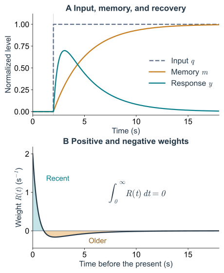
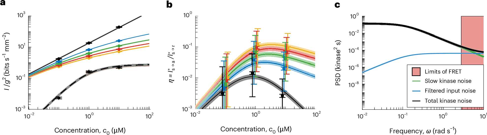

# 细菌怎样感受浓度：时间比较、适应与感知极限
## 从受体和甲基化记忆，到 Berg–Purcell 极限与单细胞信息测量

一只细菌刚游过一段路，接下来是继续直游，还是转向？前一篇把这个选择的平均效果写进了趋化系数 $\chi$，但细胞接触到的并不是浓度梯度这个数学对象。它接触的是一次次来到受体附近的分子，以及这些分子引起的细胞内反应。

问题可以沿着这条过程继续往下问：一次结合怎样影响运动；细胞怎样保留刚才的读数；分子的随机到达又会让比较变得多不可靠。Berg 与 Purcell 在 1977 年把最后一个问题变成了物理极限的计算。近半个世纪以后，单细胞信号测量使另一个问题也能够被检验：**真实的感知通路，究竟已经用上了理想探测器能够获得的多少信息？**

下面以 *E. coli* 的吸引物趋化为例。自制图与公式使用 S 编号，与另外两篇的原编号区分；较长的计算放在篇末。

## 沿着轨迹，细胞在比较什么？ {#sensing-temporal-comparison}

把环境暂时固定，让浓度沿 $x$ 方向缓慢升高。一只向右游的细菌会逐渐接触到更多吸引物，向左游时则相反。于是，细胞不必先在身体两端作一次精确的浓度相减，也可能从**游动期间的时间变化**获得方向线索。

两种比较用上的距离不同。若细胞的线性尺度是 $\ell$，一次直游走过 $uT$，身体两端的浓度差约为 $\ell\partial_xc$，沿途的变化则约为 $uT\partial_xc$。当 $uT\gg\ell$ 时，运动能提供更明显的差别，但细胞需要保留先前的输入，而且环境不能在比较期间变化得过快。

沿细胞轨迹 $\mathbf x(t)$ 定义相对浓度读数

$$
q(t)=\ln\frac{c(\mathbf x(t),t)}{c_0},\qquad
s(t)=\dot q(t)
=\partial_t\ln c+\dot{\mathbf x}\cdot\nabla\ln c.
\tag{S.1}
$$

这里 $c_0$ 是选定的背景浓度，$s$ 的单位是时间的倒数。在静止的一维梯度中，令 $g=\partial_x\ln c$，便有 $s=g v_x$。相同的空间梯度，沿梯度游和逆梯度游会产生相反的时间信号。若整个环境也随时间变化，$\partial_t\ln c$ 同样进入读数；单凭一次浓度上升，还不能把这两种来源分开。

这种时间比较有直接的实验依据。[Segall、Block 与 Berg（1986）](https://doi.org/10.1073/pnas.83.23.8987)用受控的时间刺激检验细菌的响应，发现野生型会对近期和更早的刺激赋予相反权重，比较窗口延伸到数秒。这里的“记住过去”可以由一个缓慢变化的分子状态实现，无须把先前的浓度逐个存成独立记录。

在分子层面，以天冬氨酸经 Tar 受体进入的通路为例，可以先抓住这条联系：

$$
\text{吸引物结合受体}
\ \longrightarrow\ \text{CheA 活性降低}
\ \longrightarrow\ \text{CheY-P 减少}
\ \longrightarrow\ \text{转向倾向减弱}.
\tag{S.2}
$$

受体复合物通过 CheW 与激酶 CheA 耦合，CheY 的磷酸化状态再影响鞭毛马达。吸引物增加时，一次直游因而更容易延续。CheR 和 CheB 参与调节受体的甲基化，使这条响应能够适应持续输入；[Tu、Shimizu 与 Berg（2008）](https://doi.org/10.1073/pnas.0807569105)将浓度、受体甲基化和激酶活性联系在一个动力学描述中。

这也说明“感受到浓度”包含了几种不同的量：受体有没有结合配体，通路活动改变了多少，马达又怎样响应。它们之间有反应时间和随机性，不能将其中任何一个都直接叫作细胞得到的浓度估计。

## 适应怎样变成一段可用的记忆？ {#sensing-adaptation-memory}

持续加入吸引物后，最初的运动响应会逐渐恢复。恢复不意味着外界浓度已经降回去了；变化的是细胞内部用来比较输入的状态。受体甲基化就是这种慢变量之一。[Yi 等（2000）](https://doi.org/10.1073/pnas.97.9.4649)用积分反馈解释了适应为什么能对参数变化保持稳健：只要活动仍偏离目标水平，调节变量就继续变化，直到偏差被消除。

先写一个教学用的局部线性模型。令 $m$ 为与 $q$ 采用相同标度的适应记忆，$y$ 为促进继续直游的有效响应；$y$ 的正方向与 CheA 活性变化相反。保留较快的响应时间 $\tau_f$ 和较慢的记忆时间 $\tau_m$：

$$
\tau_m\dot m=q-m,\qquad
\tau_f\dot y+y=G(q-m),\qquad
G>0,\quad\tau_m>\tau_f>0.
\tag{S.3}
$$

第一式说，记忆会追踪近期输入，但跟不上突变。第二式将当前读数与记忆的差转成响应。$m$ 经过归一化，不是真实甲基化位点数；这两式也只在一个背景附近、小扰动和时间尺度分离的条件下使用。它们怎样从活动依赖的甲基化反馈得到，见[补充推导](#sensing-linearization)。

若输入从零跳到 $q_0$ 并保持，长时间后 $m\to q_0$、$y\to0$。细胞仍处在新的浓度中，响应却回到基线。相反，若输入一直以缓慢速率上升，$q(t)=st$，记忆会保持一个滞后量，得到

$$
q-m\longrightarrow\tau_m s,\qquad
y\longrightarrow G\tau_m s.
\tag{S.4}
$$

因此，去除持续的浓度偏移与保留缓慢的浓度变化，可以由同一套动力学完成。适应不是将过去全部擦掉；它让过去的输入以一个慢变量的形式继续参与当前响应。

将式（S.3）写成对过去输入的加权，就得到

$$
y(t)=\int_0^\infty R(u)q(t-u)\,du,
\qquad
R(u)=\frac{G\tau_m}{\tau_m-\tau_f}
\left(\frac{e^{-u/\tau_f}}{\tau_f}
-\frac{e^{-u/\tau_m}}{\tau_m}\right).
\tag{S.5}
$$

这个核在近期为正，较早时为负，而且 $\int_0^\infty R(u)\,du=0$。因此，一个不随时间改变的输入会被相反权重抵消。这就是在模型中实现“拿现在与刚才比较”的办法。核的符号取决于我们把输出定义成激酶活动还是促进直游的响应，比较时要先对齐这个约定。

*图 S1. 由慢记忆产生时间比较。* 教学模型，非实验拟合。A：相对浓度突然升高后，记忆 $m$ 逐渐跟上，响应 $y$ 先增大再恢复。B：同一模型的时间核；正、负区域面积相消。参数为 $G=1$、$\tau_f=0.5\,\mathrm s$、$\tau_m=3\,\mathrm s$，用于展示动力学关系。

记忆也有代价。如果细胞早已转向，太早以前的输入可能属于另一个运动方向；如果响应过慢，当前直游也可能已经结束。能平均多久，要与方向持续多久一起计算。一个始终保持不变的浓度和一段由游动产生的动态信号，因而不是相同的估计任务。

## 只受分子到达噪声限制，理想探测器能读多准？ {#sensing-berg-purcell}

受体面对的并不是连续光滑的 $c$。即使浓度恒定，来到探测器附近的分子数也会波动。先把所有内部反应都理想化，只留下扩散与计数，可以得到一个有用的参照。[Berg 与 Purcell（1977）](https://doi.org/10.1016/S0006-3495(77)85544-6)由此建立了化学感知的物理精度限制。

考虑半径为 $a$ 的完全吸收球，外部配体的扩散系数为 $D_\ell$，远处的数浓度为 $c_0$。稳态扩散解为 $c(r)=c_0(1-a/r)$，表面积分给出吸收通量

$$
J_{\rm in}=4\pi D_\ell a c_0.
\tag{S.6}
$$

如果吸收事件可作独立 Poisson 计数，时间 $T$ 内的事件数 $N_T$ 有均值和方差 $J_{\rm in}T$。用 $\widehat c=N_T/(4\pi D_\ell aT)$ 估计恒定浓度，就得到

$$
\frac{\operatorname{Var}\widehat c}{c_0^2}
=\frac{1}{4\pi D_\ell a c_0T},\qquad
\frac{\delta c}{c_0}
=\frac{1}{\sqrt{4\pi D_\ell a c_0T}}.
\tag{S.7}
$$

这里 $c_0$ 要用分子数除以体积表示。尺度关系很直观：更大的探测器、更快的扩散、更高的浓度和更长的等待，都能提供更多计数。误差随独立样本数的平方根下降，所以要把标准差再减半，需要约四倍计数。

式（S.7）是**完全吸收球的理想计数模型**。真实受体只覆盖部分表面，结合与解离会引入相关时间，同一分子的再次结合也影响独立样本数。Berg–Purcell 一类结果的具体前因子需要连同探测器几何和观测方式说明；不能把所有表面都当作一个半径为细胞大小的完美捕获器。独立结合受体的另一种计算放在[篇末](#sensing-binding-averaging)。

再增加一个行为要求，就会得到传统论证中很有影响的一步：假设细胞需要在**每次直游内**分辨沿途的浓度变化。在相对变化很小、上述计数近似可用时，持续 $T$ 的直游产生 $\Delta c/c_0\simeq guT$。要求这项变化大于计数误差，给出量级条件

$$
\begin{aligned}
|g|uT&\gtrsim(J_{\rm in}T)^{-1/2},\\
T_{\min}&\sim(J_{\rm in}g^2u^2)^{-1/3}.
\end{aligned}
\tag{S.7a}
$$

若观察到的直游时长接近这样估计的 $T_{\min}$，便容易推断细胞已经接近理想性能。但“每次直游都要判准”是加在计数模型上的行为要求。许多次不很可靠的选择，也可能累积出很小的平均漂移。因此，这个时间尺度估算本身还不能证明真实通路已经达到扩散极限。

对动态任务，等待得更久也可能混入已经过时的信号。**扩散计数给出了可用信息的上限，而通路离这个上限多近，需要额外测量。** 这就需要在相同的时间任务下，直接比较理想探测器与真实的分子通路。

## 把理想到达记录与实际信号通路放在同一把尺上 {#sensing-mattingly-2026}

比较两种探测器时，要让它们面对同一个信号、同一段可用的过去。对趋化而言，可以让理想观察者读取配体到达记录 $r$，让另一观察者读取激酶活动 $a$，分别估计式（S.1）的 $s(t)$：

$$
s(t)\ \longrightarrow\ \{r\}_{\le t}
\ \longrightarrow\ \{a\}_{\le t}
\ \longrightarrow\ \text{运动响应}.
\tag{S.8}
$$

这里写出整段记录，是因为一次活动值没有保留所有可用的时间关系。估计也只能使用截至现在的观测；允许读未来，会把等待之后才出现的信息交给正在作决定的细胞。

[Mattingly、Kamino 等（2026）](https://doi.org/10.1038/s41567-025-03111-4)研究 Asp 刺激，在 $0.1$、$1$、$10\,\mu\mathrm M$ 背景下分别测量游动统计、阶跃响应和单细胞 CheY–CheZ FRET 波动，结合扩散捕获模型计算到达极限，再以典型参数比较。原文到达模型采用受体阵列尺度的吸收圆盘，$\bar r=4D_\ell a_{\rm sensor}c_0$，与式（S.6）的全吸收球不同。在所研究的浅梯度中，通路保留的信息率约为到达极限的百分之一量级，主要差距来自内部噪声。

论文使用的因果信息率可写为

$$
\dot I^*_{s\to X}
=\lim_{\Delta t\to0}\frac{1}{\Delta t}
I\!\left(X(t+\Delta t);s(t)\mid\{X\}_{\le t}\right),
\qquad X\in\{r,a\}.
\tag{S.9}
$$

条件中的过去记录已经给了观察者；新观测带来的增量才被计入。以 $\log_2$ 定义信息时，单位为 bits/s。这与[位置解码中的一次互信息](/notes/qbio_course/positional_information/joint_decoding/#entropy)有不同的任务和单位。用

$$
\eta=\frac{\dot I^*_{s\to a}}{\dot I^*_{s\to r}}
\tag{S.10}
$$

比较时，$\eta$ 描述的是同一动态任务中保留下来的信息率比例。估计误差或迁移速度的变化，要通过对应的动力学关系另外换算。

式（S.1）也提醒我们，运动会反过来改变输入。上面的链条是对给定信号任务的比较；在浅梯度下，可以先采用无偏游动的参照统计，忽略响应对它的高阶改动。完整趋化仍是运动与信号相互影响的闭环。

*图 S2. 实际通路与到达极限的比较。* [Mattingly 等（2026），原文 Fig. 3](https://www.nature.com/articles/s41567-025-03111-4/figures/3)，按 [CC BY-NC-ND 4.0](https://creativecommons.org/licenses/by-nc-nd/4.0/) 原样转载。a：按梯度平方归一化的信息率；b：比例 $\eta$；c：内部噪声与经过通路滤波的到达噪声。c 的红区是 FRET 不可分辨的频段，曲线含模型推断；“百分之一”也随背景和梯度而变。

可以用一个独立的线性通道计算理解这项比较。假设背景的平均到达率为 $\bar r$，小相对浓度变化为 $q$。在计数足够多时，归一化的到达读数可近似为

$$
q_{\rm obs}=q+\frac{\xi}{\sqrt{\bar r}},
\qquad
\langle\xi(t)\xi(t')\rangle=\delta(t-t').
\tag{S.11}
$$

用 $H(\omega)$ 表示通路的线性响应，再加入独立的内部噪声 $\eta_{\rm int}$，得到 $y=H*q_{\rm obs}+\eta_{\rm int}$。采用双边功率谱约定，输出噪声为

$$
S_{y,\rm noise}(\omega)
=\frac{|H(\omega)|^2}{\bar r}
+S_{\rm int}(\omega).
\tag{S.12}
$$

两项到达输出时经过的过程不同。第一项随输入一起被滤波；第二项由内部过程增加。比较时必须将它们换算到同一输出、同一频段，不能拿原始分子计数的方差直接与任意荧光轨迹的方差相减。FRET 测量本身的读出噪声也需要与生物通路波动分开处理。

在 $H\ne0$ 的频率处，将噪声除以响应增益的平方，可以把它换回输入单位：

$$
S_{\rm equiv}(\omega)
=\frac{1}{\bar r}
+\frac{S_{\rm int}(\omega)}{|H(\omega)|^2}.
\tag{S.13}
$$

这说明提高增益的作用取决于噪声加在哪一层。它会同时放大信号与此前已有的到达噪声；若下游噪声保持不变，则可能减轻后者在输入单位下的影响。真实网络中，增益、噪声和适应速度又可能一起改变，因此需要同时测量响应与波动。

## 感知的信息，怎样接回迁移和群体行为？ {#sensing-back-to-motion}

“善于利用已有读数”和“获得了物理上最多的读数”是两个可以分开检验的性质。[Mattingly 等（2021）](https://doi.org/10.1038/s41567-021-01380-3)先比较了给定信息率所允许的迁移表现与真实细胞的表现。将这一步与 2026 年的到达极限比较接起来，就可以沿通路定位约束：从环境获得多少，再将其中多少用于运动。

即使单次转向有很大不确定性，多次直游仍可能积累一个微小的平均偏置。要检验它，应测平均漂移及其统计误差，而不能先规定每次直游都必须可靠判定梯度方向。少量信息可以支持很弱的定向迁移；它对有限时间、有限营养条件下的生存有多大帮助，还取决于具体生态任务。

对前一篇的输运方程，这些内部过程最终进入有效系数 $\chi$。篇末的[一维模型](#sensing-kernel-to-drift)会得到

$$
v_d=\chi_{\log}g,
\qquad
\chi_{\log}
=\frac{\beta G u^2\tau_m}
{(1+\tau_m/\tau_v)(1+\tau_f/\tau_v)}.
\tag{S.14}
$$

这里 $u$ 是直游速度，$\tau_v$ 是该模型的方向相关时间，$\beta$ 将响应转为转向率变化。这个教学结果展示了为什么读数增益、记忆长度和游动持续性必须一起进入漂移；它不替代真实细菌的三维运动模型。换回 $v_d=\chi(c_0)\partial_xc$ 时，局部有 $\chi(c_0)=\chi_{\log}/c_0$，而 $G$、时间尺度和马达响应本身也可以随背景变化。

这与后一篇的背景浓度实验形成了一个具体联系：解释聚集为何减弱，需要知道信号响应在哪个环节改变。本文讨论的 Asp 通路结果不能直接用来指定 AI-2 系统的 $\chi(c)$；配体、受体和条件不同，要重新测量相应的响应。

沿这条路线，还有值得继续追的问题。改变 CheR 或 CheB 的表达，可能同时改变记忆时长、增益和噪声；哪个变化真正影响导航，需要结合受控刺激、通路记录与游动测量区分。更低的噪声也可能需要更多蛋白或能量，感知范围又可能与局部灵敏度相互牵制。研究这些约束，才有机会解释细胞为什么停在某个性能水平，而不只是指出它离理想探测器还远。

补充推导：受体时间平均、适应模型的来源，以及记忆核怎样产生漂移

### 独立结合受体怎样通过时间平均降低误差 {#sensing-binding-averaging}

设一个受体按 $0\xrightarrow{k_{\rm on}c_0}1$、$1\xrightarrow{k_{\rm off}}0$ 切换。稳态结合概率和相关时间为

$$
p=\frac{c_0}{c_0+K_d},\qquad
K_d=\frac{k_{\rm off}}{k_{\rm on}},\qquad
\tau_c=\frac{1}{k_{\rm on}c_0+k_{\rm off}}.
\tag{S.15}
$$

从状态方程可以得到 $\langle\delta n(t)\delta n(0)\rangle=p(1-p)e^{-|t|/\tau_c}$。对 $N$ 个相互独立的受体作时间和受体数的平均，记结果为 $\bar p_T$，则

$$
\operatorname{Var}\bar p_T
=\frac{2p(1-p)}{NT^2}
\int_0^T(T-t)e^{-t/\tau_c}\,dt
\simeq\frac{2p(1-p)\tau_c}{NT},
\qquad T\gg\tau_c.
\tag{S.16}
$$

由 $dp/dc_0=p(1-p)/c_0$ 传播误差，得到

$$
\frac{\operatorname{Var}\widehat c}{c_0^2}
\simeq\frac{2\tau_c}{NTp(1-p)}.
\tag{S.17}
$$

密集采样并不等于得到许多独立读数。若采样间隔远短于 $\tau_c$，相邻记录很可能仍来自同一段结合状态。式（S.16）中的相关时间正是因此进入有效样本数。

这是一组独立 Markov 受体的占据平均模型；真实扩散会改变再次结合及不同受体之间的相关性。完全吸收计数与可逆结合平均对应不同的观测方式，应分别说明各自的理想化条件。

### 从活动依赖的甲基化，得到归一化的记忆变量 {#sensing-linearization}

令 $M$ 表示真实受体甲基化的粗粒化水平，$a$ 表示激酶活动。在一个稳态附近，保留最低阶项：

$$
\delta a=A\delta M-Bq,\qquad
\delta\dot M=-k\delta a,\qquad A,B,k>0.
\tag{S.18}
$$

第一式的符号表示：吸引物增加使活动降低，甲基化增加则促进恢复。第二式是局部积分反馈近似，活动仍低于目标时，补偿变量继续增加。若最后能达到稳态，$\delta\dot M=0$ 就要求 $\delta a=0$，而不要求 $q=0$。

定义归一化记忆 $m=A\delta M/B$，得到

$$
\dot m=kA(q-m),\qquad
\tau_m=(kA)^{-1}.
\tag{S.19}
$$

再给可读响应加入较短的弛豫时间，即得到式（S.3）。这一步省略了受体协同性的非线性、酶反应饱和和甲基化范围的边界；大刺激或接近这些边界时，线性模型不再足够。

拉普拉斯变换给出传递函数

$$
\widetilde R(z)
=\frac{G\tau_m z}{(1+\tau_m z)(1+\tau_f z)}.
\tag{S.20}
$$

当 $z\to0$ 时，常值输入的响应为零，而变化缓慢的输入满足 $y\simeq G\tau_m\dot q$。在很高频率处，有限的 $\tau_f$ 又会抑制过快变化。因此“比较过去”同时需要解释低频适应和高频响应速度。

对从零开始的阶跃 $q=q_0\Theta(t)$，逆变换得到

$$
y(t)=\frac{Gq_0\tau_m}{\tau_m-\tau_f}
\left(e^{-t/\tau_m}-e^{-t/\tau_f}\right),
\qquad t\ge0,
\tag{S.21}
$$

对应图 S1 的先响应、后恢复。

### 时间记忆怎样在一个一维运动模型中变成漂移 {#sensing-kernel-to-drift}

让细胞以速度 $u\sigma$ 游动，$\sigma\in\{-1,+1\}$；每次事件都完全反向。无信号时反向率为 $\nu_0$，于是

$$
\langle\sigma(t)\sigma(t-w)\rangle_0=e^{-w/\tau_v},
\qquad \tau_v=\frac{1}{2\nu_0}.
\tag{S.22}
$$

这与真实细菌转向角度的分布不同，但便于将方向记忆与感知记忆放进同一个可解计算。令反向率受到弱调制：

$$
\nu(t)=\nu_0[1-\beta y(t)],\qquad \beta>0,\quad |\beta y|\ll1.
\tag{S.23}
$$

对方向平均写主方程，在稳态得到 $\langle\sigma\rangle=\beta\langle\sigma y\rangle$。在静止、很弱的梯度中，$q=gx$，计算右边的一阶项可以使用无偏运动的统计。利用 $\int R=0$ 去掉当前位置的共同项，有

$$
\begin{aligned}
\langle\sigma(t)y(t)\rangle_0
&=g\int_0^\infty R(w)
\langle\sigma(t)[x(t-w)-x(t)]\rangle_0\,dw\\
&=-gu\int_0^\infty R(w)
\int_0^w e^{-v/\tau_v}\,dv\,dw\\
&=gu\tau_v\widetilde R(1/\tau_v).
\end{aligned}
\tag{S.24}
$$

乘以 $\beta u$，再代入式（S.20），就是式（S.14）。趋化偏置因而与两个记忆的重叠有关：过去的输入还被感知通路保留了多少，过去的运动方向又还与现在相关多少。

这里没有从内部噪声直接预测真实细菌的漂移，更没有用该式拟合 2026 年论文。若要作这样的比较，还需保留三维转向、马达非线性、噪声统计和实验中实际变化的参数。

### 文献与阅读线索 {#sensing-references}

- H. C. Berg and D. A. Brown (1972), *Chemotaxis in Escherichia coli analysed by Three-dimensional Tracking*. [DOI: 10.1038/239500a0](https://doi.org/10.1038/239500a0)。运动行为与时间比较的实验背景。
- H. C. Berg and E. M. Purcell (1977), *Physics of chemoreception*. [DOI: 10.1016/S0006-3495(77)85544-6](https://doi.org/10.1016/S0006-3495(77)85544-6)。扩散、受体采样与感知精度的经典计算。
- J. E. Segall, S. M. Block and H. C. Berg (1986), *Temporal comparisons in bacterial chemotaxis*. [DOI: 10.1073/pnas.83.23.8987](https://doi.org/10.1073/pnas.83.23.8987)。用时间刺激检验比较窗口及其权重。
- T.-M. Yi, Y. Huang, M. I. Simon and J. Doyle (2000), *Robust perfect adaptation in bacterial chemotaxis through integral feedback control*. [DOI: 10.1073/pnas.97.9.4649](https://doi.org/10.1073/pnas.97.9.4649)。适应与积分反馈的联系。
- Y. Tu, T. S. Shimizu and H. C. Berg (2008), *Modeling the chemotactic response of Escherichia coli to time-varying stimuli*. [DOI: 10.1073/pnas.0807569105](https://doi.org/10.1073/pnas.0807569105)。受体、甲基化与动态输入的模型。
- H. H. Mattingly, K. Kamino, B. B. Machta and T. Emonet (2021), *Escherichia coli chemotaxis is information limited*. [DOI: 10.1038/s41567-021-01380-3](https://doi.org/10.1038/s41567-021-01380-3)。给定信息率与迁移表现之间的联系。
- H. H. Mattingly, K. Kamino, J. Ong, R. Kottou, T. Emonet and B. B. Machta (2026), *E. coli chemosensing accuracy is not limited by stochastic molecule arrivals*. [DOI: 10.1038/s41567-025-03111-4](https://doi.org/10.1038/s41567-025-03111-4)。用同一动态任务比较实际通路与分子到达极限；图 S2 对应原文 Fig. 3。
