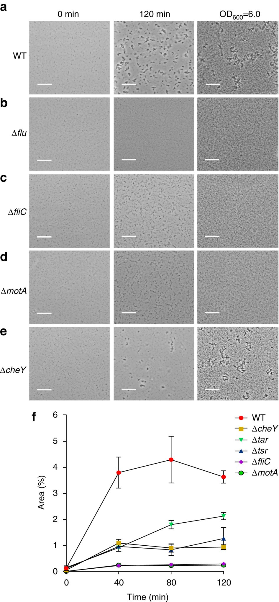
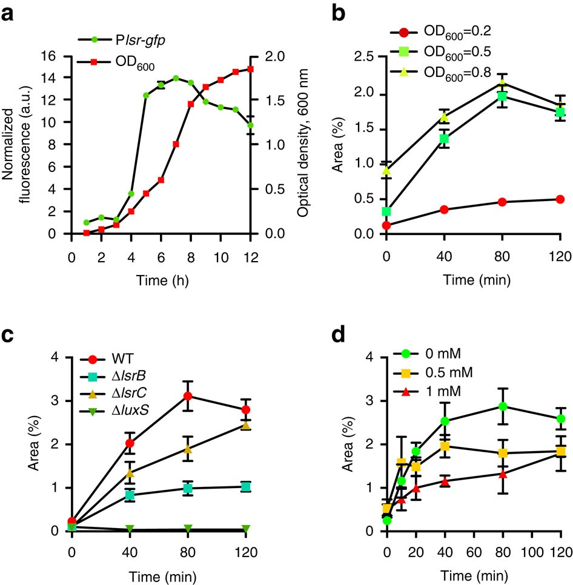
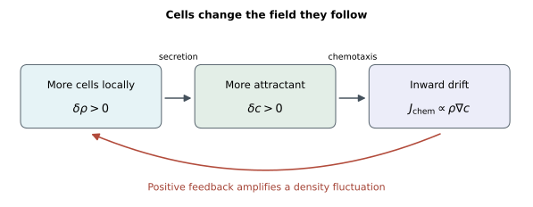
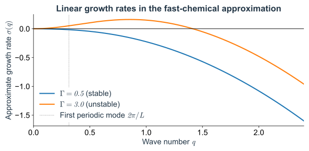
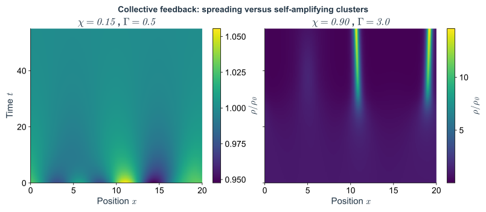
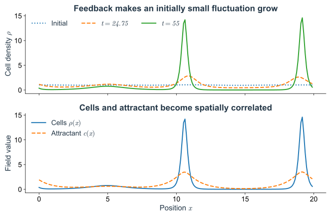
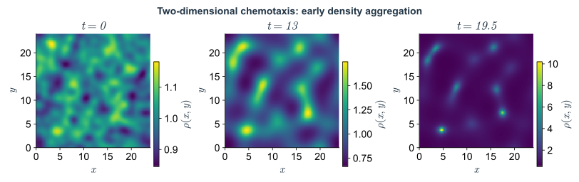

如果培养环境原本均匀，一小团偶然偏多的细菌能不能把周围细菌吸引过来？它们分泌的信号会加强向内迁移，随机游动却仍在向外摊平密度差别。聚集取决于这两个过程的竞争。

下面先借助实验判断哪些反馈值得保留，再计算一个很小的密度起伏会增长还是衰减。这个计算还要接受更具体的检验：最先出现多大的结构，均匀背景浓度为什么会改变聚集，以及模型在哪些条件下需要补充新的感知机制。

## 3. 细胞产生并追随信号，形成相互吸引 {#collective-feedback}

外加梯度能够驱动定向迁移，但细菌能否自己产生信号、招来其他细菌？[Laganenka 等（2016）](https://doi.org/10.1038/ncomms12984)研究了大肠杆菌的自聚集，并分别改变细胞的运动、趋化和黏附能力。

*Fig. 10. 聚集同时涉及运动、趋化与黏附。* a：野生型（WT）；b：缺少黏附蛋白 Ag43；c、d：缺少鞭毛或鞭毛不能转动；e：仍能运动、但趋化受损；f：聚集区域面积随时间变化。左两列显微图比较初始状态与 120 min，右列为更高细胞密度下的结果，标尺为 $20\,\mu\mathrm{m}$。引自 [Laganenka 等（2016），原文 Fig. 1](https://doi.org/10.1038/ncomms12984)。

比较 a、e、f：在图中较低的细胞密度下，趋化受损的细菌形成的聚集体较少、较小；右列较高密度时，这种差别减弱。再看 b–d，失去黏附或游动能力也会阻碍聚集。单看聚集照片，因而还不能判断它来自哪一种机制。下面先问：由细胞产生并感知的吸引物，能否放大密度起伏？细胞接触后的黏附暂时留在模型之外。

### 3.1 从信号干预实验到 Keller–Segel 模型 {#chemical-field-dynamics}

这项研究考察了细胞产生的 AI-2 信号。若细胞通过它招来周围的细胞，那么减少信号的产生，或者保留运动却破坏感知，都应改变聚集。

*Fig. 11. 改变信号的产生与感知，可以改变聚集。* a、b：信号相关报告活性、培养密度和聚集随生长阶段变化；c：野生型与 AI-2 产生、感知或摄取缺陷菌株的比较；d：加入不同浓度的 AI-2 前体 DPD 后的聚集。c、d 的纵轴均为聚集区域占图像的面积比例。引自 [Laganenka 等（2016），原文 Fig. 2](https://doi.org/10.1038/ncomms12984)。

c 中，缺少 LsrB 的细菌仍能正常游动，但对 AI-2 的感知受损，聚集明显减弱；仅影响摄取的 LsrC 缺失，影响较小。这个对照支持感知信号对聚集的作用。d 中还有一个需要解释的结果：均匀加入更多信号，聚集反而减少。先建立只含分泌、扩散、降解和趋化的模型，再回到[第 4.3 节](#model-scope)检查它能否解释这项背景浓度效应。

式（2.8）已经描述了细胞在给定 $c$ 中的运动。现在每个细胞持续分泌吸引物，信号在空间中扩散并被降解，因此还要为 $c$ 写一条收支方程。

这里多出来的是化学场自身的状态。某处现在有多少细胞，还不能立即确定那里有多少信号：它可能刚刚聚入，信号尚未积累；也可能已有细胞离开，原先分泌的信号却还没消失。所以先保留两条同时演化的方程。只有后来确认信号调整得比细胞分布快，才能再近似消去这段化学记忆。

先在同一个空间格点上对化学浓度 $c_i(t)$ 做收支。扩散给出邻格之间的交换，细胞分泌与化学降解分别贡献正、负源项：

$$
\frac{dc_i}{dt}=D_c\frac{c_{i-1}-2c_i+c_{i+1}}{a^2}
+\alpha\rho_i-\kappa c_i.
$$

这里的扩散差分与第 1 节的离散拉普拉斯结构相同；$D_c$ 由化学物质自身的迁移统计决定，不必等于细胞的 $D$。一段长度 $a$ 内约有 $a\rho_i$ 个细胞，若每个细胞单位时间分泌有效量 $\alpha$，除以段长后源项就是 $\alpha\rho_i$。$-\kappa c_i$ 表示现存信号按比例降解。

对光滑的化学场取空间连续极限，再与细胞的式（2.8）联立，得到

$$
\boxed{\begin{aligned}
\partial_t\rho&=D\partial_x^2\rho-\chi\partial_x(\rho\partial_xc),\\
\partial_tc&=D_c\partial_x^2c+\alpha\rho-\kappa c.
\end{aligned}}
\tag{3.1}
$$

这是一类 Keller–Segel 模型。$D_c$ 是化学扩散系数，$1/\kappa$ 是信号的衰减时间。$c$ 按一维有效浓度理解，$\alpha$ 的单位与之配套；以下取 $D,D_c,\alpha,\chi,\kappa$ 为正，模拟使用一致的无量纲单位。细胞没有增殖或死亡。

给定初始 $\rho,c$ 和边界条件，两条方程就能一起演化，称为模型的**闭合**。它包含三个物理过程：细胞随机迁移，细胞沿信号梯度产生净漂移，细胞不断补充信号。将离散细胞的分泌换成平滑源项 $\alpha\rho$，还采用了平均场／粗粒化近似，具体说明见[附录 A.7](01_chemotactic_transport.md#stochastic-a7)。

*Fig. 12. 细胞与吸引物的反馈回路。* 多一点细胞 $\to$ 多一点吸引物 $\to$ 更多细胞移入该处 $\to$ 密度增加。另附[矢量图版本](figures/05_field_mediated_feedback.svg)。

这与固定外场有了关键区别：现在细胞移入某处，还会增加那里的信号产生率。一个小密度峰可能因此得到更多流入。但信号会向外扩散、在途中降解，细胞也在散开；要比较这些作用，先确定信号能将多远处的细胞联系起来。

后续模拟采用周期边界，细胞总数满足 $\frac{d}{dt}\int\rho\,dx=0$，化学总量则满足 $\frac{d}{dt}\int c\,dx=\alpha N-\kappa\int c\,dx$。聚集只能重新分配已有细胞；信号总量则由分泌与降解决定。

从实验图像上看，局部密度升高也可能来自细胞在原地增殖。当前模型选择了细胞数守恒的观察窗口，因此作出更具体的预测：峰的增高应伴随周围细胞的迁入和其他区域的减少。连续追踪位置，并记录期间的分裂事件，就能检查这一取舍是否合理。若实验时段内增殖已经显著，就要把它加入收支，重新区分聚集与增长各自的贡献。

### 3.2 信号作用范围与向内、向外通量的竞争 {#signal-mediated-interactions}

若化学场比密度变化快，在它完成初始调整后可以近似写成

$$
(\kappa-D_c\partial_x^2)c\simeq\alpha\rho,\qquad
\boxed{\ell_c=\sqrt{D_c/\kappa}}.
$$

在无限长直线上，一个单位点源的稳态浓度随距离按 $e^{-|x|/\ell_c}$ 衰减。多个源的贡献可以相加，所以某处的浓度取决于周围细胞分布，而不只取决于该处密度。这就是化学信号介导的非局域相互作用。

*Fig. 13. 信号作用长度与空间叠加。* 左边是单位点源的稳态响应：离开源 $\ell_c$ 后，信号降为峰值的 $1/e$。右边用两个单位点源说明叠加，虚线是各自贡献，绿实线是总浓度，箭头示意两侧细胞沿总浓度梯度向内漂移。取 $\alpha=\kappa=1$、$D_c=1.69$，所以 $\ell_c=1.3$；这里使用无限直线上的快速响应近似。

$\ell_c$ 给出作用范围：信号既向外扩散，又在传播途中降解。离峰较远的细胞也能感到梯度，向信号源漂移，无须直接接触。响应核的归一化与积分表达式见[附录 C](#response-kernel-details)；有限周期系统需要把各周期副本的贡献相加。

传播得更远与局部吸引更强，也需要分开。在分泌量和降解率相同的条件下，较快的化学扩散会把信号分给更宽的区域，同时摊平密度峰附近的浓度差。远处可能获得更多信号，附近的梯度却未必更陡。因此，作用长度增大并不能单独判断反馈增强了多少，后面还要比较每一种空间尺度上实际留下的信号起伏。

再作一个空间近似：只关心变化尺度远大于 $\ell_c$ 的平缓密度起伏，此时化学扩散项相对降解项很小，故

$$
c\simeq\frac{\alpha}{\kappa}\rho,\qquad
J\simeq-D\partial_x\rho+\frac{\chi\alpha}{\kappa}\rho\partial_x\rho.
$$

在均匀密度 $\rho_0$ 附近写 $\rho=\rho_0+\delta\rho$，只保留小起伏的一阶项，得到

$$
\boxed{J\simeq-\underbrace{\left(D-\frac{\chi\alpha\rho_0}{\kappa}\right)}_{D_{\rm eff}}\partial_x\delta\rho,
\qquad \Gamma=\frac{\chi\alpha\rho_0}{D\kappa},\quad D_{\rm eff}=D(1-\Gamma).}
\tag{3.2}
$$

取密度峰右侧，那里 $\partial_x\delta\rho\lt0$。扩散通量向右，将细胞送离峰；趋化通量向左，将细胞送回峰。$\Gamma$ 就是这个长波近似下趋化通量与扩散通量的强度之比，等于 1 时两者抵消。

这也解释了背景密度为什么进入反馈强度。相同的信号梯度，在附近有更多细胞时能带来更大的迁入通量；密度的一点增加又会补充更多信号。因此，即使单个细胞的感知和游动规则都没变，改变群体密度也能使系统跨过聚集阈值。这个阈值来自共同化学场连接起来的输运过程，不要求每个细胞先切换成一种新的行为模式。

若 $\Gamma\lt1$，净通量仍会抹平起伏；若 $\Gamma\gt1$，长波的 $D_{\rm eff}$ 变负，密度峰获得净流入。细胞数并未增加，增加的是分布的不均匀程度。在完全均匀、没有梯度的确定性初态中，反馈没有种子，仍会保持均匀；实验中的有限细胞数涨落则可提供种子。

这里的“负有效扩散”描述的是群体的净通量。每个细胞的随机游动仍由正的 $D$ 描述，只是化学反馈带来的向内输运超过了向外散开。不能把单细胞随机方程里的 $D$ 换成负数；也不能把这个长波近似用于任意尖细的密度变化，否则会错误地让越细的起伏增长得越快。保留化学场的空间响应以后，短波仍受到抑制，下一节正要算出这个限制。

这里用了两个近似：化学场能很快调整，密度起伏的宽度又远大于 $\ell_c$。窄密度峰产生的信号更容易被化学扩散摊平，不能直接套用同一个负扩散系数。下一节按波长分别计算，确定哪些起伏能增长。

---

## 4. 密度起伏何时增长，最先长出多大的结构 {#aggregation-threshold}

### 4.1 均匀态的失稳与允许波长 {#uniform-state}

均匀稳态为 $\rho=\rho_0$、$c=c_0=\alpha\rho_0/\kappa$：没有梯度，分泌与降解平衡。现在取 $\rho=\rho_0+\delta\rho$、$c=c_0+\delta c$，看起伏是被抹平还是放大。

趋化项中 $\rho\partial_xc=\rho_0\partial_x\delta c+\delta\rho\,\partial_x\delta c$。舍去小量乘积，就得到

$$
\begin{aligned}
\partial_t\delta\rho&=D\partial_x^2\delta\rho-\chi\rho_0\partial_x^2\delta c,\\
\partial_t\delta c&=D_c\partial_x^2\delta c+\alpha\delta\rho-\kappa\delta c.
\end{aligned}
$$

这个近似适用于起伏很小的早期，不能继续描述已经长大的高密度峰。

一个局部密度包同时包含很多空间尺度：尖端很细，底部较宽。扩散会更快地消掉细的部分，信号反馈对宽窄的响应也不同，因此它通常不会整团按同一个速率升高。先选一条只有单一波长的起伏，可以把这些不同速度分开算；再把结果叠回去，才能理解一般初态。下面使用余弦波，就是为了完成这一步分解。

试着让空间起伏是一条余弦波：

$$
\delta\rho(x,t)=A(t)\cos(qx),\qquad
\delta c(x,t)=B(t)\cos(qx).
$$

$A(t)$、$B(t)$ 是起伏的振幅；$q$ 叫波数，与波长 $\lambda$ 的关系为 $q=2\pi/\lambda$。$q$ 越小，起伏越宽。选择余弦是因为它求两次导数后仍是自己：

$$
\partial_x^2\cos(qx)=-q^2\cos(qx).
$$

代入上面的线性方程，比较 $\cos(qx)$ 前的系数，就把两个偏微分方程变成了两个普通微分方程：

$$
\boxed{\begin{aligned}
\dot A&=-Dq^2A+\chi\rho_0q^2B,\\
\dot B&=\alpha A-(\kappa+D_cq^2)B.
\end{aligned}}
$$

点号表示对时间求导。现在每一项的含义都可以直接读出来：

- $-Dq^2A$：细胞扩散抹平密度起伏；
- $+\chi\rho_0q^2B$：浓度峰吸引细胞，使同位置的密度峰增高；
- $+\alpha A$：细胞多的地方产生更多化学物质；
- $-(\kappa+D_cq^2)B$：降解和化学扩散共同抹平浓度起伏。

任意足够规则的小扰动都可以分解成不同波数的正弦、余弦之和，称为傅里叶分解。在线性方程中，各波数独立演化，所以可以分别计算它们增长还是衰减。写成 $e^{iqx}$ 时，只是用复数将正弦、余弦合并，得到的增长率相同。

振幅方程也说明了“增长率”的含义。寻找一组共同按指数变化的振幅，令 $A(t)=A_0e^{\sigma t}$、$B(t)=B_0e^{\sigma t}$。$\sigma\gt0$ 时起伏放大，$\sigma\lt0$ 时起伏衰减。完整两场方程给出两支增长率，其中较大的一支记为 $\sigma_+(q)$，决定小扰动的主导增长或衰减；求根与精确失稳判据见[附录 B.1](#exact-growth-rates)。先用下图将空间波形与随时间改变的振幅联系起来，再考察化学响应较快时的近似。

*Fig. 14. 空间波形与振幅增长。* 左：波长 $\lambda$、背景 $\rho_0$ 与振幅 $A$。右：取正文参数、$q=2\pi/10$、$A(0)=0.01$，按精确线性增长率画出弱、强反馈下的振幅变化。化学初值取对应的增长模式，见[附录 B.2](#growth-rate-comparison)。

若浓度起伏能很快跟上密度起伏，就可在 $\dot B=\alpha A-(\kappa+D_cq^2)B$ 中近似取 $\dot B\simeq0$，得到

$$
B\simeq\frac{\alpha}{\kappa+D_cq^2}A.
$$

其含义是：细胞峰产生信号，降解与扩散限制了信号峰的高度。代入 $\dot A$，得到更容易理解的近似增长率

$$
\boxed{\sigma(q)\simeq-q^2\left[D-\frac{\chi\alpha\rho_0}{\kappa+D_cq^2}\right].}
\tag{4.1}
$$

这里需要明确快速响应的时间尺度条件。对所研究的指数过程，完整关系其实是 $B_0/A_0=\alpha/(\sigma+\kappa+D_cq^2)$；忽略分母中的 $\sigma$，要求 $|\sigma|\ll\kappa+D_cq^2$。化学场还有一个初始调整过程；只有它已衰减，才可以把浓度视为随密度即时调整。

因此，式（4.1）的增长速度是近似的，而其令 $\sigma=0$ 得到的阈值与[附录 B.1](#exact-growth-rates)完全相同。在阈值附近，增长或衰减很慢，这个近似尤其有用；远离阈值时，应检查时间尺度，或直接用 $\sigma_+$。

式（4.1）的分母保留了化学扩散的作用。波数 $q$ 越大，化学扩散抹平浓度起伏越快，$B/A\simeq\alpha/(\kappa+D_cq^2)$ 就越小；细胞密度虽然起伏，产生的信号峰却不足以吸引更多细胞。因此，足够短的波仍会衰减。

在另一端，$q\ell_c\ll1$ 时回到第 3.2 节的 $\sigma\simeq-D_{\rm eff}q^2$。若 $\Gamma\gt1$，很宽的起伏可以增长，但梯度小、细胞重分配所需距离长，增长率也趋近零。$q=0$ 对应平均密度，因细胞总数守恒而不能自行增长。

用第 3 节的反馈强度 $\Gamma$ 和作用长度 $\ell_c$，式（4.1）变成

$$
\sigma(q)\simeq Dq^2\left[\frac{\Gamma}{1+(q\ell_c)^2}-1\right].
$$

括号中，$-1$ 是扩散损失，前一项是经化学场传递的反馈。失稳需要

$$
\Gamma\gt1+(q\ell_c)^2.
$$

无限大系统允许任意小的非零 $q$。因此，$\Gamma\leq1$ 时所有非零波数都衰减；$\Gamma\gt1$ 时，存在一段不稳定波数

$$
0\lt q\lt\frac{\sqrt{\Gamma-1}}{\ell_c}.
$$

长而缓的起伏容易增长，很细的起伏则会被扩散抹平。不过 $q\to0$ 时增长率也趋近零：很长距离上的细胞搬运仍需要时间。

在长度为 $L$ 的周期区间，波形绕一圈必须接回自己，所以只能取

$$
q_m=\frac{2\pi m}{L},\qquad m=1,2,\ldots.
$$

最小非零波数是 $q_1=2\pi/L$。只要它也不能增长，所有更大的波数就都不能增长。因此精确的有限系统失稳条件是

$$
\boxed{\Gamma\gt1+\left(\frac{2\pi\ell_c}{L}\right)^2.}
$$

这说明仅有 $\Gamma\gt1$，在有限系统中仍可能看不到失稳。[Fig. 16](#fig-16) 的参数给出 $\ell_c=1$、$L=20$，阈值为 $\Gamma_c\simeq1.0987$，即 $\chi_c\simeq0.3296$；$\chi=0.15$ 与 $0.90$ 分别位于两侧。

仅测出这个阈值，通常还不能反推出每个过程各有多强。更强的分泌与更敏感的趋化，都能提高反馈；更快的细胞散开与更快的信号去除，都能把它压低。在判据里，它们只通过几个组合出现。因此，相同的起聚条件可以对应不同的单细胞运动和信号周转，分别测量轨迹、漂移响应和化学变化，才可能拆开这些参数。

*Fig. 15. 准稳态近似中的模态增长率。* 曲线由式（4.1）计算；竖虚线为周期区间的最小非零波数，允许波数为其正整数倍。近似与精确增长率的比较见[附录 B](#appendix-b)。

因此，提高 $D_c$ 在有限周期系统中还会提高临界趋化强度

$$
\chi_c=\frac{D}{\alpha\rho_0}\left[\kappa+D_c(2\pi/L)^2\right].
$$

无限大系统的长波阈值 $\Gamma=1$ 不含 $D_c$，因为可取任意小的非零 $q$；有限系统只有离散的波可选。上述 $2\pi/L$ 来自周期边界；封闭区间的无通量边界允许不同的波数，不能照搬这个系数。

### 4.2 数值演化与早期结构的尺度 {#collective-simulations}

判据预测：下面两组参数分别在阈值两侧，微小起伏应当一组衰减、一组增长。用式（3.1）的完整两场数值积分检验，采用一维周期区间 $0\leq x\lt L$：

| 参数 | 数值 | 作用 |
|---|---:|---|
| $L$ | $20$ | 系统长度 |
| $D$ | $0.3$ | 细胞扩散 |
| $D_c$ | $1.0$ | 化学场扩散 |
| $\alpha$ | $1.0$ | 分泌强度 |
| $\kappa$ | $1.0$ | 降解率 |
| $\rho_0$ | $1.0$ | 均匀背景细胞密度 |
| $\chi$ | $0.15$ 或 $0.90$ | 唯一改变的参数 |

*Fig. 16. 弱、强反馈下的细胞密度演化。* 横轴是空间，纵轴是时间，颜色表示 $\rho/\rho_0$。左图：微小起伏逐渐衰减；右图：起伏被反馈放大，形成局部聚集。两个色条采用各自的刻度，比较时要读数值，不能只比较颜色。

*Fig. 17. 密度起伏与化学场的空间关联。* 上：密度起伏的增长；下：在选定时刻的细胞密度与吸引物浓度峰相关。这里展示的是有限时间演化过程，未声称找到了唯一稳定的最终图案。

先看 Fig. 16 左右两图的变化方向。弱反馈下，最初的细小起伏逐渐消失；强反馈下，同样的初始起伏被放大，细胞聚到局部区域。再看 Fig. 17 的密度与浓度曲线：细胞密处也形成吸引物峰，与模型中的相互加强一致。整个过程细胞总数保持不变，密度峰中的细胞来自其他位置。

模拟从很小但非零的扰动开始。若初态严格均匀，确定性方程就一直没有梯度，密度也不会改变。这里验证的是小扰动会被放大，至于长大的峰是否停止变尖、是否会互相合并，还需要继续研究非线性演化。

失稳也不等于实验一开始就能看见聚集。由指数振幅关系可知，起初的种子越小，长到同样可见的幅度就要等得越久；接近阈值时，增长率很小，这段等待尤其长。所以在有限观察时间内，“仍然看起来均匀”可能来自真正稳定，也可能只是起伏尚未长到可见。比较早期振幅的增长速度，比单独比较最后一张照片更接近理论判据。

如果快速响应近似成立，还可以问式（4.1）在什么波数上最大。记 $y=(q\ell_c)^2$，则

$$
\sigma\simeq\frac{D}{\ell_c^2}\left(\frac{\Gamma y}{1+y}-y\right),
\qquad
\frac{d\sigma}{dy}=\frac{D}{\ell_c^2}\left[\frac{\Gamma}{(1+y)^2}-1\right].
$$

当 $\Gamma\gt1$ 时，最大值出现在

$$
\boxed{q_*^2\simeq\frac{\sqrt\Gamma-1}{\ell_c^2},\qquad
\lambda_*\simeq\frac{2\pi\ell_c}{\sqrt{\sqrt\Gamma-1}}.}
$$

这给出的是线性早期、准稳态近似下增长最快的波长。有限区间上要比较实际允许的离散 $q_m$；化学场不够快时，要改为最大化精确的 $\sigma_+(q)$。各模态初始振幅也会影响有限时间内哪一个最明显：[Fig. 16](#fig-16) 的初值主要放入了 $m=2,3,4$ 的波，并没有给所有波数相同的种子。

这个中间尺度来自两头都不够快：很细的密度起伏留不住足够的信号梯度，很宽的起伏又需要把细胞从很远的地方搬来。两者之间有一段尺度，既能建立反馈，也能较快地完成重分配。增长最快的波长因此刻画了早期哪一种间距更容易显露，并没有在方程中预先放入一个聚集体的尺寸。

当密度起伏长到不能线性化时，不同波之间会相互影响，峰还可能继续变尖或合并。早期最显眼的间距因此不能直接当作长期稳定的图案间距。

二维中也有同样的区别。让密度与浓度依赖 $x,y$ 两个坐标。梯度 $\nabla c=(\partial_xc,\partial_yc)$ 指向浓度上升最快的方向，通量也变成向量；散度 $\nabla\!\cdot J$ 表示一个小区域的净流出，拉普拉斯算子 $\nabla^2=\partial_x^2+\partial_y^2$ 则把两个方向的扩散相加。沿用同一套收支，得到：

$$
\begin{aligned}
\partial_t\rho &=D\nabla^2\rho-\chi\nabla\!\cdot(\rho\nabla c),\\
\partial_t c&=D_c\nabla^2c+\alpha\rho-\kappa c.
\end{aligned}
$$

*Fig. 18. 二维模型的早期聚集。* 周期区间内，接近均匀的初态形成局部高密度区域。长期峰值会受数值网格及模型中缺失的饱和机制影响。

### 4.3 用背景浓度实验检验模型 {#model-scope}

现在回到 [Laganenka 等的实验](https://doi.org/10.1038/ncomms12984)。[Fig. 11d](#fig-11) 中，均匀加入 DPD/AI-2 提高背景信号，聚集却受到抑制。前面用梯度解释了细胞怎样相互吸引，这个结果要求再检查：模型是否也预测背景浓度会改变运动？

先明确常数 $\chi$ 模型的预测。在原有化学场上叠加一个空间均匀的浓度 $C(t)$，它不改变 $\partial_xc$，因而不改变细胞的趋化通量。若仅改变化学初始背景，差值按 $C(t)=C(0)e^{-\kappa t}$ 衰减，细胞密度的确定性演化仍相同；若均匀补充以维持背景，梯度仍不变。第 2.3 节的归一化稳态也具有相同性质。因此，在其他参数不变的模型里，“只加均匀背景”不能抑制失稳。

常数 $\chi$ 的模型因而不能解释这项背景抑制。要判断是否因为感知响应改变，可以在不同背景上施加同样的梯度，直接追踪细菌。[作者也做了这项比较（原文 Supplementary Fig. 6）](https://www.nature.com/articles/ncomms12984)：野生型细菌能沿 $0$–$10\,\mu\mathrm M$ 的 DPD/AI-2 梯度迁移，但在 $200\,\mu\mathrm M$ 背景上已不能追随同样的梯度；游速和对 MeAsp 的趋化却未见明显变化。这支持高背景下 AI-2 感知响应减弱的解释。若要描述这些条件，就需让有效响应随背景变化，例如使用 $\chi(c)$；具体函数仍要由漂移测量约束。

另一方面，[Fig. 10b](#fig-10)中的黏附干预说明，细胞移到一起与接触后维持聚集体属于不同层次。当前模型没有黏附、拥挤排斥、响应饱和和营养耗尽；它给出早期反馈的阈值，不能单独解释这些菌株长期聚集体的大小、稳定性和寿命。

将前面的预测与实验放在一起，可以按以下条件比较：

| 要区分什么 | 最简模型的可检验预测 | 解释边界 |
|---|---|---|
| 外场积累与自发聚集 | 固定外场峰决定积累位置；共享场反馈在阈值以上放大微扰 | 有密度峰本身不足以证明自组织 |
| 分泌与感知的作用 | $\alpha=0$ 或 $\chi=0$ 都切断自分泌反馈 | 菌株干预还可能同时改变游动等性质 |
| 几何与信号传播 | 周期系统减小 $L$ 或增大 $D_c$ 会抬高失稳阈值 | 需保持其他参数并确认边界条件 |
| 均匀背景的作用 | 固定 $\chi$ 时，单独叠加均匀背景不改变细胞输运 | 背景抑制提示有效响应或其他过程发生变化 |
| 起伏增长与稳定聚集体 | 线性失稳给出早期增长，不保证峰值饱和 | 后期需检验黏附、拥挤与感知非线性 |

开头问的聚集位置，在这个模型中来自被放大的初始起伏。细胞无需预先知道目标在哪里：偶然稍密的位置产生更多信号，在超过阈值以后获得净流入。这个解释给出了聚集开始的条件。实验中的聚集体随后能维持多久、接触后的细胞是否仍能分开，则要继续测量黏附、拥挤和信号响应。

---

聚集阈值把随机运动、信号产生和化学传播放到了同一项可检验的预测中。背景浓度实验又提醒我们，有相同的浓度梯度并不保证细菌给出相同响应。要把这套模型用于不同环境，必须继续追问趋化系数怎样来自感知过程，以及细胞是否正在改变自己所读取的环境。

完整稳定性、信号作用核与参数比较

### 附录 B. 两场动力学的完整线性稳定性 {#appendix-b}

正文以快速化学响应近似解释扩散与反馈的竞争。这里不省略化学场的时间变化，验证失稳阈值，并说明怎样比较精确与近似增长率。

**B.1 完整增长率与精确失稳条件**

这两个振幅一般是两个指数过程的叠加。先寻找其中一个过程，令

$$
A(t)=A_0e^{\sigma t},\qquad B(t)=B_0e^{\sigma t}.
$$

$\sigma$ 是增长率：正数表示放大，负数表示衰减。代入振幅方程，整理为

$$
\begin{aligned}
(\sigma+Dq^2)A_0&=\chi\rho_0q^2B_0,\\
(\sigma+\kappa+D_cq^2)B_0&=\alpha A_0.
\end{aligned}
$$

消去 $A_0,B_0$，得到一个二次方程：

$$
(\sigma+Dq^2)(\sigma+\kappa+D_cq^2)
-\chi\alpha\rho_0q^2=0.
\tag{B.1}
$$

为看清它的结构，临时记

$$
u=Dq^2,\qquad w=\kappa+D_cq^2,\qquad h=\chi\alpha\rho_0q^2.
$$

于是 $\sigma^2+(u+w)\sigma+uw-h=0$，两个精确增长率为

$$
\boxed{\sigma_\pm(q)
=-\frac{u+w}{2}\pm\frac12\sqrt{(u-w)^2+4h}.}
\tag{B.2}
$$

根号内非负，因此这个最简吸引模型在均匀态附近的这类模态没有振荡增长。$\sigma_-$ 总是负；对非零 $q$，$\sigma_+$ 变正当且仅当

$$
h\gt uw
\quad\Longleftrightarrow\quad
\boxed{\chi\alpha\rho_0\gt D(\kappa+D_cq^2).}
$$

也可以不用写根式：两根之和为 $-(u+w)\lt0$，乘积为 $uw-h$。乘积为负时，一根正、一根负；乘积为正时，两根都负。这个失稳判据来自完整的两场动力学，没有要求化学场瞬时响应。

在 $q=0$ 时，两根为 $0$ 和 $-\kappa$。零根对应改变平均细胞数；若总细胞数固定，这个方向不属于允许的密度扰动。它不是一个会长大的空间图案。

两支增长率始终为实数，还限定了模型能从均匀态产生什么早期变化：小起伏可以原地放大或衰减，却不会由这次线性失稳开始周期振荡。若实验中的小幅密度起伏已表现出往复变化，仅调整这些正参数无法给出相应的振荡模态，需要检查额外的感知延迟、反馈变量或其他过程。这个结论针对均匀态附近的小扰动，并没有代替对后期非线性行为的分析。

**B.2 增长率的数值比较与测量**

Fig. 14 的曲线取单一增长模式，化学初始振幅为 $B(0)=\alpha A(0)/(\sigma_++\kappa+D_cq^2)$。

取[Fig. 16](#fig-16) 的强反馈参数，并考察连续波数曲线上的 $q=1$（它不是该长度周期区间的允许波数）。此时 $u=0.3,w=2,h=0.9$，完整二次方程给出 $\sigma_+\simeq0.1238$，快速响应近似给出 $h/w-u=0.1500$。

两者都正确判断这一波数会增长，但速度并不相同。若要测量周期模拟的早期增长率，应只放入一个允许的 $q_m$ 和很小的初始振幅，在起伏仍小时记录其振幅；化学初始调整结束后，$\ln|A(t)|$ 对时间的斜率才应与相应的 $\sigma_+(q_m)$ 比较。

---

### 附录 C. 化学响应核的归一化与空间叠加 {#appendix-c}

在快速化学响应近似下，场方程可写成

$$
(\kappa-D_c\partial_x^2)c=\alpha\rho.
$$

它告诉我们浓度取决于周围的细胞分布，而不只取决于当前位置。要看清这个空间关系，暂时改用无限长直线，并寻找一个位于原点的单位点源所产生的浓度形状 $G(x)$。离开原点后没有源项，所以

$$
D_cG''-\kappa G=0.
$$

在左右无穷远处都衰减的解是 $G(x)=C e^{-|x|/\ell_c}$。为了让它对应单位源，在原点左右极小区间积分，源贡献为 $1$，所以

$$
-D_c[G'(0^+)-G'(0^-)]=1,
\quad\Longrightarrow\quad C=\frac{1}{2\sqrt{\kappa D_c}}.
$$

将各位置的源贡献相加，得到

$$
\boxed{c(x)\simeq\alpha\int_{-\infty}^{\infty}
\underbrace{\frac{e^{-|x-y|/\ell_c}}{2\sqrt{\kappa D_c}}}_{G(x-y)}
\rho(y)\,dy.}
$$

这个 $G$ 称为点源的响应核，也常叫格林函数；积分就是将各处细胞产生的信号按传播距离加权求和。$\ell_c$ 正是信号随距离指数衰减的长度。周期区间需要将各周期副本的响应相加，不能直接只用一个无限直线核。

代回细胞通量，趋化部分成为

$$
J_{\rm chem}(x)\simeq\chi\alpha\rho(x)\,\partial_x
\int G(x-y)\rho(y)\,dy.
$$

于是能更具体地理解“间接相互作用”：位于 $y$ 的细胞产生一个向外衰减的信号峰，位于 $x$ 的细胞沿这个信号的梯度向 $y$ 漂移，影响随距离减弱。对一个余弦形的密度源，上面的场方程又给出 $B=\alpha A/(\kappa+D_cq^2)$，恰好回到第 4.1 节。空间中的作用范围与波数空间中对短波的削弱，是同一个化学传播过程的两种描述。

---

**4. 切断分泌或趋化响应**

在式（3.1）的模型中，$\alpha=0$ 或 $\chi=0$ 都会切断由细胞分泌吸引物形成的正反馈。不过，$\alpha=0$ 时若仍有外加的非均匀化学场 $c$，细胞仍可在外场驱动下积累。

**5. 有限周期系统的阈值**

取 $L=20,D=0.3,D_c=1,\alpha=\kappa=\rho_0=1$，则 $\chi_c=(D/\alpha\rho_0)(\kappa+D_c(2\pi/L)^2)\simeq0.3296$。[Fig. 16](#fig-16) 中的 $\chi=0.15$ 位于稳定侧，$\chi=0.90$ 位于失稳侧。

**6. 参数变化与数值结果**

分别改变 $\chi$、$D$ 或 $\kappa$，可以比较密度起伏的增长。增大 $\chi$ 加强趋化响应，增大 $D$ 加强扩散平滑，增大 $\kappa$ 则缩短化学信号的寿命。第 4 节的判据可用于判断这些参数变化是否会跨过失稳阈值。

**7. 化学物质扩散速度与聚集阈值**

保持其他参数不变，增大 $D_c$ 会增大 $\ell_c$，信号能传得更远。但对固定的非零波数，浓度起伏的响应 $B/A\simeq\alpha/(\kappa+D_cq^2)$ 反而减小：化学扩散也把局部的信号峰摊平了。

因此，有限系统的 $\chi_c=D[\kappa+D_c(2\pi/L)^2]/(\alpha\rho_0)$ 随 $D_c$ 增大而升高。无限大系统的长波阈值 $\Gamma=1$ 则不含 $D_c$，因为那里允许取任意小的 $q$。作用距离更远与局部起伏更容易放大，是两个需要分别计算的问题。

---

## 参考文献与进一步阅读 {#references}

把本文中的 $\chi$ 继续往微观展开，就会遇到一个研究问题：细菌沿途获得的嘈杂化学信号，究竟有多少转成了有用的运动偏置？[Mattingly 等（2026）](https://doi.org/10.1038/s41567-025-03111-4)比较分子到达所允许的信息与细胞信号通路实际编码的信息，在所研究条件下发现，主要限制来自细胞内部的信号处理噪声，而非分子随机到达本身。这让“感知精度受物理限制”变成了更细的问题：哪一步先丢掉了信息，改变响应时间或内部噪声，又能改善多少导航？只用一个漂移系数拟合轨迹，还看不到这些区别。

群体层面则需要解释更丰富的迁移形态。本文研究细胞分泌吸引物后的相互靠近；[Keller 与 Segel（1971）](https://doi.org/10.1016/0022-5193(71)90051-8)的移动带模型还讨论细菌消耗所追随的底物、不断改写前方梯度时的迁移。吸引物的产生与消耗会给化学场不同的收支，不能只靠调同一套参数把两者互换。环境几何也参与其中：[Bhattacharjee 等（2021）](https://doi.org/10.1016/j.bpj.2021.05.012)在三维多孔介质中研究集体趋化，显示孔隙限制会改变有效运动参数。要把液体中的运动规律用于土壤或凝胶一类环境，必须重新理解细胞怎样穿过这些空间。

沿轨迹看到浓度升高，可能因为细胞游向了更浓的地方，也可能因为信号源本身正在变化；密度前沿变慢，又可能来自感知减弱、孔隙阻碍或拥挤。细胞的运动与它读到的信号在互相改变，相近的宏观曲线因而可以有不同解释。把已知外场中的单细胞响应，与能改变环境的群体迁移分开研究，再要求同一模型解释二者，是连接分子感知和集体输运的一条途径。

实验背景可先看 Taute 等的三维轨迹与视频，再读 Berg 与 Brown 的单细胞追踪，以及 Budrene 与 Berg 的群体结构实验。随机运动到宏观输运的联系可结合 Keller–Segel、Schnitzer 与附录 A 阅读；随机积分约定与 Fokker–Planck 推导可继续参考 Dunkel 和 Bazant 的课程讲义。

1. **E. F. Keller & L. A. Segel (1971)**, “Model for chemotaxis,” *Journal of Theoretical Biology* **30**, 225–234. [DOI: 10.1016/0022-5193(71)90050-6](https://doi.org/10.1016/0022-5193(71)90050-6). —— 经典趋化通量模型；与本文从随机运动到通量的推导相关。
2. **H. C. Berg & D. A. Brown (1972)**, “Chemotaxis in *Escherichia coli* analysed by Three-dimensional Tracking,” *Nature* **239**, 500–504. [DOI: 10.1038/239500a0](https://doi.org/10.1038/239500a0). —— 对真实细菌改变游动方向这一现象的经典实验。
3. **E. O. Budrene & H. C. Berg (1991)**, “Complex patterns formed by motile cells of *Escherichia coli*,” *Nature* **349**, 630–633. [DOI: 10.1038/349630a0](https://doi.org/10.1038/349630a0). —— 细菌通过分泌吸引物形成斑点与条纹的实验现象。
4. **E. F. Keller & L. A. Segel (1971)**, “Traveling bands of chemotactic bacteria: A theoretical analysis,” *Journal of Theoretical Biology* **30**, 235–248. [DOI: 10.1016/0022-5193(71)90051-8](https://doi.org/10.1016/0022-5193(71)90051-8). —— 讨论消耗营养物所驱动的移动带，可与本文的分泌反馈模型比较。
5. **J. Dunkel**, *18.S995: Brownian motion*, Lecture 05, MIT. [课程讲义](https://math.mit.edu/~dunkel/Teach/18.S995_2017F/slides/lec05_BM.pdf). —— 随机轨迹、Itô／Stratonovich 约定与 Fokker–Planck 方程的对应。
6. **M. Z. Bazant**, *18.366: Random Walks and Diffusion*, MIT, 2006. [课程与讲义目录](https://math.mit.edu/classes/18.366/lec06/). —— 从离散随机游走到连续扩散、跳跃矩展开与细菌运动的课程背景。
7. **M. J. Schnitzer (1993)**, “Theory of continuum random walks and application to chemotaxis,” *Physical Review E* **48**, 2553. [DOI: 10.1103/PhysRevE.48.2553](https://doi.org/10.1103/PhysRevE.48.2553). —— 从带方向与转向过程的运动模型建立有效趋化输运；可继续阅读感知历史和运动统计之间的关系。

8. **K. M. Taute, S. Gude, S. J. Tans & T. S. Shimizu (2015)**, “High-throughput 3D tracking of bacteria on a standard phase contrast microscope,” *Nature Communications* **6**, 8776. [DOI: 10.1038/ncomms9776](https://doi.org/10.1038/ncomms9776). —— Fig. 1 的实验轨迹来源；Supplementary Movie 1 展示游动的细菌，Movie 3 展示单细胞三维轨迹的旋转视图。

9. **M. Grognot & K. M. Taute (2021)**, “A multiscale 3D chemotaxis assay reveals bacterial navigation mechanisms,” *Communications Biology* **4**, 669. [DOI: 10.1038/s42003-021-02190-2](https://doi.org/10.1038/s42003-021-02190-2). —— 在已知梯度中同时测量轨迹、游速与漂移；正文第 2 节的实验起点。
10. **L. Laganenka, R. Colin & V. Sourjik (2016)**, “Chemotaxis towards autoinducer 2 mediates autoaggregation in *Escherichia coli*,” *Nature Communications* **7**, 12984. [DOI: 10.1038/ncomms12984](https://doi.org/10.1038/ncomms12984). —— 通过运动、感知和黏附干预检验聚集机制；正文第 3 节据此引入共享化学场，第 4.3 节讨论模型的适用范围。
11. **H. H. Mattingly et al. (2026)**, “E. coli chemosensing accuracy is not limited by stochastic molecule arrivals,” *Nature Physics* **22**, 123–130. [DOI: 10.1038/s41567-025-03111-4](https://doi.org/10.1038/s41567-025-03111-4). —— 区分分子到达噪声与细胞内部信号处理噪声，联系信息获取和趋化行为。
12. **T. Bhattacharjee et al. (2021)**, “Chemotactic migration of bacteria in porous media,” *Biophysical Journal* **120**, 3483–3497. [DOI: 10.1016/j.bpj.2021.05.012](https://doi.org/10.1016/j.bpj.2021.05.012). —— 检验孔隙限制下单细胞运动统计与集体迁移模型的联系。
