# 趋化：从随机游走到集体模式形成
## 随机迁移、化学感知与集体反馈

> 西湖大学 2026 年秋季《定量生物学导论》课程学习笔记。

> 细胞对化学信号的响应，如何形成定向迁移与群体聚集？

## 概述 {#main-lecture}

将一小群能游动的细胞放在狭长通道中央，记录它们的位置。吸引物浓度均匀时，细胞团怎样散开？让右侧浓度升高后，细胞团的中心又怎样移动？

这组对照分别测量随机迁移造成的展宽和化学信号引起的定向移动。后面的聚集模型将同时保留这两种运动。

把通道画成一排格子，用点表示细胞。每隔一段时间，细胞随机向左或向右移动一格；抛硬币用来抽样决定方向。格子和硬币只是记录位置与生成随机选择的工具。

大肠杆菌通过直游与转向调节运动方向（[Berg 与 Brown，1972](https://doi.org/10.1038/239500a0)）。正文研究多次改向后的位移统计，有效扩散系数 $D$ 包含主动游动的贡献。[附录 A.8](#stochastic-a8)补充短时方向持续性的描述。

正文依次讨论[随机迁移](#random-migration)、[趋化通量](#chemical-bias)、[分泌反馈](#collective-feedback)和[聚集阈值](#aggregation-threshold)，再回到模型的生物学含义。推导从概率收支开始。

[技术附录](#technical-appendices)补充随机过程与完整增长率计算；[进阶专题](#further-topics)讨论增长尺度和化学信号的作用范围。插图均由模型计算或模拟生成。

---

## 1. 无梯度对照：细胞的随机迁移怎样变成扩散 {#random-migration}

### 1.1 随机位移的最简规则 {#random-walk-rules}

相邻位置的间距为 $a$，每隔 $\tau$ 更新一次。模型细胞从原点出发，每一步独立抛一枚公平硬币：正面向右移动 $a$，反面向左移动 $a$。独立性表示上一步的选择不影响下一步。

左右等概率对应无化学梯度时的运动基准。先计算这时的散开，再加入梯度引起的方向偏好。

前两步的路径与位置概率为：

| 步数 | 所有路径（右记为 R，左记为 L） | 最后的位置与概率 |
|---|---|---|
| 0 | 尚未移动 | $0$，概率 $1$ |
| 1 | R、L | $+a$、$-a$，各 $1/2$ |
| 2 | RR、RL、LR、LL | $+2a$：$1/4$；$0$：$1/2$；$-2a$：$1/4$ |

两步后，回到原点有 RL 和 LR 两条路径，每条的概率都是 $(1/2)(1/2)=1/4$，所以总概率是 $1/2$。算某个位置的概率，就是把能到达它的互斥路径的概率加起来。

同时从原点释放 $1000$ 个独立细胞，两步后平均约有 $500$ 个回到原点，左右两端各有 $250$ 个。单次实验的计数会在这些平均值附近波动。

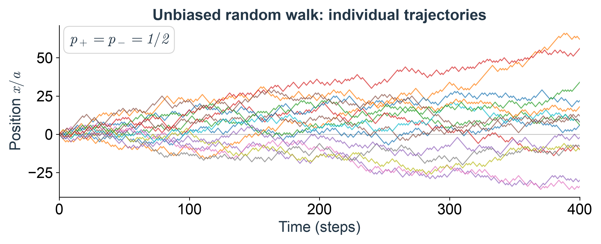

*Fig. 1. 均匀化学环境中的模型细胞轨迹。* 将每条轨迹看成一个模型细胞在均匀化学环境中的位置记录：规则相同，实际路径却不同。

### 1.2 概率收支与主方程 {#probability-balance}

计算下一步的分布，只需知道当前分布。将位置记作 $x_i=ia$，时刻记作 $t_n=n\tau$，定义

$$
P_i^n=\text{第 }n\text{ 步，模型细胞位于格子 }i\text{ 的概率}.
$$

上标 $n$ 表示时间编号，下标 $i$ 表示位置编号。初值为 $P_0^0=1$，其余为零。

要在下一步出现在格子 $i$，只有两个来源：

- 现在在 $i-1$，再向右走，概率是 $P_{i-1}^n\times 1/2$；
- 现在在 $i+1$，再向左走，概率是 $P_{i+1}^n\times 1/2$。

所以

$$
\boxed{P_i^{n+1}=\frac12 P_{i-1}^n+\frac12 P_{i+1}^n.}
\tag{1.1}
$$

式（1.1）称为主方程：根据当前位置概率，计算下一步的位置概率。

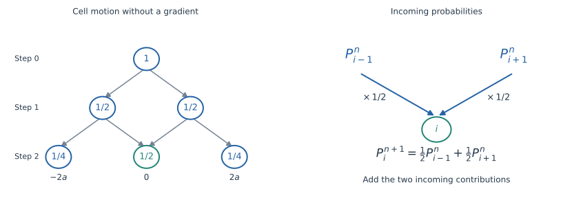

*Fig. 2. 两步位移与概率收支。* 左：回到原点有两条路径，各贡献 $1/4$。右：从左右邻居进入目标格子的概率相加，得到下一步的概率。

例如 $P_0^2=(P_{-1}^1+P_1^1)/2=1/2$，与逐条数路径一致。把式（1.1）对所有格子求和，右边只是把原来的概率各分成两半再相加，因此总概率始终为 $1$。

也可以用平均细胞数 $N_i^n=NP_i^n$ 写出完全相同的更新规则。这个等式对概率与平均个数精确成立；一次实验中的实际个数还带有随机波动。

### 1.3 局部收支与密度起伏 {#local-density-balance}

在式（1.1）两边减去 $P_i^n$：

$$
P_i^{n+1}-P_i^n
=\frac12\bigl(P_{i-1}^n-2P_i^n+P_{i+1}^n\bigr).
$$

若左、中、右三个格子的平均细胞数为 $20,100,20$，下一步中间格子有 $(20+20)/2=20$ 个；若为 $100,20,100$，中间格子就变成 $100$ 个。随机迁移降低局部高峰、填补低谷，会抵消趋化造成的积累。

同步跳跃时，单格计数可能交替变化。下面的连续描述适用于空间上足够平滑的分布。

### 1.4 连续密度与扩散方程 {#diffusion-limit}

格子变小后，每格容纳的概率也会变小，因此先定义概率密度 $p(x,t)$：

$$
P_i^n\simeq a\,p(x_i,t_n),\qquad \int p(x,t)\,dx=1.
$$

密度乘以一小段长度，才是落在这段内的概率。对 $N$ 个独立模型细胞，平均数密度为 $\rho(x,t)=Np(x,t)$，满足 $\int\rho\,dx=N$。后文统一用 $\rho$，其单位是一维中的“细胞数／长度”，就是沿通道统计细胞位置直方图时所测量的量。在给定外场、细胞彼此独立的条件下，两种密度满足相同的线性输运方程；细胞自己改变化学场后，还需要讨论相互作用与平均场近似，见[附录 A.7](#stochastic-a7)。

将离散收支式除以 $a$，再整理成

$$
\underbrace{\frac{\rho(x,t+\tau)-\rho(x,t)}{\tau}}_{\text{单位时间内密度的改变}}
=\frac{a^2}{2\tau}
\underbrace{\frac{\rho(x-a,t)-2\rho(x,t)+\rho(x+a,t)}{a^2}}_{\text{中心比邻居高，还是低？}}.
$$

左边在 $\tau$ 很小时变成时间导数 $\partial_t\rho$。“偏导数”在这里表示固定位置 $x$，只看密度怎样随时间变。右边的差商在密度足够平滑时变成空间二阶导数 $\partial_x^2\rho$。直接展开可见：

$$
\begin{aligned}
\rho(x+a,t)&=\rho+a\partial_x\rho+\frac{a^2}{2}\partial_x^2\rho+\cdots,\\
\rho(x-a,t)&=\rho-a\partial_x\rho+\frac{a^2}{2}\partial_x^2\rho+\cdots.
\end{aligned}
$$

相加再减去 $2\rho$，一阶项抵消，剩下 $a^2\partial_x^2\rho$。因此，当观察长度远大于 $a$、时间远大于 $\tau$，并且所观察的密度分布已足够平滑时，得到

$$
\boxed{\partial_t\rho=D\partial_x^2\rho,\qquad D=\frac{a^2}{2\tau}.}
\tag{1.2}
$$

这就是扩散方程。局部峰顶有 $\partial_x^2\rho\lt0$，所以密度下降；谷底有 $\partial_x^2\rho\gt0$，所以密度上升。$D$ 的单位是“长度平方／时间”，控制这团细胞在无化学方向提示时摊开的快慢。正文趋化模型中的 $D\partial_x^2\rho$ 就来自这个对照过程。

严格的扩散极限是让 $a,\tau\to0$，同时保持 $a^2/(2\tau)=D$ 有限；不能固定 $a$ 却单独把 $\tau$ 取到零。原来的同步格点游走还有奇偶性：第 $n$ 步只到达与 $n$ 同奇偶的格点。连续密度描述的是把这些微观格点细节平均掉后的光滑分布。

### 1.5 边界穿越与扩散通量 {#diffusion-flux}

把通道中相邻两小段的分界面画成一条线，对应格子 $i$ 与 $i+1$ 之间的边界。一时间步内，平均有 $N_i/2$ 个细胞向右穿线，有 $N_{i+1}/2$ 个细胞向左穿线。取向右为正，单位时间的净穿越数是

$$
J_{i+1/2}=\frac{N_i-N_{i+1}}{2\tau}
=\frac{a}{2\tau}(\rho_i-\rho_{i+1})
\simeq-D\partial_x\rho.
$$

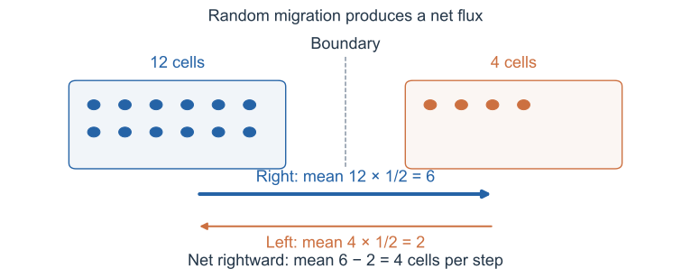

*Fig. 3. 无方向偏置时的扩散通量。* 每个圆点代表一个模型细胞，左格有 12 个、右格有 4 个。每个细胞向左右跳的概率都是 $1/2$，但穿过两格共同边界的平均数量分别是 6 和 2，因此每步净向右 4 个。通量还要除以一步的时间 $\tau$。图中数字都是平均预测。

$J$ 称为通量，一维中的单位是“个数／时间”。左右跳跃概率相同，但密的一侧细胞更多，因此产生从密处向稀处的净迁移。

再看一小段 $[x,x+\Delta x]$：里面的细胞数约为 $\rho\Delta x$。它的改变率等于左边流入减去右边流出：

$$
\partial_t\rho\,\Delta x=J(x,t)-J(x+\Delta x,t).
$$

除以 $\Delta x$，取小区间极限：

$$
\boxed{\partial_t\rho=-\partial_xJ,\qquad J_{\rm diff}=-D\partial_x\rho.}
\tag{1.3}
$$

前式是局部个数守恒的连续性方程，后式是菲克定律。两式联立即得到扩散方程（1.2）。

### 1.6 均方位移与细胞团展宽 {#mean-squared-displacement}

记第 $k$ 次跳跃的位移为 $\Delta X_k$，则

$$
X_n-X_0=\Delta X_1+\cdots+\Delta X_n.
$$

尖括号 $\langle\cdot\rangle$ 表示把大量独立重复实验的结果取平均。公平硬币给出 $\langle\Delta X_k\rangle=0$、$\langle\Delta X_k^2\rangle=a^2$。于是平均总位移为零，但平方以后：

$$
\left\langle\left(\sum_{k=1}^n\Delta X_k\right)^2\right\rangle
=\sum_{k=1}^n\langle\Delta X_k^2\rangle
+2\sum_{k\lt j}\langle\Delta X_k\Delta X_j\rangle=na^2.
$$

最后一步用了独立性：不同步的乘积平均等于各自平均的乘积，因此交叉项为零。用 $t=n\tau$ 和刚才得到的 $D$，有

$$
\boxed{\langle X(t)-X_0\rangle=0,\qquad
\langle[X(t)-X_0]^2\rangle=2Dt.}
$$

第二个量称为均方位移，其平方根 $\sqrt{2Dt}$ 给出典型位移尺度。实验中可由无梯度条件下的轨迹估计 $D$，再施加梯度测量平均漂移；观察时间应长于方向记忆的时间。

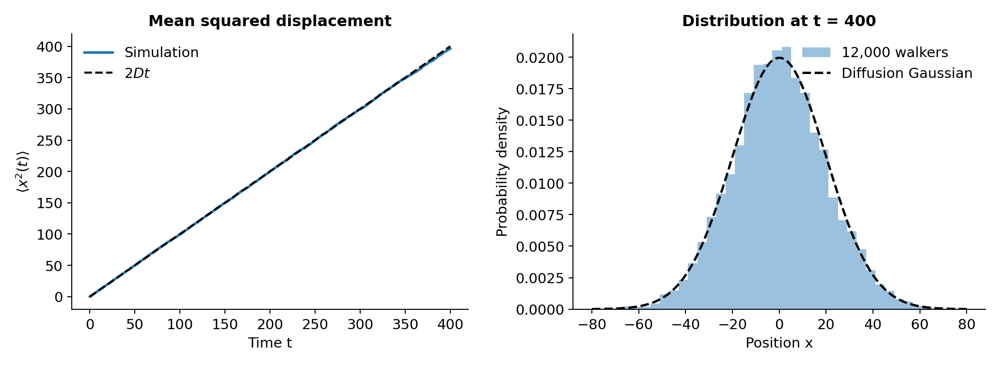

*Fig. 4. 均方位移与位置分布。* 左：模拟均方位移与 $2Dt$ 比较；右：许多模型细胞在同一时刻的位置直方图，与连续扩散方程的高斯分布比较。对集中在原点的初值，高斯分布为 $p(x,t)=(4\pi Dt)^{-1/2}\exp[-x^2/(4Dt)]$；它描述长时间、大尺度下的光滑分布。

---

## 2. 从方向偏好到趋化通量：单细胞怎样响应化学场 {#chemical-bias}

随机迁移只给出无方向提示时的基准。下面先计算一个弱方向偏好怎样移动细胞团的中心，再让这个偏好取决于细胞附近的化学浓度变化。

### 2.1 方向偏置与平均漂移 {#drift-from-bias}

设吸引物向右增加，细胞的有效位移略偏向右侧。在梯度近似恒定的一小段区域内，先将偏置视为常数。保持步长 $a$、步时 $\tau$，令

$$
p_+=\frac12+\varepsilon,\qquad p_-=\frac12-\varepsilon,
\qquad |\varepsilon|\leq\frac12.
$$

例如 $p_+=0.6$、$p_-=0.4$。一步的平均位移是 $0.6a-0.4a=0.2a$；$n$ 步就是 $0.2na$。一般地，

$$
\langle\Delta X\rangle=a(p_+-p_-)=2a\varepsilon,
\qquad
\boxed{v=\frac{2a\varepsilon}{\tau},\quad
\langle X(t)-X_0\rangle=vt.}
\tag{2.1}
$$

$v$ 是漂移速度，描述细胞团中心的移动。单个细胞仍可能向左走，群体的定向迁移来自多次位移中积累的概率偏差。

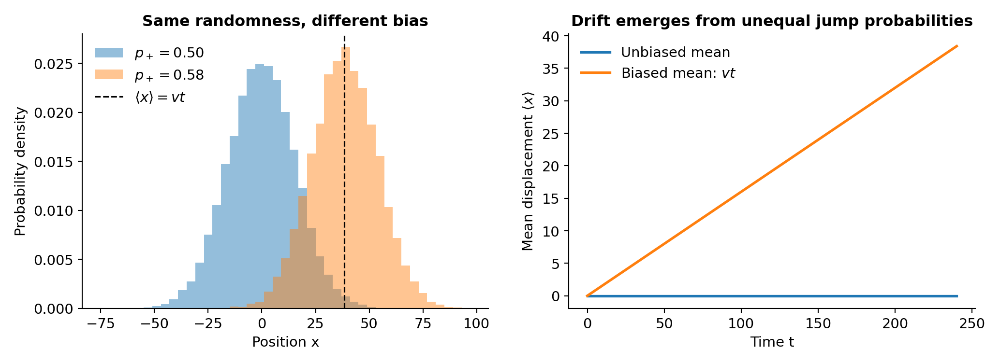

*Fig. 5. 方向偏置与细胞团漂移。* 用位置分布对比无梯度对照与向右存在有效运动偏置的模型。仅将向右概率从 $0.50$ 改为 $0.58$，分布中心便向右移动。右图画出理论平均位移，左图显示模拟分布；有漂移的细胞团依然会展宽，正如定向趋化与随机迁移可以同时存在。

宽度要围绕移动的中心计算。一步位移的方差是“平方的平均减去平均的平方”，所以

$$
\operatorname{Var}(\Delta X)=a^2-(2a\varepsilon)^2,
\qquad
\operatorname{Var}(X_n-X_0)=na^2(1-4\varepsilon^2).
$$

对有限步长，强偏置确实会改变展宽速率；在 $\varepsilon=1/2$ 时每一步都向右走，方差为零。

接下来研究弱偏置的扩散极限：因为 $\tau$ 随 $a^2$ 缩小，为使式（2.1）的 $v$ 有限，需要 $\varepsilon$ 随 $a$ 缩小。此时方差中的 $4\varepsilon^2$ 修正趋于零，主导扩散系数仍是 $D=a^2/(2\tau)$。这说明连续模型里的有限漂移，可以来自每一步都很微弱的方向偏好。

### 2.2 漂移与扩散的共同演化 {#drift-diffusion}

向右的概率现在是 $p_+$，所以式（1.1）变成

$$
\rho(x,t+\tau)=p_+\rho(x-a,t)+p_-\rho(x+a,t).
$$

使用第 1.4 节已经写出的空间展开，并用 $p_++p_-=1$，右边为

$$
\rho-a(p_+-p_-)\partial_x\rho+\frac{a^2}{2}\partial_x^2\rho+\cdots.
$$

减去 $\rho$、除以 $\tau$，取上述弱偏置极限：

$$
\boxed{\partial_t\rho=D\partial_x^2\rho-v\partial_x\rho}
\qquad (v\text{ 为常数}).
\tag{2.2}
$$

在局部恒梯度的趋化近似中，扩散项让细胞团变宽，漂移项让它的中心向高浓度一侧移动。若一开始集中在原点，连续解是以 $vt$ 为中心、方差为 $2Dt$ 的高斯分布。

### 2.3 位置依赖的漂移与局部守恒 {#position-dependent-drift}

实际趋化环境的坡度会随位置改变，例如吸引物峰左边的高浓度方向向右、右边则向左。于是有效方向偏好也要随位置改变，记为 $\varepsilon=\varepsilon(x)$。到达格子 $i$ 的两批细胞分别从 $i-1$ 和 $i+1$ 出发，必须使用出发位置的跳跃概率：

$$
P_i^{n+1}=p_+(x_{i-1})P_{i-1}^n+p_-(x_{i+1})P_{i+1}^n.
\tag{2.3}
$$

这次要展开整个乘积。记 $f_\pm(x)=p_\pm(x)\rho(x,t)$，右边是 $f_+(x-a)+f_-(x+a)$，因此

$$
\tau\partial_t\rho
=-a\partial_x\bigl[(p_+-p_-)\rho\bigr]
+\frac{a^2}{2}\partial_x^2\bigl[(p_++p_-)\rho\bigr]+\cdots.
$$

用 $p_++p_-=1$ 和 $v(x)=2a\varepsilon(x)/\tau$，得到

$$
\boxed{\partial_t\rho=D\partial_x^2\rho-\partial_x[v(x)\rho],
\qquad J=-D\partial_x\rho+v(x)\rho.}
\tag{2.4}
$$

“速度乘以密度”为什么是漂移通量？短时间 $\Delta t$ 内，若 $v\gt0$，边界左侧宽约 $v\Delta t$ 内的细胞会穿过它，数量约为 $\rho v\Delta t$；除以 $\Delta t$ 就是 $\rho v$。

乘积求导给出 $-\partial_x(v\rho)=-v\partial_x\rho-\rho\partial_xv$。第二项不能丢：在吸引物峰两侧，细胞的平均趋化方向相向，即使初始细胞密度均匀，也会在中间积累。只写 $-v\partial_x\rho$ 会错误地预测这时密度不变。

### 2.4 化学梯度与趋化敏感系数 {#chemotactic-response}

前面已经把细胞的随机迁移与方向偏好分别算清。现在用 $c(x)$ 表示化学吸引物浓度，把方向偏好与细胞所感受到的化学信号连起来。先假设这个浓度由外界固定，细胞不能改变它。

一个最简单的感知规则是比较左右两侧的浓度：

$$
\Delta c(x)=c(x+a)-c(x-a),\qquad
p_\pm(x)=\frac12\pm\frac{b}{2}\Delta c(x),\quad b\gt0.
$$

$b$ 的单位是浓度的倒数。右边更浓时 $\Delta c\gt0$，向右概率就更大；浓度处处相同时，仍是公平的随机游走。这个线性规则只在 $|b\Delta c|\leq1$ 时给出合法概率，下面取弱偏置情形。

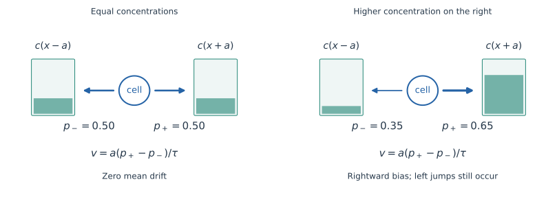

*Fig. 6. 浓度差与运动方向偏好。* 色块高度表示左右两侧的浓度。浓度相同时，两个方向各占一半；右侧更浓时，向右概率增大，向左概率减小。图中的 $0.35/0.65$ 只用于说明规则，左右概率之和仍为 1；连续推导取更弱的偏置。

浓度变化平缓时，$\Delta c\simeq2a\partial_xc$。把它代入一步平均位移：

$$
v=\frac{a}{\tau}(p_+-p_-)
=\frac{ab}{\tau}\Delta c
\simeq\frac{2ba^2}{\tau}\partial_xc.
$$

将比例系数记作 $\chi$，于是自然得到

$$
\boxed{v(x)=\chi\partial_xc(x),\qquad
\chi=\frac{2ba^2}{\tau}=4bD\gt0.}
\tag{2.5}
$$

$\partial_xc$ 是浓度梯度：每向右移动单位距离，浓度增加多少。$\chi$ 叫趋化敏感系数。它的单位使 $\chi\partial_xc$ 恰好是速度；后面的连续模型可分别调节 $D$ 和 $\chi$，相当于同时允许改变这个微观响应参数 $b$。

用 $\chi$ 重写跳跃概率，得到与前面的漂移模型衔接的形式：

$$
p_\pm(x)\simeq\frac12\pm\frac{\chi\tau}{2a}\partial_xc(x).
\tag{2.6}
$$

这里的“比较左右浓度”是为了建立可推导的玩具模型。真实大肠杆菌会在游动过程中比较信号随时间的变化，调节直游与转向；上面的规则将这类过程压缩为局部平均偏置，并未模拟其内部感知网络（见[Berg 与 Brown（1972）](https://doi.org/10.1038/239500a0)）。

现在无需另猜一个方程：将式（2.5）代入已经推导好的式（2.4），就是

$$
\boxed{\partial_t\rho
=D\partial_x^2\rho-\partial_x\bigl(\chi\rho\partial_xc\bigr).}
\tag{2.7}
$$

对应的通量为

$$
\boxed{J=\underbrace{-D\partial_x\rho}_{\text{从细胞密处向稀处}}
+\underbrace{\chi\rho\partial_xc}_{\text{向吸引物浓处漂移}}.}
\tag{2.8}
$$

这两种方向不一定相同：细胞已经很多的地方，若吸引物也很多，扩散把细胞向外送，趋化则把细胞向内拉。它们的竞争贯穿后面的分析。

### 2.5 固定吸引物场中的积累 {#fixed-field-accumulation}

假设 $c(x)$ 在空间中心有一个峰，例如

$$
c(x)=c_{\max}\exp\left[-\frac{(x-x_0)^2}{2w^2}\right]
$$

（这里为了直观省略了有限边界的处理；代码使用周期边界下的对应光滑剖面）。若初始细胞密度为常数，演化后会在 $x_0$ 附近增加。

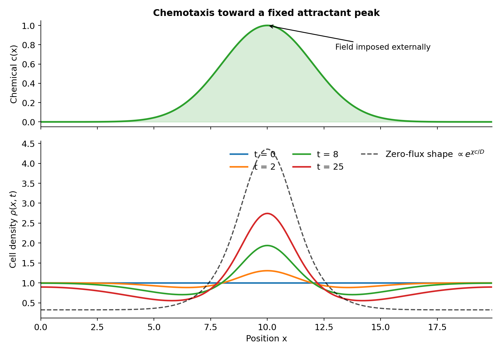

*Fig. 7. 固定吸引物峰下的细胞积累。* 上：外界给定的浓度 $c(x)$。下：细胞向峰附近积累。黑色虚线为零通量稳态，$t=25$ 的分布仍在演化。

在零通量稳态，

$$
J=-D\partial_x\rho+\chi\rho\partial_x c=0.
$$

先把扩散与趋化两项移到等号两侧，再除以 $D\rho$（考虑正密度）：

$$
\frac{\partial_x\rho}{\rho}=\frac\chi D\partial_xc.
$$

左边恰好是 $\ln\rho$ 的导数。对位置积分，得到 $\ln\rho=(\chi/D)c+C$，再取指数：

$$
\partial_x(\ln\rho)=\frac\chi D\partial_xc
\quad\Longrightarrow\quad
\boxed{\rho_{\rm st}(x)\propto\exp\!\left(\frac\chi D c(x)\right).}
\tag{2.9}
$$

在长度为 $L$ 的区间内，若细胞总数为 $N$，归一化后就是

$$
\rho_{\rm st}(x)=\frac{N e^{\chi c(x)/D}}{\int_0^L e^{\chi c(y)/D}\,dy}.
$$

两个位置的密度比为 $\rho_{\rm st}(x_1)/\rho_{\rm st}(x_2)=\exp\{\chi[c(x_1)-c(x_2)]/D\}$。因此决定积累程度的是无量纲组合 $\chi\Delta c/D$。给 $c$ 处处加同一个常数不会改变梯度，也不会改变归一化后的密度分布。

这种积累由外场驱动：每个细胞都独立响应预先给定的化学分布；即使每次只放入一个细胞，多次重复实验的位置分布也会向吸引物峰附近积累。密度峰的位置由外界设定。

自发聚集还需要细胞改变吸引物分布，形成群体反馈。

---

## 3. 从单细胞响应到集体反馈：细胞改变它们追随的场 {#collective-feedback}

### 3.1 化学物质的扩散、降解与分泌 {#chemical-field-dynamics}

现在取消“外界固定浓度”这个条件，让 $c=c(x,t)$ 也随时间变。仍然取一小段长度 $\Delta x$，其中的化学物质量是 $c\Delta x$。先加入两个过程。

化学物质扩散。沿用第 1 节的概率收支，浓度变化中出现 $D_c\partial_x^2c$；$D_c$ 为化学物质的扩散系数。

化学物质降解。 假设很短时间 $\Delta t$ 内，每份现存物质都有 $\kappa\Delta t$ 的比例被降解，那么这一小段的损失为 $\kappa c\Delta x\Delta t$。除以长度和时间，就得到 $-\kappa c$。只保留降解时，$dc/dt=-\kappa c$ 的解为 $c(t)=c(0)e^{-\kappa t}$，因此 $1/\kappa$ 是信号衰减到原来 $1/e$ 所需的时间。

把这两个贡献相加：

$$
\boxed{\partial_t c=D_c\partial_x^2c-\kappa c.}
\tag{3.1}
$$

细胞分泌吸引物。 一小段内有约 $\rho\Delta x$ 个细胞。若每个细胞单位时间分泌量为 $\alpha$，那么 $\Delta t$ 内的新增物质量为 $\alpha\rho\Delta x\Delta t$；除以 $\Delta x\Delta t$，源项就是 $+\alpha\rho$。于是

$$
\boxed{\partial_t c=D_c\partial_x^2c+\alpha\rho-\kappa c.}
\tag{3.2}
$$

这里 $c$ 按一维有效浓度理解，$\alpha$ 的单位与之配套；模拟使用一致的无量纲单位。每一项都有“浓度／时间”的单位。细胞本身没有在这个模型里增殖或死亡，所以细胞方程没有对应的源项。

### 3.2 两场耦合与 Keller–Segel 模型 {#keller-segel-model}

把式（2.7）和式（3.2）放在一起：

$$
\boxed{\begin{aligned}
\partial_t\rho
&=D\partial_x^2\rho-\chi\partial_x(\rho\partial_x c),\\[3pt]
\partial_t c
&=D_c\partial_x^2 c+\alpha\rho-\kappa c.
\end{aligned}}
\tag{3.3}
$$

这是一类Keller–Segel 趋化模型。密度方程中的扩散和漂移来自随机游走，化学场方程中的各项分别对应扩散、分泌和降解。

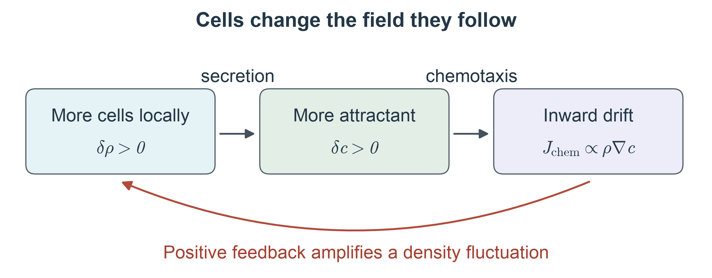

*Fig. 8. 细胞与吸引物的反馈回路。* 多一点细胞 $\to$ 多一点吸引物 $\to$ 更多细胞移入该处 $\to$ 密度增加。另附[矢量图版本](figures/05_field_mediated_feedback.svg)。

细胞通过共同分泌、扩散和感知的化学物质相互影响。

设初始细胞密度接近均匀：

$$
\rho(x,0)=\rho_0+\text{小扰动}.
$$

在一个局部偶然有稍多细胞的地方：

- 扩散通量倾向于消除这个密度起伏；
- 细胞分泌的吸引物较多，浓度梯度把更多细胞向那里吸引；
- 后一过程可能进一步放大原来的起伏。

这两种输运同时存在。增大趋化敏感系数 $\chi$ 会增强反馈，而密度起伏是否真的增长，还要与扩散平滑的速度比较。

### 3.3 细胞总数与化学物质的收支 {#conservation-laws}

为避免边界通量造成干扰，后续数值模拟采用周期边界条件。积分第一个方程得

$$
\boxed{\frac{d}{dt}\int_0^L\rho(x,t)\,dx=0.}
\tag{3.4}
$$

细胞总数守恒。积分第二个方程得

$$
\boxed{\frac{d}{dt}\int_0^L c(x,t)\,dx
=\alpha\int_0^L\rho(x,t)\,dx-\kappa\int_0^L c(x,t)\,dx.}
\tag{3.5}
$$

总化学物质不守恒，因为细胞持续分泌且物质会降解。这两个积分关系可用于检查数值计算是否满足相应的守恒与收支关系。

### 3.4 数值比较：相同初态下的弱反馈与强反馈 {#collective-simulations}

下面的结果都由 `code/collective_1d.py` 积分式（3.3）得到，采用一维周期区间 $0\leq x\lt L$：

| 参数 | 数值 | 作用 |
|---|---:|---|
| $L$ | $20$ | 系统长度 |
| $D$ | $0.3$ | 细胞扩散 |
| $D_c$ | $1.0$ | 化学场扩散 |
| $\alpha$ | $1.0$ | 分泌强度 |
| $\kappa$ | $1.0$ | 降解率 |
| $\rho_0$ | $1.0$ | 均匀背景细胞密度 |
| $\chi$ | $0.15$ 或 $0.90$ | 唯一改变的参数 |

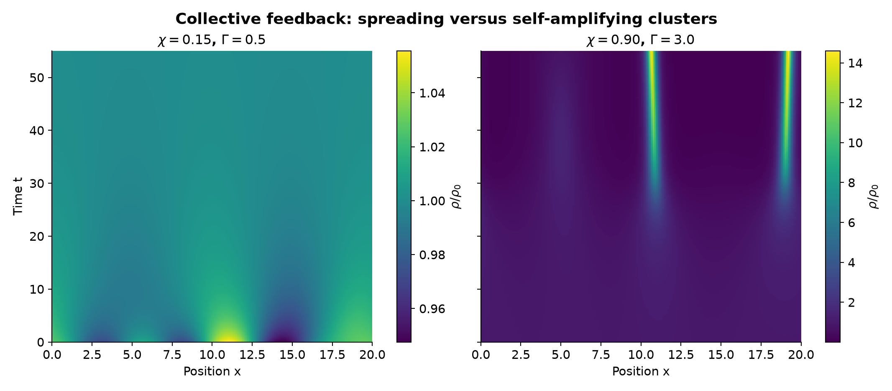

*Fig. 9. 弱、强反馈下的细胞密度演化。* 横轴是空间，纵轴是时间，颜色表示 $\rho/\rho_0$。左图：微小起伏逐渐衰减；右图：起伏被反馈放大，形成局部聚集。两个色条采用各自的刻度，比较时要读数值，不能只比较颜色。

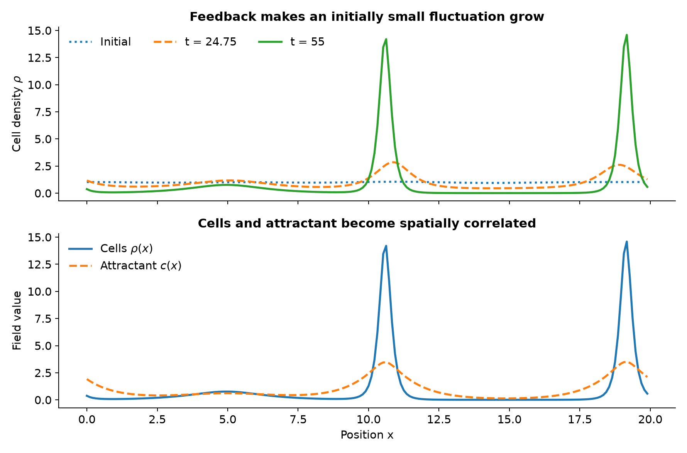

*Fig. 10. 密度起伏与化学场的空间关联。* 上：密度起伏的增长；下：在选定时刻的细胞密度与吸引物浓度峰相关。这里展示的是有限时间演化过程，未声称找到了唯一稳定的最终图案。

这些结果描述起伏被放大的早期过程：

1. **初态的涨落非常小**。真正大的密度峰是动力学放大出来的。
2. 无噪声方程的严格均匀初值始终均匀；失稳需要扰动。
3. **聚集的出现**与**最终是否得到稳定且间距规则的图案**是不同的问题。这个简化模型足以展示反馈失稳，但并没有保证稳定斑点的形成。

下面计算这些起伏增长所需的反馈强度。

---

## 4. 聚集失稳：一个小密度起伏何时会被放大 {#aggregation-threshold}

### 4.1 均匀态与扰动问题 {#uniform-state}

设整条线上细胞密度都是 $\rho_0$，化学浓度都是 $c_0$。因为处处相同，空间导数全部为零，细胞没有净通量。化学物质还在生产和降解，所以稳态需要

$$
0=\alpha\rho_0-\kappa c_0
\quad\Longrightarrow\quad
\boxed{c_0=\frac{\alpha\rho_0}{\kappa}.}
$$

以下取 $D,D_c,\alpha,\chi,\kappa,\rho_0$ 为正，考察均匀态附近的小偏差会衰减还是增长。

### 4.2 小扰动与线性化 {#linearization}

把密度和浓度拆成背景与小偏差：

$$
\rho=\rho_0+\delta\rho(x,t),\qquad c=c_0+\delta c(x,t).
$$

$\delta$ 在这里表示小偏差，不是又一次求导。最需要展开的是趋化项内部的乘积：

$$
\rho\partial_xc
=(\rho_0+\delta\rho)\partial_x(c_0+\delta c)
=\rho_0\partial_x\delta c+\delta\rho\,\partial_x\delta c.
$$

若两个偏差各自都缩小到原来的 $1/10$，第一项缩小到 $1/10$，最后一项则缩小到 $1/100$。在线性近似中，舍去这个“小量乘以小量”的项；化学方程的常数项又因 $\alpha\rho_0=\kappa c_0$ 抵消，留下

$$
\begin{aligned}
\partial_t\delta\rho
&=D\partial_x^2\delta\rho-\chi\rho_0\partial_x^2\delta c,\\
\partial_t\delta c
&=D_c\partial_x^2\delta c+\alpha\delta\rho-\kappa\delta c.
\end{aligned}
$$

这个近似只适用于起伏很小的阶段。密度峰长大后，丢掉的乘积就可能与保留的项同样重要。

### 4.3 单个空间模式与振幅动力学 {#spatial-modes}

试着让空间起伏是一条余弦波：

$$
\delta\rho(x,t)=A(t)\cos(qx),\qquad
\delta c(x,t)=B(t)\cos(qx).
$$

$A(t)$、$B(t)$ 是起伏的振幅；$q$ 叫波数，与波长 $\lambda$ 的关系为 $q=2\pi/\lambda$。$q$ 越小，起伏越宽。选择余弦是因为它求两次导数后仍是自己：

$$
\partial_x^2\cos(qx)=-q^2\cos(qx).
$$

代入上面的线性方程，比较 $\cos(qx)$ 前的系数，就把两个偏微分方程变成了两个普通微分方程：

$$
\boxed{\begin{aligned}
\dot A&=-Dq^2A+\chi\rho_0q^2B,\\
\dot B&=\alpha A-(\kappa+D_cq^2)B.
\end{aligned}}
$$

点号表示对时间求导。现在每一项的含义都可以直接读出来：

- $-Dq^2A$：细胞扩散抹平密度起伏；
- $+\chi\rho_0q^2B$：浓度峰吸引细胞，使同位置的密度峰增高；
- $+\alpha A$：细胞多的地方产生更多化学物质；
- $-(\kappa+D_cq^2)B$：降解和化学扩散共同抹平浓度起伏。

任意足够规则的小扰动都可以分解成不同波数的正弦、余弦之和，称为傅里叶分解。在线性方程中，这些波各自独立演化，所以先弄懂一条波，就能判断哪些尺度的起伏会增长。常见的 $e^{iqx}$ 写法只是将正弦、余弦合并的记号，这里不需要它。

振幅方程也说明了“增长率”的含义。寻找一组共同按指数变化的振幅，令 $A(t)=A_0e^{\sigma t}$、$B(t)=B_0e^{\sigma t}$。$\sigma\gt0$ 时起伏放大，$\sigma\lt0$ 时起伏衰减。完整两场方程给出两支增长率，其中较大的一支记为 $\sigma_+(q)$，决定小扰动的主导增长或衰减；求根与精确失稳判据见[附录 B.1](#exact-growth-rates)。先用下图将空间波形与随时间改变的振幅联系起来，再考察化学响应较快时的近似。

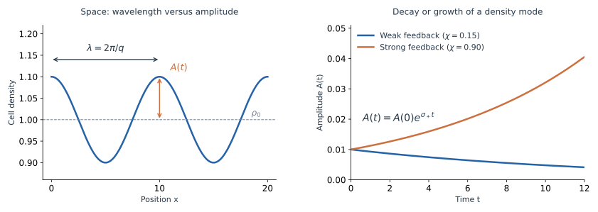

*Fig. 11. 空间波形与振幅增长。* 左：波长 $\lambda$、背景 $\rho_0$ 与振幅 $A$。右：取正文参数、$q=2\pi/10$、$A(0)=0.01$，按精确线性增长率画出弱、强反馈下的振幅变化。化学初值取对应的增长模式，见[附录 B.2](#growth-rate-comparison)。

### 4.4 快速化学响应近似 {#fast-chemical-response}

若浓度起伏能很快跟上密度起伏，就可在 $\dot B=\alpha A-(\kappa+D_cq^2)B$ 中近似取 $\dot B\simeq0$，得到

$$
B\simeq\frac{\alpha}{\kappa+D_cq^2}A.
$$

其含义是：细胞峰产生信号，降解与扩散限制了信号峰的高度。代入 $\dot A$，得到更容易理解的近似增长率

$$
\boxed{\sigma(q)\simeq q^2\left[
\frac{\chi\alpha\rho_0}{\kappa+D_cq^2}-D\right].}
\tag{4.1}
$$

这一步新增了一个时间尺度条件。对所研究的指数过程，完整关系其实是 $B_0/A_0=\alpha/(\sigma+\kappa+D_cq^2)$；忽略分母中的 $\sigma$，要求 $|\sigma|\ll\kappa+D_cq^2$。化学场还有一个初始调整过程；只有它已衰减，才可以把浓度视为随密度即时调整。

因此，式（4.1）的增长速度是近似的，而其令 $\sigma=0$ 得到的阈值与[附录 B.1](#exact-growth-rates)完全相同。在阈值附近，增长或衰减很慢，这个近似尤其有用；远离阈值时，应检查时间尺度，或直接用 $\sigma_+$。

### 4.5 反馈强度、作用长度与有限系统阈值 {#finite-system-threshold}

定义

$$
\boxed{\Gamma=\frac{\chi\alpha\rho_0}{D\kappa}},\qquad
\boxed{\ell_c=\sqrt{\frac{D_c}{\kappa}}}.
\tag{4.2}
$$

$\Gamma$ 无量纲，衡量分泌和趋化的反馈相对于扩散、降解有多强。$\ell_c$ 有长度单位：信号在寿命约 $1/\kappa$ 内扩散所覆盖的特征距离与它同阶；[进阶专题 FT.2](#signal-mediated-interactions)会给出它更精确的空间含义。

式（4.1）变成

$$
\sigma(q)\simeq Dq^2\left[\frac{\Gamma}{1+(q\ell_c)^2}-1\right].
$$

括号中，$-1$ 是扩散损失，前一项是经化学场传递的反馈。失稳需要

$$
\Gamma\gt1+(q\ell_c)^2.
$$

无限大系统允许任意小的非零 $q$。因此，$\Gamma\leq1$ 时所有非零波数都衰减；$\Gamma\gt1$ 时，存在一段不稳定波数

$$
0\lt q\lt\frac{\sqrt{\Gamma-1}}{\ell_c}.
$$

长而缓的起伏容易增长，很细的起伏则会被扩散抹平。不过 $q\to0$ 时增长率也趋近零：很长距离上的细胞搬运仍需要时间。

在长度为 $L$ 的周期区间，波形绕一圈必须接回自己，所以只能取

$$
q_m=\frac{2\pi m}{L},\qquad m=1,2,\ldots.
$$

最小非零波数是 $q_1=2\pi/L$。只要它也不能增长，所有更大的波数就都不能增长。因此精确的有限系统失稳条件是

$$
\boxed{\Gamma\gt1+\left(\frac{2\pi\ell_c}{L}\right)^2.}
$$

这说明仅有 $\Gamma\gt1$，在有限系统中仍可能看不到失稳。[Fig. 9](#fig-9) 的参数给出 $\ell_c=1$、$L=20$，阈值为 $\Gamma_c\simeq1.0987$，即 $\chi_c\simeq0.3296$；$\chi=0.15$ 与 $0.90$ 分别位于两侧。

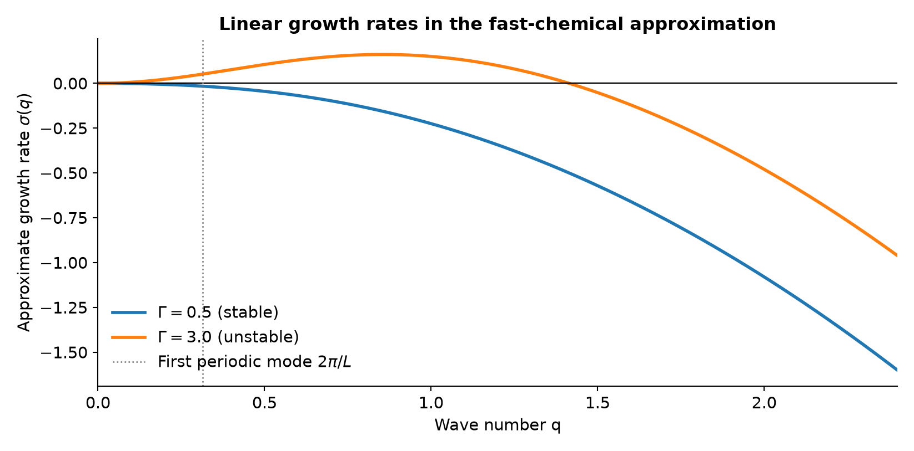

*Fig. 12. 准稳态近似中的模态增长率。* 曲线由式（4.1）计算；竖虚线为周期区间的最小非零波数，允许波数为其正整数倍。近似与精确增长率的比较见[附录 B](#appendix-b)。

---

## 5. 回到趋化现象：定向迁移、聚集与空间结构 {#biological-conclusions}

### 5.1 从单细胞位移到群体聚集 {#single-cell-to-collective}

无梯度对照中，细胞团的中心没有系统漂移，宽度随时间增长。给定非均匀吸引物场后，同样的随机运动叠加了趋化偏置，细胞可以在浓度较高处积累；其稳态分布由随机扩散与向内趋化通量的平衡决定。若细胞还会产生吸引物，密度与浓度的双向反馈才有可能放大原先很小的密度起伏。

因此，观察到密度峰时，需要辨认峰由什么决定：是外界已经给定了信号峰，还是细胞改变了化学场，并使均匀态失稳？[固定场积累](#fixed-field-accumulation)与[反馈失稳](#finite-system-threshold)给出了两个可分别检验的模型基准。即使发生失稳，线性分析也只确定早期哪些起伏会增长，不能单独确定最终图案。

### 5.2 二维模型与早期空间结构 {#two-dimensional-patterns}

真正的空间图案通常在二维中更直观。让密度与浓度依赖 $x,y$ 两个坐标。梯度 $\nabla c=(\partial_xc,\partial_yc)$ 指向浓度上升最快的方向，通量也变成向量；散度 $\nabla\!\cdot J$ 表示一个小区域的净流出，拉普拉斯算子 $\nabla^2=\partial_x^2+\partial_y^2$ 则把两个方向的扩散相加。沿用同一套收支，得到：

$$
\begin{aligned}
\partial_t\rho &=D\nabla^2\rho-\chi\nabla\!\cdot(\rho\nabla c),\\
\partial_t c&=D_c\nabla^2c+\alpha\rho-\kappa c.
\end{aligned}
$$

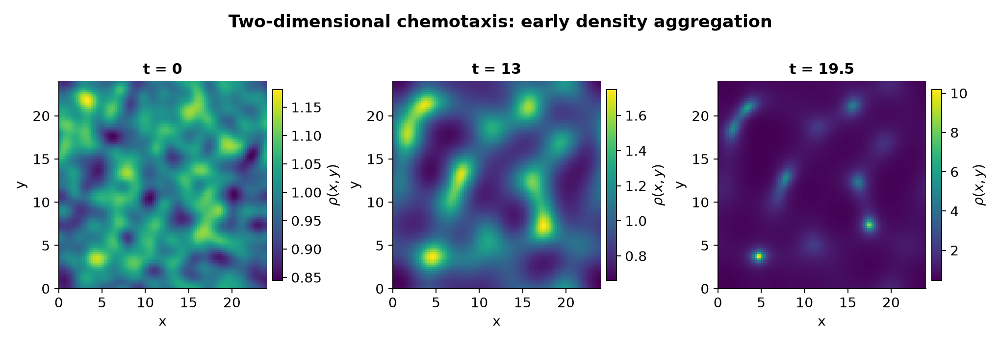

*Fig. 13. 二维模型的早期聚集。* 周期区间内，接近均匀的初态形成局部高密度区域。长期峰值会受数值网格及模型中缺失的饱和机制影响。

### 5.3 模型假设与生物学适用范围 {#model-scope}

模型保留随机运动、梯度响应和吸引物分泌三个机制，适用范围由以下简化决定：

- 位置依赖的跳跃概率是运动偏置的有效模型。真实大肠杆菌通过信号的时间变化调节直游与转向；这一微观信号过程需要额外变量描述，参见[Berg 与 Brown（1972）](https://doi.org/10.1038/239500a0)的实验。
- 高密度区域中的拥挤、趋化响应饱和及物质耗尽，可能影响长期演化和峰值。这些效应在当前方程中尚未包含。
- 化学波、信号兴奋性与移动带涉及其他机制，需要另建模型。
- 当前模型的细胞间耦合来自共享化学场。分泌、扩散和感知共同构成反馈，使原本独立的运动变成集体动力学。

这些条件限定了模型能解释的现象，也指出了定量研究真实细菌系统时需要补充的机制。

---

## 技术附录 {#technical-appendices}

以下推导补全正文使用的随机过程与稳定性结果。附录 A 连接离散跳跃、连续概率密度与单条细胞轨迹；附录 B 保留化学场的有限响应时间，给出完整增长率。

### 附录 A. Master、Fokker–Planck 与 Langevin 描述 {#appendix-a}

本附录将细胞的跳跃规则、位置分布和随机轨迹联系起来，对应 Master equation、Fokker–Planck 与 Langevin 描述。进一步推导见[Dunkel 的讲义](https://math.mit.edu/~dunkel/Teach/18.S995_2017F/slides/lec05_BM.pdf)和[Bazant 的课程资料](https://math.mit.edu/classes/18.366/lec06/)。

#### A.1 轨迹、概率与细胞数密度 {#stochastic-a1}

仍看一条狭长通道，先由外界给定光滑化学场 $c(x,t)$，细胞响应的平均漂移为 $v(x,t)=\chi\partial_xc(x,t)$。把同样条件下的实验独立重复很多次：

| 描述 | 记录什么 | 在趋化实验里对应什么 |
|---|---|---|
| Master equation | 各离散位置的概率 $P_i(t)$ | 规定细胞从哪格跳到哪格，计算每格概率的收支 |
| Fokker–Planck equation | 连续位置的概率密度 $p(x,t)$ | 预测同一条件下许多次位置记录的分布 |
| Langevin equation | 一次随机实现的位置 $X(t)$ | 生成或描述一条模型细胞轨迹 |

$X(t)$ 的一次取值是一个位置；$p(x,t)\,dx$ 是重复实验中落在一小段的概率，两者不能当成同一种变量。对于给定外场中 $N$ 个独立、同分布的细胞，平均数密度为 $\rho=Np$。

连续跳跃模型的主方程在给定跳跃规则下是精确的；Fokker–Planck 是其适当扩散极限的描述。Langevin 与对应 Fokker–Planck 在相同初值、边界条件及适当正则性条件下描述同一个扩散过程。 不能因此认为一个有限步长的跳跃过程与连续布朗轨迹在每个时间尺度上都相同。

#### A.2 连续时间跳跃与 Master equation {#stochastic-a2}

正文每隔固定 $\tau$ 跳一次，是离散时间模型。现在让跳跃发生的时刻也随机：位于 $x_i$ 的细胞，在很短时间 $dt$ 内

$$
\begin{aligned}
\Pr(i\to i+1)&=r_+(x_i,t)\,dt+o(dt),\\
\Pr(i\to i-1)&=r_-(x_i,t)\,dt+o(dt),\\
\Pr(\text{不跳})&=1-[r_+(x_i,t)+r_-(x_i,t)]dt+o(dt).
\end{aligned}
$$

$r_\pm$ 是跳跃率，单位为“每单位时间”，不是无量纲概率；$o(dt)$ 表示比 $dt$ 更高阶的小量。时间越短，不跳的概率越接近 1。若在某格的两项率不随时间变，在该格等待下一次跳跃的时间服从指数分布，平均为 $1/(r_++r_-)$。

下一时刻位于 $i$ 的细胞，可能原来就在这里而没有跳，也可能从邻格进入。写出这三批概率、减去当前概率并除以 $dt$，得到

$$
\boxed{\frac{dP_i}{dt}
=r_+(x_{i-1},t)P_{i-1}+r_-(x_{i+1},t)P_{i+1}
-[r_+(x_i,t)+r_-(x_i,t)]P_i.}
\tag{A.1}
$$

前两项是进入，最后一项是离开。对所有格子求和，进入和离开逐项抵消，所以概率守恒。对更一般的离散状态，若 $W_{i\leftarrow j}$ 表示从 $j$ 到 $i$ 的转移率，同一规则写成

$$
\frac{dP_i}{dt}=\sum_{j\ne i}
\bigl[W_{i\leftarrow j}P_j-W_{j\leftarrow i}P_i\bigr].
$$

在趋化问题中，化学信号可以通过改变这些方向相关的转移率产生漂移。但跳跃率增大与趋化偏置不同：左右率相等地增大时，在该位置的一阶平均位移仍为零；真正的方向偏置由左右之差决定。若速率还随位置变，稳态分布也要由完整收支计算。

固定步时与随机跳时在有限尺度上是两种模型，即使令 $r_\pm=p_\pm/\tau$，等待时间统计也不相同；下面是在各自的弱偏置扩散极限中将它们联系起来。

#### A.3 跳跃矩展开与 Fokker–Planck 方程 {#stochastic-a3}

令 $P_i(t)\simeq a p(x_i,t)$。与正文位置依赖偏置的推导一样，对式（A.1）中的整个乘积 $r_\pm p$ 做空间展开，零阶项抵消，留下

$$
\partial_t p
=-\partial_x\!\left[a(r_+-r_-)p\right]
+\partial_x^2\!\left[\frac{a^2}{2}(r_++r_-)p\right]+\cdots.
$$

为什么恰好出现这两个组合？条件是细胞当前在 $x$，一小段时间内的位移只有 $+a,-a,0$ 三种，因此

$$
\begin{aligned}
v(x,t)&=\lim_{dt\to0}\frac{\mathbb E[\Delta X\mid X(t)=x]}{dt}
=a(r_+-r_-),\\
K(x,t)&=\lim_{dt\to0}\frac{\mathbb E[(\Delta X)^2\mid X(t)=x]}{2dt}
=\frac{a^2}{2}(r_++r_-).
\end{aligned}
$$

$\mathbb E$ 与正文的尖括号都表示平均。$v$ 衡量局部平均迁移，$K$ 衡量局部随机展宽；这里用 $K$ 是为了允许它随位置变化。取小步长极限，并让这两项有限、高阶跳跃矩的单位时间贡献消失，得到一维 Fokker–Planck 方程：

$$
\boxed{\partial_t p=-\partial_x(vp)+\partial_x^2(Kp).}
\tag{A.2}
$$

这类从跳跃矩展开的做法称为 Kramers–Moyal 展开；二阶截断需要相应的小跳跃与尺度分离条件。若大量运动由长距离跳跃支配，就不能仅凭前两项写下局部扩散方程。

对正文的趋化模型，取 $K=D$ 为常数、$v=\chi\partial_xc$：

$$
\partial_t p=-\partial_x(\chi p\partial_xc)+D\partial_x^2p.
$$

乘以 $N$，正好回到式（2.7）。在给定光滑外场中，一组明确实现这个极限的跳跃率是

$$
r_\pm(x,t)=\frac{D}{a^2}\pm\frac{\chi\partial_xc(x,t)}{2a}.
$$

有限 $a$ 时必须保证两项非负；在有界梯度区域可取足够小的 $a$。左右共同的 $D/a^2$ 造成随机迁移，较小的差值造成趋化漂移，正是正文“随机散开叠加微弱偏好”的连续时间版本。

#### A.4 Langevin 方程与轨迹采样 {#stochastic-a4}

若想在计算机上生成一条轨迹，就不必先求整张位置分布。对正文的常数 $D$ 模型，在时间网格上可用

$$
X_{n+1}=X_n+\underbrace{\chi\partial_xc(X_n,t_n)\,\Delta t}_{\text{趋化平均位移}}
+\underbrace{\sqrt{2D\Delta t}\,Z_n}_{\text{随机位移}},
\qquad Z_n\sim\mathcal N(0,1).
$$

各 $Z_n$ 相互独立，是均值为零、方差为 1 的标准正态随机数。给定当前位置，一步位移的平均是 $\chi\partial_xc\,\Delta t$，方差是 $2D\Delta t$。噪声前必须是 $\sqrt{\Delta t}$；若误写成 $\Delta t$，固定总时间后随机展宽会在细化时间步时消失。

把无限细时间步的极限记为

$$
\boxed{dX_t=\chi\partial_xc(X_t,t)\,dt+\sqrt{2D}\,dW_t.}
\tag{A.3}
$$

$W_t$ 是标准 Wiener 过程，也叫标准布朗运动：其不相交时间段的增量独立，$W_{t+\Delta t}-W_t$ 服从均值零、方差 $\Delta t$ 的正态分布。式（A.3）是位置层次的 Langevin 随机微分方程；它已经平均掉短时速度与改向过程，没有把细胞当作受一个化学机械力加速的质点。

物理文献也常形式地写成

$$
\dot X=\chi\partial_xc(X,t)+\sqrt{2D}\,\xi(t),\qquad
\langle\xi(t)\rangle=0,\quad
\langle\xi(t)\xi(t')\rangle=\delta(t-t').
$$

$\xi$ 叫高斯白噪声，右边的 $\delta(t-t')$ 是狄拉克 delta，表示理想化的零相关时间。白噪声不是普通的光滑函数；实际计算使用上面的随机增量，不能把 $\dot X$ 理解为每一时刻都存在的普通速度。

作为趋化实验的局部恒梯度近似，取 $\partial_xc=g$，并固定 $X_0=x_0$，则

$$
X_t=x_0+\chi gt+\sqrt{2D}\,W_t,
\qquad
\mathbb E[X_t-x_0]=\chi gt,\quad
\operatorname{Var}(X_t-x_0)=2Dt.
$$

这同时给出细胞团中心的趋化移动和围绕中心的随机展宽。$g=0$ 时回到正文无梯度对照；$g$ 变号时中心漂移反向，而展宽仍然存在。

#### A.5 轨迹与概率密度方程的对应 {#stochastic-a5}

可以不先学整套随机微积分，而是比较它们对任意光滑测试函数 $f(x)$ 的预测。设更一般的 Itô 随机微分方程为

$$
dX_t=v(X_t,t)\,dt+\sqrt{2K(X_t,t)}\,dW_t.
$$

Itô 的含义是：每个短时间步都在步初位置取 $v,K$，再产生该步的独立噪声。展开 $f(X+\Delta X)$，用条件平均 $\mathbb E[\Delta X\mid X=x]=vdt+o(dt)$、$\mathbb E[(\Delta X)^2\mid X=x]=2Kdt+o(dt)$，得到

$$
\frac{d}{dt}\mathbb E[f(X_t)]
=\mathbb E[vf'+Kf'']
=\int [vf'+Kf'']p\,dx.
$$

另一方面，左边等于 $\int f\partial_t p\,dx$。在无限空间边界项消失，或使用相容的周期条件时，对右边分部积分一次、两次：

$$
\int f\partial_t p\,dx
=\int f\bigl[-\partial_x(vp)+\partial_x^2(Kp)\bigr]\,dx.
$$

该等式对任意测试函数 $f$ 成立，因此得到 Fokker–Planck 方程（A.2）（见[Dunkel 的课程讲义](https://math.mit.edu/~dunkel/Teach/18.S995_2017F/slides/lec05_BM.pdf)）。

固定吸引物场下，取 $K=D$，Fokker–Planck 的概率流为 $j=\chi p\partial_xc-D\partial_xp$；零流稳态又给出 $p_{\rm st}\propto e^{\chi c/D}$，与正文式（2.9）一致。形式上可把 $-\chi c$ 看成一个有效势，但这并不说明主动游动细胞处于热平衡，也没有为 $D,\chi$ 强加热平衡的 Einstein 关系。

#### A.6 位置依赖噪声与随机积分约定 {#stochastic-a6}

正文取 $D$ 为常数，因此 Itô 与 Stratonovich 两种约定不会造成差别。若要模拟不同位置上游动随机性不同的细胞，令 $K=K(x)$，并按 Itô 写

$$
dX=v_I(x)dt+\sqrt{2K(x)}\,dW_t,
$$

对应的是 $\partial_t p=-\partial_x(v_Ip)+\partial_x^2(Kp)$，其概率流为

$$
j=v_Ip-\partial_x(Kp)=[v_I-K']p-K\partial_xp.
$$

因此，如果要保留物理上指定的菲克型通量 $j=\chi p\partial_xc-K\partial_xp$，Itô 方程的漂移就必须取 $v_I=\chi\partial_xc+K'$。直接把式（A.3）中的常数 $D$ 改成 $K(x)$，却保持原来的漂移，会定义另一个过程。

若采用 Stratonovich 约定，以圆圈记为 $\sqrt{2K}\circ dW_t$，同一个过程的两种漂移满足 $v_I=v_S+K'/2$（见[Dunkel 的课程讲义](https://math.mit.edu/~dunkel/Teach/18.S995_2017F/slides/lec05_BM.pdf)）。这个差异来自噪声幅度随位置变化，并不会把常数 $D$ 的正文模型改成另一套方程。研究具体细胞时，应从更细的运动规则或观测确定通量，再选择一致的随机方程。

#### A.7 共享化学场与平均场闭合 {#stochastic-a7}

给定外场时，各细胞可以独立遵循式（A.3）。若吸引物由细胞产生，那么第 $j$ 个细胞的运动要改成

$$
dX_j=\chi\partial_xc_N(X_j,t)dt+\sqrt{2D}\,dW_j,
\qquad j=1,\ldots,N,
$$

其中 $c_N$ 由这一批细胞共同产生，$W_j$ 是独立的噪声。可将每个细胞的分泌源铺在一个很小的有限宽度内，避免理想点源的奇异性，再把扩散、降解和各细胞源项相加，求出 $c_N$。

即使 $W_j$ 独立，细胞轨迹也不再独立：一个细胞的位置会影响场，场又影响其他细胞。若用 $\widehat\rho$ 表示单次实验的细胞分布，平均趋化通量中出现的是 $\mathbb E[\widehat\rho\,\partial_xc_N]$，一般不能精确地拆成 $\mathbb E[\widehat\rho]\,\partial_x\mathbb E[c_N]$。

正文的确定性 Keller–Segel 方程用平滑密度与平滑场构成闭合描述，相当于在所观察的尺度上忽略这些相关性与有限细胞数涨落，并近似用平均量的乘积代替乘积的平均。由单细胞随机运动得到集体方程，除了扩散极限，还包含了这个平均场／粗粒化步骤。

因此，确定性方程中严格均匀的初值会一直均匀；有限细胞数的实验中，局部计数本身就可能提供触发失稳的小起伏。这也解释了正文为何需要为密度方程指定初始微扰。

#### A.8 持续游动与长时扩散极限 {#stochastic-a8}

公平硬币省略了细胞直游时的方向持续性。要看这个省略何时合理，可以扩充状态：除位置 $x$ 外，再记录当前向右还是向左游。设游速为 $u\gt0$，$p_+(x,t)$、$p_-(x,t)$ 分别是两个方向上的概率密度；这里的下标表示运动状态，不是正文的跳跃概率。

设 $r_+$ 是由右行转成左行的率，$r_-$ 是由左行转成右行的率。分别做概率收支：

$$
\begin{aligned}
\partial_t p_+&=-u\partial_xp_+-r_+p_++r_-p_-,\\
\partial_t p_-&=+u\partial_xp_-+r_+p_+-r_-p_-.
\end{aligned}
$$

每式第一项是沿当前方向游动造成的平移，后两项是方向切换的损失和补充。这是对细胞持续游动的进一步玩具化；它只允许完全反向，并不等同于真实三维细菌的转向角分布和感知网络（见[Berg 与 Brown（1972）](https://doi.org/10.1038/239500a0)与[Schnitzer（1993）](https://doi.org/10.1103/PhysRevE.48.2553)）。

定义总位置密度 $p=p_++p_-$、概率流 $j=u(p_+-p_-)$，将两式相加、相减，得到

$$
\begin{aligned}
\partial_t p&=-\partial_xj,\\
\partial_t j&=-u^2\partial_xp-(r_++r_-)j+u(r_--r_+)p.
\end{aligned}
$$

在弱方向偏置、长时间与大尺度下，若方向分布能在位置密度显著变化之前充分调整，可在主导阶近似令 $\partial_tj\simeq0$，于是

$$
j\simeq-\underbrace{\frac{u^2}{r_++r_-}}_{D_{\rm eff}}\partial_xp
+\underbrace{\frac{u(r_--r_+)}{r_++r_-}}_{v_{\rm eff}}p.
$$

上式将扩散系数保留到偏置的零阶，漂移保留到一阶。若两个切换率均为常数，写 $j=v_{\rm eff}p+j_{\rm corr}$，用最低阶关系 $\partial_tp\simeq-v_{\rm eff}\partial_xp$ 得到 $\partial_tj\simeq-v_{\rm eff}^2\partial_xp$，代回可得

$$
j\simeq v_{\rm eff}p-\frac{u^2-v_{\rm eff}^2}{r_++r_-}\partial_xp.
$$

所以该常率模型完整的长时扩散系数为 $(u^2-v_{\rm eff}^2)/(r_++r_-)$；偏置很弱时才约为 $u^2/(r_++r_-)$。这与正文中“强方向偏置也会改变随机展宽”的提醒一致。

无方向偏好时，若 $r_+=r_-=r$ 为常数，就有 $D_{\rm eff}=u^2/(2r)$。这是主动游速与方向切换共同产生的有效扩散。对于初始左右方向各半的细胞，令瞬时游速为 $V_t=+u$ 或 $-u$，由上述对称切换方程可得速度相关函数 $\langle V_tV_0\rangle=u^2e^{-2rt}$。从原点出发时，将 $X_t=\int_0^tV_s\,ds$ 平方再平均，有

$$
\langle X_t^2\rangle=2\int_0^t(t-s)\,u^2e^{-2rs}\,ds.
$$

算完这个积分，得到完整模型的均方位移：

$$
\langle X_t^2\rangle=\frac{u^2}{r}\left[t-\frac{1-e^{-2rt}}{2r}\right].
$$

在 $t\ll1/(2r)$ 时，它近似为 $u^2t^2$，细胞还沿原方向直游；在 $t\gg1/(2r)$ 时，主导项才是 $2D_{\rm eff}t$。这给出了正文独立位移与 Langevin 扩散近似所需要的观察时间条件。

若在吸引物向右增加的局部区域中，右行细胞比左行细胞更少改变方向，即有效地有 $r_+\lt r_-$，则 $v_{\rm eff}\gt0$，细胞团向高浓度方向漂移。弱梯度下，若更细的感知与转向模型给出 $v_{\rm eff}\simeq\chi\partial_xc$，就接回正文的趋化通量。真实细胞怎样通过沿途的信号历史调节转向率，还需要受体与适应等内部变量；本节没有从这些机制计算 $\chi$（见[Schnitzer（1993）](https://doi.org/10.1103/PhysRevE.48.2553)）。

独立跳跃模型描述多次改向后的随机散开与平均漂移。研究更短时间的游动或感知记忆时，需要保留运动方向和内部状态，再判断是否可以作扩散近似。

### 附录 B. 两场动力学的完整线性稳定性 {#appendix-b}

正文以快速化学响应近似解释扩散与反馈的竞争。这里不省略化学场的时间变化，验证失稳阈值，并说明怎样比较精确与近似增长率。

#### B.1 完整增长率与精确失稳条件 {#exact-growth-rates}

这两个振幅一般是两个指数过程的叠加。先寻找其中一个过程，令

$$
A(t)=A_0e^{\sigma t},\qquad B(t)=B_0e^{\sigma t}.
$$

$\sigma$ 是增长率：正数表示放大，负数表示衰减。代入振幅方程，整理为

$$
\begin{aligned}
(\sigma+Dq^2)A_0&=\chi\rho_0q^2B_0,\\
(\sigma+\kappa+D_cq^2)B_0&=\alpha A_0.
\end{aligned}
$$

消去 $A_0,B_0$，得到一个二次方程：

$$
(\sigma+Dq^2)(\sigma+\kappa+D_cq^2)
-\chi\alpha\rho_0q^2=0.
\tag{B.1}
$$

为看清它的结构，临时记

$$
u=Dq^2,\qquad w=\kappa+D_cq^2,\qquad h=\chi\alpha\rho_0q^2.
$$

于是 $\sigma^2+(u+w)\sigma+uw-h=0$，两个精确增长率为

$$
\boxed{\sigma_\pm(q)
=-\frac{u+w}{2}\pm\frac12\sqrt{(u-w)^2+4h}.}
\tag{B.2}
$$

根号内非负，因此这个最简吸引模型在均匀态附近的这类模态没有振荡增长。$\sigma_-$ 总是负；对非零 $q$，$\sigma_+$ 变正当且仅当

$$
h\gt uw
\quad\Longleftrightarrow\quad
\boxed{\chi\alpha\rho_0\gt D(\kappa+D_cq^2).}
$$

也可以不用写根式：两根之和为 $-(u+w)\lt0$，乘积为 $uw-h$。乘积为负时，一根正、一根负；乘积为正时，两根都负。这个失稳判据来自完整的两场动力学，没有要求化学场瞬时响应。

在 $q=0$ 时，两根为 $0$ 和 $-\kappa$。零根对应改变平均细胞数；若总细胞数固定，这个方向不属于允许的密度扰动。它不是一个会长大的空间图案。

#### B.2 增长率的数值比较与测量 {#growth-rate-comparison}

Fig. 11 的曲线取单一增长模式，化学初始振幅为 $B(0)=\alpha A(0)/(\sigma_++\kappa+D_cq^2)$。

取[Fig. 9](#fig-9) 的强反馈参数，并考察连续波数曲线上的 $q=1$（它不是该长度周期区间的允许波数）。此时 $u=0.3,w=2,h=0.9$，完整二次方程给出 $\sigma_+\simeq0.1238$，快速响应近似给出 $h/w-u=0.1500$。

两者都正确判断这一波数会增长，但速度并不相同。若要测量周期模拟的早期增长率，应只放入一个允许的 $q_m$ 和很小的初始振幅，在起伏仍小时记录其振幅；化学初始调整结束后，$\ln|A(t)|$ 对时间的斜率才应与相应的 $\sigma_+(q_m)$ 比较。

---

## 进阶专题：早期尺度与化学场介导的相互作用 {#further-topics}

失稳条件判断起伏是否增长。下面继续问：哪一尺度最先显现，以及空间中不同细胞如何通过扩散的信号相互影响。两部分都在正文的两场模型内展开。

### FT.1 增长最快的波长与长期图案 {#fastest-growing-wavelength}

如果快速响应近似成立，还可以问式（4.1）在什么波数上最大。记 $y=(q\ell_c)^2$，则

$$
\sigma\simeq\frac{D}{\ell_c^2}\left(\frac{\Gamma y}{1+y}-y\right),
\qquad
\frac{d\sigma}{dy}=\frac{D}{\ell_c^2}\left[\frac{\Gamma}{(1+y)^2}-1\right].
$$

当 $\Gamma\gt1$ 时，最大值出现在

$$
\boxed{q_*^2\simeq\frac{\sqrt\Gamma-1}{\ell_c^2},\qquad
\lambda_*\simeq\frac{2\pi\ell_c}{\sqrt{\sqrt\Gamma-1}}.}
$$

这给出的是线性早期、准稳态近似下增长最快的波长。有限区间上要比较实际允许的离散 $q_m$；化学场不够快时，要改为最大化精确的 $\sigma_+(q)$。各模态初始振幅也会影响有限时间内哪一个最明显：[Fig. 9](#fig-9) 的初值主要放入了 $m=2,3,4$ 的波，并没有给所有波数相同的种子。

当密度起伏长到不能线性化时，不同波之间会相互影响，峰还可能继续变尖或合并。早期最显眼的间距因此不能直接当作长期稳定的图案间距。

### FT.2 化学响应核与非局域吸引 {#signal-mediated-interactions}

在快速化学响应近似下，场方程可写成

$$
(\kappa-D_c\partial_x^2)c=\alpha\rho.
$$

它告诉我们浓度取决于周围的细胞分布，而不只取决于当前位置。要看清这个空间关系，暂时改用无限长直线，并寻找一个位于原点的单位点源所产生的浓度形状 $G(x)$。离开原点后没有源项，所以

$$
D_cG''-\kappa G=0.
$$

在左右无穷远处都衰减的解是 $G(x)=C e^{-|x|/\ell_c}$。为了让它对应单位源，在原点左右极小区间积分，源贡献为 $1$，所以

$$
-D_c[G'(0^+)-G'(0^-)]=1,
\quad\Longrightarrow\quad C=\frac{1}{2\sqrt{\kappa D_c}}.
$$

将各位置的源贡献相加，得到

$$
\boxed{c(x)\simeq\alpha\int_{-\infty}^{\infty}
\underbrace{\frac{e^{-|x-y|/\ell_c}}{2\sqrt{\kappa D_c}}}_{G(x-y)}
\rho(y)\,dy.}
$$

这个 $G$ 称为点源的响应核，也常叫格林函数；积分就是将各处细胞产生的信号按传播距离加权求和。$\ell_c$ 正是信号随距离指数衰减的长度。周期区间需要将各周期副本的响应相加，不能直接只用一个无限直线核。

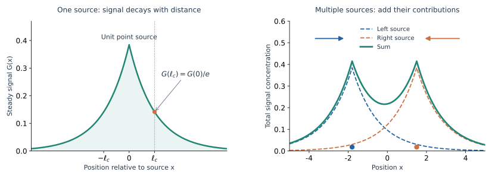

*Fig. 14. 信号作用长度与空间叠加。* 左边是单位点源的稳态响应：离开源 $\ell_c$ 后，信号降为峰值的 $1/e$。右边用两个单位点源说明叠加，虚线是各自贡献，绿实线是总浓度，箭头示意两侧细胞沿总浓度梯度向内漂移。取 $\alpha=\kappa=1$、$D_c=1.69$，所以 $\ell_c=1.3$；这里使用无限直线上的快速响应近似。

代回细胞通量，趋化部分成为

$$
J_{\rm chem}(x)\simeq\chi\alpha\rho(x)\,\partial_x
\int G(x-y)\rho(y)\,dy.
$$

于是能更具体地理解“间接相互作用”：位于 $y$ 的细胞产生一个向外衰减的信号峰，位于 $x$ 的细胞沿这个信号的梯度向 $y$ 漂移，影响随距离减弱。对一个余弦形的密度源，上面的场方程又给出 $B=\alpha A/(\kappa+D_cq^2)$，恰好回到第 4.4 节。空间中的作用范围与波数空间中对短波的削弱，是同一个化学传播过程的两种描述。

---

## 补充计算与参数比较 {#supplementary-calculations}

### 1. 有偏随机游走的均值与方差 {#calculation-1}

取 $p_+=0.6$、$p_-=0.4$，则

$\langle X_n-X_0\rangle=0.2na$，方差为 $na^2(1-0.2^2)=0.96na^2$。相对无偏过程，平均位移改变，方差系数也略有变化。

### 2. 位置依赖漂移的守恒形式 {#calculation-2}

周期边界条件下，$\frac{d}{dt}\int_0^L\rho\,dx=-[J(L)-J(0)]=0$。因此漂移项应写为 $-\partial_x(v\rho)$。当 $v(x)$ 不为常数时，只写 $-v\partial_x\rho$ 会漏掉 $-\rho\partial_xv$。

### 3. 固定化学场中的稳态分布 {#calculation-3}

零通量条件给出 $\rho_{\rm st}\propto e^{\chi c/D}$。当 $\chi\to0$ 时，趋化漂移消失，稳态趋于均匀分布。

### 4. 切断分泌或趋化响应 {#calculation-4}

在式（3.3）的模型中，$\alpha=0$ 或 $\chi=0$ 都会切断由细胞分泌吸引物形成的正反馈。不过，$\alpha=0$ 时若仍有外加的非均匀化学场 $c$，细胞仍可在外场驱动下积累。

### 5. 有限周期系统的阈值 {#calculation-5}

取 $L=20,D=0.3,D_c=1,\alpha=\kappa=\rho_0=1$，则 $\chi_c=(D/\alpha\rho_0)(\kappa+D_c(2\pi/L)^2)\simeq0.3296$。[Fig. 9](#fig-9) 中的 $\chi=0.15$ 位于稳定侧，$\chi=0.90$ 位于失稳侧。

### 6. 参数变化与数值结果 {#calculation-6}

`code/collective_1d.py` 中可以分别改变 $\chi$、$D$ 或 $\kappa$，比较密度起伏的增长。增大 $\chi$ 加强趋化响应，增大 $D$ 加强扩散平滑，增大 $\kappa$ 则缩短化学信号的寿命。第 4 节的判据可用于判断这些参数变化是否会跨过失稳阈值。

### 7. 化学物质扩散速度与聚集阈值 {#calculation-7}

保持其他参数不变，增大 $D_c$ 会增大 $\ell_c$，信号能传得更远。但对固定的非零波数，浓度起伏的响应 $B/A\simeq\alpha/(\kappa+D_cq^2)$ 反而减小：化学扩散也把局部的信号峰摊平了。

因此，有限系统的 $\chi_c=D[\kappa+D_c(2\pi/L)^2]/(\alpha\rho_0)$ 随 $D_c$ 增大而升高。无限大系统的长波阈值 $\Gamma=1$ 则不含 $D_c$，因为那里允许取任意小的 $q$。作用距离更远与局部起伏更容易放大，是两个需要分别计算的问题。

---

## 数值复现与参考文献 {#reproduction-and-references}

### 图像与数值复现 {#numerical-reproduction}

复现命令见[复现说明](README.md)。图像由下列脚本生成：

| 生成脚本 | 对应正文 | 图号 |
|---|---|---|
| `code/random_walk.py` | 随机迁移、均方位移与漂移 | Fig. 1、4、5 |
| `code/teaching_diagrams.py` | 概率收支、通量、化学响应与空间模式 | Fig. 2、3、6、11、14 |
| `code/fixed_field.py` | 固定吸引物场中的积累 | Fig. 7 |
| `code/feedback_diagram.py` | 细胞与化学场的反馈 | Fig. 8 |
| `code/collective_1d.py` | 聚集演化与增长率 | Fig. 9、10、12 |
| `code/collective_2d.py` | 二维早期聚集 | Fig. 13 |
| `code/make_all_figures.py` | 一键生成全部图片 | Fig. 1–14 |

细胞密度方程采用守恒通量和漂移迎风离散，化学场采用显式反应–扩散更新。脚本检查非负性和细胞总数守恒，边界为周期条件。模拟参数与初值由代码明确指定；这些数值结果用于展示模型机制。

### 参考文献与进一步阅读 {#references}

实验背景可先读 Berg 与 Brown 的单细胞追踪，以及 Budrene 与 Berg 的群体结构实验。随机运动到宏观输运的联系可结合 Keller–Segel、Schnitzer 与附录 A 阅读；随机积分约定与 Fokker–Planck 推导可继续参考 Dunkel 和 Bazant 的课程讲义。

1. **E. F. Keller & L. A. Segel (1971)**, “Model for chemotaxis,” *Journal of Theoretical Biology* **30**, 225–234. [DOI: 10.1016/0022-5193(71)90050-6](https://doi.org/10.1016/0022-5193(71)90050-6). —— 经典趋化通量模型；与本文从随机运动到通量的推导相关。
2. **H. C. Berg & D. A. Brown (1972)**, “Chemotaxis in *Escherichia coli* analysed by Three-dimensional Tracking,” *Nature* **239**, 500–504. [DOI: 10.1038/239500a0](https://doi.org/10.1038/239500a0). —— 对真实细菌改变游动方向这一现象的经典实验。
3. **E. O. Budrene & H. C. Berg (1991)**, “Complex patterns formed by motile cells of *Escherichia coli*,” *Nature* **349**, 630–633. [DOI: 10.1038/349630a0](https://doi.org/10.1038/349630a0). —— 细菌通过分泌吸引物形成斑点与条纹的实验现象。
4. **E. F. Keller & L. A. Segel (1971)**, “Traveling bands of chemotactic bacteria: A theoretical analysis,” *Journal of Theoretical Biology* **30**, 235–248. [DOI: 10.1016/0022-5193(71)90051-8](https://doi.org/10.1016/0022-5193(71)90051-8). —— 讨论消耗营养物所驱动的移动带，可与本文的分泌反馈模型比较。
5. **J. Dunkel**, *18.S995: Brownian motion*, Lecture 05, MIT. [课程讲义](https://math.mit.edu/~dunkel/Teach/18.S995_2017F/slides/lec05_BM.pdf). —— 随机轨迹、Itô／Stratonovich 约定与 Fokker–Planck 方程的对应。
6. **M. Z. Bazant**, *18.366: Random Walks and Diffusion*, MIT, 2006. [课程与讲义目录](https://math.mit.edu/classes/18.366/lec06/). —— 从离散随机游走到连续扩散、跳跃矩展开与细菌运动的课程背景。
7. **M. J. Schnitzer (1993)**, “Theory of continuum random walks and application to chemotaxis,” *Physical Review E* **48**, 2553. [DOI: 10.1103/PhysRevE.48.2553](https://doi.org/10.1103/PhysRevE.48.2553). —— 从带方向与转向过程的运动模型建立有效趋化输运；可继续阅读感知历史和运动统计之间的关系。
