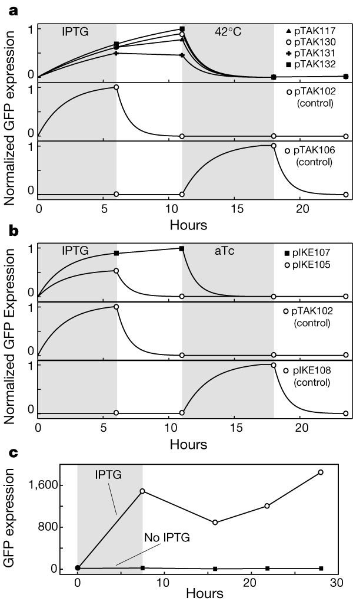
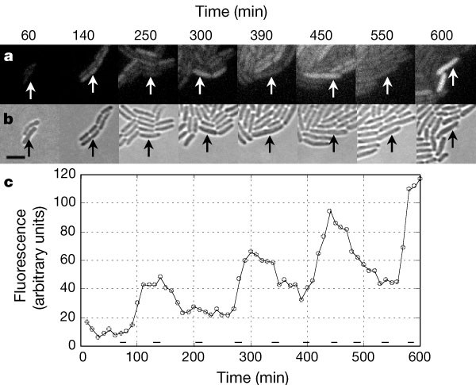

# 基因调控网络的理论：表达状态如何形成、维持与改变
## 分子不断更新，细胞怎样保留一次刺激的影响

> 西湖大学 2026 年秋季《定量生物学导论》课程学习笔记。

> **核心问题：** 一次短暂刺激为什么能留下持久的表达变化？维持这段记忆的分子不断更新，记忆又会在什么时候丢失？

## 概述 {#main-lecture}

给细菌一段诱导刺激，某个基因的表达升高。撤去刺激以后，表达会不会降回原来的水平？如果产生率恢复原样，多出来的分子逐渐被去除，表达就会回落。但如果这些分子能够促进自身的后续产生，一次短暂输入就可能改变细胞此后保持的表达状态。

[Gardner 等（2000）](https://doi.org/10.1038/35002131)在大肠杆菌中构建了一个可以检验这种想法的开关。它包含两种相互抑制的蛋白质 LacI 和 TetR：LacI 多时，TetR 难以产生；TetR 多时，LacI 难以产生。IPTG 和 aTc 分别削弱其中一方的抑制作用，让研究者能够暂时改变两者的竞争关系。绿色荧光蛋白 GFP 用于报告回路的表达状态。

*Fig. 1. 撤去诱导以后，细胞是否保留表达变化？* 引自 [Gardner 等（2000），原文 Fig. 4](https://www.nature.com/articles/35002131/figures/4)。a：LacI–温敏 CI 的 pTAK 系列；b：LacI–TetR 的 pIKE 系列。灰区为诱导时段，符号为测量点，a、b 的连线辅助显示切换过程。c：pTAK117 经 IPTG 诱导与未经诱导的两组细胞，随后在相同的无 IPTG 条件下培养。

先看 b 中两段灰区之间的记录。pIKE107 撤去 IPTG 后仍保持高 GFP，直到 aTc 输入将它切回低表达；pIKE105 则在撤去 IPTG 后回落。相同的调控结构可以得到不同的结果，说明仅知道“两种蛋白相互抑制”还不够，还需要知道它们的产生率、抑制强度和去除速度。c 做了另一项比较：后续环境相同，先前受过诱导与未受诱导的细胞仍有不同表达。这种对过去输入的依赖，就是本文要解释的表达记忆。

荧光在这里是观察回路的窗口，不必与决定状态的调控蛋白完全同步。一个稳定的报告蛋白可以在转录已经减弱以后继续发亮；相反，报告信号较弱也不等于调控作用已经消失。因此，撤去输入后保持荧光只是记忆问题的入口。接下来要说明的是：回路是否仍在补充维持该状态所需的分子，以及这种补充能否抵抗小扰动。

记忆并不要求最初的分子一直存在。mRNA 和蛋白质会持续产生、降解，当前的蛋白质却可以改变下一刻的转录率，让新分子接替旧分子的调控作用。问题在于，这样的补充能否维持两种不同状态，一次刺激怎样将细胞从一种状态推到另一种，以及反应的随机性会让它保持多久。

下面先从转录、翻译和去除写出表达方程，再比较自激活、互抑制与三基因抑制环。前两种回路帮助理解状态的维持与切换，第三种则说明反馈也可能使表达持续振荡。随后回到开关，计算刺激的幅度与时长、随机切换的寿命，并用单细胞观测区分几种看起来相似的表达行为。

较长的计算放在[技术附录](#technical-appendices)。[布尔网络](03_network_topics.md#network-response)、[前馈信号过滤](03_network_topics.md#feed-forward-topic)和[多基因景观](03_network_topics.md#landscape-and-flow)分别讨论大网络中的扰动、短输入的过滤与多维状态空间，可在正文之后阅读。

---

先暂时把分子反应的随机性放在一边，看平均产生与去除能否维持不同状态。若去除一点蛋白质后，系统会主动补回，它便具有恢复能力；若偏差反而被放大，就可能离开原来的状态。这个局部判断把分子的收支接到了开关与振荡的动力学上。

## 1. 从分子的产生与去除写出表达方程 {#expression-dynamics}

要解释 GFP 为什么能在撤去诱导后保持，先要分清“分子不变”与“分子数大致不变”。后者允许旧分子不断消失，只要新分子的补充能够跟上。表达方程记录的就是这笔收支。

### 1.1 分子更新与转录调控 {#state-and-turnover}

基因是一段 DNA，转录后产生 mRNA（信使 RNA），mRNA 再作为翻译蛋白质的模板。某些蛋白质可以结合调控 DNA，改变基因的转录率，这类蛋白质称为转录因子。先用 $m_i$ 和 $p_i$ 分别表示基因 $i$ 的 mRNA 与蛋白质水平，用 $u$ 表示外部信号。在固定体积下可以使用分子数；若使用浓度，还需将生长稀释计入去除。下面两条方程采用一致的计量方式。

沿单个细胞逐分子地看，产生与降解都是一次次离散事件。分子数足够多、相对涨落较小时，可以先用连续变量近似这些跳变，用单位时间的平均反应次数描述产生与去除。连续变量允许在两个整数之间取值，表示的是这种平滑后的水平。这样得到的方程适合先寻找表达状态和恢复趋势；它暂时略去的离散性，将在第 4 节重新成为问题。

最简单的连续时间方程为

$$
\begin{aligned}
\frac{dm_i}{dt}&=r_i(\mathbf p,u)-\delta_{m,i}m_i,\\
\frac{dp_i}{dt}&=k_i m_i-\delta_{p,i}p_i.
\end{aligned}
\tag{1.1}
$$

这里 $r_i$ 是转录产生率，$k_i$ 是翻译速率，$\delta_{m,i}$ 和 $\delta_{p,i}$ 是有效降解或稀释速率。调控网络体现在函数 $r_i(\mathbf p,u)$ 中。

第一行说，转录补充 mRNA，已有 mRNA 按比例被去除；第二行说，mRNA 越多，单位时间翻译出的蛋白质越多，蛋白质也持续被去除。网络的连线进入 $r_i(\mathbf p,u)$：例如，TetR 抑制 lacI，就意味着在其他条件相同时，TetR 增多会降低 lacI 的转录率。

去除项写成“速率常数乘以已有量”，相当于假设每个分子在短时间内有相同的被去除机会：分子多一倍，平均总去除速率就多一倍。翻译项也采用类似的加和，一个 mRNA 在寿命结束以前可以反复作为模板，翻译本身不在这里消耗它。若降解酶已经饱和，或者翻译资源随表达明显改变，这种简单比例就需要修正。先采用线性去除，能够把注意力集中到调控如何改变产生率上。

生长和分裂还会改变“去除”的含义。若变量表示浓度，细胞体积增加本身就能稀释蛋白质，未必发生了化学降解；对称分裂时分子数约减半，浓度却可以基本延续。若变量表示分子数，同一次分裂又会留下明显跳变。研究跨代保持的表达状态，必须沿用同一种计量方式，否则由分配造成的数量下降，可能被误认成反馈开关已经关闭。

这里的**状态**是某一时刻各分子水平组成的向量，例如“LacI 高、TetR 低”。当每一种分子的产生与去除都平衡时，各变量不再随时间改变，称为**固定点**。固定点是否稳定，还要看稍微偏离以后会发生什么：如果偏差逐渐减小，轨迹回到原来的水平，这个固定点才是稳定的。

因此，开关保存表达状态，要求回路不断合成调控蛋白，并在分子数偏离时将它拉回来。接下来先描述转录因子怎样改变产生率，再计算这种恢复作用。

先将转录因子对基因的作用简化为调控位点上的结合。把一个有效结合过程写成 $P+nX\rightleftharpoons PX_n$，其中 $P$ 是游离启动子，$PX_n$ 是结合态。如果结合和解离快于表达量的变化，在当前浓度 $x=[X]$ 下，两种状态的比例可近似写成 $[PX_n]/[P]=(x/K)^n$。

这个时间顺序让调控可以暂时被画成一条静态曲线：蛋白质水平还没来得及明显改变，位点已经经历多次结合与解离，下游看到的是这些状态的平均作用。于是给定当前蛋白浓度，就能近似指定当前平均产生率。若一次结合状态保持得和表达变化一样久，仅用浓度还不足以决定后续反应，就需要把位点状态也作为变量保留下来。

占据率回答的是：观察许多同样的启动子，或观察一个足够快切换的启动子，有多少比例处于结合状态？将结合态除以启动子总量，就得到

$$
\theta(x)
=\frac{[PX_n]}{[P]+[PX_n]}
=\frac{x^n}{K^n+x^n}.
\tag{1.2}
$$

低浓度时，启动子大多处于游离态；浓度升高后，结合态所占比例增加；当启动子接近饱和，继续增加转录因子的效果就逐渐减弱。若结合态更容易招募转录机器，可以用占据率给基础转录增加一个诱导项：

$$
r_{+}(x)=r_{\min}+(r_{\max}-r_{\min})\frac{x^n}{K^n+x^n};
\tag{1.3}
$$

若结合阻碍转录，能够产生转录本的机会则随游离比例减少。用同一组参数表示，得到相反方向的响应：

$$
r_{-}(x)=r_{\min}+(r_{\max}-r_{\min})\frac{K^n}{K^n+x^n}.
\tag{1.4}
$$

这里 $K$ 是产生率达到基础值与最大值中点时的浓度，$n$ 控制响应在这个范围内有多陡。对归一化的激活函数，$x=K$ 处的斜率为 $n/(4K)$。增加转录因子浓度，是沿同一条曲线移动；改变结合强度或协同性，则会改变曲线本身。反馈的效果取决于这条曲线的斜率，后面将直接用到它。

Fig. 2B、C 比较了不同的 $n$：较大的 $n$ 使响应集中在更窄的浓度范围内。在上述有效结合模型中，$n$ 来自结合反应的写法；拟合真实转录响应时，它通常只是描述曲线陡峭程度的有效参数，不能直接据此数出结合的蛋白质个数。

### 1.2 有效表达方程与反馈回路 {#effective-expression-equation}

只考虑一种蛋白质时，式（1.1）成为 $\dot m=r(p)-\delta_m m$ 和 $\dot p=km-\delta_p p$。两条方程记录了两个先后发生的过程：转录先补充 mRNA，翻译再把这一变化传给蛋白质。

若 mRNA 的弛豫很快，即 $\delta_m\gg\delta_p$，在蛋白质明显改变以前，mRNA 已接近当前转录率对应的水平 $m\simeq r(p)/\delta_m$。将它代入蛋白质方程，得到 $\dot p\simeq (k/\delta_m)r(p)-\delta_p p$。这里 $k/\delta_m$ 有直接的分子含义：一个平均寿命为 $1/\delta_m$ 的 mRNA，平均可以翻译出 $k/\delta_m$ 个蛋白质。

用阈值浓度 $K$ 衡量蛋白质水平，令 $x=p/K$；再以蛋白质的更新时间衡量时间，令 $\tau=\delta_p t$。这样，蛋白质产生与去除的竞争可以写成

$$
\frac{dx}{d\tau}=F(x)-x,
\qquad
F(x)=\frac{k\,r(Kx)}{\delta_m\delta_p K}.
\tag{1.5}
$$

式中 $x$ 和 $\tau$ 都无量纲，去除项的系数因而成为 1。$F(x)\gt x$ 时表达上升，$F(x)\lt x$ 时表达下降；将无量纲时间乘回 $\delta_p^{-1}$，才得到实际经过的时间。推广到多基因网络，就得到后文反复使用的形式：

$$
\boxed{\frac{dx_i}{d\tau}=F_i(x_1,\ldots,x_N;u)-\gamma_i x_i.}
\tag{1.6}
$$

其中 $F_i$ 汇总其他变量对基因 $i$ 产生率的影响，$\gamma_i$ 是相对于所选时间单位的去除速度。即使调控边完全相同，改变翻译效率或分子寿命，也会改变产生与去除的平衡位置。

无量纲化还给产生强度一个可比较的尺度：在一个蛋白质更新时间内，细胞能补充多少个阈值浓度单位？同样的合成速率，若蛋白质去除更快，就未必能积累到有效调控所需的浓度。因此，图中增大无量纲产生强度，可以对应增强合成，也可以对应延长分子寿命；把模型参数对应回一次具体实验时，要辨认实际改变了哪一项。

这个近似省略了 mRNA 的独立变化过程。转录减弱后，已有 mRNA 仍会翻译，已有蛋白质也要逐渐被去除；若 mRNA 与蛋白质寿命相近，就不能将这段等待压缩掉。[第 2.2 节](#expression-delay)讨论表达延迟时会再保留这些步骤。

消去 mRNA 以后，模型可以正确给出某些稳态，却仍可能给错快速扰动的回程。稳态只要求平均补充恰好平衡去除，动态响应还要问补充的改变经多长时间才到达蛋白质。一次短刺激若短于被消去变量的更新时间，两变量模型与单变量模型便可能明显不同。因此，使用简化方程时，应将它与准备比较的刺激持续时间一起考虑，而不能只用两套模型的固定点相同来证明近似足够。

在一个给定状态 $\mathbf x$ 附近，可以用偏导数 $J_{ij}^{(\mathrm{reg})}=\partial F_i/\partial x_j$ 描述一条调控边：稍微增加基因 $j$ 的产物，基因 $i$ 的产生率会怎样变化？

若 $J_{ij}^{(\mathrm{reg})}\gt 0$，则 $j\to i$ 是局部激活；若小于零，则是局部抑制。沿一个闭合回路，把所有边的符号相乘：

- 结果为正，称为**正回路**（例如一个自激活，或两个基因相互抑制）；
- 结果为负，称为**负回路**（例如三个基因依次相互抑制）。

Thomas 反馈回路原则把这些符号与动力学联系起来：在相应的调控动力学框架下，多稳态需要正回路，持续振荡需要负回路 [Thomas（1994）](https://doi.org/10.1002/bbpc.19940980916)、[Thieffry（2007）](https://academic.oup.com/bib/article/8/4/220/221430)。正回路让某个变化绕行一周后得到同方向的加强；负回路让变化绕行一周后受到反向纠正。实际的放大或纠正有多强、来得有多快，则由响应曲线与各级的时间尺度决定。

*Fig. 2. 反馈结构与 Hill 响应。* A：箭头表示激活，横杠表示抑制。B、C：式（1.3）、（1.4）在 $n=1,2,4$ 时的归一化曲线，半响应点均为 $x=K$。

两条抑制边为何可能维持表达偏向，而三条抑制边又为何可能产生起伏？回路的正负给出初步判断，但还不能确定结果。下面把产生曲线与去除项放在一起，计算平衡点的数目和小扰动的变化。

---

## 2. 反馈怎样维持两种状态，又怎样产生振荡 {#feedback-memory}

先把外部信号固定，问细胞在这种环境中能够保持哪些表达水平。若不同的初值都趋向同一个稳定固定点，诱导造成的差异最终就会消失。要用两种稳定表达水平保留不同的准备历史，回路需要允许两种稳定状态。

### 2.1 自激活与互抑制：稳定状态的形成 {#self-activation}

先用一个基因计算：它的产物促进自身表达，产生率在高浓度时饱和，去除率与浓度成正比。令点号表示对无量纲时间求导，采用

$$
\boxed{\dot x=b+\alpha\frac{x^n}{1+x^n}-x\equiv f(x),\qquad b\gt0.}
\tag{2.1}
$$

时间以蛋白质更新时间衡量；$b$ 是基础表达，$\alpha$ 是诱导产生强度，$n$ 控制响应陡峭程度。基础表达让低态仍有分子补充；在对应的出生–死亡模型中，它还保证零分子数可以重新产生分子。若设 $b=0$，零态会成为吸收态，后面讨论的双向随机切换就不再成立。因此解析上方便的零基础表达极限放在[附录 A.1](#activation-threshold)。

固定点是产生曲线 $F(x)=b+\alpha x^n/(1+x^n)$ 与去除直线 $x$ 的交点。令 $x=x^*+\delta x$，在交点附近保留偏差的一阶项，得到 $\dot{\delta x}\simeq[F'(x^*)-1]\delta x$。因此

$$
\delta x(t)\simeq\delta x(0)e^{[F'(x^*)-1]t}.
$$

若稍微增高表达后，去除增加得更快，偏差就衰减；若产生增加得更快，偏差就增长。由此得到

$$
\boxed{f'(x^*)=F'(x^*)-1,\qquad
\tau_{\rm relax}=\frac{1}{1-F'(x^*)}\quad(F'(x^*)\lt1).}
\tag{2.2}
$$

$\tau_{\rm relax}$ 是小扰动衰减到原幅度 $1/e$ 所需的时间。即使有自激活，只要产生曲线处处比去除直线更平缓，就只有一个稳定交点；反馈只改变恢复速度。要出现两个稳定交点，中间必须有一段产生斜率超过去除斜率，再由饱和将斜率压低。在这个 Hill 模型中，$n=1$、$b\gt0$ 只有一个正固定点；足够的非线性增益才允许双稳态。

沿浓度从低到高看，三个区域各承担了不同作用。低浓度时，自激活尚弱，基础产生与去除可以维持一个低水平；进入敏感区后，新增蛋白带来的产生增量超过去除增量，偏差被继续放大；到高浓度时，产生率逐渐饱和，去除却仍随浓度增长，表达终于又能停下来。高态能够停在有限的表达水平，依靠的是放大与限制同时存在。若只画一条不断增强的正反馈箭头，就看不到这两个作用如何配合。

例如，始终取 $b=0.02,n=2,\alpha=2.5$，求解 $f(x)=0$ 得到

$$
\boxed{x_L\simeq0.0211,\qquad x_U\simeq0.4659,\qquad x_H\simeq2.0329.}
\tag{2.3}
$$

外侧两点满足 $f'\lt0$，偏差会衰减；中间点满足 $f'\gt0$，偏差会增长。最终趋向同一个稳定点的所有初值，组成它的**吸引域**。这里 $x_U$ 将两个吸引域分开：左侧初值趋向 $x_L$，右侧初值趋向 $x_H$。这种在相同参数下存在两个稳定固定点的情形称为**双稳态**。诱导前后若落在不同的吸引域，即使后续环境相同，最终表达也会不同。

*Fig. 3. 同一更新机制支持两种表达状态。* 式（2.1）取 $b=0.02,n=2,\alpha=2.5$。A：实心点稳定，空心点为 $x_U$；相线箭头给出净变化方向。B：阈值两侧的初值分别趋向低态和高态。

从低态出发，一次刺激若只使表达升高到 $x_U$ 左侧，撤去后仍会回落；若将它推到右侧，后续自激活就能将它带到高态。第 3 节计算刺激要持续多久才能完成这一跨越。先看开头实验中的两种蛋白如何通过互相抑制实现类似的维持。

令 $x$ 与 $y$ 为两种互相抑制对方表达的转录因子：

$$
\boxed{
\begin{aligned}
\dot x&=\frac{\alpha}{1+y^n}-x,\\
\dot y&=\frac{\alpha}{1+x^n}-y.
\end{aligned}}
\tag{2.4}
$$

增加 $x$ 会抑制 $y$，而 $y$ 的减少又解除对 $x$ 的抑制。因此，两条负边构成**整体正反馈**。

这正是 LacI–TetR 开关的基本关系。为便于计算，这里让两种蛋白具有相同的最大产生率、阈值和去除率；真实构建中的参数可以不同。若 $x$ 最初只比 $y$ 多一点，互相抑制会消除这点差异，还是会使它越来越大？

取 $n=2$，两个稳态平衡条件相减，得到

$$
x-y+xy^2-yx^2=(x-y)(1-xy)=0.
\tag{2.5}
$$

因此，固定点或者位于对角线 $x=y=s$，满足 $s(1+s^2)=\alpha$，或者满足 $xy=1$。在后一种情况下，$x+y=\alpha$，两种非对称状态为

$$
\boxed{
(x,y)=\left(\frac{\alpha+\sqrt{\alpha^2-4}}2,
\frac{\alpha-\sqrt{\alpha^2-4}}2\right)
}
\tag{2.6}
$$

以及交换 $x,y$ 后的另一个解。它们从 $\alpha=2$ 开始出现。

稳定性需要同时检查两个表达方向。固定点附近有两种自然的扰动：$x,y$ 一起增减，以及一个增大、另一个减小。记对称点处的抑制斜率绝对值为 $g=2s^2/(1+s^2)$，这两种扰动的增长率分别是 $\lambda_{\rm sym}=-1-g$ 与 $\lambda_{\rm antisym}=-1+g$。共同变化始终衰减，表达差则在 $g\gt1$ 后增长；这对应 $\alpha\gt2$，此时对称点变为鞍点。两个非对称点都稳定，因而

$$
\boxed{
\alpha\lt 2:\ \text{唯一对称稳定态};
\qquad
\alpha\gt 2:\ \text{两个稳定非对称态 + 一个对称鞍点}.
}
\tag{2.7}
$$

完整的雅可比矩阵与两个扰动模态的计算见[附录 B](#appendix-b)。

这两个方向在分子上也很好区分。若两种蛋白同时偏高，它们都会更强地抑制对方，补充减少，去除便把共同的升高压回去。若只是 $X$ 略高、$Y$ 略低，$Y$ 的减少却会解除对 $X$ 的抑制，原有差别得到加强。所以同一个互抑制回路可以一边限制总水平，一边放大两者的差异。它要保持的是表达偏向，并不需要让所有方向的扰动都增长。

$\alpha=2$ 为理想对称模型的临界值，发生对称性破缺。由于模型在交换 $x\leftrightarrow y$ 下不变，两个稳定态成对出现；在真实网络中轻微的参数不对称会偏好其中一侧，但未必立即消除双稳态。

在合成开关中，改变核糖体结合位点可以调整两种抑制蛋白的合成强度，对应将共同的 $\alpha$ 拆成 $\alpha_x,\alpha_y$。两支表达过于失衡时，零流线的位置会偏移到只剩一个交点，一方始终占优。[Gardner 等（2000）](https://doi.org/10.1038/35002131)的不同构建确实出现了双稳态与单稳态两种行为。调节表达强度因而能够直接改变细胞可保持的状态数。

*Fig. 4. 互抑制开关的相平面与分岔。* 式（2.4）取 $n=2$。A、B：$\alpha=1.5,3$ 时的零流线、轨迹与固定点，B 中 $x=y$ 分开两个吸引域。C：表达差 $x^*-y^*$ 在 $\alpha=2$ 处发生叉形分岔。

Fig. 4 的横、纵坐标分别是 $x,y$，平面上的一个点就是一组表达水平，随时间移动的点连成轨迹。蓝色曲线满足 $\dot x=0$，橙色曲线满足 $\dot y=0$，称为**零流线**；两条线的交点同时满足两个平衡条件。跨过一条零流线，对应变量的变化方向就会改变。在 $\alpha=3$ 时，初值只要略偏向 $x\gt y$，这种优势就会沿反对称方向放大，最终落入 $X$ 高的稳定态。沿 $x=y$ 的共同增减仍然会衰减，因此中间的对称点有一个稳定方向和一个不稳定方向，正是鞍点的几何特征。

零流线也不是轨迹必须沿着走的导轨。把状态恰好放在蓝线上，只表示此刻第一种蛋白质的净变化为零；第二种蛋白质仍可增加或减少，下一刻就会改变第一种蛋白质的产生条件，使轨迹离开蓝线。只有两条零流线相交，两个变量才同时满足平衡。这个读图方式让我们能从相平面判断一次刺激后的回程，而不把“某个变量暂时不变”误认为系统已经停在稳态。

这个结果还会影响怎样观察开关。沿首先失稳的反对称方向，$x$ 增加、$y$ 减少，两者总量在一阶近似下可以几乎不变，表达差却已经增长。若把两个通道简单相加，就可能漏掉状态选择的开始。分别记录两种蛋白，或看它们的表达差，才与这里算出的不稳定方向对应。稳定性分析因此也告诉我们，哪个观测量最能显示正在发生的变化。

在这个开关中，持续增大的表达差最终被响应饱和限制在两个稳定水平。如果沿环再加入第三个抑制基因，$x$ 升高引起的变化绕一周后却会回来压低 $x$。这时表达是否还能停在一种偏向上，需要重新检查扰动。

### 2.2 抑制环与表达延迟：振荡的形成 {#feedback-modes}

从开关走向振荡，还要保留变化传回来所需的时间。一个只有即时自抑制的单变量方程，在表达高一点时立刻减少产生，通常只是将偏差拉回；平滑的一维自治方程也无法沿闭合轨道反复绕行。让反馈经过其他分子变量以后，当前的抑制就可能仍在回应更早的状态。表达已经下降，抑制却还没解除，随后又可能反向超调。这里先通过多个调控环节保留这段历史，再计算它何时足以维持起伏。

把各条抑制边在对称固定点附近的斜率绝对值都记作 $g$，并令各变量具有相同的单位去除率。无论是两基因互抑制还是三基因抑制环，小扰动都满足

$$
\dot\eta_i=-\eta_i-g\eta_{i-1},\qquad i\pmod N,
\qquad \lambda_k=-1-g e^{-2\pi\mathrm i k/N}.
\tag{2.8}
$$

这里“模态”指各个基因按固定比例或相位共同变化的一种扰动形状。每个模态的特征值 $\lambda$ 决定它增长还是衰减，以及是否同时旋转。计算见[附录 C.3](#ring-parity)。

| 抑制环 | 最先可能增长的模态 | 线性增长率 | 非线性演化的可能结果 |
|---|---|---|---|
| $N=2$ | 反对称实模态：一个升高、另一个降低 | $-1+g$，在 $g=1$ 越过零 | 表达差异被放大，可形成两个互斥稳定态 |
| $N=3$ | 共轭复模态：三个变量错相变化 | $-1+g/2\pm\mathrm i\sqrt3g/2$，在 $g=2$ 穿过虚轴 | 错相扰动增长，可形成周期运动 |

两基因时，$(+,-)$ 的表达偏向绕一周仍与自身一致，可以被反复加强。三基因时，无法让每一对相邻变量都一高一低；最容易增长的扰动带有相位差，三个变量的峰值依次出现。表中的虚部表示这种周期变化的角频率，实部表示振幅增长或衰减的速率。两基因开关放大表达差，三基因环则可能放大错开时间的表达起伏。

这里比较的是相同去除率、相同局部增益的理想环；不对称参数与额外表达步骤会移动阈值。线性模态只判定固定点如何失稳，最终是否有稳定双稳态或稳定周期轨道，仍要检验非线性。互抑制模型的两个非对称解已经通过稳定性检验；下面对三基因环作同样的区分。

这一比较还区分了改变初始状态与改变网络参数。给固定参数的回路一个短脉冲，是看原有吸引域怎样组织回程；持续改变合成或去除，则可能移动固定点，甚至改变吸引子的数目。一组不同初值的时间轨迹可以揭示多稳态，却不能替代参数扫描；一条参数扫描曲线出现跃迁，也还要结合回程和等待时间解释。两种操作分别检验状态空间与状态空间本身的改变。

三基因环形抑制振荡器（repressilator）由三种依次抑制对方表达的蛋白质构成，沿环依次为 $X_1\dashv X_2$、$X_2\dashv X_3$、$X_3\dashv X_1$。

三个负边相乘，整体构成负反馈回路。令 $x_0\equiv x_3$，其对称模型写为

$$
\boxed{
\dot x_i=\frac{\alpha}{1+x_{i-1}^{n}}-x_i,
\qquad i=1,2,3\pmod 3.
}
\tag{2.9}
$$

[Elowitz 和 Leibler（2000）](https://doi.org/10.1038/35002125) 在大肠杆菌中用三个转录抑制系统构建了 repressilator，并通过荧光报告观察单细胞的周期表达；其振荡周期可长于细胞分裂周期，表达状态因而能跨代延续。

*Fig. 5. 活细胞中的人工振荡回路。* 引自 [Elowitz 和 Leibler（2000），原文 Fig. 2](https://www.nature.com/articles/35002125/figures/2)。a、b：同一微菌落的荧光与明场图，箭头标出各时刻被追踪的细胞。c：沿细胞分裂延续的 GFP 荧光密度记录，底部短横线标记分裂事件；图像比例尺为 $4\,\mu\mathrm m$。

实验中用绿色荧光蛋白 GFP 报告回路的表达状态。先对照 Fig. 5a、b：明场图显示细胞的位置、生长与分裂，荧光图显示报告信号的强弱；再看 c，追踪记录在分裂后沿后代细胞继续延伸。

c 中的 GFP 多次升高又降低，相邻峰之间可以跨越多次分裂。这说明表达周期并不只是随细胞分裂重复。峰高和峰间距也并不完全相同，因此下面的确定性模型只先解释持续起伏怎样出现；若要解释各轮之间的差别，还需要加入分子噪声。

GFP 在这里将回路的调控状态转换为可测荧光。要把时间轴上的峰间距与模型联系起来，需要同时考虑转录因子的合成、去除以及报告蛋白的响应时间。下面先用三个浓度变量保留反馈环的核心过程，看持续振荡怎样从固定点附近产生。

这个环的运行可以从 $X_1$ 偏高开始理解：$X_2$ 受到抑制后逐渐减少，$X_3$ 随之解除抑制而升高，升高的 $X_3$ 又压低 $X_1$。每一个环节都要等待原有蛋白质减少或新蛋白质积累，于是三个变量依次到达峰值，形成沿环传播的表达波。

尤其要留意“抑制以后逐渐减少”这一步。抑制转录先改变的是后续补充，已经存在的蛋白质仍能继续作用；只有等它降到足够低，下一个基因才明显解除抑制。网络图上的边看起来没有长度，沿边传递的反应却有等待时间。各条曲线的峰错开，正是这些分子更新时间在观测上的表现。

对称表达时，三个基因都处于同一水平 $s$，产生与去除的平衡给出 $\alpha=s(1+s^n)$。这个关系对 $s\gt 0$ 单调递增，所以每个给定的 $\alpha$ 都对应唯一的对称固定点。

但这个平衡能否保持，还要看一个基因先升高以后，绕环返回的响应会怎样改变这次扰动。

将每一条抑制边在固定点附近的斜率绝对值记为 $g$。它衡量一次小幅表达变化能在下一个环节引起多大变化：$g$ 小时，变化在传递中被削弱；$g$ 大时，后续环节对同样的输入差异反应更强。利用固定点条件可写成

$$
\boxed{g=\frac{n s^n}{1+s^n}.}
\tag{2.10}
$$

对三个基因的线性扰动，有一个共同变化的模态，以及一对错相变化的模态，特征值分别为

$$
\boxed{
\begin{aligned}
\lambda_0&=-1-g,\\
\lambda_{1,2}&=-1+\frac g2\ \pm\ \mathrm i\frac{\sqrt3 g}{2}.
\end{aligned}}
\tag{2.11}
$$

共同模态始终衰减。另两个模态一边以虚部给出的频率旋转，一边按实部决定振幅是缩小还是增长；当 $g$ 足够大，旋转中的扰动便可以摆脱固定点。环形模态的推导见[附录 C](#appendix-c)。

复特征值的实部为 $-1+g/2$，因此 $g=2$ 是由衰减转为增长的临界位置。又因为 $g=ns^n/(1+s^n)\lt n$，这个三变量模型需要 $n\gt 2$ 才能达到该阈值。响应曲线足够陡，环路传回的纠正才可能强到将状态推过平衡位置，形成下一轮超调。

在阈值处令 $g=2$，可得 $s_H^n=2/(n-2)$；将它代入对称表达的平衡关系，就得到临界表达强度：

$$
\boxed{
\alpha_H=\frac{n}{n-2}
\left(\frac{2}{n-2}\right)^{1/n},
\qquad n\gt 2.
}
\tag{2.12}
$$

为什么只把产生强度调得很大还不够？增大 $\alpha$ 也会抬高固定点 $s$，局部增益 $g$ 最多趋近 $n$，无法无限增加。因此在这个三变量模型中，$n\le2$ 时，无论怎样提高产生能力，都达不到振荡阈值。若保留 mRNA 或其他延迟环节，反馈的相位关系会改变，需要重新算阈值；这里对 $n$ 的要求来自这套被简化后的反应步骤。

例如 $n=3$ 时，$\alpha_H=3\,2^{1/3}\simeq3.78$。低于它时，一次偏离可以让三个变量起伏几轮，但振幅会逐渐消失；越过它以后，固定点开始放大错相扰动。Fig. 6A、B 将这两种时间行为并排展示。

临界点的虚部给出角频率 $\omega_H=\sqrt3$，对应无量纲周期 $T_H=2\pi/\sqrt3$。若时间单位为蛋白质的更新时间 $\delta_p^{-1}$，物理周期便是 $2\pi/(\sqrt3\delta_p)$。在保持无量纲参数相同的比较中，蛋白质更新越慢，整个环绕行一周所需的物理时间越长。

这里还存在两种不同的时间尺度：振荡一轮要多久，由虚部决定；扰动的振幅经过多少轮才明显减小或增大，则由实部决定。接近阈值时，实部接近零，所以衰减的振荡可以持续较长时间。远离阈值后，轨迹会探索响应曲线的更大范围，振幅与周期都进一步受到非线性影响。

式（2.11）–（2.12）证明了：当 $\alpha$ 增大并穿过阈值时，对称固定点的一对共轭特征值穿过虚轴；在满足 Hopf 分岔通常的非退化条件时，附近会出现周期解。

固定点附近的扰动开始增长后，决定长期行为的是振幅如何受到非线性限制。Hopf 附近常将振幅 $A$ 写成 $\dot A=\mu A-cA^3+\cdots$：$\mu$ 描述线性增长，$c$ 描述振幅增大后的修正。在 $c\gt 0$ 的超临界情形，增长在 $A\simeq\sqrt{\mu/c}$ 处被平衡，形成稳定的小振幅周期轨道；$c\lt 0$ 时则要考察更高阶项和更远处的轨道。$c$ 的符号来自非线性分析，Fig. 6B 则展示本文方程在一组具体参数下形成的持续振荡。

*Fig. 6. 衰减响应、周期轨道与 Hopf 边界。* A、B：式（2.9）取 $n=3$、初值 $(1.1,1.2,0.9)$，比较 $\alpha=3,6$。C：三维轨迹在 $(x_1,x_2)$ 平面的投影，橙线取 $t\ge60$。D：式（2.12）给出的对称固定点线性稳定性边界。

持续振荡也未必在群体平均荧光中留下周期。若每个细胞都有起伏，却在不同时间到达峰值，平均时这些变化就会部分抵消；相位逐渐散开，还能让群体曲线的振幅随时间减小。要区分“单细胞振荡停止了”与“细胞之间不再同步”，需要保留单细胞轨迹，比较每条轨迹的峰间距及不同细胞的相位关系。只看一条平均曲线，会把这两种动力学混在一起。

稳定振荡中的“稳定”与固定点中的稳定也有区别。偏离固定点后，轨迹要回到同一个表达组合；偏离周期轨道后，它可以回到相同的绕行，却沿着周期提前或落后一段。因而振幅能受到恢复，峰值出现的时刻仍可逐渐散开。观察两条相位不同的持续轨迹，不应仅凭它们在同一时刻表达差很大，就断言振荡器缺少稳定性。

三基因环将响应分散在三个调控步骤中。同一个基因的 mRNA 合成、加工和蛋白质更新，也可以提供反馈返回所需的时间。保留 mRNA 和蛋白质后，每个环节的线性响应会出现 $(\lambda+\delta_m)(\lambda+\delta_p)$ 两个动态因子；相对于只保留蛋白质的模型，多一级分子过程就多一份幅度衰减和相位滞后，计算见[附录 C.2](#mrna-stability)。

[Hirata 等（2002）](https://doi.org/10.1126/science.1074560)在血清刺激的培养细胞中观察到约两小时周期的 Hes1 mRNA 和蛋白表达变化。Hes1 蛋白抑制自身转录，其降解又解除这层抑制，使下一轮表达得以开始。在 [Monk（2003）](https://doi.org/10.1016/S0960-9822(03)00494-9) 的延迟模型中，转录及 RNA 加工等步骤的等待时间与 mRNA、蛋白寿命共同决定振荡周期。三基因环通过连续的调控环节积累滞后，Hes1 模型则保留单个基因表达过程内部的延迟；两者都把负反馈与分子的更新时间联系起来。

在 Hes1 这样的自抑制回路中，mRNA 与蛋白质的相对变化尤其有意义：mRNA 的减少先降低后续蛋白质的补充，已有蛋白质则在一段时间内继续抑制转录。等到蛋白质下降，转录才重新增强。因而，一条蛋白质起伏曲线可以进一步拆成转录响应、翻译积累和去除三个阶段；同时观察 mRNA 和蛋白质，有助于找出周期中主要的等待发生在哪里。

合成开关与 repressilator 说明，持续更新的分子既可以维持固定表达，也可以维持周期变化。回到开关实验：即使回路允许高、低两态，短刺激也未必足以将细胞切到另一态。下面固定回路本身，计算刺激对轨迹的推动。

---

同一张回路图并不唯一决定细胞的行为。反馈强度、去除速度和响应延迟共同决定固定点是否稳定，或者扰动会不会变成持续振荡。对于能够保留两种状态的开关，下一步才是一个操作问题：刺激需要多强、持续多久，才能真正改变细胞此后停留的状态？

反馈阈值、固定点与振荡模态

## 技术附录 {#technical-appendices}

以下集中给出正文所用的分岔条件、稳定性模态、表达噪声和化学逃逸计算。

### 附录 A. 自激活的反馈阈值与折叠边界 {#appendix-a}

这里补充 Fig. 7 所用的固定点出现条件和参数边界。

**A.1 一般 Hill 指数下的阈值**

更一般地，仍取 $b=0$，但允许 $n\gt 1$。正的固定点需要满足

$$
\alpha=\frac{1+x^n}{x^{n-1}}=x+x^{1-n}.
\tag{A.1}
$$

将右边视为 $x\gt 0$ 的函数，求导得 $d\alpha/dx=1-(n-1)x^{-n}$。它在 $x_c^n=n-1$ 时达到极小值，对应产生曲线刚好接触降解直线的位置。

代回去，得到两个正固定点出现的临界值

$$
\boxed{\alpha_c=n(n-1)^{-(n-1)/n},\qquad n\gt 1.}
\tag{A.2}
$$

$n=2$ 时，$\alpha_c=2$。这是零基础表达极限中新正固定点出现的阈值；正文采用 $b\gt0$，折叠边界见下文。

特别地，$b=0,n=2$ 时，除 $x=0$ 外的固定点来自 $x^2-\alpha x+1=0$：

$$
x_\pm=\frac{\alpha\pm\sqrt{\alpha^2-4}}2,\qquad \alpha\gt2.
\tag{A.3}
$$

代入固定点条件，$f'(x_\pm)=[1-x_\pm^2]/[1+x_\pm^2]$，所以 $x_-$ 不稳定、$x_+$ 稳定，零点始终稳定。这个极限方便解析计算，但零分子吸收态与缺少有限的上跳阈值，限制了它对随机记忆和完整迟滞的描述。

当 $n=1$ 且 $b=0$ 时，$f(x)=\alpha x/(1+x)-x$ 只有 $x=0$ 和至多一个正固定点；一般并不存在上述意义的两种稳定表达状态。**反馈增益和非线性缺一不可。**

**A.2 基础表达与两条折叠曲线**

启动子在低表达状态下仍可能偶尔产生转录本。用 $b\gt 0$ 描述这部分基础表达，返回式（2.1），固定点条件及折叠点条件分别为

$$
b+\alpha\frac{x^n}{1+x^n}-x=0,
\qquad
\alpha\frac{n x^{n-1}}{(1+x^n)^2}-1=0.
$$

消去 $\alpha$，用折叠处的 $x$ 参数化分岔边界，得到

$$
\boxed{
\alpha_{\rm fold}(x)=\frac{(1+x^n)^2}{n x^{n-1}},
\qquad
b_{\rm fold}(x)=\frac{x}{n}(n-1-x^n).
}
\tag{A.4}
$$

在 $n=2$ 时，$b_{\rm fold}=x(1-x^2)/2$ 的极大值位于 $x=1/\sqrt3$。代回两条参数式，得到尖点 $b_c=1/(3\sqrt3)$、$\alpha_c=8\sqrt3/9$，与 Fig. 7B 的汇合位置一致。

### 附录 B. 互抑制开关的固定点与稳定性 {#appendix-b}

**B.1 固定点的两类解**

令 $n=2$。稳态满足

$$
x(1+y^2)=\alpha,
\qquad
y(1+x^2)=\alpha.
\tag{B.1}
$$

两式相减，利用主文式（2.5）得 $(x-y)(1-xy)=0$。

因此稳态只能属于两类：

**第一类：对称稳态 $x=y=s$。**

$$
s(1+s^2)=\alpha.
\tag{B.2}
$$

对任意 $\alpha\gt 0$，该方程有唯一正解。

**第二类：非对称稳态 $xy=1$。**

将 $xy=1$ 代入式（B.1），得到 $x+y=\alpha$，求解后即为主文式（2.6）的两个非对称固定点。

**B.2 共同模态与反对称模态**

系统（2.4）在 $n=2$ 时的雅可比矩阵（Jacobian matrix）为

$$
J(x,y)=
\begin{pmatrix}
-1&-\dfrac{2\alpha y}{(1+y^2)^2}\\[5pt]
-\dfrac{2\alpha x}{(1+x^2)^2}&-1
\end{pmatrix}.
\tag{B.3}
$$

在对称稳态 $x=y=s$ 处，两条抑制边具有相同的局部增益 $g=2\alpha s/(1+s^2)^2=2s^2/(1+s^2)$；第二个等号利用了平衡关系 $s(1+s^2)=\alpha$。因此，线性化矩阵简化为

$$
J_s=\begin{pmatrix}-1&-g\\-g&-1\end{pmatrix},
$$

其两个特征向量分别是 $(1,1)$ 和 $(1,-1)$，特征值为

$$
\boxed{\lambda_{\rm sym}=-1-g,
\qquad\lambda_{\rm antisym}=-1+g.}
\tag{B.4}
$$

由式（B.2），$\alpha=2$ 对应 $s=1$；此时 $g=1$。因此：

- 当 $\alpha\lt 2$，对称稳态对两种模式都稳定；
- 当 $\alpha\gt 2$，反对称扰动增长，对称稳态变成不稳定的鞍点。

对非对称稳态，$xy=1$ 使非对角元化为 $J_{12}=-2/(1+y^2)$、$J_{21}=-2/(1+x^2)$。又因为 $(1+x^2)(1+y^2)=x^2+y^2+2=(x+y)^2=\alpha^2$，两个非对角元的乘积就是 $4/\alpha^2$。对角元均为 $-1$，所以求特征值只需在共同的衰减率上加减 $2/\alpha$。

所以两个特征值是

$$
\boxed{\lambda_{\pm}=-1\pm\frac2\alpha.}
\tag{B.5}
$$

当 $\alpha\gt 2$ 时，两者都为负，故**两个非对称稳态都稳定**。

**B.3 一般 Hill 指数下的对称态失稳**

若将抑制函数推广到 $n\gt 1$，对称固定点仍满足 $\alpha=s(1+s^n)$，两条边的局部增益为 $g=ns^n/(1+s^n)$。反对称模态在 $g=1$ 时失稳，因此 $s^n=1/(n-1)$，代回得到

$$
\boxed{
\alpha_c^{\mathrm{toggle}}=
\frac{n}{n-1}\left(\frac1{n-1}\right)^{1/n}
=n(n-1)^{-(1+1/n)}.
}
$$

$n=2$ 时回到正文的 $\alpha_c=2$。协同性改变了固定点附近的抑制斜率，因而改变表达差异开始被放大的位置。

**B.4 二维向量场的散度**

对这个最简二维模型，向量场的散度为

$$
\frac{\partial \dot x}{\partial x}
+\frac{\partial \dot y}{\partial y}=-2\lt 0.
\tag{B.6}
$$

由 Bendixson–Dulac 判据，式（2.4）在第一象限内没有周期轨道。这里的竞争最终以稳定的表达偏向结束。三基因抑制环通过负回路和额外的动态环节引入了不同的失稳机制。

### 附录 C. 抑制环的模态与响应时间 {#appendix-c}

**C.1 环形移位与复特征值**

记 $x_i=s+\eta_i$。对抑制函数求导并定义正的局部增益

$$
g=-\left.\frac{d}{dx}\frac{\alpha}{1+x^n}\right|_{x=s}
=\frac{n\alpha s^{n-1}}{(1+s^n)^2}.
$$

利用固定点条件 $\alpha=s(1+s^n)$ 可消去 $\alpha$，得到主文式（2.10）的局部增益。

线性方程于是是

$$
\dot\eta_i=-\eta_i-g\eta_{i-1}.
\tag{C.1}
$$

采用环上的傅里叶模态（Fourier mode）

$$
\eta_i(\tau)=A\,e^{\lambda\tau}
\exp\!\left(\frac{2\pi\mathrm i k i}{3}\right),
\qquad k=0,1,2.
$$

因为 $\eta_{i-1}=e^{-2\pi\mathrm i k/3}\eta_i$，所以

$$
\lambda_k=-1-g\exp\!\left(-\frac{2\pi\mathrm i k}{3}\right).
\tag{C.2}
$$

将三个 $k$ 代入，即得主文式（2.11）的三个特征值。

一个模态始终衰减，另两个则是一对带有相位差的复共轭模态，其实部随 $g$ 增大而上升。

临界复模态的三个分量相位依次相差 $2\pi/3$。因此，扰动沿环传播时，每个基因的峰值依次出现。

**C.2 保留 mRNA 后的线性响应**

保留 mRNA 和蛋白质，写成

$$
\dot m_i=r(p_{i-1})-\delta_m m_i,
\qquad
\dot p_i=k m_i-\delta_p p_i.
\tag{C.3}
$$

在对称固定点附近，设 $q=-r'(p_*)\gt 0$。对线性扰动代入 $e^{\lambda t}$，得

$$
(\lambda+\delta_m)\,\widehat m_i=-q\,\widehat p_{i-1},
$$

$$
(\lambda+\delta_p)\,\widehat p_i=k\,\widehat m_i.
$$

消去 $\widehat m_i$：

$$
\boxed{
(\lambda+\delta_m)(\lambda+\delta_p)\widehat p_i
=-kq\,\widehat p_{i-1}.
}
\tag{C.4}
$$

与只保留蛋白质的一阶响应相比，现在每个调控步骤多了一个动态因子 $1/(\lambda+\delta_m)$。它给不同频率的信号带来额外的幅度衰减与相位滞后，因此临界增益与频率都会改变。

式（C.4）中的两个因子也有直接的时间含义：一次抑制变化先改变 mRNA，再改变蛋白质，这两级各自积累相位滞后。模型中的时间结构因此可以来自显式的分子中间步骤，而不必全部写成一个固定的延迟时间。

**C.3 奇数与偶数抑制环**

把式（C.1）推广为 $N$ 个完全对称的环形抑制变量：

$$
\dot\eta_i=-\eta_i-g\eta_{i-1},\qquad i\pmod N.
$$

傅里叶模态给出

$$
\lambda_k=-1-g e^{-2\pi\mathrm ik/N}.
\tag{C.5}
$$

若 $N$ 为偶数，则存在 $k=N/2$，其特征值为 $\lambda=-1+g$，最先发生的可以是**实特征值失稳**：这是偶数个抑制构成整体正反馈的反映。

若 $N\ge3$ 为奇数，最容易失稳的一对模态位于相角最接近 $\pi$ 的位置，故

$$
\operatorname{Re}\lambda_{\max}=-1+g\cos\!\left(\frac\pi N\right),
$$

相应的线性振荡失稳阈值是

$$
\boxed{g_c=\sec\!\left(\frac\pi N\right).}
\tag{C.6}
$$

$N=3$ 时再次得到 $g_c=2$。网络尺寸与回路奇偶性，可以改变同一局部抑制作用的集体动力学后果。

## 补充推导与阅读 {#problems-further-reading}

**2. 互抑制的哪一种扰动首先增长？**

对角线上的共同扰动为 $(1,1)$，表达差扰动为 $(1,-1)$。利用[附录 B](#appendix-b)的线性化矩阵，分别计算其特征值。

**结果：** $\lambda_{\rm sym}=-1-g$、$\lambda_{\rm antisym}=-1+g$。$g\gt 1$ 后增长的是表达差，系统因而选择两种互斥表达状态之一。

[本主题参考文献](03_network_topics.md#references)。
