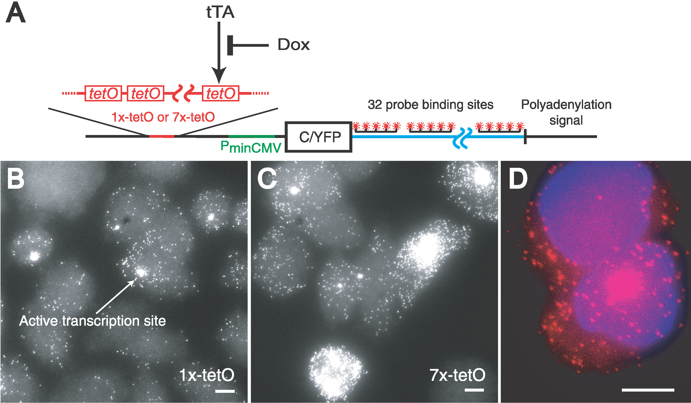
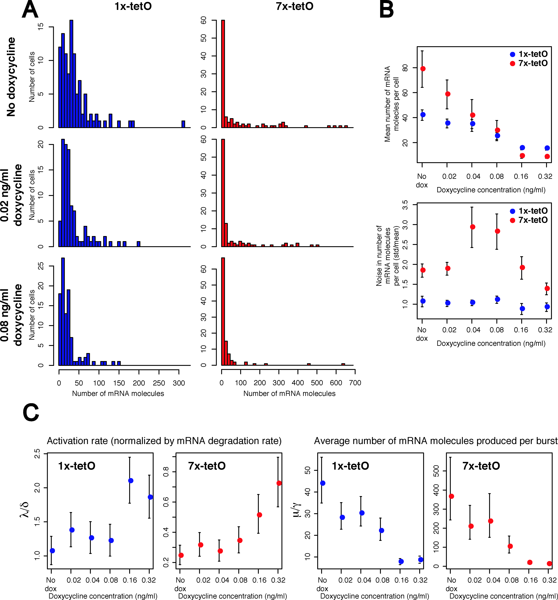

开关存在两种稳定状态，还不等于一次实验中的诱导一定能留下记忆。刺激可能过短，表达刚升高便在撤去输入后回落；即使成功切换，随机反应也可能在后来把细胞推回去。

这里沿着一次刺激的时间过程追踪：先计算怎样写入，再计算怎样丢失，最后检查快照、时间轨迹和不同准备历史能否支持同一种机制解释。

## 3. 刺激怎样写入和擦除表达记忆 {#stimulus-memory}

先从低表达态出发，在有限时间内增加产生率，然后撤去输入。此前求出的 $x_U$ 是撤去输入后的分界：最终能否保持高表达，取决于撤去时表达已经到了哪里。另一种切换办法是持续改变调控强度，直到原来的稳定态消失，第 3.2 节再计算它的边界。

### 3.1 脉冲幅度、持续时间与状态切换 {#pulse-writing}

仍用式（2.1），在 $b=0.02,n=2,\alpha=2.5$ 的低态出发，令输入在 $0\lt t\lt T$ 增加产生率：$\dot x=f(x)+u_0$，撤去后恢复 $\dot x=f(x)$。脉冲结束时若 $x(T)\gt x_U$，后续反馈将轨迹带到高态；若 $x(T)\lt x_U$，表达最终回落。

只要 $f(x)+u_0$ 在 $[x_L,x_U]$ 上处处为正，写入所需的临界时间可直接由 $dt=dx/[f(x)+u_0]$ 算出：

$$
\boxed{T_c(u_0)=\int_{x_L}^{x_U}\frac{dx}{f(x)+u_0}.}
\tag{3.1}
$$

这个条件很重要：若持续输入下仍有一个阻挡轨迹的低态固定点，仅延长脉冲并不能从低态确定性地切到高态。输入足够强以后，幅度越大，跨越同一距离所需的时间越短。恰好停在 $x_U$ 的临界轨迹对任意小扰动都敏感，实验中的切换概率会在阈值附近变得平滑。

因此，幅度和时长一般不能只合成一个“总刺激剂量”。输入作用期间，分子已经在被去除，反馈也随表达水平不断改变。一个很弱的长脉冲可能只把细胞带到稍高的新平衡，始终跨不过分界；更强的短脉冲则可能完成跨越。积分式计算的是沿途净积累的速度，其中最难通过、净变化最小的一段，往往占据了大部分切换时间。

在这组参数下，$u_0=0.05$ 即使长期保持也不能完成确定性写入；$u_0=0.1$ 的临界持续时间约为 $14.12$，$u_0=0.2$ 时缩短为 $3.17$。时间单位仍是蛋白质更新时间。因此可以固定脉冲幅度、逐渐延长时长，再在撤去刺激后测量最终表达，检验计算出的切换边界。

擦除可用暂时降低净产生或增强去除来完成，只要在撤去输入时把轨迹带回 $x_U$ 左侧。二维互抑制开关中，标量阈值变成穿过鞍点的吸引域边界；写入原则仍是撤去刺激后落在哪个吸引域。

在开头的合成开关实验中，IPTG 暂时削弱 LacI 的抑制作用，使 TetR 得以积累；TetR 又压低 lacI 表达。若撤去 IPTG 时，TetR 已足以维持这种抑制，回路就能保持在新的表达状态。aTc 则削弱 TetR 的作用，使竞争转向另一侧。它们改变的是调控蛋白的有效作用，式（3.1）中直接增加产生率的脉冲只是用来计算跨阈值条件的简化。

脉冲时长因而会影响撤去输入后的结果。新的一方需要积累蛋白质，原先占优的一方需要逐渐减少，切换需要时间。[Fig. 1](01_feedback.md#toggle-experiment) 中 pIKE107 与 pIKE105 在撤去诱导后留下不同结果，可以据此追问：各构建是否都存在高态？输入结束时，细胞是否已经进入高态的吸引域？仅看诱导期间的 GFP 峰值，无法区分这两种原因。

把同一刺激拆成两个脉冲，还能检验回路保留了哪一部分过去。两次脉冲挨得很近时，第一次留下的蛋白质尚未消退，第二次可能从较高起点继续推进；间隔足够长，轨迹又回到低态附近，两次输入便更像分别尝试写入。即使总的刺激时长相同，间隔也可能改变结果。这种短期积累发生在真正切换以前，不必已经形成一个能够自我维持的高态。

### 3.2 迟滞与稳定态消失的边界 {#hysteresis}

逐步改变参数时，阈值与稳定态也会移动。仍取式（2.1），固定 $b\gt0$，把 $\alpha$ 当作可调的有效自激活强度。固定点与阈值合并的位置满足 $f=f'=0$；以折叠处浓度 $x$ 参数化，得到

$$
\boxed{\alpha_{\rm fold}(x)=\frac{(1+x^n)^2}{n x^{n-1}},\qquad
b_{\rm fold}(x)=\frac{x}{n}(n-1-x^n).}
\tag{3.2}
$$

对 $n=2,b=0.02$，两次折叠约在 $\alpha_{\downarrow}=1.96$ 与 $\alpha_{\uparrow}=12.52$。从低表达出发缓慢增加 $\alpha$，高态虽然已在下阈值出现，轨迹仍沿低分支移动，直到上阈值处低态消失才跳高；从高态反向扫描，则到下阈值才跳低。在两阈值之间，同一个参数对应哪种表达，由准备历史决定。

*Fig. 7. 从同一产生–去除模型得到迟滞与参数相图。* A：固定 $b=0.02,n=2$，纵轴采用对数刻度，实线稳定、虚线不稳定，箭头表示往返扫描方向与分支消失后的跳变。B：式（3.2）的折叠边界，绿色区域双稳，紫点为正文例子 $(b,\alpha)=(0.02,2.5)$。A、B 的读取方向分别为固定 $b$ 扫描 $\alpha$、比较不同 $b$ 下的边界。

两条折叠边界在尖点 $(b_c,\alpha_c)=(1/(3\sqrt3),8\sqrt3/9)$ 汇合，详见[附录 A.2](01_feedback.md#fold-boundary)。基础表达太大时，低态已无法保持独立，双稳态区消失。$b\to0$ 时，上跳阈值趋向无穷，说明零基础表达极限不能描述有限参数范围内完整的往返迟滞。

**检验迟滞需要控制等待时间。** 只因分子去除较慢，单稳态系统在快速扫描时也能留下往返差异。应在每个参数处等待足够久，使局部恢复完成，再比较两种准备历史。带噪声时还要求等待短于跨态逃逸时间；第 4 节将说明为何这种时间窗口可能在折叠点附近消失。

迟滞图中沿哪一支移动，取决于系统此前已经落在哪个吸引域，不是参数在某个数值上能同时发出两种互相矛盾的指令。因此，在同一参数处用相反刺激分别准备两组，再撤去刺激比较后续状态，比单次单向扫描更直接。若两组只有刚撤去时不同，随后迅速汇合，看到的主要是恢复过程；若局部恢复已经完成，差异仍持续存在，才进入了更长时间的状态保持问题。

为什么不同微观调控模型会在状态消失时表现相似？在任一非退化折叠点 $(x_c,\alpha_c)$，有 $f=f_x=0$，而 $f_{xx}\ne0$、$f_\alpha\ne0$。对偏离量作 Taylor 展开，最低阶只剩参数偏移和位移平方；经过局部坐标与时间缩放，可写成

$$
\boxed{\dot y=\mu-y^2,\qquad \mu\gt0.}
\tag{3.3}
$$

$y$ 是折叠附近的局部坐标，允许为负，并非分子浓度；$\mu$ 衡量距离折叠的程度。稳定点 $y_s=\sqrt\mu$ 与不稳定阈值 $y_u=-\sqrt\mu$ 在 $\mu\to0^+$ 时合并。这个正规形只描述一侧稳定态及其出口，不能独自代表整个双稳态系统。下一节用它计算稳定态即将消失时，恢复时间和逃逸势垒怎样随 $\mu$ 改变。

---

## 4. 分子反应有随机性，记忆能保持多久 {#expression-noise}

确定性模型中，撤去刺激后只要处在高态的吸引域内，表达就会一直保持。真实细胞却会随机地产生和去除分子，启动子也会在活跃与不活跃之间切换。如果某次涨落足以越过阈值，记忆就可能丢失。先从没有反馈的反应算起，了解这些涨落的大小和持续时间，再将它们放回双稳态模型。

### 4.1 分子计数与启动子切换 {#poisson-baseline}

以蛋白质或 mRNA 分子数 $N$ 为变量，考虑两个反应：

$$
\varnothing\xrightarrow{\beta}X,
\qquad
X\xrightarrow{\gamma}\varnothing.
\tag{4.1}
$$

第一种反应以恒定速率 $\beta$ 增加一个分子；第二种反应以总速率 $\gamma n$，从分子数 $n$ 减少到 $n-1$。令 $P_n(t)=\Pr(N(t)=n)$。

产生事件随机到来，已有分子又各自随机降解。对相邻分子数之间的平稳概率进行平衡，可得泊松分布；详细计算见[附录 D.1](#poisson-calculation)。

$$
\boxed{
P_n^*=e^{-\mu}\frac{\mu^n}{n!},
\qquad
\mu=\frac\beta\gamma.
}
\tag{4.2}
$$

泊松分布满足 $\langle N\rangle=\operatorname{Var}(N)=\mu$，相对标准差为 $\mu^{-1/2}$。平均分子数越多，单次事件在总量中所占的比例越小，因此表达的相对起伏也越小。

例如，平均只有 $4$ 个分子时，相对标准差为 $1/2$；平均有 $100$ 个分子时，相对标准差为 $1/10$。后面如果观察到远大于同均值泊松分布的方差，就要检查恒定产生率等假设是否合适。

[Elowitz 等（2002）](https://doi.org/10.1126/science.1070919)在同一个大肠杆菌细胞中放入两种受到相同调控的荧光报告基因，用它们的共同变化与彼此差异区分噪声来源。若细胞内的共同环境使两种报告都偏高，会出现相关变化；若两套表达反应各自随机起伏，则两种信号会产生差异。测量这两种报告的相关性，有助于区分共同环境与各自表达反应造成的波动。

[Raj 等（2006）](https://doi.org/10.1371/journal.pbio.0040309) 用单分子 FISH 统计 CHO 细胞中的报告基因 mRNA。Fig. 8 将抽象的“分子数”变成了可以逐个计数的荧光斑点；同一克隆群体中的细胞，转录本数量仍有显著差异。部分细胞内还出现明亮的转录位点，显示取样时刻的转录活动集中在少数位置。

*Fig. 8. 单分子图像中的表达异质性。* 引自 [Raj 等（2006），原文 Fig. 2](https://doi.org/10.1371/journal.pbio.0040309.g002)。A：含 1 个或 7 个 tetO 位点的可调启动子与转录本标记设计；Dox 削弱 tTA 的激活作用。B、C：两种细胞系的 mRNA 图像，箭头标出活跃转录位点。D：两个姐妹细胞，红色为 mRNA，蓝色为 DAPI；比例尺均为 $5\,\mu\mathrm m$。

图中有些细胞转录本很多，有些很少。恒定产生率模型能否解释这种差别，可以先比较方差与均值；若产生率本身会长时间偏高或偏低，分布就可能明显宽于泊松分布。

一个启动子通常会经历较活跃与较沉默的时段。用 $S(t)\in\{0,1\}$ 表示 OFF 与 ON，令进入 ON 的速率为 $k_{\rm on}$、离开 ON 的速率为 $k_{\rm off}$。在 ON 状态下，以速率 $r$ 产生 mRNA，每个 mRNA 以速率 $\gamma$ 降解。

加入 $S$ 有一个直接理由：两个细胞即使眼下都有 10 个 mRNA，如果一个启动子正在 ON，另一个正在 OFF，接下来一小段时间的补充也不同。只记录 mRNA 数，就会把这两种未来不同的状态混在一起。启动子变量保存了当前产生条件，也解释了为什么表达起伏会有持续时间。是否能够再把它平均掉，要看它相对于 mRNA 去除究竟切换得多快。

两种切换速率之和 $\kappa=k_{\rm on}+k_{\rm off}$ 描述启动子状态更新得有多快；活跃时间比例为 $\pi=k_{\rm on}/\kappa$。平均 mRNA 数满足 $d\langle M\rangle/dt=r\langle S\rangle-\gamma\langle M\rangle$，稳态时因而有 $\langle M\rangle_*=r\pi/\gamma$。这与恒定产生模型具有相同的平衡形式，只是平均产生率变成了 $r\pi$。

固定活跃期的产生率 $r$ 和降解率 $\gamma$ 后，平均表达由活跃时间比例 $\pi$ 决定。但相同的比例可以来自频繁的短暂开启，也可以来自少数持续很久的开启。为描述这种差异，考虑方差与均值之比，即 Fano 因子。双态模型给出

$$
\boxed{
\frac{\operatorname{Var}(M)}{\langle M\rangle}
=1+\frac{r(1-\pi)}{\gamma+\kappa}\gt 1
}
\tag{4.3}
$$

其中 $0\lt \pi\lt 1,r\gt 0$；混合矩与方差的计算见[附录 D.2](#promoter-moments)。

mRNA 的涨落既来自离散生成、降解事件产生的散粒噪声（shot noise），也来自对产生率共同起调制作用的启动子状态。启动子切换越慢，表达速率越容易长时间维持高或低状态，方差就越大。这是时间相关性放大表达噪声的一个可解析例子。

从单条时间轨迹看，OFF 时段不断消耗已有的 mRNA，ON 时段则集中补充转录本。一次 ON 状态平均持续 $1/k_{\rm off}$，这段时间内平均产生 $r/k_{\rm off}$ 个新转录本；当活跃期短于 mRNA 寿命、且活跃期之间相隔较久时，表达就呈现出一阵一阵的“爆发”。提高 ON 的进入频率与增加每次 ON 中的产量，都能提高平均表达，却会留下不同的波动结构。

*Fig. 9. 相同均值下的表达噪声。* 取 $\gamma=1,r=20,\pi=1/2$。A：切换速率均为 $0.2$ 的随机轨迹，从 OFF、零分子数出发，绿色表示 ON。B：泊松分布与切换速率均为 $0.2$ 或 $20$ 的双态启动子稳态分布，均值均为 $10$。C：式（4.3）的 Fano 因子曲线。

Fig. 9B 中，慢切换的细胞有较长时间停在低表达区，也有机会积累较多 mRNA，因此分布比同均值的泊松分布更宽。快切换时，mRNA 在被降解以前已经经历多次 ON/OFF 交替，产生率的起伏被时间平均，分布逐渐靠近泊松形状。式（4.3）分母中的 $\gamma+\kappa$ 正是在比较这两种更新时间：mRNA 保留信息多久，以及启动子状态改变得有多快。

代入 Fig. 9 的参数，两种切换方式都让启动子一半时间处于活跃状态，平均都有 10 个 mRNA；慢切换的 Fano 因子约为 8.14，快切换时约为 1.24。只比较均值，会漏掉这项由切换速度造成的差异。

与实验比较时，还要保留“直接分子计数”这个条件。如果把全部荧光强度乘以 2，均值变成两倍，方差变成四倍，方差与均值之比也会加倍，表达机制却没有改变。因此，“Fano 因子等于 1”的泊松基准不能直接搬到未经标定的任意荧光单位上。分子计数、报告蛋白的亮度以及成像噪声，需要在观测模型里分清。

*Fig. 10. 从 mRNA 分布推断转录爆发。* 引自 [Raj 等（2006），原文 Fig. 3](https://doi.org/10.1371/journal.pbio.0040309.g003)。A：两种细胞系在三种 Dox 条件下的 mRNA 计数分布。B：均值与相对标准差（标准差/均值）。C：由分布拟合得到的启动激活率与每次爆发的平均产量。

Fig. 10A 中，7×tetO 细胞的分布有明显长尾：许多细胞转录本很少，少数细胞却携带很多。随 Dox 增加，平均表达降低。作者拟合完整分布后，发现这种调节主要体现为每次爆发平均产量的改变。与只拟合均值相比，分布还约束了产生过程怎样随时间组织；这些爆发参数仍依赖所采用的模型。

同一张快照中的高、低表达细胞，因而也可能只是处在不同的启动子活动阶段。要知道一个细胞怎样在这些水平之间变化，需要连续追踪，或同时观测转录活动。

这个没有自激活的模型已能产生长时间的高、低表达。群体中即使出现两个峰，也就未必对应两个反馈稳定态。第 5 节会比较这两种解释；先回到有反馈的开关，计算随机涨落怎样使状态越过阈值。

### 4.2 势垒、恢复时间与记忆寿命 {#potential-barrier}

回到双稳态模型 $\dot x=f(x)$，将低表达稳定点、中间的不稳定阈值和高表达稳定点分别记为 $x_L\lt x_U\lt x_H$。在确定性轨迹中，阈值两侧的状态会被带向各自的吸引子；在分子反应的随机轨迹中，状态还会不断受到新的扰动。

有了噪声以后，即使系统处于 $x_L$ 附近，也可能偶然越过 $x_U$，随后确定性漂移便将其带向 $x_H$。稳定态附近的恢复作用仍在不断消除小扰动，而一次足够大的涨落可以完成跨越。因此，细胞常表现为在某个表达状态附近停留很久，再迅速转入另一个状态，这种具有有限停留时间的状态称为**亚稳态（metastable state）**。

先采用加性白噪声的朗之万（Langevin）描述：

$$
\boxed{dx=f(x)\,dt+\sqrt{2D}\,dW_t,}
\tag{4.4}
$$

其中 $W_t$ 为维纳过程（标准布朗运动），$D$ 为扩散强度。加性噪声先用于区分两种稳定性；它只是局部有效近似。若把 $x$ 解释为非负浓度，需要在零点指定反射等边界；真实化学跳跃的非负性和状态依赖噪声将在 4.3 节恢复。

在一维中可定义

$$
U(x)=-\int^x f(y)\,dy,
\qquad f(x)=-U'(x).
\tag{4.5}
$$

图中的横坐标是表达水平，沿横轴移动表示分子数量改变。这里的 $U$ 由净产生率定义，并不自动等于细胞的热力学自由能。在当前的一维加性噪声近似下，这幅地形可以把局部恢复、概率分布和罕见切换联系起来。

势函数将净变化率积累为一幅地形：恢复作用强的地方坡较陡，接近固定点时坡度趋于零。对应的概率流为 $j=f\rho-D\rho'$；在零流边界条件下，$j=0$ 将漂移与扩散平衡起来，得到

$$
\frac{\rho'}\rho=\frac fD=-\frac{U'}D
\quad\Longrightarrow\quad
\boxed{\rho_*(x)\propto e^{-U(x)/D}.}
\tag{4.6}
$$

稳定固定点对应 $U$ 的局部极小值，中间的不稳定点对应势垒顶部。由 $\rho_*\propto e^{-U/D}$ 可见，较低的势函数区域有较高的概率密度。对式（2.1）取 $n=2$，将 $f(x)=b+\alpha x^2/(1+x^2)-x$ 积分，得到

$$
\boxed{
U(x)=\frac{x^2}{2}-bx-\alpha\bigl(x-\arctan x\bigr)+\text{constant}.
}
\tag{4.7}
$$

用第 2.1 节同一组参数 $b=0.02,\alpha=2.5$，两个势阱底部就是 $x_L,x_H$，中间的势垒顶部是 $x_U$。在 Fig. 11A 中可以将它们与产生曲线上的三个交点对应起来。

从单细胞分布看，阱底附近的恢复作用决定一个表达峰周围的波动有多宽，而从阱底走到阈值的整段上坡决定跨状态事件有多罕见。因此，表达在一个状态附近波动的幅度，与细胞多久切换一次，是两个互相关联但可以分别测量的量。改变某段浓度范围内的调控响应，可能主要影响峰的宽度，也可能主要改变两个峰之间的跃迁。

将一个势阱底部记为 $x_a$，分隔两个盆地的势垒顶部记为 $x_b$，需要跨越的势垒高度就是 $\Delta U=U(x_b)-U(x_a)\gt 0$。一次小涨落通常只把状态推上坡的一小段，随后就被恢复作用拉回；逃逸需要一段持续偏向上坡方向的随机变化。

在一维、加性弱噪声、充分光滑的非退化势阱及适当边界条件下，逃逸时间的 Kramers 近似为

$$
\boxed{
\tau_{a\to\mathrm{other}}
\simeq\frac{2\pi}{\sqrt{U''(x_a)|U''(x_b)|}}
\exp\!\left(\frac{\Delta U}{D}\right).
}
\tag{4.8}
$$

式中的曲率描述阱底与阱顶附近运动的快慢，指数因子则控制跨越整段势垒有多难。若其他因素近似相同，使 $\Delta U/D$ 增加 $\ln10$，逃逸时间就会增大约十倍。于是，一个只略微改变产生曲线的调控操作，也可能明显改变细胞能够保留表达状态的时间。

这段很长的等待，并不意味着分子在阱底停止反应。多数时候，随机增加几次产生或去除，只造成一次会被恢复作用消掉的小偏离。偶尔出现一段足够偏向同一方向的反应历史，表达才走到分界之外，随后由确定性动力学完成切换。等待时间主要消耗在反复失败的尝试上，真正从一个表达区转到另一个区，反而可以很快。

若阱内弛豫远快于逃逸，离开该状态可近似看作以恒定速率 $k=1/\tau$ 发生，首次离开前的停留时间超过 $t$ 的概率约为 $e^{-t/\tau}$。例如，观察到 $t=0.1\tau$ 时约有 90% 尚未离开，观察到 $t=\tau$ 时只剩约 37%。这里统计的是首次离开；若细胞还会切回，某时刻处于高态的总比例需要同时计算两个方向的切换。

如果把两态用来保存两种准备历史，就要分别关心两个方向的寿命。一个很深的高态势阱可以让高表达保持很久，但若低态很容易逃向高态，先前准备的两组细胞仍会很快变得相似。长期几乎都处于高态，与能够可靠区分“之前写入过什么”，是两项不同要求。记忆的保留要比较两组历史条件下的状态，而不能只看哪一态占据得最多。

*Fig. 11. 同一自激活模型的势垒与寿命。* 式（2.1）取 $b=0.02,n=2,\alpha=2.5$，势函数由式（4.7）给出。A：两个稳定点与中间阈值。B：$D=0.1$、初值 $x_H$、步长 $0.005$ 的加性噪声示意轨迹，在 $x=0$ 作反射以保持非负；这里不要求满足弱噪声极限。C：高态逃逸到低态的 Kramers 近似；该曲线只用于势垒远大于 $D$ 的区域。

“更稳定”有两种不同含义：局部扰动是否迅速恢复，以及跨过吸引域边界是否困难。前者只取决于固定点附近的斜率，后者取决于通往阈值的整段动力学与噪声。一般不能从恢复快慢直接推出记忆长短；临近折叠却可以建立一个明确联系。

返回式（3.3）的局部正规形，加入已在同一坐标和时间单位中定义的小加性噪声：

$$
dy=(\mu-y^2)dt+\sqrt{2D}\,dW_t,\qquad
U(y)=\frac{y^3}{3}-\mu y.
\tag{4.9}
$$

在稳定点 $y_s=\sqrt\mu$，$f'(y_s)=-2\sqrt\mu$；阈值为 $y_u=-\sqrt\mu$。两者给出

$$
\boxed{\tau_{\rm relax}=\frac{1}{2\sqrt\mu},\qquad
\Delta U=U(y_u)-U(y_s)=\frac43\mu^{3/2}.}
\tag{4.10}
$$

因此，在局部正规形有效且 $\Delta U/D\gg1$ 的弱噪声区间，越过阈值后离开原吸引域的平均时间近似为

$$
\boxed{\tau_{\rm escape}\simeq\frac{\pi}{\sqrt\mu}
\exp\!\left(\frac{4\mu^{3/2}}{3D}\right).}
\tag{4.11}
$$

这里取越过阈值后进入其外侧的逃逸边界；若只算首次触及阈值，前因子会依边界定义改变。三次局部势并不在整条实线上限制轨迹，因而这里使用的是局部阱的逃逸近似，不是把它当作全局平稳分布。

随着 $\mu$ 减小，产生与去除在稳定点附近越来越难分出净胜负，恢复变慢；稳定点与阈值同时靠近，势垒也降低。在弱噪声适用区间，指数项的下降使记忆更容易被擦除。因此，小扰动恢复得慢，并不意味着表达记忆更难丢失。

固定 $D$ 时不能把 Kramers 公式一直外推到 $\mu=0$：当 $\mu^{3/2}$ 与 $D$ 同阶，阱内弛豫与跨态逃逸不再充分分离，式（4.11）失效。前因子在 $\mu\to0$ 的形式发散不是“记忆重新变长”的物理预测。

实验可在改变同一控制参数时，分别测量小脉冲后的恢复时间和恒定条件下的停留时间。临界减速提示状态正在变软，但仅看到恢复变慢还不足以认定发生了折叠：慢启动子、报告蛋白寿命和其他慢变量也会延长相关时间。判定仍需结合分支消失与历史依赖。

长时间停留以后发生的切换，也不一定由一次异常巨大的反应直接完成。更常用的概率图像是：许多次偏向同一方向的产生与去除，暂时压过平常的恢复趋势，逐步把状态带到阈值附近。越过阈值以后，原本阻碍离开的确定性漂移又开始帮助它走向另一态。因此，切换轨迹中快速的跳变部分与此前漫长的等待，受不同环节控制；只提高成像频率看到跳变变快，并不能据此推算等待时间也会同样缩短。

### 4.3 化学反应决定的切换寿命 {#reaction-noise}

对实际的化学反应，可以用产生率 $\Omega B(x)$ 与损失率 $\Omega R(x)$ 描述分子数 $N$ 的上下跳跃，其中 $x=N/\Omega$，$\Omega$ 是将分子数换成浓度的系统大小。平均轨迹由产生与损失之差决定，即 $\dot x=B(x)-R(x)$。

产生与降解都贡献涨落，大系统的扩散近似为

$$
\boxed{
dx=[B(x)-R(x)]\,dt
+\sqrt{\frac{B(x)+R(x)}{\Omega}}\,dW_t.
}
\tag{4.12}
$$

这意味着两个系统可以具有相同的净漂移 $B-R$，却有不同的分子周转速度。在一个给定浓度范围内，同时增加产生率与降解率、保持它们的差不变，平均动力学保持相同，但更多的反应事件会增大式（4.12）中的涨落强度。因此，平均表达轨迹与表达噪声提供了关于分子机制的互补信息。

对于从稳定点 $x_a$ 到中间阈值 $x_b$ 的罕见逃逸，化学主方程进一步给出

$$
\boxed{
\Delta S=\int_{x_a}^{x_b}\ln\!\frac{R(x)}{B(x)}\,dx,
\qquad
\tau_{a\to b}\asymp e^{\Omega\Delta S}.
}
\tag{4.13}
$$

其中 $\Delta S$ 沿路径累计反应率之比给出的概率代价，$\asymp$ 表示主导指数阶。较大的系统中，局部相对涨落减小，跨越同一作用量势垒所需的时间呈指数增长。扩散近似与 WKB 计算见[附录 E](#appendix-e)。

比较系统大小时，保持的是同一套浓度反应规律。在较大的体积里维持同样浓度，需要更多分子；一次反应引起的浓度改变量更小，要把整体浓度推过同样的区间，也需要反应计数积累更大的偏差。这解释了系统大小为什么进入寿命的指数。真实细胞变大时，合成能力、稀释和其他参数也可能一起改变，不能只凭体积变化就套用这项单参数比较。

因此，描述平均变化、小涨落和罕见切换时，用到的是不同的反应率组合：

$$
\boxed{\underbrace{B-R}_{\text{平均场漂移}},\qquad
\underbrace{B+R}_{\text{局部扩散噪声}},\qquad
\underbrace{\ln(R/B)}_{\text{跳跃逃逸作用量的梯度}}.}
\tag{4.14}
$$

例如，在 $x\gt0$ 的逃逸路径上同时令 $B\mapsto B+c(x)$、$R\mapsto R+c(x)$，$c\ge0$ 且在零点取零以保留化学边界。固定点、线性稳定性和确定性轨迹全部不变，扩散噪声却增大；在低态向阈值的区间 $R\gt B$，$\ln[(R+c)/(B+c)]$ 减小，逃逸作用量降低。于是相同的平均场动力学可以对应不同的记忆寿命。有限系统中均值未必严格满足非线性平均场方程，这里的“相同轨迹”指宏观确定性极限。

这也解释了局部拟合为何可能给出很不同的长期预测。常见轨迹大多停在稳定点附近，数据对那里约束最强；真正决定罕见切换的中间区域，却可能几乎没有被采到。两个模型都能复现多数帧的平均值和峰宽，仍可能对偶尔一次越过阈值的概率相差很大。记忆寿命对参数的敏感性，既是生物学现象，也让模型外推更需要直接的切换统计来检验。

即使把稳定态附近的噪声也测准，离开这个区域后的反应率仍会影响逃逸。峰宽主要约束阱底附近的小变化，作用量却要沿通往阈值的整个区间累计。如果两个模型只在最常见的表达范围内拟合得一样，它们对罕见切换的预测仍可能相差很大。这也是寿命难预测的地方：真正决定结果的一段反应历史，在常规记录中恰好很少出现。

确定性固定点没有改变，随机切换却可以快得多。要估计真实开关的记忆寿命，只拟合平均表达曲线还不够；还要测量涨落和状态停留时间。下一节回到这些观测，检查它们能否区分反馈记忆与其他慢过程。

---

## 5. 回到单细胞观测：怎样判断表达记忆的来源 {#biological-synthesis}

### 5.1 结合分布、时间轨迹与刺激历史 {#mechanism-identification}

将许多细胞的表达量画成直方图，可能看到高、低两个峰。双峰描述的是群体快照；双稳态描述的是同一组参数下的确定性动力学。这张直方图没有记录每个细胞此前怎样变化，因此还需要比较能产生它的不同过程。

在第 4 节的无反馈双态启动子模型中，若 ON/OFF 切换都远慢于分子去除，细胞在 OFF 时趋近低表达，在 ON 时趋近 $r/\gamma$；当两组表达分布分得足够开，混合后的快照便可有两个峰。若先把快启动子平均化，只有 $\dot m=r\pi-\gamma m$ 的一个固定点；真正的慢切换情形则必须保留离散启动子状态，不能用这条平均方程描述单细胞。这里的高低群体来自外加随机切换的产生率，并不需要反馈驱动的双稳态。

反过来，具有两个确定性吸引子的系统，在有限采样时间、偏斜占据概率或较强噪声下，也未必显示清楚的双峰。因此，不能从“有两个峰”直接宣布双稳态，也不能从“只看到一个峰”排除它。

| 观测或干预 | 反馈双稳态加弱噪声 | 无反馈的慢 ON/OFF 启动子 |
|---|---|---|
| 群体快照 | 可有低、高两个峰 | 峰分离充分时也可双峰，单张快照难以区分 |
| 两种历史准备后回到同一环境 | 在局部恢复之后、罕见逃逸之前可维持不同占据 | 准备差异随启动子切换与分子去除逐渐消退；慢切换也可造成暂时记忆 |
| 撤去一次上调表达脉冲 | 越过分界后由反馈维持高态 | 若未改变启动子状态或切换率，额外分子按去除动力学衰减 |
| 改变调控增益并延长每步等待 | 可追踪到吸引子与阈值合并的折叠边界 | 主要改变开启比例、时长或产量，不要求出现反馈折叠 |
| 单细胞高低停留时间 | 在时间尺度分离下近似指数分布，参数依赖由逃逸作用量控制 | 启动子本身有指数 ON/OFF 时长，表达阈值定义的停留还受到分子寿命影响 |

停留时间呈指数分布也不是双稳态的独有证据。两类模型都可能有长等待、快跃迁，应比较**干预以后阈值、恢复和停留统计怎样一起改变**。例如同时测量启动子活动与蛋白质，可检验一次表达转换是否由可见的 ON/OFF 转换先行触发。

平均表达限定长期平均的产生与去除平衡；方差和分布补上细胞间差异；时间相关则说明这些差异能够保持多久。在双态模型中，启动子自相关为

$$
\operatorname{Cov}[S(t),S(0)]=\pi(1-\pi)e^{-\kappa|t|}.
\tag{5.1}
$$

这一结果来自两态切换的条件概率。mRNA 还会按自身寿命过滤这份输入，所以表达相关时间不能不加区分地等同于 $1/\kappa$。同均值的两组细胞，若具有不同的方差与衰减时间，就已经排除了“只改一个恒定产生率”的泊松解释；但仍需更多干预才能在多种含慢变量的模型之间选择。

一套有针对性的观测可以依次进行：

1. 在恒定环境下测量单细胞时间轨迹和群体分布，记录低、高时段及其占据比例。
2. 用相反刺激准备高低两组，再回到同一环境，比较表达差异随等待时间的变化。
3. 在每个状态附近施加小扰动，测恢复时间；另以足够长的恒定条件记录测停留时间，分开局部恢复与跨态逃逸。
4. 改变反馈增益、启动子切换或去除速率，要求候选模型同时解释分布、时间结构与刺激历史的变化。

有限时间的历史依赖可以来自慢过程，随机双稳态也会在足够长时间后丢失准备记忆。因而实验要寻找的是恢复时间与逃逸时间之间的窗口及其参数依赖，不能用一次长短未定义的“撤去后仍然很高”作结论。荧光成熟、报告蛋白寿命与细胞分裂也要进入观测模型，否则测到的慢变化可能主要来自读出过程。

停留时间还应按单个细胞的事件来统计。实验结束时尚未切换的细胞，只给出一个“至少保持到现在”的记录，不能当成已经在结束时切换，也不能全部丢掉。与此同时，群体中高态比例下降还可能来自两种状态的增殖或存活差异；只有追踪个体的离开和进入，才能将状态切换与群体数量重排分开。这与确定性模型的固定点是否存在，是不同层面的观测。

### 5.2 暂时高表达与持久记忆 {#comk-excitability}

枯草芽孢杆菌在营养受限时，部分细胞会暂时进入能够摄取外源 DNA 的感受态。[Süel 等（2006）](https://doi.org/10.1038/nature04588)的单细胞研究将这种行为解释为兴奋性动力学：ComK 的正反馈放大越过阈值的随机涨落，启动感受态程序；ComK 同时通过间接抑制 ComS，削弱 ComS 对 ComK 的保护、增强 ComK 的降解，最终使表达回落。这给随机表达增加了一个时间结构：噪声决定何时触发，较快的正反馈负责进入，较慢的负反馈负责退出。相平面上，这种过程表现为从静息态出发、完成一次大幅绕行后返回，适合描述暂时执行的细胞功能。

这种进入与退出的分工，使一次细胞功能程序有了两类时间问题：细胞等待多久才被触发，以及触发以后执行多久。前者涉及静息态附近的波动和阈值，后者还取决于 ComS 等慢变量如何改变 ComK 的维持条件。沿单细胞轨迹区分等待时段与执行时段，就能把群体中“有多少细胞进入感受态”进一步拆成触发和返回两个过程。

从功能上看，也不必把保持越久都视为越好。若一种响应需要在环境改变后继续执行，较长的状态寿命可能有用；若细胞只需暂时完成一段程序，能按时返回同样重要。前面开关、振荡器和兴奋脉冲的差别，因而对应了不同的时间安排。讨论一个天然回路时，应先明确生物过程需要保持、重复还是退出，再判断哪一种动力学描述更合适。

在兴奋性参数区，高表达阶段属于一次大幅绕行，随后由慢负反馈主动退出；它不是第二个长期吸引子附近的等待。相比之下，双稳态系统离开高态需要另一次逃逸。应把“等待触发多久”和“触发后持续多久”分别统计，检查返回是否随慢负反馈的干预改变；该研究通过旁路负反馈阻止退出，正是比单看高低表达分布更有辨识力的检验。振荡器则在固定条件下反复产生相位有序的起伏，需要用长轨迹及峰间关系与偶发兴奋脉冲区分。

不同细胞若具有不同的逃逸快慢，将它们混在一起也会改变停留时间曲线。较易切换的细胞先离开，剩下的群体便逐渐富集更持久者，整体看起来会越等越稳定；这并不要求同一个细胞的记忆随着等待自动加固。要判断是否存在真正的状态老化，需要区分细胞之间的参数差异与单细胞自身的时间变化，而不能只凭群体平均的保持比例。

开头的实验先用不同刺激准备两组细胞，再将它们放回相同环境。这个比较还可以沿时间继续做下去：刚撤去输入时的差异，可能包含尚未去除的旧蛋白；等待几个局部恢复时间以后仍保留的差异，才更适合与反馈模型的两种状态比较。

随后分别追踪两组中的单细胞，记录第一次离开原状态的时间，并检查是否会切回。如果一组细胞在高态附近快速恢复小扰动，却很久才偶然离开，就出现了前面计算的“阱内恢复快、跨阱逃逸慢”的时间分离。改变反馈强度或反应噪声以后，模型还应同时解释恢复时间和停留时间怎样改变。

因此，“撤去刺激后仍然很高”需要附带一个观察时长。确定性双稳态允许状态持续保持；有限分子数的开关则有随机切换的寿命。实验中的表达记忆，是在给定观察时间内，反馈能够以多大的概率保留此前写入的状态。

---

记忆因而有两个需要分开测量的时间问题：短输入能否越过切换条件，以及撤去输入后状态能维持多久。双峰分布或长停留时间都可能有不止一种来源。只有让写入、恢复和跨态切换接受同一套参数的检验，才能把“看起来记住了”变成对具体机制的判断。

从可操作的功能看，稳定保持与容易重写也可能相互牵制。更难被噪声推过的分界，往往也要求输入提供足够强、足够久的驱动；一个对极短刺激就很敏感的系统，则需要另外的办法避免把偶然波动写成长期状态。这里没有预先规定记忆越长越好，而是把写入时间、日常恢复与自发丢失放在同一回路中比较。它们共同决定一个开关适合记录怎样的环境变化。

启动子噪声、慢恢复与罕见切换

### 附录 D. 出生–死亡过程与启动子噪声 {#appendix-d}

**D.1 从主方程到泊松分布**

描述分子数概率演化的主方程（master equation）为

$$
\boxed{
\frac{dP_n}{dt}
=\beta P_{n-1}+\gamma(n+1)P_{n+1}
-(\beta+\gamma n)P_n,
}
\tag{D.1}
$$

并约定 $P_{-1}=0$。

其中前两项代表流入状态 $n$ 的概率流，后两项是离开状态 $n$ 的概率流。

这个一维出生–死亡过程在平稳时满足相邻状态的详细平衡：$\beta P_n^*=\gamma(n+1)P_{n+1}^*$。因此，$P_{n+1}^*=\beta P_n^*/[\gamma(n+1)]$，逐次递推得到 $P_n^*=(\beta/\gamma)^nP_0^*/n!$。

递推中的阶乘来自降解事件的数目依赖：分子越多，总降解率越高，所以高分子数状态相对于前一状态需要更强的产生来维持。再使用归一化 $\sum_{n=0}^{\infty}P_n^*=1$，得到 $P_0^*=e^{-\beta/\gamma}$，从而还原主文的泊松分布。

**D.1.1 用矩方程计算方差**

利用反应带来的跃迁，直接得到

$$
\frac{d\langle N\rangle}{dt}=\beta-\gamma\langle N\rangle,
$$

$$
\frac{d\operatorname{Var}(N)}{dt}
=\beta+\gamma\langle N\rangle
-2\gamma\operatorname{Var}(N).
\tag{D.2}
$$

稳态时第一式给 $\mu=\beta/\gamma$，第二式给 $\operatorname{Var}(N)=\mu$，与式（4.2）相符。

**D.2 启动子状态与分子数的混合矩**

采用主文的 $S\in\{0,1\}$、$\pi=k_{\rm on}/\kappa$ 和 $\kappa=k_{\rm on}+k_{\rm off}$。

为了计算方差，需要混合矩 $\langle SM\rangle$。由生成、降解和启动子切换分别计算其变化率：

$$
\frac{d\langle SM\rangle}{dt}
=r\langle S\rangle+k_{\rm on}\langle M\rangle
-(\gamma+\kappa)\langle SM\rangle.
\tag{D.3}
$$

在稳态代入 $\langle S\rangle=\pi$ 和 $\langle M\rangle_*=r\pi/\gamma$，可得

$$
\operatorname{Cov}(S,M)
=\langle SM\rangle_*-\pi\langle M\rangle_*
=\frac{r\pi(1-\pi)}{\gamma+\kappa}.
\tag{D.4}
$$

再利用二阶矩方程，

$$
\frac{d\operatorname{Var}(M)}{dt}
=r\langle S\rangle+\gamma\langle M\rangle
+2r\operatorname{Cov}(S,M)-2\gamma\operatorname{Var}(M),
$$

在稳态得到

$$
\boxed{
\operatorname{Var}(M)
=\langle M\rangle
+\frac{r^2\pi(1-\pi)}{\gamma(\gamma+\kappa)}.
}
\tag{D.5}
$$

将方差除以均值 $\langle M\rangle_*=r\pi/\gamma$，即得式（4.3）的 Fano 因子。

### 附录 E. 从化学主方程到罕见切换 {#appendix-e}

**E.1 加性噪声的概率密度演化**

对主文的加性 Langevin 方程，概率密度满足 Fokker–Planck 方程

$$
\frac{\partial\rho}{\partial t}
=-\frac{\partial}{\partial x}[f(x)\rho]
+D\frac{\partial^2\rho}{\partial x^2}.
\tag{E.1}
$$

写成守恒形式 $\partial_t\rho=-\partial_x j$，得到 $j=f\rho-D\rho'$。零流条件将它转化为一阶方程，其解为主文的 $\rho_*\propto e^{-U/D}$。

化学反应的产生与损失率通常随状态变化，噪声因而也是**状态依赖**的。相应的扩散近似和逃逸势垒可以从反应规则推导。

设系统大小为 $\Omega$，分子数 $N\simeq\Omega x$。在状态 $N$，产生一个分子的速率为 $\Omega B(x)$，损失一个分子的速率为 $\Omega R(x)$。写作

$$
N\xrightarrow{\ \Omega B(N/\Omega)\ }N+1,
\qquad
N\xrightarrow{\ \Omega R(N/\Omega)\ }N-1.
$$

这里 $B$ 和 $R$ 都是非负的宏观速率函数，平均场漂移由它们的差给出，即 $\dot x=B(x)-R(x)$。

**E.2 系统大小展开与扩散系数**

一步跃迁使 $x$ 改变 $\pm1/\Omega$。对主方程进行 Kramers–Moyal 展开至二阶，得到

$$
\frac{\partial\rho}{\partial t}
=-\partial_x\!\left[(B-R)\rho\right]
+\frac{1}{2\Omega}\partial_x^2\!\left[(B+R)\rho\right]
+O(\Omega^{-2}).
\tag{E.2}
$$

二阶项对应噪声幅度 $\sqrt{(B+R)/\Omega}$，从而得到主文式（4.12）的 Itô 随机微分方程。

它说明两件事：

1. 大系统的典型表达涨落相对变小，噪声幅度是 $O(\Omega^{-1/2})$；
2. 产生与损失事件都贡献随机性，噪声强度由两者的和 $B(x)+R(x)$ 决定，并随状态变化。

平均漂移取决于 $B-R$，扩散项取决于 $B+R$。这两个组合来自同一套跃迁规则，不能仅从确定性方程反推出噪声强度。

**E.3 化学跳跃与 WKB 作用量**

稳定点附近的小涨落只探索很窄的浓度范围，扩散近似可以将许多反应事件汇总成局部噪声。跨越阈值则要求一串偏向同一方向的反应事件，途中的产生率与降解率都在变化。计算这种罕见路径的概率，需要保留反应跳跃的完整统计结构。

WKB 近似（Wentzel–Kramers–Brillouin approximation）在这里用于求解小噪声下的主导指数行为。设大 $\Omega$ 下的稳态概率具有以下形式：

$$
P_N\asymp\exp[-\Omega S(x)],
\qquad x=N/\Omega.
\tag{E.3}
$$

这里的 $S(x)$ 是大偏差作用量，也对应稳态分布的率函数（rate function）。化学主方程在平稳状态下为

$$
0=\Omega B(x-\Omega^{-1})P_{N-1}
+\Omega R(x+\Omega^{-1})P_{N+1}
-\Omega[B(x)+R(x)]P_N.
$$

由式（E.3），在主阶有

$$
\frac{P_{N-1}}{P_N}\simeq e^{S'(x)},
\qquad
\frac{P_{N+1}}{P_N}\simeq e^{-S'(x)}.
$$

忽略相对 $O(\Omega^{-1})$ 的变化后，得到零能量 Hamilton–Jacobi 方程

$$
0=B(x)(e^q-1)+R(x)(e^{-q}-1),
\qquad q=S'(x).
\tag{E.4}
$$

令指数变量代换后，这成为一个二次代数方程：令 $z=e^q$，则

$$
Bz^2-(B+R)z+R=0
\quad\Longrightarrow\quad
(z-1)(Bz-R)=0.
$$

一个解是 $q=0$，对应确定性弛豫分支；另一个为

$$
\boxed{S'(x)=\ln\frac{R(x)}{B(x)}.}
\tag{E.5}
$$

这个非零动量分支描述从稳定态向阈值点的罕见“逆流”涨落轨道。从稳定点 $x_a$ 积分到中间不稳定点 $x_b$，便得到主文式（4.13）的作用量势垒及逃逸时间的主导指数。

这里 $\asymp$ 表示只给出系统大小 $\Omega$ 下的主导指数阶，未给出前因子。对于一维出生–死亡过程，这也可以从相邻态平稳概率的比值直接得到。

以双稳态的自激活模型为例，可以选

$$
B(x)=b+\alpha\frac{x^2}{1+x^2},
\qquad R(x)=x,
\tag{E.6}
$$

其中 $b\gt0$。在从低表达态走向阈值的区间，通常有 $R\gt B$，确定性作用把系统拉回低态；$\ln(R/B)\gt 0$ 则逐点累计逆着这种作用前进的概率代价。式（4.13）将整条逃逸路径上的代价相加，再通过系统大小 $\Omega$ 放大，得到切换时间的主导指数。

这也说明 $U$ 与 $S$ 各自记录了什么：$U$ 积分的是净漂移，配合给定的常数噪声强度描述加性 Langevin 模型；$S$ 积分的是反应率之比，把化学事件本身的随机性包含在内。对于同一个平均表达方程，具体的反应机制仍可能改变切换寿命。

---

**1. 接近折叠点时，表达为何恢复得更慢？**

对 $\dot x=f(x)$ 在稳定点附近线性化，得到 $\delta x(t)=\delta x(0)e^{f'(x^*)t}$。求恢复时间，再对 $\dot y=\mu-y^2$ 求势垒，比较接近折叠时的两种变化，并说明 Kramers 近似何时失效。

**结果：** $\tau_{\rm relax}=1/|f'(x^*)|$。沿稳定分支接近非退化折叠点时，$f'(x^*)\to0^-$，恢复时间增大。正规形中 $\tau_{\rm relax}=1/(2\sqrt\mu)$、$\Delta U=4\mu^{3/2}/3$；固定 $D$ 下当 $\mu^{3/2}$ 与 $D$ 同阶时，不能再使用弱噪声逃逸公式。

**3. 平均 mRNA 数相同，Fano 因子可以相差多少？**

取 $r=20,\gamma=1$，比较 $k_{\rm on}=k_{\rm off}=0.2$ 与两者均为 $20$ 的情况。

**结果：** 两者均值均为 $10$，Fano 因子分别为 $1+10/1.4\simeq8.14$ 与 $1+10/41\simeq1.24$。平均表达匹配后，切换时间尺度仍保留在波动中。

**4. 势垒或反应系统大小怎样改变记忆？**

分别使用 Kramers 近似与化学跳跃模型的主导指数，比较势垒增量 $\delta U$ 或系统大小增量 $\delta\Omega$ 的影响。

**结果：** 在 Kramers 前因子变化可忽略时，寿命比约为 $e^{\delta U/D}$；固定宏观反应率函数时，化学模型寿命的主导指数比为 $e^{\delta\Omega\Delta S}$。

**6. 双峰和指数停留时间能否证明双稳态？**

比较无反馈慢启动子与反馈双稳态模型，分别提出一项能产生相似快照的条件，以及一项有助于区分的干预。

**结果：** 慢 ON/OFF 切换且条件表达分布充分分离时，无反馈模型也能双峰；两种机制也都可产生近似指数的停留时间。应在相同环境下比较不同准备历史，改变等待时间，并检验小扰动恢复、反馈折叠与跨态寿命是否被同一套参数解释。

[本主题参考文献](03_network_topics.md#references)。
