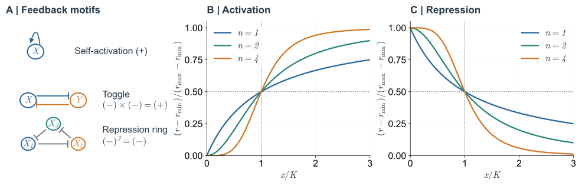
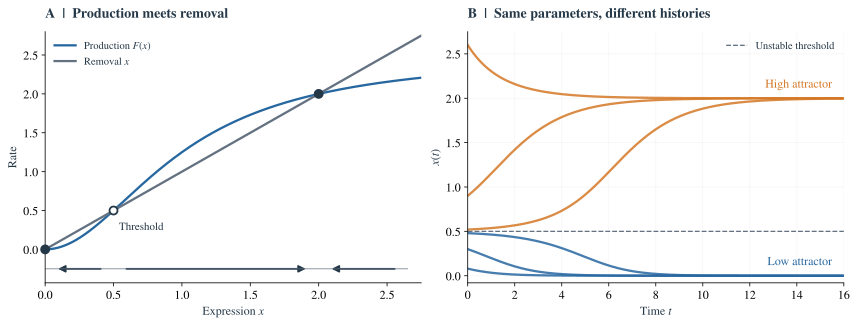
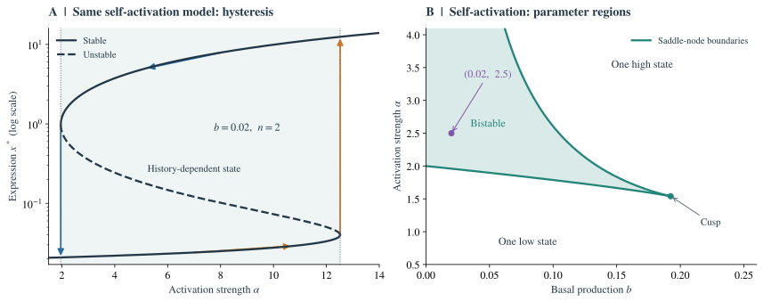
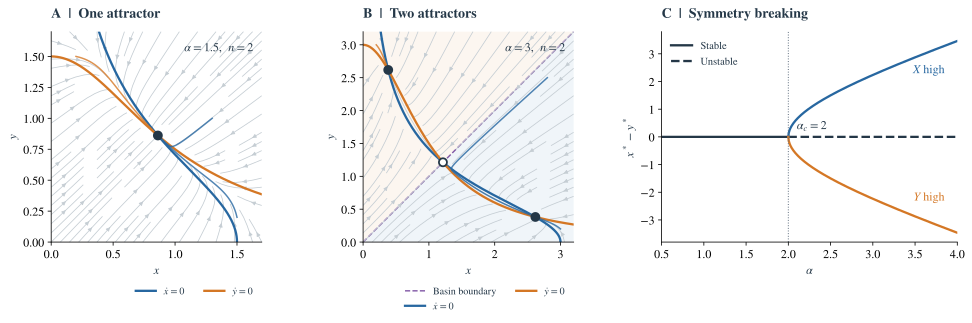
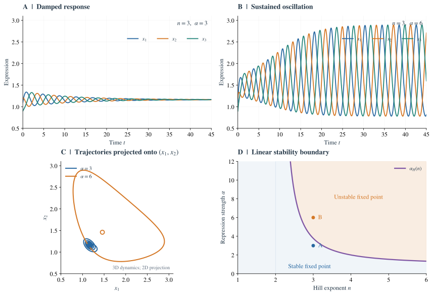
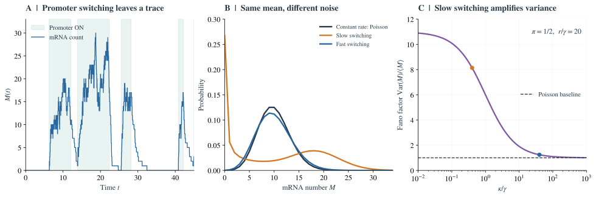
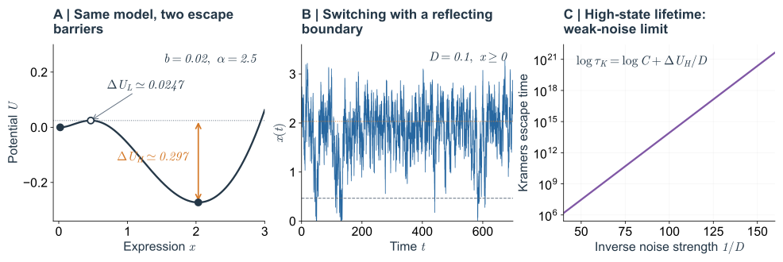
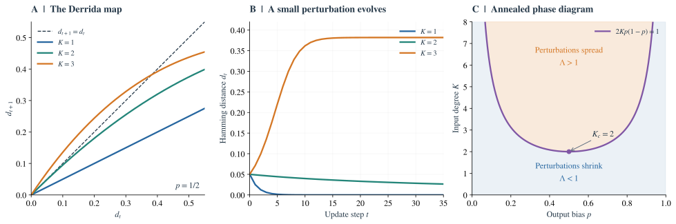
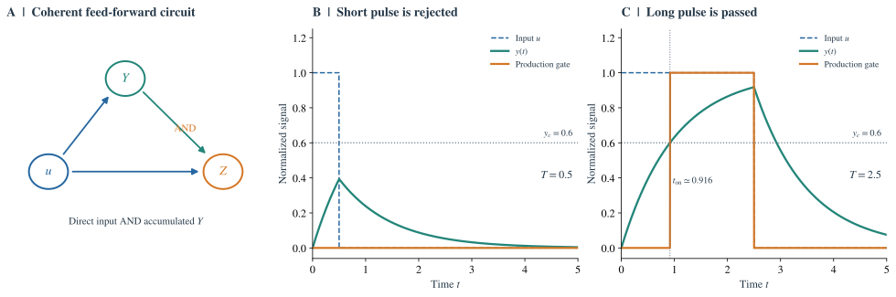

# 基因调控网络的理论：反馈、动力学、噪声与集体行为
## 表达状态的形成、维持与切换

> 西湖大学 2026 年秋季《定量生物学导论》课程学习笔记。

> **核心问题：** 持续更新的分子，怎样组成能够记忆、振荡和随机切换的细胞表达状态？

## 概述 {#main-lecture}

一个细胞中的 mRNA 和蛋白质不断产生、降解，表达程序却可以保持很久。细胞也会在相同环境中出现不同的表达水平，有时在短暂刺激后维持新的状态，有时周期性起伏，有时突然启动一段暂时的功能程序。理解这些现象，需要把调控关系转化为随时间演化的方程。

[Gardner 等（2000）](https://doi.org/10.1038/35002131)构建的互抑制开关提供了一个实验起点：短暂输入可以写入新的表达状态，随后由回路维持。[Elowitz 和 Leibler（2000）](https://doi.org/10.1038/35002125)则用三个抑制系统构建了周期表达的 repressilator。两个回路都由抑制关系组成，但前者把细胞推向稳定的表达偏向，后者能让状态沿环不断变化。这引出了本文的第一个问题：**反馈经过一圈后怎样返回，才能产生不同的长期行为？**

即使已经找到稳定状态，单细胞的轨迹仍然会波动。启动子何时活跃、一次产生多少转录本、已有蛋白质何时被清除，都受随机反应影响。小波动可以被反馈纠正，也可以偶然越过状态之间的阈值。因此，还要追问：**稳定状态能保存多久，一次局部波动又会怎样影响其他基因？**

正文先建立产生与降解的动力学描述，再依次讨论正反馈记忆、负反馈振荡、表达噪声和跨状态切换，最后研究大网络中的扰动传播。较长的稳定性计算、矩方程与化学主方程推导集中在[技术附录](#technical-appendices)；[进阶专题](#feed-forward-topic)讨论前馈回路如何识别信号持续时间。

---

## 1. 从调控关系到表达动力学 {#expression-dynamics}

细胞表达的稳定，首先要求产生与去除能够相互平衡。调控因子改变生产率，降解和生长稀释改变已有分子的去除速度；两者共同决定表达量怎样响应一个扰动。

### 1.1 状态变量与分子更新 {#state-and-turnover}

一个简化的描述是：基因 $i$ 的表达状态由相应的 mRNA（信使 RNA）数量 $m_i$ 和蛋白质数量或浓度 $p_i$ 表示；其中某些蛋白质是转录因子，能调控其他基因的转录速率。外部信号记为 $u$。

最简单的连续时间方程为

$$
\begin{aligned}
\frac{dm_i}{dt}&=r_i(\mathbf p,u)-\delta_{m,i}m_i,\\
\frac{dp_i}{dt}&=k_i m_i-\delta_{p,i}p_i.
\end{aligned}
\tag{1.1}
$$

这里 $r_i$ 是转录产生率，$k_i$ 是翻译速率，$\delta_{m,i}$ 和 $\delta_{p,i}$ 是有效降解或稀释速率。调控网络体现在函数 $r_i(\mathbf p,u)$ 中。

这个模型包含两个基本机制：

- 表达是**产生与去除的动态平衡**，而非基因简单地“开”或“关”；
- 调控关系给出产生率如何依赖其他变量，因而可能产生反馈。

一个细胞状态在此由表达向量 $\mathbf x=(x_1,\ldots,x_N)$ 描述。例如，“$X$ 高、$Y$ 低”对应状态空间中的一个区域。即使每个蛋白质分子都在不断更新，只要产生与去除维持平衡，细胞仍可长期停留在同一个表达状态附近。因此，状态的稳定来自整个调控过程的持续运行。

### 1.2 启动子占据率与 Hill 响应 {#hill-response}

先研究一个转录因子 $X$ 与启动子 $P$ 的结合。将有效结合过程写为

$$
P+nX\rightleftharpoons PX_n.
$$

如果结合相对于表达动力学足够快，可以近似看作平衡，定义有效解离常数 $K$，使得

$$
\frac{[PX_n]}{[P]}=\left(\frac{x}{K}\right)^n,
\qquad x=[X].
$$

假设启动子只有游离和结合这两类状态，那么结合占据率是

$$
\theta(x)
=\frac{[PX_n]}{[P]+[PX_n]}
=\frac{x^n}{K^n+x^n}.
\tag{1.2}
$$

当结合促进转录时，可以令

$$
r_{+}(x)=r_{\min}+(r_{\max}-r_{\min})\frac{x^n}{K^n+x^n};
\tag{1.3}
$$

当结合抑制转录时，可以令

$$
r_{-}(x)=r_{\min}+(r_{\max}-r_{\min})\frac{K^n}{K^n+x^n}.
\tag{1.4}
$$

这两个函数都在 $x=K$ 时达到半响应，因此 $K$ 决定细胞对哪一个浓度范围最敏感。浓度远低于 $K$ 时，结合事件少；远高于 $K$ 时，启动子接近饱和，继续增加转录因子的效果逐渐减弱。

Hill 指数 $n$ 则控制阈值附近的陡峭程度。对归一化的激活函数，半响应处的斜率为 $n/(4K)$：$n$ 越大，同样的小幅浓度变化能带来越大的表达变化。在实验拟合中，$n$ 常作为汇总协同性等效应的有效参数。这个斜率随后会进入反馈增益：生产响应足够陡时，浓度的小幅上升可以被进一步放大，进而形成开关。

### 1.3 从两级表达过程到有效方程 {#effective-expression-equation}

考虑只含一种蛋白质的模型：

$$
\dot m=r(p)-\delta_m m,
\qquad
\dot p=k m-\delta_p p.
\tag{1.5}
$$

如果 $\delta_m\gg\delta_p$，且输入 $r(p)$ 的变化相对于 mRNA 弛豫也足够慢，则在蛋白质的时间尺度上，mRNA 近似满足

$$
m(t)\simeq\frac{r(p(t))}{\delta_m}.
$$

于是

$$
\dot p\simeq\frac{k}{\delta_m}r(p)-\delta_p p.
\tag{1.6}
$$

取浓度尺度 $K$，时间尺度 $\delta_p^{-1}$，令

$$
x=\frac pK,
\qquad \tau=\delta_p t,
$$

则方程成为

$$
\frac{dx}{d\tau}=F(x)-x,
\qquad
F(x)=\frac{k\,r(Kx)}{\delta_m\delta_p K}.
\tag{1.7}
$$

推广到多基因网络，可用

$$
\boxed{\frac{dx_i}{d\tau}=F_i(x_1,\ldots,x_N;u)-\gamma_i x_i.}
\tag{1.8}
$$

这里 $F_i$ 表示经其他分子调控后的有效表达，$\gamma_i$ 是相对于所选时间单位的降解率。

mRNA 与蛋白质的两级动力学还提供了一种时间记忆：转录减弱后，已有的 mRNA 仍会继续翻译，已有的蛋白质也要经过降解或稀释才会减少。当 mRNA 的寿命很短，这段记忆可以压缩进式（1.6）的有效产生率；当它与蛋白质的寿命相近，两级响应会产生明显滞后。[第 3 节](#feedback-oscillation)将看到，这种滞后正是负反馈产生振荡的重要来源。

### 1.4 反馈返回的方向 {#feedback-sign}

在一个给定状态 $\mathbf x$ 附近，用偏导数定义有符号调控边：

$$
J_{ij}^{(\mathrm{reg})}=\frac{\partial F_i}{\partial x_j}.
$$

若 $J_{ij}^{(\mathrm{reg})}\gt 0$，则 $j\to i$ 是局部激活；若小于零，则是局部抑制。沿一个闭合回路，把所有边的符号相乘：

- 结果为正，称为**正回路**（例如一个自激活，或两个基因相互抑制）；
- 结果为负，称为**负回路**（例如三个基因依次相互抑制）。

Thomas 反馈回路原则把这些符号与动力学联系起来：在相应的调控动力学框架下，多稳态需要正回路，持续振荡需要负回路 [Thomas（1994）](https://doi.org/10.1002/bbpc.19940980916)、[Thieffry（2007）](https://academic.oup.com/bib/article/8/4/220/221430)。正回路让某个变化绕行一周后得到同方向的加强；负回路让变化绕行一周后受到反向纠正。实际的放大或纠正有多强、来得有多快，则由响应曲线与各级的时间尺度决定。

*Fig. 1. 反馈结构与 Hill 响应。* A：箭头表示激活，横杠表示抑制。B、C：式（1.3）、（1.4）在 $n=1,2,4$ 时的归一化曲线，半响应点均为 $x=K$。

现在，回路的符号和响应曲线都已进入模型。接下来先固定外部环境，考察同一组参数是否能够支持两个不同的长期表达状态。

---

## 2. 正反馈怎样将短暂刺激变成记忆？ {#feedback-memory}

一个输入脉冲可以暂时提高表达，但输入撤去后是否还保持高表达，取决于细胞能否通过自身调控补充正在消失的分子。自激活与互抑制给出了两种可计算的维持机制。

### 2.1 自激活：生产与损失的交点 {#self-activation}

一个自激活基因具有表达促进自身表达的作用。考虑

$$
\boxed{\dot x=b+\alpha\frac{x^n}{1+x^n}-x,}
\tag{2.1}
$$

其中时间已经无量纲化；$b\ge0$ 表示基础表达，$\alpha\gt 0$ 表示最大诱导产生率，$n$ 控制响应陡峭程度。

记

$$
f(x)=b+\alpha\frac{x^n}{1+x^n}-x.
$$

固定点由 $f(x^*)=0$ 给出。对于一维连续动力系统，

$$
f'(x^*)\lt 0\ \Rightarrow\ \text{局部渐近稳定},
\qquad
f'(x^*)\gt 0\ \Rightarrow\ \text{不稳定}.
\tag{2.2}
$$

**物理图像：** 在固定点处，生产率等于损失率；如果浓度略微增高后损失率反过来大于生产率，系统就回到固定点，这个固定点才稳定。

把一个小扰动记为 $\delta x$，在固定点附近有 $\dot{\delta x}\simeq f'(x^*)\delta x$，所以扰动按 $e^{f'(x^*)t}$ 衰减或增长。稳定点的局部恢复时间为 $\tau_{\rm relax}=1/|f'(x^*)|$。这也解释了为什么系统接近鞍结分岔时会恢复得很慢：两条曲线接近相切，生产与损失几乎抵消，推动表达量返回的净作用变弱了。

先设 $b=0$、$n=2$：

$$
\dot x=\alpha\frac{x^2}{1+x^2}-x.
\tag{2.3}
$$

固定点满足

$$
x\left(\frac{\alpha x}{1+x^2}-1\right)=0.
$$

因此，一个固定点是 $x_0=0$，另外两个满足

$$
x^2-\alpha x+1=0,
$$

从而

$$
\boxed{x_{\pm}=\frac{\alpha\pm\sqrt{\alpha^2-4}}2.}
\tag{2.4}
$$

只有 $\alpha\ge2$ 时，它们才是非负实固定点。当 $\alpha\gt 2$ 时，

$$
0\lt x_-\lt 1\lt x_+,
\qquad x_-x_+=1.
$$

接下来判定稳定性。对式（2.3）求导：

$$
f'(x)=\frac{2\alpha x}{(1+x^2)^2}-1.
$$

在非零固定点，由 $\alpha=(1+x^2)/x$ 可得

$$
f'(x^*)=\frac{2}{1+(x^*)^2}-1
=\frac{1-(x^*)^2}{1+(x^*)^2}.
\tag{2.5}
$$

于是

$$
\begin{array}{c|c|c}
\text{固定点}&f'(x^*)&\text{稳定性}\\\hline
x_0=0&-1&\text{稳定}\\
x_-\lt 1&\gt 0&\text{不稳定}\\
x_+\gt 1&\lt 0&\text{稳定}
\end{array}
$$

特别地，当 $\alpha=5/2$，

$$
\boxed{x_0=0,\quad x_-=\tfrac12,\quad x_+=2.}
\tag{2.6}
$$

*Fig. 2. 生产曲线、相线与表达轨迹。* 式（2.3）取 $b=0,n=2,\alpha=2.5$。A：实心交点 $0,2$ 稳定，空心交点 $1/2$ 不稳定，相线箭头给出运动方向。B：六个初值分别趋向低表达或高表达状态。

$1/2$ 是确定性动力学中的**阈值**：初值在其两侧，将分别趋向低表达和高表达吸引子。在相同环境、相同动力学参数下，长期结果仍取决于历史初值，这就是细胞记忆的最小机制。

从 Fig. 2A 可以直接读出这种选择过程。在 $0<x<1/2$ 时，降解快于生产，小幅增加的蛋白质会被清除；越过 $1/2$ 后，生产超过降解，自激活把浓度继续推高，直到高表达点附近重新平衡。因此，一个暂时增强表达的信号，只有将状态推过阈值才会留下长期效果。信号的幅度和持续时间都会影响是否完成切换，而切换后的维持由细胞自身的反馈承担。

### 2.2 迟滞：状态如何记录刺激历史 {#hysteresis}

迟滞（hysteresis）指**控制参数正向与反向扫描时，状态在不同阈值发生突变**。要形成完整的往返迟滞，低表达和高表达分支需要分别在扫描的两端失去稳定性。式（2.3）中 $b=0$，零表达点对所有 $\alpha$ 都保持稳定；下面引入一个能清楚展示两个跳变阈值的模型。

双稳态附近的一种常用正规形（normal form，即保留局部关键非线性的简化方程）为

$$
\boxed{\dot z=h+a z-z^3,\qquad a\gt 0.}
\tag{2.7}
$$

这里 $z$ 表示以某个参考表达状态为中心的序参量，因此可以有正负值，$h$ 则表示偏向某一表达状态的外部信号。

固定点满足

$$
h+a z-z^3=0.
$$

鞍结分岔（saddle-node bifurcation）发生在

$$
f(z)=0,\qquad f'(z)=a-3z^2=0.
$$

后一个条件给出

$$
z_{\mathrm{fold}}=\pm\sqrt{\frac a3}.
$$

再代回固定点条件：

$$
h=z^3-az=-\frac{2a}{3}z.
$$

因而两个跳变阈值为

$$
\boxed{h_{\pm}=\pm\frac{2a^{3/2}}{3\sqrt3}.}
\tag{2.8}
$$

当 $|h|\lt 2a^{3/2}/(3\sqrt3)$，有三个固定点：外侧两点稳定，中间点不稳定。缓慢增大 $h$ 时，系统沿低表达分支运动，直至该分支消失才跳到高表达状态；反向减小 $h$，则在另一个阈值才跳回。

例如，从 $h=0$ 的低表达态出发，先将信号升到 $h_+$ 以上，再撤回到 $h=0$，系统会留在高表达分支。此时，双稳态提供了两种可保持的状态，外部刺激选择其中一种，迟滞曲线则把这段历史表现为不同的往返路径。若要擦除这段记忆，需要将信号降到 $h_-$ 以下。

实验上，可以先用强、弱两种刺激准备细胞，再把两组细胞放回相同环境，比较它们是否仍保持不同的表达。往返扫描时，还可以逐渐增加每个信号水平的等待时间：分支之间稳定存在的差异体现状态选择，而随等待时间延长而消退的差异反映有限的响应速度。

### 2.3 基础表达与双稳态区域 {#basal-expression}

基础转录使低表达态保持少量分子，也会移动两个状态之间的阈值。折叠条件 $f(x)=f'(x)=0$ 给出双稳态区域的两条边界，计算见[附录 A](#appendix-a)。固定一个较小的 $b$，逐渐增大 $\alpha$：系统先只有低表达态，随后出现高表达态与阈值，最后低表达态也消失。这三个阶段对应 Fig. 3B 中从下向上穿过两条边界的过程。增大基础表达会把低态向阈值推近；在 $n=2$ 时，两条边界最终于尖点 $(b_c,\alpha_c)=(1/(3\sqrt3),8\sqrt3/9)$ 汇合。

基础表达同时为随机切换提供了起点：即使某一时刻分子数降到零，仍可通过基础转录重新产生分子。相比之下，$b=0$ 的化学模型在零分子数处没有产生事件，零态成为吸收态。

*Fig. 3. 迟滞与双稳态区域。* A：式（2.7）取 $a=1$，实线为稳定分支，虚线为不稳定分支；箭头表示准静态往返扫描与跳变。B：式（2.1）在 $n=2$ 时的参数相图，绿色区域为双稳态，紫点为 $(b,\alpha)=(0.02,2.5)$。

### 2.4 互抑制开关与对称性破缺 {#toggle-switch}

令 $x$ 与 $y$ 为两种互相抑制对方表达的转录因子：

$$
\boxed{
\begin{aligned}
\dot x&=\frac{\alpha}{1+y^n}-x,\\
\dot y&=\frac{\alpha}{1+x^n}-y.
\end{aligned}}
\tag{2.9}
$$

增加 $x$ 会抑制 $y$，而 $y$ 的减少又解除对 $x$ 的抑制。因此，两条负边构成**整体正反馈**。

[Gardner 等（2000）](https://doi.org/10.1038/35002131) 在大肠杆菌中构建的 LacI–TetR 开关，把这种机制变成了可写入的细胞记忆：IPTG 暂时削弱 LacI 的抑制作用，TetR 因而积累并压低 lacI 表达；撤去 IPTG 后，互抑制回路仍维持 TetR 高、LacI 低的状态。反向切换可用 aTc 完成。刺激暂时改变两者的竞争关系，随后相互抑制接管状态的维持；用式（2.9）理解，就是将轨迹推入另一个吸引域。

互抑制还提供了理解互斥表达程序的直观图像。两种程序通过各自的调控因子相互压制时，较强的一方可以通过压低另一方来巩固自身。下面的对称模型将这种竞争理想化为两个地位相同的变量，便于看清一个微小差异如何发展成长期的表达偏向。

取 $n=2$，两个稳态平衡条件相减，得到

$$
x-y+xy^2-yx^2=(x-y)(1-xy)=0.
\tag{2.10}
$$

因此，固定点或者位于对角线 $x=y=s$，满足 $s(1+s^2)=\alpha$，或者满足 $xy=1$。在后一种情况下，$x+y=\alpha$，两种非对称状态为

$$
\boxed{
(x,y)=\left(\frac{\alpha+\sqrt{\alpha^2-4}}2,
\frac{\alpha-\sqrt{\alpha^2-4}}2\right)
}
\tag{2.11}
$$

以及交换 $x,y$ 后的另一个解。它们从 $\alpha=2$ 开始出现。

固定点附近有两种自然的扰动：$x,y$ 一起增减，以及一个增大、另一个减小。共同变化会衰减；当 $\alpha>2$ 时，表达差异则被互抑制放大，对称点变为鞍点。两个非对称点都稳定，因而

$$
\boxed{
\alpha\lt 2:\ \text{唯一对称稳定态};
\qquad
\alpha\gt 2:\ \text{两个稳定非对称态 + 一个对称鞍点}.
}
\tag{2.12}
$$

完整的雅可比矩阵与两个扰动模态的计算见[附录 B](#appendix-b)。

$\alpha=2$ 为理想对称模型的临界值，发生对称性破缺。由于模型在交换 $x\leftrightarrow y$ 下不变，两个稳定态成对出现；在真实网络中轻微的参数不对称会偏好其中一侧，但未必立即消除双稳态。

在合成开关中，改变核糖体结合位点可以调整两种抑制蛋白的合成强度，对应将共同的 $\alpha$ 拆成 $\alpha_x,\alpha_y$。两支表达过于失衡时，零流线的位置会偏移到只剩一个交点，一方始终占优。[Gardner 等（2000）](https://doi.org/10.1038/35002131)的不同构建确实出现了双稳态与单稳态两种行为。调节表达强度因而能够直接改变细胞可保持的状态数。

*Fig. 4. 互抑制开关的相平面与分岔。* 式（2.9）取 $n=2$。A、B：$\alpha=1.5,3$ 时的零流线、轨迹与固定点，B 中 $x=y$ 分开两个吸引域。C：表达差 $x^*-y^*$ 在 $\alpha=2$ 处发生叉形分岔。

相平面把“谁压过谁”的过程展开成了轨迹。蓝色零流线的两侧，$x$ 分别增加或减少；橙色零流线则给出 $y$ 的变化方向，两条线的交点同时满足两个平衡条件。在 $\alpha=3$ 时，初值只要略偏向 $x>y$，这种优势就会沿反对称方向放大，最终落入 $X$ 高的稳定态。沿 $x=y$ 的共同增减仍然会衰减，因此中间的对称点有一个稳定方向和一个不稳定方向，正是鞍点的几何特征。

两基因互抑制通过放大表达差异来完成选择。要使状态持续变化，反馈返回时还需要把当前的表达趋势反向纠正；下一节考察这种纠正何时会形成振荡。

---

## 3. 负反馈怎样从纠错变成振荡？ {#feedback-oscillation}

负反馈首先是一种偏差纠正机制：表达过高时压低生产率，表达过低时解除抑制。若纠正及时而平缓，扰动逐渐消退；若纠正到来时状态已经发生很大变化，就可能压得过低，继而又补得过高。

例如，抑制转录并不会立刻清除已存在的蛋白质；解除抑制后，新的蛋白质也需要经过转录和翻译才能积累。足够大的**反馈增益**与足够强的**相位滞后**结合，就能把这类反复超调维持下去。在线性稳定性分析中，这对应一对复特征值穿过虚轴。

### 3.1 三个抑制环节怎样形成表达波 {#repressilator}

三基因环形抑制振荡器（repressilator）由三种依次抑制对方表达的蛋白质构成：

$$
X_1\dashv X_2,\qquad
X_2\dashv X_3,\qquad
X_3\dashv X_1.
$$

三个负边相乘，整体构成负反馈回路。其对称模型写为

$$
\boxed{
\dot x_i=\frac{\alpha}{1+x_{i-1}^{n}}-x_i,
\qquad i=1,2,3\pmod 3.
}
\tag{3.1}
$$

这里 $x_0\equiv x_3$。[Elowitz 和 Leibler（2000）](https://doi.org/10.1038/35002125) 在大肠杆菌中用三个转录抑制系统构建了 repressilator，并通过荧光报告观察单细胞的周期表达；其振荡周期可长于细胞分裂周期，表达状态因而能跨代延续。

这个环的运行可以从 $X_1$ 偏高开始理解：$X_2$ 受到抑制后逐渐减少，$X_3$ 随之解除抑制而升高，升高的 $X_3$ 又压低 $X_1$。每一个环节都要等待原有蛋白质减少或新蛋白质积累，于是三个变量依次到达峰值，形成沿环传播的表达波。

设 $x_1=x_2=x_3=s$，则

$$
s=\frac{\alpha}{1+s^n},
\qquad\Longleftrightarrow\qquad
\alpha=s(1+s^n).
\tag{3.2}
$$

因为右侧对 $s\gt 0$ 单调递增，所以任意 $\alpha\gt 0$ 都有唯一的对称正固定点。

### 3.2 从衰减响应到 Hopf 失稳 {#hopf-threshold}

在对称固定点附近，将每一条抑制边的局部斜率绝对值记为 $g$。利用固定点条件可以写成

$$
\boxed{g=\frac{n s^n}{1+s^n}.}
\tag{3.3}
$$

对三个基因的线性扰动，有一个共同变化的模态，以及一对错相变化的模态，特征值分别为

$$
\boxed{
\begin{aligned}
\lambda_0&=-1-g,\\
\lambda_{1,2}&=-1+\frac g2\ \pm\ \mathrm i\frac{\sqrt3 g}{2}.
\end{aligned}}
\tag{3.4}
$$

共同模态始终衰减。另两个模态一边以虚部给出的频率旋转，一边按实部决定振幅是缩小还是增长；当 $g$ 足够大，旋转中的扰动便可以摆脱固定点。环形模态的推导见[附录 C](#appendix-c)。

复特征值实部为零时，

$$
-1+\frac g2=0
\quad\Longrightarrow\quad
\boxed{g_c=2.}
\tag{3.5}
$$

由于 $g=ns^n/(1+s^n)\lt n$，要让 $g$ 穿过 2，必须有

$$
\boxed{n\gt 2.}
\tag{3.6}
$$

进一步令 $g=2$，得到

$$
\frac{n s^n}{1+s^n}=2
\quad\Longrightarrow\quad
s_H^n=\frac{2}{n-2}.
$$

对应的临界表达强度为

$$
\boxed{
\alpha_H=\frac{n}{n-2}
\left(\frac{2}{n-2}\right)^{1/n},
\qquad n\gt 2.
}
\tag{3.7}
$$

例如 $n=3$ 时，$\alpha_H=3\,2^{1/3}\simeq3.78$。在失稳阈值处，复特征值的虚部绝对值是

$$
\omega_H=\frac{\sqrt3 g_c}{2}=\sqrt3.
$$

因此阈值附近的无量纲振荡周期为

$$
T_H=\frac{2\pi}{\sqrt3}.
\tag{3.8}
$$

如果最初时间单位为蛋白质降解时间 $\delta_p^{-1}$，则阈值附近的物理周期为 $2\pi/(\sqrt3\,\delta_p)$。这个结果把振荡与分子的更新时间联系起来：在保持无量纲参数相同的比较中，蛋白质更新越慢，整个环绕行一周所需的时间越长。远离阈值时，振幅增大，轨迹经过响应曲线的不同区段，周期还会受到非线性动力学的影响。

### 3.3 振幅的饱和与周期轨道 {#periodic-orbit}

式（3.4）–（3.7）证明了：当 $\alpha$ 增大并穿过阈值时，对称固定点的一对共轭特征值穿过虚轴；在满足 Hopf 分岔通常的非退化条件时，附近会出现周期解。

固定点附近的扰动开始增长后，决定长期行为的是振幅如何受到非线性限制。Hopf 附近常将振幅 $A$ 写成 $\dot A=\mu A-cA^3+\cdots$：$\mu$ 描述线性增长，$c$ 描述振幅增大后的修正。在 $c>0$ 的超临界情形，增长在 $A\simeq\sqrt{\mu/c}$ 处被平衡，形成稳定的小振幅周期轨道；$c<0$ 时则要考察更高阶项和更远处的轨道。$c$ 的符号来自非线性分析，Fig. 5B 则展示本文方程在一组具体参数下形成的持续振荡。

*Fig. 5. 衰减响应、周期轨道与 Hopf 边界。* A、B：式（3.1）取 $n=3$、初值 $(1.1,1.2,0.9)$，比较 $\alpha=3,6$。C：三维轨迹在 $(x_1,x_2)$ 平面的投影，橙线取 $t\ge60$。D：式（3.7）给出的对称固定点线性稳定性边界。

### 3.4 表达过程本身的延迟：Hes1 {#expression-delay}

三基因环将响应分散在三个调控步骤中。同一个基因的 mRNA 合成、加工和蛋白质更新，也可以提供反馈返回所需的时间。保留 mRNA 和蛋白质后，每个环节的线性响应会出现 $(\lambda+\delta_m)(\lambda+\delta_p)$ 两个动态因子；相对于只保留蛋白质的模型，多一级分子过程就多一份幅度衰减和相位滞后，计算见[附录 C.2](#mrna-stability)。

[Hirata 等（2002）](https://doi.org/10.1126/science.1074560)在血清刺激的培养细胞中观察到约两小时周期的 Hes1 mRNA 和蛋白表达变化。Hes1 蛋白抑制自身转录，其降解又解除这层抑制，使下一轮表达得以开始。在 [Monk（2003）](https://doi.org/10.1016/S0960-9822(03)00494-9) 的延迟模型中，转录及 RNA 加工等步骤的等待时间与 mRNA、蛋白寿命共同决定振荡周期。三基因环通过连续的调控环节积累滞后，Hes1 模型则保留单个基因表达过程内部的延迟；两者都把负反馈与分子的更新时间联系起来。

稳定点和周期轨道都描述了确定性方程的长期行为。接下来将表达量重新看作分子数，研究同一套反应规则为何仍会产生不同的单细胞轨迹。

---

## 4. 相同的平均表达，为何有不同的细胞差异？ {#expression-noise}

前面的浓度方程把许多产生、降解事件平均在一起。单细胞中，每一次事件却是离散发生的；尤其在分子数少、启动子较慢切换时，平均表达量与单条轨迹之间会出现明显差别。

### 4.1 恒定产生率下的泊松基准 {#poisson-baseline}

以蛋白质或 mRNA 分子数 $N$ 为变量，考虑两个反应：

$$
\varnothing\xrightarrow{\beta}X,
\qquad
X\xrightarrow{\gamma}\varnothing.
\tag{4.1}
$$

第一种反应以恒定速率 $\beta$ 增加一个分子；第二种反应以总速率 $\gamma n$，从分子数 $n$ 减少到 $n-1$。令 $P_n(t)=\Pr(N(t)=n)$。

产生事件随机到来，已有分子又各自随机降解。对相邻分子数之间的平稳概率进行平衡，可得泊松分布；详细计算见[附录 D.1](#poisson-calculation)。

$$
\boxed{
P_n^*=e^{-\mu}\frac{\mu^n}{n!},
\qquad
\mu=\frac\beta\gamma.
}
\tag{4.2}
$$

其均值、方差和相对标准差为

$$
\boxed{\langle N\rangle=\mu,
\qquad\operatorname{Var}(N)=\mu,
\qquad\frac{\sqrt{\operatorname{Var}(N)}}{\langle N\rangle}=\mu^{-1/2}.}
\tag{4.3}
$$

泊松结果给出一个有用的比较基准：平均只有 $4$ 个分子时，相对标准差为 $1/2$；平均有 $100$ 个分子时，相对标准差降为 $1/10$。两种情况下方差都等于均值，但少分子系统中的一次产生或降解，会占据当前表达量更大的比例。

[Elowitz 等（2002）](https://doi.org/10.1126/science.1070919)在同一个大肠杆菌细胞中放入两种受到相同调控的荧光报告基因，用它们的共同变化与彼此差异区分噪声来源。若细胞内的共同环境使两种报告都偏高，会出现相关变化；若两套表达反应各自随机起伏，则两种信号会产生差异。这将“细胞之间为何不同”转化为可以测量的相关性问题。

### 4.2 启动子切换、转录爆发与时间平均 {#promoter-bursts}

恒定生成率往往过于理想。考虑启动子在 OFF 与 ON 两种状态之间随机切换：

$$
\mathrm{OFF}\xrightleftharpoons[k_{\rm off}]{k_{\rm on}}\mathrm{ON}.
$$

只有在 ON 状态，以速率 $r$ 产生 mRNA；每个 mRNA 以速率 $\gamma$ 降解。用 $S(t)\in\{0,1\}$ 表示启动子是否处于 ON 状态。令

$$
\kappa=k_{\rm on}+k_{\rm off},
\qquad
\pi=\langle S\rangle_*=\frac{k_{\rm on}}\kappa.
$$

平均 mRNA 数 $M$ 满足

$$
\frac{d\langle M\rangle}{dt}=r\langle S\rangle-\gamma\langle M\rangle,
$$

所以

$$
\boxed{\langle M\rangle_*=\frac{r\pi}{\gamma}.}
\tag{4.4}
$$

平均表达只取决于活跃时间比例 $\pi$。但相同的比例可以来自频繁的短暂开启，也可以来自少数持续很久的开启。为描述这种差异，考虑方差与均值之比，即 Fano 因子。双态模型给出

$$
\boxed{
\frac{\operatorname{Var}(M)}{\langle M\rangle}
=1+\frac{r(1-\pi)}{\gamma+\kappa}\gt 1
}
\tag{4.5}
$$

其中 $0<\pi<1,r>0$；混合矩与方差的计算见[附录 D.2](#promoter-moments)。

mRNA 的涨落既来自离散生成、降解事件产生的散粒噪声（shot noise），也来自对产生率共同起调制作用的启动子状态。启动子切换越慢，表达速率越容易长时间维持高或低状态，方差就越大。这是时间相关性放大表达噪声的一个可解析例子。

从单条时间轨迹看，OFF 时段不断消耗已有的 mRNA，ON 时段则集中补充转录本。一次 ON 状态平均持续 $1/k_{\rm off}$，这段时间内平均产生 $r/k_{\rm off}$ 个新转录本；当活跃期短于 mRNA 寿命、且活跃期之间相隔较久时，表达就呈现出一阵一阵的“爆发”。提高 ON 的进入频率与增加每次 ON 中的产量，都能提高平均表达，却会留下不同的波动结构。

*Fig. 6. 相同均值下的表达噪声。* 取 $\gamma=1,r=20,\pi=1/2$。A：切换速率均为 $0.2$ 的随机轨迹，从 OFF、零分子数出发，绿色表示 ON。B：泊松分布与切换速率均为 $0.2$ 或 $20$ 的双态启动子稳态分布，均值均为 $10$。C：式（4.5）的 Fano 因子曲线。

Fig. 6B 中，慢切换的细胞有较长时间停在低表达区，也有机会积累较多 mRNA，因此分布比同均值的泊松分布更宽。快切换时，mRNA 在被降解以前已经经历多次 ON/OFF 交替，产生率的起伏被时间平均，分布逐渐靠近泊松形状。式（4.5）分母中的 $\gamma+\kappa$ 正是在比较这两种更新时间：mRNA 保留信息多久，以及启动子状态改变得有多快。

[Raj 等（2006）](https://doi.org/10.1371/journal.pbio.0040309)利用单分子 FISH 计数培养的哺乳动物细胞中的 mRNA，观察到同一群体内显著的表达差异，并用活跃期与沉默期交替的模型解释转录本分布。这些观测把图中的 ON/OFF 与转录爆发联系起来：某一时刻只有部分细胞处于强转录阶段，而寿命较长的蛋白质可以积累多次爆发的产物，使下游读出比瞬时 mRNA 数目更平滑。

这些波动大部分发生在一个表达状态附近。若回路还存在第二个吸引子，则要进一步考察：一次波动越过阈值以后，会怎样改变细胞的长期状态？

---

## 5. 稳定表达能够保存多久？ {#metastability}

回到双稳态模型。确定性动力学

$$
\dot x=f(x)
$$

拥有低表达稳定点 $x_L$、不稳定阈值 $x_U$ 与高表达稳定点 $x_H$：

$$
x_L\lt x_U\lt x_H.
$$

有了噪声以后，即使系统处于 $x_L$ 附近，也可能偶然越过 $x_U$，随后确定性漂移便将其带向 $x_H$。稳定态附近的恢复作用仍在不断消除小扰动，而一次足够大的涨落可以完成跨越。因此，细胞常表现为在某个表达状态附近停留很久，再迅速转入另一个状态，这种具有有限停留时间的状态称为**亚稳态（metastable state）**。

### 5.1 恢复作用、势垒与跨阈值涨落 {#potential-barrier}

先采用加性白噪声的朗之万（Langevin）描述：

$$
\boxed{dx=f(x)\,dt+\sqrt{2D}\,dW_t,}
\tag{5.1}
$$

其中 $W_t$ 为维纳过程（Wiener process，即标准布朗运动），$D$ 为扩散强度。

在一维中可定义

$$
U(x)=-\int^x f(y)\,dy,
\qquad f(x)=-U'(x).
\tag{5.2}
$$

稳态概率流为

$$
j=f\rho-D\rho'.
$$

在零概率流边界条件下令 $j=0$，得到

$$
\frac{\rho'}\rho=\frac fD=-\frac{U'}D
\quad\Longrightarrow\quad
\boxed{\rho_*(x)\propto e^{-U(x)/D}.}
\tag{5.3}
$$

稳定固定点对应 $U$ 的局部极小值；两稳态之间的不稳定固定点对应势垒顶部。对于式（2.1）的 $n=2$ 情形，

$$
f(x)=b+\alpha\frac{x^2}{1+x^2}-x,
$$

直接积分得到

$$
\boxed{
U(x)=\frac{x^2}{2}-bx-\alpha\bigl(x-\arctan x\bigr)+\text{constant}.
}
\tag{5.4}
$$

例如，选择 $b=0.02$、$\alpha=2.5$，就有三个正固定点，约为 $0.0211$、$0.4659$ 和 $2.0329$。外侧两个是稳定态；中间的点形成势垒。

### 5.2 从势垒到记忆寿命 {#memory-lifetime}

设 $x_a$ 是某一势阱底部，$x_b$ 是分隔两个盆地的势垒顶部，

$$
\Delta U=U(x_b)-U(x_a)\gt 0.
$$

在一维、加性弱噪声、充分光滑的非退化势阱及适当边界条件下，逃逸时间的 Kramers 近似为

$$
\boxed{
\tau_{a\to\mathrm{other}}
\simeq\frac{2\pi}{\sqrt{U''(x_a)|U''(x_b)|}}
\exp\!\left(\frac{\Delta U}{D}\right).
}
\tag{5.5}
$$

指数因子比前因子更值得关注：噪声强度的微小变化，或反馈使势垒略微提高，都能造成状态寿命的巨大差异。

这使“记忆能保存多久”成为一个可计算的问题。若阱内弛豫远快于逃逸，离开该状态可近似看作以恒定速率 $k=1/\tau$ 发生，停留时间超过 $t$ 的概率约为 $e^{-t/\tau}$。当观察时间远小于 $\tau$，大部分细胞都保留初始状态；观察时间与 $\tau$ 相当时，同一群体便逐渐分散到不同状态。较深的势阱和较弱的噪声都能延长记忆，而势垒附近很小的参数改变，就可能显著改变群体中发生切换的比例。

*Fig. 7. 势垒、随机切换与记忆寿命。* 取 $dz=(z-z^3)dt+\sqrt{2D}\,dW_t$。A：$U=z^4/4-z^2/2$，势垒高 $1/4$；蓝色阴影为平移、缩放后的稳态密度。B：$D=0.1$、初值 $z=-1$ 的数值轨迹，步长 $0.005$。C：Kramers 近似 $\tau_K=(2\pi/\sqrt2)e^{1/(4D)}$。

### 5.3 相同的平均轨迹，不同的切换寿命 {#reaction-noise}

对实际的化学反应，可以用产生率 $\Omega B(x)$ 与损失率 $\Omega R(x)$ 描述分子数 $N$ 的上下跳跃，其中 $x=N/\Omega$，$\Omega$ 是将分子数换成浓度的系统大小。净漂移为

$$
\boxed{\dot x=B(x)-R(x).}
\tag{5.6}
$$

产生与降解都贡献涨落，大系统的扩散近似为

$$
\boxed{
dx=[B(x)-R(x)]\,dt
+\sqrt{\frac{B(x)+R(x)}{\Omega}}\,dW_t.
}
\tag{5.7}
$$

这意味着两个系统可以具有相同的净漂移 $B-R$，却有不同的分子周转速度。在一个给定浓度范围内，同时增加产生率与降解率、保持它们的差不变，平均动力学保持相同，但更多的反应事件会增大式（5.7）中的涨落强度。因此，平均表达轨迹与表达噪声提供了关于分子机制的互补信息。

对于从稳定点 $x_a$ 到中间阈值 $x_b$ 的罕见逃逸，化学主方程进一步给出

$$
\boxed{
\Delta S=\int_{x_a}^{x_b}\ln\!\frac{R(x)}{B(x)}\,dx,
\qquad
\tau_{a\to b}\asymp e^{\Omega\Delta S}.
}
\tag{5.8}
$$

其中 $\Delta S$ 沿路径累计反应率之比给出的概率代价，$\asymp$ 表示主导指数阶。较大的系统中，局部相对涨落减小，跨越同一作用量势垒所需的时间呈指数增长。扩散近似与 WKB 计算见[附录 E](#appendix-e)。

### 5.4 随机触发与主动退出：ComK 感受态 {#comk-excitability}

枯草芽孢杆菌在营养受限时，部分细胞会暂时进入能够摄取外源 DNA 的感受态。[Süel 等（2006）](https://doi.org/10.1038/nature04588)的单细胞研究将这种行为解释为兴奋性动力学：ComK 的正反馈放大越过阈值的随机涨落，启动感受态程序；ComK 同时通过间接抑制 ComS，削弱 ComS 对 ComK 的保护、增强 ComK 的降解，最终使表达回落。这给随机表达增加了一个时间结构：噪声决定何时触发，较快的正反馈负责进入，较慢的负反馈负责退出。相平面上，这种过程表现为从静息态出发、完成一次大幅绕行后返回，适合描述暂时执行的细胞功能。

### 5.5 从势阱走向多基因状态空间 {#landscape-and-flow}

在多基因系统中，漂移是向量场 $\mathbf f(\mathbf x)$。若它恰好可以写成某个标量函数的负梯度，

$$
\mathbf f=-\nabla U.
$$

那么沿确定性轨迹有 $dU/dt=-|\nabla U|^2\le0$，状态会持续“下坡”，直到落入谷底。这个图像直观地表达了稳定状态与恢复作用。一个持续绕行的非平凡周期轨道则需要额外的运动成分：轨迹绕一圈回到起点时，$U$ 也应回到原值，与沿途持续下降的性质相冲突。

Repressilator 的振荡提示了这部分动力学——状态空间中沿环运动的趋势。带噪声时，系统可以在保持平稳概率分布的同时，仍有持续的概率环流。因此，描述多基因网络时，既要知道细胞常停留在哪些区域，也要知道它们怎样在这些区域之间运动。Waddington 景观将细胞命运画成谷地；大偏差准势进一步量化离开谷地的罕见跃迁代价，而完整的漂移场保留了运动方向和环流信息。

---

## 6. 一个基因的变化怎样传播到整个网络？ {#network-response}

少量变量的模型能够追踪固定点和轨迹；网络变大后，还可以先研究一个更粗的量：两个初始状态中有少量基因不同，经过更新后，这份差异是扩大还是收缩？

### 6.1 布尔状态与表达差异 {#boolean-states}

布尔模型令每个基因只有两种状态 $\sigma_i(t)\in\{0,1\}$，并以同步离散时间更新：

$$
\boxed{
\sigma_i(t+1)=F_i\bigl(\sigma_{j_1}(t),\ldots,\sigma_{j_K}(t)\bigr).
}
\tag{6.1}
$$

这样的网络共有 $2^N$ 个可能状态。只要更新规则固定，轨道经过足够多步后必然重复某个状态；之后它会沿同样的路径循环，形成固定点或周期吸引子。这个有限状态空间让我们能够暂时略去浓度的连续变化，集中研究一个基因的表达翻转怎样影响其下游。

### 6.2 从局部改变概率到传播阈值 {#derrida-map}

考虑一个简单随机布尔网络系综：

- 每个节点随机选择 $K$ 个输入；
- 每个节点真值表中的每个输出独立地以概率 $p$ 取 1，以概率 $1-p$ 取 0；
- 用退火近似（annealed approximation）忽略长期演化中固定连线、固定真值表造成的相关性（可理解为每步对相关随机结构重新抽样）。

取两个彼此接近的初始状态 $\boldsymbol\sigma$ 和 $\boldsymbol\sigma'$，用归一化的汉明距离（Hamming distance，即两个状态中不同分量所占的比例）

$$
d_t=\frac1N\sum_{i=1}^N
\mathbf 1\bigl[\sigma_i(t)\ne\sigma_i'(t)\bigr]
\tag{6.2}
$$

描述两种状态的差异。

**第一步：** 对一个节点，它的 $K$ 个输入在两个网络副本中完全相同的概率近似为

$$
(1-d_t)^K.
$$

因此至少一个输入不同的概率为

$$
1-(1-d_t)^K.
$$

**第二步：** 如果输入组合不同，它们对应随机真值表中的两个不同表项。两个输出一个为 1、另一个为 0 的概率是

$$
p(1-p)+(1-p)p=2p(1-p).
$$

**第三步：** 将两种独立概率相乘，得到下一步的期望差异比例

$$
\boxed{
d_{t+1}=2p(1-p)\left[1-(1-d_t)^K\right].
}
\tag{6.3}
$$

这就是退火近似下的扰动传播映射 [Derrida 和 Pomeau（1986）](https://doi.org/10.1209/0295-5075/1/2/001)。

对很小的扰动 $d_t\ll1$，有

$$
1-(1-d_t)^K=K d_t+O(d_t^2),
$$

所以

$$
\boxed{
d_{t+1}=\Lambda d_t+O(d_t^2),
\qquad \Lambda=2Kp(1-p).
}
\tag{6.4}
$$

于是

$$
\boxed{
\begin{cases}
\Lambda\lt 1:&\text{小扰动平均收缩（ordered）},\\
\Lambda\gt 1:&\text{小扰动平均传播},\\
\Lambda=1:&\text{该近似下的临界分界}.
\end{cases}}
\tag{6.5}
$$

尤其当 $p=1/2$，

$$
\Lambda=K/2,
\qquad \boxed{K_c=2.}
\tag{6.6}
$$

这个结果的价值在于：不必给每一个基因指定生化参数，仍能就一个明确的集体动力学性质给出可解析的相边界。

*Fig. 8. 退火近似下的扰动传播。* A：$p=1/2$ 时 $K=1,2,3$ 的 Derrida 映射。B：从 $d_0=0.05$ 出发的迭代。C：相边界 $K_c=1/[2p(1-p)]$，连续曲线展示不同输出偏置对应的临界入度。

增益 $\Lambda$ 中的两个因子各有含义：$K$ 越大，一个节点接收到扰动的机会越多；$2p(1-p)$ 则表示收到不同输入后，输出实际发生改变的机会。当 $p$ 接近 $0$ 或 $1$，真值表大多给出同一输出，许多输入变化会被忽略，因而需要更多连线才能维持扰动传播。

临界点处的时间演化也值得细看。取 $p=1/2,K=2$，式（6.3）恰好成为 $d_{t+1}=d_t-d_t^2/2$：线性项既不放大也不缩小扰动，二次项仍使它缓慢减小。对较晚时刻作连续近似，可得 $d_t\sim2/t$。这解释了 Fig. 8B 中临界曲线为何长时间保留差异，而 $K=1$ 的差异很快消退。

### 6.3 连线经过什么逻辑门？ {#logical-sensitivity}

对于一个具体布尔规则 $F_i$，可以定义其对第 $j$ 个输入的敏感性：

$$
s_{ij}=\Pr_{\boldsymbol\sigma}
\bigl[F_i(\boldsymbol\sigma)\ne F_i(\boldsymbol\sigma^{(j)})\bigr],
\tag{6.7}
$$

其中 $\boldsymbol\sigma^{(j)}$ 表示只翻转第 $j$ 个输入的组合，概率是对指定的输入分布取平均。节点的总敏感性为

$$
s_i=\sum_{j\in\mathrm{inputs}(i)}s_{ij}.
\tag{6.8}
$$

对独立随机真值表，每个 $s_{ij}$ 的系综平均为 $2p(1-p)$，故 $\langle s_i\rangle=2Kp(1-p)$；式（6.4）正是这一具体选择的结果。

以两个输入独立且等概率取 $0,1$ 为例，AND 门只有在另一个输入为 $1$ 时，翻转当前输入才会改变输出，所以两个输入各贡献 $1/2$，总敏感性为 $1$。XOR 门则在任一输入翻转时都会改变输出，总敏感性为 $2$。它们都有两条输入边，但传播扰动的能力相差一倍。

AND 门还展示了渠化（canalization）：一个输入为 $0$ 时，输出已被确定，另一个输入的变化被屏蔽。在转录调控中，需要两个激活因子共同作用的启动子就能具有类似的组合逻辑。分析具体网络时，可以先测量各输入在不同背景下改变输出的概率，再研究这些敏感性如何沿连线传播。这把“网络有多少条边”推进为“哪些边在当前细胞状态下真正起作用”。

---

## 7. 回到生物问题：细胞怎样保持、定时和改变表达？ {#biological-synthesis}

| 表达行为 | 调控机制 | 单细胞轨迹中的特征 | 对应的可测量量 |
|---|---|---|---|
| 记忆 | 自激活或互抑制 | 刺激撤去后保持新的状态 | 切换阈值、迟滞宽度、状态寿命 |
| 振荡 | 负反馈与响应滞后 | 各变量错相、反复变化 | 周期、振幅、峰值时差 |
| 转录爆发 | 启动子随机切换 | 活跃期与沉默期交替 | mRNA 分布、Fano 因子、相关时间 |
| 暂时的功能程序 | 快正反馈与慢负反馈 | 越过阈值后大幅响应，再返回 | 触发概率、程序持续时间 |
| 持续信号检测 | 直接与间接路径的 AND 组合 | 延迟开启、较快停止产生 | 输入脉冲长度与开启概率 |
| 扰动传播 | 多基因连线与逻辑敏感性 | 初始表达差异收缩或扩大 | 汉明距离随更新步数的变化 |

### 7.1 状态选择与维持 {#state-selection}

自激活与互抑制的共同作用，是把小幅差异转化为可持续的表达偏向。生产曲线和降解曲线的交点给出候选状态，交点附近的斜率决定扰动会被恢复还是被放大。外部刺激改变轨迹所在的吸引域，就可以写入新的状态；调节反馈强度和基础表达，则会改变这些状态本身是否存在。

在 LacI–TetR 开关中，短暂诱导改变竞争关系，互抑制回路则维持刺激之后的表达偏向。图中的两个吸引子对应两种可写入的状态；基础表达、抑制强度或降解速度的改变，又会移动阈值，甚至使其中一种状态消失。记忆由此既有写入条件，也有保存条件。

### 7.2 周期表达与暂时的功能程序 {#timed-programs}

负反馈把表达变化转化为随后的反向作用。它与分子寿命、转录翻译延迟结合，可以产生反复超调和周期表达；与快速正反馈结合，又可以形成 ComK 那样的短暂表达脉冲。相同的调控因子因此既能参与状态保持，也能参与定时退出，关键在于反馈返回的方向与速度。

Repressilator 和 Hes1 将状态的更新组织成反复出现的周期；ComK 感受态则把一次随机触发组织成进入、执行和退出的暂时程序。[前馈回路](#feed-forward-topic)还展示了另一种时间选择：中间调控因子积累得足够久，输出才开启。它们处理的都是输入与表达之间的时间关系，但分别实现持续计时、短暂响应和持续信号检测。

### 7.3 单细胞轨迹、群体分布与可测量预测 {#measurements}

**状态保持与刺激历史。** 对一个长期表达的细胞群体，可以用相反方向的刺激分别准备高、低两组状态，再将它们放回相同环境。若两组仍维持不同的表达，并在往返扫描中于不同阈值切换，就能将状态记忆与迟滞联系起来。单细胞时间轨迹还能显示，表达差异是在缓慢消退、稳定维持，还是由偶发切换重新分配。

**振荡的时间尺度。** 对 Hes1 或合成振荡器，可以同时测量 mRNA、蛋白质的峰值时差、寿命与周期，再改变降解速度或表达步骤的延迟。只含蛋白质的三基因模型给出式（3.7）的阈值；保留 mRNA 后，式（C.4）则预言附加的响应滞后。周期和稳定性怎样随这些操作改变，有助于识别振荡依赖的分子过程。

**相同均值下的噪声。** 两种调控方式都可以达到相同平均表达量，但通过增加启动子开启频率或增加每次活跃期的产量实现时，分布宽度与时间相关性会不同。因此，除了平均荧光，还可以比较单细胞分布、Fano 因子和表达轨迹的相关时间，判断表达是较连续地产生，还是集中在少数活跃期。

多基因网络将这些局部机制连接起来。状态分布告诉我们不同表达程序出现的比例，单细胞轨迹揭示保持与切换的时间，扰动传播则描述一个局部改变能够影响多大的调控范围。将三类观测结合，才能把表达差异与产生它的反馈过程联系起来。

---

## 技术 {#technical-appendices}

以下集中给出正文所用的分岔条件、稳定性模态、表达噪声和化学逃逸计算。

### 附录 A. 自激活的反馈阈值与折叠边界 {#appendix-a}

这里补充 Fig. 3 所用的固定点出现条件和参数边界。

#### A.1 一般 Hill 指数下的阈值 {#activation-threshold}

更一般地，仍取 $b=0$，但允许 $n\gt 1$。正的固定点需要满足

$$
\alpha=\frac{1+x^n}{x^{n-1}}=x+x^{1-n}.
\tag{A.1}
$$

把右边视为 $x\gt 0$ 的函数，求其极小值：

$$
\frac{d\alpha}{dx}=1-(n-1)x^{-n}=0
\quad\Longrightarrow\quad x_c^n=n-1.
$$

代回去，得到两个正固定点出现的临界值

$$
\boxed{\alpha_c=n(n-1)^{-(n-1)/n},\qquad n\gt 1.}
\tag{A.2}
$$

$n=2$ 时，$\alpha_c=2$，与式（2.4）一致。

当 $n=1$ 且 $b=0$ 时，$f(x)=\alpha x/(1+x)-x$ 只有 $x=0$ 和至多一个正固定点；一般并不存在上述意义的两种稳定表达状态。**反馈增益和非线性缺一不可。**

#### A.2 基础表达与两条折叠曲线 {#fold-boundary}

启动子在低表达状态下仍可能偶尔产生转录本。用 $b>0$ 描述这部分基础表达，返回式（2.1），固定点条件及折叠点条件分别为

$$
b+\alpha\frac{x^n}{1+x^n}-x=0,
\qquad
\alpha\frac{n x^{n-1}}{(1+x^n)^2}-1=0.
$$

消去 $\alpha$，用折叠处的 $x$ 参数化分岔边界，得到

$$
\boxed{
\alpha_{\rm fold}(x)=\frac{(1+x^n)^2}{n x^{n-1}},
\qquad
b_{\rm fold}(x)=\frac{x}{n}(n-1-x^n).
}
\tag{A.3}
$$

在 $n=2$ 时，$b_{\rm fold}=x(1-x^2)/2$ 的极大值位于 $x=1/\sqrt3$。代回两条参数式，得到尖点 $b_c=1/(3\sqrt3)$、$\alpha_c=8\sqrt3/9$，与 Fig. 3B 的汇合位置一致。

### 附录 B. 互抑制开关的固定点与稳定性 {#appendix-b}

#### B.1 固定点的两类解 {#toggle-fixed-points}

令 $n=2$。稳态满足

$$
x(1+y^2)=\alpha,
\qquad
y(1+x^2)=\alpha.
\tag{B.1}
$$

两式相减，利用主文式（2.10）得 $(x-y)(1-xy)=0$。

因此稳态只能属于两类：

**第一类：对称稳态 $x=y=s$。**

$$
s(1+s^2)=\alpha.
\tag{B.2}
$$

对任意 $\alpha\gt 0$，该方程有唯一正解。

**第二类：非对称稳态 $xy=1$。**

将 $xy=1$ 代入式（B.1），得到 $x+y=\alpha$，求解后即为主文式（2.11）的两个非对称固定点。

#### B.2 共同模态与反对称模态 {#toggle-modes}

系统（2.9）在 $n=2$ 时的雅可比矩阵（Jacobian matrix）为

$$
J(x,y)=
\begin{pmatrix}
-1&-\dfrac{2\alpha y}{(1+y^2)^2}\\[5pt]
-\dfrac{2\alpha x}{(1+x^2)^2}&-1
\end{pmatrix}.
\tag{B.3}
$$

对称稳态 $x=y=s$ 处，定义

$$
g=\frac{2\alpha s}{(1+s^2)^2}
=\frac{2s^2}{1+s^2},
$$

第二个等号利用了 （B.2）。此时

$$
J_s=\begin{pmatrix}-1&-g\\-g&-1\end{pmatrix},
$$

其两个特征向量分别是 $(1,1)$ 和 $(1,-1)$，特征值为

$$
\boxed{\lambda_{\rm sym}=-1-g,
\qquad\lambda_{\rm antisym}=-1+g.}
\tag{B.4}
$$

由式（B.2），$\alpha=2$ 对应 $s=1$；此时 $g=1$。因此：

- 当 $\alpha\lt 2$，对称稳态对两种模式都稳定；
- 当 $\alpha\gt 2$，反对称扰动增长，对称稳态变成不稳定的鞍点。

对非对称稳态，利用 $xy=1$ 可将非对角元改写成

$$
J_{12}=-\frac{2}{1+y^2},
\qquad
J_{21}=-\frac{2}{1+x^2}.
$$

由于

$$
(1+x^2)(1+y^2)=x^2+y^2+2=(x+y)^2=\alpha^2,
$$

所以两个特征值是

$$
\boxed{\lambda_{\pm}=-1\pm\frac2\alpha.}
\tag{B.5}
$$

当 $\alpha\gt 2$ 时，两者都为负，故**两个非对称稳态都稳定**。

#### B.3 一般 Hill 指数下的对称态失稳 {#toggle-cooperativity}

若将抑制函数推广到 $n>1$，对称固定点仍满足 $\alpha=s(1+s^n)$，两条边的局部增益为 $g=ns^n/(1+s^n)$。反对称模态在 $g=1$ 时失稳，因此 $s^n=1/(n-1)$，代回得到

$$
\boxed{
\alpha_c^{\mathrm{toggle}}=
\frac{n}{n-1}\left(\frac1{n-1}\right)^{1/n}
=n(n-1)^{-(1+1/n)}.
}
$$

$n=2$ 时回到正文的 $\alpha_c=2$。协同性改变了固定点附近的抑制斜率，因而改变表达差异开始被放大的位置。

#### B.4 二维向量场的散度 {#toggle-divergence}

对这个最简二维模型，向量场的散度为

$$
\frac{\partial \dot x}{\partial x}
+\frac{\partial \dot y}{\partial y}=-2\lt 0.
\tag{B.6}
$$

由 Bendixson–Dulac 判据，式（2.9）在第一象限内没有周期轨道。这里的竞争最终以稳定的表达偏向结束。三基因抑制环通过负回路和额外的动态环节引入了不同的失稳机制。

### 附录 C. 抑制环的模态与响应时间 {#appendix-c}

#### C.1 环形移位与复特征值 {#ring-modes}

记 $x_i=s+\eta_i$。对抑制函数求导并定义正的局部增益

$$
g=-\left.\frac{d}{dx}\frac{\alpha}{1+x^n}\right|_{x=s}
=\frac{n\alpha s^{n-1}}{(1+s^n)^2}.
$$

利用固定点条件（3.2）可消去 $\alpha$，得到主文式（3.3）的局部增益。

线性方程于是是

$$
\dot\eta_i=-\eta_i-g\eta_{i-1}.
\tag{C.1}
$$

采用环上的傅里叶模态（Fourier mode）

$$
\eta_i(\tau)=A\,e^{\lambda\tau}
\exp\!\left(\frac{2\pi\mathrm i k i}{3}\right),
\qquad k=0,1,2.
$$

因为 $\eta_{i-1}=e^{-2\pi\mathrm i k/3}\eta_i$，所以

$$
\lambda_k=-1-g\exp\!\left(-\frac{2\pi\mathrm i k}{3}\right).
\tag{C.2}
$$

将三个 $k$ 代入，即得主文式（3.4）的三个特征值。

一个模态始终衰减，另两个则是一对带有相位差的复共轭模态，其实部随 $g$ 增大而上升。

临界复模态的三个分量相位依次相差 $2\pi/3$。因此，扰动沿环传播时，每个基因的峰值依次出现。

#### C.2 保留 mRNA 后的线性响应 {#mrna-stability}

保留 mRNA 和蛋白质，写成

$$
\dot m_i=r(p_{i-1})-\delta_m m_i,
\qquad
\dot p_i=k m_i-\delta_p p_i.
\tag{C.3}
$$

在对称固定点附近，设 $q=-r'(p_*)\gt 0$。对线性扰动代入 $e^{\lambda t}$，得

$$
(\lambda+\delta_m)\,\widehat m_i=-q\,\widehat p_{i-1},
$$

$$
(\lambda+\delta_p)\,\widehat p_i=k\,\widehat m_i.
$$

消去 $\widehat m_i$：

$$
\boxed{
(\lambda+\delta_m)(\lambda+\delta_p)\widehat p_i
=-kq\,\widehat p_{i-1}.
}
\tag{C.4}
$$

与只保留蛋白质的一阶响应相比，现在每个调控步骤多了一个动态因子 $1/(\lambda+\delta_m)$。它给不同频率的信号带来额外的幅度衰减与相位滞后，因此临界增益与频率都会改变。

式（C.4）中的两个因子也有直接的时间含义：一次抑制变化先改变 mRNA，再改变蛋白质，这两级各自积累相位滞后。模型中的时间结构因此可以来自显式的分子中间步骤，而不必全部写成一个固定的延迟时间。

#### C.3 奇数与偶数抑制环 {#ring-parity}

把式（C.1）推广为 $N$ 个完全对称的环形抑制变量：

$$
\dot\eta_i=-\eta_i-g\eta_{i-1},\qquad i\pmod N.
$$

傅里叶模态给出

$$
\lambda_k=-1-g e^{-2\pi\mathrm ik/N}.
\tag{C.5}
$$

若 $N$ 为偶数，则存在 $k=N/2$，其特征值为 $\lambda=-1+g$，最先发生的可以是**实特征值失稳**：这是偶数个抑制构成整体正反馈的反映。

若 $N\ge3$ 为奇数，最容易失稳的一对模态位于相角最接近 $\pi$ 的位置，故

$$
\operatorname{Re}\lambda_{\max}=-1+g\cos\!\left(\frac\pi N\right),
$$

相应的线性振荡失稳阈值是

$$
\boxed{g_c=\sec\!\left(\frac\pi N\right).}
\tag{C.6}
$$

$N=3$ 时再次得到 $g_c=2$。网络尺寸与回路奇偶性，可以改变同一局部抑制作用的集体动力学后果。

### 附录 D. 出生–死亡过程与启动子噪声 {#appendix-d}

#### D.1 从主方程到泊松分布 {#poisson-calculation}

描述分子数概率演化的主方程（master equation）为

$$
\boxed{
\frac{dP_n}{dt}
=\beta P_{n-1}+\gamma(n+1)P_{n+1}
-(\beta+\gamma n)P_n,
}
\tag{D.1}
$$

并约定 $P_{-1}=0$。

其中前两项代表流入状态 $n$ 的概率流，后两项是离开状态 $n$ 的概率流。

对于这个一维出生–死亡过程（birth–death process），平稳时相邻状态之间的净概率流为零，即满足详细平衡（detailed balance）：

$$
\beta P_n^*=\gamma(n+1)P_{n+1}^*.
$$

于是

$$
P_{n+1}^*=\frac{\beta}{\gamma(n+1)}P_n^*.
$$

反复迭代：

$$
P_n^*=\frac1{n!}\left(\frac\beta\gamma\right)^n P_0^*.
$$

利用归一化 $\sum_{n=0}^{\infty}P_n^*=1$，得到

$$
P_0^*=e^{-\beta/\gamma}.
$$

将归一化常数代回递推式，即得主文式（4.2）的泊松分布，其均值与方差关系见式（4.3）。

即使完全没有细胞之间的参数差异，单个细胞的表达也会有随机涨落。当平均分子数很小时，相对涨落尤其显著。

#### D.1.1 用矩方程计算方差

利用反应带来的跃迁，直接得到

$$
\frac{d\langle N\rangle}{dt}=\beta-\gamma\langle N\rangle,
$$

$$
\frac{d\operatorname{Var}(N)}{dt}
=\beta+\gamma\langle N\rangle
-2\gamma\operatorname{Var}(N).
\tag{D.2}
$$

稳态时第一式给 $\mu=\beta/\gamma$，第二式给 $\operatorname{Var}(N)=\mu$，与式（4.2）相符。

#### D.2 启动子状态与分子数的混合矩 {#promoter-moments}

采用主文的 $S\in\{0,1\}$、$\pi=k_{\rm on}/\kappa$ 和 $\kappa=k_{\rm on}+k_{\rm off}$。

为了计算方差，需要混合矩 $\langle SM\rangle$。由生成、降解和启动子切换分别计算其变化率：

$$
\frac{d\langle SM\rangle}{dt}
=r\langle S\rangle+k_{\rm on}\langle M\rangle
-(\gamma+\kappa)\langle SM\rangle.
\tag{D.3}
$$

在稳态代入 $\langle S\rangle=\pi$ 和式（4.4），可得

$$
\operatorname{Cov}(S,M)
=\langle SM\rangle_*-\pi\langle M\rangle_*
=\frac{r\pi(1-\pi)}{\gamma+\kappa}.
\tag{D.4}
$$

再利用二阶矩方程，

$$
\frac{d\operatorname{Var}(M)}{dt}
=r\langle S\rangle+\gamma\langle M\rangle
+2r\operatorname{Cov}(S,M)-2\gamma\operatorname{Var}(M),
$$

在稳态得到

$$
\boxed{
\operatorname{Var}(M)
=\langle M\rangle
+\frac{r^2\pi(1-\pi)}{\gamma(\gamma+\kappa)}.
}
\tag{D.5}
$$

将方差除以主文式（4.4）的均值，即得式（4.5）的 Fano 因子。

### 附录 E. 从化学主方程到罕见切换 {#appendix-e}

#### E.1 加性噪声的概率密度演化 {#fokker-planck}

对主文的加性 Langevin 方程，概率密度满足 Fokker–Planck 方程

$$
\frac{\partial\rho}{\partial t}
=-\frac{\partial}{\partial x}[f(x)\rho]
+D\frac{\partial^2\rho}{\partial x^2}.
\tag{E.1}
$$

写成守恒形式 $\partial_t\rho=-\partial_x j$，得到 $j=f\rho-D\rho'$。零流条件将它转化为一阶方程，其解为主文的 $\rho_*\propto e^{-U/D}$。

化学反应的产生与损失率通常随状态变化，噪声因而也是**状态依赖**的。相应的扩散近似和逃逸势垒可以从反应规则推导。

设系统大小为 $\Omega$，分子数 $N\simeq\Omega x$。在状态 $N$，产生一个分子的速率为 $\Omega B(x)$，损失一个分子的速率为 $\Omega R(x)$。写作

$$
N\xrightarrow{\ \Omega B(N/\Omega)\ }N+1,
\qquad
N\xrightarrow{\ \Omega R(N/\Omega)\ }N-1.
$$

这里 $B$ 和 $R$ 都是非负的宏观速率函数，平均场漂移由它们的差给出，即主文式（5.6）。

#### E.2 系统大小展开与扩散系数

一步跃迁使 $x$ 改变 $\pm1/\Omega$。对主方程进行 Kramers–Moyal 展开至二阶，得到

$$
\frac{\partial\rho}{\partial t}
=-\partial_x\!\left[(B-R)\rho\right]
+\frac{1}{2\Omega}\partial_x^2\!\left[(B+R)\rho\right]
+O(\Omega^{-2}).
\tag{E.2}
$$

二阶项对应噪声幅度 $\sqrt{(B+R)/\Omega}$，从而得到主文式（5.7）的 Itô 随机微分方程。

它说明两件事：

1. 大系统的典型表达涨落相对变小，噪声幅度是 $O(\Omega^{-1/2})$；
2. 产生与损失事件都贡献随机性，噪声强度由两者的和 $B(x)+R(x)$ 决定，并随状态变化。

这意味着两个系统可以具有相同的净漂移 $B-R$，却有不同的分子周转速度。在一个给定浓度范围内，同时增加产生率与降解率、保持它们的差不变，平均动力学保持相同，但更多的反应事件会增大式（5.7）中的涨落强度。因此，平均表达轨迹与表达噪声提供了关于分子机制的互补信息。

#### E.3 化学跳跃与 WKB 作用量

稳定点附近的小涨落只探索很窄的浓度范围，扩散近似可以将许多反应事件汇总成局部噪声。跨越阈值则要求一串偏向同一方向的反应事件，途中的产生率与降解率都在变化。计算这种罕见路径的概率，需要保留反应跳跃的完整统计结构。

WKB 近似（Wentzel–Kramers–Brillouin approximation）在这里用于求解小噪声下的主导指数行为。设大 $\Omega$ 下的稳态概率具有以下形式：

$$
P_N\asymp\exp[-\Omega S(x)],
\qquad x=N/\Omega.
\tag{E.3}
$$

这里的 $S(x)$ 是大偏差作用量，也对应稳态分布的率函数（rate function）。化学主方程在平稳状态下为

$$
0=\Omega B(x-\Omega^{-1})P_{N-1}
+\Omega R(x+\Omega^{-1})P_{N+1}
-\Omega[B(x)+R(x)]P_N.
$$

由式（E.3），在主阶有

$$
\frac{P_{N-1}}{P_N}\simeq e^{S'(x)},
\qquad
\frac{P_{N+1}}{P_N}\simeq e^{-S'(x)}.
$$

忽略相对 $O(\Omega^{-1})$ 的变化后，得到零能量 Hamilton–Jacobi 方程

$$
0=B(x)(e^q-1)+R(x)(e^{-q}-1),
\qquad q=S'(x).
\tag{E.4}
$$

令指数变量代换后，这成为一个二次代数方程：令 $z=e^q$，则

$$
Bz^2-(B+R)z+R=0
\quad\Longrightarrow\quad
(z-1)(Bz-R)=0.
$$

一个解是 $q=0$，对应确定性弛豫分支；另一个为

$$
\boxed{S'(x)=\ln\frac{R(x)}{B(x)}.}
\tag{E.5}
$$

这个非零动量分支描述从稳定态向阈值点的罕见“逆流”涨落轨道。从稳定点 $x_a$ 积分到中间不稳定点 $x_b$，便得到主文式（5.8）的作用量势垒及逃逸时间的主导指数。

这里 $\asymp$ 表示只给出系统大小 $\Omega$ 下的主导指数阶，未给出前因子。对于一维出生–死亡过程，这也可以从相邻态平稳概率的比值直接得到。

以双稳态的自激活模型为例，可以选

$$
B(x)=b+\alpha\frac{x^2}{1+x^2},
\qquad R(x)=x,
\tag{E.6}
$$

其中 $b\gt0$。在从低表达态走向阈值的区间，通常有 $R>B$，确定性作用把系统拉回低态；$\ln(R/B)>0$ 则逐点累计逆着这种作用前进的概率代价。式（5.8）将整条逃逸路径上的代价相加，再通过系统大小 $\Omega$ 放大，得到切换时间的主导指数。

这也说明 $U$ 与 $S$ 各自记录了什么：$U$ 积分的是净漂移，配合给定的常数噪声强度描述加性 Langevin 模型；$S$ 积分的是反应率之比，把化学事件本身的随机性包含在内。对于同一个平均表达方程，具体的反应机制仍可能改变切换寿命。

---

## 进阶专题：无需反馈的持续信号检测 {#feed-forward-topic}

前面的状态记忆和振荡都依赖闭合反馈。输入还可以通过一条直接路径和一条较慢的间接路径共同作用于输出，从而比较“信号是否出现”与“信号已经持续多久”。

### FT.1 一致前馈回路与等待时间 {#feed-forward-delay}

无反馈的前馈模体（feed-forward motif）也能对信号持续时间作出选择性响应。模体指网络中反复出现的小型连接结构；这里考虑的是一致前馈回路，即两条输入到输出的路径具有相同的调控符号。

考虑输入 $u$ 一方面直接激活输出 $Z$，另一方面激活中间变量 $Y$，而 $Y$ 也激活 $Z$。设输出采用近似 与门（AND）规则，即需要 $u$ 和 $Y$ 都足够高，$Z$ 才显著表达。

为简化，令输入由 0 突然变成 1，并令

$$
\dot y=\beta_y u-\gamma_y y,
\qquad y(0)=0.
\tag{FT.1}
$$

在 $u=1$ 的持续时间内，解为

$$
y(t)=y_\infty(1-e^{-\gamma_y t}),
\qquad y_\infty=\frac{\beta_y}{\gamma_y}.
\tag{FT.2}
$$

若输出需要 $y\gt y_c$，其中 $0\lt y_c\lt y_\infty$，则启动时间为

$$
\boxed{
t_{\rm on}=\frac1{\gamma_y}
\ln\!\left(\frac{y_\infty}{y_\infty-y_c}\right).
}
\tag{FT.3}
$$

如果输入脉冲长度 $T\lt t_{\rm on}$，中间变量来不及上升到阈值，输出就几乎不启动；反之，持续输入可以启动输出。由于输出同时依赖输入的直接通路，一旦 $u$ 关闭，输出产生率可以迅速停止。

这种机制可以滤掉短脉冲，称为**持续信号检测（persistence detection）** [Alon（2007）](https://doi.org/10.1038/nrg2102)。式（FT.3）表明，等待时间随阈值在 $y_\infty$ 中所占的比例增加而延长：若需要中间变量接近饱和才启动，细胞就会等待更久；若低水平的中间变量已足够，输出更容易响应短暂输入。

*Fig. 9. 短脉冲过滤与延迟开启。* 取 $\beta_y=\gamma_y=1,y_c=0.6$，启动时间 $t_{\rm on}\simeq0.916$。输入脉冲长度分别为 $T=0.5,2.5$；橙色表示输出产生的 AND 门控，已有输出蛋白随后按自身的降解动力学消失。

**阿拉伯糖利用系统中的前馈调控。** 在阿拉伯糖存在时，大肠杆菌的 cAMP–CRP 一方面直接促进 araBAD、araFGH 等输出启动子的活性，另一方面促进 AraC 的合成；输出需要 CRP 与 AraC 共同作用。[Mangan 等（2003）](https://doi.org/10.1016/j.jmb.2003.09.049)在保持阿拉伯糖存在的条件下改变 cAMP，观察到输入开启时输出存在延迟，而输入关闭时响应较快。这对应 Fig. 9 中两条路径的分工：直接路径迅速传递信号，间接路径等待调控因子积累；AND 组合使输出的开启由较慢的路径控制，关闭则由直接路径迅速触发。

从细胞的资源分配看，这样的时间过滤有助于将酶的合成集中到持续出现的营养条件上。短暂的信号波动还未让中间调控因子积累到阈值，表达程序便停止；信号持续足够久，细胞才投入合成下游蛋白。与正反馈开关相比，这里的输出依赖当前输入，信号消失后产生率会关闭，而正反馈可以在输入撤去后继续维持表达。

### FT.2 输出蛋白如何读出产生率 {#output-protein}

Fig. 9 中的橙线表示产生条件满足与否。若输出蛋白满足 $\dot z=r_z g(t)-\gamma_z z$，其中 $g(t)$ 是 AND 门控，那么门控开启后，$z$ 还需逐渐积累；门控关闭后，已有蛋白质按 $e^{-\gamma_z t}$ 衰减。中间变量 $Y$ 决定输出何时开始产生，输出自身的寿命决定这段产生记录能保留多久。

---

## 补充推导与阅读 {#problems-further-reading}

### 1. 接近折叠点时，表达为何恢复得更慢？

对 $\dot x=f(x)$ 在稳定点附近线性化，得到 $\delta x(t)=\delta x(0)e^{f'(x^*)t}$。求恢复时间，并结合生产曲线和降解直线相切的几何图像解释其变化。

**结果：** $\tau_{\rm relax}=1/|f'(x^*)|$。沿稳定分支接近非退化折叠点时，$f'(x^*)\to0^-$，恢复时间增大。

### 2. 互抑制的哪一种扰动首先增长？

对角线上的共同扰动为 $(1,1)$，表达差扰动为 $(1,-1)$。利用[附录 B](#appendix-b)的线性化矩阵，分别计算其特征值。

**结果：** $\lambda_{\rm sym}=-1-g$、$\lambda_{\rm antisym}=-1+g$。$g>1$ 后增长的是表达差，系统因而选择两种互斥表达状态之一。

### 3. 平均 mRNA 数相同，Fano 因子可以相差多少？

取 $r=20,\gamma=1$，比较 $k_{\rm on}=k_{\rm off}=0.2$ 与两者均为 $20$ 的情况。

**结果：** 两者均值均为 $10$，Fano 因子分别为 $1+10/1.4\simeq8.14$ 与 $1+10/41\simeq1.24$。平均表达匹配后，切换时间尺度仍保留在波动中。

### 4. 势垒或反应系统大小怎样改变记忆？

分别使用 Kramers 近似与化学跳跃模型的主导指数，比较势垒增量 $\delta U$ 或系统大小增量 $\delta\Omega$ 的影响。

**结果：** 在 Kramers 前因子变化可忽略时，寿命比约为 $e^{\delta U/D}$；固定宏观反应率函数时，化学模型寿命的主导指数比为 $e^{\delta\Omega\Delta S}$。

### 5. 两条输入边是否总有相同的传播能力？

令两个输入独立、等概率为 $0,1$，比较 AND 与 XOR 的总敏感性。

**结果：** AND 为 $1$，XOR 为 $2$。在 AND 门中，另一个输入为零就会屏蔽当前输入的变化，体现了渠化逻辑。

### 进一步阅读 {#further-reading}

状态记忆可以从 Gardner 等的合成开关开始；时间结构可对照 Elowitz–Leibler 的三基因抑制环与 Hirata、Monk 的 Hes1 实验和延迟模型。表达噪声方面，Elowitz 等的双报告实验与 Raj 等的单分子计数分别连接了噪声相关性和转录爆发。Süel 等的 ComK 研究则把随机触发、正反馈放大和负反馈退出联系到同一个暂时性细胞程序。各研究的来源列于下方。

### 参考文献 {#references}

下列文献对应本文讨论的具体机制。

- **Thomas 反馈回路原则**：R. Thomas, “The role of feedback circuits: Positive feedback circuits are a necessary condition for positive real eigenvalues of the Jacobian matrix,” *Berichte der Bunsengesellschaft für physikalische Chemie* **98**, 1148–1151 (1994). [DOI: 10.1002/bbpc.19940980916](https://doi.org/10.1002/bbpc.19940980916)。另见 C. Soulé, “Mathematical approaches to differentiation and gene regulation,” *Comptes Rendus Biologies* **329**, 13–20 (2006), [DOI: 10.1016/j.crvi.2005.10.002](https://doi.org/10.1016/j.crvi.2005.10.002)。
- **回路、状态与吸引子的理论综述**：D. Thieffry, “Dynamical roles of biological regulatory circuits,” *Briefings in Bioinformatics* **8**, 220–225 (2007). [期刊页面](https://academic.oup.com/bib/article/8/4/220/221430)。
- **双稳态合成开关**：T. S. Gardner, C. R. Cantor and J. J. Collins, “Construction of a genetic toggle switch in *Escherichia coli*,” *Nature* **403**, 339–342 (2000). [DOI: 10.1038/35002131](https://doi.org/10.1038/35002131)。
- **三基因振荡器**：M. B. Elowitz and S. Leibler, “A synthetic oscillatory network of transcriptional regulators,” *Nature* **403**, 335–338 (2000). [DOI: 10.1038/35002125](https://doi.org/10.1038/35002125)。
- **单细胞表达噪声**：M. B. Elowitz, A. J. Levine, E. D. Siggia and P. S. Swain, “Stochastic gene expression in a single cell,” *Science* **297**, 1183–1186 (2002). [DOI: 10.1126/science.1070919](https://doi.org/10.1126/science.1070919)。
- **随机布尔网络的退火近似**：B. Derrida and Y. Pomeau, “Random networks of automata: A simple annealed approximation,” *Europhysics Letters* **1**, 45–49 (1986). [DOI: 10.1209/0295-5075/1/2/001](https://doi.org/10.1209/0295-5075/1/2/001)。
- **网络模体与信号处理**：U. Alon, “Network motifs: theory and experimental approaches,” *Nature Reviews Genetics* **8**, 450–461 (2007). [DOI: 10.1038/nrg2102](https://doi.org/10.1038/nrg2102)。另见 U. Alon, *An Introduction to Systems Biology: Design Principles of Biological Circuits*，讨论生物回路的设计原理。
- **Hes1 负反馈振荡实验**：H. Hirata et al., “Oscillatory Expression of the bHLH Factor Hes1 Regulated by a Negative Feedback Loop,” *Science* **298**, 840–843 (2002). [DOI: 10.1126/science.1074560](https://doi.org/10.1126/science.1074560)。
- **表达延迟与振荡周期**：N. A. M. Monk, “Oscillatory Expression of Hes1, p53, and NF-κB Driven by Transcriptional Time Delays,” *Current Biology* **13**, 1409–1413 (2003). [DOI: 10.1016/S0960-9822(03)00494-9](https://doi.org/10.1016/S0960-9822(03)00494-9)。
- **哺乳动物细胞中的转录爆发**：A. Raj, C. S. Peskin, D. Tranchina, D. Y. Vargas and S. Tyagi, “Stochastic mRNA Synthesis in Mammalian Cells,” *PLoS Biology* **4**, e309 (2006). [DOI: 10.1371/journal.pbio.0040309](https://doi.org/10.1371/journal.pbio.0040309)。
- **ComK 感受态与兴奋性**：G. M. Süel, J. Garcia-Ojalvo, L. M. Liberman and M. B. Elowitz, “An excitable gene regulatory circuit induces transient cellular differentiation,” *Nature* **440**, 545–550 (2006). [DOI: 10.1038/nature04588](https://doi.org/10.1038/nature04588)。
- **阿拉伯糖系统的前馈延迟**：S. Mangan, A. Zaslaver and U. Alon, “The Coherent Feedforward Loop Serves as a Sign-sensitive Delay Element in Transcription Networks,” *Journal of Molecular Biology* **334**, 197–204 (2003). [DOI: 10.1016/j.jmb.2003.09.049](https://doi.org/10.1016/j.jmb.2003.09.049)。
