# 最小基因调控回路的理论基础
## 从化学反应到一、二、三组分系统及真实网络

> 西湖大学 2026 年秋季《定量生物学导论》课程学习笔记。

## 摘要

本文采用明确的反应规则与动力学假设，从产生–降解、启动子结合和质量作用定律出发，研究少数组分基因调控回路所允许的行为。全文围绕一个问题展开：调控如何把简单的浓度恢复变成记忆、振荡或适应？先从反应建立表达模型，沿一变量、两变量、三组分逐步增加动态环节。一变量部分讨论自反馈、双稳态、吸引域与迟滞；两变量部分先建立稳定性与相图分析，再推导互抑开关，完整整理 81 种符号拓扑，并讨论 R8 快慢反馈的振荡与调频。三组分部分进一步解释负反馈振荡、时间筛选与前馈适应。随后把连续浓度改为离散分子数，最后用乳糖操纵子讨论最小回路如何连接真实网络。重点在于区分*结构所允许的机制*、*特定参数下实现的动力学*与*具体生物学功能*，而非追求复杂网络的完整重构。

## 目录

- [从反应到调控模型](#chapter-1)
- [一个变量：自反馈、双稳态与记忆](#chapter-2)
- [两节点回路与 81 种符号拓扑](#chapter-3)
- [三个组分：负反馈振荡与前馈适应](#chapter-4)
- [分子数较少时：从浓度轨迹转向概率分布](#chapter-5)
- [从最小回路到真实网络](#chapter-6)
- [附录：81 种两节点拓扑逐图索引](#chapter-7)
- [参考文献与延伸阅读](#chapter-8)

## 第一章　从反应到调控模型

一个以恒定速率产生、以一阶速率降解的蛋白质，总会逐渐回到同一个浓度。基因调控的作用，是让产生率依赖其他分子，甚至依赖自身：同样的外部条件下，系统于是可能保留不同表达状态，也可能持续振荡，或者只对输入变化作出短暂响应。要理解这些现象，需要依次回答三个问题：产生率从什么反应机制来？反馈如何改变稳态和扰动的演化？这些局部行为在随机性与网络背景中还能否成立？

本文按回路结构、动力学方程与适用条件整理各个模型，再比较它们如何产生状态选择、振荡和适应。

网络节点常表示基因表达产物（例如蛋白质）的有效浓度。启动子状态、RNA 聚合酶、mRNA（信使 RNA）、配体和代谢物等微观变量可能在简化时被省略。本文用 $x,y,z$ 表示按参考浓度换算后的数值，例如 $x=1$ 表示达到参考浓度。激活边表示：调控因子增加时，目标的产生率上升；抑制边表示产生率下降。用公式说，就是 $\partial F_i/\partial x_j$ 分别为正或负。边的符号说明作用方向，具体结合方式还要另外建模。

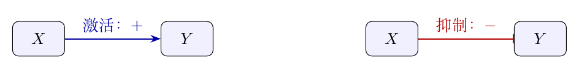

**图 1.1**　调控边的记号。箭头表示产生率随调控变量增加，钝头表示产生率下降；边的符号不能单独指定结合机制。

标准连续模型为

$$
\dot x_i=F_i(\boldsymbol{x};\boldsymbol{u})-\gamma_i x_i,\qquad F_i\geq0,\quad\gamma_i\gt 0.
$$

其中 $F_i$ 为有效产生率，$\boldsymbol{u}$ 为外部输入，$\gamma_i$ 汇总一阶降解及相应的稀释效应。讨论稳态时固定输入；讨论响应时再指定输入怎样变化。同一组初始浓度能否决定唯一一条轨迹，是后面所有相图分析的前提。一个常用的保证条件叫*局部 Lipschitz（利普希茨）连续*：在每个所考察状态附近，变化率 $\boldsymbol{v}(\boldsymbol{x})$ 满足

$$
\|\boldsymbol{v}(\boldsymbol{x})-\boldsymbol{v}(\boldsymbol{y})\|\leq L\|\boldsymbol{x}-\boldsymbol{y}\|,
$$

其中 $L$ 是局部范围内的有限常数，$\|\cdot\|$ 表示状态之间的距离。直观地说，浓度只改动一点，变化率也只能改动有限的一点，不能在很小的浓度差上出现无限陡的变化。这个条件比“曲线不断开”更强，却不要求每个位置都有斜率；它保证同一起点不会分叉出两种未来。例如 $v(x)=|x|$ 满足 $|v(x)-v(y)|\leq|x-y|$，可取 $L=1$；虽然零点处有尖角、没有导数，它仍然是 Lipschitz 连续的。“局部”表示不同浓度范围可以用不同的 $L$，并不是要求整个浓度空间共用一个限制。

使用导数分析小扰动时，本文通常进一步假设产生率为 $C^1$。这个记号表示*函数可求一阶导数，且一阶导数连续*：不仅曲线不断开，斜率本身也连续变化。$C^1$ 函数在足够小的范围内满足上述 Lipschitz 条件，因此本文的 Hill 等常见模型可以同时支持唯一轨迹和斜率分析。这些是假设在所分析的浓度范围内成立；若模型有开关式跳变或边界处无限陡的斜率，就要重新检查。

*稳态*指产生与损失平衡、浓度不再变化。*稳定*指小偏差下轨迹始终留在附近；若偏差逐渐消失，则称为*渐近稳定*。局部结论只涉及稳态附近，不代表所有初始浓度都回到它。 所有回路共享同一个骨架：分子通过反应产生和消耗。先把这个骨架写清楚，再讨论哪些微观变量可以消去，以及调控如何进入产生率。

### 从反应规则建立表达模型

对于 $\sum_i\alpha_{ir}X_i\xrightarrow{k_r}\sum_i\beta_{ir}X_i$，质量作用律给出 $v_r(\boldsymbol{x})=k_r\prod_i x_i^{\alpha_{ir}}$，以及

$$
\dot{\boldsymbol{x}}=S\boldsymbol{v}(\boldsymbol{x}),\qquad S_{ir}=\beta_{ir}-\alpha_{ir}.
$$

其中 $S$ 记录每次反应使各类分子增加或减少多少，$v_r$ 则表示第 $r$ 个反应发生得多快。例如一次反应消耗一个 $X$、产生两个 $Y$，对应的变化量就是 $-1$ 和 $+2$。对于 $\varnothing\xrightarrow{\alpha}X$, $X\xrightarrow{\gamma}\varnothing$，

$$
\dot x=\alpha-\gamma x,\qquad x(t)=\frac\alpha\gamma+\left(x(0)-\frac\alpha\gamma\right)e^{-\gamma t}.
$$

这个解把后文的基线完整地展示出来：唯一稳态是 $x^*=\alpha/\gamma$，任何非负初值与它的差都以 $e^{-\gamma t}$ 衰减，恢复时间为 $1/\gamma$。没有反馈时，系统不会选择多个长期状态。

蛋白质的产生通常还经过转录和翻译。保留 mRNA 时，反应与方程为

$$
\begin{aligned}
\varnothing\xrightarrow{k_m}M,\quad M\xrightarrow{\delta_m}\varnothing,\quad M\xrightarrow{k_p}M+P,\quad P\xrightarrow{\delta_p}\varnothing,\\
\dot m=k_m-\delta_m m,\qquad\dot p=k_pm-\delta_p p.
\end{aligned}
$$

仅当 mRNA 恢复远快于蛋白质变化时，可近似令 $m\simeq k_m/\delta_m$；若研究振荡或短时间响应，该时间尺度消去可能失效。

要判断上述消去何时可靠，可以先把两阶段模型完整解出来。记两个稳态浓度为

$$
m^*=\frac{k_m}{\delta_m},\qquad p^*=\frac{k_pk_m}{\delta_p\delta_m}.
$$

分别把两个方程乘以相应的指数因子再积分，这种方法称为*积分因子法*；指数因子帮助把左边合成一个乘积的导数，从而得到

$$
\begin{aligned}
m(t)&=m^*+(m_0-m^*)e^{-\delta_mt},\\
p(t)&=p^*+(p_0-p^*)e^{-\delta_pt}
 +k_p(m_0-m^*)\frac{e^{-\delta_mt}-e^{-\delta_pt}}{\delta_p-\delta_m}.
\end{aligned}
$$

当 $\delta_p=\delta_m=\delta$ 时，最后一项取极限为 $k_p(m_0-m^*)te^{-\delta t}$。各项均随时间减小到零，所以无论从什么非负浓度出发，两个变量最终都会回到同一个稳态。若转录率变为随时间变化的 $r(t)$，则 $m(t)=m_0e^{-\delta_mt}+\int_0^t e^{-\delta_m(t-s)}r(s)\mathrm{d} s$。 如果转录率 $r(t)$ 为 $C^2$（有连续的一阶和二阶导数，即变化速度及其变化也连续），并且输入变化的时间尺度远长于 mRNA 的恢复时间，那么起始时的快速调整结束后，即 $t\gg1/\delta_m$，就可以把积分近似写成 $m(t)\simeq r(t)/\delta_m-\dot r(t)/\delta_m^2$。故仅有 $\delta_m\gg\delta_p$ 还不够，输入与其他调控变量也必须在 mRNA 时间尺度上缓慢变化。

这些速率也决定了自然的时间和浓度单位。若物理浓度 $P$ 满足 $\dot P=A+B P^n/(K_P^n+P^n)-\gamma P$，取 $x=P/K_P$、$\tau=\gamma t$，则 $\mathrm{d} x/\mathrm{d}\tau=a+b x^n/(1+x^n)-x$，其中 $a=A/(\gamma K_P)$、$b=B/(\gamma K_P)$。后文的阈值应在对应单位下解读。

### 从启动子结合到有效调控

前面的产生率是常数。若调控因子与启动子结合，不同结合状态可以有不同转录率，产生率就成为调控因子浓度的函数。考虑 $D+X\rightleftharpoons DX$，令总启动子浓度 $D_T=[D]+[DX]$ 守恒。固定游离调控因子浓度 $x$ 时，平衡条件为

$$
k_{\rm on}[D]x=k_{\rm off}[DX],\qquad K_d=\frac{k_{\rm off}}{k_{\rm on}}=\frac{[D]x}{[DX]}.
$$

把守恒关系代入，得到结合概率 $p=[DX]/D_T=x/(K_d+x)$。若未结合与已结合的转录速率分别为 $r_0,r_1$，对两个状态加权就有

$$
F(x)=r_0(1-p)+r_1p=r_0+(r_1-r_0)\frac{x}{K_d+x}.\tag{1.8}
$$

由这个式子直接看出，$r_1\gt r_0$ 是激活，$r_1\lt r_0$ 是抑制；结合本身的存在并不能决定调控符号。这里的 $x$ 是游离浓度。若结合显著耗竭调控因子，还需要同时解其守恒关系，不能把总浓度直接代入。

这种有效产生率把启动子状态隐藏在占据概率中，因此还须检查启动子能否足够快地跟上浓度变化。固定 $x$ 时，结合概率满足

$$
\dot p=k_{\rm on}x(1-p)-k_{\rm off}p,
$$

启动子接近结合平衡的速率为 $k_{\rm on}x+k_{\rm off}$。如果结合与解离远快于表达量的变化，就可以近似认为：浓度每次改变后，启动子几乎立即重新达到相应的结合比例。这就是后文所说的“准平衡”近似。Hill（希尔）函数 $x^n/(K^n+x^n)$ 则进一步把复杂结合压缩为有效的陡峭响应；$n$ 不应直接解读为实际结合分子数。多个操纵位点、协同结合及 DNA 成环（DNA looping，即远隔的 DNA 区段通过结合蛋白靠近）等机制都可能改变这种压缩的具体形式。

产生率的非负性和一阶降解还有一个共同作用：确保模型始终描述有物理意义的浓度。当浓度降到 $x_i=0$ 时，有 $\dot x_i=F_i\geq0$，变化方向只能向上或暂时不变，所以浓度不会继续降成负数。在上述唯一轨迹的条件下，从非负浓度出发就始终保持非负；数学上称为非负浓度区域的*正向不变性*。“正向”指随着时间向前演化，“不变”指轨迹不会离开这个区域。把方程两侧乘以 $e^{\gamma_i t}$ 再积分，还可以写出：

$$
x_i(t)=e^{-\gamma_it}x_i(0)+\int_0^t e^{-\gamma_i(t-s)}F_i(\boldsymbol{x}(s))\mathrm{d} s.
$$

如果产生率进一步有上界 $F_i\leq M_i$，就得到

$$
0\leq x_i(t)\leq x_i(0)e^{-\gamma_it}+\frac{M_i}{\gamma_i}(1-e^{-\gamma_it}).
\tag{1.9}
$$

这个上界说明，产生率最高为 $M_i$ 时，一阶降解会限制浓度的增长；它不会在有限时间内升到无限大，方程也能一直计算下去。后文的 Hill 产生率都有这样的上限。接下来可以据此分析系统最终停在哪里，以及不同初始状态会不会导致不同结果。

## 第二章　一个变量：自反馈、双稳态与记忆

现在让产生率依赖蛋白质自身。单个动态变量只能沿浓度轴运动，但产生曲线的形状已经能决定系统是回到唯一表达水平，还是在不同长期状态之间作出选择。

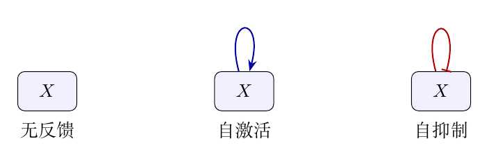

**图 2.1**　单节点的三种符号拓扑。所有模型仍包含产生与降解；自边表示自身浓度对产生率的作用。

### 单基因反馈：恢复、双稳态与迟滞

无反馈模型的产生率恒为 $\alpha$。自抑制把它改成随 $x$ 非增的 $F(x)$，例如 $F(x)=a/(1+(x/K)^n)$。浓度上升时，产生减少而降解增加，两种作用都将浓度拉回。

把这种直觉写成方程，令 $f(x)=F(x)-\gamma x$，假设产生率 $F(x)$ 非负、有界、非增且为 $C^1$。这里“有界”就是有一个有限上限，“非增”表示浓度增加时产生率不会上升，$C^1$ 则保证可以连续地计算斜率。$f$ 就严格递减，且 $f(0)\geq0$、$f(x)\to-\infty$。因此产生曲线与降解直线恰好相交一次，稳态 $x^*$ 唯一，允许它位于边界 $x^*=0$。

不仅稳态唯一，所有非负初值也都会趋于它。令浓度偏差 $e=x-x^*$，则

$$
\frac12\frac{\mathrm{d}}{\mathrm{d} t}e^2=e\{F(x)-F(x^*)\}-\gamma e^2\leq-\gamma e^2,
$$

因为 $F$ 非增，浓度偏差与产生率偏差的乘积不可能为正。积分可得

$$
|x(t)-x^*|\leq e^{-\gamma t}|x(0)-x^*|.
$$

式 [(1.9)](#eq-bound)说明浓度不会无限增大，所以这个恢复速度的估计可以一直使用。若 $F'(x^*)\lt 0$，小扰动满足 $\dot e\simeq(F'(x^*)-\gamma)e$，小偏差减小到原来约 $37\%$ 所需的时间为 $1/(\gamma-F'(x^*))$，短于无反馈的 $1/\gamma$。这把“自抑制促进恢复”落实为具体速率；它描述的是稳态附近的小偏差；输入变化很大时，还要直接计算整条时间轨迹。

自激活的方向相反：浓度上升也会提高产生率，偏差可能被放大。于是一个自然的问题是，这种放大能否使系统保留不同表达状态？取

$$
\dot x=a+b\frac{x^n}{K^n+x^n}-\gamma x.\tag{2.1}
$$

稳态是产生曲线与线性降解直线的交点。局部稳定条件为

$$
F'(x^*)-\gamma\lt 0.
$$

图 [2.2](#fig-auto) 的参数 $a=0.05,b=3.5,K=\gamma=1,n=4$ 产生三个稳态，外侧稳定，中间不稳定。关键不是正反馈必然双稳态，而是正反馈与足够的非线性产生多个交点。改变参数时，两个交点可能靠近并合在一起，再一起消失。合并的临界位置称为“折叠点”：此时产生曲线与降解直线不仅相交，斜率也相同，即 $F(x^*)=\gamma x^*$ 和 $F'(x^*)=\gamma$。

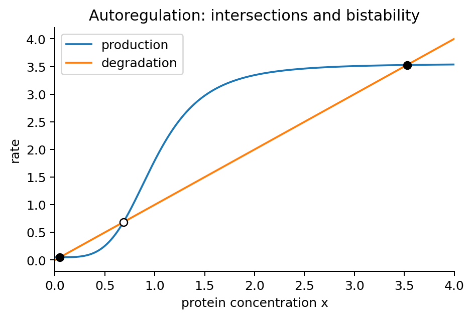

**图 2.2**　自激活模型的产生率与降解率，实心点为稳定的稳态，空心点为不稳定的稳态。

先判断交点两侧的运动方向，再问交点何时会成对出现。对只有一个浓度变量的 $C^1$ 方程，若 $f'(x^*)\lt 0$，则足够靠近稳态时 $f$ 在左侧为正、右侧为负，轨道向稳态运动；若 $f'(x^*)\gt 0$ 则方向相反。如果交点处的斜率为零，就需要再看它左右两侧的实际变化方向，不能只凭这个斜率判断。对式 [(2.1)](#eq-auto)，

$$
F'(x)=\frac{bnK^nx^{n-1}}{(K^n+x^n)^2}.
$$

当 $n\gt 1$ 时该导数的唯一最大值出现在 $x_m=K((n-1)/(n+1))^{1/n}$：令 $h=x/K$，对 $h^{n-1}/(1+h^n)^2$ 求导，驻点条件为 $(n-1)-(n+1)h^n=0$。因此

$$
\max F'=\frac bK\frac{(n+1)^2}{4n}
\left(\frac{n-1}{n+1}\right)^{(n-1)/n}.
$$

若该值小于 $\gamma$，$f$ 严格递减，稳态唯一；超过 $\gamma$ 只是出现多交点的必要条件，仍需选择合适的 $a$。 令 $q=(x^*/K)^n$，联立折叠条件可参数化为

$$
b_{\rm fold}=\frac{\gamma K}{n}q^{(1-n)/n}(1+q)^2,\qquad
a_{\rm fold}=\frac{\gamma K}{n}q^{1/n}(n-1-q).
$$

这是由 $F'=\gamma$ 先解出 $b$，再代入 $a=\gamma x-bq/(1+q)$ 得到。对 $a\gt 0$ 需 $0\lt q\lt n-1$。通常的折叠分岔还要求 $f''\ne0$，称为一个*非退化条件*。“分岔”指参数变化使稳态或轨迹的类型发生改变；“非退化”在这里指相切处仍有明确的弯曲，两个交点的合并不是更特殊的平坦情形。若连弯曲程度也为零，交点怎样变化就需要进一步分析。

把条件落实到图中的参数，也能解析地确认这三个交点。取 $f(x)=0.05+3.5x^4/(1+x^4)-x$，有 $f(0)\gt 0$、$f(0.1)\lt 0$、$f(1)\gt 0$、$f(4)\lt 0$，所以三个互不相交的区间 $(0,0.1)$、$(0.1,1)$、$(1,4)$ 各含至少一个根。上面的计算说明 $f'$ 最多有两个零点，也就是说曲线最多改变两次升降方向。若 $f$ 有四个交点，相邻交点之间就至少需要三个斜率为零的位置，超过了这个上限。这用到了*Rolle（罗尔）定理*：一条可求导的曲线在两端取相同值时，中间至少有一处斜率为零。因此三个交点就是全部结果。两个极值分别严格低于、严格高于零，因此三个根均不在极值点处，斜率依次为负、正、负。中间的不稳定交点构成一道分界：初始浓度在它以下时趋于低表达态，在它以上时趋于高表达态。短暂扰动跨过此阈值可造成持久状态切换。

上述例子有两个稳定交点，因此具有*双稳态*。这里的“双”指同一组参数、同一个固定外部输入下，有两个能吸引附近轨迹的长期状态；两个交点本身还不够，必须检查它们的稳定性。下面把“可能出现三个交点”进一步变成可直接判断的参数条件。

固定 $b,K,n,\gamma$，假设 $n\gt 1$ 且 $\max F'\gt \gamma$。因为 $F'$ 先增后减，方程 $F'(x)=\gamma$ 有两个正根 $x_-\lt x_+$。于是 $f=F-\gamma x$ 在 $x_-$ 处取局部最小值，在 $x_+$ 处取局部最大值。令

$$
a_{\rm up}=\gamma x_--b\frac{x_-^n}{K^n+x_-^n},\qquad
a_{\rm down}=\gamma x_+-b\frac{x_+^n}{K^n+x_+^n}.
$$

则 $f(x_-)=a-a_{\rm up}$、$f(x_+)=a-a_{\rm down}$。两个极值之间 $f$ 严格增加，所以 $a_{\rm down}\lt a_{\rm up}$。在物理范围 $a\gt 0$ 内，*恰有三个不同稳态的充要条件*是

$$
a_{\rm down}\lt a\lt a_{\rm up}.
$$

证明可以按三个单调区间逐段看：$f(0)=a\gt 0$，第一个极小值为负，随后极大值为正，最后 $f(x)\to-\infty$，每一段恰好经过零一次。反过来，若有三个不同交点，极小值必须低于零、极大值必须高于零，否则至少一段没有交点。这就补上了“正反馈足够强”之后仍需检查的截距条件。若下阈值为负，非负的基础产生率未必能跨过它；实验上能否完整观察迟滞，还要看实际可调参数的范围。

记三个根为 $x_L\lt x_U\lt x_H$。变化率的符号依次是

$$
\begin{array}{c|cccc}
x &(0,x_L)&(x_L,x_U)&(x_U,x_H)&(x_H,\infty)\\\hline
\dot x&+&-&+&-
\end{array}
$$

因此 $x_L,x_H$ 渐近稳定，$x_U$ 不稳定。进一步地，唯一性保证轨迹不能穿过一个稳态；位于 $x_U$ 以下的轨迹向 $x_L$ 单调运动，位于其以上的轨迹向 $x_H$ 单调运动。单调且有界的轨迹有极限；若极限处 $f$ 不为零，变化率就会在附近保持一个非零大小，轨迹不可能停下来，所以极限必为相应稳态。由此得到完整的*吸引域*：$[0,x_U)$ 属于低态，$(x_U,\infty)$ 属于高态，而初值恰为 $x_U$ 才会一直停在分界上。吸引域就是“哪些初始状态最终进入同一个长期状态”的集合。

还可以定义一维*势函数*

$$
V(x)=-\int_0^x f(\xi)\mathrm{d}\xi,\qquad
\frac{\mathrm{d} V(x(t))}{\mathrm{d} t}=-f(x(t))^2\leq0.
$$

稳定交点对应势谷，不稳定交点对应势垒。这个图像解释了为何小扰动会被拉回、跨过阈值的扰动却能改变长期状态。这里的 $V$ 是从方程构造的数学函数，通常不是分子的热力学自由能；两个势谷也不要求等深，才能形成确定性的双稳态。没有额外扰动时，轨迹不会自行跨过分界。

*迟滞*进一步涉及改变参数，而不仅是选择不同初值。若缓慢提高基础产生率 $a$，低态会沿自身分支保持到 $a_{\rm up}$，再跳到高态；反向降低 $a$，高态则保持到 $a_{\rm down}$ 才消失。两次切换阈值不同，所以相同输入下的输出取决于此前是从低态还是高态到来。也可以固定 $a$、调节反馈强度 $b$，得到图 [2.3](#fig-bistability-branches)。参数变化必须相对恢复足够慢，才能近似跟随稳态分支；较快扫描还可能带来额外的动态滞后，不能把所有滞后都解释为静态双稳态。

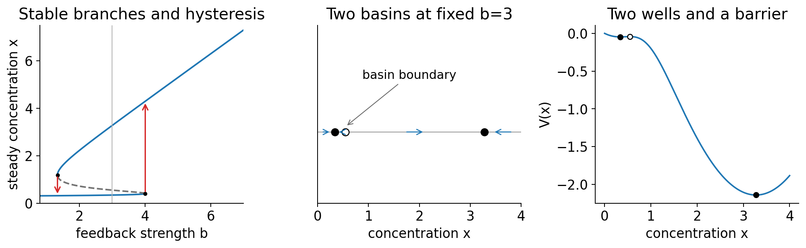

**图 2.3**　把双稳态、阈值与迟滞放在同一张图中。左：固定 $a=0.3,K=\gamma=1,n=4$，随反馈强度 $b$ 改变的稳态分支；实线稳定、虚线不稳定，箭头表示慢扫描时的切换方向。中：双稳态区中的运动方向及吸引域分界。右：相同参数下构造的势函数，两个谷之间由势垒隔开。数值只用于绘图，分支和吸引域由正文论证。

折叠点附近还会出现*临界减慢*。设控制参数为 $a$，折叠点为 $(x_c,a_c)$，此时 $f=f_x=0$、$f_{xx}\ne0$ 且 $f_a=1$。令 $\eta=x-x_c$、$\mu=a-a_c$，Taylor 展开给出

$$
\dot\eta=\mu+\frac12f_{xx}(x_c,a_c)\eta^2
 +O(|\eta|^3).
$$

“$O$”表示被省略的项至多按括号内的量级增长。稳态靠近临界点时，两个分支的距离按 $\sqrt{|\mu|}$ 缩小，稳定分支上的恢复斜率 $|f_x|$ 也按 $\sqrt{|\mu|}$ 趋于零，故小扰动恢复时间约为 $1/|f_x|$，会越来越长。这个结论说明：开关尚未切换之前，就可能变得恢复很慢。它来自光滑、非退化折叠的局部展开；退化点需保留更高阶项。

两个稳定表达态已经足以构成记忆，却还不足以构成时钟。对*一维自治方程* $\dot x=f(x)$，“一维”表示只有一个动态变量，“自治”表示变化率由当前状态决定、不显式依赖时间。如果外部条件固定、也没有延迟，那么同一个浓度 $x$ 总对应同一个变化方向。浓度在一个区间里一直上升，就不能在没有其他变化的情况下突然掉头下降。

可以把这一点完整地论证出来。假设有一条重复往返的轨迹，周期为 $T$。它在一个周期内一定有最高浓度 $x_m$。最高点处的变化率为零，所以 $f(x_m)=0$，也就是说这里已经是稳态。从这个浓度出发，始终停在 $x_m$ 就满足原方程；同一初始浓度又只能产生一条轨迹，因此原来的轨迹也只能停在那里，与“重复往返”矛盾。

所以，一个变量可以提供不同表达状态之间的选择，但在这些假设下不能自行维持振荡。要寻找持续振荡，需要增加动态环节，或者另行考虑延迟、随时间变化的输入等因素。

一维自反馈已经说明，记忆可以由同一个表达变量的两个吸引态产生，而持续振荡需要增加动态环节。下一章进入两个变量的浓度平面：先建立稳定性与相图分析，再研究互抑制怎样用两个基因的表达差异形成另一种开关。

## 第三章　两节点回路与 81 种符号拓扑

增加第二个变量后，轨道从浓度轴进入平面。新节点可以只是接收上游信号，也可以将作用传回上游。先比较这两种连接，才能看出闭环符号如何影响扰动，以及二维模型是否已经足以振荡。

### 信号传递、闭环稳定性与振荡限制

$$
\dot x=\alpha_x-\gamma_xx,\qquad\dot y=G(x)-\gamma_yy.
$$

$x$ 的稳态先独立确定，再决定 $y$。纯前向连接不能让 $y$ 反过来影响 $x$；它改变输出幅度、响应时间和滤波性质，而不是构成闭合反馈回路。

这一连接的长期状态可以按上游、下游的顺序确定。若 $G$ 连续非负，则 $x^*=\alpha_x/\gamma_x$、$y^*=G(x^*)/\gamma_y$ 唯一。上游的小偏差按速率 $\gamma_x$ 衰减，下游自身的偏差按速率 $\gamma_y$ 衰减。要进一步确认下游最终确实跟到对应的稳态，可以直接看它的解：

$$
y(t)=e^{-\gamma_yt}y_0+\int_0^t e^{-\gamma_y(t-s)}G(x(s))\mathrm{d} s.
$$

当 $x(s)\to x^*$ 时，$G(x(s))$ 也趋于 $G(x^*)$。积分中较早的输入影响会随时间衰减，较晚的输入又已接近稳态值，因此 $y(t)\to y^*$。如果上游在稳态附近有小幅、反复的变化，设重复一次所需的时间为 $T$，角频率为 $\omega=2\pi/T$，那么上游变化 $\delta x$ 与下游变化 $\delta y$ 的幅度和时间滞后关系为 $\delta y(i\omega)/\delta x(i\omega)=G'(x^*)/(\gamma_y+i\omega)$：高频幅值被抑制，相位发生滞后。这个关系把上游浓度变化作为输入；若改变的是上游产生率，则还要考虑上游浓度本身需要多久才能跟上。

最简单的无自反馈模型是

$$
\dot x=f(y)-\gamma_xx,\qquad\dot y=g(x)-\gamma_yy.\tag{3.2}
$$

两条边可以是 $++$（互激活）、$--$（互抑制）、$+-$ 或 $-+$（一激活一抑制）。要知道轻微偏离稳态后会怎样，可以对方程作*线性化*，也就是用稳态附近的斜率近似曲线，只保留小偏差的一阶影响，把它们整理成下面的矩阵 $J$，通常称为雅可比矩阵。对角项表示每个变量自身的恢复作用，另外两项表示一个变量怎样影响另一个：

$$
J=\begin{pmatrix}-\gamma_x&f'(y^*)\\g'(x^*)&-\gamma_y\end{pmatrix},\quad \operatorname{tr}J=-\gamma_x-\gamma_y\lt 0,\quad\det J=\gamma_x\gamma_y-f'g'.
$$

正反馈时 $f'g'\gt 0$，两个节点会沿回路放大某些偏差。当 $f'g'\gt \gamma_x\gamma_y$，这股放大作用超过降解的恢复作用，至少有一种偏差会越变越大；另一个方向的偏差仍会恢复，这样的稳态叫“鞍点”。是否还存在另外两个稳定状态，需要继续寻找所有产生与降解平衡的位置。负反馈时 $f'g'\lt 0$，这个模型的稳态附近偏差会衰减，有时还会边衰减边上下摆动。

这里判断的是偏差随时间放大还是缩小。偏差可以分成两种基本变化方式，每一种都带有 $e^{\lambda t}$ 这样的时间因子，$\lambda$ 称为特征值。$\lambda\lt 0$ 表示这一种偏差衰减，$\lambda\gt 0$ 表示它增长；若 $\lambda$ 是复数，偏差还会在增长或衰减的同时摆动，增长还是衰减由它的实部决定。令 $q=f'(y^*)g'(x^*)$，把两种变化方式的特征值写出来，得到

$$
\lambda_{\pm}=-\frac{\gamma_x+\gamma_y}{2}
\pm\sqrt{\frac{(\gamma_x-\gamma_y)^2}{4}+q}.
$$

这两个数满足 $\lambda^2+(\gamma_x+\gamma_y)\lambda+\gamma_x\gamma_y-q=0$。前面写出的 $\operatorname{tr}J$ 称为*迹*，是对角项之和；$\det J$ 称为*行列式*，对这里的二维矩阵就是两个对角项的乘积减去两个交叉项的乘积。它们分别对应两个特征值的和与积，因此能用来判断偏差会怎样变化。若 $\det J\gt 0$，两个实数特征值的和为负、积为正，所以都为负；若它们是复数，共同的实部为 $-(\gamma_x+\gamma_y)/2$，也为负。两种情况都表示偏差会衰减。若 $\det J\lt 0$，两个特征值一正一负，出现鞍点。若 $\det J=0$，至少有一个特征值为零，仅看稳态附近的斜率还不能判断这个方向会怎样。 负反馈的衰减振荡条件进一步是 $q\lt -(\gamma_x-\gamma_y)^2/4$，所以负反馈符号本身甚至不保证*衰减*振荡；正反馈 $q\gt 0$ 则两种变化方式都不会带有这种摆动。

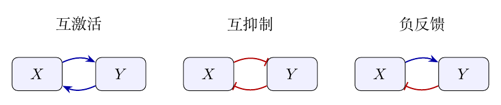

**图 3.1**　两个交叉边形成的反馈。互激活与互抑制均为正回路；一激活一抑制为负回路。交换节点得到另一种带标签的负回路。

在负反馈下，局部稳定还可以与稳态的唯一性联系起来。假设 $f,g$ 非负、有界且为 $C^1$，并且一个随输入增加而严格上升，另一个严格下降。在稳态方程中消去 $y$，得到

$$
x=T(x):=\frac1{\gamma_x}f\!\left(\frac{g(x)}{\gamma_y}\right).
$$

经过一正一负两次调控，$T$ 不会随 $x$ 增加而上升，而且有上限。所以 $T(x)-x$ 一直下降，在零处非负，$x$ 足够大时为负，恰好经过零一次。随后 $y=g(x)/\gamma_y$ 也唯一。又有 $q\leq0$，由上面的计算，两种偏差都只能衰减，因此这个唯一稳态在小偏差后能逐渐恢复。这与单节点自抑制相呼应：闭环总体为负时，偏差受到恢复作用；两个变量则额外允许恢复过程带有衰减振荡。

边衰减边摆动，仍然是逐渐回到稳态；持续振荡则要求轨迹每隔一段时间回到原处，并重复同样的变化。对式 [(3.2)](#eq-two)，可以排除后一种情况，原因是这个模型始终使浓度平面中的面积收缩。这是*Bendixson 判据*在此模型中的应用：若一个没有空洞的平面区域内，散度始终严格为同一符号，就不存在非恒定周期轨道。下面解释为什么面积收缩会产生这个限制。

把两个变化率写成 $\boldsymbol{v}=(f(y)-\gamma_xx,g(x)-\gamma_yy)$，则沿各自浓度方向计算斜率并相加，有

$$
\frac{\partial\dot x}{\partial x}+\frac{\partial\dot y}{\partial y}=-\gamma_x-\gamma_y\lt 0.
$$

这个和称为“散度”。它为负，表示一小片初始状态经过同样一段时间的演化后，占据的面积会缩小。

假如存在一条不断重复的轨迹，它在浓度平面上就围成闭合曲线 $C$，内部区域记为 $\Omega$。轨迹不会自相交，因为同一组浓度只能对应一种后续变化。还假设这条曲线及其内部都处于方程可以正常使用的范围内。数学上常通过*单连通区域*保证这一点：直观地说，区域中没有空洞，区域内的闭合曲线所围住的内部也属于这个区域。沿曲线，变化方向与曲线相切，没有穿过边界向外的净流动；但内部处处收缩又要求净流动小于零。平面散度定理把“沿边界的净流动”与“内部收缩率的总和”联系起来，因此这两种说法可以写成同一个面积关系：

$$
0=\oint_C\boldsymbol{v}\cdot\boldsymbol{n}\,\mathrm{d}\ell
=\iint_\Omega\nabla\cdot\boldsymbol{v}\,\mathrm{d} x\mathrm{d} y
=-(\gamma_x+\gamma_y)\operatorname{Area}(\Omega)\lt 0,
$$

相互矛盾。左边沿边界计算净向外流动，右边把内部的收缩率加起来；$\boldsymbol{n}$ 表示指向边界外侧的方向。因此该模型没有持续重复的非恒定轨迹。

这里用到了“没有自调控”和“一阶降解”。换成其他二维负反馈模型，收缩率未必始终为负，结论也可能改变。另外，没有持续振荡并不等于所有初始状态都回到同一个稳态：正反馈仍可能形成多个长期状态。

前面的线性化与面积收缩已经区分了局部恢复、鞍点和持续振荡。下面先用一个具体的二维正反馈模型，把稳态存在、稳定性和吸引域一起算清楚，再扩展到全部符号拓扑。

### 互抑开关：对称破缺与状态选择

负反馈倾向于恢复，正反馈则可能放大两个节点之间的差异。互抑制尤其直观：$X$ 增多会压低 $Y$，较低的 $Y$ 又解除对 $X$ 的抑制，最初的表达优势于是被增强。用下面的无量纲模型分析这一过程：

$$
\dot x=\frac{a}{1+y^n}-x,\qquad\dot y=\frac{a}{1+x^n}-y.\tag{3.4}
$$

先把两条变化率分别设为零，得到 $x=a/(1+y^n)$ 与 $y=a/(1+x^n)$。这样的曲线称为“零流线”：在一条线上 $x$ 暂时不变，在另一条线上 $y$ 暂时不变；两条线的交点处两个变量都不变，就是稳态。图 [3.2](#fig-toggle) 展示 $a=3,n=3$ 的示例：两个不对称表达态和中间的对称稳态。再检查这些交点附近的小偏差会恢复还是被放大，就能判断它们是否稳定。该模型展示状态选择的最小机制，但生物学中的细胞命运并不等同于某一对基因浓度。

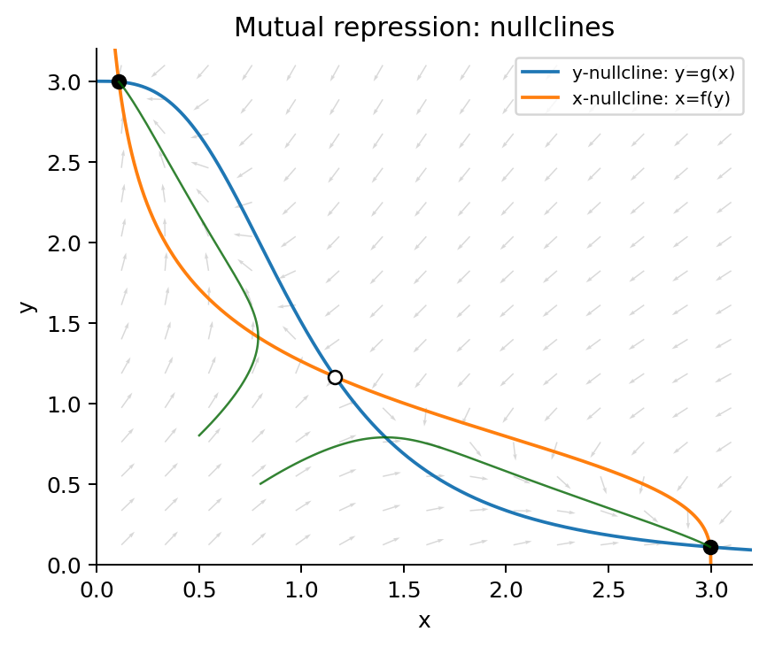

**图 3.2**　互抑开关的零流线与相流（$a=3,n=3$）。实心点稳定，空心点为鞍点；绿色轨迹分别趋于两种不对称表达态。

先从两个基因表达相同的状态开始，问微小的不对称是否会增长。令 $x=y=s$，则 $a=s(1+s^n)$；右侧在 $s\geq0$ 严格递增，故对称稳态唯一。记交叉斜率的绝对值为 $h=ns^n/(1+s^n)$，雅可比为 $\begin{pmatrix}-1&-h\\-h&-1\end{pmatrix}$。 如果两个浓度同时增加同样的一小点，偏差按 $e^{(-1-h)t}$ 衰减；如果一个增加、另一个减少同样的一小点，差异则按 $e^{(-1+h)t}$ 变化。这分别对应特征值 $-1-h$ 与 $-1+h$。当 $n\gt 1$ 时，后者过零的阈值为

$$
s_c=(n-1)^{-1/n},\qquad a_c=\frac n{n-1}(n-1)^{-1/n}.
$$

当 $n\leq1$ 时有限 $s\gt 0$ 下 $h\lt 1$，对称态不会经这一线性机制失稳。阈值只判断对称态；不对称态的存在和稳定性仍须证明。

对于图中的 $a=3,n=3$，可以继续把所有稳态解出来，从而确认系统有一个对称鞍点和两个稳定的不对称表达态。 稳态满足 $x+xy^3=3$、$y+yx^3=3$，故 $x,y\gt 0$。相减得 $(x-y)[1-xy(x+y)]=0$。对称解满足 $s+s^4=3$，严格单调性保证唯一；又 $s\gt 1$，故 $h=3s^3/(1+s^3)\gt 1$，是鞍点。 不对称时令 $S=x+y$、$P=xy$，有 $PS=1$。相加得 $S+P(S^2-2P)=6$，即 $S-S^{-2}=3$。左侧在 $S\gt 0$ 严格递增，故恰有一个解，且 $S\gt 3$。二次方程 $t^2-St+1/S=0$ 的判别式 $S^2-4/S\gt 0$，两根均正；交换两根得恰好两个不对称解。此和、差条件亦反推出原两条稳态方程，未引入额外解。 在这些点，两个交叉斜率均等于 $-3x^2y^2/a=-P^2$，特征值为 $-1\pm P^2$。因为 $P=1/S\lt 1/3$，两根均负。三种分支已穷尽所有稳态。小的不对称在鞍点附近被放大，而两个不对称态附近的偏差又被压回去；这两步共同构成了开关的状态选择与保持。

只计算 $a=3$ 还看不出开关怎样出现。对于整个 $n=3$ 参数族，上述消元可以原样保留：不对称稳态必须满足

$$
P=1/S,\qquad a=S-S^{-2},\qquad
x,y=\frac{S\pm\sqrt{S^2-4/S}}2.
$$

函数 $S-S^{-2}$ 在 $S\gt 0$ 严格递增，而两个不同正根存在恰好要求 $S^3\gt 4$。因此不对称稳态出现的阈值为

$$
S_c=\sqrt[3]4,\qquad a_c=S_c-S_c^{-2}=\frac3{2^{4/3}},
\qquad x=y=s_c=2^{-1/3}.
$$

$a\lt a_c$ 时只有对称稳态，且 $h\lt 1$、两根特征值都为负；$a\gt a_c$ 时对称态变成鞍点，并且恰好出现两个不对称稳态。后两者的交叉斜率相等，绝对值为 $3P^2/a=3/(S^3-1)$，故

$$
\lambda_\pm=-1\pm\frac3{S^3-1}\lt 0\qquad(S^3\gt 4).
$$

这同时证明了两条新分支的存在与局部渐近稳定，而非只从对称态失稳猜测它们存在。

这种从对称状态分出两种对等选择的变化称为*超临界叉形分岔*：两条稳定分支在临界点连续长出。写表达差 $D=x-y$，有 $D^2=S^2-4/S$。在临界点处

$$
\frac{\mathrm{d} a}{\mathrm{d} S}=\frac32,\qquad
\frac{\mathrm{d}(D^2)}{\mathrm{d} S}=3S_c,
\qquad
D=\pm\sqrt{2S_c(a-a_c)}+O((a-a_c)^{3/2}).
$$

正负两号对应哪一个基因取得表达优势。$a=a_c$ 处线性化有零特征值，所以不能仅用线性斜率下结论。令 $m=(x+y)/2$、$d=(x-y)/2$，把快速恢复的共同表达变量写成 $m=s_c+Md^2+O(d^4)$。在临界点，$f'(s_c)=-1$、$f''(s_c)=0$，故共同表达方程的二阶项给出 $M=0$；直接求导又有 $f'''(s_c)=8s_c$。差异方程因此化为

$$
\dot d=-\frac{4s_c}{3}d^3+O(d^5).
$$

这说明足够小的差异仍被压回零，但恢复是缓慢的代数过程。在领先近似下，

$$
d(t)=\frac{d_0}{\sqrt{1+\frac{8s_c}{3}d_0^2t}}.
$$

恢复不再呈指数形式。这里的*中心流形*近似将快变量随慢差异一起消去，所需系数已在上述展开中算出。越过临界点后，线性增长与三次恢复竞争，形成两条稳定分支。

开关的分界在这个对称模型中也能精确定位。交换 $x,y$ 不改变方程，直线 $x=y$ 正向不变，在其上只有一维恢复到对称稳态。对 $a\gt a_c$，鞍点的稳定方向为 $(1,1)$，不稳定方向为 $(1,-1)$；局部稳定流形恰好就是这条对角线。又令 $D=x-y$，有

$$
\dot D=D\left[\frac{a(x^2+xy+y^2)}{(1+x^3)(1+y^3)}-1\right].
$$

因此 $D$ 的符号保持不变。轨迹有界且最终远离坐标轴，散度恒为 $-2$，排除了周期轨道。两个不对称稳态是吸引点，没有出向连接；鞍点的入向轨迹只在对角线上，也不存在闭合的稳态连接。Poincaré–Bendixson 定理将此类有界平面轨迹的长期极限限制为稳态、周期轨道或稳态连接（参考文献 7）；后两类已排除。鞍点仅吸引对角线上的轨迹，故 $x\gt y$ 的轨迹趋于 $X$ 高表达态，$x\lt y$ 的轨迹趋于 $Y$ 高表达态。这就证明了两个吸引域及其分界。参数不对称时，对角线通常不再是分界，叉形也会展开成偏向一方的分支，需重新分析。

### 81 种拓扑：从结构筛选到动力学机制

前面的模型只保留两条交叉边。允许两个节点分别自激活、自抑制或没有自边后，产生率变为 $F_x(x,y),F_y(x,y)$，一般形式是

$$
\dot x=F_x(x,y)-\gamma_xx,\qquad
\dot y=F_y(x,y)-\gamma_yy.
\tag{3.5}
$$

以下分类假设产生率非负、有界且为 $C^1$，边的符号在所讨论的浓度范围内固定；缺失边表示相应偏导数恒为零。输入固定，没有延迟，也没有其他隐藏动态变量。这样的约定让“一个拓扑”具有可比较的含义；若边会随浓度改变符号，就不属于同一个固定符号类别。

四条边 $(X\to X,X\to Y,Y\to X,Y\to Y)$ 各有 $0,+,-$ 三种选择，所以带标签的情况恰为 $3^4=81$。交换 $X,Y$ 后不变的图需要两条自边相同、两条交叉边相同，共 $3^2=9$ 个；其余图两两配对，故有 $9+(81-9)/2=45$ 个无标签类别。本文先保留标签，方便区分输入、输出及两个节点的不同时间尺度。

81 种拓扑可以先按节点间的连接方式分类，再区分是否存在自激活：没有交叉边有 $9$ 种；恰有一条交叉边有 $2\times2\times9=36$ 种；两条交叉边都存在时，同号与异号各有 $2\times9=18$ 种。每种连接下，自边的 $9$ 种组合中有 $4$ 种完全没有正自边、$5$ 种至少有一条正自边。因此所有情况恰好分成下表的八组。

| 组 | 数目 | 结构 | 先分析什么 |
|:--:|---:|:---|:---|
| R1 | 4 | 无交叉边，无自激活 | 两个独立的恢复过程；每个节点有唯一稳态。 |
| R2 | 5 | 无交叉边，有自激活 | 独立记忆单元；自激活足够强时可有多个表达组合。 |
| R3 | 16 | 单向连接，无自激活 | 有限增益的信号传递；唯一稳态，不能自行持续振荡。 |
| R4 | 20 | 单向连接，有自激活 | 上游状态传给下游，或下游自己存储状态；先后求解两个节点。 |
| R5 | 8 | 同号交叉边，无自激活 | 互激活或互抑制开关；多稳态取决于闭环增益。 |
| R6 | 10 | 同号交叉边，有自激活 | 多个正反馈共同作用；考察状态数、阈值与迟滞，不能经 Hopf 失稳。 |
| R7 | 8 | 异号交叉边，无自激活 | 唯一局部渐近稳定的稳态，可有衰减摆动，无周期轨道。 |
| R8 | 10 | 异号交叉边，有自激活 | 正放大与负恢复竞争；可能出现 Hopf 分岔，也可能只是恢复或多稳态。 |

这些是*结构分组与解析筛选*，不是把每张图标成固定功能。R1 的恢复看起来简单，却可以提供稳定的基线；R3 可以滤去快速噪声；R2、R4 的记忆也不必依赖跨节点闭环。不同结构适合解释恢复、状态选择、时间响应或振荡等不同问题。图 [3.3](#fig-81map)把 81 个组合完整放进同一张索引图；附录还给出逐张回路图与编号，方便查到任何一种情况。

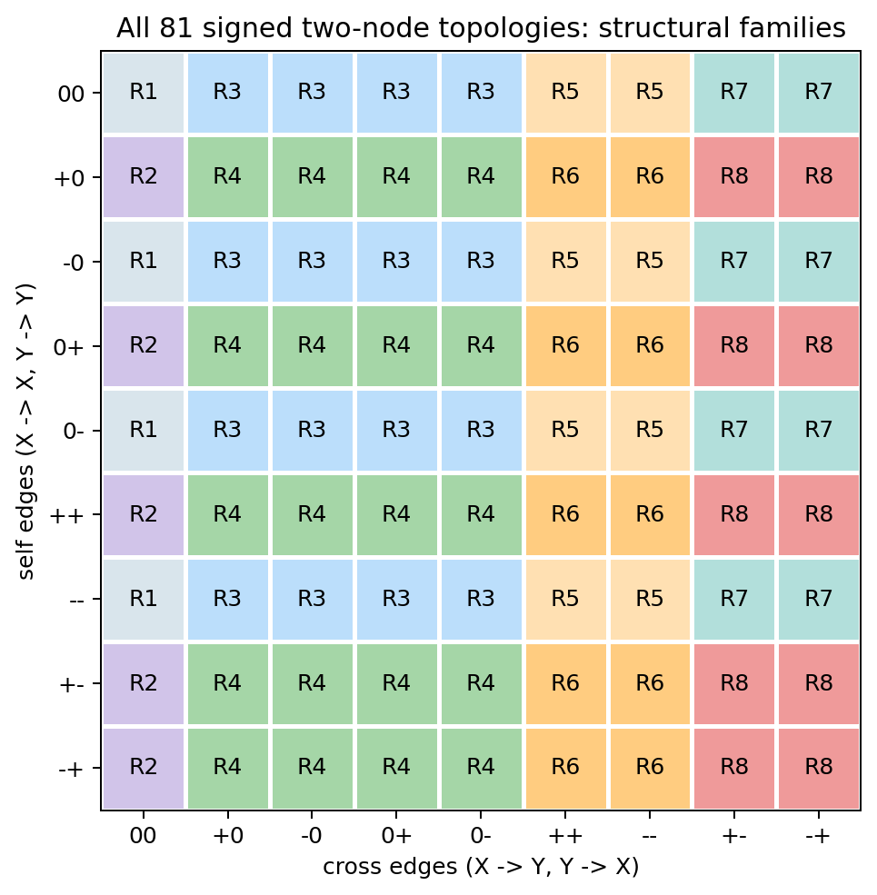

**图 3.3**　完整的 81 种两节点符号拓扑。行是 $(X\to X,Y\to Y)$ 的自边组合，列是 $(X\to Y,Y\to X)$ 的交叉边组合；$0$ 表示缺失。每个格子的 R 编号对应正文八组，颜色表示分组，不表示已经实现某种功能。

R1 与 R2 没有节点间连接，整个系统是两个一维系统并列。R1 的自边只有缺失或抑制，前面的一维恢复论证分别适用。R2 则允许其中一个或两个节点具有自激活；例如两个节点都在双稳态参数区时，每个节点各有低、高两种稳定状态，组合后可以有四种稳定表达状态。这是两份独立记忆，并不需要互抑制。

R3 与 R4 虽然有传递，但作用只有一个方向。先求不受下游影响的节点，再把它的稳态代入下游方程。R3 的两条自边都不会促进自身产生，因此两个步骤各有唯一稳态；上游趋于稳态后，下游也会逐渐跟上。严格地看，下游偏差的恢复率至少为 $\gamma_y$，而上游尚未稳定造成的附加输入会趋于零，所以前面的积分估计仍保证它最终恢复。R4 的任一步都可能因自激活而出现多个解：需要分别问“上游能否选择状态”和“同一上游输入下，下游能否保留不同状态”。这两种记忆机制值得区分。

这四组总共有 $45$ 种，都没有跨节点闭环。它们不能在固定输入下产生非恒定周期轨道：若整个系统周期变化，上游也必须周期变化；一维自治方程迫使上游恒定，随后下游又成为一个一维自治方程，也只能恒定。因此“有两个变量”本身不是振荡机制。

对 R5 与 R6，同号交叉边构成正回路。互激活增强共同表达的变化，互抑制则增强两者之间的差异；它们与自激活一样，都能为状态选择提供放大作用，但还需要足够陡的产生率曲线。一个有用的结构统计是：含至少一条正自边的图有 $81-2^2\times3^2=45$ 种；没有正自边却有正交叉回路的图有 $2\times4=8$ 种，所以含正回路的共有 $53$ 种。

其余 $28$ 种就是 R1、R3、R7。前两组已知只有一个稳态，下面说明 R7 也如此。因此在本文的固定符号、有限产生率模型中，多稳态只能在这 $53$ 种含正回路的图里寻找。这个条件只是筛选入口，不代表这 $53$ 种在任意参数下都会多稳态。

R7 可以保留自抑制。给定 $y$ 时，$F_x(x,y)-\gamma_xx$ 随 $x$ 严格下降，恰有一个零点 $x=h(y)$；同理 $y=k(x)$ 唯一。由定态方程求导，

$$
h'(y)=\frac{\partial_yF_x}{\gamma_x-\partial_xF_x},\qquad
k'(x)=\frac{\partial_xF_y}{\gamma_y-\partial_yF_y}.
$$

分母均为正，两条交叉边异号，所以 $h(k(x))$ 非增，与直线 $x$ 只相交一次。边界处的解也可以由同样的单调性处理。因而 R7 有唯一稳态；两个对角恢复率为负、交叉作用乘积为负，保证它局部渐近稳定。散度在整个区域为负，又排除了周期轨道。可见无反馈、负反馈和弱正反馈都可能表现为恢复，但原因并不相同。

在稳态附近，式 [(3.5)](#eq-two-general)的雅可比可以写成

$$
J=\begin{pmatrix}a&b\\c&d\end{pmatrix},\quad
 a=\partial_xF_x-\gamma_x,\quad d=\partial_yF_y-\gamma_y,
\quad b=\partial_yF_x,\quad c=\partial_xF_y.
$$

这里 $a,d$ 是自身产生与降解合起来的*净作用*，不是自边符号本身。正自边也可能太弱，以至于 $a$ 或 $d$ 仍为负。两个特征值满足

$$
\lambda_{\pm}=\frac{a+d}{2}\pm\frac12\sqrt{(a-d)^2+4bc}.
$$

这一个公式便能检验全部八组的 Hopf 入口。R1–R4 至少一条交叉边缺失，$bc=0$，两根为实数；R5、R6 有 $bc\gt 0$，根号内严格为正，两根也为实数，所以不会通过一对复特征值穿越虚轴产生 Hopf 分岔。R7 虽然 $bc\lt 0$，但 $a,d\lt 0$，迹不可能到零；没有正自边的所有 $36$ 种图还都满足全域面积收缩。

于是只有 R8 的 $10$ 种具备这种失稳的符号条件：两条交叉边异号，而且至少有一条正自边。在候选临界点，

$$
a+d=0,\qquad ad-bc\gt 0.
$$

代入 $d=-a$，条件变成 $-bc\gt a^2$。直观地说，一边的自放大刚好抵消另一边的净恢复，而负闭环还必须足够强，才能使偏差以摆动方式变化。这仍只是必要的线性条件，真正的 Hopf 分岔还需参数横截和非线性非退化条件。

为了看到“同一结构可以恢复，也可以振荡”，考虑 R8 中的一张图：$X$ 自激活，$X$ 激活 $Y$，$Y$ 抑制 $X$，$Y$ 没有自边。取

$$
\begin{aligned}
H(x)&=\frac{x^4}{1+x^4},\\
\dot x&=\frac{a_0+b_0H(x)}{1+y^4}-x,\qquad
\dot y=\varepsilon\{d_0H(x)-y\}.
\end{aligned}
$$

自激活让 $X$ 快速上升，较慢积累的 $Y$ 随后压低 $X$；$X$ 降低后，$Y$ 的产生也减少，抑制逐渐解除。这就是正放大与负恢复交替工作的机制。固定 $a_0=0.4,b_0=4,d_0=2$，图 [3.4](#fig-twoosc)比较 $\varepsilon=1$ 与 $\varepsilon=0.05$：前者在小扰动后恢复，后者数值上持续振荡。改变的是 $Y$ 的时间尺度，而不是连边。脚本检查了示例定态的局部稳定性及后期轨迹，图中振荡仍是数值例子，没有替代周期轨道的严格证明。

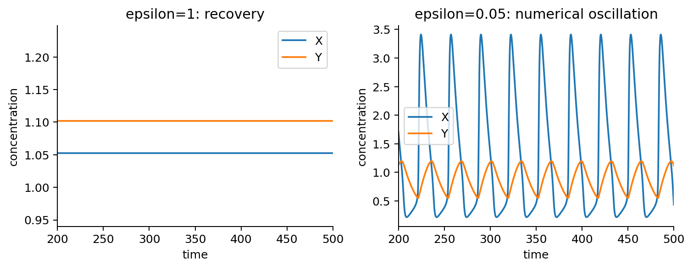

**图 3.4**　同一 R8 拓扑的两种参数行为。左：下游较快，偏差衰减；右：下游较慢，自激活与负反馈轮流主导，数值轨迹持续摆动。仅展示后期轨迹，未标注不必要的数值根。

这个二维例子还可以进一步回答：周期怎样随慢变量的速度变化，切换幅度又由什么决定？将刚才的稳定性分析与前一章的迟滞分支联系起来，就能看清这两个层面。

设相邻两个峰的时间间隔为 $T$，频率为 $f=1/T$，一周期内的最大、最小浓度为 $x_{\max},x_{\min}$，振幅在本文记为

$$
A_{\rm osc}=x_{\max}-x_{\min}.
$$

比较振荡器时，至少要分开三个问题：它能否持续振荡，频率能调多少，以及调频时振幅改变多少。一个只能在很窄的参数区间里产生微弱摆动的系统，与一个可以调节周期、又保持明确高低状态的系统，虽然都能画出周期轨迹，功能上并不相同。

也要说明调的是哪个参数。如果把*所有*速率统一乘以同一系数，等于把整个时间坐标一起缩放，当然可以改变周期而保留轨迹形状。更有意义的问题是，只改变一个合适的产生率或时间尺度，其他过程不作同步调整时，是否仍能稳定调频。稳健性则是另一个量：它考察某个采样范围内，多少组参数产生符合标准的振荡；数值取决于模型、采样规则和振荡判据。

继续分析本节的 R8 两变量模型，可以从快慢分离理解另一种振荡机制：

$$
\dot x=f(x,y),\qquad\dot y=\varepsilon g(x,y),
$$

其中 $f$ 与 $g$ 就是本节的 R8 产生–降解规则。$\varepsilon$ 较小时，$x$ 快，抑制变量 $y$ 慢。暂时固定 $y$，只让 $x$ 恢复，就能画出*快变量稳态曲线* $f(x,y)=0$。如果某个 $y$ 区间内存在明显分开的低表达和高表达两个稳定分支，中间夹着不稳定分支，$x$ 会在慢变量推动下沿一个稳定分支走，到折叠点才跳到另一支。

这就产生*迟滞*：从低态转向高态与从高态转向低态，发生在不同的 $y$ 阈值。$y$ 增大时，高表达态一直保持到其分支终止，再快速降到低态；$y$ 减小时，低态又保持到另一个阈值，再快速升高。慢变化与快跳跃轮流发生，称为*弛豫振荡*。这里“弛豫”是这一类振荡的标准名称，不表示整个过程都以单个指数恢复。

设高分支上 $y$ 从 $y_-$ 增到 $y_+$，低分支上再从 $y_+$ 降到 $y_-$，快分支上的稳态值分别记为 $x_H(y),x_L(y)$。若快慢分离足够明显、快跳跃所占时间很短，那么由 $\mathrm{d} t=\mathrm{d} y/[\varepsilon g(x,y)]$ 得到周期的近似：

$$
T\simeq\frac1\varepsilon\left[
\int_{y_-}^{y_+}\frac{\mathrm{d} y}{g(x_H(y),y)}+
\int_{y_+}^{y_-}\frac{\mathrm{d} y}{g(x_L(y),y)}\right].
$$

高分支上 $g\gt 0$、低分支上 $g\lt 0$，所以两项时间都为正。这说明慢变量的速度主要控制等待多久，而分支位置与跳跃阈值主要控制浓度跨越的范围。只改变 $\varepsilon$ 时，快稳态曲线本身不变，因此在这一近似适用的区间内，有可能明显改变周期而只小幅改变振幅。

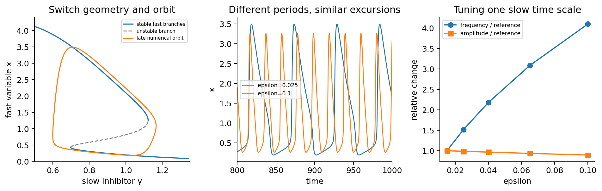

**图 3.5**　本文 R8 模型的快慢机制演示。左：快变量稳态曲线的稳定分支、不稳定分支与数值轨迹；中：改变同一个慢时间尺度，周期不同而浓度跨度接近；右：频率与振幅相对参考参数的变化。固定 $a_0=0.4,b_0=4,d_0=2$，仅改变 $\varepsilon$。

这个近似有明确限度。快慢分离减弱、参数靠近分支消失的位置，或反馈改变了快稳态曲线本身时，振幅与周期仍可能一起变化。数值脚本在所示参数范围内检查了后期重复峰、正浓度与频率变化；这些数值检查说明例子怎样工作，并不替代极限环存在性的证明。

二维部分的结论可以这样使用：先凭结构排除不适合的机制，再用反馈增益与时间尺度检验剩余候选。开关重点看交点与正回路；Hopf 振荡重点看 R8、迹与行列式。增加第三个节点，则可以在没有正自边的负反馈环中提供新的动态环节，也可以让输入沿多条路径抵达输出。

## 第四章　三个组分：负反馈振荡与前馈适应

双节点已经提供两条路线：正回路可以形成开关，负回路配上正自反馈则有二维振荡的入口。若没有正自边，前面的瞬时产生–一阶降解模型仍排除了周期轨道。第三个环节提供另一种时间结构：在负闭环中，它增加动态环节，让没有正自边的模型也能出现摆动失稳；在前馈中，它让同一输入沿快慢两条路径到达输出。下面分别讨论振荡、时间筛选与适应。

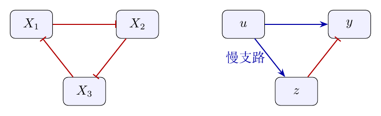

**图 4.1**　左：三次抑制构成负反馈环。右：不一致前馈回路，直接激活与间接抑制在输出处竞争；输入 $u$ 在这里是外部信号。

### 负反馈环：从线性失稳到稳定周期轨道

三个相互抑制环节可写为（本节取相同的一阶降解率 $\gamma$）

$$
\dot x_1=f_1(x_3)-\gamma x_1,\quad\dot x_2=f_2(x_1)-\gamma x_2,\quad\dot x_3=f_3(x_2)-\gamma x_3.
$$

反馈符号仍然是负，但稳定性已经不能照搬双节点的结论。要找出新的可能，先用稳态附近的斜率近似产生率曲线，计算三种基本偏差各自会增长还是衰减。记 $a_i=f_i'$ 为三个交叉斜率。三次抑制使 $a_1a_2a_3\lt 0$，写成 $a_1a_2a_3=-k^3$、$k\gt 0$，则

$$
\lambda I-J=\begin{pmatrix}\lambda+\gamma&0&-a_1\\-a_2&\lambda+\gamma&0\\0&-a_3&\lambda+\gamma\end{pmatrix},
\quad \det(\lambda I-J)=(\lambda+\gamma)^3-a_1a_2a_3.
$$

当乘积为 $-k^3$ 时，取 $-1$ 的三个立方根 $-1,\frac12\pm i\frac{\sqrt3}{2}$ 得到

$$
\lambda_1=-\gamma-k,\qquad\lambda_{2,3}=-\gamma+\frac k2\pm i\frac{\sqrt3k}{2}.
$$

$k\lt 2\gamma$ 时，三种偏差的增长率都为负，会逐渐减小；$k\gt 2\gamma$ 时，其中两种带摆动的偏差开始增长。门槛 $k=2\gamma$ 处，摆动的角频率为 $\sqrt3\gamma$，对应周期 $2\pi/(\sqrt3\gamma)$。 对对称 Hill 环 $f(s)=\alpha/(1+s^n)$，唯一对称稳态满足 $\alpha=\gamma s(1+s^n)$，因此

$$
\frac k\gamma=\frac{ns^n}{1+s^n}.
$$

这里也不会漏掉另外的不对称稳态：当三个调控函数相同且都严格下降时，沿环走过三次调控，浓度增加最终对应的是反馈输入下降。这条反馈关系与 $x$ 本身只会相交一次，而三个浓度相等的解已经满足关系，因此它就是整个环的唯一稳态。 当 $n\leq2$ 时不可能达到有限参数的阈值；当 $n\gt 2$ 时

$$
s_c=\left(\frac2{n-2}\right)^{1/n},\qquad
\alpha_c=\gamma\frac n{n-2}\left(\frac2{n-2}\right)^{1/n}.
$$

在 $n=3,\gamma=1$ 下 $\alpha_c=3\sqrt[3]2$，示例的 $\alpha=20$ 位于稳态失稳一侧。 随 $\alpha$ 增加，$\mathrm{d} s/\mathrm{d}\alpha=1/[\gamma(1+(n+1)s^n)]\gt 0$，且 $\mathrm{d} k/\mathrm{d} s\gt 0$；所以随参数增大，这两种摆动方式确实会从衰减转为增长。这对复特征值的实部从负变正，数学上称为*穿过虚轴*；“虚轴”就是复数平面中实部为零的位置。因为这里增长率随参数变化确实不为零，这次穿越是*横截*的，也就是实际穿过去，而不是碰到边界后折返。这是 Hopf 分岔的候选点：稳态附近原本衰减的摆动可能变成周期振荡。

仅有复特征值穿过虚轴，还没有证明振荡会稳定下来。下面把 $n=3$ 的非线性一步也算完。取临界点 $s_c=\sqrt[3]2$、$\alpha_c=3\gamma s_c$，平移稳态后，系统在每个节点上的二、三阶项都是前一个节点偏差的平方与立方。记

$$
\beta_2=f''(s_c)=2\gamma s_c^2,\qquad
\beta_3=f'''(s_c)=-2\gamma s_c,\qquad
\omega_0=\sqrt3\gamma.
$$

这些系数由 $f(x)=\alpha_c/(1+x^3)$ 直接求导再代入 $s_c^3=2$ 得到。此处的 Hill 函数在正稳态附近光滑，具备展开所需的导数。

计算的目标是*第一 Lyapunov 系数* $\ell_1$：它决定微小摆动增长后，三阶非线性会抑制振幅还是继续放大它。为了把这一计算写得可复核，令 $P(v_1,v_2,v_3)=(v_3,v_1,v_2)$，临界点的线性矩阵为 $A=-\gamma I-2\gamma P$。再定义逐分量相乘的运算 $\odot$，二、三阶项写成

$$
B(v,w)=\beta_2(Pv)\odot(Pw),\qquad
C(v,w,z)=\beta_3(Pv)\odot(Pw)\odot(Pz).
$$

这只是把三次相同的节点计算合并成一个记号；Taylor 展开中的因子仍为 $\frac12B$ 与 $\frac16C$。取

$$
\zeta=e^{-2\pi i/3},\quad q=(1,\bar\zeta,\zeta)^{\mathsf T},\quad
p=q/3,\qquad Aq=i\omega_0q,
\quad \langle p,q\rangle=1,
$$

其中 $\langle p,v\rangle=\bar p^{\mathsf T}v$，复数用来同时记录摆动的幅度和相位。标准 Hopf 系数公式（参考文献 6）给出

$$
\begin{aligned}
\ell_1=\frac1{2\omega_0}\operatorname{Re}\big\langle p,
&C(q,q,\bar q)-2B(q,A^{-1}B(q,\bar q))\\
&+B(\bar q,(2i\omega_0I-A)^{-1}B(q,q))\big\rangle.
\end{aligned}
$$

它综合了直接三阶作用，以及二阶作用经过其他恢复方向再传回摆动的影响。临界点另一个特征值为 $-3\gamma$，且 $2i\omega_0$ 不是特征值，所以式中的两个逆矩阵都有定义。

利用 $Pq=\zeta q$、$q\odot\bar q=\boldsymbol{1}$ 和 $q\odot q=\bar q$，三项分别可以直接算为

$$
\begin{aligned}
C(q,q,\bar q)&=\beta_3\zeta q,\\
B(q,A^{-1}B(q,\bar q))&=-\frac{\beta_2^2\zeta}{3\gamma}q,\\
B(\bar q,(2i\omega_0I-A)^{-1}B(q,q))&=\frac{\beta_2^2}{3i\omega_0}q.
\end{aligned}
$$

最后一项没有实部，$\operatorname{Re}\zeta=-1/2$，于是

$$
\ell_1=-\frac1{4\omega_0}
\left(\beta_3+\frac{2\beta_2^2}{3\gamma}\right)
=-\frac{5s_c}{6\sqrt3}\lt 0.
$$

$\ell_1$ 的数值随特征向量的幅度约定改变，但其符号不变；上式对应这里明确给出的 $q,p$。负号说明非线性会限制微小振幅的增长。

现在可以应用*Hopf 分岔定理*：系统光滑，只有一对简单纯虚特征值，其余特征值实部为负；前面已证明参数穿越是横截的，这里又算出 $\ell_1\lt 0$。因此，在 $\alpha$ 略高于 $\alpha_c$ 时，唯一稳态附近确实产生一族*轨道渐近稳定的周期解*。这就是超临界 Hopf（霍普夫）分岔。轨道稳定表示扰动后会回到同一条闭合轨道，允许在周期中的相位稍有变化；并不要求相位也恢复到原来的值。

用振幅 $r$ 描述这一步，适当缩放后的局部方程具有 $\dot r=\mu r+\ell_1r^3+\cdots$ 的形式，$\mu$ 随 $\alpha-\alpha_c$ 同号。$\mu\gt 0$ 时非零稳态振幅满足 $r^2\simeq-\mu/\ell_1$，其恢复斜率约为 $-2\mu\lt 0$；振幅从零连续长出，周期趋于 $2\pi/\omega_0$。这把“稳态不稳定”“周期轨道存在”和“周期轨道能吸引附近轨迹”三件事连接成完整论证。

这个证明是*临界点附近*的结论。图 [4.2](#fig-rep) 的 $\alpha=20$ 远离阈值，仍是给定参数下的数值演示；不能仅凭局部定理宣称所有更大参数都保留同一条稳定周期轨道。非线性系数的矩阵代入也在 `code/bistability_details.py` 中复核。

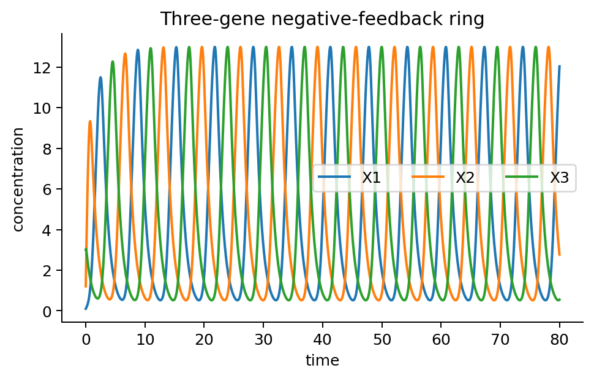

**图 4.2**　三节点负反馈环的数值轨迹，生成脚本见 `code/make_figures.py`。

### 前馈与适应：瞬态峰、支路抵消和误差积分

输入 $u$ 可以直接激活输出 $y$，又通过慢变量 $z$ 抑制 $y$：

$$
\tau_y\dot y=H(u,z)-y,\qquad\tau_z\dot z=G(u)-z.
$$

在 $H_u\gt 0,H_z\lt 0,G'\gt 0$ 的调控范围内，若 $z$ 比 $y$ 慢，上升阶跃可使 $y$ 先增加，随后 $z$ 增加抑制 $y$，形成脉冲。*脉冲*与*精确适应*不同：精确适应要求稳态输出 $y^*(u)$ 与持续输入的幅度无关，这对 $H$、$G$ 有额外条件；拓扑本身不保证这种性质。后面将把支路抵消与积分反馈作具体比较。

要把“回落”与“回到同一基线”区分开，先算恒定输入下的长期输出。设 $\tau_y,\tau_z\gt 0$，$H,G$ 在所考察输入及状态范围内连续，固定 $u$ 时有

$$
z(t)=G(u)+(z_0-G(u))e^{-t/\tau_z},
$$

所以 $z\to G(u)$。此时输入输出支路 $H(u,z(t))\to H(u,G(u))$，按前面单向调控的方法把 $y$ 的方程积分，就得到

$$
y^*(u)=H(u,G(u)).
$$

精确适应要求输入改变后仍回到相同的输出，因此恰好要求这个复合函数在输入区间内为常数。如果 $H,G$ 为 $C^1$，且所讨论的输入覆盖一个完整区间 $I$，那么可以用*链式法则*沿两条支路计算输入变化的影响。链式法则就是：间接支路的总变化率等于沿路各步变化率的乘积。由此得到

$$
H_u(u,G(u))+H_z(u,G(u))G'(u)=0\qquad(u\in I).
$$

这个式子揭示了适应所需的抵消：直接输入对输出的长期增益，与输入通过 $z$ 产生的长期增益大小相等、符号相反。快慢差异帮助形成瞬态峰，但只有这一稳态抵消才使基线与输入幅度无关。

可以选一个简单函数把这两个层面同时展示出来。取 $u\gt 0,z\gt 0$、$G(u)=u$、$H(u,z)=u/z$。每个恒定输入的稳态为 $(y^*,z^*)=(1,u)$，故确有精确适应。若从输入 $u_0$ 的稳态出发，在 $t=0$ 切换至 $u_1\gt u_0$，则

$$
z(t)=u_1+(u_0-u_1)e^{-t/\tau_z},\qquad
\dot y(0^+)=\frac{u_1/u_0-1}{\tau_y}\gt 0.
$$

$y$ 起初升高，最终回到 $1$，所以至少存在一个高于基线的峰；$\tau_z\gg\tau_y$ 使脉冲更易分辨。$u/z$ 是理想化的比值调控，只在 $u,z\gt 0$ 的工作域内使用。若换成 $H=u/(1+z)$，保持同一拓扑与 $G$，则 $y^*=u/(1+u)$ 依赖输入，精确适应消失。这给出了拓扑不充分的明确反例。

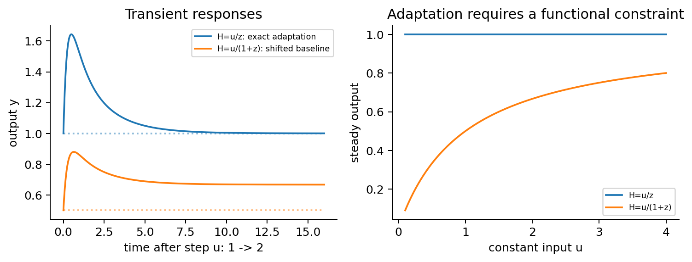

**图 4.3**　相同的不一致前馈结构可以精确适应，也可以只产生瞬态峰而改变最终基线。输入从 $1$ 跳至 $2$，$\tau_y=0.25,\tau_z=2$；右图比较两种调控函数的稳态输入输出曲线。

前馈回路有两条从输入到输出的路径。若两条路径的累计符号相同，称为*一致前馈*；相反则为*不一致前馈*。前面的例子利用两条路径相反的长期作用形成适应，而一致前馈的一种用途是区分短脉冲与持续输入。

看一个全激活的三节点回路 $A\to B\to C$、$A\to C$。为单独看时间逻辑，暂时把输入节点 $A$ 的活动当成 $0$ 或 $1$，令 $\tau_B\dot B=A-B$，再以阈值 $0\lt \theta\lt 1$ 判断 $B$ 是否足够高。如果输出产生采用 AND 逻辑，要求 $A$ 与 $B$ 同时高：上升输入到来后，$B(t)=1-e^{-t/\tau_B}$，只有等到

$$
t_{\rm on}=-\tau_B\ln(1-\theta)
$$

才开始产生输出；输入一撤去，AND 条件立即失效。所以比这个时间还短的输入可能被过滤掉。如果改成 OR 逻辑，输入到来时直接支路立即打开，撤去后则要等 $B$ 从高值降到阈值，关闭的等待时间为 $t_{\rm off}=\tau_B\ln(1/\theta)$。

这是理想阈值模型，真实的连续产生率会把“立即”与“等待”平滑成不同快慢的响应，输出自身的恢复时间也会再加一层滞后。重点是：同样的三条激活边，配上不同启动子逻辑，就可能分别延迟开启或延迟关闭。因此一致前馈并非“没有适应所以无趣”，它回答的是另一个时间功能问题。

为什么普通的负反馈不自动给出精确适应？因为一个通常的恢复变量会同时遗忘过去的偏差：产生与降解平衡时，允许输出停在一个小的残余误差上。要把这个误差消掉，调节变量需要在误差存在时继续改变。

下面用一个三变量模型说明积分反馈怎样实现这一作用。$A$ 接收输入，$C$ 是输出，$B$ 是调节变量；$C$ 激活 $B$，$B$ 抑制 $C$。令

$$
\begin{aligned}
\dot A&=\rho\{u(1-A)-A\},\\
\dot B&=\kappa(C-C_0),\\
\dot C&=k\{A(1-C)-BC\},\qquad \rho,\kappa,k\gt 0.
\end{aligned}
\tag{4.5}
$$

$A,C$ 可以理解为活性比例；$B$ 是缓冲变量，在本例的工作范围内也保持正且小于 $1$。第一式使 $A^*=u/(1+u)$。关键在第二式：当 $C\gt C_0$，$B$ 继续积累并压低 $C$；当 $C\lt C_0$，$B$ 下降，抑制减弱；只有 $C=C_0$ 时，$B$ 才停止调整。因此

$$
C^*=C_0,\qquad B^*=\frac{1-C_0}{C_0}A^*.
$$

输入变大后，长期改变的是 $A^*$ 与 $B^*$，输出仍为 $C_0$。这不是两个支路恰巧抵消一次，而是反馈持续校正误差。

把第二式积分，得到

$$
B(t)=B(0)+\kappa\int_0^t[C(s)-C_0]\mathrm{d} s.
$$

所以 $B$ 保存的是过去输出误差的累积，称为*积分反馈*。这里的“缓冲”不只是响应慢，而是 $\dot B$ 在工作近似下不直接依赖 $B$ 自己。饱和的酶反应能提供近似恒定的转化速率，从而产生这类条件；它不会无条件地出现在所有负反馈回路中。式 [(4.5)](#eq-buffer-demo)采用线性积分近似；若 $B$ 达到上下限，线性积分近似就失效，必须回到完整的转化反应。

这个例子的恢复也能算出来。因为 $A$ 不受下游影响，线性化后它的一根特征值为 $-\rho(1+u)$，而 $(B,C)$ 部分为

$$
J_{BC}=\begin{pmatrix}0&\kappa\\-kC_0&-k(A^*+B^*)\end{pmatrix}.
$$

迹为负，行列式 $\kappa kC_0\gt 0$，故只要 $0\lt C_0\lt 1$ 且 $B^*$ 在缓冲近似的内部工作范围，稳态就局部渐近稳定。输出基线固定与基线附近能恢复，是这里分别检查过的两件事。

若给缓冲变量加入“泄漏”，改成

$$
\dot B=\kappa(C-C_0)-\varepsilon_B(B-B_{\rm ref}),\qquad\varepsilon_B\gt 0,
$$

稳态就允许 $C^*-C_0=(\varepsilon_B/\kappa)(B^*-B_{\rm ref})$。它仍是负反馈，也仍可能有瞬态峰，却通常留下随输入变化的基线偏差。缓冲变量慢并不足够，是否能持续积累误差才是区别。

前馈的思路不同：没有输出回传的校正，而是让一条支路产生与输入成比例的反向作用。沿用同样的输入节点 $A$，构造另一个简化模型：

$$
\begin{aligned}
\dot A&=\rho\{u(1-A)-A\},\\
\dot B&=k_BA-\gamma_BB,\\
\dot C&=k_AA(1-C)-k_CB C,\qquad k_B,\gamma_B,k_A,k_C\gt 0.
\end{aligned}
$$

$A$ 直接激活 $C$，又通过 $B$ 抑制 $C$。令 $\eta=k_B/\gamma_B$，稳态下

$$
B^*=\eta A^*,\qquad
0=A^*\{k_A(1-C^*)-k_C\eta C^*\}.
$$

在 $A^*\gt 0$ 的工作范围内，公共因子 $A^*$ 可以约去，得到

$$
C^*=\frac{k_A}{k_A+k_C\eta}.
$$

这就是比例节点的作用：输入增加多少，抑制支路长期也按固定比例增加多少，两条支路在输出方程中共享输入因子。$B$ 较慢时，直接支路先起作用，随后比例支路跟上，于是输出先偏离、再回到基线。

该模型是逐级驱动的：$A$ 先稳定，随后 $B$ 稳定，最后 $C$ 的恢复率为 $k_AA^*+k_CB^*\gt 0$，所以在给定正输入及上述工作范围内三者都收敛。若把 $B$ 的产生换成 $k_BA/(K+A)$，则 $B^*/A^*=k_B/[\gamma_B(K+A^*)]$ 不再恒定，输出基线也通常随输入改变。可见不一致前馈的边符号还要配上合适的支路比例关系。

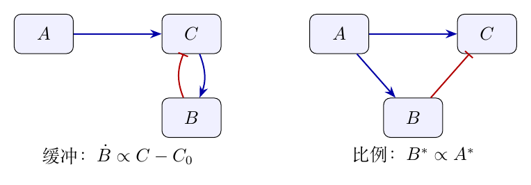

**图 4.4**　两种适应机制的节点角色。左边由输出误差驱动缓冲变量持续校正；右边由输入驱动比例变量，长期抵消直接输入作用。两者都允许 $B$ 的稳态随输入改变。

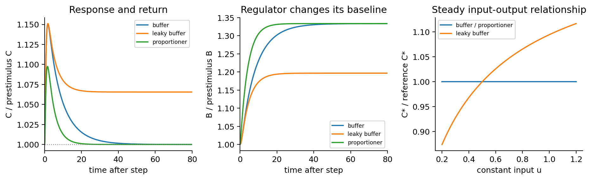

**图 4.5**　本文简化模型的数值比较。左：缓冲反馈与比例前馈都先响应再恢复，带泄漏的缓冲反馈改变最终基线。中：调节变量 $B$ 保留输入变化。右：理想机制的稳态输出与输入无关，泄漏模型则不然。曲线按各自初始基线归一化。

本图的示例参数为 $\rho=3$、输入 $u:0.5\to0.8$。缓冲模型取 $C_0=0.4,\kappa=0.3,k=2$，泄漏模型另取 $\varepsilon_B=0.08$；比例模型取 $k_B=\gamma_B=0.25,k_A=k_C=2$。这些参数用于展示基线恢复与泄漏反例。完整方程与检查见 `code/extended_examples.py`。

同一种连接也可能通过不同变量保存误差。例如在 $B\gt 0$ 的工作域内，若调节规律为 $\dot B=\nu B(C_0-C)$，则

$$
\frac{\mathrm{d}\log B}{\mathrm{d} t}=\nu(C_0-C).
$$

累积误差的变量现在是 $\log B$；内部稳态仍要求 $C=C_0$。这里的调节规律涉及随状态改变的产生或损失，必须另外检查正性、工作范围和稳定性，不能直接套用固定一阶降解下的拓扑分类。

精确适应与参数稳健性也不同。前者要求同一组参数下，稳态输出不随持续输入改变；后者问这种性质能否在一个参数范围内保持。积分反馈的基线由 $C_0$ 指定，比例前馈的基线则由速率比指定：改变这些设定参数可以改变基线，却不必破坏对输入的适应。因此分析功能时要同时指定节点角色、速率机制、参数和输入方式。

## 第五章　分子数较少时：从浓度轨迹转向概率分布

前面的轨迹把表达量当作连续浓度。在分子数较多、涨落相对较小时，这能突出反馈的主要作用；但同一个产生–降解机制在低分子数下也会不断随机变化。此时，长期“稳定”不再意味着每条轨迹停在同一个数值，而是分子数的概率分布保持不变。先回到最简单的无反馈反应，看看这一转换怎样进行。

### 主方程、稳态分布与涨落的时间结构

考虑 $k\gt 0,\gamma\gt 0$ 的出生–死亡过程

$$
\varnothing\xrightarrow{k}X,\qquad X\xrightarrow{\gamma}\varnothing.
$$

令 $P_n(t)$ 表示时刻 $t$ 恰有 $n$ 个分子的概率。在短时间 $\mathrm{d} t$ 内，出生使 $n-1\to n$，跃迁率为 $k$；死亡使 $n+1\to n$，跃迁率为 $\gamma(n+1)$；从 $n$ 离开的总率为 $k+\gamma n$。流入减去流出，只保留 $\mathrm{d} t$ 的一阶项，就得到

$$
\dot P_n=kP_{n-1}+\gamma(n+1)P_{n+1}-(k+\gamma n)P_n,\qquad P_{-1}=0.
$$

零边界没有向负分子数的跃迁。确定性方程描述一个浓度的导数，而主方程同时描述所有可能分子数之间的概率转移。

先寻找长期不变的分布。定义从 $n$ 到 $n+1$ 的净概率流 $j_n=kP_n-\gamma(n+1)P_{n+1}$，主方程就是 $\dot P_n=j_{n-1}-j_n$。在稳态各相邻概率流必须相等，而零边界给出 $j_{-1}=0$，所以所有 $j_n=0$。这就推出相邻态的*详细平衡*：每一对相邻分子数之间，向上与向下转移的概率流分别相等。它比只要求总分布不再变化更具体。递推得到

$$
P_n=P_0\frac{\mu^n}{n!},\qquad\mu=\frac k\gamma.
$$

归一化要求 $1=P_0\sum_{n=0}^{\infty}\mu^n/n!=P_0e^\mu$，从而

$$
P_n=e^{-\mu}\frac{\mu^n}{n!}.
$$

因此泊松分布是这条链的唯一归一化稳态；平均分子数 $\mu$ 与此前产生–降解的平衡值对应，但单次观测仍可偏离平均值。

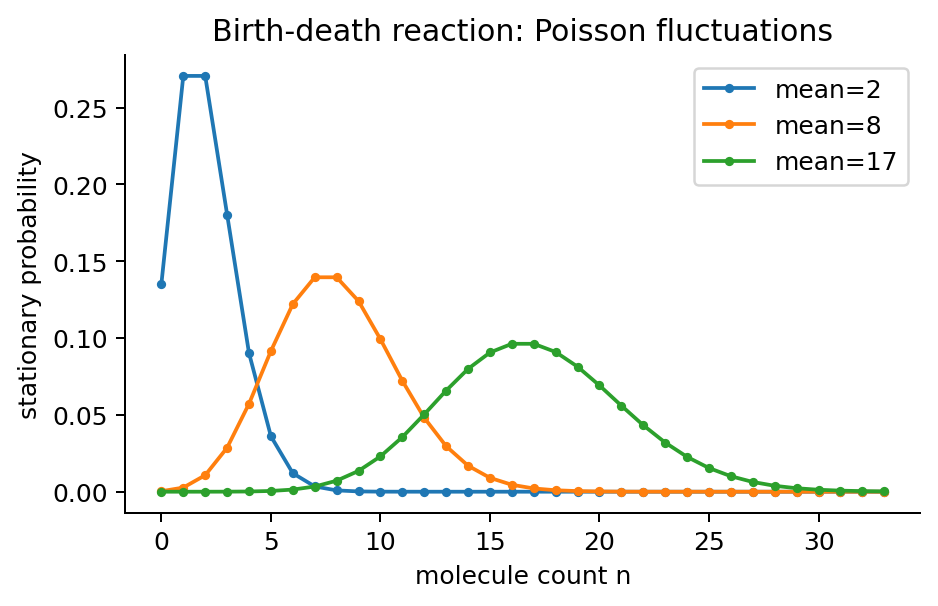

**图 5.1**　基本出生–死亡模型的稳态泊松分布。平均分子数越低，涨落相对于平均值越明显。

稳态存在还不等于已经说明任意初始分布会到达它。在线性出生–死亡模型中，这一步可以精确补上：从确定的 $n_0$ 个分子出发，每个初始分子存活到 $t$ 的概率为 $p_t=e^{-\gamma t}$，所以存活数服从 $\operatorname{Bin}(n_0,p_t)$。时刻 $s$ 出生的分子存活到 $t$ 的概率为 $e^{-\gamma(t-s)}$，把泊松出生流按这个存活概率保留，新生且仍存活的分子数服从参数为

$$
\int_0^t ke^{-\gamma(t-s)}\mathrm{d} s=\mu(1-e^{-\gamma t})
$$

的泊松分布，与初始存活数独立。因此

$$
n(t)\overset{\rm law}=\operatorname{Bin}(n_0,e^{-\gamma t})
 +\operatorname{Pois}\!\left(\mu(1-e^{-\gamma t})\right).
$$

记号表示两边具有相同的概率分布。随时间增长，初始分子最终消失，新生存活数趋于 $\operatorname{Pois}(\mu)$。对任意几乎必然有限的随机初始分子数，先条件于 $n_0$ 再平均也得到相同极限。这证明该泊松分布不仅唯一，而且吸引所有这类初始分布。

为了比较主方程与浓度模型，可以直接计算平均值与方差。先假设平均值与方差都是有限的，数学上称为*有限二阶矩*：$\langle n^2\rangle\lt \infty$，所以分子数平方的平均值不会无限大。下面分别关心分子数 $h(n)=n$ 和它的平方 $h(n)=n^2$。把每次出生、死亡对这些数量的改变，按照发生概率加起来，就有

$$
\frac{\mathrm{d}\langle h(n)\rangle}{\mathrm{d} t}
=\left\langle k[h(n+1)-h(n)]+\gamma n[h(n-1)-h(n)]\right\rangle.
$$

先取 $h=n$，得到

$$
\frac{\mathrm{d}\langle n\rangle}{\mathrm{d} t}=k-\gamma\langle n\rangle.
$$

这个平均值方程与确定性产生–降解模型具有相同形式，是线性反应下的精确关系。再取 $h=n^2$，得到

$$
\frac{\mathrm{d}\langle n^2\rangle}{\mathrm{d} t}=2k\langle n\rangle+k-2\gamma\langle n^2\rangle+\gamma\langle n\rangle.
$$

减去 $\mathrm{d}\langle n\rangle^2/\mathrm{d} t$，就有

$$
\frac{\mathrm{d}\operatorname{Var}(n)}{\mathrm{d} t}=k+\gamma\langle n\rangle-2\gamma\operatorname{Var}(n).
$$

在稳态代入 $\langle n\rangle=\mu=k/\gamma$，得到 $\operatorname{Var}(n)=\mu$。因此变异系数为 $1/\sqrt\mu$，分子数越低，相对内禀涨落越大。

涨落还具有时间结构。由平均值方程，从给定 $n(0)$ 出发的条件均值为

$$
\mathbb E[n(t)\mid n(0)]=\mu+(n(0)-\mu)e^{-\gamma t}.
$$

减去 $\mu$，再乘以 $n(0)-\mu$ 并在稳态平均，得到

$$
\operatorname{Cov}(n(t),n(0))=\mu e^{-\gamma t},\qquad t\geq0.
$$

所以同一个 $1/\gamma$ 既描述平均浓度的恢复，也描述这条线性反应链的涨落相关时间。若产生率带有非线性反馈，通常有 $\langle F(n)\rangle\ne F(\langle n\rangle)$，平均值不再自动满足原来的非线性浓度方程。

### 随机切换、双峰与记忆的寿命

前面的自激活和互抑制开关有两个确定性吸引态，但在随机模型中，两个概率峰还可能来自另一种时间结构：启动子在两种产生率之间缓慢切换。取关闭与开启状态的产生率为 $k_0,k_1$，共享降解率 $\gamma$，切换率为 $k_{\rm on},k_{\rm off}$。

如果两种切换均远慢于 $\gamma$，蛋白质常有足够时间接近当前启动子状态的条件平衡。二态链的稳态流量平衡给出开启概率 $q=k_{\rm on}/(k_{\rm on}+k_{\rm off})$，整体分布的领先阶近似于是为

$$
P_n\simeq(1-q)\operatorname{Pois}_{k_0/\gamma}(n)+q\operatorname{Pois}_{k_1/\gamma}(n).
$$

若两个均值相距足够远且两权重均显著，这个混合分布可以双峰；每个固定启动子状态下的浓度模型却都只有唯一稳定的稳态。该式是慢切换近似，有限切换速率下不是精确公式。由此可见，解释两个峰时还需要看时间序列、驻留时间和扰动响应，判断状态选择来自确定性反馈，还是来自慢切换或其他机制。

真正的确定性双稳态进入随机模型后，记忆通常具有有限寿命。若出生率依赖当前分子数，写成 $\lambda_n\gt 0$，死亡率仍为 $\gamma n$，详细平衡递推变成

$$
\pi_n=\pi_0\prod_{j=0}^{n-1}\frac{\lambda_j}{\gamma(j+1)}.
$$

当出生率有上限时，这个乘积由泊松尾部控制，可以归一化；因为所有相邻跃迁均可发生，整条链仍只有一个归一化稳态。两个概率峰可以对应两个长时间驻留区，但不代表两份互不相通的稳态分布。连续模型的吸引域分界在这里可以被一连串随机出生或死亡跨过，所以“双稳态记忆”变成很长但有限的驻留时间。

这个寿命可以用*首次到达时间*具体定义。选择两个分子数 $i\lt j$，将 $j$ 作为切换判据，令 $T_i$ 为从 $i$ 出发第一次到达 $j$ 所需的平均时间。对 $k\lt j$，按第一次跃迁前的平均等待时间分解，有

$$
-1=\lambda_k(T_{k+1}-T_k)+\gamma k(T_{k-1}-T_k),\qquad T_j=0.
$$

令 $\Delta_k=T_k-T_{k+1}$，并用 $\lambda_{k-1}\pi_{k-1}=\gamma k\pi_k$，上式乘以 $\pi_k$ 后可逐项相加：

$$
\lambda_k\pi_k\Delta_k=\sum_{m=0}^{k}\pi_m.
$$

因此得到精确的离散表达式

$$
T_i=\sum_{k=i}^{j-1}\frac{\sum_{m=0}^{k}\pi_m}{\lambda_k\pi_k}.
$$

若两个峰之间的概率很小，分母中的 $\pi_k$ 会让相应等待时间变大。可见解释记忆时，除了是否有两个稳定表达态，还要问噪声有多强、跨越阈值需要多久，以及这个时间是否长于实际观察窗口。

这里的公式适用于一维出生–死亡链；双基因联合随机过程需要在二维分子数空间重新求首次到达问题，不能把这条一维公式直接照搬过去。

## 第六章　从最小回路到真实网络

### 有效反馈与组合调控：以 lac 为例

至此，最小模型已经解释了记忆、振荡、适应与随机涨落各自可能来自什么机制。把它们用于真实系统时，第一步是识别生物过程怎样对应到模型变量和调控函数。乳糖操纵子提供了一个例子：反馈并不只发生在基因之间，还经过摄取与代谢。 大肠杆菌 lac 系统包括 LacI 阻遏蛋白、lacZYA 转录单位以及乳糖/异乳糖相关代谢与摄取过程。lacI 具有自身的转录调控，不属于 lacZYA 同一多顺反子转录单位。异乳糖降低 LacI 的阻遏活性；CAP–cAMP 及葡萄糖相关效应调节转录和摄取。

在最简单的结合占据近似下，活性 LacI 浓度为 $R_a$ 时，解除阻遏的分数可写作 $K_d/(K_d+R_a)$，从而给出有效转录率 $F(R_a)$。进一步引入 LacY 蛋白 $y$ 与细胞内诱导物 $a$，

$$
\dot y=F(a)-\gamma_y y,\qquad\dot a=v_{\rm in}(y,L_{\rm ext})-v_{\rm out/met}(a,y).
$$

这体现了 “LacY 增强摄取 $\to$ 诱导物增加 $\to$ 阻遏解除 $\to$ LacY 增加” 的有效正反馈，但真正的乳糖代谢、透过酶动力学、葡萄糖作用和生长稀释会改变反馈强度。特别应区分代谢性乳糖与非代谢型诱导物的实验情形，不能笼统声称 lac 网络必然双稳态。

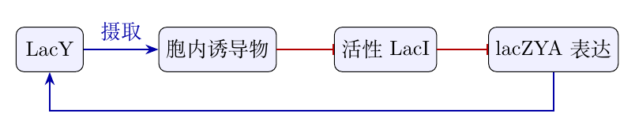

**图 6.1**　lac 系统的简化有效反馈关系。两次抑制形成解除阻遏，闭环总体为正；该图省略了代谢、葡萄糖作用和稀释，不据此断言双稳态。

为了把这条生物学路径与前面的符号分析接上，可以逐步计算导数。单个位点近似下 $F(R_a)=r_{\rm leak}+(r_{\rm max}-r_{\rm leak})K_d/(K_d+R_a)$，当 $r_{\rm max}\gt r_{\rm leak}$ 时 $\partial F/\partial R_a\lt 0$。 若有效活性阻遏蛋白 $R_a(a)$ 随诱导物下降，则链式法则给出 $\mathrm{d} F/\mathrm{d} a=(\partial F/\partial R_a)(\mathrm{d} R_a/\mathrm{d} a)\gt 0$。 再结合 $\partial v_{\rm in}/\partial y\gt 0$，即可识别摄取支路的正反馈。完整第二个方程的交叉导数却是 $\partial\dot a/\partial y=\partial_yv_{\rm in}-\partial_yv_{\rm out/met}$，其符号未必正；这正是代谢性诱导物与仅摄取的理想模型之间需要检查的环节。

这个例子把最小回路的用法具体化了：先识别产生率与中间变量，再检查有效反馈的符号和强度，最后分析对应参数下的动力学。接下来还要问，多个因子共同作用于启动子时怎样合并？局部回路受到其余网络影响时，独立分析还能保留多少结论？ lac 的摄取支路已经说明，简化图上的一条边可能压缩了多个过程。真实网络还存在组合输入、与其余变量的动态耦合，以及统计意义上的模体富集。理解这些层面，才能判断最小模型的解释在何种条件下可以迁移。

两个转录因子 $X,Y$ 结合启动子 $D$ 的四个状态为 $D,DX,DY,DXY$。在特定准平衡模型中，统计权重为

$$
1,\quad x/K_x,\quad y/K_y,\quad\omega xy/(K_xK_y),
$$

$\omega$ 表示协同性。令 $Z=1+x/K_x+y/K_y+\omega xy/(K_xK_y)$，则

$$
F(x,y)=\frac{r_0+r_xx/K_x+r_yy/K_y+r_{xy}\omega xy/(K_xK_y)}{Z}.
$$

同样两条激活边，根据各状态转录率 $r_s$ 的不同，可形成类似与门（AND）或或门（OR）的调控逻辑。仅有网络连边不能确定动力学方程。

具体的差别可以从状态概率直接算出来。写 $a=x/K_x,b=y/K_y$。准平衡时四种状态的概率是各自统计权重除以总权重 $Z$，所以 $F=\sum_s r_s p_s$，即前述有理式。$\omega=1$ 时 $Z=(1+a)(1+b)$，记 $p_x=a/(1+a),p_y=b/(1+b)$。 若只有双结合态转录，$r_{xy}=r$、其余为零，得到 $F_{\rm AND}=rp_xp_y$；若除空态以外均以速率 $r$ 转录，得到 $F_{\rm OR}=r(p_x+p_y-p_xp_y)$。 二者对 $x,y$ 均非减，却有不同的低输入响应。极限 $a,b\ll1$ 或 $\gg1$ 将连续调控近似为布尔真值表。若 $r_{xy}$ 小于单结合态速率，增加另一个因子甚至可能降低输出；因此指定某些 $r_s$ 后还要实际检查偏导数，不能只凭结合就称为激活。

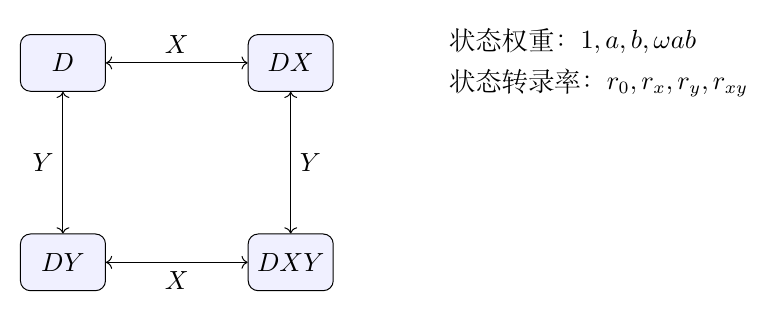

**图 6.2**　两种调控因子的启动子占据状态。图示可逆结合；协同性必须与相容的结合常数共同指定，最终输出由状态概率与各状态转录率共同决定。

### 网络背景、模块耦合与结论的适用范围

将已分析的局部变量记为 $\boldsymbol{x}$，其余网络记为 $\boldsymbol{z}$：

$$
\dot{\boldsymbol{x}}=\boldsymbol{f}(\boldsymbol{x},\boldsymbol{z}),\qquad\dot{\boldsymbol{z}}=\boldsymbol{g}(\boldsymbol{x},\boldsymbol{z}).
$$

在稳态附近，两个模块的小偏差怎样相互影响，可以整理成四块： $J=\begin{pmatrix}A&B\\C&D\end{pmatrix}$。其中 $A,D$ 描述两个模块各自的变化，$B,C$ 描述它们如何影响对方。即使两个模块单独运行都能恢复，连接起来也可能让某些偏差不断放大，因此不能只用单独模块的结果判断整个网络。只有在外部输入近似固定、存在明确时间尺度分离或耦合可控时，局部回路才可能构成近似独立运行的模块。这解释了为何最小回路有用，但不能无条件拼装成真实系统。

一个两维线性扰动例子足以看出耦合的影响。取 $A=D=-1$、$B=C=2$。单独运行时，两块的偏差都按 $e^{-t}$ 衰减。连接后，描述小偏差的雅可比矩阵 $\begin{pmatrix}-1&2\\2&-1\end{pmatrix}$ 的特征值却是 $1,-3$，所以耦合足以使系统失稳。这是线性扰动系统的反例，不把可取负值的扰动直接解释为绝对浓度。 要继续计算连接后的影响，可以先从外部模块的方程中解出它的偏差，再代回局部模块。只要 $\lambda I-D$ 有逆矩阵，这一代入就给出

$$
\det(\lambda I-J)=\det(\lambda I-D)
\det\left[\lambda I-A-B(\lambda I-D)^{-1}C\right].
$$

这个消去外部变量后的组合称为*Schur（舒尔）补*：它把外部变量的响应折算成局部方程中的修正。这里的 $B(\lambda I-D)^{-1}C$ 就是“局部影响外部，再由外部传回局部”的整条反馈路径。代入的矩阵计算相当于左乘 $\begin{pmatrix}I&B(\lambda I-D)^{-1}\\0&I\end{pmatrix}$，把右上块消成零；这个操作不改变行列式，剩下的两块分别取行列式再相乘，就得到上式。这个式子说明：外部模块传回来的影响取决于偏差变化的快慢，即时间因子 $e^{\lambda t}$ 中的 $\lambda$；不能简单地当成一个固定输入。 如果外部变量恢复得远快于局部变量，就可以近似认为它们总能及时跟上。令外部变量的变化率接近零，即 $0=C\delta\boldsymbol{x}+D\delta\boldsymbol{z}$ 给出 $\delta\boldsymbol{z}=-D^{-1}C\delta\boldsymbol{x}$，从而 $A_{\rm eff}=A-BD^{-1}C$。所以即使把外部变量从方程中省去，它们的影响仍留在 $-BD^{-1}C$ 这一项里，局部模块的实际恢复行为通常也会改变。

明确了调控函数与网络背景之后，再讨论一个小回路为何在真实网络中反复出现。 真实网络中常统计自调控、前馈回路、反馈环等小拓扑是否相对某一合理随机网络零模型富集。富集不等于因果功能，也不能自动认定局部回路独立于网络其余部分。需要进一步判断：哪些局部动力学性质在给定输入变化和网络背景下依然可观察？

从产生–降解出发，单节点正反馈通过多个稳态提供记忆，双节点互抑制通过放大表达差异形成开关，三节点负反馈增加动态环节而能使带摆动的小偏差从衰减转为增长，快慢前馈则以支路竞争形成瞬态响应。转向分子计数后，同一个长期平均值还对应一整个涨落分布；回到真实网络时，组合逻辑与模块耦合进一步决定这些局部机制能否被观察到。下表把各步得到的结论与它们的适用边界放在一起。

| 模型 | 由推导得到的行为 | 迁移结论时需注意 |
|:---|:---|:---|
| 线性产生–降解 | 唯一指数稳定的稳态；出生–死亡离散模型为泊松稳态 | 泊松结论依赖恒定出生与一阶死亡 |
| 一维单调自抑制 | 唯一稳定的稳态；不能自行维持振荡 | 输入固定且没有延迟时成立 |
| 一维自激活 | 足够非线性时可能双稳态 | 多交点还需足够非线性与合适参数 |
| 双组分互相调控 | 正/负回路符号影响特征值和稳定性 | 稳定性仍依赖增益及具体产生率 |
| 三节点负反馈 | 小偏差可从衰减摆动转为增长摆动 | 已证明临界点附近的稳定周期轨道；远离临界点需另行分析 |
| 前馈回路 | 可实现脉冲、滤波和特定条件下适应 | 精确适应还需稳态支路增益抵消 |

分析一个新回路时，也可以沿这条路线：先从反应规则建立产生率，说明哪些快变量被省去；再寻找稳态，检查偏差会恢复还是放大；最后考虑分子涨落与其余网络的影响，判断模型能解释哪些实验现象。

## 附录：81 种两节点拓扑逐图索引

四条边的编号次序固定为 $(X\to X,Y\to Y,X\to Y,Y\to X)$。以下三张表展示全部 $81$ 张带标签图，每张只出现一次。R 编号表示结构组，不表示某组参数已经实现的行为。枚举脚本检查了 $81$ 个唯一图、$45$ 个节点交换类别及正文八组的计数；拓扑信息可由 `code/topology_inventory.json` 直接复用。

### 图谱 1

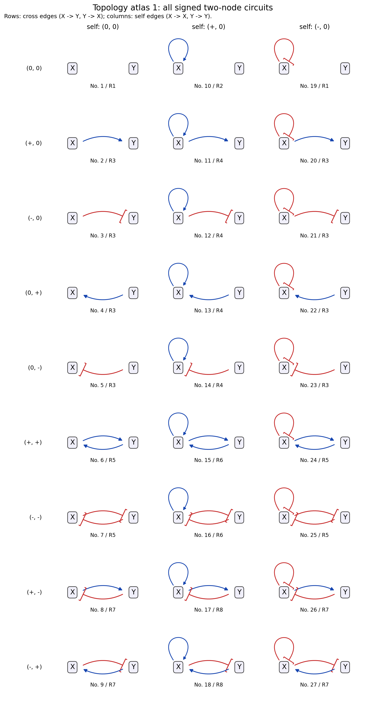

### 图谱 2

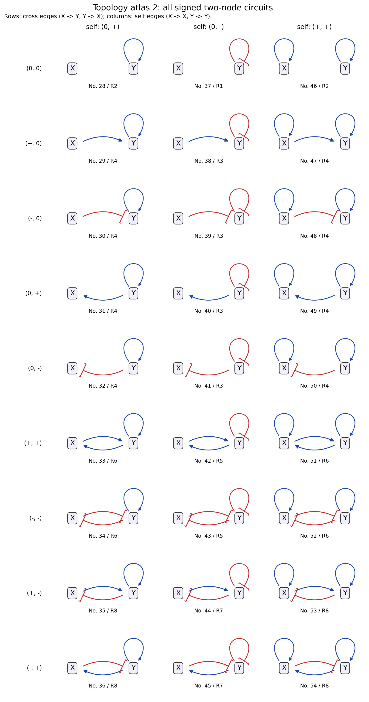

### 图谱 3

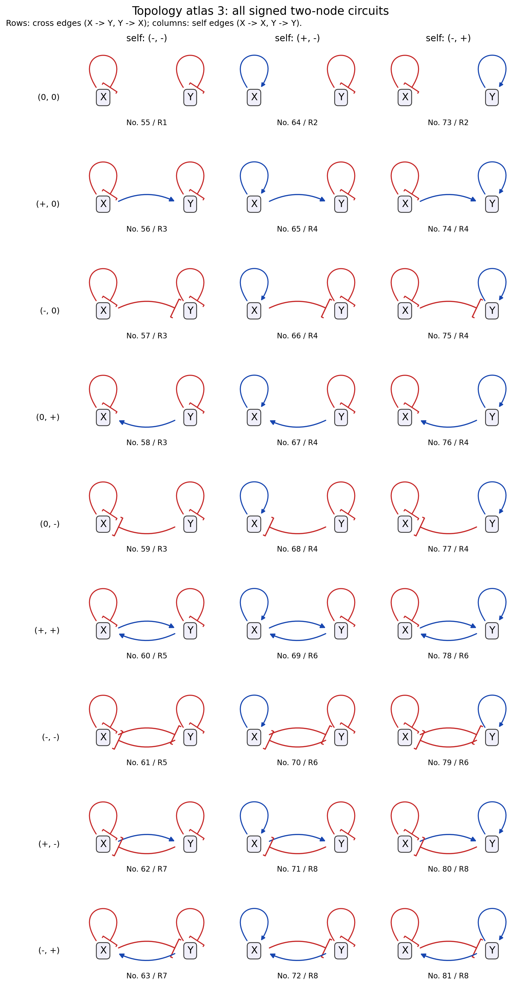

## 参考文献与延伸阅读

1.  Bintu, L. et al. (2005). Transcriptional regulation by the numbers: models. *Current Opinion in Genetics & Development*, 15, 116–124. DOI: [`10.1016/j.gde.2005.02.007`](https://doi.org/10.1016/j.gde.2005.02.007).

2.  Gardner, T. S., Cantor, C. R., & Collins, J. J. (2000). Construction of a genetic toggle switch in Escherichia coli. *Nature*, 403, 339–342. DOI: [`10.1038/35002131`](https://doi.org/10.1038/35002131).

3.  Elowitz, M. B. & Leibler, S. (2000). A synthetic oscillatory network of transcriptional regulators. *Nature*, 403, 335–338. DOI: [`10.1038/35002125`](https://doi.org/10.1038/35002125).

4.  Shen-Orr, S. S. et al. (2002). Network motifs in the transcriptional regulation network of Escherichia coli. *Nature Genetics*, 31, 64–68. DOI: [`10.1038/ng881`](https://doi.org/10.1038/ng881).

5.  Alon, U. (2007). Network motifs: theory and experimental approaches. *Nature Reviews Genetics*, 8, 450–461. DOI: [`10.1038/nrg2102`](https://doi.org/10.1038/nrg2102).

6.  Kuznetsov, Y. A. Andronov–Hopf bifurcation. *Scholarpedia*. [Hopf 定理与第一 Lyapunov 系数公式](https://www.scholarpedia.org/article/Andronov-Hopf_bifurcation)。

7.  Utrecht University. The Poincaré–Bendixson Theorem. [平面极限集定理与证明讲义](https://webspace.science.uu.nl/~hanss102/inlds224/PoincareBendixsonTheorem.pdf)。
