# 基因调控网络如何编码空间位置
## 从 Bicoid 梯度和 French flag model 到位置解码与网络优化

> 西湖大学 2026 年秋季《定量生物学导论》课程学习笔记。

> **核心问题：** 胚胎中的细胞核接触到的是分子，为什么这些分子能帮助它在合适的位置开启合适的基因？分子读数的波动，又会让这个决定有多不确定？

## 概述 {#main-lecture}

一个果蝇胚胎要沿前后方向形成不同的身体结构。可是，各处细胞核中的基因组大体相同。为什么同一套基因，在前部和后部会有不同的活动？

关键在于：**基因相同，不代表它们接触的调控信号相同。** 某些蛋白质在胚胎前端多、后端少，各处的核因而接触到不同浓度。蛋白质又能影响基因是否转录，于是，“处在不同地方”就可能变成“开启不同的基因”。

先认识这里的三个对象。**基因**是一段 DNA；基因转录后产生 RNA，其中的 **mRNA** 可以作为合成蛋白质的模板；某些**蛋白质**又会影响其他基因的转录，这类蛋白质称为转录因子。本文说一个基因“表达高”，会按所讨论的实验，具体指它的 RNA 或蛋白质较多。

### 从 Bicoid 到一条表达边界 {#biological-start}

果蝇早期胚胎提供了一个可以实际观察的例子。母源 *bcd* mRNA 集中在胚胎前端，产生的 **Bicoid 蛋白（Bcd）** 在前端较多、向后逐渐减少。这种浓度随位置有规律变化的分布，就称为**浓度梯度**。

Bicoid 是转录因子，能参与激活 *hunchback*（*hb*）等基因。先把早期 *hb* 响应看作一个具体问题：前部有较多核正在转录 *hb*，后部则较少，二者之间出现一条表达边界。[Porcher 和 Dostatni（2010）](https://doi.org/10.1016/j.cub.2010.01.026)的综述提供了这个系统的生物学背景。

<div id="bicoid-system"></div>

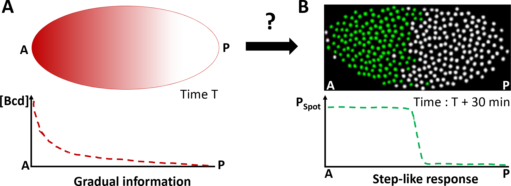

*Fig. 1. 从连续梯度到空间表达边界。* 引自 [Lucas 等（2018），原文 Fig. 1](https://doi.org/10.1371/journal.pgen.1007676.g001)。A：Bicoid 在前端多、后端少；A、P 分别表示前端与后端。B：根据 RNA FISH（特定 RNA 的荧光标记）观测绘制的早期 *hb* 转录示意；绿点是正在转录的核，白点是未检测到转录的核。下方曲线表示活跃核的比例。图中两个阶段相隔 30 min。

读图时，先只抓住一个变化：左边是浓度逐渐降低，右边却出现了“前部大多开启、后部大多关闭”的区域划分。**平缓的输入，怎样变成较明确的边界？** 这就是要解释的第一件事。

图中的点是细胞核。此时胚胎仍是合胞体，也就是多个核共享细胞质，尚未由完整的细胞膜逐个隔开。因此下面常说“一个核读取局部蛋白浓度”。所谓“读取”，具体可以是蛋白质结合调控 DNA 后改变转录概率，而不是让核先计算出一个数值坐标。

### 位置信息与 French flag model {#french-flag}

**Positional information（位置信息）** 是局部状态中能够指示空间位置的线索。细胞或细胞核可以利用这些线索，选择适合所在位置的响应。[Wolpert（1969）](https://doi.org/10.1016/S0022-5193(69)80016-0)区分了两个步骤：先有随位置不同的信号，再由细胞解释这些信号、选择行为。知道一个信号存在，还没有说明它怎样被使用。

**French flag model** 用蓝、白、红三个区域表示三种命运或表达状态。设想所有细胞遵守完全相同的规则：浓度高时选蓝色，中等时选白色，低时选红色。高与中、中与低的分界浓度，就叫两个**阈值**。

这里没有给每个位置单独安排一条指令。靠近高浓度一端的细胞更容易选蓝色，另一端更容易选红色。同一条读取规则，因为局部输入不同，就形成了空间图案。

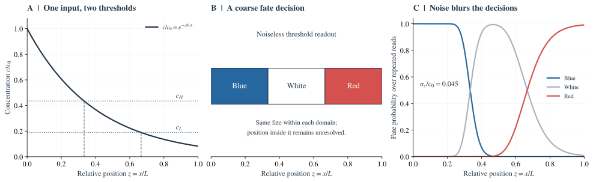

*Fig. 2. 一个梯度怎样划分出三种命运。* 教学模型，非胚胎数据。A：一条由左向右降低的浓度曲线，以及两个读取阈值。B：同一条规则把不同位置分成蓝、白、红三个区域。C：读数有波动后，边界附近可能作出不同选择；纵轴是同一位置重复读取时选中各颜色的概率。

如果一个靠近蓝白边界的核，第一次读到的浓度略高、第二次略低，它会不会改变选择？如果整个胚胎的 Bicoid 都增加了一点，边界会不会移动？这些问题把理想的 French flag model 变成了一个需要定量回答的生物学问题。

French flag model 的原始问题还关心比例：胚胎更长，或一部分被移除后，是否仍能形成比例正确的图案？两个固定阈值本身不保证这一点，第 1.3 节再区分它与读数精度。

---

## 1. 一条浓度梯度怎样指定边界 {#gradient}

先暂时忽略分子的随机波动，只研究平均图案。要走通的因果链是：**蛋白质在哪里产生、怎样运动和消失 → 各处的平均浓度 → 同一条基因调控规则在各处产生不同响应。** 这一章分别解释这三个环节。

### 1.1 先看浓度曲线，再问它怎样形成 {#source-diffusion-degradation}

**第一步：把胚胎图像变成浓度曲线。** 怎样知道 Bicoid 在哪里多、在哪里少？[Gregor 等（2007）](https://pmc.ncbi.nlm.nih.gov/articles/PMC2253670/)把 Bcd 与能发绿色荧光的 GFP 融合，在活胚胎里成像。经过浓度标定，核的亮度就可以换算成 Bcd 浓度。

<div id="experimental-bicoid"></div>

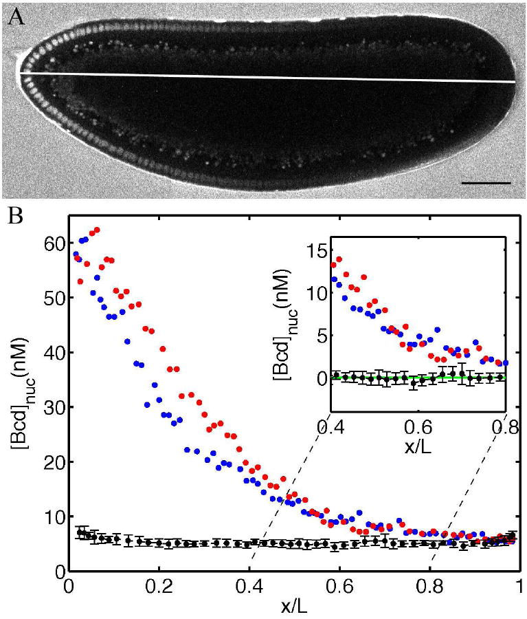

*Fig. 3. 从果蝇胚胎到 Bicoid 浓度梯度。* 引自 [Gregor 等（2007），原文 Fig. 2](https://pmc.ncbi.nlm.nih.gov/articles/PMC2253670/#F2)。A：活胚胎中的 Bcd-GFP 荧光，前端在左，亮点对应富集 Bcd-GFP 的细胞核，标尺 $50\,\mu\mathrm m$；胚胎外的 GFP 溶液用于浓度标定。B：横轴从前端的 0 走到后端的 1，纵轴是逐核浓度；红、蓝点分别来自背侧和腹侧，黑点及误差棒是无 GFP 胚胎的背景对照。插图放大扣除平均背景后的中后段信号。

图 A 中，胚胎左侧的细胞核比较亮，向右则逐渐变暗。因为荧光来自 Bcd-GFP，经过浓度标定后，就能根据每个核的亮度估计其中的 Bicoid 浓度。把这些核的位置和浓度画在一起，就得到图 B：每个红点或蓝点代表一个核，横坐标表示它在胚胎中的位置，纵坐标表示测得的浓度。靠近前端的点通常较高，越往后，点的位置整体越低，对应的就是图 A 中从亮到暗的变化。

横轴用 $x/L$ 表示位置，其中 $x$ 是这个核到胚胎前端的距离，$L$ 是胚胎的全长。例如，$x/L=0.4$ 表示这个核位于从前端算起、全长 40% 的地方。如果胚胎长 $500\,\mu\mathrm m$，这个核就离前端 $200\,\mu\mathrm m$。要知道这里的 Bicoid 浓度，还需要看这个点在纵轴上的数值。

图 B 中的数据点没有排成一条光滑的曲线，即使位置很接近，不同核测得的浓度也会有差别。这些差别可能来自核之间实际的浓度差异，也可能来自成像和浓度换算中的测量误差。我们后面关心的是：在发育阶段和位置相同的条件下，细胞核能读到多稳定的浓度信号？回答这个问题，需要比较相同条件下的多次观测，并估计测量误差有多大。仅凭这张图中各个点的分散程度，还不能直接判断细胞核读取浓度时的噪声有多大。

**第二步：用几个参数概括平均形状。** 以胚胎前端为原点，$x$ 是距离前端的位置，$L$ 是胚胎全长，$c(x)$ 是该处的平均浓度。一个常用的近似是

$$
\boxed{c(x)=c_0e^{-x/\lambda}.}
\tag{1.1}
$$

$c_0$ 表示前端的浓度尺度。$\lambda$ 是浓度衰减的长度尺度：每向后走一个 $\lambda$，浓度就乘以 $e^{-1}\simeq0.37$。它不像直线那样“每走一步减去同样多”，而是“每走一步剩下同样的比例”。

找一组参数进行后续的计算：令 $L=500\,\mu\mathrm m$、$\lambda=100\,\mu\mathrm m=0.2L$，$c_0=100$ 个任意浓度单位。

| 离前端的距离 $x$ | 相对位置 $x/L$ | 平均浓度 $c(x)$ | 相对前端剩余比例 |
|---|---|---|---|
| $0\,\mu\mathrm m$ | 0 | 100 | 100% |
| $100\,\mu\mathrm m$ | 0.2 | 36.8 | 36.8% |
| $200\,\mu\mathrm m$ | 0.4 | 13.5 | 13.5% |
| $300\,\mu\mathrm m$ | 0.6 | 5.0 | 5.0% |

这里有两个不同的调节方向：增大 $c_0$ 会把整条曲线按比例抬高；增大 $\lambda$ 则让浓度随距离下降得更慢。知道前端有多亮，还不足以知道后端能接收到多少信号。

**第三步：理解为什么会形成这种形状。** 考虑一个最小的**源–扩散–降解模型（SDD）**：

1. **源：** 前端不断产生蛋白质，为系统补充分子。
2. **扩散：** 分子作随机运动。单个分子没有“向后走”的目标；因为前端分子更多，从前向后运动的总数可以多于反向运动的总数，于是形成净输运。
3. **降解：** 分子在途中以一定概率被去除。这里假设每个分子单位时间被去除的概率不随位置改变，平均寿命记为 $\tau$。

把胚胎的前后轴看作一条长度为 $L$ 的线，前端是 $x=0$，后端是 $x=L$。用 $c(x,t)$ 表示位置 $x$、时刻 $t$ 的平均蛋白质浓度。先假设扩散系数 $D$ 和平均寿命 $\tau$ 在各处相同，前端以恒定通量 $R$ 向胚胎内部补充分子。

**先写分子的收支。** 沿 $x$ 正方向的扩散通量记为 $j(x,t)$。根据 Fick 定律，

$$
j=-D\frac{\partial c}{\partial x}.
$$

这里的负号表示分子净流动的方向是从高浓度到低浓度。例如，浓度向后降低时，$\partial_xc\lt 0$，就有 $j\gt 0$，即分子净流向后端。对于胚胎内部的一小段，浓度的变化来自流入与流出的差额，以及这段内部的降解：

$$
\frac{\partial c}{\partial t}
=-\frac{\partial j}{\partial x}-\frac{c}{\tau}
= D\frac{\partial^2c}{\partial x^2}-\frac{c}{\tau},
\qquad 0\lt x\lt L.
$$

这就是这里使用的**反应–扩散方程**。扩散项描述相邻位置之间的分子交换；降解项 $-c/\tau$ 表示单位时间内平均有 $1/\tau$ 的比例被去除。源集中在前端，因此通过边界条件加入，不再在区间内部另写一个产生项。

**还要说明两端怎样与外界交换分子。** 前端持续输入，后端不允许分子流出，对应

$$
\boxed{
-D\partial_xc(0,t)=R,
\qquad
-D\partial_xc(L,t)=0.
}
$$

第一条规定输入的通量，而前端浓度由后续的扩散和降解共同决定；第二条是后端的零通量条件，也就是 $\partial_xc(L,t)=0$。若 $c$ 按单位体积的浓度计，$R$ 的单位就是“浓度 × 长度 / 时间”，可理解为单位横截面积、单位时间输入的分子数。为了描述梯度从无到有的建立过程，可以再取初始条件 $c(x,0)=0$，并从 $t=0$ 起开启前端输入。下面求的是经过足够长时间后的稳态。

**稳态时，流入、扩散与降解达到平衡。** 此时 $\partial_tc=0$，方程变成

$$
D\frac{\mathrm d^2c}{\mathrm dx^2}-\frac{c}{\tau}=0
\quad\Longrightarrow\quad
c''-\frac{c}{\lambda^2}=0,
\qquad
\boxed{\lambda=\sqrt{D\tau}}.
\tag{1.2}
$$

$D$ 的单位是“长度平方 / 时间”，所以 $\lambda$ 确实是一个长度。它表示扩散与降解竞争所决定的距离尺度：扩散越快，分子能到达的地方越远；寿命越短，分子就越容易在到达远处以前被去除。

这个二阶常系数方程的通解是 $c(x)=A e^{x/\lambda}+B e^{-x/\lambda}$。为了方便使用后端条件，也可以把同一个通解写成

$$
c(x)=a\cosh\frac{L-x}{\lambda}
+b\sinh\frac{L-x}{\lambda}.
$$

其中 $\cosh u=(e^u+e^{-u})/2$，$\sinh u=(e^u-e^{-u})/2$。求导后，在后端 $x=L$ 代入，得到 $c'(L)=-b/\lambda$。后端零通量要求 $b=0$。再把剩下的解代入前端条件：

$$
-Dc'(0)=\frac{Da}{\lambda}\sinh\frac L\lambda=R
\quad\Longrightarrow\quad
a=\frac{R\lambda}{D\sinh(L/\lambda)}.
$$

利用 $\lambda^2=D\tau$，就得到有限长度胚胎中的稳态梯度：

$$
\boxed{
c(x)=\frac{R\tau}{\lambda}
\frac{\cosh[(L-x)/\lambda]}{\sinh(L/\lambda)}.
}
\tag{1.2a}
$$

还可以检查整个区间的分子收支。将稳态方程从 $0$ 积分到 $L$，再代入两端通量，得到

$$
0=D[c'(L)-c'(0)]-\frac1\tau\int_0^Lc(x)\,\mathrm dx
=R-\frac1\tau\int_0^Lc(x)\,\mathrm dx,
\qquad
\int_0^Lc(x)\,\mathrm dx=R\tau.
$$

也就是说，稳态时整个区间的降解速率恰好等于输入通量；区间内的总量（按单位横截面积计）等于输入通量乘以平均寿命。

**正文前面使用的指数形式，是这个解在远离后端时的近似。** 把双曲函数展开，可以看得更清楚：

$$
c(x)=\frac{R\tau}{\lambda}
\frac{e^{-x/\lambda}+e^{-(2L-x)/\lambda}}
{1-e^{-2L/\lambda}}.
$$

当 $L\gg\lambda$，且观察位置离后端也足够远，即 $L-x\gg\lambda$ 时，分母接近 1，分子中的第二项远小于第一项，因此

$$
\boxed{
c(x)\simeq c_0e^{-x/\lambda},
\qquad c_0=\frac{R\tau}{\lambda}=R\sqrt{\frac\tau D}.
}
\tag{1.2b}
$$

如果一开始就把空间近似成半无限区间 $x\geq0$，并要求 $c(x)\to0$（$x\to\infty$），通解中的增长项 $A e^{x/\lambda}$ 必须去掉，再用前端通量条件确定 $B$，也会得到这个指数解。对于实际的有限区间，前端浓度则是 $c(0)=(R\tau/\lambda)\coth(L/\lambda)$；只有在上述长区间近似下，它才接近这里的 $c_0$。

这个结果也说明了为什么不能只把 $D$ 当作“调节梯度宽度”的参数。在输入通量 $R$ 和寿命 $\tau$ 固定时，$D$ 增加四倍，会让 $\lambda$ 增加两倍，同时使指数近似中的前端浓度 $c_0$ 降到原来的一半。分子扩散得更远，前端的积累也随之减少。若改为固定前端浓度，得到的就是另一种边界条件，不能直接套用固定通量下的参数关系。

后端附近还必须使用有限区间解：零通量要求曲线在那里变平，而单独一个递减指数在 $x=L$ 处仍有斜率。Fig. 6B 比较了这两种形状。SDD 在这里用于解释梯度怎样形成；真实 Bicoid 系统还涉及发育时间、核内外交换等过程，仅凭观察到指数形状，还不能断定只有这一种形成机制。

[Durrieu 等（2018）](https://doi.org/10.15252/msb.20188355)把这个问题往前推进了一步：除了测量各处有多少 Bicoid，还测量这些蛋白质合成后已经存在了多久。这里的“蛋白质年龄”指从合成到观测所经过的时间，同一位置有新旧不同的分子，实验提供的是与这群分子的平均年龄有关的信号。

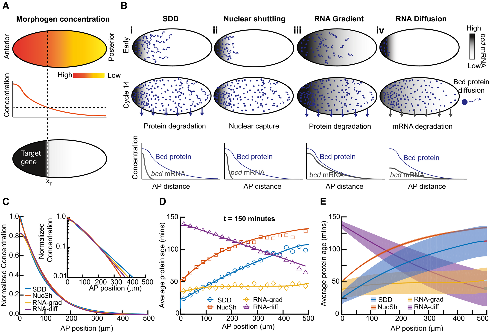

*Fig. 4. 相似的浓度图案可以来自不同的形成过程。* 引自 [Durrieu 等（2018），原文 Fig. 1](https://pmc.ncbi.nlm.nih.gov/articles/PMC6121778/#msb188355-fig-0001)。B：四种模型对 RNA 分布、蛋白质输运和降解作出不同假设。C：在同一观测时刻，它们都能产生相近的归一化浓度曲线。D：同一时刻的平均蛋白质年龄预测却明显不同，符号为随机模拟结果，实线为理论预测。E：改变模型参数后得到的预测范围。C–E 均为模型结果，尚不是胚胎中测得的年龄。

图 4C 中的曲线几乎重合，只看这一幅图，很难判断蛋白质究竟在哪里产生、怎样到达后端。B 展示了不同的解释：SDD 假设蛋白质主要在前端产生，随后扩散并降解；核穿梭模型（NucSh）也依靠蛋白质向后输运，但通过不断增加的细胞核捕获蛋白质，在没有蛋白质降解的设定下形成核内浓度图案。另两种模型则让 RNA 分布到更靠后的地方，使那里也能产生蛋白质。

这些过程对“后端的蛋白质有多老”给出了不同答案。在图 4D 的 SDD 和核穿梭模型中，越靠后，蛋白质平均越老；但降解会改变存留下来的分子的年龄分布，因此两条曲线并不相同。RNA 梯度模型在各处持续产生蛋白质，预测的平均年龄随位置变化较小。RNA 扩散模型中，产生蛋白质的区域随 RNA 向后扩展，后端的蛋白质反而更年轻。浓度相近的地方，分子的产生和输运历史仍然可能很不一样。

实验怎样读出年龄？作者把 Bicoid 与两种成熟速度不同的荧光蛋白连接起来。对于 mCherry–sfGFP 这组报告蛋白，绿色荧光成熟较快，红色荧光成熟较慢。刚合成的分子较早出现绿光，过一段时间红光才逐渐出现。测量红、绿荧光的强度比，再结合成熟速率的标定和模型，就能获得年龄方面的约束。这个比值不是直接以分钟为单位的年龄，也不能把单独的红光强度当作年龄。

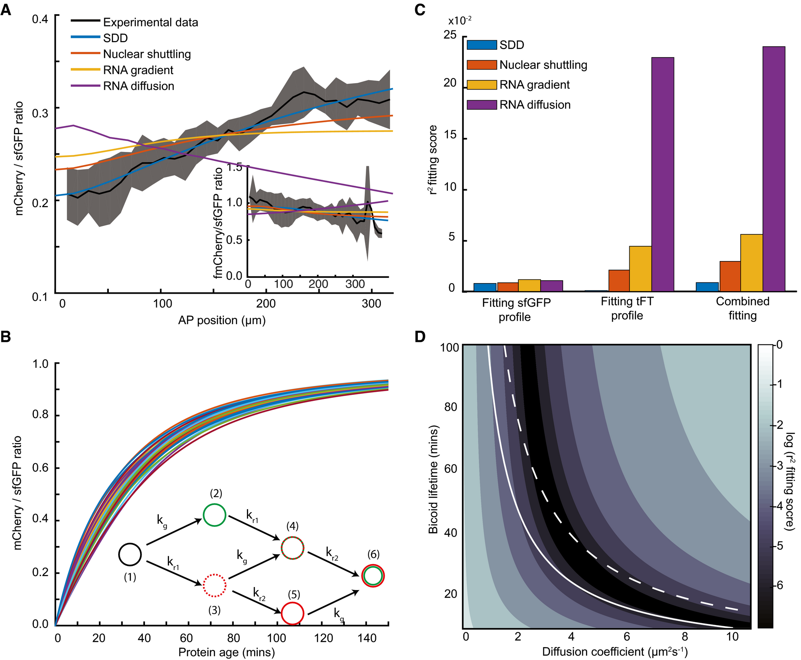

*Fig. 5. 加入年龄相关信号后，模型的拟合表现出现差别。* 引自 [Durrieu 等（2018），原文 Fig. 3](https://pmc.ncbi.nlm.nih.gov/articles/PMC6121778/#msb188355-fig-0003)。A：早期核周期 14 的 mCherry/sfGFP 强度比，黑线为实验均值，灰带为均值上下一个标准差，彩线为模型拟合；插图使用另一组荧光计时报告。B：报告比值随蛋白质年龄变化的理论关系。C：分别拟合绿色荧光分布、计时报告比值，以及同时拟合两者的误差，柱越低表示拟合越好。D：SDD 模型在不同扩散系数和寿命下的拟合误差，深色区域对应较小误差。

图 5A 中，实验测得的红绿比值总体向后升高，说明后端的 Bicoid 平均更老。这个趋势已经不符合图 4 中 RNA 梯度和 RNA 扩散模型的预期。不过，年龄随位置增加还不足以区分 SDD 和核穿梭模型，需要进一步比较曲线的幅度和形状。图 5C 把这种比较汇总起来：只拟合绿色荧光的空间分布时，四个模型的误差都较小；加入计时报告比值后，差别明显增大，SDD 对两类观测的联合拟合最好。

因此，这项工作对 SDD 的支持来自它同时解释了浓度和年龄相关的观测，而不只是能够画出一条下降的浓度曲线。这个结论针对论文比较的模型、报告系统和发育阶段。对下面的位置读取问题，我们仍可以先用指数梯度计算；在解释梯度的来源时，则需要接受这些额外实验的检验。

### 1.2 浓度过阈值的地方，就是表达边界 {#threshold-variability}

上一节得到了一条由前向后降低的 Bicoid 浓度曲线。但浓度的变化是连续的：从一个核走到旁边的核，浓度通常只差一点。早期 *hb* 转录却能表现出前部较活跃、后部较少活跃的区域。要解释这两个区域之间的分界，还需要知道基因怎样响应局部的 Bicoid。

Bicoid 是转录因子，可以结合基因附近的调控 DNA，参与调节转录。在其他条件相同时，局部 Bicoid 越多，调控位点与它发生结合的机会通常也越多。不过，一次结合并不等于基因立刻、持续地开启。实际的转录还涉及其他调控因子，启动子也会在活跃和不活跃的状态之间切换。因此，描述这种响应时，可以先问：在给定的 Bicoid 浓度下，观察到基因正在转录的概率有多大？

假如这个概率在低浓度时接近 0，高浓度时接近 1，而且主要的变化集中在一小段浓度范围内，就可以先用一个开关近似它。用 $c_*$ 表示开关的阈值，规定 $c\gt c_*$ 时开启，$c\lt c_*$ 时关闭。这是 French flag 模型采用的简化；对于实际的连续响应，也可以把活跃概率为一半时的浓度作为边界的判据。这里先用这条简单规则计算边界的位置，真实 *hb* 的调控机制会比它复杂。

可以把同一条规则放到胚胎中的每个核上。前端附近的核接触到较高浓度，满足开启条件；沿前后轴往后，浓度逐渐下降，总会有一处降到 $c_*$。这处前面的核开启，后面的核关闭，把所有核的状态画在一起，就出现了一条表达边界。**边界的位置由浓度梯度和基因的响应阈值共同决定。** 每个核只对自己附近的浓度作出响应，并不需要知道自己离前端多远。

设这条边界距离前端 $x_*$，用上一节的指数近似，就有

$$
c(x_*)=c_*
\quad\Longrightarrow\quad
c_0e^{-x_*/\lambda}=c_*.
$$

两边除以 $c_0$，再取自然对数，得到

$$
-\frac{x_*}{\lambda}=\ln\frac{c_*}{c_0},
\qquad
\boxed{x_*=\lambda\ln\frac{c_0}{c_*}}.
\tag{1.3}
$$

也可以直接从图上读出这个位置：在浓度曲线上画一条高度为 $c_*$ 的水平线，找到两者的交点，再向下投影到位置轴。式（1.3）就是这个交点的横坐标。这里默认阈值落在前端和后端的浓度之间，因而交点确实位于胚胎内部；阈值太高会使所有位置都达不到开启条件，太低则会使整个区间都开启。

沿用上一节的教学参数：胚胎长 $L=500\,\mu\mathrm m$，前端浓度 $c_0=100$，衰减长度 $\lambda=100\,\mu\mathrm m$。令阈值为 $c_*=100e^{-2}\simeq13.5$，则

$$
x_*=100\ln\frac{100}{100e^{-2}}\,\mu\mathrm m
=200\,\mu\mathrm m.
$$

在 $190\,\mu\mathrm m$ 处，浓度约为 15.0，比阈值高，按规则应当开启；在 $210\,\mu\mathrm m$ 处，浓度约为 12.2，比阈值低，应当关闭。两者之间的 $200\,\mu\mathrm m$ 就是分界。因为它占胚胎全长的 40%，我们可以把结果描述成“前 40% 区域开启”。这个比例是根据计算结果换算出来的，模型中的核实际响应的仍然是浓度。

接下来把 Bicoid 的输入增加一点。假设梯度整体升高 10%，即 $c_0$ 从 100 变成 110，而衰减长度和阈值都不变。原来位于边界上的核，现在读到的浓度也会从约 13.5 升到约 14.9，已经高于原来的阈值。它后面的一些核也会因此开启，所以表达区域向后延伸。

新边界仍然满足式（1.3）。把改变前后的边界位置相减，得到

$$
\Delta x_*
=\lambda\ln\frac{110}{c_*}-\lambda\ln\frac{100}{c_*}
=\lambda\ln\frac{110}{100}
\simeq9.5\,\mu\mathrm m.
$$

所以新边界在约 $209.5\,\mu\mathrm m$，相当于全长的 41.9%，见 Fig. 6A。这个位移来自输入浓度的整体升高，即使每个核每次都能准确读取浓度，仍会发生。反过来，若浓度曲线保持不变，只把开启阈值提高 10%，原来边界附近的一些核就达不到新的阈值，边界会向前移动约 $9.5\,\mu\mathrm m$。

前一节的源–扩散–降解模型还给出了 $c_0=R\tau/\lambda$。在扩散系数和寿命固定时，输入通量 $R$ 增加多少百分比，$c_0$ 也增加同样的百分比。因此，当输入从 $R$ 变为 $R+\delta R$ 时，

$$
\Delta x_*=\lambda\ln\left(1+\frac{\delta R}{R}\right).
$$

对于小幅变化，可以用 $\ln(1+\epsilon)\simeq\epsilon$ 近似，得到

$$
\delta x_*\simeq\lambda\frac{\delta R}{R}.
\tag{1.4}
$$

例如，输入增加 10%，边界位移就约为衰减长度的 10%。这里 $\lambda=100\,\mu\mathrm m$，近似结果为 $10\,\mu\mathrm m$，与刚才的精确值 $9.5\,\mu\mathrm m$ 很接近。输入变化较大时，则应使用前面的对数表达式。

实际改变一个生物学条件时，往往不止一个参数会变。例如，蛋白质寿命的变化会同时影响衰减长度和前端浓度。要把这些影响合起来，可以对式（1.3）求全微分：

$$
\delta x_*=
\ln\frac{c_0}{c_*}\,\delta\lambda
+\lambda\left(\frac{\delta c_0}{c_0}-\frac{\delta c_*}{c_*}\right).
\tag{1.4a}
$$

这几项可以分别理解。固定前端浓度和阈值时，$\lambda$ 增大，梯度下降得更慢，要到更靠后的地方才降到阈值；固定其他量时，前端浓度升高也会让边界后移，阈值升高则会让边界前移。如果多个参数一起变化，这些位移可能相加，也可能抵消。用这个式子分析某种扰动时，需要把该扰动造成的各项变化一并代入。

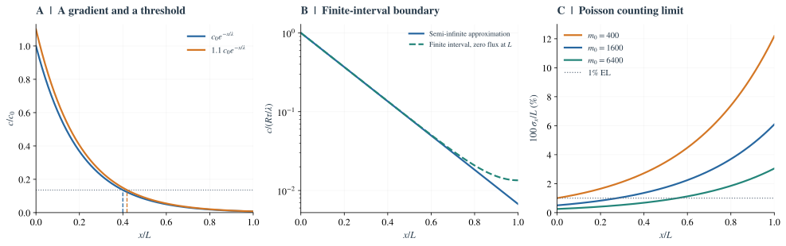

*Fig. 6. 梯度的形成与定位限制。* A：灰色水平线表示固定的浓度阈值。前端产生通量增加 10% 后，浓度曲线整体升高，与阈值线的交点从 $0.40L$ 移到约 $0.419L$；这里 $\lambda/L=0.2$。B：第 1.1 节的有限区间解与指数近似，后端的零通量条件使有限区间解在那里变平。C：第 2 章将讨论的 Poisson 分子计数模型，$m(x)=m_0e^{-x/\lambda}$；越靠后，可计数的分子越少，对位置的判断也越不精确。三个面板均为模型计算。

到这里，我们算的是平均浓度曲线与阈值的交点。如果同一位置的浓度读数有波动，靠近交点的核就可能这次读到阈值以上、下次读到阈值以下，表达边界也会变得不确定。让基因的开关响应更陡，并不能自动解决这个问题：输入的读数一旦跨过阈值，再陡的开关也会跟着改变状态。第 2 章将具体计算，浓度读数的误差会造成多大的位置误差。在此之前，先区分边界的重复定位、对输入改变的响应，以及胚胎大小改变时的比例保持。

### 1.3 三种不同的“图案是否可靠” {#precision-robustness-scaling}

看到一条清楚的平均边界，还需要分别问三个问题：

| 问题 | 怎样比较 | 对应概念 |
|---|---|---|
| 相同条件下，这次与下次的结果相差多少？ | 固定发育阶段，重复测量同一位置的表达或边界 | 精度 |
| 输入改变后，图案会移动多少？ | 例如提高母源剂量，比较改变前后的边界 | 鲁棒性 |
| 胚胎更长时，边界是否仍在相同比例处？ | 比较边界距离与胚胎全长之比 | 尺度缩放 |

沿用第 1.2 节的模型例子，可以进一步区分这三个问题。下面讨论的是假设情境和模型预测，不是实验测量结果。

**精度关心相同条件下的重复差异。** 如果在发育阶段、输入条件和胚胎大小相同的情况下，反复观察得到的边界位置都靠近 $200\,\mu\mathrm m$，就说明重复定位较精确。这里尚未给出边界波动的实验数据，也没有用模型算出它的大小；第 2 章会讨论浓度读数的噪声怎样造成位置不确定性。

**鲁棒性关心条件改变后，边界是否仍能保持原位。** 第 1.2 节已经算出，在阈值和衰减长度固定时，源强增加 10% 会使模型边界从 $200\,\mu\mathrm m$ 移到约 $209.5\,\mu\mathrm m$。即使改变前后各自的重复定位都很精确，两组结果仍会相差约 $9.5\,\mu\mathrm m$。因此，重复定位精确，并不意味着边界对源强变化不敏感。

**尺度缩放关心相对位置是否保持不变。** 假设胚胎全长从 $500\,\mu\mathrm m$ 变为 $600\,\mu\mathrm m$，要让边界仍位于全长的 40%，它就必须从 $200\,\mu\mathrm m$ 移到 $240\,\mu\mathrm m$。这里的 $240\,\mu\mathrm m$ 是保持比例所要求的位置；模型是否会产生这样的移动，还需要根据参数和胚胎长度之间的关系计算。

为什么两个固定阈值不能自动保证缩放？因为式（1.3）里只有 $c_0$、$c_*$ 和 $\lambda$，没有胚胎全长 $L$。这些量都不随大小改变时，在指数近似成立的范围内，边界仍会停在相同的绝对距离；原来的 $200/500=40\%$ 就变成 $200/600\simeq33\%$。若希望比例不变，模型还需要让输入或读取规则随大小作适当变化。

对于第 1.1 节的有限区间解，可以把这个要求写得更具体。令相对位置 $z=x/L$、$\kappa=L/\lambda$，则

$$
c(z;L)=\frac{R\tau}{\lambda}
\frac{\cosh[\kappa(1-z)]}{\sinh\kappa}.
\tag{1.5}
$$

将边界处的浓度设为 $c_*$，得到

$$
\frac{\cosh[\kappa(1-z_*)]}{\sinh\kappa}
=\frac{c_*\lambda}{R\tau}.
$$

因此，要在改变 $L$ 后保持相同的边界比例 $z_*$，一组充分条件是：$L/\lambda$ 和 $c_*\lambda/(R\tau)$ 都保持不变。前一个条件要求梯度的衰减长度随胚胎长度同比例改变，后一个条件要求阈值相对于梯度的浓度尺度也保持不变。只让衰减长度随胚胎变长，通常还不够；输入通量、寿命和阈值之间也需要有合适的配合。这是一组能保证缩放的条件，并不意味着实现缩放只有这一种方式。

还要区分**一个胚胎里表达过渡有多宽**，以及**不同胚胎的边界位置相差多少**。每个胚胎都可以有很窄的过渡，却在不同位置出现；把许多胚胎平均后，就会得到一条较宽的过渡。因此，仅看平均图案是否清楚，还不足以判断这些可靠性。

接下来固定平均浓度图案，单独问：**同一位置的读数为什么仍会波动？读数相差一点，究竟相当于位置相差多少？**

## 2. 细胞怎样读取浓度，读数又为何有误差 {#local-estimation}

第 1 章把基因调控概括为“浓度过阈值就开启”。这一章先拆开这个开关：核中的什么东西接触到信号，接触以后发生什么，为什么这些反应能把空间差异变成表达差异。理解了实际读取过程，再问它能有多精确。

### 2.1 谁在读取：从蛋白质结合 DNA 到产生 RNA {#molecular-readout}

**“读到浓度”首先是一连串分子接触事件。** 在这里，Bicoid 已经存在于核内。控制基因表达的 DNA 调控序列含有能与 Bicoid 结合的位点；分子运动到这些位点附近，可能结合，过一段时间又解离。同一个位点因而在“空着”和“被占据”之间切换。

先认识调控 DNA 上两个常见的名称。**启动子**（promoter）是转录机器组装、起始转录所需的 DNA 区域；**增强子**（enhancer）是能结合调控蛋白并影响目标基因转录的 DNA 区域，可以离启动子较远。两者通过分子相互作用影响转录，不要求蛋白质先把浓度翻译成一个数值，再把这个数值交给基因。不同基因的调控结构不同，下面先用一个结合位点解释最基本的感应原理。

如果其他条件不变，周围 Bcd 浓度高，空位点通常更快遇到能够结合的 Bcd；浓度低，平均等待时间更长。因此，**浓度可以被转换成位点被占据的时间比例，以及结合、解离事件的时间序列。** 这就是一种物理上的“测量”。例如，假设每次结合平均维持 2 s：

| 教学情形 | 空位点平均等待多久才被结合 | 每次结合平均维持多久 | 长时间内被占据的比例 |
|---|---|---|---|
| 较低浓度 | 8 s | 2 s | $2/(8+2)=20\%$ |
| 较高浓度 | 2 s | 2 s | $2/(2+2)=50\%$ |

这些是方便理解的假设参数，不是 Bcd 的实测停留时间。每次等待也不恰好等于表中的平均数：有时很快就有分子到达，有时会空等很久。只看一瞬间，两个位置的位点都可能恰好被占据；观察一段时间，结合历史的统计才显出差别。

<div id="binding-readout"></div>

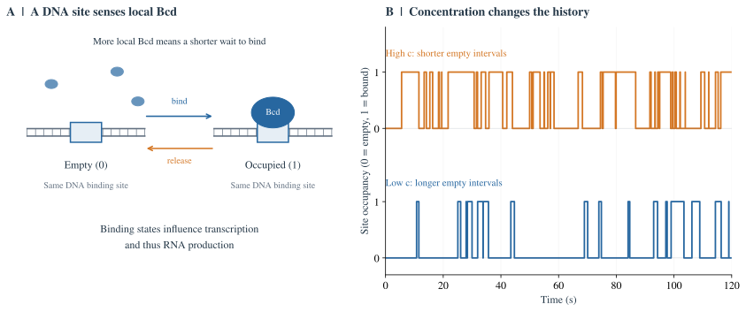

*Fig. 7. 浓度怎样成为可影响基因的分子信号。* A：同一个 DNA 位点在空闲与被 Bcd 占据之间切换；在最小模型中，空位点的结合速率随局部浓度增加，解离速率保持不变。B：两种浓度下模拟的随机结合轨迹，1 表示被占据、0 表示空闲；两条轨迹使用表中的平均等待与结合时间。位点只经历这些事件，不知道自己在胚胎的哪个坐标。图为教学示意与随机模拟，非胚胎数据；单个位点模型不代表完整的 *hb* 调控机制。

**结合状态再改变转录。** 对一个激活因子来说，结合可以通过招募或影响其他蛋白质，使转录机器更容易开始工作；抑制因子则可以降低相应调控区域的转录输出。具体方式依赖基因和调控蛋白。把这些中间环节概括起来，就是“不同结合状态对应不同的转录产生率”。一次结合不必对应恰好一条 RNA，也不保证基因立即开启。

在最简单的教学模型里，可以假设位点被占据时更容易转录，空闲时较难转录。高浓度使位点更常被占据，于是在相同时间内，平均产生的 mRNA 更多。mRNA 再被翻译成蛋白质，就把短暂的结合事件转成了能够持续一段时间、影响下游基因的分子状态：

$$
\text{局部 Bcd 浓度}
\longrightarrow\text{DNA 结合状态}
\longrightarrow\text{转录与 mRNA 积累}
\longrightarrow\text{Hb 蛋白}.
$$

这里的“积累”还有一个作用：某个时刻有多少 RNA 或蛋白质，取决于之前一段时间的产生与去除。因此，输出可以保留输入历史的一部分，起到时间整合的作用；它不是无限记忆，更不是无噪声的平均器，具体精度取决于结合动力学、转录随机性和分子寿命。

实验确实能接近这条链中的中间环节。[Lucas 等（2018）](https://doi.org/10.1371/journal.pgen.1007676)用带荧光标记的 nascent RNA（正在合成的 RNA）观察 *hb* 报告基因的活体转录。它观测的是转录输出，不是核“报出一个浓度值”；结合模型则尝试解释输入 Bcd 怎样造成这种输出。真实系统包含多个位点、转录状态和其他调控因素，不能把单个位点的占据率直接当成完整的活跃概率。

**空间信息由此进入反应，但反应不必显式包含坐标。** 前后两个核具有相同的调控 DNA，却接触到不同浓度，因而产生不同的结合历史和表达概率。对外部观察者而言，看到这些表达差异，就能推测来自哪里；对胚胎而言，在正确区域产生 Hb、再影响后续表达，本身就已经在使用位置信息。

下面的“读数”可以指实验测得的蛋白浓度，也可以指模型中可供下游使用的分子状态。我们先量化这些状态能支持多精细的位置区分；实际下游是否利用了全部线索，还要检验其调控机制。

### 2.2 先比较两个位置的重复读数 {#conditional-expression}

**先固定位置，再看读数。** 假设在同一发育阶段，重复测量一批胚胎的同一个位置。即使位置相同，分子的产生、到达与去除也不完全相同，表达量因此会波动。本文把条件固定后仍然存在的表达波动称为**噪声**。实验中还要另外估计成像、背景扣除等测量误差，避免把仪器的波动全部算成生物噪声。

先看一个完全假设的例子。位置 A 在全长的 40%，位置 B 在 41%；两处的平均表达分别是 100 和 110 个任意单位。这里为了便于演示，选了一条向后升高的表达曲线，并非 Bicoid 的实际下降曲线。

如果 A 的读数通常集中在 100 附近、B 集中在 110 附近，两处就可能区分。如果两边都时常出现从 80 到 130 的读数，单独看到一个 106 就很难判定来自哪里。**均值不同是必要线索，但还要知道每个位置的读数有多分散。**

<div id="reading-noise"></div>

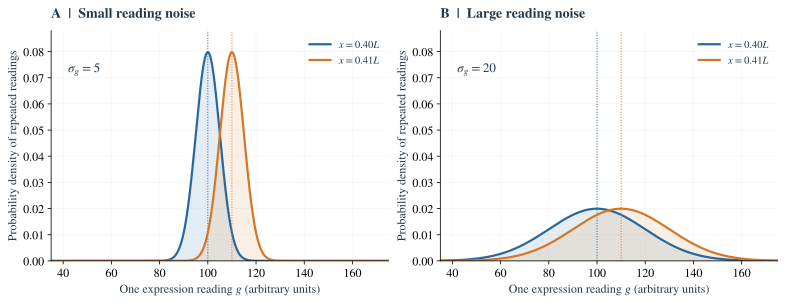

*Fig. 8. 从表达分布的重叠，到位置误差的几何意义。* A、B：位置 $0.40L$、$0.41L$ 的平均读数都是 100、110；标准差分别取 5、20。横轴是表达读数，纵轴是概率密度；曲线下某段的面积表示读数落在该段的概率，整条曲线下面积为 1。重叠越多，越难区分来源。C、D：改画平均表达随位置的变化，固定读数标准差为 5；橙色带以 $x=0.40L$ 处的均值 100 为中心，上下各取一个读数标准差，虚线把交点投影到位置轴。C 曲线较陡，对应的位置半宽为 $0.005L$；D 斜率降为四分之一，位置半宽扩大到 $0.02L$。图中分布与直线均为教学模型，非实验拟合。

**用一个分布概括同一位置的重复读数。** 记号 $P(g\mid x)$ 表示“位置固定为 $x$ 时，读到表达量 $g$ 的分布”，竖线读作“在……条件下”。在 A 处，分布中心在 100；在 B 处，中心在 110。这两条曲线不是两个核沿时间移动的轨迹，而是各自固定位置上的读数分布。

用 $\mu(x)$ 表示平均表达，用 $\sigma_g(x)$ 表示读数的**标准差**。标准差描述围绕均值波动的典型大小，计算方法是：先把每种读数减去均值，再平方、取平均，最后开平方。例如，若读数以相等概率取 90 和 110，均值就是 100，标准差为

$$
\sigma_g=\sqrt{\tfrac12(90-100)^2+\tfrac12(110-100)^2}=10.
$$

平方是为了不让正、负偏差互相抵消；再开平方，则让标准差恢复成与读数相同的单位。标准差为 10 并不表示每次恰好偏离 10，也不是最大可能误差。Fig. 8A、B 的正态分布中，约 68% 的读数位于均值上下一个标准差内。

**再把读数的宽度换成位置的宽度。** 在本例中，位置移动 $0.01L$，平均读数改变 10。把附近的平均曲线近似为直线，那么：

- 读数相差 1，对应的位置差是 $0.001L$；
- 读数不确定 5，对应的位置尺度是 $0.005L$，即全长的 0.5%；
- 读数不确定 20，对应的位置尺度是 $0.02L$，即全长的 2%。

把“每移动一点，平均读数改变多少”记为斜率 $\mu'(x)$。上述换算就是“读数变化 $\simeq$ 斜率 $\times$ 位置变化”，因此

$$
\boxed{\sigma_x\simeq\frac{\sigma_g}{|\mu\prime|}.}
\tag{2.1}
$$

这里的 $\sigma_x$ 是沿平均曲线反推位置时的局部误差尺度。斜率取绝对值，是因为向后升高或降低都可以提供位置线索；误差大小应当为正。单位也可以检查：读数单位除以“读数单位/长度”，恰好得到长度。

Fig. 8C、D 可以直接读出这个除法：先画出同样宽的竖直读数范围，再沿曲线投影到横轴。曲线陡，投影到的位置区间窄；曲线平，同样的读数波动就覆盖更长的一段位置。因此，**定位依靠平均信号随位置的变化相对于噪声有多大。**

这也补上了第 1 章留下的“开关更陡”问题。若只把已有读数作确定的放大，例如全部乘以 2，平均曲线的斜率增大两倍，已有读数的标准差也增大两倍，式（2.1）的比值不变。陡峭的响应有助于把浓度差转成明显的表达差，却不能凭这种放大获得原读数中没有的位置线索；是否还能改善实际响应，要看它有没有同时平均噪声、引入新线索或改变其他噪声来源。

这个量级与生物问题怎样联系？[Gregor 等（2007）](https://pmc.ncbi.nlm.nih.gov/articles/PMC2253670/)讨论的胚胎全长约 $500\,\mu\mathrm m$、相邻核间距约 $8\,\mu\mathrm m$、Bcd 衰减长度约 $100\,\mu\mathrm m$。在指数曲线上，向后走 $8\,\mu\mathrm m$，浓度下降约 $1-e^{-8/100}\simeq7.7\%$。也就是说，若要仅靠 Bcd 区分相邻核，读取就必须能辨别这个量级的浓度差。看起来平滑的梯度，到了单个核的尺度上，就成为了辨别小差异的问题。

最后检查适用范围。式（2.1）要求不确定区间内曲线近似直线，而且读数能对应到附近的单一分支。若曲线很平，算出的范围大到跨越明显弯曲的区段，这个近似就不可靠；若是峰形曲线，另一侧还可能有相同读数，也不能只用一个局部误差概括。第 4 章会处理多个候选位置，[附录 A.6](#local-error-derivation)保留局部推导。

### 2.3 为什么分子数会限制读取精度 {#poisson-counting}

上一节把噪声大小当作已知量，现在问它可能从哪里来。第 2.1 节的实际调控通过结合事件采样；为了先看清有限分子数的影响，这里暂用一个理想计数实验作基准：固定位置、固定采样体积，在某一时刻直接数里面有多少个分子。平均数可以稳定，但实际计数仍会变化。这个简化帮助计算分子信号本身的波动，随后还要考虑结合与转录怎样接收它。

**为什么“平均 100 个”不等于每次都有 100 个？** 分子会随机进入、离开或被去除，各次观测的结果可能是 92、105、98 等。对于独立、稀疏的随机占据，一个常用的计数模型是 **Poisson 分布**。它不是所有基因表达都必须服从的定律，而是先排除分子间关联、转录爆发等额外机制后，研究计数噪声的起点。

在 Poisson 模型中，若平均计数为 $m$，计数的方差也是 $m$。用 $N$ 表示实际读到的随机计数，则

$$
\sigma_N=\sqrt m,
\qquad
\frac{\sigma_N}{m}=\frac1{\sqrt m}.
\tag{2.2}
$$

可以用一个相加的例子理解平方根：四个等体积、相互独立的小区域，如果每个区域平均有 25 个分子、方差为 25，把它们合起来，总均值是 100，总方差也是 100，标准差却是 $\sqrt{100}=10$。均值增加四倍，标准差只增加两倍，所以相对标准差从 $5/25=20\%$ 降为 $10/100=10\%$。这个例子说明独立计数相加时的规律；它还没有说明真实启动子能把更大的空间全部采样。

特别注意**绝对波动**与**相对波动**的区别：平均数从 25 增至 400，标准差从 5 增至 20，绝对波动增大了；但相对于平均数，波动从 20% 降为 5%。说“分子多时噪声更小”，这里指的是相对波动更小。

**把分子计数接回位置判断。** 若采样体积固定，平均计数正比于浓度，所以也可以写成 $m(x)=m_0e^{-x/\lambda}$。在很短的距离 $\Delta x$ 内，平均计数的变化量约为 $m(x)\Delta x/\lambda$，因此斜率的绝对值是 $m(x)/\lambda$。代入式（2.1）：

$$
\boxed{\sigma_x(x)\simeq\frac{\sqrt{m(x)}}{m(x)/\lambda}
=\frac{\lambda}{\sqrt{m(x)}}.}
\tag{2.3}
$$

分子数决定相对计数波动，衰减长度决定同样的位置移动能带来多大的相对信号变化。以 $L=500\,\mu\mathrm m$、$\lambda=100\,\mu\mathrm m$ 为例：

| 当地平均计数 $m$ | 计数标准差 $\sqrt m$ | 相对标准差 | 局部位置误差尺度 $\lambda/\sqrt m$ |
|---|---|---|---|
| 25 | 5 | 20% | $20\,\mu\mathrm m=4\%L$ |
| 100 | 10 | 10% | $10\,\mu\mathrm m=2\%L$ |
| 400 | 20 | 5% | $5\,\mu\mathrm m=1\%L$ |

这里比较的是当地分子数不同的三种计数情形；$m$ 不是前端的 $m_0$。沿同一条指数梯度向后，平均计数减少，相对波动增大，因而定位更困难，见 Fig. 6C。

这也解释了一个容易误会的结果：指数梯度前部的绝对计数波动虽然更大，但其斜率也更大，且增长得更快，最终位置误差反而更小。不能只比较噪声分子的大小，而不比较分母中的斜率。

这个模型还有明确的生物学边界。一个启动子并不能瞬间数遍整个核中的分子，而是通过局部结合、解离等事件接收信号；转录还会引入自己的随机性。因此，表中的 400 既不是整个胚胎的分子数，也不等于启动子已经获得 400 次独立观测。Poisson 计数给出一种基准；要预测实际读取误差，还需要说明体积、时间和读取机制。[附录 A.1](#appendix-a)给出完整计数分布与估计界。

### 2.4 多读几次，为什么不一定解决问题 {#averaging-and-extrinsic-noise}

**独立重复可以减少随机波动。** 假设位置不变，每次读数都来自同一分布、标准差为 $\sigma_g$，并且各次相互独立。把 $K$ 次读数取平均，均值不变，标准差降为

$$
\sigma_{\bar g}=\frac{\sigma_g}{\sqrt K}.
\tag{2.4}
$$

这里 $\bar g$ 表示平均读数。为什么不是除以 $K$？因为独立读数相加时，方差增加到原来的 $K$ 倍，标准差增加到 $\sqrt K$ 倍；再把总和除以 $K$，才得到 $1/\sqrt K$。四次独立观测只能让标准差减半，要降到十分之一就需要 100 次。

只要平均表达曲线没有改变，式（2.1）的分母也不变，于是位置误差同样按 $1/\sqrt K$ 减小。对生物系统而言，在时间上积累结合事件、转录产物等过程，可以起到某种平均作用；具体能平均多少，要由反应动力学决定。

**“多拍几帧”不等于“多做几次独立实验”。** 一团分子还没有散开时，连续拍很多帧可能反复看到同一团分子；启动子持续处于一次活跃状态时，密集采样也没有创造出很多次新的随机尝试。极端情况下，把同一个读数抄四遍再平均，结果当然不会更准确。

描述这种记忆持续多久的量，叫**相关时间**。间隔远大于相关时间的观测才可能近似独立。若一个状态约持续 10 s，1 s 内拍 100 帧，不能直接把式（2.4）的 $K$ 设为 100。延长观测也有代价：胚胎发育在继续，核必须在有限时间内影响下游基因；若期间平均输入也在改变，就不能再把它当作对同一个固定分布的重复取样。时间平均的定量计算见[附录 C](#appendix-c)。

**有些不确定性会在所有读数中一起保留下来。** 设想每次测量都包含两部分：一部分是独立波动，标准差为 10；另一部分是在整个读取时段内保持不变的共同偏移，不同胚胎的偏移标准差为 5。假设这两部分相互独立，并在胚胎总体上均值为零：

| 取平均的独立读数次数 | 独立部分的标准差 | 共同部分的标准差 | 总标准差 |
|---|---|---|---|
| 1 | 10 | 5 | $\sqrt{10^2+5^2}\simeq11.2$ |
| 4 | 5 | 5 | $\sqrt{5^2+5^2}\simeq7.1$ |
| 很多次 | 趋近 0 | 5 | 趋近 5 |

总方差相加，而不是把两个标准差直接相加。共同偏移在同一胚胎的重复读数里都存在，平均再多次也不会自行消失。这个表描述的是跨胚胎的总不确定性；在单个胚胎内，固定偏移本身不会表现为随时间的起伏。

输入强弱就能造成这样的困难。回到第 1 章的教学梯度：通常 $c_0=100$，在 $x=200\,\mu\mathrm m$ 处读到约 13.5。若这个胚胎的前端幅度只有通常的 80%，同一位置就只有约 10.8。对只知道“通常梯度”的观察者而言，10.8 也可以解释为：前端仍是 100，但自己处在约 $222.3\,\mu\mathrm m$ 的更后方。因为

$$
80e^{-200/100}\simeq100e^{-222.3/100}\simeq10.8.
$$

增加本地采样，可以把“这里确实是 10.8”测得更准，却不能单凭这一个浓度区分“输入偏弱”和“位置更靠后”。这是一种信号解释上的歧义，需要额外线索。

### 2.5 同一段调控 DNA 怎样接收多个位置线索 {#molecular-combination}

现在把第 2.1 节的单一输入向前推进一步。*hb* 产生的 Hb 蛋白本身也是转录因子，可以成为其他基因的输入。果蝇的 gap gene（间隙基因）蛋白还包括 Krüppel（Kr）、Giant（Gt）、Knirps（Kni）等；它们在前后轴上的表达区域不同，部分重叠，并参与相互调控。因此，一个核内同时存在的是一组调控蛋白，而不只是一个 Bcd 浓度。

下游基因怎样使用这一组信号？**同一段调控 DNA 可以带有识别不同转录因子的位点。** 一类位点接触 Hb，另一类接触 Kr 或 Gt；这些结合状态共同影响同一个基因的转录。调控区域因而可以对“激活因子足够、某种抑制因子较少”这一类组合更容易响应。这不是把几种蛋白浓度不分身份地加在一起，而是让不同分子通过各自的结合与调控作用共同影响输出。

一个真实例子是 *even-skipped*（*eve*）的第 2 条纹增强子。[Small、Blair 和 Levine（1992）](https://pmc.ncbi.nlm.nih.gov/articles/PMC556915/)研究发现，这段调控 DNA 含有 Bcd、Hb、Gt、Kr 的结合位点：Bcd 与 Hb 参与激活，Gt 参与限定前侧边界，Kr 的抑制与有限的 Bcd 激活共同影响后侧边界。因而可以先用下面的定性图景理解一条窄条纹：

| 所在区域 | 本地调控组合的作用 | 对第 2 条纹表达的影响 |
|---|---|---|
| 条纹前侧附近 | Gt 等抑制作用限制表达 | 前侧被挡住 |
| 条纹所在的空间窗口 | 激活足够，两侧的抑制条件允许表达 | 能够产生条纹表达 |
| 条纹后侧附近 | Kr 抑制与 Bcd 激活减弱共同限制表达 | 后侧被挡住 |

表格省略了连续变化和其他调控细节，不是一个精确的逻辑门。它要说明的是：**一个核可以通过本地蛋白组合开启一段表达区域，而不必先计算“我在全长的百分之几”。** 同一条规则在各处执行，因为局部组合不同，最后只在一段空间窗口里产生表达。

到这里，第三章要比较的对象才有了物理含义。一种蛋白的局部浓度可能有歧义，另一种蛋白可能给出补充；下游调控 DNA 也确实有接收多个输入的分子结构。接下来先问一个可计算的问题：**如果同时知道同一个核中的几种蛋白浓度，附近的位置是否更容易区分？**

这一步评价的是表达组合中“有多少线索可用”。具体增强子能取出其中多少，还取决于结合位点、反应速度与自身噪声，不能把数学上可实现的最佳读取直接当成细胞已经实现的机制。第 8.3 节再把统计解码与实际下游输出对照起来。

## 3. 多个基因如何联合提高位置分辨能力 {#multigene-fisher}

### 3.1 从调控蛋白组合到表达空间 {#expression-space}

第 2.5 节已经看到，下游基因可以通过调控 DNA 接收多种蛋白输入。现在暂时把具体的结合反应放在一边，先比较这些输入组合能否把位置区分开。本章选取四种 gap 蛋白——Hunchback（Hb）、Krüppel（Kr）、Giant（Gt）和 Knirps（Kni）——作为定量研究对象；它们是这里同时测量的四个读数，与上一节 *eve* 第 2 条纹例子的四种输入并不完全相同。

<div id="gap-genes-to-stripes"></div>

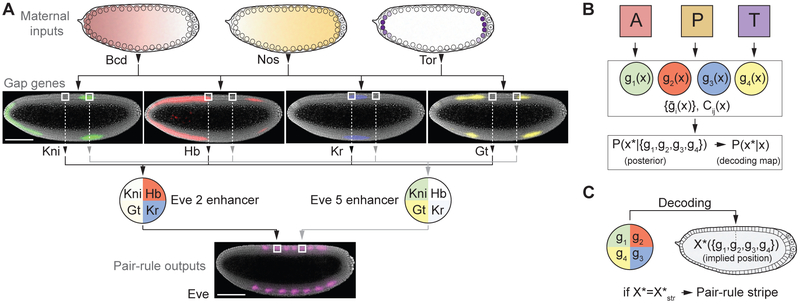

*Fig. 9. 从母源输入到 gap genes，再到下游条纹。* 引自 [Petkova 等（2019），原文 Fig. 1](https://pmc.ncbi.nlm.nih.gov/articles/PMC6526179/#F1)。A 包含胚胎表达成像，标尺 $100\,\mu\mathrm m$；B、C 示意如何从表达组合推断位置，并检验下游条纹。先沿 A 自上而下看生物过程，再用 B、C 对照后文的数学描述。

设想两个核的 Hb 浓度相近，但一个核的 Kr 多、另一个核的 Kr 少。只依赖 Hb 的调控很难区分它们；能响应 Kr 的调控区域则可能作出不同反应。这就是下面“联合读取”的生物学起点。为了比较全部可用线索，数学上把“哪一种蛋白有多少”分别记下来，四个读数构成向量：

$$
\mathbf g=(g_{\mathrm{Hb}},g_{\mathrm{Kr}},g_{\mathrm{Gt}},g_{\mathrm{Kni}}).
$$

先只取 Hb 与 Kr 两个读数，就可以画一张二维图：横轴是 Hb，纵轴是 Kr，一个点代表某个核的一次联合读数。同一位置的重复测量形成一团点；不同位置则可能形成不同的点团。

联合读取是否有用，要看这些点团能否分开。两处的 Hb 几乎相同时，Kr 的差异仍可能帮助区分；如果两处在所有蛋白上的读数都一样，就依然无法区分。四维表达向量是同一件事在四种蛋白上的推广。

### 3.2 给局部可分辨性取一个名字 {#fisher-bound}

第 2 节已经得到：平均表达的斜率大、读数噪声小，位置容易区分。对单一读数，为方便比较，把这个比值的平方记为

$$
\mathcal J_\mu(x)=\left[\frac{\mu'(x)}{\sigma_g(x)}\right]^2,
\qquad
\sigma_x(x)\simeq\frac1{\sqrt{\mathcal J_\mu(x)}}.
\tag{3.1}
$$

$\mathcal J_\mu$ 越大，局部位置误差尺度越小。例如，比值增大两倍，$\mathcal J_\mu$ 增大四倍，位置误差尺度减半。

在局部高斯噪声、方差近似不变的条件下，这就是 **Fisher information（Fisher 信息）**。它衡量两个很接近的位置，在观测读数上有多容易区分。这里先用这个熟悉的“斜率与噪声”的例子理解它；一般定义与估计界见[附录 A.5](#general-fisher)。

Fisher 信息只处理附近位置的分辨能力，还不能保证在整个胚胎中找到唯一位置。一个表达峰两侧可能各有一个很窄的候选区，第 4 节再把所有候选位置一起考虑。

### 3.3 不同基因可以在空间上互相补充 {#complementary-slopes}

一个基因在表达平台上变化很小，另一个基因可能正处于明显变化的区域。它们就能在不同地方提供位置线索。若各基因的波动大小在附近近似不变，且它们在给定位置上的噪声彼此独立，联合读取的局部 Fisher 信息就是各自贡献之和：

$$
\mathcal J_\mu(x)=
\sum_{\alpha=1}^{K}
\frac{[\mu_\alpha'(x)]^2}{\sigma_\alpha^2(x)}.
\tag{3.2}
$$

每一项都是第 3.2 节的“斜率与噪声比值的平方”，现在只是对不同蛋白求和。增加一个读数至少不会抹去原有读数的信息；但如果为了增加一种蛋白，必须减少其他蛋白的分子数，原有读数的相对波动可能增大，收益就需要重新计算。

### 3.4 相关噪声究竟有利还是有害 {#correlation-geometry}

两个基因的噪声可能一起升降。例如，共同输入偏高时，两种蛋白都偏高；也可能一种偏高时另一种偏低。这种共同变化称为**相关噪声**。用相关系数 $\rho$ 描述它：正值表示倾向于同向波动，零表示没有线性相关，负值表示倾向于反向波动。

先想两种信号。若往后移动本来就会让两种蛋白一起升高，那么“一起偏高”的噪声就像一次假位置移动，容易误导读取。若往后移动会使一种升高、另一种降低，那么两者同时偏高就不太像真正的位置变化；比较它们的差值，还能抵消一部分共同波动。

用一个等噪声的教学模型算出这一差别。设两种蛋白各自的标准差都是 $\sigma$，局部斜率大小都是 $a$。

如果两种平均表达都随位置以斜率 $a$ 升高，则

$$
\mathcal J_\mu=\frac{2a^2}{\sigma^2(1+\rho)}.
\tag{3.3}
$$

共同升降的噪声与位置信号方向一致，正相关会降低可分辨性。但若一种以斜率 $a$ 升高，另一种以同样大小的斜率降低，结果为

$$
\mathcal J_\mu=\frac{2a^2}{\sigma^2(1-\rho)}.
\tag{3.4}
$$

此时正相关噪声可以在差值中抵消，反而有助于读取位置。因而，相关系数的正负本身不足以判断编码好坏，必须同时看信号方向。$|\rho|\to1$ 的发散对应理想模型里某个方向噪声趋零；真实系统中的额外噪声会限制这一增益。

图 10 用椭圆概括同一位置的读数点团，箭头表示位置改变时平均读数移动的方向。椭圆沿箭头方向越宽，读数波动就越容易被误认成位置变化。

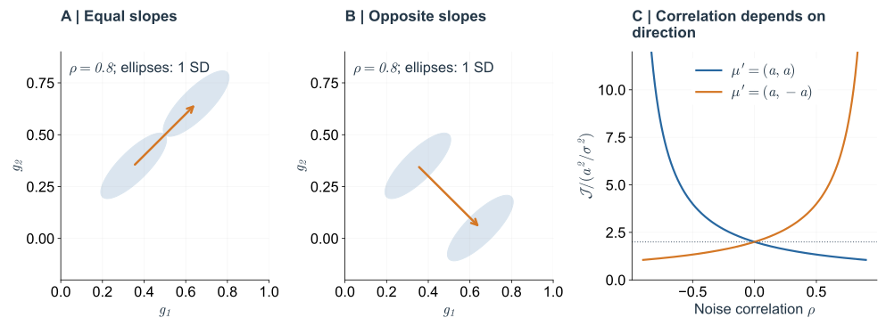

*Fig. 10. 噪声相关性的效果取决于信号方向。* A、B：蓝色椭圆是 $\rho=0.8$ 时的一标准差等高线，橙色箭头表示位置改变引起的均值移动。C：固定单基因斜率大小与噪声方差，分别计算式（3.3）和（3.4）。同一相关结构可以使一种位置编码恶化，同时改善另一种。

## 4. 从局部精度走向全局位置解码 {#global-decoding}

### 4.1 陡峭的表达曲线也可能有位置歧义 {#branch-ambiguity}

考虑以胚胎中部为中心的对称表达峰。左右两个位置 $x_1$ 和 $x_2$ 可以具有相同均值；若它们的条件分布也相同，单独观测这个基因就无法区分二者。每个分支上的斜率可以很大，因此局部 Fisher information 也可以很大，但这种局部可分辨性没有消除远处的另一种解释。

现在把读取方向反过来。$P(g\mid x)$ 是“给定位置，会读到什么”；我们需要的是“已经读到这一组表达，可能在哪些位置”，记为 $P(x\mid\mathbf g)$，称为**位置后验分布**。它允许同时保留几个可能位置。

先做一个只有三个候选点的教学例子。若它们原先等可能，而当前读数在三个点的相对出现可能性为 $1:8:1$，看到读数后，三个候选点的概率就更新为 10%、80%、10%。先比较读数与每个候选位置是否相符，再把权重归一化，就是下面公式所做的事。连续空间中，把求和换成积分。下式中的 $P_X(x)$ 是观察表达前对位置的概率描述，称为先验；$\Omega$ 是纳入比较的空间区间。若没有额外位置线索，可以先在区间内均匀取样：

$$
\boxed{
P(x\mid\mathbf g)=
\frac{P(\mathbf g\mid x)P_X(x)}
{\int_\Omega P(\mathbf g\mid u)P_X(u)\,du}.
}
\tag{4.1}
$$

在对称峰的例子里，后验可能有两个分离的峰。此时每个峰的局部宽度很小，仍不能说明全局定位准确。若增加一个能区分左右分支的基因，表达向量便可能只对应一个位置。

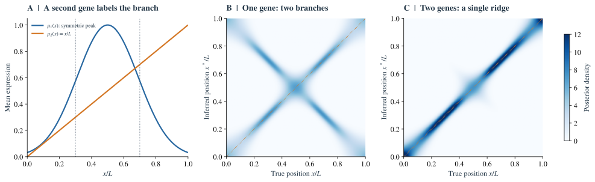

*Fig. 11. 局部精度与全局歧义。* A：两个示意表达通道，$\mu_1=\exp[-(z-0.5)^2/(2\times0.19^2)]$，$\mu_2=z$。B、C：分别用第一个通道和两个通道解码，噪声独立且 $\sigma_g=0.06$。每一列是在真实位置 $x$ 对表达噪声平均后的后验密度，定义见附录 B。单基因图中出现两条分支；第二个通道帮助识别左右位置。这些曲线是教学模型，不是 gap gene 的拟合。

这也解释了实验中的解码图为何有用：[Petkova 等](https://pmc.ncbi.nlm.nih.gov/articles/PMC6526179/#F3)比较不同数量基因的联合读出，用完整的位置后验同时展示局部宽度和远距离歧义。只报告一个位置误差数字，会丢掉其中一部分结构。

### 4.2 熵：读取之前有多不确定 {#entropy}

先把胚胎暂时简化成四个候选位置 A、B、C、D。随机选一个核，遮住坐标，只给观察者它的表达读数。用随机变量 $X$ 表示被选中的位置；这里随机的是“选中了哪个核”，并不要求核的位置本身不停移动。先用离散变量 $G$ 表示一个基因的开、关读数。

如果四个位置原先等可能，观察者有四种候选；如果事先就确定在 A，则没有位置上的不确定性。我们希望用一个量表示这种区别，而且能够处理“不等可能”的情形。

先给一次结果出现时的“意外程度”记一个分数：发生概率为 $p$，分数是 $-\log_2p$。必然发生的结果，分数为 0；概率 $1/2$ 的结果是 1，概率 $1/4$ 的结果是 2。用对数的一个好处是：两个独立结果的概率相乘，对应的分数正好相加。底数取 2，单位就叫 **bit**。

再按每种结果出现的概率，对这个分数取平均，就得到 **Shannon 熵**：

$$
\boxed{H(X)=-\sum_xP_X(x)\log_2P_X(x).}
\tag{4.2}
$$

约定零概率项贡献为零。这个定义来自 [Shannon（1948）](https://people.math.harvard.edu/~ctm/home/text/others/shannon/entropy/entropy.pdf)的信息论；这里用它衡量位置标签的不确定性，并未计算胚胎的热力学熵。

| 读取前的位置分布 | 熵 | 含义 |
|---|---|---|
| 已确定在某一位置 | 0 bits | 没有位置需要进一步区分 |
| 两个位置各占 $1/2$ | 1 bit | 有两个等可能候选 |
| 四个位置各占 $1/4$ | 2 bits | 有四个等可能候选 |
| 两个位置概率为 0.9、0.1 | 约 0.469 bits | 候选虽有两个，但事先已较偏向其中一个 |

因此，熵同时考虑候选数目与它们的概率。只有 $N$ 个位置等可能时，才简化成 $H(X)=\log_2N$。概率为 0.9、0.1 的两种情况，不能直接按“两个候选，所以 1 bit”计算。

### 4.3 条件熵与互信息：读完还剩多少不确定 {#mutual-information}

假设一个无噪声读数能告诉我们位于前半还是后半：A、B 时为 ON，C、D 时为 OFF。看到 ON 后，A、B 各有 $1/2$ 的可能，仍剩 1 bit 不确定性；看到 OFF 后也一样。原来有 2 bits，读完平均剩 1 bit，因此这个读数提供了 1 bit 位置信息。

一般情况下，每种读数 $g$ 都对应一个位置后验分布 $P(x\mid g)$。先算这个后验的熵，再按各种读数出现的概率求平均，得到**条件熵**：

$$
\begin{aligned}
H(X\mid G=g)&=-\sum_xP(x\mid g)\log_2P(x\mid g),\\
H(X\mid G)&=\sum_gP_G(g)H(X\mid G=g).
\end{aligned}
\tag{4.3}
$$

$H(X\mid G=g)$ 关心一次特定读数；$H(X\mid G)$ 则关心许多次取样与读取之后，平均还剩多少位置不确定性。二者不能混成同一个量。

**互信息**就是读完以后平均减少的不确定性：

$$
\boxed{I(X;G)=H(X)-H(X\mid G).}
\tag{4.4}
$$

若读数与位置无关，后验仍是原先的分布，$I=0$；若读数完全确定核的位置，$H(X\mid G)=0$，便有 $I=H(X)$。对离散位置，总有 $0\le I(X;G)\le H(X)$。

这里的“减少”指平均结果。某个意外读数可以让原先很偏斜的位置判断变得更犹豫；所有读数平均后的条件熵才不会超过原来的熵。后面的信息量也都针对一个指定的取样分布和读取条件。

### 4.4 一个能从头算完的带噪读取例子 {#noisy-channel-example}

现在让刚才的前后半区读数有 10% 的错误率。它可以作为认识“前部大多开启、后部大多关闭”图案的教学模型；不是某个真实基因的测量结果。

把每个位置可能给出的读数列成表，得到 $P(G\mid X)$。这张表叫**通道**：它总结位置经过表达与读取过程后，可能得到什么观测。

| 真实位置 $X$ | 读取前概率 | $P(\mathrm{ON}\mid X)$ | $P(\mathrm{OFF}\mid X)$ |
|---|---|---|---|
| A，前半区 | $1/4$ | 0.9 | 0.1 |
| B，前半区 | $1/4$ | 0.9 | 0.1 |
| C，后半区 | $1/4$ | 0.1 | 0.9 |
| D，后半区 | $1/4$ | 0.1 | 0.9 |

先算看到 ON 的概率：把各位置的先验乘以对应 ON 概率，再加起来，得到 $P_G(\mathrm{ON})=0.5$。按 Bayes 公式，看到 ON 后，A、B 的后验各为 $0.25\times0.9/0.5=0.45$，C、D 各为 0.05。

因此，这次读数之后的位置熵为

$$
H(X\mid \mathrm{ON})
=-2(0.45\log_2 0.45)-2(0.05\log_2 0.05)
\simeq1.469\ \mathrm{bits}.
$$

OFF 的情况对称，后验为 $(0.05,0.05,0.45,0.45)$，熵仍是 1.469 bits。于是条件熵也是 1.469 bits，互信息为 $2-1.469\simeq0.531$ bits。**10% 的半区读取错误，在这个模型中留下约 0.531 bits 的位置信息。**

<div id="information-budget"></div>

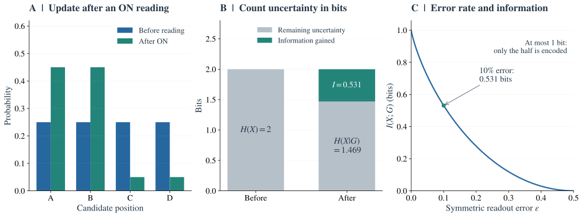

*Fig. 12. 逐步计算一次带噪读取的信息量。* 教学模型，使用上表。A：蓝柱是四个位置的均匀先验，绿柱是看到 ON 后的后验。B：原有 2 bits 不确定性，平均仍剩 1.469 bits，减少的 0.531 bits 为互信息。C：只改变对称错误率 $\epsilon\in[0,1/2]$；无错误时也至多得到 1 bit，因为这个信号本来就不区分 A 与 B、C 与 D。

同一个例子还说明一个常见混淆。ON、OFF 各占一半，所以读数自身的熵 $H(G)=1$ bit；但它对位置提供的互信息只有 0.531 bits。若读数完全随机、与位置无关，$H(G)$ 仍可以是 1 bit，位置信息却变成零。**表达变化丰富，不等于这些变化在报告位置。**

互信息也可写成 $I(X;G)=H(G)-H(G\mid X)$：在熵的意义下，读数的总变化中，扣除位置固定后仍然存在的变化，才是关于位置的部分。在这个对称例子中，用二元熵概括读取噪声，可写成

$$
\begin{aligned}
h_2(\epsilon)&=-\epsilon\log_2\epsilon-(1-\epsilon)\log_2(1-\epsilon),\\
I(X;G)&=1-h_2(\epsilon).
\end{aligned}
\tag{4.5}
$$

在图中考察的 $0\le\epsilon\le1/2$ 区间，错误率增加使读数越来越难区分前后。$\epsilon=1/2$ 时，表中四行完全相同，位置信息为零。

### 4.5 多读一个基因，增加了多少新信息 {#conditional-information}

如果第二个基因只是完全重复“前半 ON、后半 OFF”，两个无噪声读数一起仍只能提供 1 bit。它们都不能区分同处前半的 A、B。这叫信息的**冗余**。

若第一个读数区分 A、B 与 C、D，第二个无噪声读数则区分 A、C 与 B、D，两种读数的组合就能唯一标记四个位置。各自提供 1 bit，合起来提供 2 bits。这里的开关图案都是教学构造。

实际 gap genes 是否互相补充，可以用同一个问题衡量：已经读过 $G_1$ 后，$G_2$ 还能减少多少位置不确定性？这叫**条件互信息**，满足链式法则：

$$
I(X;G_1,G_2)=I(X;G_1)+I(X;G_2\mid G_1).
\tag{4.6}
$$

后一项非负，所以增加一个可用读数不会减少已有信息；但新增多少，取决于它是否提供先前没有的位置线索。有噪声的重复读取也可能通过相互校验来改善精度，不能把“报告相同区域”直接等同于“绝无增益”。

这也解释了为什么实验应同时测量多个基因：我们需要它们在同一位置的联合分布，而不仅是分别测得的几条均值曲线。第 3 节的相关噪声会影响这份联合分布。若新增基因分走总分子预算，则各通道本身也改变，需要重新比较。

### 4.6 回到连续位置与连续表达 {#continuous-information}

真实位置和蛋白浓度通常以连续数值描述。用 $X$ 表示位置、$\mathbf G$ 表示多个蛋白的读数，$P(\mathbf g\mid x)$ 就是前面通道表的连续版本。此时 $P$ 表示概率密度；只有乘上一个小区间的宽度，才得到落入该区间的近似概率。

总体表达分布 $P(\mathbf g)$ 来自所有位置的混合：$P(\mathbf g)=\int_\Omega P_X(x)P(\mathbf g\mid x)\,dx$。互信息写成

$$
\boxed{
I(X;\mathbf G)=
\int_\Omega dx\,P_X(x)
\int d\mathbf g\,P(\mathbf g\mid x)
\log_2\frac{P(\mathbf g\mid x)}{P(\mathbf g)}.
}
\tag{4.7}
$$

读这个式子时，先看对数里的比值：当前表达在位置 $x$ 上出现的可能性，相对于混合所有位置后出现的可能性，提高了多少？这个比值对某些位置和读数可以小于 1，对应负的对数；互信息再按位置与读数的联合概率平均，结果非负。这与前面先求后验熵、再做平均的计算等价；离散形式的推导见[附录 F](#information-theory-appendix)。

连续变量对应的是**微分熵** $h$，也有 $I(X;\mathbf G)=h(X)-h(X\mid\mathbf G)$。但微分熵本身会随坐标单位改变，甚至可以为负；互信息中的两个单位变化相互抵消，结果仍以 bits 表示。不能把连续情形的 $h(X)$ 直接当成一个与长度单位无关的“可选位置数”。

还有两个尺度需要区分：Fisher 信息比较相邻位置的读数分布有多不同，互信息则把整个区间的混淆一起计入。一个峰形表达可以在左右两支上各有很好的局部精度，却仍留下“究竟在哪一支”的不确定性；因此不能直接用局部 Fisher 信息代替全局互信息。

### 4.7 什么时候能把 bits 换算成位置误差 {#bits-and-error}

现在可以理解从 bits 到误差的桥梁了。均匀分布在长度 $W$ 上的位置，微分熵为 $\log_2W$；标准差为 $s$ 的高斯分布，微分熵为 $\log_2(\sqrt{2\pi e}\,s)$。两者相减，就把“读取前的区间宽度”与“读取后的后验宽度”联系起来；长度使用同一坐标单位。

假设位置在长度为 $W$ 的区间上均匀分布；典型位置后验只有一个窄峰，并且可以近似为高斯；边界影响与宽度随观测变化的高阶修正均可忽略。此时

$$
\begin{aligned}
I\simeq{}&\log_2 W\\
&-\left\langle
\log_2\left[\sqrt{2\pi e}\,\sigma_x(x)\right]
\right\rangle_x.
\end{aligned}
\tag{4.8}
$$

定义几何平均误差 $\sigma_{x,\mathrm{geo}}=\exp\langle\ln\sigma_x\rangle_x$，则

$$
\boxed{
I\simeq\log_2\frac{W}{\sqrt{2\pi e}\,\sigma_{x,\mathrm{geo}}}.
}
\tag{4.9}
$$

如果误差在空间上近似恒定，几何平均才可以直接替换为共同的 $\sigma_x$。因此，bits 所对应的“误差”既不是无条件的算术平均，也不是均方根，更不是最坏位置的误差。

| $I$ | 以分析区间计的 $\sigma_{x,\mathrm{geo}}/W$ | 若 $W=0.8L$，相应的 $\sigma_{x,\mathrm{geo}}/L$ |
|---|---|---|
| 3 bits | 3.02% | 2.42% |
| 4 bits | 1.51% | 1.21% |
| 4.2 bits | 1.32% | 1.05% |
| 4.3 bits | 1.23% | 0.98% |
| 5 bits | 0.76% | 0.60% |

表中仅计算式（4.9），没有加入实验拟合。它说明，空间区间的选择足以影响“4.2 bits 对应多少百分比”的数值。[Tkačik 等（2015）](https://doi.org/10.1534/genetics.114.171850)的分析通常取前后轴中间 80% 的区域；比较文献结果时，必须保留各自的位置范围、取样方式和发育时刻。

### 4.8 bits 不是无误差分类的区域数 {#discrete-and-continuous}

若位置变量是 $N$ 个等概率细胞核的离散标签，互信息有严格上限 $I\leq H(X)=\log_2N$。达到上限意味着观测表达后，核标签的不确定性为零。若位置作为连续变量处理，则没有一个仅由 $L$ 决定的有限熵上限；此时有限信息来自观测噪声和其他约束。

因此，$2^{4.2}\simeq18.4$ 可以帮助理解平均不确定性的缩减尺度，却不能解读成“只能区分 18 个固定区域”，更不能据此给出相邻细胞核的分类正确率。分类误差还取决于核间距、后验形状、损失函数和解码规则。

另一个严格结论来自输出取值数。若每个基因只有一个二值读数 $B_i\in\{0,1\}$，四个基因至多有 16 种组合，因而

$$
I(X;B_1,B_2,B_3,B_4)\leq H(\mathbf B)\leq4\ \mathrm{bits}.
\tag{4.10}
$$

只要可靠估计的连续表达信息超过 4 bits，就表明这种单时刻、四二值通道的描述丢失了信息；并非说明四个基因在物理上只能传递四个 bits。

再回看 French flag：如果三个区域等长、取样均匀，且颜色读取完全无误，颜色 $Y$ 只传递 $I(X;Y)=\log_2 3\simeq1.585$ bits。观察到白色，知道的是“位于中间三分之一”，并不知道这一区域内的精细坐标。这已经足以完成三类命运的划分；若还要放置更细的条纹，就需要能区分区域内部位置的额外读数。

### 4.9 互信息、通道容量与网络优化分别在改变什么 {#channel-capacity}

前面的数值都使用了给定的位置取样方式。若只选 A、B 来测量，上表的通道在这两个位置给出相同的读数分布，位置信息便为零；信号没有改变，所问的位置区间已经改变。因此，比较不同网络前，要先固定在什么区间、以什么概率选择位置。

对一个固定通道 $P(G\mid X)$，允许输入分布改变时，能得到的最大互信息叫**通道容量**。第 7 节做的则是固定位置先验，改变分子网络参数 $\theta$，从而改变通道本身：

$$
\begin{aligned}
C_{\mathrm{channel}}&=\max_{P_X}I(X;G),\\
\theta^*&=\operatorname*{arg\,max}_{\theta\in\mathcal C}
I_{P_X}(X;\mathbf G_\theta).
\end{aligned}
\tag{4.11}
$$

$\mathcal C$ 是允许的分子资源与动力学条件。第一行是在同一读取装置上改变输入统计，第二行是在相同取样任务下改变读取装置。果蝇的网络优化问题主要对应第二行；这里的 bits 是一次指定观测携带的信息，没有自动换算成 bits/s。

## 5. 信息最大化如何预测表达曲线 {#optimal-encoding}

French flag 希望不同区域选择不同命运，因此清晰的开关很有用。为什么下面却会得到“线性梯度比陡峭开关更好”的结果？因为优化的任务变了：**现在要在整个分析区间内区分位置，而不只是判断落在阈值的哪一侧。**

假如某个 *hb* 读数只报告“前部开启、后部关闭”，它可以帮助确定前后部的身份，却不能靠自己在前部内部再放置几条条纹。生物网络可以让一个基因承担区域划分，让其他基因提供区域内部的差异。下面先把这件事压缩为一个通道，弄清有限表达范围应该怎样分配，再回到多基因网络。

### 5.1 固定噪声和表达范围的单基因问题 {#linear-optimum}

先构造一个可以完全求解的问题。位置在 $[0,W]$ 上均匀分布，单基因读数满足

$$
G=\mu(x)+\eta,\qquad
\eta\sim\mathcal N(0,\sigma_g^2).
$$

要求 $\mu$ 严格单调递增，端点固定为 $g_{\min}$ 和 $g_{\max}$，表达范围 $\Delta g=g_{\max}-g_{\min}$ 固定。噪声小到可以使用局部单峰近似。代入 $\sigma_x\simeq\sigma_g/\mu'$，互信息为

$$
I\simeq\frac1W\int_0^W
\log_2\frac{W\mu'(x)}{\sqrt{2\pi e}\,\sigma_g}\,dx.
\tag{5.1}
$$

约束给出 $\int_0^W\mu'(x)\,dx=\Delta g$。由于 $\log$ 是严格凹函数，Jensen 不等式意味着

$$
\frac1W\int_0^W\log_2\mu'(x)\,dx
\leq\log_2\frac{\Delta g}{W}.
$$

等号要求所有位置的斜率相同，因此

$$
\boxed{
\mu^*(x)=g_{\min}+\frac{\Delta g}{W}x,
\qquad
I_{\mathrm{opt}}^{\mathrm{small\ noise}}
\simeq\log_2\frac{\Delta g}{\sqrt{2\pi e}\,\sigma_g}.
}
\tag{5.2}
$$

有限表达范围在所有位置之间均匀分配，给出线性梯度和均匀的局部位置精度。陡峭阶跃把很大一部分表达变化集中在很窄区域，虽然阈值附近定位更好，两侧平台却几乎无法区分位置；平均信息不一定增加。

这个解只是在上述单调、小噪声模型内的最优解。有限噪声下，允许更一般输入分布的幅度受限高斯通道，其精确容量问题并不等同于这里的变分问题。若式（5.2）算出负值，则小噪声近似已经失效；真实互信息始终非负。

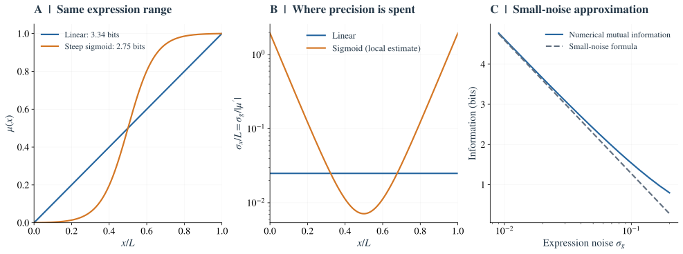

*Fig. 13. 阶跃更陡，并不保证平均编码更好。* A：两个单调图案具有相同的 $[0,1]$ 动态范围与独立高斯噪声 $\sigma_g=0.025$；图例中的互信息由 $I=h(G)-h(\eta)$ 数值积分计算。B：局部误差传播公式显示 sigmoid 在中央更精确，在两侧明显变差；较大误差处局部线性近似不再可靠。C：线性图案的数值互信息与式（5.2）比较，噪声增大后可见有限区间边界修正。

### 5.2 噪声依赖表达时，应该均分什么 {#noise-weighted-range}

如果前后两处的表达差都是 20 个分子，它们就同样容易区分吗？未必。Poisson 计数的标准差约为 $\sqrt{\mu}$；在高表达处，相同的绝对差异可能更容易被涨落盖住。所以应比较的是“相差多少个当地噪声标准差”，而不只是分子数差。

假设噪声标准差是表达水平的函数 $\sigma_g(\mu)>0$，而不是常数。仍在单调、小噪声条件下，引入新的表达坐标

$$
q(g)=\int_{g_{\min}}^g\frac{du}{\sigma_g(u)}.
\tag{5.3}
$$

这个坐标以当地的噪声为单位衡量表达变化。因为 $dq/dx=\mu'/\sigma_g(\mu)$，互信息中的可调项变为 $\langle\log(dq/dx)\rangle_x$。固定端点意味着总的 $q$ 范围固定，于是同样的凹性论证给出

$$
\boxed{
\frac{\mu'(x)}{\sigma_g(\mu(x))}
=\frac1W\int_{g_{\min}}^{g_{\max}}
\frac{dg}{\sigma_g(g)}.
}
\tag{5.4}
$$

最优图案均匀分配的是以噪声为单位的表达变化。若 $\sigma_g(g)\propto\sqrt g$，则 $q\propto\sqrt g$，最优的 $\sqrt{\mu(x)}$ 随位置线性变化，$\mu(x)$ 为相应的二次曲线。这个推导要求表达范围内的计数足够大，不能把连续高斯近似外推到零分子数。

一个具体的教学例子是把计数均值从 100 增到 121，或从 400 增到 441。两段的绝对增量分别为 21 和 41，但 $\sqrt{\mu}$ 都增加 1。在这个大计数近似里，它们占据相同的“噪声单位距离”。因此，式（5.4）是在给不同位置分配近似相同的可分辨机会。

### 5.3 多基因优化还需要动力学约束 {#why-networks}

回看 Fig. 9A 中相互错开的表达区域：若 Hb 在某段几乎不变，Kr 或 Gt 的变化仍可能区分那里的核。这提示一个有生物学含义的资源分配问题：是否值得在 Hb 已经处于平台的地方，投入另一个基因提供新的空间变化？

多基因情形中，把各基因的平均表达放进向量 $\boldsymbol\mu(x)$；位置变化时，它在表达空间里形成一条曲线。协方差矩阵 $\Sigma$ 汇总各基因的波动大小与共同变化，定义了不同方向上的噪声尺度。忽略协方差变化项，式（4.8）中的可调部分近似为

$$
\frac12\int_\Omega P_X(x)\log_2\mathcal J_\mu(x)\,dx.
\tag{5.5}
$$

这一表达鼓励网络在整个区间保留可分辨的变化。但它没有要求曲线在远处保持分离：不同位置可以在表达空间中重新靠近，甚至相交。所以，单独最大化局部 Fisher information 不能替代完整互信息。

此外，表达曲线不能任意画。每个位置遵循同一套调控规则，表达有合成速率和降解时间，蛋白质可以交换，调控强度也有上限。某条几何上很好的曲线，未必能在给定时间内由可行的基因网络产生。只有把这些限制放入可行集合，最优图案才具有机制上的含义。

## 6. 扩散为什么既能改善精度，也会抹平图案 {#diffusion}

### 6.1 平均场中的空间平滑 {#diffusion-signal}

想象两个相邻核区域：其中一个因转录爆发而暂时偏高，另一个偏低。如果蛋白质能够交换，局部差异会减小；但如果这两个区域原本就应该处在表达边界的两侧，交换也会减小有用的差异。**同一种混合过程既可能抹去随机起伏，也可能抹去位置差异。**

在合胞体胚胎中，细胞核尚未由完整细胞膜逐一隔开。这里讨论的是相邻核区域之间的有效蛋白交换；它与第 1 节用来建立母源 Bicoid 梯度的输运问题相关，但被平滑的对象现在是下游表达图案。考虑一个用于分析的线性方程：

$$
\partial_t g=s(x)-\gamma g+D\partial_x^2g+\xi(x,t).
\tag{6.1}
$$

先忽略噪声。若产生率具有 Fourier 模式 $s_k$，稳态平均表达为

$$
\bar g_k=\frac{s_k}{\gamma+Dk^2}.
\tag{6.2}
$$

较大的 $D$ 对高波数、短尺度的结构抑制更强。相应的平滑长度为 $\ell_D=\sqrt{D/\gamma}$。这可以使边界变宽、降低局部斜率，从而削弱位置信号。

不用 Fourier 语言也可以理解式（6.2）：宽表达区域内部，相邻位置的均值接近，交换的净作用小；很窄的峰或很陡的边界，两侧差异大，更容易被交换削弱。$\ell_D$ 表示蛋白质在被去除前大致能把影响传到多远；它若接近要保留的图案宽度，读取这段图案就会受到明显影响。

### 6.2 噪声是否一起减小，取决于噪声来源 {#diffusion-noise}

先比较两种情况。若相邻核区域各自偶然偏高或偏低，混合可以让它们相互抵消；若母源输入使整个胚胎的这些区域一起偏高，彼此交换并没有提供一个偏低的参照。后一种共同波动不能靠这种空间平均消除。

若 $\xi$ 代表各处独立产生的额外表达噪声，扩散会把局部偏高、偏低的表达混合。第 $k$ 个线性涨落模态满足

$$
\partial_t\delta g_k=-(\gamma+Dk^2)\delta g_k+\xi_k.
$$

当 $\langle\xi_k(t)\xi_k(t')^*\rangle=Q_k\delta(t-t')$，其稳态方差为

$$
\left\langle|\delta g_k|^2\right\rangle
=\frac{Q_k}{2(\gamma+Dk^2)}.
\tag{6.3}
$$

若 $Q_k$ 固定，扩散能压低非均匀涨落。但是，分子的随机跳跃也会产生噪声，因而真实反应–扩散系统中的 $Q_k$ 往往随 $D$ 改变。对理想的独立产生、降解和随机迁移分子，均匀稳态可以仍保持 Poisson 计数分布；不能从“有扩散”直接推出局部 Poisson 方差变小。

扩散对额外噪声、共同噪声和迁移噪声的作用需要分别计算。均匀的共同波动对应 $k=0$，空间平均尤其不能将它消除。

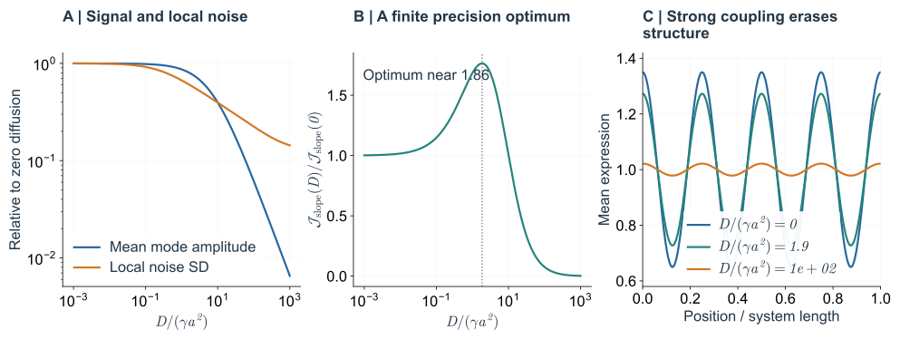

*Fig. 14. 扩散的两种效果。* 周期性 64 格点模型，格距 $a$，降解率 $\gamma$，产生率包含第 4 个余弦模态。各点受到固定强度、相互独立的加性白噪声；扩散在此仅为确定性耦合，没有额外迁移噪声。A：平均模式振幅和单点噪声标准差均相对于 $D=0$ 归一化。B：最大斜率处的 $\mathcal J_\mu(D)/\mathcal J_\mu(0)$ 出现有限最优值。C：强扩散使表达差异消失。该例只展示额外局部噪声的平均与信号平滑之间的竞争，并未计算完整胚胎模型的 $I(D)$。

### 6.3 局部精度的最优值不等于全局编码最优值 {#diffusion-global}

图中的余弦模式在空间重复。即使某个 $D$ 使最大斜率处的定位尺度最好，单个余弦表达仍然有不同位置取相同值的歧义。因此，图 14 的纵轴必须理解为局部 Fisher information，而不能改标为完整位置信息。

在实际网络里改变 $D$，均值、协方差、远处位置的可区分性和达到图案所需的时间都会改变。如果每次改变 $D$ 后重新优化其余参数，得到的是“该扩散条件下能实现的最好网络”；如果固定网络只改变 $D$，测量的则是该网络对扰动的响应。两种曲线回答不同问题。

## 7. 怎样让一个分子网络产生这些位置读数 {#network-optimization}

### 7.1 每个核运行相同的调控规则 {#stochastic-network}

第 2.1、2.5 节解释了结合、转录和组合调控怎样让核使用局部信号；第 3 至 6 节则评价了表达图案中的位置线索。现在把这些过程写进动力学模型，计算整个 gap gene 图案怎样在有限时间内形成，以及产生、降解和交换怎样决定其波动。

可以把一个核区域里的过程分成四步：母源信号与 gap 蛋白影响某基因的转录，mRNA 被翻译成蛋白质，mRNA 与蛋白质被去除，蛋白质与邻近区域交换。令 $m_{\alpha i}$、$p_{\alpha i}$ 分别为位置 $i$ 的基因 $\alpha$ 的 mRNA 和蛋白质数，就得到

$$
\begin{aligned}
\dot m_{\alpha i}
&=r_\alpha(\mathbf p_i,\mathbf c_i;\theta)
-\gamma_{m,\alpha}m_{\alpha i}+\xi^m_{\alpha i},\\
\dot p_{\alpha i}
&=k_\alpha m_{\alpha i}-\gamma_{p,\alpha}p_{\alpha i}
+\frac{D_\alpha}{a^2}\sum_{j\sim i}(p_{\alpha j}-p_{\alpha i})
+\xi^p_{\alpha i}.
\end{aligned}
\tag{7.1}
$$

逐项读这两行：$r_\alpha$ 是转录产生，$k_\alpha m$ 是翻译产生，带 $\gamma$ 的负项是去除，邻居与本核的浓度差决定净交换；$\xi$ 描述离散反应的随机性。各位置使用同一个 $r_\alpha$，相当于同一基因组中的相同调控规则。位置之间表达不同，是因为局部输入、状态和邻居不同。

第 2.1 节的分子读取怎样进入这里的产生率？只考虑 Bicoid 激活的教学近似，可以写成

$$
r_{\mathrm{hb}}(c)=r_{\max}
\frac{c^n}{K^n+c^n}.
\tag{7.2}
$$

$c$ 接近 $K$ 时产生率从低变高；$K$ 像 French flag 中的阈值，$n$ 控制切换的陡峭程度。但产生率变陡，还要经过 mRNA 和蛋白质的积累，才能成为可读取的表达边界。其他输入、基因间调控和启动子状态会改变这一响应；式（7.2）仅展示浓度读取如何进入动力学。第 8.2 节的活体转录实验进一步要求解释这种响应为什么能足够快。

### 7.2 从重复胚胎得到平均图案与噪声 {#linear-noise}

设想在同一发育时刻，对一批胚胎做四种蛋白的同时成像。在固定相对位置上，Hb 的平均浓度是 $\mu_{\mathrm{Hb}}$；各胚胎围绕它的散布给出方差。还要追问：Hb 偏高的胚胎里，Kr 通常也偏高，还是偏低？这些共同变化组成协方差 $\Sigma$，正是第 3 节噪声椭球的实验含义。

机制模型应该生成同样的统计对象。给相同调控规则不同的随机反应历史，在时间 $T$ 读取每个核，就能得到该处的平均表达与联合分布。若波动较小，可以只计算均值和协方差来近似分布；[附录 D](#appendix-d)给出相应的矩阵演化。若波动足以引起状态切换，则应直接检查随机轨迹和完整分布。

这里有一个生物学上的边界：假设下游只接触本核的四种蛋白，那么解码时只能给它本核的四个读数。蛋白交换已经影响了这些读数，但不能再把整条胚胎的成像数据都当成这个核可获得的信息。

### 7.3 优化的是哪些分子参数 {#objective-and-constraints}

现在才能问：“在同样的分子预算和发育时间内，怎样调节网络，让位置更容易读出？”可以调的量包括启动子对输入的响应范围、基因间调控强度和产生率。每调一次，都要重新生成图案与噪声，再评价位置信息：

$$
\theta
\longrightarrow
\{\boldsymbol\mu_i(T),\Sigma_i(T)\}
\longrightarrow P(\mathbf g\mid x_i,T)
\longrightarrow I(X;\mathbf G(T)).
\tag{7.3}
$$

例如，提高所有产生率可能减少相对计数噪声，却要花更多分子；把响应做得更陡可能强化某条边界，却使其他位置进入难以区分的平台；提高交换速率可能平均局部噪声，也会混合相邻核的表达。这些选择不能分开评价。

将允许的参数和资源限制记为 $\mathcal C$，优化问题为

$$
\boxed{
\theta^*=\operatorname*{arg\,max}_{\theta\in\mathcal C}
I(X;\mathbf G(T;\theta)).
}
\tag{7.4}
$$

$\mathcal C$ 必须规定总分子使用、合成速率、寿命、读取时间、几何及允许的调控关系。否则“多造分子”就能不断改善精度，无法解释真实胚胎为何采用某种网络。这里固定位置的取样方式，寻找更好的编码机制；它与固定一个通道、只改变输入分布的通道容量问题不同。

### 7.4 怎样与真实果蝇网络比较 {#sokolowski-2025}

[Sokolowski 等（2025）](https://pmc.ncbi.nlm.nih.gov/articles/PMC11725783/)把这一问题用于果蝇 gap gene 网络。在实测输入、核分裂时序和分子资源限制下，搜索 50 余个调控参数，得到约 4.2 bits 的 WT-like 解。

比较时应同时看三件事：蛋白表达是否出现在合适的区域，调控相互作用是否与已知网络相符，以及这些表达是否确实能指定位置。只得到接近实验的 bits 数，还不足以判断产生信息的机制是否相似。

该模型的基准尺度包括 $D=0.5\,\mu\mathrm m^2/\mathrm s$、蛋白质寿命 10 min、mRNA 寿命 20 min、核间距 $8.5\,\mu\mathrm m$。前两者给出 $\sqrt{D\tau_P}\simeq17\,\mu\mathrm m$，约为两个核间距。这是帮助理解交换尺度的无反馈估计；完整网络中的边界还受产生与调控影响。

其扩散优化显示一个宽的最优区间；三基因网络也可以得到较高总信息，却留下局部定位缺陷。它们分别把第 6 节的“平均与平滑”和第 8.1 节的“平均与局部可靠性”变成具体网络中的可检验结果。模型与约束见原文 [Box 1 与 Figs. 2–4](https://pmc.ncbi.nlm.nih.gov/articles/PMC11725783/)。

## 8. 高互信息还不能替代哪些发育要求 {#limits-and-predictions}

### 8.1 平均性能可以掩盖局部缺陷 {#mean-versus-worst}

先回到 French flag 的一条命运边界。远离边界的核，即使把位置估错一点，仍可能选择相同命运；紧挨边界的核，同样大小的误差就可能使它越过阈值。因此，“位置平均误差小”与“关键边界附近很少选错”需要分别检验。

举一个明确的教学算例：假设下游用估计位置与固定边界比较，定位误差是标准差 $\sigma_x=0.01L$ 的无偏高斯噪声。真实位置距离边界 $0.02L$ 时，误跨边界的概率约为 2.3%；距离只有 $0.005L$ 时，约为 31%。二者采用同一精度，任务错误却差很多。这个例子没有假定果蝇真的先计算坐标再比较，而是说明命运读取为何还取决于边界和决策规则。

在单峰、小噪声近似内，最大化互信息等价于压低 $\langle\ln\sigma_x\rangle$。这会惩罚误差较大的区域，但一个占比较小的区域，仍可能被其他区域较好的精度补偿。于是下面两个目标一般不同：

$$
\max_\theta I(X;\mathbf G),
\qquad
\min_\theta\max_{x\in\Omega}\sigma_x(x;\theta).
\tag{8.1}
$$

也可以针对发育任务规定损失，例如把跨越细胞命运边界的错误赋予更大代价，或要求 $P(|\hat X-X|>\epsilon)<\delta$。这些目标都需要明确“哪些位置的哪些错误最不能接受”。

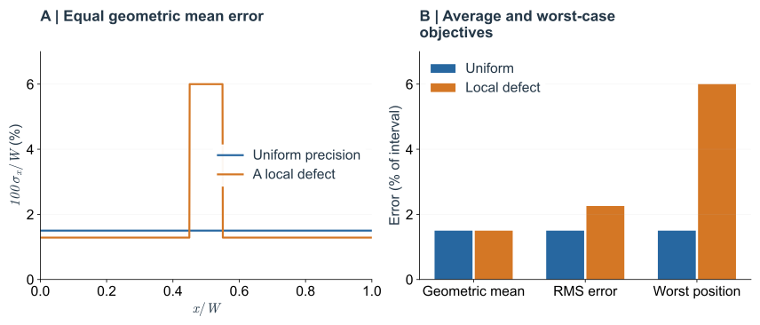

*Fig. 15. 相同的平均对数精度，不保证相同的局部可靠性。* 蓝线误差恒为分析区间的 1.5%；橙线在 10% 区域为 6%，其余区域约为 1.29%，因此两者具有相同几何平均误差。B 比较几何平均、均方根和最坏位置误差。这里直接构造误差函数，展示式（4.9）的平均方式；没有指定完整 $P(\mathbf g\mid x)$，所以不能据此声称两种实际通道具有完全相同的精确互信息。

### 8.2 读出时间的不确定性会变成额外表达噪声 {#readout-time}

[Lucas 等（2018）](https://doi.org/10.1371/journal.pgen.1007676)用 MS2 活体转录报告发现，所研究的早期 *hb* 报告系统在每次间期约 3 min 内建立陡峭且位置稳定的边界。这与 Fig. 1 跨两个发育阶段的 30 min 不同；它提醒我们，实际读出还受到单次间期的可用时间限制。

再设想表达边界还在移动。两个核的位置没有变，但同一个核在早一点和晚一点读到的表达不同。如果下游不知道现在是什么时刻，就可能把时间差误认为位置差。

对单一、局部可逆的平均表达曲线，在固定参考时刻 $T$ 附近，时间偏差 $\delta t$ 会造成 $\delta g\simeq\partial_t\mu\,\delta t$；再用第 2 节的斜率换算，得到

$$
\delta x_{\mathrm{time}}
\simeq\frac{\partial_t\mu(x,T)}{\partial_x\mu(x,T)}\,\delta t.
\tag{8.2}
$$

若图案近似以速度 $v$ 平移，$\mu(x,t)=f(x-vt)$，则 $\delta x_{\mathrm{time}}\simeq-v\delta t$。例如，边界移动速度为每分钟 $0.002L$、读出时刻相差 2 min，会产生约 $0.004L$ 的位置偏差；这组数仅作教学演示。

因此，实验不能把不同发育时刻的胚胎随意混成一个“表达噪声”分布；机制模型也不能只挑信息最高的一瞬间，而忽略下游实际能否在那时读取。多个基因的时间漂移可能相互补充，或共同模拟空间变化；对应的协方差表达式见[附录 D.4](#time-noise-covariance)。

### 8.3 编码中的信息还需要可实现的解码器 {#implementable-decoder}

第 2.5 节的 *eve* 第 2 条纹增强子已经给出一种具体读取机制：多种蛋白通过不同位点共同影响转录，在允许表达的空间窗口产生条纹。Fig. 9A 把这一类下游条纹接在 gap 表达之后。现在要进一步区分：输入中含有多少位置线索，以及一个具有具体反应步骤的下游系统实际利用了多少。

互信息衡量表达包含多少关于位置的信息，并不指定下游怎样实现 Bayes 后验。若下游输出 $Y$ 仅由本核当前表达 $\mathbf G$ 和独立内部噪声产生，形成 Markov 链 $X\to\mathbf G\to Y$，数据处理不等式要求

$$
I(X;Y)\leq I(X;\mathbf G).
\tag{8.3}
$$

有限的分子数、时间和反应步骤可能使下游只取出其中一部分信息。因此，一个完整解释还应将下游阈值、组合调控或时间积分写成机制，比较它们实际保留多少信息。

怎样检验读取，而不只证明“信息存在”？[Petkova 等（2019）](https://pmc.ncbi.nlm.nih.gov/articles/PMC6526179/#F4)用野生型的表达统计建立解码规则，再将它用于母源输入突变后的 gap 表达，并比较预测位置与实际 Eve 等条纹。这把位置后验接到了胚胎自己的下游输出。相符支持近似最优读取；它仍不等于确定了增强子的全部分子步骤。

这也不意味着下游某个时刻的信息必然小于上游任意一个瞬时快照。若下游整合了输入历史或邻域，它的输入变量就应写成相应的历史和空间观测；对不同观测集合的 bits 数直接套用式（8.3），会造成错误比较。

### 8.4 怎样使优化原则产生可检验的预测 {#testable-predictions}

最有力的检验需要区分物理扰动与重新优化。在现有胚胎里改变扩散或母源剂量，检验的是固定调控网络对扰动的响应；删除一个基因后，把其余参数全部重新优化，检验的是该模型类别在替代资源配置下能够达到什么性能，不能直接当作急性突变表型。

可以把理论输出与生物学观测逐项配对：

| 改变或比较什么 | 要测什么 | 要检验的机制 |
|---|---|---|
| 改变母源 Bicoid 剂量 | Bcd 浓度、gap 表达边界及下游条纹的位置 | 单梯度阈值预测是否足够，网络响应又增加了什么 |
| 同时测量多个 gap 蛋白 | 各自均值、同一位置的联合波动，以及联合解码误差 | 多基因是提供不同位置线索，还是主要重复相同线索 |
| 对胚胎按发育时刻分组 | 边界移动速度、表达噪声和解码精度随时间的变化 | 图案是否只在短暂时刻可读，还是在实际读取窗口内稳定 |
| 比较野生型与母源输入突变 | 用同一读取规则预测的条纹位置，以及实际条纹 | 所构造的解码规则是否接近下游真正使用的规则 |

沿这条线回看 French flag：两个阈值说明了“位置可以怎样影响命运”；有噪声的联合表达说明了“这个决定有多可靠”；动态网络说明了“读数怎样及时形成”；下游条纹则检验“胚胎是否实际使用了这些线索”。信息优化只有同时面对这些观测，才可能解释生物网络为什么采用某种表达和调控方式。

---

## 技术附录 {#technical-appendices}

## 附录 A Fisher information 与有效位置估计 {#appendix-a}

### A.1 Poisson 计数的精确 Fisher information

设固定采样体积中的计数 $N$ 服从 Poisson 分布，均值 $m(x)=m_0e^{-x/\lambda}$：

$$
P(n\mid x)=\frac{[m(x)]^{n}\,e^{-m(x)}}{n!},
\qquad m(x)=m_0e^{-x/\lambda}.
$$

对这个概率取自然对数并求导：

$$
\partial_x\ln P(n\mid x)
=\left(\frac n{m(x)}-1\right)m'(x).
$$

利用 $\mathbb E[N]=m$、$\operatorname{Var}(N)=m$：

$$
\mathcal J(x)
=\frac{[m'(x)]^2}{m(x)^2}
\mathbb E[(N-m)^2]
=\frac{[m'(x)]^2}{m(x)}.
\tag{A.1}
$$

这个 Fisher information 不需要把 Poisson 近似为高斯。指数梯度下为 $m/\lambda^2$。但单次计数可能为零，此时形式上的对数反演 $\hat x=\lambda\ln(m_0/N)$ 不存在；在有限区间内需要边界处理或先验。因此，精确 Fisher information 的存在不代表单次估计量一定无偏或达到下界。

### A.2 固定协方差时的最优局部线性读出

令 $\mathbf v=\boldsymbol\mu'(x_0)$，局部模型为

$$
\mathbf G-\boldsymbol\mu(x_0)
=\mathbf v\,\delta x+\boldsymbol\eta,
\qquad \boldsymbol\eta\sim\mathcal N(0,\Sigma).
$$

取线性估计 $\widehat{\delta x}=\mathbf w^{\mathsf T}[\mathbf G-\boldsymbol\mu(x_0)]$，局部无偏要求 $\mathbf w^{\mathsf T}\mathbf v=1$。最小化方差 $\mathbf w^{\mathsf T}\Sigma\mathbf w$，得到

$$
\mathbf w_*=
\frac{\Sigma^{-1}\mathbf v}{\mathbf v^{\mathsf T}\Sigma^{-1}\mathbf v},
\qquad
\operatorname{Var}(\widehat{\delta x})=
\frac1{\mathbf v^{\mathsf T}\Sigma^{-1}\mathbf v}.
\tag{A.2}
$$

这个结果具体说明了局部界怎样达到：不同基因按斜率和完整协方差加权。它要求已知展开位置附近的分支，不能作为全局歧义的解决办法。

### A.3 高斯协方差变化时的附加项

写 $\mathbf y=\mathbf g-\boldsymbol\mu(x)$，则

$$
\ln P=-\frac K2\ln(2\pi)-\frac12\ln\det\Sigma
-\frac12\mathbf y^{\mathsf T}\Sigma^{-1}\mathbf y.
$$

利用 $\partial_x\ln\det\Sigma=\operatorname{Tr}(\Sigma^{-1}\Sigma')$ 和 $\partial_x\Sigma^{-1}=-\Sigma^{-1}\Sigma'\Sigma^{-1}$，score 为

$$
\partial_x\ln P
=\boldsymbol\mu'^{\mathsf T}\Sigma^{-1}\mathbf y
+\frac12\left[
\mathbf y^{\mathsf T}\Sigma^{-1}\Sigma'\Sigma^{-1}\mathbf y
-\operatorname{Tr}(\Sigma^{-1}\Sigma')\right].
\tag{A.3}
$$

第一项是关于 $\mathbf y$ 的线性函数，第二项是中心化二次函数。零均值高斯分布的三阶矩为零，二者的交叉贡献消失；再用高斯四阶矩公式，得到式（A.7）。这一额外项描述分布宽度和方向的空间变化；当它不可忽略时，简单的线性均值解码不再利用全部局部信息。

### A.4 共同波动与位置混淆

考虑一个小的共同扰动 $u$，其表达方向为 $\mathbf b$：

$$
\mathbf G=\boldsymbol\mu(x)+\mathbf b\,u+\boldsymbol\epsilon,
\quad \operatorname{Var}(u)=s_u^2,
\quad \operatorname{Cov}(\boldsymbol\epsilon)=\Sigma_0.
$$

若 $u$ 与其他噪声独立，边缘化后 $\Sigma=\Sigma_0+s_u^2\mathbf b\mathbf b^{\mathsf T}$。Sherman–Morrison 公式给出均值贡献

$$
\mathcal J_\mu=
\mathbf v^{\mathsf T}\Sigma_0^{-1}\mathbf v
-\frac{s_u^2(\mathbf v^{\mathsf T}\Sigma_0^{-1}\mathbf b)^2}
{1+s_u^2\mathbf b^{\mathsf T}\Sigma_0^{-1}\mathbf b}.
\tag{A.4}
$$

共同噪声和位置信号在去除基底噪声尺度后的空间里越重合，损失越大。若 $\mathbf b=b\mathbf v$，则 $\mathcal J_\mu=J_0/(1+s_u^2b^2J_0)$；即使基底测量越来越精确，也留下位置等效扰动 $s_u|b|$ 的尺度。这里 $\Sigma_0$ 正定，方向与协方差都取局部常数。

### A.5 一般 Fisher information 与估计界 {#general-fisher}

对一般条件分布，定义

$$
\mathcal J(x)=
\mathbb E_{\mathbf G\mid x}
\left[\left(\partial_x\ln P(\mathbf G\mid x)\right)^2\right].
\tag{A.5}
$$

在适当的正则条件下，对无偏位置估计量，Cramér–Rao 不等式给出

$$
\operatorname{Var}(\hat X\mid x)\geq\frac1{\mathcal J(x)}.
\tag{A.6}
$$

在小噪声、单一可识别分支及缓慢变化先验下，局部后验宽度也可近似为 $\sigma_x\simeq\mathcal J^{-1/2}$。但实际解码器未必达到此尺度；对有偏估计量，式（A.6）也不能原样套用。

若高斯噪声的协方差固定，则 $\mathcal J=\mathcal J_\mu$。若它依赖位置，完整结果为

$$
\boxed{
\mathcal J=
\boldsymbol\mu'^{\mathsf T}\Sigma^{-1}\boldsymbol\mu'
+\frac12\operatorname{Tr}
\left(\Sigma^{-1}\Sigma'\Sigma^{-1}\Sigma'\right).
}
\tag{A.7}
$$

第二项说明，噪声分布的形状本身也可能随位置变化并提供信息。实际使用“斜率除以噪声”时，通常只保留第一项；应明确这一近似，不能把它当作所有分布下 Fisher information 的定义。

固定协方差时，向量情形的局部可分辨性为

$$
(\delta\boldsymbol\mu)^{\mathsf T}\Sigma^{-1}
(\delta\boldsymbol\mu)
\simeq
\underbrace{\boldsymbol\mu'^{\mathsf T}\Sigma^{-1}\boldsymbol\mu'}_{\mathcal J_\mu(x)}
\,\delta x^2.
\tag{A.8}
$$

式（A.8）中的 $\mathcal J_\mu=\boldsymbol\mu'^{\mathsf T}\Sigma^{-1}\boldsymbol\mu'$ 是正文单基因表达式的多基因推广。若协方差固定，它等于完整 Fisher information；协方差随位置改变时，还需要式（A.7）的第二项。

### A.6 单基因局部误差传播 {#local-error-derivation}

用 $G$ 表示随机读数、$g$ 表示一次具体观测。均值、方差的定义为 $\mu(x)=\mathbb E[G\mid x]$、$\sigma_g^2(x)=\operatorname{Var}(G\mid x)$。

先在真实位置 $x_0$ 附近写成

$$
g=\mu(x_0)+\eta,\qquad
\mathbb E[\eta\mid x_0]=0,
\qquad \operatorname{Var}(\eta\mid x_0)=\sigma_g^2(x_0).
$$

若平均曲线在此可逆，且噪声足够小，反推位置得到 $\mu(\hat x)=g$。将左侧在 $x_0$ 展开：

$$
\mu(x_0)+\mu'(x_0)(\hat x-x_0)
\simeq\mu(x_0)+\eta.
$$

因此 $\hat x-x_0\simeq\eta/\mu'(x_0)$；取条件方差，得到正文式（2.1）。

## 附录 B 互信息、位置后验与离散化 {#appendix-b}

### B.1 小噪声公式中的几何平均

若位置先验均匀，$h(X)=\log_2W$。若给定观测的后验近似为单高斯，方差为 $s^2(\mathbf g)$，则

$$
h(X\mid\mathbf G)
\simeq\int d\mathbf g\,P(\mathbf g)
\frac12\log_2[2\pi e\,s^2(\mathbf g)].
\tag{B.1}
$$

小噪声下，每个典型观测集中在其真实位置附近，若局部宽度平滑变化，可以把对表达观测的平均近似为对位置的平均，得到式（4.8）。这个替换和高斯后验都是近似；边界截断、多峰后验和大误差都会破坏它。

两个等权、相隔很远的窄高斯峰就是一个反例。每个峰宽为 $s$，互相几乎不重叠，则后验熵约为单峰高斯熵再加 1 bit。只用局部峰宽会漏掉这个分支选择的不确定性。与此同时，后验总体方差还包含峰间距，不能用任一个峰的 $s^2$ 代替。

### B.2 一般先验与不同的优化问题

若先验不是均匀分布，局部近似为

$$
I\simeq h(P_X)+\frac12\int dx\,P_X(x)
\log_2\frac{\mathcal J(x)}{2\pi e}.
\tag{B.2}
$$

假设通道固定，且这个近似成立，变分优化 $P_X$ 会得到 $P_X^*(x)\propto\sqrt{\mathcal J(x)}$。这只是固定通道上选择输入分布的结果；不能转而断言胚胎应该改变细胞核密度来符合它，也不能把它和固定先验下优化网络参数混为一谈。

### B.3 核位置离散化不会改变推断问题的定义

若计算采用 $N$ 个位置，取概率 $p_i$，则

$$
P(\mathbf g)=\sum_{j=1}^Np_jP(\mathbf g\mid x_j),
$$

$$
I=\sum_{i=1}^Np_i\int d\mathbf g\,P(\mathbf g\mid x_i)
\log_2\frac{P(\mathbf g\mid x_i)}{\sum_jp_jP(\mathbf g\mid x_j)}.
\tag{B.3}
$$

这时 $I\leq-\sum_i p_i\log_2p_i$。若位置间距远小于噪声造成的位置宽度，离散计算可以逼近连续结果；若噪声远小于核间距，连续小噪声公式可能超过 $\log_2N$，应改用离散表达，而不是接受一个不可能的核标签信息值。

图 11 使用均匀格点与 Gauss–Hermite 求积。对于真实位置 $x_i$，计算

$$
\mathcal D(x_j\mid x_i)
=\int d\mathbf g\,P(\mathbf g\mid x_i)
P(x_j\mid\mathbf g).
\tag{B.4}
$$

每列概率和为 1，绘图时除以格点间距得到密度。$\mathcal D$ 描述在真实位置下，对表达噪声平均后得到的后验；它并不自动等于某个点估计器输出的频率分布。MAP 估计、后验均值以及从后验抽样，会给出不同的点估计误差。

### B.4 从实验样本估计信息时需要控制什么

表达数据需要先限定发育时刻、分析区间和取样方式。同一位置上的胚胎间波动既可能来自真实生物差异，也可能来自成像增益、背景和空间配准；它们对 $P(\mathbf g\mid x)$ 的估计有直接影响。若用每条表达曲线本身进行过强的对齐，还可能消除原本需要测量的位置变异。

有限样本下，直接将高维表达分箱会产生偏差；高斯拟合虽然降低估计维度，也引入分布假设。应检查样本量外推、重采样误差、协方差估计稳定性，并将训练编码分布与检验解码表现的数据分开。相关方法及其在 gap genes 上的比较见 [Tkačik 等（2015）](https://doi.org/10.1534/genetics.114.171850)。一个信息数字只有连同这些统计定义才可比较。

## 附录 C 有限时间内的噪声平均 {#appendix-c}

设 $g(t)$ 为均值恒定的平稳过程，涨落相关函数为 $C_g(s)=\langle\delta g(t+s)\delta g(t)\rangle$。定义时长 $T$ 的平均 $\bar g_T=T^{-1}\int_0^Tg(t)\,dt$，则

$$
\begin{aligned}
\operatorname{Var}(\bar g_T)
&=\frac1{T^2}\int_0^T\!dt\int_0^T\!dt'\,C_g(t-t')\\
&=\frac2{T^2}\int_0^T(T-s)C_g(s)\,ds.
\end{aligned}
\tag{C.1}
$$

若 $C_g(s)=\sigma_g^2e^{-|s|/\tau_c}$，精确结果为

$$
\operatorname{Var}(\bar g_T)=
\frac{2\sigma_g^2}{T^2}
\left[T\tau_c-\tau_c^2(1-e^{-T/\tau_c})\right].
\tag{C.2}
$$

当 $T\ll\tau_c$，方差趋向 $\sigma_g^2$，几乎没有独立平均；当 $T\gg\tau_c$，方差近似为 $2\sigma_g^2\tau_c/T$。一般情形可用积分相关时间 $\tau_{\mathrm{int}}=\sigma_g^{-2}\int_0^\infty C_g(s)\,ds$ 替代 $\tau_c$，前提是该积分存在且窗口内平均信号近似不变。

若 $C_g$ 还包含不随 $s$ 衰减的共同分量 $\sigma_{\mathrm{ext}}^2$，式（C.1）会留下同样大小的方差，而不是随 $T$ 消失。若平均表达在窗口内明显漂移，则又会引入动态读出的偏差，不能直接使用平稳公式。

## 附录 D 从反应噪声到协方差演化 {#appendix-d}

### D.1 从分子反应得到噪声强度

对于反应通道 $r$，令计量变化向量为 $\boldsymbol\nu_r$，反应倾向为 $a_r(\mathbf y)$。在化学 Langevin 与线性噪声近似中，沿平均轨迹的漂移和噪声矩阵为

$$
\mathbf F=\sum_r\boldsymbol\nu_r a_r,
\qquad
Q=\sum_r\boldsymbol\nu_r\boldsymbol\nu_r^{\mathsf T}a_r.
\tag{D.1}
$$

产生与降解通道都贡献正的单点方差。对于从核 $i$ 到核 $j$ 的迁移，$\boldsymbol\nu=-\mathbf e_i+\mathbf e_j$，所以 $\boldsymbol\nu\boldsymbol\nu^{\mathsf T}$ 的 $ij$、$ji$ 分量为负；同一次迁移会使源位置减少一个分子，目标位置增加一个分子。这解释了扩散噪声为何不能当作各点独立的白噪声处理。

### D.2 均值与协方差的线性噪声演化

把所有基因、核位置及保留的分子自由度合并成向量 $\mathbf y$。在一个稳定的平均轨迹附近，线性噪声近似写成

$$
\dot{\boldsymbol\mu}=\mathbf F(\boldsymbol\mu,t;\theta),
\qquad
d\delta\mathbf y=A(t)\delta\mathbf y\,dt+B(t)\,d\mathbf W_t,
\tag{D.2}
$$

其中 $A=\partial\mathbf F/\partial\mathbf y$ 在平均轨迹上计算。协方差 $C=\mathbb E[\delta\mathbf y\delta\mathbf y^{\mathsf T}]$ 满足

$$
\boxed{\dot C=AC+CA^{\mathsf T}+Q,\qquad Q=BB^{\mathsf T}.}
\tag{D.3}
$$

该式把反馈对涨落的放大或抑制、扩散引起的空间耦合和反应噪声的持续注入放到一起。非线性系统中“确定性轨迹等于精确随机均值”并不普遍成立；这里采用的是线性噪声展开的近似。若存在显著多稳态切换或低分子数效应，需要更完整的随机模拟或分布演化。

对线性化随机微分方程应用 Itô 乘法公式：

$$
d(\delta\mathbf y\delta\mathbf y^{\mathsf T})
=(d\delta\mathbf y)\delta\mathbf y^{\mathsf T}
+\delta\mathbf y(d\delta\mathbf y)^{\mathsf T}
+(d\delta\mathbf y)(d\delta\mathbf y)^{\mathsf T}.
$$

取平均，使用 $\mathbb E[d\mathbf W_t\,d\mathbf W_t^{\mathsf T}]=I\,dt$，就得到式（D.3）。若 $A$ 固定且所有特征值实部为负，稳态协方差满足 $AC+CA^{\mathsf T}+Q=0$。不稳定的平均态、明显的分支切换，以及有色外源噪声，都需要修改这一步描述。

对于图 14 的周期格点，离散 Laplacian 的正特征值为 $\Lambda_j=4\sin^2(\pi j/N)/a^2$。设噪声强度在所有格点相同且独立，$Q=qI$，稳态单点方差为

$$
\operatorname{Var}(g_i)
=\frac q{2N}\sum_{j=0}^{N-1}\frac1{\gamma+D\Lambda_j}.
\tag{D.4}
$$

第 $k$ 个平均模式的振幅则乘以 $1/(\gamma+D\Lambda_k)$。因此最大斜率处的 Fisher information 相对于 $D=0$ 的比值可直接由信号振幅平方与单点方差计算。$D\to\infty$ 时，零模态的噪声仍然保留，非零平均模式却消失，所以局部信息最终降低。

### D.3 多输入调控函数的一种参数化

式（7.2）只展示单一激活输入。若要在数值优化中允许多个输入、激活与抑制，可以采用以下有效参数化；它与启动子的微观状态模型并不等同。

一种有界的调控参数化是

$$
\begin{aligned}
r_\alpha&=\frac{r_{\max,\alpha}}{1+e^{-F_\alpha}},\\
F_\alpha&=b_\alpha
+\sum_\beta H_{\alpha\beta}\ln\left(1+\frac{p_\beta}{K_{\alpha\beta}}\right)\\
&\quad+\sum_\kappa H^c_{\alpha\kappa}\ln\left(1+\frac{c_\kappa}{K^c_{\alpha\kappa}}\right).
\end{aligned}
\tag{D.5}
$$

正、负 $H$ 表示激活与抑制，$K$ 决定响应的浓度范围。这只是说明如何给一类网络建立有限维参数空间；具体模型还需规定启动子近似、噪声机制、初态、几何与边界条件。

### D.4 多基因时间漂移产生的协方差 {#time-noise-covariance}

在参考时刻 $T$ 附近，$\delta\mathbf g_{\mathrm{time}}\simeq\partial_t\boldsymbol\mu\,\delta t$。若时间抖动独立于其他噪声，均值为零、方差为 $\sigma_t^2$，新增协方差为

$$
\Sigma_{\mathrm{time}}
\simeq\sigma_t^2
(\partial_t\boldsymbol\mu)
(\partial_t\boldsymbol\mu)^{\mathsf T}.
\tag{D.6}
$$

时间漂移沿空间均值曲线的切向时，尤其容易被误认为位置变化；若它指向不同方向，联合表达有可能帮助分离时间与位置。若下游还可估计时间，则应建立联合解码模型。

## 附录 E 一个可以继续计算的最小问题 {#appendix-e}

完整网络优化包含很多参数。要分离机制，可以先固定长度为 $L$ 的一维格点、两个母源输入、两到四个输出基因，以及相同的总平均分子预算。各位置采用相同的有界产生率，包含降解、蛋白交换及由反应得到的噪声；在固定时间 $T$ 读取本核的表达向量。

对每组参数，分别记录四种量：完整 $I(X;\mathbf G)$、局部 $\mathcal J_\mu(x)$、完整后验的大误差概率，以及读取窗口内的图案漂移。随后改变扩散、共同输入噪声或基因数，并区分固定参数扰动和重新优化。这样的比较能够检验：提高平均局部精度时，是否也消除了远处分支；压低独立噪声后，共同噪声是否成为瓶颈；总信息相近时，局部缺陷是否仍然存在。

这组问题已经保留了统计物理上的主要竞争：有限分子数限制读出，扩散改变空间信号与涨落，调控网络分配表达范围和分子资源，而全局后验决定这些局部变化能否组成一个可靠的位置编码。

## 附录 F 信息论的推导与几个容易混淆的量 {#information-theory-appendix}

### F.1 从联合分布推出互信息

先取离散变量 $X,G$。联合分布为 $p(x,g)=p_X(x)p(g\mid x)$，边缘分布为 $p_G(g)=\sum_xp(x,g)$。联合熵满足链式法则：

$$
H(X,G)=H(X)+H(G\mid X)=H(G)+H(X\mid G).
\tag{F.1}
$$

将 $p(x\mid g)=p(x,g)/p_G(g)$ 代入条件熵，展开正文式（4.4），得到

$$
\begin{aligned}
I(X;G)
&=H(X)+H(G)-H(X,G)\\
&=\sum_{x,g}p(x,g)
\log_2\frac{p(x,g)}{p_X(x)p_G(g)}\\
&=\sum_{x,g}p_X(x)p(g\mid x)
\log_2\frac{p(g\mid x)}{p_G(g)}.
\end{aligned}
\tag{F.2}
$$

这个形式说明 $I(X;G)=I(G;X)$，但这种对称性不说明两个变量间的因果方向。连续情形将求和换成积分，得到正文式（4.7）。

### F.2 KL divergence 与平均后验更新

对同一组结果上的分布 $p,q$，定义

$$
D_{\mathrm{KL}}(p\Vert q)
=\sum_zp(z)\log_2\frac{p(z)}{q(z)}.
\tag{F.3}
$$

这里要求 $q$ 在 $p>0$ 的地方也非零，否则散度可为无穷。由对数函数的凹性，$\sum_zp(z)\ln[q(z)/p(z)]\le\ln\sum_{z:p(z)>0}q(z)\le0$，故 $D_{\mathrm{KL}}\ge0$，且它一般不对称。

互信息就是联合分布相对于独立分布的 KL divergence，也可写成平均后验更新：

$$
\begin{aligned}
I(X;G)
&=D_{\mathrm{KL}}\big(p(x,g)\Vert p_X(x)p_G(g)\big)\\
&=\sum_gp_G(g)
D_{\mathrm{KL}}\big(p(x\mid g)\Vert p_X(x)\big).
\end{aligned}
\tag{F.4}
$$

因此互信息非负；它为零，当且仅当 $X,G$ 独立。这也表明，平均信息衡量的是后验相对于先验改变了多少。

对一次读数，$H(X)-H(X\mid G=g)$ 与后验相对先验的 KL divergence 并不相同。举例：先验为 $(0.9,0.1)$，设某读数 $g$ 在两种位置出现的概率为 $(1/9,1)$，则它以概率 0.2 出现，出现后的位置后验为 $(0.5,0.5)$。这次读取让位置熵从约 0.469 增至 1 bit；另一种读数则确定在第一处。对两种读数平均，$H(X\mid G)=0.2$、$I\simeq0.269$ bits，仍然非负。

### F.3 Fisher 信息为什么只描述局部

Fisher 信息比较的是很接近的两个位置所对应的观测分布。在满足正则条件、使用自然对数定义 $\mathcal J$ 时，对两个相邻位置作小位移展开：

$$
D_{\mathrm{KL}}\big(P(\mathbf g\mid x)\Vert
P(\mathbf g\mid x+\delta x)\big)
=\frac{\mathcal J(x)}{2\ln2}\,\delta x^2+o(\delta x^2).
\tag{F.5}
$$

一次项由概率归一化消失，二次项是 Fisher 信息；$1/\ln2$ 将自然对数换成 bits。因此它给出通道分布对局部位移的敏感程度。互信息则比较各位置通道分布与总体混合分布，并对整个位置先验平均；远处相同的表达分布仍会造成歧义。

### F.4 离散熵与微分熵的单位问题

若把连续位置按宽度 $\Delta x$ 分箱，细分极限下 $p_i\simeq p_X(x_i)\Delta x$，因此

$$
H(X_{\Delta x})\simeq h(X)-\log_2\Delta x.
\tag{F.6}
$$

位置箱越细，离散熵越大。条件熵有相同的 $-\log_2\Delta x$ 项，两者相减时抵消，互信息可在适当条件下趋于有限极限。把坐标数值缩放为 $X'=aX$，微分熵改变 $\log_2|a|$，互信息仍不变。

若实际变量是有限个核的离散标签，就直接使用离散分布，仍有 $I\le\log_2N$。连续近似不能在噪声远小于核间距时替代这个有限标签问题，见附录 B.3。

### F.5 条件互信息、增加读数与下游处理

条件互信息是额外读数带来的平均增益：

$$
I(X;G_2\mid G_1)
=H(X\mid G_1)-H(X\mid G_1,G_2)\ge0.
\tag{F.7}
$$

它可以写成对 $G_1$ 平均的条件联合分布与条件独立分布之间的 KL divergence，因此非负；将式（F.7）代入即可得到正文的多基因链式法则。

若下游 $Y$ 只由当前 $\mathbf G$ 与独立内部噪声产生，即 $X\to\mathbf G\to Y$，那么 $I(X;Y\mid\mathbf G)=0$。对 $I(X;\mathbf G,Y)$ 用两个顺序展开，得到

$$
I(X;\mathbf G)=I(X;Y)+I(X;\mathbf G\mid Y)\ge I(X;Y).
\tag{F.8}
$$

这就是正文第 8.3 节的数据处理不等式。若下游另外接触输入历史、邻域或其他信号，应将它们纳入输入变量，再讨论信息的保留和损失。

## 参考文献与复现 {#references}

### 按问题选择背景阅读 {#biological-reading}

果蝇前后轴图案并不只对应一种统计问题。综述提供系统背景，而具体实验分别检验梯度的形成、启动子的响应，以及多个基因能否共同指定位置。

| 想理解的问题 | 阅读入口 | 与本笔记的联系 |
|---|---|---|
| 位置信息与 French flag 原本提出什么问题？ | [Wolpert, 1969](https://doi.org/10.1016/S0022-5193(69)80016-0) | 区分位置指定、命运解释与比例调节 |
| 熵与互信息为什么衡量平均不确定性？ | [Shannon, 1948](https://people.math.harvard.edu/~ctm/home/text/others/shannon/entropy/entropy.pdf)；[Tkačik et al., 2015](https://doi.org/10.1534/genetics.114.171850) | 第 4 节的基础定义、手算例子与位置信息的联系 |
| Bicoid 系统包含哪些生物学过程？ | [Porcher & Dostatni, 2010](https://doi.org/10.1016/j.cub.2010.01.026)，系统综述 | 先区分母源输入、转录调控与图案的鲁棒性 |
| 梯度怎样形成，如何区分机制？ | [Durrieu et al., 2018](https://doi.org/10.15252/msb.20188355)，蛋白质年龄测量 | 第 1 节：浓度图案之外还需要动态观测 |
| 下游转录怎样在有限时间内形成边界？ | [Lucas et al., 2018](https://doi.org/10.1371/journal.pgen.1007676)，活体转录成像 | Fig. 1 与第 8.2 节：输入、响应及读出时间 |
| 有噪声的表达能指定多精确的位置？ | [Gregor et al., 2007](https://pmc.ncbi.nlm.nih.gov/articles/PMC2253670/)；[Dubuis et al., 2013](https://doi.org/10.1073/pnas.1315642110)；[Petkova et al., 2019](https://pmc.ncbi.nlm.nih.gov/articles/PMC6526179/) | 从单一梯度读取，走向多基因的信息测量与位置后验 |
| 给定资源和动力学，哪些网络能产生高信息编码？ | [Sokolowski et al., 2025](https://pmc.ncbi.nlm.nih.gov/articles/PMC11725783/) | 第 7 节：受约束的网络优化 |

### 引用文献

1. Dubuis, J. O., Tkačik, G., Wieschaus, E. F., Gregor, T. & Bialek, W. (2013). [Positional information, in bits](https://doi.org/10.1073/pnas.1315642110). *PNAS* **110**, 16301–16308. 位置信息的实验测量，以及连续表达与二值表达的比较。
2. Tkačik, G., Dubuis, J. O., Petkova, M. D. & Gregor, T. (2015). [Positional Information, Positional Error, and Readout Precision in Morphogenesis: A Mathematical Framework](https://doi.org/10.1534/genetics.114.171850). *Genetics* **199**, 39–59. 信息、位置误差与估计方法的关系。
3. Petkova, M. D., Tkačik, G., Bialek, W., Wieschaus, E. F. & Gregor, T. (2019). [Optimal decoding of cellular identities in a genetic network](https://pmc.ncbi.nlm.nih.gov/articles/PMC6526179/). *Cell* **176**, 844–855.e15. Bayes 位置解码及其与下游条纹的比较；Fig. 9 的原图来源。
4. Sokolowski, T. R., Gregor, T., Bialek, W. & Tkačik, G. (2025). [Deriving a genetic regulatory network from an optimization principle](https://pmc.ncbi.nlm.nih.gov/articles/PMC11725783/). *PNAS* **122**, e2402925121. 在物理约束下优化随机空间调控网络。
5. Gregor, T., Tank, D. W., Wieschaus, E. F. & Bialek, W. (2007). [Probing the limits to positional information](https://pmc.ncbi.nlm.nih.gov/articles/PMC2253670/). *Cell* **130**, 153–164. Bicoid 浓度的活胚胎测量与位置读取精度；Fig. 3 的原图来源。

6. Porcher, A. & Dostatni, N. (2010). [The Bicoid Morphogen System](https://doi.org/10.1016/j.cub.2010.01.026). *Current Biology* **20**, R249–R254. 系统背景综述。
7. Lucas, T., Tran, G., Perez Romero, C. A., et al. (2018). [3 minutes to precisely measure morphogen concentration](https://doi.org/10.1371/journal.pgen.1007676). *PLoS Genetics* **14**, e1007676. 早期 *hb* 转录响应及其时间尺度；Fig. 1 的原图来源。
8. Durrieu, L., Kirrmaier, D., Schneidt, T., et al. (2018). [Bicoid gradient formation mechanism and dynamics revealed by protein lifetime analysis](https://doi.org/10.15252/msb.20188355). *Molecular Systems Biology* **14**, e8355. 以蛋白质年龄作为梯度形成机制的额外检验；Fig. 4、5 的原图来源。

9. Wolpert, L. (1969). [Positional information and the spatial pattern of cellular differentiation](https://doi.org/10.1016/S0022-5193(69)80016-0). *Journal of Theoretical Biology* **25**, 1–47. 位置指定、解释与 French flag 问题的经典论述。

10. Small, S., Blair, A. & Levine, M. (1992). [Regulation of even-skipped stripe 2 in the Drosophila embryo](https://pmc.ncbi.nlm.nih.gov/articles/PMC556915/). *The EMBO Journal* **11**, 4047–4057. 组合激活与抑制如何定位第 2 条纹的经典增强子实验。

11. Shannon, C. E. (1948). [A Mathematical Theory of Communication](https://people.math.harvard.edu/~ctm/home/text/others/shannon/entropy/entropy.pdf). *The Bell System Technical Journal* **27**, 379–423, 623–656. 熵、条件熵与带噪通信的信息论基础。

### 图源与计算复现

Fig. 1：© 2018 Lucas et al.；Fig. 4、5：© 2018 The Authors（Durrieu et al.）。以上图片采用 [CC BY 4.0](https://creativecommons.org/licenses/by/4.0/)。

十幅教学图由本目录的 [generate_figures.py](figures/generate_figures.py) 生成，依赖 NumPy、SciPy 和 Matplotlib。图 7 模拟两态结合事件；图 8 比较两处的假设读数分布；图 11 对表达噪声作数值求积；图 12 从离散通道表直接计算条件熵与互信息；图 13 计算连续单通道互信息；图 14 使用线性系统的解析稳态协方差。均未使用或生成胚胎实验数据。五幅文献原图的下载地址、许可说明与文件校验值记录在 [paper_figure_sources.json](figures/paper_figure_sources.json)。

在仓库根目录运行：

```bash
python3 notes/qbio_course/positional_information/figures/generate_figures.py
```
