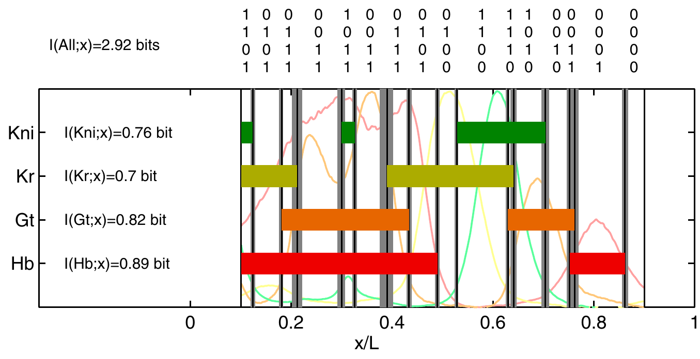
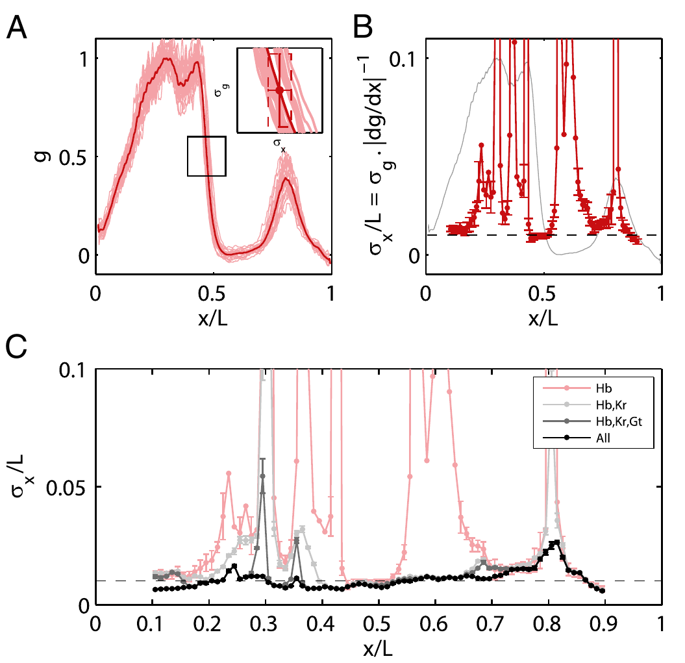
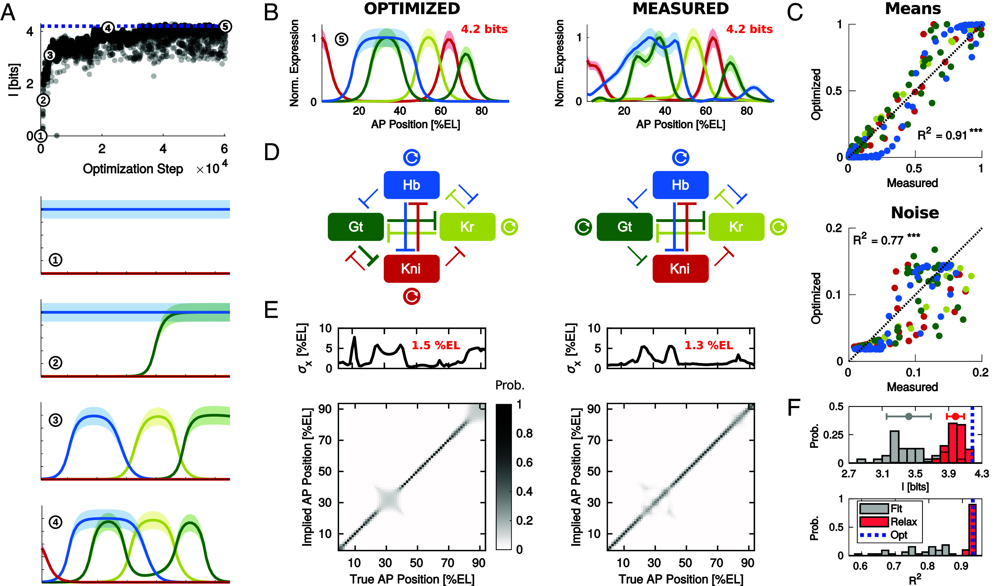
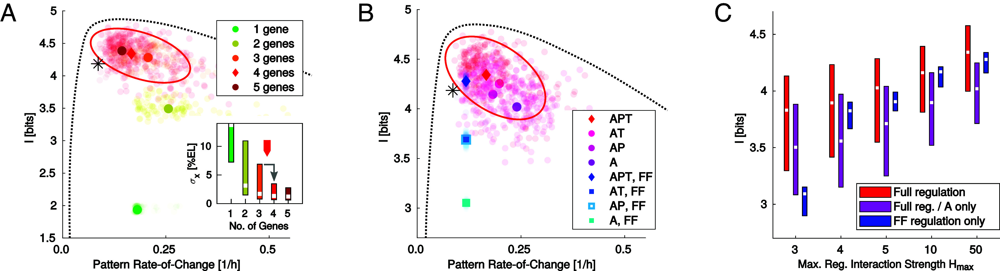

# 基因调控网络如何编码空间位置
## 从 Bicoid 梯度和 French flag model 到位置解码与网络优化

> 西湖大学 2026 年秋季《定量生物学导论》课程学习笔记。

> **核心问题：** 胚胎中的细胞核接触到的是分子，为什么这些分子能帮助它在合适的位置开启合适的基因？分子读数的波动，又会让这个决定有多不确定？

## 概述 {#main-lecture}

一个果蝇胚胎要沿前后方向形成不同的身体结构。可是，各处细胞核中的基因组大体相同。为什么同一套基因，在前部和后部会有不同的活动？

关键在于：**基因相同，不代表它们接触的调控信号相同。** 某些蛋白质在胚胎前端多、后端少，各处的核因而接触到不同浓度。蛋白质又能影响基因是否转录，于是，“处在不同地方”就可能变成“开启不同的基因”。

先认识这里的三个对象。**基因**是一段 DNA；基因转录后产生 RNA，其中的 **mRNA** 可以作为合成蛋白质的模板；某些**蛋白质**又会影响其他基因的转录，这类蛋白质称为转录因子。本文说一个基因“表达高”，会按所讨论的实验，具体指它的 RNA 或蛋白质较多。

### 从 Bicoid 到一条表达边界 {#biological-start}

果蝇早期胚胎提供了一个可以实际观察的例子。母源 *bcd* mRNA 集中在胚胎前端，产生的 **Bicoid 蛋白（Bcd）** 在前端较多、向后逐渐减少。这种浓度随位置有规律变化的分布，就称为**浓度梯度**。

Bicoid 是转录因子，能参与激活 *hunchback*（*hb*）等基因。先把早期 *hb* 响应看作一个具体问题：前部有较多核正在转录 *hb*，后部则较少，二者之间出现一条表达边界。[Porcher 和 Dostatni（2010）](https://doi.org/10.1016/j.cub.2010.01.026)的综述提供了这个系统的生物学背景。

*Fig. 1. 从连续梯度到空间表达边界。* 引自 [Lucas 等（2018），原文 Fig. 1](https://doi.org/10.1371/journal.pgen.1007676.g001)。A：Bicoid 在前端多、后端少；A、P 分别表示前端与后端。B：根据 RNA FISH（特定 RNA 的荧光标记）观测绘制的早期 *hb* 转录示意；绿点是正在转录的核，白点是未检测到转录的核。下方曲线表示活跃核的比例。图中两个阶段相隔 30 min。

读图时，先只抓住一个变化：左边是浓度逐渐降低，右边却出现了“前部大多开启、后部大多关闭”的区域划分。**平缓的输入，怎样变成较明确的边界？** 这就是要解释的第一件事。

图中的点是细胞核。此时胚胎仍是合胞体，也就是多个核共享细胞质，尚未由完整的细胞膜逐个隔开。因此下面常说“一个核读取局部蛋白浓度”。所谓“读取”，具体可以是蛋白质结合调控 DNA 后改变转录概率，而不是让核先计算出一个数值坐标。

### 位置信息与 French flag model {#french-flag}

**Positional information（位置信息）** 是局部状态中能够指示空间位置的线索。细胞或细胞核可以利用这些线索，选择适合所在位置的响应。[Wolpert（1969）](https://doi.org/10.1016/S0022-5193(69)80016-0)区分了两个步骤：先有随位置不同的信号，再由细胞解释这些信号、选择行为。知道一个信号存在，还没有说明它怎样被使用。

**French flag model** 用蓝、白、红三个区域表示三种命运或表达状态。设想所有细胞遵守完全相同的规则：浓度高时选蓝色，中等时选白色，低时选红色。高与中、中与低的分界浓度，就叫两个**阈值**。

这里没有给每个位置单独安排一条指令。靠近高浓度一端的细胞更容易选蓝色，另一端更容易选红色。同一条读取规则，因为局部输入不同，就形成了空间图案。

*Fig. 2. 一个梯度怎样划分出三种命运。* Toy model，非胚胎数据。A：一条由左向右降低的浓度曲线，以及两个读取阈值。B：同一条规则把不同位置分成蓝、白、红三个区域。C：读数有波动后，边界附近可能作出不同选择；纵轴是同一位置重复读取时选中各颜色的概率。

如果一个靠近蓝白边界的核，第一次读到的浓度略高、第二次略低，它会不会改变选择？如果整个胚胎的 Bicoid 都增加了一点，边界会不会移动？这些问题把理想的 French flag model 变成了一个需要定量回答的生物学问题。

French flag model 的原始问题还关心比例：胚胎更长，或一部分被移除后，是否仍能形成比例正确的图案？两个固定阈值本身不保证这一点，第 1.3 节再区分它与读数精度。

---

## 1. 一条浓度梯度怎样指定边界 {#gradient}

先暂时忽略分子的随机波动，只研究平均图案。要走通的因果链是：**蛋白质在哪里产生、怎样运动和消失 → 各处的平均浓度 → 同一条基因调控规则在各处产生不同响应。** 这一章分别解释这三个环节。

### 1.1 先看浓度曲线，再问它怎样形成 {#source-diffusion-degradation}

**第一步：把胚胎图像变成浓度曲线。** 怎样知道 Bicoid 在哪里多、在哪里少？[Gregor 等（2007）](https://pmc.ncbi.nlm.nih.gov/articles/PMC2253670/)把 Bcd 与能发绿色荧光的 GFP 融合，在活胚胎里成像。经过浓度标定，核的亮度就可以换算成 Bcd 浓度。

*Fig. 3. 从果蝇胚胎到 Bicoid 浓度梯度。* 引自 [Gregor 等（2007），原文 Fig. 2](https://pmc.ncbi.nlm.nih.gov/articles/PMC2253670/#F2)。A：活胚胎中的 Bcd-GFP 荧光，前端在左，亮点对应富集 Bcd-GFP 的细胞核，标尺 $50\,\mu\mathrm m$；胚胎外的 GFP 溶液用于浓度标定。B：横轴从前端的 0 走到后端的 1，纵轴是逐核浓度；红、蓝点分别来自背侧和腹侧，黑点及误差棒是无 GFP 胚胎的背景对照。插图放大扣除平均背景后的中后段信号。

图 A 中，胚胎左侧的细胞核比较亮，向右则逐渐变暗。因为荧光来自 Bcd-GFP，经过浓度标定后，就能根据每个核的亮度估计其中的 Bicoid 浓度。把这些核的位置和浓度画在一起，就得到图 B：每个红点或蓝点代表一个核，横坐标表示它在胚胎中的位置，纵坐标表示测得的浓度。靠近前端的点通常较高，越往后，点的位置整体越低，对应的就是图 A 中从亮到暗的变化。

横轴用 $x/L$ 表示位置，其中 $x$ 是这个核到胚胎前端的距离，$L$ 是胚胎的全长。例如，$x/L=0.4$ 表示这个核位于从前端算起、全长 40% 的地方。如果胚胎长 $500\,\mu\mathrm m$，这个核就离前端 $200\,\mu\mathrm m$。要知道这里的 Bicoid 浓度，还需要看这个点在纵轴上的数值。

图 B 中的数据点没有排成一条光滑的曲线，即使位置很接近，不同核测得的浓度也会有差别。这些差别可能来自核之间实际的浓度差异，也可能来自成像和浓度换算中的测量误差。我们后面关心的是：在发育阶段和位置相同的条件下，细胞核能读到多稳定的浓度信号？回答这个问题，需要比较相同条件下的多次观测，并估计测量误差有多大。仅凭这张图中各个点的分散程度，还不能直接判断细胞核读取浓度时的噪声有多大。

**第二步：用几个参数概括平均形状。** 以胚胎前端为原点，$x$ 是距离前端的位置，$L$ 是胚胎全长，$c(x)$ 是该处的平均浓度。一个常用的近似是

$$
\boxed{c(x)=c_0e^{-x/\lambda}.}
\tag{1.1}
$$

$c_0$ 表示前端的浓度尺度。$\lambda$ 是浓度衰减的长度尺度：每向后走一个 $\lambda$，浓度就乘以 $e^{-1}\simeq0.37$。它不像直线那样“每走一步减去同样多”，而是“每走一步剩下同样的比例”。

找一组参数进行后续的计算：令 $L=500\,\mu\mathrm m$、$\lambda=100\,\mu\mathrm m=0.2L$，$c_0=100$ 个任意浓度单位。

| 离前端的距离 $x$ | 相对位置 $x/L$ | 平均浓度 $c(x)$ | 相对前端剩余比例 |
|---|---|---|---|
| $0\,\mu\mathrm m$ | 0 | 100 | 100% |
| $100\,\mu\mathrm m$ | 0.2 | 36.8 | 36.8% |
| $200\,\mu\mathrm m$ | 0.4 | 13.5 | 13.5% |
| $300\,\mu\mathrm m$ | 0.6 | 5.0 | 5.0% |

这里有两个不同的调节方向：增大 $c_0$ 会把整条曲线按比例抬高；增大 $\lambda$ 则让浓度随距离下降得更慢。知道前端有多亮，还不足以知道后端能接收到多少信号。

**第三步：理解为什么会形成这种形状。** 考虑一个最小的**源–扩散–降解模型（SDD）**：

1. **源：** 前端不断产生蛋白质，为系统补充分子。
2. **扩散：** 分子作随机运动。单个分子没有“向后走”的目标；因为前端分子更多，从前向后运动的总数可以多于反向运动的总数，于是形成净输运。
3. **降解：** 分子在途中以一定概率被去除。这里假设每个分子单位时间被去除的概率不随位置改变，平均寿命记为 $\tau$。

把胚胎的前后轴看作一条长度为 $L$ 的线，前端是 $x=0$，后端是 $x=L$。用 $c(x,t)$ 表示位置 $x$、时刻 $t$ 的平均蛋白质浓度。先假设扩散系数 $D$ 和平均寿命 $\tau$ 在各处相同，前端以恒定通量 $R$ 向胚胎内部补充分子。

**先写分子的收支。** 沿 $x$ 正方向的扩散通量记为 $j(x,t)$。根据 Fick 定律，

$$
j=-D\frac{\partial c}{\partial x}.
$$

这里的负号表示分子净流动的方向是从高浓度到低浓度。例如，浓度向后降低时，$\partial_xc\lt 0$，就有 $j\gt 0$，即分子净流向后端。对于胚胎内部的一小段，浓度的变化来自流入与流出的差额，以及这段内部的降解：

$$
\frac{\partial c}{\partial t}
=-\frac{\partial j}{\partial x}-\frac{c}{\tau}
= D\frac{\partial^2c}{\partial x^2}-\frac{c}{\tau},
\qquad 0\lt x\lt L.
$$

这就是这里使用的**反应–扩散方程**。扩散项描述相邻位置之间的分子交换；降解项 $-c/\tau$ 表示单位时间内平均有 $1/\tau$ 的比例被去除。源集中在前端，因此通过边界条件加入，不再在区间内部另写一个产生项。

**还要说明两端怎样与外界交换分子。** 前端持续输入，后端不允许分子流出，对应

$$
\boxed{
-D\partial_xc(0,t)=R,
\qquad
-D\partial_xc(L,t)=0.
}
$$

第一条规定输入的通量，而前端浓度由后续的扩散和降解共同决定；第二条是后端的零通量条件，也就是 $\partial_xc(L,t)=0$。若 $c$ 按单位体积的浓度计，$R$ 的单位就是“浓度 × 长度 / 时间”，可理解为单位横截面积、单位时间输入的分子数。为了描述梯度从无到有的建立过程，可以再取初始条件 $c(x,0)=0$，并从 $t=0$ 起开启前端输入。下面求的是经过足够长时间后的稳态。

**稳态时，流入、扩散与降解达到平衡。** 此时 $\partial_tc=0$，方程变成

$$
D\frac{\mathrm d^2c}{\mathrm dx^2}-\frac{c}{\tau}=0
\quad\Longrightarrow\quad
c''-\frac{c}{\lambda^2}=0,
\qquad
\boxed{\lambda=\sqrt{D\tau}}.
\tag{1.2}
$$

$D$ 的单位是“长度平方 / 时间”，所以 $\lambda$ 确实是一个长度。它表示扩散与降解竞争所决定的距离尺度：扩散越快，分子能到达的地方越远；寿命越短，分子就越容易在到达远处以前被去除。

这个二阶常系数方程的通解是 $c(x)=A e^{x/\lambda}+B e^{-x/\lambda}$。为了方便使用后端条件，也可以把同一个通解写成

$$
c(x)=a\cosh\frac{L-x}{\lambda}
+b\sinh\frac{L-x}{\lambda}.
$$

其中 $\cosh u=(e^u+e^{-u})/2$，$\sinh u=(e^u-e^{-u})/2$。求导后，在后端 $x=L$ 代入，得到 $c'(L)=-b/\lambda$。后端零通量要求 $b=0$。再把剩下的解代入前端条件：

$$
-Dc'(0)=\frac{Da}{\lambda}\sinh\frac L\lambda=R
\quad\Longrightarrow\quad
a=\frac{R\lambda}{D\sinh(L/\lambda)}.
$$

利用 $\lambda^2=D\tau$，就得到有限长度胚胎中的稳态梯度：

$$
\boxed{
c(x)=\frac{R\tau}{\lambda}
\frac{\cosh[(L-x)/\lambda]}{\sinh(L/\lambda)}.
}
\tag{1.2a}
$$

还可以检查整个区间的分子收支。将稳态方程从 $0$ 积分到 $L$，再代入两端通量，得到

$$
0=D[c'(L)-c'(0)]-\frac1\tau\int_0^Lc(x)\,\mathrm dx
=R-\frac1\tau\int_0^Lc(x)\,\mathrm dx,
\qquad
\int_0^Lc(x)\,\mathrm dx=R\tau.
$$

也就是说，稳态时整个区间的降解速率恰好等于输入通量；区间内的总量（按单位横截面积计）等于输入通量乘以平均寿命。

**正文前面使用的指数形式，是这个解在远离后端时的近似。** 把双曲函数展开，可以看得更清楚：

$$
c(x)=\frac{R\tau}{\lambda}
\frac{e^{-x/\lambda}+e^{-(2L-x)/\lambda}}
{1-e^{-2L/\lambda}}.
$$

当 $L\gg\lambda$，且观察位置离后端也足够远，即 $L-x\gg\lambda$ 时，分母接近 1，分子中的第二项远小于第一项，因此

$$
\boxed{
c(x)\simeq c_0e^{-x/\lambda},
\qquad c_0=\frac{R\tau}{\lambda}=R\sqrt{\frac\tau D}.
}
\tag{1.2b}
$$

如果一开始就把空间近似成半无限区间 $x\geq0$，并要求 $c(x)\to0$（$x\to\infty$），通解中的增长项 $A e^{x/\lambda}$ 必须去掉，再用前端通量条件确定 $B$，也会得到这个指数解。对于实际的有限区间，前端浓度则是 $c(0)=(R\tau/\lambda)\coth(L/\lambda)$；只有在上述长区间近似下，它才接近这里的 $c_0$。

这个结果也说明了为什么不能只把 $D$ 当作“调节梯度宽度”的参数。在输入通量 $R$ 和寿命 $\tau$ 固定时，$D$ 增加四倍，会让 $\lambda$ 增加两倍，同时使指数近似中的前端浓度 $c_0$ 降到原来的一半。分子扩散得更远，前端的积累也随之减少。若改为固定前端浓度，得到的就是另一种边界条件，不能直接套用固定通量下的参数关系。

后端附近还必须使用有限区间解：零通量要求曲线在那里变平，而单独一个递减指数在 $x=L$ 处仍有斜率。Fig. 5B 比较了这两种形状。SDD 在这里用于解释梯度怎样形成；真实 Bicoid 系统还涉及发育时间、核内外交换等过程，仅凭观察到指数形状，还不能断定只有这一种形成机制。

[Durrieu 等（2018）](https://doi.org/10.15252/msb.20188355)把这个问题往前推进了一步：除了测量各处有多少 Bicoid，还测量这些蛋白质合成后已经存在了多久。这里的“蛋白质年龄”指从合成到观测所经过的时间，同一位置有新旧不同的分子，实验提供的是与这群分子的平均年龄有关的信号。

*Fig. 4. 相似的浓度图案可以来自不同的形成过程。* 引自 [Durrieu 等（2018），原文 Fig. 1](https://pmc.ncbi.nlm.nih.gov/articles/PMC6121778/#msb188355-fig-0001)。B：四种模型对 RNA 分布、蛋白质输运和降解作出不同假设。C：在同一观测时刻，它们都能产生相近的归一化浓度曲线。D：同一时刻的平均蛋白质年龄预测却明显不同，符号为随机模拟结果，实线为理论预测。E：改变模型参数后得到的预测范围。C–E 均为模型结果，尚不是胚胎中测得的年龄。

图 4C 中的曲线几乎重合，很难判断蛋白质究竟在哪里产生、怎样到达后端。B 展示了不同的解释：SDD 假设蛋白质主要在前端产生，随后扩散并降解；核穿梭模型（NucSh）也依靠蛋白质向后输运，但通过不断增加的细胞核捕获蛋白质，在没有蛋白质降解的设定下形成核内浓度图案。另两种模型则让 RNA 分布到更靠后的地方，使那里也能产生蛋白质。

这些过程对“后端的蛋白质有多老”给出了不同答案。在图 4D 的 SDD 和核穿梭模型中，越靠后，蛋白质平均越老；但降解会改变存留下来的分子的年龄分布，因此两条曲线并不相同。RNA 梯度模型在各处持续产生蛋白质，预测的平均年龄随位置变化较小。RNA 扩散模型中，产生蛋白质的区域随 RNA 向后扩展，后端的蛋白质反而更年轻。浓度相近的地方，分子的产生和输运历史仍然可能很不一样。

对于本文而言，这项工作对 SDD 的支持来自它同时解释了浓度和年龄相关的观测，而不只是能够画出一条下降的浓度曲线。因此，对下面的位置读取问题，我们仍可以先用指数梯度计算；但在解释梯度的来源时，则需要接受这些额外实验的检验。

### 1.2 浓度过阈值的地方，就是表达边界 {#threshold-variability}

上一节得到了一条由前向后降低的 Bicoid 浓度曲线。但浓度的变化是连续的：从一个核走到旁边的核，浓度通常只差一点。早期 *hb* 转录却能表现出前部较活跃、后部较少活跃的区域。要解释这两个区域之间的分界，还需要知道基因怎样响应局部的 Bicoid。

Bicoid 是转录因子，可以结合基因附近的调控 DNA，参与调节转录。在其他条件相同时，局部 Bicoid 越多，调控位点与它发生结合的机会通常也越多。不过，一次结合并不等于基因立刻、持续地开启。实际的转录还涉及其他调控因子，启动子也会在活跃和不活跃的状态之间切换。因此，描述这种响应时，可以先问：在给定的 Bicoid 浓度下，观察到基因正在转录的概率有多大？

假如这个概率在低浓度时接近 0，高浓度时接近 1，而且主要的变化集中在一小段浓度范围内，就可以先用一个开关近似它。用 $c_*$ 表示开关的阈值，规定 $c\gt c_*$ 时开启，$c\lt c_*$ 时关闭。这是 French flag 模型采用的简化；对于实际的连续响应，也可以把活跃概率为一半时的浓度作为边界的判据。这里先用这条简单规则计算边界的位置，真实 *hb* 的调控机制会比它复杂。

可以把同一条规则放到胚胎中的每个核上。前端附近的核接触到较高浓度，满足开启条件；沿前后轴往后，浓度逐渐下降，总会有一处降到 $c_*$。这处前面的核开启，后面的核关闭，把所有核的状态画在一起，就出现了一条表达边界。**边界的位置由浓度梯度和基因的响应阈值共同决定。** 每个核只对自己附近的浓度作出响应，并不需要知道自己离前端多远。

设这条边界距离前端 $x_*$，用上一节的指数近似，就有

$$
c(x_*)=c_*
\quad\Longrightarrow\quad
c_0e^{-x_*/\lambda}=c_*.
$$

两边除以 $c_0$，再取自然对数，得到

$$
-\frac{x_*}{\lambda}=\ln\frac{c_*}{c_0},
\qquad
\boxed{x_*=\lambda\ln\frac{c_0}{c_*}}.
\tag{1.3}
$$

也可以直接从图上读出这个位置：在浓度曲线上画一条高度为 $c_*$ 的水平线，找到两者的交点，再向下投影到位置轴。式（1.3）就是这个交点的横坐标。这里默认阈值落在前端和后端的浓度之间，因而交点确实位于胚胎内部；阈值太高会使所有位置都达不到开启条件，太低则会使整个区间都开启。

沿用上一节的参数：胚胎长 $L=500\,\mu\mathrm m$，前端浓度 $c_0=100$，衰减长度 $\lambda=100\,\mu\mathrm m$。令阈值为 $c_*=100e^{-2}\simeq13.5$，则

$$
x_*=100\ln\frac{100}{100e^{-2}}\,\mu\mathrm m
=200\,\mu\mathrm m.
$$

在 $190\,\mu\mathrm m$ 处，浓度约为 15.0，比阈值高，按规则应当开启；在 $210\,\mu\mathrm m$ 处，浓度约为 12.2，比阈值低，应当关闭。两者之间的 $200\,\mu\mathrm m$ 就是分界。因为它占胚胎全长的 40%，我们可以把结果描述成“前 40% 区域开启”。这个比例是根据计算结果换算出来的，模型中的核实际响应的仍然是浓度。

接下来把 Bicoid 的输入增加一点。假设梯度整体升高 10%，即 $c_0$ 从 100 变成 110，而衰减长度和阈值都不变。原来位于边界上的核，现在读到的浓度也会从约 13.5 升到约 14.9，已经高于原来的阈值。它后面的一些核也会因此开启，所以表达区域向后延伸。

新边界仍然满足式（1.3）。把改变前后的边界位置相减，得到

$$
\Delta x_*
=\lambda\ln\frac{110}{c_*}-\lambda\ln\frac{100}{c_*}
=\lambda\ln\frac{110}{100}
\simeq9.5\,\mu\mathrm m.
$$

所以新边界在约 $209.5\,\mu\mathrm m$，相当于全长的 41.9%，见 Fig. 5A。这个位移来自输入浓度的整体升高，即使每个核每次都能准确读取浓度，仍会发生。反过来，若浓度曲线保持不变，只把开启阈值提高 10%，原来边界附近的一些核就达不到新的阈值，边界会向前移动约 $9.5\,\mu\mathrm m$。

前一节的源–扩散–降解模型还给出了 $c_0=R\tau/\lambda$。在扩散系数和寿命固定时，输入通量 $R$ 增加多少百分比，$c_0$ 也增加同样的百分比。因此，当输入从 $R$ 变为 $R+\delta R$ 时，

$$
\Delta x_*=\lambda\ln\left(1+\frac{\delta R}{R}\right).
$$

对于小幅变化，可以用 $\ln(1+\epsilon)\simeq\epsilon$ 近似，得到

$$
\delta x_*\simeq\lambda\frac{\delta R}{R}.
\tag{1.4}
$$

例如，输入增加 10%，边界位移就约为衰减长度的 10%。这里 $\lambda=100\,\mu\mathrm m$，近似结果为 $10\,\mu\mathrm m$，与刚才的精确值 $9.5\,\mu\mathrm m$ 很接近。输入变化较大时，则应使用前面的对数表达式。

实际改变一个生物学条件时，往往不止一个参数会变。例如，蛋白质寿命的变化会同时影响衰减长度和前端浓度。要把这些影响合起来，可以对式（1.3）求全微分：

$$
\delta x_*=
\ln\frac{c_0}{c_*}\,\delta\lambda
+\lambda\left(\frac{\delta c_0}{c_0}-\frac{\delta c_*}{c_*}\right).
\tag{1.4a}
$$

这几项可以分别理解。固定前端浓度和阈值时，$\lambda$ 增大，梯度下降得更慢，要到更靠后的地方才降到阈值；固定其他量时，前端浓度升高也会让边界后移，阈值升高则会让边界前移。如果多个参数一起变化，这些位移可能相加，也可能抵消。用这个式子分析某种扰动时，需要把该扰动造成的各项变化一并代入。

*Fig. 5. 梯度的形成与定位限制。* A：灰色水平线表示固定的浓度阈值。前端产生通量增加 10% 后，浓度曲线整体升高，与阈值线的交点从 $0.40L$ 移到约 $0.419L$；这里 $\lambda/L=0.2$。B：第 1.1 节的有限区间解与指数近似，后端的零通量条件使有限区间解在那里变平。C：第 2 章将讨论的 Poisson 分子计数模型，$m(x)=m_0e^{-x/\lambda}$；越靠后，可计数的分子越少，对位置的判断也越不精确。三个面板均为模型计算。

到这里，我们算的是平均浓度曲线与阈值的交点。如果同一位置的浓度读数有波动，靠近交点的核就可能这次读到阈值以上、下次读到阈值以下，表达边界也会变得不确定。让基因的开关响应更陡，并不能自动解决这个问题：输入的读数一旦跨过阈值，再陡的开关也会跟着改变状态。第 2 章将具体计算，浓度读数的误差会造成多大的位置误差。在此之前，先区分边界的重复定位、对输入改变的响应，以及胚胎大小改变时的比例保持。

### 1.3 三种不同的“图案是否可靠” {#precision-robustness-scaling}

看到一条清楚的平均边界，还需要分别问三个问题：

| 问题 | 怎样比较 | 对应概念 |
|---|---|---|
| 相同条件下，这次与下次的结果相差多少？ | 固定发育阶段，重复测量同一位置的表达或边界 | 精度 |
| 输入改变后，图案会移动多少？ | 例如提高母源剂量，比较改变前后的边界 | 鲁棒性 |
| 胚胎更长时，边界是否仍在相同比例处？ | 比较边界距离与胚胎全长之比 | 尺度缩放 |

沿用第 1.2 节的模型例子，可以进一步区分这三个问题。下面讨论的是假设情境和模型预测，不是实验测量结果。

**精度关心相同条件下的重复差异。** 如果在发育阶段、输入条件和胚胎大小相同的情况下，反复观察得到的边界位置都靠近 $200\,\mu\mathrm m$，就说明重复定位较精确。这里尚未给出边界波动的实验数据，也没有用模型算出它的大小；第 2 章会讨论浓度读数的噪声怎样造成位置不确定性。

**鲁棒性关心条件改变后，边界是否仍能保持原位。** 第 1.2 节已经算出，在阈值和衰减长度固定时，源强增加 10% 会使模型边界从 $200\,\mu\mathrm m$ 移到约 $209.5\,\mu\mathrm m$。即使改变前后各自的重复定位都很精确，两组结果仍会相差约 $9.5\,\mu\mathrm m$。因此，重复定位精确，并不意味着边界对源强变化不敏感。

**尺度缩放关心相对位置是否保持不变。** 假设胚胎全长从 $500\,\mu\mathrm m$ 变为 $600\,\mu\mathrm m$，要让边界仍位于全长的 40%，它就必须从 $200\,\mu\mathrm m$ 移到 $240\,\mu\mathrm m$。这里的 $240\,\mu\mathrm m$ 是保持比例所要求的位置；模型是否会产生这样的移动，还需要根据参数和胚胎长度之间的关系计算。

为什么两个固定阈值不能自动保证缩放？因为式（1.3）里只有 $c_0$、$c_*$ 和 $\lambda$，没有胚胎全长 $L$。这些量都不随大小改变时，在指数近似成立的范围内，边界仍会停在相同的绝对距离；原来的 $200/500=40\%$ 就变成 $200/600\simeq33\%$。若希望比例不变，模型还需要让输入或读取规则随大小作适当变化。

对于第 1.1 节的有限区间解，可以把这个要求写得更具体。令相对位置 $z=x/L$、$\kappa=L/\lambda$，则

$$
c(z;L)=\frac{R\tau}{\lambda}
\frac{\cosh[\kappa(1-z)]}{\sinh\kappa}.
\tag{1.5}
$$

将边界处的浓度设为 $c_*$，得到

$$
\frac{\cosh[\kappa(1-z_*)]}{\sinh\kappa}
=\frac{c_*\lambda}{R\tau}.
$$

因此，要在改变 $L$ 后保持相同的边界比例 $z_*$，一组充分条件是：$L/\lambda$ 和 $c_*\lambda/(R\tau)$ 都保持不变。前一个条件要求梯度的衰减长度随胚胎长度同比例改变，后一个条件要求阈值相对于梯度的浓度尺度也保持不变。只让衰减长度随胚胎变长，通常还不够；输入通量、寿命和阈值之间也需要有合适的配合。这是一组能保证缩放的条件，并不意味着实现缩放只有这一种方式。

还要区分**一个胚胎里表达过渡有多宽**，以及**不同胚胎的边界位置相差多少**。每个胚胎都可以有很窄的过渡，却在不同位置出现；把许多胚胎平均后，就会得到一条较宽的过渡。因此，仅看平均图案是否清楚，还不足以判断这些可靠性。

接下来固定平均浓度图案，单独问：**同一位置的读数为什么仍会波动？读数相差一点，究竟相当于位置相差多少？**

## 2. 细胞怎样读取浓度，读数又为何有误差 {#local-estimation}

第 1 章把基因调控概括为“浓度过阈值就开启”。这一章先拆开这个开关：核中的什么东西接触到信号，接触以后发生什么，为什么这些反应能把空间差异变成表达差异。理解了实际读取过程，再问它能有多精确。

### 2.1 谁在读取：从蛋白质结合 DNA 到产生 RNA {#molecular-readout}

**“读到浓度”首先是一连串分子接触事件。** 在这里，Bicoid 已经存在于核内。控制基因表达的 DNA 调控序列含有能与 Bicoid 结合的位点；分子运动到这些位点附近，可能结合，过一段时间又解离。同一个位点因而在“空着”和“被占据”之间切换。

先认识调控 DNA 上两个常见的名称。**启动子**（promoter）是转录机器组装、起始转录所需的 DNA 区域；**增强子**（enhancer）是能结合调控蛋白并影响目标基因转录的 DNA 区域，可以离启动子较远。两者通过分子相互作用影响转录，不需要蛋白质先把浓度翻译成一个数值，再把这个数值交给基因。不同基因的调控结构不同，下面先用一个结合位点解释最基本的感应原理。

如果其他条件不变，周围 Bcd 浓度高，空位点通常更快遇到能够结合的 Bcd；浓度低，平均等待时间更长。因此，**浓度可以被转换成位点被占据的时间比例，以及结合、解离事件的时间序列。** 这就是一种物理上的“测量”。例如，假设每次结合平均维持 2 s：

| Toy model | 空位点平均等待多久才被结合 | 每次结合平均维持多久 | 长时间内被占据的比例 |
|---|---|---|---|
| 较低浓度 | 8 s | 2 s | $2/(8+2)=20\%$ |
| 较高浓度 | 2 s | 2 s | $2/(2+2)=50\%$ |

*Fig. 6. 浓度怎样成为可影响基因的分子信号。* A：同一个 DNA 位点在空闲与被 Bcd 占据之间切换；在最小模型中，空位点的结合速率随局部浓度增加，解离速率保持不变。B：两种浓度下模拟的随机结合轨迹，1 表示被占据、0 表示空闲；两条轨迹使用表中的平均等待与结合时间。位点只经历这些事件，不知道自己在胚胎的哪个坐标。

**结合状态再改变转录。** 对一个激活因子来说，结合可以通过招募或影响其他蛋白质，使转录机器更容易开始工作；抑制因子则可以降低相应调控区域的转录输出。具体方式依赖基因和调控蛋白。把这些中间环节概括起来，就是“不同结合状态对应不同的转录产生率”。一次结合不必对应恰好一条 RNA，也不保证基因立即开启。

在一个最简的 toy model 中，假设位点被占据时更容易转录，空闲时较难转录。高浓度使位点更常被占据，于是在相同时间内，平均产生的 mRNA 更多。mRNA 再被翻译成蛋白质，就把短暂的结合事件转成了能够持续一段时间、影响下游基因的分子状态：

$$
\text{局部 Bcd 浓度}
\longrightarrow\text{DNA 结合状态}
\longrightarrow\text{转录与 mRNA 积累}
\longrightarrow\text{Hb 蛋白}.
$$

这里的“积累”还有一个作用：某个时刻有多少 RNA 或蛋白质，取决于之前一段时间的产生与去除。因此，输出可以保留输入历史的一部分，起到时间整合的作用；它不是无限记忆，也不是无噪声的平均器，具体精度取决于结合动力学、转录随机性和分子寿命。

实验确实能接近这条链中的中间环节。[Lucas 等（2018）](https://doi.org/10.1371/journal.pgen.1007676)用带荧光标记的 nascent RNA（正在合成的 RNA）观察 *hb* 报告基因的活体转录。它观测的是转录输出，而不是核“得到一个浓度值”；结合模型则尝试解释输入 Bcd 怎样造成这种输出。

**空间信息由此进入反应，但反应不必显式包含坐标。** 前后两个核具有相同的调控 DNA，却接触到不同浓度，因而产生不同的结合历史和表达概率。对外部观察者而言，看到这些表达差异，就能推测来自哪里；对胚胎而言，在正确区域产生 Hb、再影响后续表达，本身就已经在使用位置信息。

下面的“读数”可以指实验测得的蛋白浓度，也可以指模型中可供下游使用的分子状态。我们对这些状态能支持多精细的位置区分进行量化。

### 2.2 先比较两个位置的重复读数 {#conditional-expression}

**先固定位置，再看读数。** 假设在同一发育阶段，重复测量一批胚胎的同一个位置。即使位置相同，分子的产生、到达与去除也不完全相同，表达量因此会波动。我们把条件固定后仍然存在的表达波动称为**噪声**。

先看一个完全假设的例子。位置 A 在全长的 40%，位置 B 在 41%；两处的平均表达分别是 100 和 110 个单位。为了便于演示，选了一条向后升高的表达曲线。如果 A 的读数通常集中在 100 附近、B 集中在 110 附近，两处就可能区分。如果两边都时常出现从 80 到 130 的读数，单独看到一个 106 就很难判定来自哪里。**均值不同是必要线索，但还要知道每个位置的读数有多分散。**

*Fig. 7. 从表达分布的重叠，到位置误差的几何意义。* A、B：位置 $0.40L$、$0.41L$ 的平均读数都是 100、110；标准差分别取 5、20。横轴是表达读数，纵轴是概率密度；曲线下某段的面积表示读数落在该段的概率，整条曲线下面积为 1。重叠越多，越难区分来源。C、D：改画平均表达随位置的变化，固定读数标准差为 5；橙色带以 $x=0.40L$ 处的均值 100 为中心，上下各取一个读数标准差，虚线把交点投影到位置轴。C 曲线较陡，对应的位置半宽为 $0.005L$；D 斜率降为四分之一，位置半宽扩大到 $0.02L$。图中的分布与直线来自 toy model，非实验拟合。

**用一个分布概括同一位置的重复读数。** 记号 $P(g\mid x)$ 表示“位置固定为 $x$ 时，读到表达量 $g$ 的分布”，竖线为“在……条件下”。在 A 处，分布中心在 100；在 B 处，中心在 110。这两条曲线是各自固定位置上的读数分布。用 $\mu(x)$ 表示平均表达，用 $\sigma_g(x)$ 表示读数的标准差描述围绕均值波动的典型大小，Fig. 7A、B 的正态分布中，约 68% 的读数位于均值上下一个标准差内。

**再把读数的宽度换成位置的宽度。** 在这个例子中，位置移动 $0.01L$，平均读数改变 10。把附近的平均曲线近似为直线，那么：

- 读数相差 1，对应的位置差是 $0.001L$；
- 读数不确定 5，对应的位置尺度是 $0.005L$，即全长的 0.5%；
- 读数不确定 20，对应的位置尺度是 $0.02L$，即全长的 2%。

把“每移动一点，平均读数改变多少”记为斜率 $\mu'(x)$。上述换算就是“读数变化 $\simeq$ 斜率 $\times$ 位置变化”，因此

$$
\boxed{\sigma_x\simeq\frac{\sigma_g}{|\mu\prime|}.}
\tag{2.1}
$$

这里的 $\sigma_x$ 是沿平均曲线反推位置时的局部误差尺度。

Fig. 7C、D 可以直接读出这个除法：先画出同样宽的竖直读数范围，再沿曲线投影到横轴。曲线陡，投影到的位置区间窄；曲线平，同样的读数波动就覆盖更长的一段位置。因此，**定位依靠平均信号随位置的变化相对于噪声有多大。** 这也补上了第 1 章留下的“开关更陡”问题。若只把已有读数作确定的放大，例如全部乘以 2，平均曲线的斜率增大两倍，已有读数的标准差也增大两倍，式（2.1）的比值不变。陡峭的响应有助于把浓度差转成明显的表达差。

这个量级与生物问题怎样联系？[Gregor 等（2007）](https://pmc.ncbi.nlm.nih.gov/articles/PMC2253670/)讨论的胚胎全长约 $500\,\mu\mathrm m$、相邻核间距约 $8\,\mu\mathrm m$、Bcd 衰减长度约 $100\,\mu\mathrm m$。在指数曲线上，向后走 $8\,\mu\mathrm m$，浓度下降约 $1-e^{-8/100}\simeq7.7\%$。也就是说，若要仅靠 Bcd 区分相邻核，读取就必须能辨别这个量级的浓度差。看起来平滑的梯度，到了单个核的尺度上，就成为了辨别小差异的问题。

检查适用范围。式（2.1）要求不确定区间内曲线近似直线，而且读数能对应到附近的单一分支。若曲线很平，算出的范围大到跨越明显弯曲的区段，这个近似就不可靠；若是峰形曲线，另一侧还可能有相同读数，也不能只用一个局部误差概括。第 4 章会处理多个候选位置，[附录 A.6](#local-error-derivation)保留局部推导。

### 2.3 为什么分子数会限制读取精度 {#poisson-counting}

上一节把噪声大小当作已知量，现在问它可能从哪里来。第 2.1 节的实际调控通过结合事件采样；为了先看清有限分子数的影响，这里暂用一个理想计数实验作基准：固定位置、固定采样体积，在某一时刻直接数里面有多少个分子。平均数可以稳定，但实际计数仍会变化。这个简化帮助计算分子信号本身的波动，随后还要考虑结合与转录怎样接收它。

**为什么“平均 100 个”不等于每次都有 100 个？** 分子会随机进入、离开或被去除，各次观测的结果可能是 92、105、98 等。对于独立、稀疏的随机占据，一个常用的计数模型是 **Poisson 分布**。它不是所有基因表达都必须服从的定律，而是先排除分子间关联、转录爆发等额外机制后，研究计数噪声的起点。

在 Poisson 模型中，若平均计数为 $m$，计数的方差也是 $m$。用 $N$ 表示实际读到的随机计数，则

$$
\sigma_N=\sqrt m,
\qquad
\frac{\sigma_N}{m}=\frac1{\sqrt m}.
\tag{2.2}
$$

可以用一个相加的例子理解平方根：四个等体积、相互独立的小区域，如果每个区域平均有 25 个分子、方差为 25，把它们合起来，总均值是 100，总方差也是 100，标准差却是 $\sqrt{100}=10$。均值增加四倍，标准差只增加两倍，所以相对标准差从 $5/25=20\%$ 降为 $10/100=10\%$。这个例子说明独立计数相加时的规律；它还没有说明真实启动子能把更大的空间全部采样。

**把分子计数接回位置判断。** 若采样体积固定，平均计数正比于浓度，所以也可以写成 $m(x)=m_0e^{-x/\lambda}$。在很短的距离 $\Delta x$ 内，平均计数的变化量约为 $m(x)\Delta x/\lambda$，因此斜率的绝对值是 $m(x)/\lambda$。代入式（2.1）：

$$
\boxed{\sigma_x(x)\simeq\frac{\sqrt{m(x)}}{m(x)/\lambda}
=\frac{\lambda}{\sqrt{m(x)}}.}
\tag{2.3}
$$

分子数决定相对计数波动，衰减长度决定同样的位置移动能带来多大的相对信号变化。以 $L=500\,\mu\mathrm m$、$\lambda=100\,\mu\mathrm m$ 为例：

| local 平均计数 $m$ | 计数标准差 $\sqrt m$ | 相对标准差 | 局部位置误差尺度 $\lambda/\sqrt m$ |
|---|---|---|---|
| 25 | 5 | 20% | $20\,\mu\mathrm m=4\%L$ |
| 100 | 10 | 10% | $10\,\mu\mathrm m=2\%L$ |
| 400 | 20 | 5% | $5\,\mu\mathrm m=1\%L$ |

这里比较的是当地分子数不同的三种计数情形；$m$ 不是前端的 $m_0$。沿同一条指数梯度向后，平均计数减少，相对波动增大，因而定位更困难，见 Fig. 5C。 这也解释了一个容易误会的结果：指数梯度前部的绝对计数波动虽然更大，但其斜率也更大，且增长得更快，最终位置误差反而更小。

Poisson 计数给出一种基准；要预测实际读取误差，还需要说明体积、时间和读取机制。[附录 A.1](#appendix-a)给出完整计数分布与估计界。

### 2.4 多读几次，为什么不一定解决问题 {#averaging-and-extrinsic-noise}

**独立重复可以减少随机波动。** 假设位置不变，每次读数都来自同一分布、标准差为 $\sigma_g$，并且各次相互独立。把 $K$ 次读数取平均，均值不变，标准差降为

$$
\sigma_{\bar g}=\frac{\sigma_g}{\sqrt K}.
\tag{2.4}
$$

这里 $\bar g$ 表示平均读数。四次独立观测只能让标准差减半，要降到十分之一就需要 100 次。只要平均表达曲线没有改变，式（2.1）的分母也不变，位置误差按 $1/\sqrt K$ 减小。对生物系统而言，在时间上积累结合事件、转录产物等过程，可以起到某种平均作用。

**“多拍几帧”不等于“多做几次独立实验”。** 一团分子还没有散开时，连续拍很多帧可能反复看到同一团分子；启动子持续处于一次活跃状态时，密集采样也没有创造出很多次新的随机试验。极端情况下，把同一个读数抄四遍再平均，结果当然不会更准确。

因此需要一个描述这种记忆持续多久的量，叫**相关时间**。间隔远大于相关时间的观测才可能近似独立。若一个状态约持续 10 s，1 s 内拍 100 帧，就不能直接把式（2.4）的 $K$ 设为 100。延长观测也有代价：胚胎发育在继续，核必须在有限时间内影响下游基因；若期间平均输入也在改变，就不能再把它当作对同一个固定分布的重复取样。时间平均的定量计算见[附录 C](#appendix-c)。

**有些不确定性会在所有读数中一起保留下来。** 设想每次测量都包含两部分：一部分是独立波动，标准差为 10；另一部分是在整个读取时段内保持不变的共同偏移，不同胚胎的偏移标准差为 5。假设这两部分相互独立，并在胚胎总体上均值为零：

| 取平均的独立读数次数 | 独立部分的标准差 | 共同部分的标准差 | 总标准差 |
|---|---|---|---|
| 1 | 10 | 5 | $\sqrt{10^2+5^2}\simeq11.2$ |
| 4 | 5 | 5 | $\sqrt{5^2+5^2}\simeq7.1$ |
| 很多次 | 趋近 0 | 5 | 趋近 5 |

总方差相加，不是把两个标准差直接相加。共同偏移在同一胚胎的重复读数里都存在，平均再多次也不会自行消失。

输入强弱就能造成这样的困难。回到第 1 章的指数梯度例子：通常 $c_0=100$，在 $x=200\,\mu\mathrm m$ 处读到约 13.5。若这个胚胎的前端幅度只有通常的 80%，同一位置就只有约 10.8。对只知道“通常梯度”的观察者而言，10.8 也可以解释为：前端仍是 100，但自己处在约 $222.3\,\mu\mathrm m$ 的更后方。因为

$$
80e^{-200/100}\simeq100e^{-222.3/100}\simeq10.8.
$$

增加本地采样，可以把“这里确实是 10.8”测得更准，却不能单凭这一个浓度区分“输入偏弱”和“位置更靠后”。这是一种信号解释上的歧义，需要额外线索。

### 2.5 同一段调控 DNA 怎样接收多个位置线索 {#molecular-combination}

现在把第 2.1 节的单一输入向前推进一步。*hb* 产生的 Hb 蛋白本身也是转录因子，可以成为其他基因的输入。果蝇的 gap gene（间隙基因）蛋白还包括 Krüppel（Kr）、Giant（Gt）、Knirps（Kni）等；它们在前后轴上的表达区域不同，部分重叠，并参与相互调控。因此，一个核内同时存在的是一组调控蛋白，而不只是一个 Bcd 浓度。

下游基因怎样使用这一组信号？**同一段调控 DNA 可以带有识别不同转录因子的位点。** 一类位点接触 Hb，另一类接触 Kr 或 Gt；这些结合状态共同影响同一个基因的转录。调控区域因而可以对“激活因子足够、某种抑制因子较少”这一类组合更容易响应。这不是把几种蛋白浓度不分身份地加在一起，而是让不同分子通过各自的结合与调控作用共同影响输出。

例如，下游基因 *even-skipped*（*eve*）会在胚胎中形成条带状的表达区域：一条窄带里的核表达较强，两侧较弱，这样的空间图案称为“条纹”。这里讨论的是从前端数起的第 2 条。控制这条纹表达的一段调控 DNA，称为第 2 条纹增强子；增强子可以通过结合转录因子，影响基因的转录。[Small、Blair 和 Levine（1992）](https://pmc.ncbi.nlm.nih.gov/articles/PMC556915/)研究发现，这段调控 DNA 含有 Bcd、Hb、Gt、Kr 的结合位点：Bcd 与 Hb 参与激活，Gt 参与限定前侧边界，Kr 的抑制与有限的 Bcd 激活共同影响后侧边界。下面用表格概括这些调控关系。

| 所在区域 | 局部调控组合的作用 | 对第 2 条纹表达的影响 |
|---|---|---|
| 条纹前侧附近 | Gt 等抑制作用限制表达 | 前侧被挡住 |
| 条纹所在的空间窗口 | 激活足够，两侧的抑制条件允许表达 | 能够产生条纹表达 |
| 条纹后侧附近 | Kr 抑制与 Bcd 激活减弱共同限制表达 | 后侧被挡住 |

表格省略了连续变化和其他调控细节。各处的核执行相同的调控规则，却因局部蛋白组合不同而产生不同的表达，从而在一段空间窗口内形成条纹。

到这里，第三章要比较的对象才有了物理含义。一种蛋白的局部浓度可能有歧义，另一种蛋白可能给出补充；下游调控 DNA 也确实有接收多个输入的分子结构。接下来先问一个可计算的问题：**如果同时知道同一个核中的几种蛋白浓度，附近的位置是否更容易区分？**

## 3. 多个基因如何联合提高位置分辨能力 {#multigene-fisher}

### 3.1 从调控蛋白组合到表达空间 {#expression-space}

[第 2.5 节](#molecular-combination)用 *eve* 第 2 条纹增强子的例子说明，多种调控蛋白可以共同限定一条表达带的位置。下面进一步问：如果同时测量一个核中的几种蛋白浓度，能据此把它的位置判断得多准确？

这里沿用 [Petkova 等（2019）](https://pmc.ncbi.nlm.nih.gov/articles/PMC6526179/)的位置解码研究，分析四种 gap 蛋白：Hunchback（Hb）、Krüppel（Kr）、Giant（Gt）和 Knirps（Kni）。四种蛋白的浓度就是用来推断位置的四个观测量。它们与前面增强子例子中的 Bcd、Hb、Gt、Kr 有重叠，但用途不同：前面解释的是一个具体基因怎样受到调控，这里比较的是四种 gap 蛋白的表达组合能够提供多少位置线索。

*Fig. 8. 从母源输入到 gap genes，再到下游条纹。* 引自 [Petkova 等（2019），原文 Fig. 1](https://pmc.ncbi.nlm.nih.gov/articles/PMC6526179/#F1)。A 包含胚胎表达成像，标尺 $100\,\mu\mathrm m$；B、C 示意如何从表达组合推断位置，并检验下游条纹。先沿 A 自上而下看生物过程，再用 B、C 对照后文的数学描述。

设想两个核的 Hb 浓度相近，但一个核的 Kr 多、另一个核的 Kr 少。只依赖 Hb 的调控很难区分它们；能响应 Kr 的调控区域则可能作出不同反应。这就是下面“联合读取”的生物学起点。为了比较全部可用线索，数学上把“哪一种蛋白有多少”分别记下来，四个读数构成向量：

$$
\mathbf g=(g_{\mathrm{Hb}},g_{\mathrm{Kr}},g_{\mathrm{Gt}},g_{\mathrm{Kni}}).
$$

先只取 Hb 与 Kr 两个读数，就可以画一张二维图：横轴是 Hb，纵轴是 Kr，一个点代表某个核的一次联合读数。同一位置的重复测量形成一团点；不同位置则可能形成不同的点团。

联合读取是否有用，要看这些点团能否分开。两处的 Hb 几乎相同时，Kr 的差异仍可能帮助区分；如果两处在所有蛋白上的读数都一样，就依然无法区分。四维表达向量是同一件事在四种蛋白上的推广。类似做分类任务，有时候一个低维难以线性分解的问题，在高维空间中是线性可分的。

### 3.2 Fisher 信息：从单基因读数到联合定位 {#fisher-bound}

先考虑一种蛋白。用 $x$ 表示位置，$g$ 表示一次测得的表达量。在同一位置重复观测，读数会有波动，其平均值记为 $\mu(x)=\mathbb E[g\mid x]$，标准差记为 $\sigma_g(x)$。因此，即使知道位置，也不能准确预言下一次会读到多少；我们能给出的是读数的概率分布 $P(g\mid x)$。

比较两个很接近的位置 $x$ 和 $x+\delta x$。如果它们的读数分布几乎重合，拿到一次读数后，就很难判断它来自哪一个位置。若两个分布相隔较远，同一个读数在其中一处很常见、在另一处却很少见，位置就比较容易区分。**Fisher information（Fisher 信息）衡量的，就是位置稍微改变时，读数分布会发生多明显的变化。**

先看最容易计算的情况：读数近似服从高斯分布，而且在这一小段位置内，标准差 $\sigma_g$ 几乎不变。此时两个分布的形状和宽度相同，主要区别是中心位置不同。平均表达曲线的局部斜率记为

$$
\mu'(x)=\frac{\mathrm d\mu}{\mathrm dx},
\qquad
\mu(x+\delta x)-\mu(x)\simeq\mu'(x)\delta x.
$$

撇号表示对位置求导。斜率越大，同样的位置移动引起的平均读数变化越大；噪声越大，这种变化就越容易被波动掩盖。所以，应该比较两个分布的中心相差了多少个标准差：

$$
\frac{|\mu(x+\delta x)-\mu(x)|}{\sigma_g(x)}
\simeq\frac{|\mu'(x)|}{\sigma_g(x)}|\delta x|.
$$

例如，在一个局部线性的例子中，若平均表达每移动 $1\,\mu\mathrm m$ 就增加 10 个表达单位，而读数标准差是 5 个单位，那么相隔 $1\,\mu\mathrm m$ 的两处，均值相差两个标准差。若标准差增为 10，均值就只差一个标准差，两个分布的重叠会更多。对于上述高斯分布，把斜率与噪声之比平方，就得到 Fisher 信息：

$$
\mathcal J_\mu(x)=\left[\frac{\mu'(x)}{\sigma_g(x)}\right]^2,
\qquad
\sigma_x(x)\simeq\frac1{\sqrt{\mathcal J_\mu(x)}}.
\tag{3.1}
$$

第一式把“斜率大、噪声小”的判断写成一个可以比较的量。平方使上升和下降的曲线得到同样的处理：只要平均读数随位置有明显变化，两者都能提供位置线索。$\mathcal J_\mu$ 的单位是长度的倒数平方，因此它与两处位置间距的平方相乘，恰好就是上面“相差多少个标准差”的平方。

第二式与第 2 节的误差传播关系 $\sigma_x\simeq\sigma_g/|\mu'|$ 一致。它说明，Fisher 信息增大四倍，对应的局部位置误差尺度减半。在刚才的线性例子中，这个尺度是 $5/10=0.5\,\mu\mathrm m$；噪声加倍后变为 $1\,\mu\mathrm m$。

Fisher 信息也有适用于一般分布的定义：

$$
\mathcal J(x)=\int P(g\mid x)
\left[\partial_x\ln P(g\mid x)\right]^2\,\mathrm dg.
$$

先固定一个可能的读数 $g$，稍微改变候选位置 $x$，看这个读数出现的可能性怎样变化。$\partial_x\ln P(g\mid x)$ 描述这种变化的快慢；平方后，再对该位置可能出现的读数取平均，就得到 $\mathcal J(x)$。如果改变位置后，各种读数出现的概率都几乎不变，这个量就很小；如果分布对位置很敏感，它就较大。对于方差固定的高斯读数，代入定义便会得到式（3.1）的 $\mathcal J_\mu$。

下标 $\mu$ 提醒我们，式（3.1）只计入了平均表达变化的贡献。如果噪声的宽度也随位置改变，分布的宽窄本身也可能提供线索，完整的 Fisher 信息就需要包括这一部分。在通常的正则条件下，局部无偏位置估计的方差不能小于 $1/\mathcal J$；只有合适的读出方式才可能达到这个界。具体条件和推导见[附录 A.5](#general-fisher)。

接下来同时读取几种蛋白。假设在某一小段位置内，Hb 的平均表达几乎不变，而 Kr 的平均表达变化明显。Hb 在这里提供的位置线索很少，但 Kr 仍然有用；换一个位置，两者的贡献也可能反过来。这是多个基因能够互相补充的一种方式。

如果各蛋白的读数在给定位置下彼此独立，每一种读数都能提供额外证据，联合分布中的 Fisher 信息等于各自信息之和。进一步假设它们都是局部方差近似不变的高斯读数，就有

$$
\mathcal J_\mu(x)=
\sum_{\alpha=1}^{K}
\frac{[\mu_\alpha'(x)]^2}{\sigma_\alpha^2(x)}.
\tag{3.2}
$$

这里 $K$ 是同时读取的蛋白种数，$\alpha$ 标记其中一种；$\mu_\alpha(x)$、$\mu_\alpha'(x)$ 和 $\sigma_\alpha(x)$ 分别表示它的平均表达、空间斜率和固定位置上的读数标准差。每一项都是单基因的“斜率与噪声之比的平方”。某个基因处于平台区时，斜率接近零，它在该处的这一项贡献也接近零；其他基因只要有足够大的斜率和足够小的噪声，仍能帮助定位。

即使两种蛋白在同一位置有相同的斜率和噪声，只要它们的波动独立，联合读取也能改善精度：两项相加使信息变为单独读取的两倍，误差尺度缩小到原来的 $1/\sqrt2$。若两种蛋白的波动有关联，信息通常也不能再按式（3.2）直接相加，下一节会讨论这一点。

最后，这些公式描述的都是附近位置的分辨能力。一个表达峰左右两侧可能具有相同的读数分布，即使各自分支上的斜率很大，仍会留下两个相距很远的候选位置。第 4 节将用完整的位置后验处理这种歧义。

### 3.3 相关噪声究竟有利还是有害 {#correlation-geometry}

两个基因的噪声可能一起升降。例如，共同输入偏高时，两种蛋白都偏高；也可能一种偏高时另一种偏低。这种共同变化称为**相关噪声**。用相关系数 $\rho$ 描述它：正值表示倾向于同向波动，零表示没有线性相关，负值表示倾向于反向波动。

先想两种信号。若往后移动本来就会让两种蛋白一起升高，那么“一起偏高”的噪声就像一次假位置移动，容易误导读取。若往后移动会使一种升高、另一种降低，那么两者同时偏高就不太像真正的位置变化；比较它们的差值，还能抵消一部分共同波动。

用一个等噪声的 toy model 可以算出这一差别。设两种蛋白各自的标准差都是 $\sigma$，局部斜率大小都是 $a$。

如果两种平均表达都随位置以斜率 $a$ 升高，则

$$
\mathcal J_\mu=\frac{2a^2}{\sigma^2(1+\rho)}.
\tag{3.3}
$$

共同升降的噪声与位置信号方向一致，正相关会降低可分辨性。但若一种以斜率 $a$ 升高，另一种以同样大小的斜率降低，结果为

$$
\mathcal J_\mu=\frac{2a^2}{\sigma^2(1-\rho)}.
\tag{3.4}
$$

此时正相关噪声可以在差值中抵消，反而有助于读取位置。因而，相关系数的正负本身不足以判断编码好坏，必须同时看信号方向。$|\rho|\to1$ 的发散对应理想模型里某个方向噪声趋零；真实系统中的额外噪声会限制这一增益。

图 9 用椭圆概括同一位置的读数点团，箭头表示位置改变时平均读数移动的方向。椭圆沿箭头方向越宽，读数波动就越容易被误认成位置变化。

*Fig. 9. 噪声相关性的效果取决于信号方向。* A、B：蓝色椭圆是 $\rho=0.8$ 时的一标准差等高线，橙色箭头表示位置改变引起的均值移动。C：固定单基因斜率大小与噪声方差，分别计算式（3.3）和（3.4）。同一相关结构可以使一种位置编码恶化，同时改善另一种。

## 4. 从局部精度走向全局位置解码 {#global-decoding}

*eve* 条纹中的核表达较强，两侧较弱。各处的调控 DNA 相同，这种表达差异来自局部蛋白组合的不同：条纹内部满足激活条件，两侧则受到抑制。

第三章讨论了相邻核的表达能否区分。形成条纹还涉及相距较远的位置：如果前部和后部有两处蛋白读数相同，下游基因怎样只在其中一处开启？位置后验与互信息可以描述这类歧义，也可以用来比较增加一种调控蛋白后，哪些位置变得更容易区分。

### 4.1 陡峭的表达曲线也可能有位置歧义 {#branch-ambiguity}

上一章的 Fisher 信息描述了附近位置能否区分：从某个位置移动一点，平均表达改变多少，这个变化会不会被噪声掩盖。但当我们拿到一个表达读数时，通常还不知道自己处在哪一段曲线上。附近的两个位置容易区分，并不保证远处没有另一个位置也能产生同样的读数。

例如，某个基因在胚胎中部表达最高，向前、向后都逐渐降低。把浓度为某个值的水平线画在这条曲线上，可能会有两个交点，一个在上升侧，一个在下降侧。若曲线左右对称，$0.3L$ 与 $0.7L$ 就可能具有相同的平均表达。如果两处的读数波动也相同，那么仅凭这个基因，无论把浓度测得多准确，都无法判断读数来自哪一侧。

假设下游基因只受这一种蛋白调控。当左侧的浓度足以使它开启时，右侧的相同浓度也会产生同样的作用，结果可能出现两条表达带。若要只保留左侧的一条，就需要额外的线索，例如另一种在左右两侧浓度不同的调控蛋白。

从位置推断的角度看，直接给出一个坐标也会遇到困难。选左侧，会丢掉右侧同样合理的解释；取两者的平均值，又会得到 $0.5L$，但那里恰好是表达峰顶，可能根本不符合当前读数。即使两个交点附近的斜率都很大、各自的位置误差都很小，左右两种解释仍然同时存在。

因此，拿到读数后，我们需要先回答：**哪些位置与这次读数相符，各自有多大的可能性？** 用 $\mathbf g$ 表示这次测得的一组表达量，这个答案就是**位置后验分布** $P(x\mid\mathbf g)$。它给整个候选区间中的位置分配概率，而不急于把答案压缩成一个坐标。只有一段位置受读数支持时，后验主要集中在这一段；有两种位置解释时，它就保留两个峰，以及两边各自的概率。

这个分布可以从前面已经描述过的 $P(\mathbf g\mid x)$ 算出来。$P(\mathbf g\mid x)$ 回答“如果核在这里，会读到什么”；现在固定已经观察到的 $\mathbf g$，逐个比较候选位置，检查在哪些位置更容易出现这组读数。还要结合观测前的位置概率 $P_X(x)$，称为先验。如果各处原先等可能，就可以使用均匀先验。最后将所有候选位置的权重归一化，得到 Bayes 公式：

$$
\boxed{
P(x\mid\mathbf g)=
\frac{P(\mathbf g\mid x)P_X(x)}
{\int_\Omega P(\mathbf g\mid u)P_X(u)\,du}.
}
\tag{4.1}
$$

这里 $\Omega$ 是纳入比较的空间区间，$u$ 是积分中的候选位置。分子给出位置 $x$ 与当前读数相符的权重；分母把整个区间的权重加起来，使后验在区间上的积分等于 1。比如，只有三个候选位置且它们原先等可能时，若这次读数在三处的相对出现可能性为 $1:8:1$，归一化后的后验概率就是 10%、80%、10%。中间位置最受支持，但两侧仍各自保留一部分可能性。

只测第一个基因时，后验可能在 $0.3L$ 和 $0.7L$ 附近各有一个窄峰。再测一个从前向后单调增加的基因：它在左侧较低、右侧较高。如果第二个读数较低，左侧就更符合这组联合读数，后验中的右峰会减弱。增强子也可以利用这种组合，只在“第一种蛋白处于合适范围、第二种蛋白较低”时较容易开启，从而把表达限制在左侧。

*Fig. 10. 局部精度与全局歧义。* A：两个示意表达 channel，$\mu_1=\exp[-(z-0.5)^2/(2\times0.19^2)]$，$\mu_2=z$。B、C：分别用第一个 channel 和两个 channel 解码，噪声独立且 $\sigma_g=0.06$。每一列是在真实位置 $x$ 对表达噪声平均后的后验密度，定义见附录 B。单基因图中出现两条分支；第二个 channel 帮助识别左右位置。

图 10B、C 把不同真实位置对应的后验排列在一起。横轴是真实位置 $x$，纵轴是根据读数推断的候选位置 $x^*$。固定横轴上的一个位置，沿这一列向上看，颜色较深的区域就是读数较支持的候选范围；每一列还对该真实位置可能出现的读数作了平均。B 中，同一列可以在两处出现深色区域，表示左右两种解释。C 中，加入第二个基因后，密度主要集中到 $x^*=x$ 附近，形成沿对角线延伸的窄带。

把同一个峰变窄，表示在这一带定位得更精细；让远处的另一个峰消失，表示左右歧义得到了解决。[Petkova 等（2019），原文 Fig. 3](https://pmc.ncbi.nlm.nih.gov/articles/PMC6526179/#F3)比较一种到四种 gap 蛋白时，解码图显示了这两种改进。它们都减少了候选位置的不确定性，可以用熵与互信息一起衡量。

### 4.2 熵、条件熵与互信息：读取前后的位置不确定性 {#entropy}

只读一种蛋白，或同时读两种蛋白，读完后留下的候选位置可能很不一样。熵描述读取前的位置不确定性，条件熵描述读取后平均还剩多少，互信息则是两者之差。

先把胚胎简化成沿前后轴排列的四个候选位置 A、B、C、D。随机选一个核，遮住坐标，只给观察者它的表达读数。用随机变量 $X$ 表示选中了哪个位置，$G$ 表示一个基因的 ON/OFF 读数。大写 $X,G$ 表示变量，小写 $x,g$ 表示具体取值，例如 $x=\mathrm A$、$g=\mathrm{ON}$。

**熵：用一个数概括读取前的位置不确定性。**

如果四个位置原先等可能，我们没有理由优先选择其中一个；如果事先就确定在 A，则没有位置需要进一步判断。如果 A 的可能性远高于其他位置，不确定性又会介于这两种情况之间。因此，这个量既要考虑有哪些候选，也要考虑概率怎样分配。

可以先从等可能的情况理解单位 **bit**：两个等可能候选需要一次可靠的二选一判断才能分清，对应 1 bit 不确定性；四个等可能候选可以先分前后半，再分半区内的两个位置，对应 2 bits。候选数每增加一倍，就多需要一层这样的区分，所以等可能时用 $\log_2N$ 描述 $N$ 个候选的不确定性。

怎样推广到不等可能的情况？先给一个概率为 $p$ 的结果定义“意外程度” $-\log_2p$。必然发生的结果，这个量为 0；概率 $1/2$ 的结果为 1，概率 $1/4$ 的结果为 2。越不容易发生，真正出现时就越意外。并且，使用对数还使两个独立结果的意外程度可以相加，因为它们同时发生的概率是各自概率的乘积。

**Shannon 熵是这种意外程度的概率加权平均**：

$$
\boxed{H(X)=-\sum_xP_X(x)\log_2P_X(x).}
\tag{4.2}
$$

把每一项看成 $P_X(x)\times[-\log_2P_X(x)]$：先算“如果选中这里，会有多意外”，再乘以选中这里的概率，最后把所有位置的贡献加起来。前面的负号使各项非负；零概率项按极限约定为零。这个定义来自 [Shannon（1948）](https://people.math.harvard.edu/~ctm/home/text/others/shannon/entropy/entropy.pdf)的信息论，这里用它衡量位置标签的不确定性。

例如，四处等可能时，每项都是 $(1/4)\times2$，加起来就是 2 bits。若只剩两个候选，概率为 0.9、0.1，则常见结果的意外程度约为 0.152 bits，少见结果约为 3.322 bits；按 0.9、0.1 加权，平均只有约 0.469 bits。

| 读取前的位置分布 | 熵 | 含义 |
|---|---|---|
| 已确定在某一位置 | 0 bits | 没有位置需要进一步区分 |
| 两个位置各占 $1/2$ | 1 bit | 有两个等可能候选 |
| 四个位置各占 $1/4$ | 2 bits | 有四个等可能候选 |
| 两个位置概率为 0.9、0.1 | 约 0.469 bits | 候选虽有两个，但事先已较偏向其中一个 |

**条件熵：读完之后，平均还剩多少位置不确定性。**

继续使用四处等可能的例子。假设读数完全可靠，A、B 时为 ON，C、D 时为 OFF，也就是只报告前半区还是后半区。根据上一节的 Bayes 公式，读数会把位置概率更新为：

| 候选位置 | 读取前 $P_X(x)$ | 看到 ON 后 $P(x\mid\mathrm{ON})$ | 看到 OFF 后 $P(x\mid\mathrm{OFF})$ |
|---|---|---|---|
| A | $1/4$ | $1/2$ | 0 |
| B | $1/4$ | $1/2$ | 0 |
| C | $1/4$ | 0 | $1/2$ |
| D | $1/4$ | 0 | $1/2$ |

看到 ON 后，后半区被排除，但 A 与 B 仍无法区分。把这一列后验代入同一个熵公式，得到 $H(X\mid G=\mathrm{ON})=1$ bit。竖线 $\mid$ 表示“在已经知道……的条件下”，所以这里求的仍然是位置 $X$ 的熵，只是已经知道读数为 ON。看到 OFF 后同样剩下 1 bit。

随机选核再读取，ON、OFF 都可能出现，也可能留下不同的后验熵。因此要**先对每种读数分别算后验熵，再按该读数出现的概率求平均**，得到**条件熵** $H(X\mid G)$：

$$
\begin{aligned}
H(X\mid G=g)&=-\sum_xP(x\mid g)\log_2P(x\mid g),\\
H(X\mid G)&=\sum_gP_G(g)H(X\mid G=g).
\end{aligned}
\tag{4.3}
$$

第一行固定读数 $g$，在可能的位置之间求和；第二行再遍历各种读数。$P_G(g)$ 是随机选核后读到 $g$ 的总体概率，离散情形下由 $P_G(g)=\sum_xP_X(x)P(g\mid x)$ 得到。这里 ON、OFF 各以 $1/2$ 的概率出现，所以 $H(X\mid G)=(1/2)\times1+(1/2)\times1=1$ bit。若两种读数不等可能，就不能直接把两个后验熵各算一半。

**互信息：这次读取平均消除了多少位置不确定性。**

现在把读取前的熵与读取后的条件熵相减，就得到**互信息**：

$$
\boxed{I(X;G)=H(X)-H(X\mid G).}
\tag{4.4}
$$

在这个例子里，$I(X;G)=2-1=1$ bit。读数分清了前后半区，却把 A、B 归为同一组。下游若在 ON 时表达，就能形成前半区表达、后半区关闭的图案；要只在 A 附近形成一条带，还需要能区分 A、B 的其他输入。

两个极端可以帮助检查这个定义。如果读数在各处的分布都一样，它与位置无关，看到它也不会改变位置判断，于是 $H(X\mid G)=H(X)$、$I=0$。如果读数能唯一确定 A、B、C、D 中的哪一处，所有后验都只剩一个位置，便有 $H(X\mid G)=0$、$I=H(X)=2$ bits。对离散位置，总有 $0\le I(X;G)\le H(X)$。

互信息描述的是所有读数的平均效果。单次读数也可能使后验更分散、熵更大，例子见[附录 E.2](#information-theory-appendix)。

**例子：多读一个基因，增加了多少新信息？**

把刚才区分前后半区的读数记为 $G_1$。读过它后，平均还剩 $H(X\mid G_1)=1$ bit 不确定性。现在再读第二个基因 $G_2$，看看它能否帮助分清半区内部的位置。仍假设四处等可能、读数无噪声，并比较两种理想化的开关图案：

| 位置 | 第一个读数 $G_1$ | 重复图案的 $G_2$ | 互补图案的 $G_2$ |
|---|---|---|---|
| A | ON | ON | ON |
| B | ON | ON | OFF |
| C | OFF | OFF | ON |
| D | OFF | OFF | OFF |

先看重复图案。知道 $G_1=\mathrm{ON}$ 时，已经知道 $G_2$ 也会是 ON；它无法进一步分清 A、B。OFF 的情况也一样。因此，两个读数一起仍只把位置分成前后两组，$H(X\mid G_1,G_2)=1$ bit，总互信息仍为 $2-1=1$ bit。第二个读数新增的信息为零，这就是信息的**冗余**。

再看互补图案。读到 $G_1=\mathrm{ON}$ 后，候选是 A、B；接着看 $G_2$，ON 对应 A，OFF 对应 B。后半区的 C、D 也能用同样的方法分清。两个读数共有 ON/ON、ON/OFF、OFF/ON、OFF/OFF 四种组合，每一种恰好对应一个位置。于是 $H(X\mid G_1,G_2)=0$，总互信息为 2 bits，比只读 $G_1$ 增加了 1 bit。

这两个情况都可以从同一个问题计算：**已经知道 $G_1$ 后，再知道 $G_2$，平均还能减少多少位置不确定性？** 这个新增量叫**条件互信息**，满足链式法则：

$$
\begin{aligned}
I(X;G_2\mid G_1)
&=H(X\mid G_1)-H(X\mid G_1,G_2),\\
I(X;G_1,G_2)
&=I(X;G_1)+I(X;G_2\mid G_1).
\end{aligned}
\tag{4.5}
$$

第一行就是两种情况中分别计算的 $1-1=0$ 和 $1-0=1$ bit；第二行把总信息分成已有的信息与新增的信息。新增量非负，所以增加一个可用读数不会减少已有信息。

若下游只在 $G_1$ 和互补的 $G_2$ 都为 ON 时开启，它就只会在 A 表达：B 缺少第二个 ON，C 缺少第一个 ON，D 两者都没有。第二个基因增加的 1 bit，让这个组合规则能够排除原先与 A 混在一起的 B。有噪声时，重复图案的基因也可能有帮助，例如独立波动的两个读数可以通过平均提高精度，见第 2.4 节。

这也解释了为什么实验应同时测量多个 gap 基因：我们需要它们在同一位置的联合分布，而不仅是分别测得的几条均值曲线。第 3 节的相关噪声会影响这份联合分布。若新增基因分走总分子预算，则各个 channel 本身也改变，需要重新比较。

下一节仍以最初的前后半区读数为例，加入读取错误，具体计算噪声会留下多少位置不确定性。

### 4.3 一个能从头算完的带噪读取例子 {#noisy-channel-example}

在刚才的 toy model 中加入 10% 的读取错误：前半区的读数有 10% 为 OFF，后半区的读数有 10% 为 ON。这可以来自局部表达波动——同一位置的浓度偶尔跨过了划分 ON/OFF 的阈值。

把每个位置可能给出的读数列成表，得到 $P(G\mid X)$。这张表描述一个 **channel**：它总结位置经过表达与读取过程后，可能得到什么观测。

| 真实位置 $X$ | 读取前概率 | $P(\mathrm{ON}\mid X)$ | $P(\mathrm{OFF}\mid X)$ |
|---|---|---|---|
| A，前半区 | $1/4$ | 0.9 | 0.1 |
| B，前半区 | $1/4$ | 0.9 | 0.1 |
| C，后半区 | $1/4$ | 0.1 | 0.9 |
| D，后半区 | $1/4$ | 0.1 | 0.9 |

先算看到 ON 的概率：把各位置的先验乘以对应 ON 概率，再加起来，得到 $P_G(\mathrm{ON})=0.5$。按 Bayes 公式，看到 ON 后，A、B 的后验各为 $0.25\times0.9/0.5=0.45$，C、D 各为 0.05。

因此，这次读数之后的位置熵为

$$
H(X\mid \mathrm{ON})
=-2(0.45\log_2 0.45)-2(0.05\log_2 0.05)
\simeq1.469\ \mathrm{bits}.
$$

OFF 的情况对称，后验为 $(0.05,0.05,0.45,0.45)$，熵仍是 1.469 bits。于是条件熵也是 1.469 bits，互信息为 $2-1.469\simeq0.531$ bits。**10% 的半区读取错误，在这个模型中留下约 0.531 bits 的位置信息。**

读到 ON 后，前半区依然更受支持，后半区也保留了少量概率。若下游在 ON 时表达，后半区的核便会偶尔开启；其他蛋白若能帮助识别这些核，就能减少这种异位表达。

*Fig. 11. 逐步计算一次带噪读取的信息量。* 基于上表的 toy model。A：蓝柱是四个位置的均匀先验，绿柱是看到 ON 后的后验。B：原有 2 bits 不确定性，平均仍剩 1.469 bits，减少的 0.531 bits 为互信息。C：只改变对称错误率 $\epsilon\in[0,1/2]$；无错误时也至多得到 1 bit，因为这个信号本来就不区分 A 与 B、C 与 D。

同一个例子还说明一个常见混淆。ON、OFF 各占一半，所以读数自身的熵 $H(G)=1$ bit；但它对位置提供的互信息只有 0.531 bits。若读数完全随机、与位置无关，$H(G)$ 仍可以是 1 bit，位置信息却变成零。**表达变化丰富，不等于这些变化在报告位置。**

互信息也可写成 $I(X;G)=H(G)-H(G\mid X)$：在熵的意义下，读数的总变化中，扣除位置固定后仍然存在的变化，才是关于位置的部分。在这个对称例子中，用二元熵概括读取噪声，可写成

$$
\begin{aligned}
h_2(\epsilon)&=-\epsilon\log_2\epsilon-(1-\epsilon)\log_2(1-\epsilon),\\
I(X;G)&=1-h_2(\epsilon).
\end{aligned}
\tag{4.6}
$$

在图中考察的 $0\le\epsilon\le1/2$ 区间，错误率增加使读数越来越难区分前后。$\epsilon=1/2$ 时，表中四行完全相同，位置信息为零。

### 4.4 回到连续位置与连续表达 {#continuous-information}

真实胚胎中，两个都被记作 Hb“开启”的核，Hb 浓度仍可能相差很多，Kr、Gt、Kni 的浓度也各不相同。这些浓度差会影响转录因子与调控 DNA 的结合概率，进而改变下游表达。ON/OFF 只保留了其中最粗略的区别。

实验中，可以选取同一发育阶段的一批胚胎，同时测量几种蛋白。把相同相对位置附近的核放在一起比较，就能得到该位置的平均表达和读数散布。不同位置各自形成一个读数点团：点团重叠越多，越容易混淆；分得越开，蛋白组合就越能指示位置。

用 $X$ 表示位置、$\mathbf G$ 表示多个蛋白的读数，$P(\mathbf g\mid x)$ 就是固定位置上的联合读数分布，也是前面 channel 概率表的连续版本。这里的 $P$ 是概率密度，对某段浓度范围积分，就得到读数落在其中的概率。成像误差和样本量的处理见[附录 B.4](#appendix-b)。

总体表达分布 $P(\mathbf g)=\int_\Omega P_X(x)P(\mathbf g\mid x)\,dx$ 把所有取样位置的读数合在一起。$P(\mathbf g\mid x)$ 描述在指定位置会读到什么，$P(\mathbf g)$ 描述随机选一个核会读到什么。某组表达越集中在特定位置，它对判断位置的帮助就越大。互信息写成

$$
\boxed{
I(X;\mathbf G)=
\int_\Omega dx\,P_X(x)
\int d\mathbf g\,P(\mathbf g\mid x)
\log_2\frac{P(\mathbf g\mid x)}{P(\mathbf g)}.
}
\tag{4.7}
$$

读这个式子时，先看对数里的比值：当前表达在位置 $x$ 上出现的可能性，相对于混合所有位置后出现的可能性，提高了多少？这个比值对某些位置和读数可以小于 1，对应负的对数；互信息再按位置与读数的联合概率平均，结果非负。这与前面先求后验熵、再做平均的计算等价；离散形式的推导见[附录 E](#information-theory-appendix)。

连续变量对应的是**微分熵** $h$，也有 $I(X;\mathbf G)=h(X)-h(X\mid\mathbf G)$。但微分熵本身会随坐标单位改变，甚至可以为负；互信息中的两个单位变化相互抵消，结果仍以 bits 表示。不能把连续情形的 $h(X)$ 直接当成一个与长度单位无关的“可选位置数”。

还有两个尺度需要区分：Fisher 信息比较相邻位置的读数分布有多不同，互信息则把整个区间的混淆一起计入。一个峰形表达可以在左右两支上各有很好的局部精度，却仍留下“究竟在哪一支”的不确定性；因此不能直接用局部 Fisher 信息代替全局互信息。

### 4.5 bits、位置误差与可区分区域数的关系 {#bits-and-error}

*eve* 条纹有多宽、相邻条纹隔多远、边界在不同胚胎间移动多少，都用长度描述。把 bits 换算成位置误差，就能在同一空间尺度上比较蛋白读数的精度与这些表达图案。

**从 bits 换算位置误差。**

均匀分布在长度 $W$ 上的位置，微分熵为 $\log_2W$；标准差为 $s$ 的高斯分布，微分熵为 $\log_2(\sqrt{2\pi e}\,s)$。两者相减，就把读取前的区间宽度与读取后的后验宽度联系起来，长度使用同一坐标单位。

假设位置在长度为 $W$ 的区间上均匀分布；典型位置后验只有一个窄峰，并且可以近似为高斯；边界影响与宽度随观测变化的高阶修正均可忽略。此时

$$
I\simeq{}\log_2 W-\left\langle
\log_2\left[\sqrt{2\pi e}\,\sigma_x(x)\right]
\right\rangle_x.
\tag{4.8}
$$

定义几何平均误差 $\sigma_{x,\mathrm{geo}}=\exp\langle\ln\sigma_x\rangle_x$，则

$$
\boxed{
I\simeq\log_2\frac{W}{\sqrt{2\pi e}\,\sigma_{x,\mathrm{geo}}}.
}
\tag{4.9}
$$

误差在空间上近似恒定时，$\sigma_{x,\mathrm{geo}}$ 就等于各处共同的 $\sigma_x$；误差随位置变化时，式（4.9）取的是几何平均。不同平均方式的比较见第 6.1 节。

| $I$ | 以分析区间计的 $\sigma_{x,\mathrm{geo}}/W$ | 若 $W=0.8L$，相应的 $\sigma_{x,\mathrm{geo}}/L$ |
|---|---|---|
| 3 bits | 3.02% | 2.42% |
| 4 bits | 1.51% | 1.21% |
| 4.2 bits | 1.32% | 1.05% |
| 4.3 bits | 1.23% | 0.98% |
| 5 bits | 0.76% | 0.60% |

例如，胚胎全长 $L=500\,\mu\mathrm m$，分析中间 80%，则 $W=400\,\mu\mathrm m$。按式（4.9），4.2 bits 对应的几何平均位置误差约为 $5.3\,\mu\mathrm m$，即全长的 1.05%。这个长度表示由蛋白读数推断位置时，后验有多宽。

[Tkačik 等（2015）](https://doi.org/10.1534/genetics.114.171850)的分析通常取前后轴中间 80% 的区域。同样的 bits 数，分析区间越宽，换算出的位置误差也越大；比较文献结果时，应使用各自的空间范围和发育时刻。

**理解可区分的区域数与读数的信息上限。**

上面的换算联系的是后验宽度的几何平均。若进一步问“能否把每个核都分到正确的位置”，还需要说明有哪些位置标签，以及怎样根据读数作出选择。

若位置变量是 $N$ 个等概率细胞核的离散标签，互信息有严格上限 $I\leq H(X)=\log_2N$。达到上限意味着观测表达后，核标签的不确定性为零。若位置作为连续变量处理，则没有一个仅由 $L$ 决定的有限熵上限；此时有限信息来自观测噪声和其他约束。

例如，$2^{4.2}\simeq18.4$ 表示平均不确定性缩减的尺度。若要划分具体区域，还要给出区域边界和分类规则。上面的 $5.3\,\mu\mathrm m$ 是后验标准差，高斯后验在这个范围外仍有尾部。对条纹边缘的核，偏差即使很小，也可能使它被判到边界另一侧，从而改变表达选择。

另一个严格结论来自输出取值数。若每个基因只有一个二值读数 $B_i\in\{0,1\}$，四个基因至多有 16 种组合，因而

$$
I(X;B_1,B_2,B_3,B_4)\leq H(\mathbf B)\leq4\ \mathrm{bits}.
\tag{4.10}
$$

这个 4 bits 上限来自二值化。连续浓度有更多可分辨的取值，四种蛋白的联合读数因而可以携带更多信息。

这个区别可以直接拿实验检验。[Dubuis 等（2013）](https://doi.org/10.1073/pnas.1315642110)在核周期 14 开始后 38–48 min、胚胎前后轴中间 80% 的区域，分析了 Hb、Kr、Gt、Kni 的表达。单独 Hb 的连续读数携带约 2.26 bits；四种蛋白联合读取时，原文的估计约为 4.1 bits。若把每种蛋白都压成 ON/OFF，即使分别调整阈值以尽量保留信息，四个二值读数合起来也只有 $2.92\pm0.03$ bits。这里比较的是同一研究中的连续读数与二值化结果。

*Fig. 12. 把连续表达压成 ON/OFF，会丢掉什么？* 引自 [Dubuis 等（2013），原文 Fig. 5](https://tglab.princeton.edu/wp-content/uploads/2013/09/dubuis+al_13b.pdf#page=6)。浅色曲线是平均表达，粗色条是超过阈值的区域，灰带表示边界波动；上方四位代码从上到下对应 Kni、Kr、Gt、Hb。阈值已按最大化二值联合信息选择。

沿横轴选定一个位置，再向上读四个 0 或 1，就得到该处的代码。同一个代码覆盖一段空间范围。只识别这四个开关的下游基因，会给这段内部的核相同的响应概率；若要在其中形成更窄的表达带，就需要利用连续浓度中的差别。

浅色曲线显示，同处一个 ON 区域内，蛋白浓度仍在变化。这段变化若能从噪声中分辨出来，下游就可以通过不同的结合概率和调控强度作出不同响应。灰带则表示开关边界的波动：边界附近的核在不同胚胎中可能被分到不同代码。

再回看 French flag：如果三个区域等长、取样均匀，且颜色读取完全无误，颜色 $Y$ 只传递 $I(X;Y)=\log_2 3\simeq1.585$ bits。观察到白色，知道的是“位于中间三分之一”，并不知道这一区域内的精细坐标。这已经足以完成三类命运的划分；若还要放置更细的条纹，就需要能区分区域内部位置的额外读数。

### 4.6 互信息、channel capacity 与网络优化分别在改变什么 {#channel-capacity}

互信息取决于所选的位置。例如，在 Hb 变化明显的一段区间里，读数比较容易区分；进入平台区后，许多核的 Hb 浓度相近，区分就更困难。第 4.3 节的模型中，若只选 A、B，两处的读数分布完全相同，它们之间的位置信息就是零。

改变取样位置，调整的是输入分布 $P_X$。改变基因的响应阈值或调控关系，调整的则是各个位置产生读数的方式，即 $P(G\mid X)$。这两种优化对应不同的问题。

对一个固定的 channel $P(G\mid X)$，允许输入分布改变时，能得到的最大互信息叫 **channel capacity**。文末的[进阶拓展](#network-optimization)讨论的则是固定位置先验，改变分子网络参数 $\theta$，从而改变 channel 本身：

$$
\begin{aligned}
C_{\mathrm{channel}}&=\max_{P_X}I(X;G),\\
\theta^*&=\operatorname*{arg\,max}_{\theta\in\mathcal C}
I_{P_X}(X;\mathbf G_\theta).
\end{aligned}
\tag{4.11}
$$

$\mathcal C$ 是允许的分子资源与动力学条件。第一行保持表达与噪声的关系不变，调整各类输入出现的频率；第二行固定位置取样，调整调控阈值、作用强度等分子参数，让网络产生新的表达与噪声分布。果蝇的网络优化主要研究第二种问题。

## 5. 信息最大化如何预测表达曲线 {#optimal-encoding}

一种上游蛋白可以被多个下游基因读取。若它的浓度随位置逐渐改变，响应阈值不同的基因就能在不同位置形成边界；若它只有高、低两个平台，大部分阈值都会落在同一条狭窄过渡带附近，平台内部则缺少位置区别。

图 12 中连续浓度比 ON/OFF 保留了更多信息，但表达水平有上限，波动也不会消失。一个单基因模型可以帮助我们计算：怎样分配有限的表达范围，才能让胚胎各处都比较容易区分？

### 5.1 固定噪声和表达范围的单基因问题 {#linear-optimum}

把某种上游蛋白的平均浓度记为 $\mu(x)$，一次实际读数记为 $G$。固定表达范围和噪声大小，允许平均曲线的形状改变。位置在 $[0,W]$ 上均匀取样，模型写成

$$
G=\mu(x)+\eta,\qquad
\eta\sim\mathcal N(0,\sigma_g^2).
$$

要求 $\mu$ 严格单调递增，端点固定为 $g_{\min}$ 和 $g_{\max}$，表达范围 $\Delta g=g_{\max}-g_{\min}$ 固定。噪声小到可以使用局部单峰近似。代入 $\sigma_x\simeq\sigma_g/\mu'$，互信息为

$$
I\simeq\frac1W\int_0^W
\log_2\frac{W\mu'(x)}{\sqrt{2\pi e}\,\sigma_g}\,dx.
\tag{5.1}
$$

约束给出 $\int_0^W\mu'(x)\,dx=\Delta g$。由于 $\log$ 是严格凹函数，Jensen 不等式意味着

$$
\frac1W\int_0^W\log_2\mu'(x)\,dx
\leq\log_2\frac{\Delta g}{W}.
$$

等号要求所有位置的斜率相同，因此

$$
\boxed{
\mu^*(x)=g_{\min}+\frac{\Delta g}{W}x,
\qquad
I_{\mathrm{opt}}^{\mathrm{small\ noise}}
\simeq\log_2\frac{\Delta g}{\sqrt{2\pi e}\,\sigma_g}.
}
\tag{5.2}
$$

在线性梯度上，每向后移动相同距离，平均浓度都改变同样多，而噪声宽度处处相同。相邻位置在各处都有相近的可分辨程度，响应阈值不同的下游基因也能把边界放在不同位置。

陡峭阶跃把大部分表达变化集中在一个很窄的区域。那里移动一点就会明显改变浓度；走进两侧平台后，移动很远，读数也可能几乎不变。这样的曲线适合限定一条边界，线性梯度则把定位精度更均匀地分配给整个区间。图 13 比较了两者，也显示了噪声增大时小噪声近似的偏差。

*Fig. 13. 阶跃更陡，并不保证平均编码更好。* A：两个单调图案具有相同的 $[0,1]$ 动态范围与独立高斯噪声 $\sigma_g=0.025$；图例中的互信息由 $I=h(G)-h(\eta)$ 数值积分计算。B：局部误差传播公式显示 sigmoid 在中央更精确，在两侧明显变差；较大误差处局部线性近似不再可靠。C：线性图案的数值互信息与式（5.2）比较，噪声增大后可见有限区间边界修正。

### 5.2 噪声依赖表达时，应该均分什么 {#noise-weighted-range}

如果前后两处的表达差都是 20 个分子，它们就同样容易区分吗？未必。Poisson 计数的标准差约为 $\sqrt{\mu}$；在高表达处，相同的绝对差异可能更容易被涨落盖住。所以应比较的是“相差多少个当地噪声标准差”，而不只是分子数差。

假设噪声标准差是表达水平的函数 $\sigma_g(\mu)>0$，而不是常数。仍在单调、小噪声条件下，引入新的表达坐标

$$
q(g)=\int_{g_{\min}}^g\frac{du}{\sigma_g(u)}.
\tag{5.3}
$$

这个坐标以当地的噪声为单位衡量表达变化。因为 $dq/dx=\mu'/\sigma_g(\mu)$，互信息中的可调项变为 $\langle\log(dq/dx)\rangle_x$。固定端点意味着总的 $q$ 范围固定，于是同样的凹性论证给出

$$
\boxed{
\frac{\mu'(x)}{\sigma_g(\mu(x))}
=\frac1W\int_{g_{\min}}^{g_{\max}}
\frac{dg}{\sigma_g(g)}.
}
\tag{5.4}
$$

最优图案均匀分配的是以噪声为单位的表达变化。若 $\sigma_g(g)\propto\sqrt g$，则 $q\propto\sqrt g$，最优的 $\sqrt{\mu(x)}$ 随位置线性变化，$\mu(x)$ 为相应的二次曲线。这个推导要求表达范围内的计数足够大，不能把连续高斯近似外推到零分子数。

例如，把计数均值从 100 增到 121，或从 400 增到 441。两段的绝对增量分别为 21 和 41，但 $\sqrt{\mu}$ 都增加 1。在 Poisson 模型里，平均分子数约为 100 时，标准差约为 10；平均分子数约为 400 时，标准差约为 20。后一段的背景波动更大，因此也需要更大的分子数差异。

用 $q$ 衡量后，这两段的变化相同。高表达区多分配一些分子数变化，就能补偿更大的噪声，使它与低表达区提供相近的定位精度。

### 5.3 多基因优化还需要动力学约束 {#why-networks}

Fig. 8A 中，各基因的表达区域相互错开。Hb 进入平台的地方，Kr 或 Gt 仍在变化，因而可以帮助区分那里的核。多个基因可以把有限的分子资源用在不同区域，补足彼此的定位精度。

多基因情形中，把各基因的平均表达放进向量 $\boldsymbol\mu(x)$；位置变化时，它在表达空间里形成一条曲线。协方差矩阵 $\Sigma$ 汇总各基因的波动大小与共同变化，定义了不同方向上的噪声尺度。忽略协方差变化项，式（4.8）中的可调部分近似为

$$
\frac12\int_\Omega P_X(x)\log_2\mathcal J_\mu(x)\,dx.
\tag{5.5}
$$

这一表达鼓励网络在整个区间保留可分辨的变化。但它没有要求曲线在远处保持分离：不同位置可以在表达空间中重新靠近，甚至相交。所以，单独最大化局部 Fisher information 不能替代完整互信息。

Dubuis 等把实测的表达斜率、波动和基因间协方差代入局部误差公式，比较只读 Hb 与逐步加入其他蛋白的结果（图 14）。

*Fig. 14. 不同基因补足不同位置的读取精度。* 引自 [Dubuis 等（2013），原文 Fig. 4](https://tglab.princeton.edu/wp-content/uploads/2013/09/dubuis+al_13b.pdf#page=5)。A：Hb 表达波动如何经局部斜率换算为位置误差。B：只用 Hb 得到的误差随位置明显变化。C：逐步加入其他基因，黑线为四基因联合结果；虚线对应胚胎全长的 1%。误差由表达统计和局部小噪声近似推得。

图 14A、B 中，Hb 的高表达平台变化很缓，相邻核的读数接近，换算出的位置误差较大。C 中加入其他蛋白后，这些地方的误差明显降低；四基因联合结果在分析区域内大体保持在 $\sigma_x/L\sim1\%$。不同区域可以依靠不同蛋白的变化来定位：一处主要利用 Hb，另一处更多利用 Kr、Gt 或 Kni。

这种近乎均匀的联合精度，与前面模型中把可分辨的变化均匀分配给各段位置的结果相呼应。Dubuis 等将它作为检验信息优化的线索，相关的输入匹配论证见[附录 B.2](#appendix-b)。

这些峰和平台怎样形成，则取决于基因的合成、降解、空间交换和相互调控。每个核遵循相同的反应规则，图案必须在有限发育时间内形成。附录后的[进阶拓展](#network-optimization)会把这些过程写成动力学模型。

## 6. 位置读数怎样支持可靠的发育图案 {#limits-and-predictions}

### 6.1 平均性能可以掩盖局部缺陷 {#mean-versus-worst}

对一个下游基因，表达边界一侧较容易转录，另一侧较少转录。远离边界的核，输入略有波动后，通常仍在原来的响应范围内；紧挨边界的核，同样大小的波动却可能使它跨过阈值。因此，边界附近的定位精度对表达选择尤其重要。

例如，假设按估计位置与固定边界的关系来决定表达，定位误差是标准差 $\sigma_x=0.01L$ 的无偏高斯噪声。真实位置距离边界 $0.02L$ 时，误跨边界的概率约为 2.3%；距离只有 $0.005L$ 时，约为 31%。定位精度相同，靠近边界的核却更容易作出错误的表达选择。

在单峰、小噪声近似内，最大化互信息等价于压低 $\langle\ln\sigma_x\rangle$。这会惩罚误差较大的区域，但一个占比较小的区域，仍可能被其他区域较好的精度补偿。于是下面两个目标一般不同：

$$
\max_\theta I(X;\mathbf G),
\qquad
\min_\theta\max_{x\in\Omega}\sigma_x(x;\theta).
\tag{6.1}
$$

也可以针对发育任务规定损失，例如把跨越细胞命运边界的错误赋予更大代价，或要求 $P(|\hat X-X|>\epsilon)<\delta$。这些目标都需要明确“哪些位置的哪些错误最不能接受”。

*Fig. 15. 相同的平均对数精度，不保证相同的局部可靠性。* 蓝线误差恒为分析区间的 1.5%；橙线在 10% 区域为 6%，其余区域约为 1.29%，因此两者具有相同几何平均误差。B 比较几何平均、均方根和最坏位置误差。图中直接构造误差函数，用于比较式（4.9）中的几何平均与另外两种误差指标。

[Sokolowski 等（2025）](https://pmc.ncbi.nlm.nih.gov/articles/PMC11725783/)在相同总分子预算下优化不同基因数的网络，发现三基因系统已能达到较高总信息，加入第四个基因则主要改善了局部精度较差的区域，具体结果见[进阶拓展](#network-components)。

### 6.2 读出时间的不确定性会变成额外表达噪声 {#readout-time}

[Lucas 等（2018）](https://doi.org/10.1371/journal.pgen.1007676)用 MS2 活体转录报告发现，早期 *hb* 报告系统在每次间期约 3 min 内建立陡峭且位置稳定的边界。调控系统需要在几分钟内把浓度差转成稳定的转录差异。

若 gap 表达边界还在移动，一个固定位置的核早些时候可能接触到较低 Hb，晚些时候则接触到较高 Hb。同一套浓度响应规则，在不同时刻就可能使不同位置的核开启，条纹也随之移动。

第 2.4 节的时间平均因而有一个取舍：延长读取时间，可以积累更多反应事件，减小随机波动；平均信号本身也可能在这段时间里改变，使积累的读数偏离当前状态。

对单一、局部可逆的平均表达曲线，在固定参考时刻 $T$ 附近，时间偏差 $\delta t$ 会造成 $\delta g\simeq\partial_t\mu\,\delta t$；再用第 2 节的斜率换算，得到

$$
\delta x_{\mathrm{time}}
\simeq\frac{\partial_t\mu(x,T)}{\partial_x\mu(x,T)}\,\delta t.
\tag{6.2}
$$

若图案近似以速度 $v$ 平移，$\mu(x,t)=f(x-vt)$，则 $\delta x_{\mathrm{time}}\simeq-v\delta t$。例如，设边界每分钟移动 $0.002L$，读出时刻相差 2 min，就会产生约 $0.004L$ 的位置偏差。

实验按发育时刻分组，可以将图案漂移与同一时刻的表达波动分开；模型也可以在整个读取窗口内计算定位精度。多个基因的时间漂移可能相互补充，也可能共同模拟一次空间移动，对应的协方差表达式见[附录 D.4](#time-noise-covariance)。

[Sokolowski 等（2025），原文 Fig. 3B](https://pmc.ncbi.nlm.nih.gov/articles/PMC11725783/#fig03)同时比较了读出时刻的信息量与图案变化速度，高信息解往往也变化较慢。按式（6.2），较慢的变化能减小读取时间偏差带来的位置误差。

### 6.3 从位置读数到下游表达 {#implementable-decoder}

第 2.5 节的 *eve* 第 2 条纹增强子，通过激活与抑制作用把表达限制在一条窄带里。这就是分子层面的解码：输入蛋白的组合影响 DNA 结合状态，进而决定下游 RNA 和蛋白质的产生概率。

四种 gap 蛋白的联合统计给出了可供读取的位置线索。对于一个具体增强子，可以列出它接收的调控蛋白，再研究结合位点、组合响应、读取时间和转录波动怎样影响输出。

用 $Y$ 表示一个指定下游系统的输出。例如，在一个简化模型中，$Y$ 可以是某个 *eve* 报告基因在读取窗口内是否产生了转录信号。若 $Y$ 仅由本核当前表达 $\mathbf G$ 和独立内部噪声产生，形成 Markov 链 $X\to\mathbf G\to Y$，数据处理不等式要求

$$
I(X;Y)\leq I(X;\mathbf G).
\tag{6.3}
$$

两处输入完全相同时，下游也会给出相同的响应概率；转录噪声还会增加混淆。另一方面，条纹增强子只需区分目标区域与两侧，可以把许多位置归为同一种输出。这样的压缩会减少 bits，同时完成所需的空间表达。

[Petkova 等（2019），原文 Fig. 4](https://pmc.ncbi.nlm.nih.gov/articles/PMC6526179/#F4)用突变胚胎检验了这种读取。他们先用野生型 gap 表达建立“什么组合对应什么位置”的规则，再用同一规则预测母源输入突变后的 Eve 等条纹。

突变胚胎中位于 $x$ 的核，gap 浓度可能更像野生型另一个位置 $x^*$ 的读数。下游若沿用原有规则，这个核的表达状态也应接近野生型的 $x^*$ 处。因此，对野生型中位于 $x_s$ 的一条条纹，可以寻找突变胚胎中哪些位置仍满足 $x^*\approx x_s$，据此预测条纹会移到哪里，再与实际表达比较。

这一比较始终沿用野生型读取规则，把 gap 蛋白的变化与下游条纹位置联系起来。预测条纹与实测结果的对应，为胚胎利用这些位置线索提供了证据。

若下游整合了输入历史或邻域信号，就把 $\mathbf G$ 扩展为包含这些信号的输入集合，式（6.3）仍然适用。

### 6.4 怎样使优化原则产生可检验的预测 {#testable-predictions}

实验扰动与模型的重新优化回答不同的问题。改变母源剂量，观察现有网络怎样响应，可以检验模型的突变预测；删除一个基因后重新优化其余参数，则是在研究另一种网络结构能达到怎样的性能。

例如，改变母源 Bicoid 剂量后，第 1.2 节的单梯度阈值模型会预测边界移动。可以依次测量 Bcd 浓度、gap 蛋白表达和下游条纹位置，沿着输入到输出的过程，检查网络调控怎样改变了这一预测。

可以把理论输出与生物学观测逐项配对：

| 改变或比较什么 | 要测什么 | 要检验的机制 |
|---|---|---|
| 改变母源 Bicoid 剂量 | Bcd 浓度、gap 表达边界及下游条纹的位置 | 单梯度阈值预测是否足够，网络响应又增加了什么 |
| 同时测量多个 gap 蛋白 | 各自均值、同一位置的联合波动，以及联合解码误差 | 多基因是提供不同位置线索，还是主要重复相同线索 |
| 对胚胎按发育时刻分组 | 边界移动速度、表达噪声和解码精度随时间的变化 | 图案是否只在短暂时刻可读，还是在实际读取窗口内稳定 |
| 比较野生型与母源输入突变 | 用同一读取规则预测的条纹位置，以及实际条纹 | 所构造的解码规则是否接近下游真正使用的规则 |

---

## 技术附录 {#technical-appendices}

## 附录 A Fisher information 与有效位置估计 {#appendix-a}

本附录补充第 3.2 节的计算依据：一般定义与估计界见 A.5，局部高斯读数达到该界的线性读出见 A.2，协方差随位置变化时的修正见 A.3。均值变化的贡献记为 $\mathcal J_\mu$，完整 Fisher 信息记为 $\mathcal J$。

### A.1 Poisson 计数的精确 Fisher information

设固定采样体积中的计数 $N$ 服从 Poisson 分布，均值 $m(x)=m_0e^{-x/\lambda}$：

$$
P(n\mid x)=\frac{[m(x)]^{n}\,e^{-m(x)}}{n!},
\qquad m(x)=m_0e^{-x/\lambda}.
$$

对这个概率取自然对数并求导：

$$
\partial_x\ln P(n\mid x)
=\left(\frac n{m(x)}-1\right)m'(x).
$$

利用 $\mathbb E[N]=m$、$\operatorname{Var}(N)=m$：

$$
\mathcal J(x)
=\frac{[m'(x)]^2}{m(x)^2}
\mathbb E[(N-m)^2]
=\frac{[m'(x)]^2}{m(x)}.
\tag{A.1}
$$

这个 Fisher information 不需要把 Poisson 近似为高斯。指数梯度下为 $m/\lambda^2$。但单次计数可能为零，此时形式上的对数反演 $\hat x=\lambda\ln(m_0/N)$ 不存在；在有限区间内需要边界处理或先验。因此，精确 Fisher information 的存在不代表单次估计量一定无偏或达到下界。

### A.2 固定协方差时的最优局部线性读出

用 $\mathbf G$ 表示 $K$ 种蛋白的随机读数向量，$\boldsymbol\mu(x)$ 表示其平均值，$\Sigma$ 表示给定位置下的噪声协方差矩阵，假设它在局部近似不变且正定。令 $\mathbf v=\boldsymbol\mu'(x_0)$，即各蛋白空间斜率组成的向量。局部模型为

$$
\mathbf G-\boldsymbol\mu(x_0)
=\mathbf v\,\delta x+\boldsymbol\eta,
\qquad \boldsymbol\eta\sim\mathcal N(0,\Sigma).
$$

取线性估计 $\widehat{\delta x}=\mathbf w^{\mathsf T}[\mathbf G-\boldsymbol\mu(x_0)]$，局部无偏要求 $\mathbf w^{\mathsf T}\mathbf v=1$。最小化方差 $\mathbf w^{\mathsf T}\Sigma\mathbf w$，得到

$$
\mathbf w_*=
\frac{\Sigma^{-1}\mathbf v}{\mathbf v^{\mathsf T}\Sigma^{-1}\mathbf v},
\qquad
\operatorname{Var}(\widehat{\delta x})=
\frac1{\mathbf v^{\mathsf T}\Sigma^{-1}\mathbf v}.
\tag{A.2}
$$

这个结果具体说明了局部界怎样达到：不同基因按斜率和完整协方差加权。它要求已知展开位置附近的分支，不能作为全局歧义的解决办法。

若各蛋白的噪声独立，$\Sigma=\operatorname{diag}(\sigma_1^2,\ldots,\sigma_K^2)$，于是

$$
\mathcal J_\mu=\mathbf v^{\mathsf T}\Sigma^{-1}\mathbf v
=\sum_{\alpha=1}^K\frac{[\mu_\alpha'(x_0)]^2}{\sigma_\alpha^2},
\qquad
w_{*,\alpha}=\frac{\mu_\alpha'(x_0)/\sigma_\alpha^2}{\mathcal J_\mu}.
$$

前一式就是正文式（3.2）；后一式给出了实现这一局部精度的权重。斜率较大、噪声较小的读数权重较大；斜率为负的基因使用负权重，将相反的表达变化转换成一致的位置变化。

### A.3 高斯协方差变化时的附加项

写 $\mathbf y=\mathbf g-\boldsymbol\mu(x)$，则

$$
\ln P=-\frac K2\ln(2\pi)-\frac12\ln\det\Sigma
-\frac12\mathbf y^{\mathsf T}\Sigma^{-1}\mathbf y.
$$

利用 $\partial_x\ln\det\Sigma=\operatorname{Tr}(\Sigma^{-1}\Sigma')$ 和 $\partial_x\Sigma^{-1}=-\Sigma^{-1}\Sigma'\Sigma^{-1}$，score 为

$$
\partial_x\ln P
=\boldsymbol\mu'^{\mathsf T}\Sigma^{-1}\mathbf y
+\frac12\left[
\mathbf y^{\mathsf T}\Sigma^{-1}\Sigma'\Sigma^{-1}\mathbf y
-\operatorname{Tr}(\Sigma^{-1}\Sigma')\right].
\tag{A.3}
$$

第一项是关于 $\mathbf y$ 的线性函数，第二项是中心化二次函数。零均值高斯分布的三阶矩为零，二者的交叉贡献消失；再用高斯四阶矩公式，得到式（A.7）。这一额外项描述分布宽度和方向的空间变化；当它不可忽略时，简单的线性均值解码不再利用全部局部信息。

### A.4 共同波动与位置混淆

考虑一个小的共同扰动 $u$，其表达方向为 $\mathbf b$：

$$
\mathbf G=\boldsymbol\mu(x)+\mathbf b\,u+\boldsymbol\epsilon,
\quad \operatorname{Var}(u)=s_u^2,
\quad \operatorname{Cov}(\boldsymbol\epsilon)=\Sigma_0.
$$

若 $u$ 与其他噪声独立，边缘化后 $\Sigma=\Sigma_0+s_u^2\mathbf b\mathbf b^{\mathsf T}$。Sherman–Morrison 公式给出均值贡献

$$
\mathcal J_\mu=
\mathbf v^{\mathsf T}\Sigma_0^{-1}\mathbf v
-\frac{s_u^2(\mathbf v^{\mathsf T}\Sigma_0^{-1}\mathbf b)^2}
{1+s_u^2\mathbf b^{\mathsf T}\Sigma_0^{-1}\mathbf b}.
\tag{A.4}
$$

共同噪声和位置信号在去除基底噪声尺度后的空间里越重合，损失越大。若 $\mathbf b=b\mathbf v$，则 $\mathcal J_\mu=J_0/(1+s_u^2b^2J_0)$；即使基底测量越来越精确，也留下位置等效扰动 $s_u|b|$ 的尺度。这里 $\Sigma_0$ 正定，方向与协方差都取局部常数。

### A.5 一般 Fisher information 与估计界 {#general-fisher}

对一般条件分布，定义

$$
\mathcal J(x)=
\mathbb E_{\mathbf G\mid x}
\left[\left(\partial_x\ln P(\mathbf G\mid x)\right)^2\right].
\tag{A.5}
$$

式（A.5）是正文第 3.2 节单基因积分定义的向量形式。其中 $\partial_x$ 对候选位置求导，求导时保持观测读数不变；期望则按给定位置 $x$ 下的读数分布计算。

在适当的正则条件下，对无偏位置估计量，Cramér–Rao 不等式给出

$$
\operatorname{Var}(\hat X\mid x)\geq\frac1{\mathcal J(x)}.
\tag{A.6}
$$

在小噪声、单一可识别分支及缓慢变化先验下，局部后验宽度也可近似为 $\sigma_x\simeq\mathcal J^{-1/2}$。但实际解码器未必达到此尺度；对有偏估计量，式（A.6）也不能原样套用。

若高斯噪声的协方差固定，则 $\mathcal J=\mathcal J_\mu$。若它依赖位置，完整结果为

$$
\boxed{
\mathcal J=
\boldsymbol\mu'^{\mathsf T}\Sigma^{-1}\boldsymbol\mu'
+\frac12\operatorname{Tr}
\left(\Sigma^{-1}\Sigma'\Sigma^{-1}\Sigma'\right).
}
\tag{A.7}
$$

第二项说明，噪声分布的形状本身也可能随位置变化并提供信息。实际使用“斜率除以噪声”时，通常只保留第一项；应明确这一近似，不能把它当作所有分布下 Fisher information 的定义。

固定协方差时，向量情形的局部可分辨性为

$$
(\delta\boldsymbol\mu)^{\mathsf T}\Sigma^{-1}
(\delta\boldsymbol\mu)
\simeq
\underbrace{\boldsymbol\mu'^{\mathsf T}\Sigma^{-1}\boldsymbol\mu'}_{\mathcal J_\mu(x)}
\,\delta x^2.
\tag{A.8}
$$

式（A.8）中的 $\mathcal J_\mu=\boldsymbol\mu'^{\mathsf T}\Sigma^{-1}\boldsymbol\mu'$ 是正文单基因表达式的多基因推广。若协方差固定，它等于完整 Fisher information；协方差随位置改变时，还需要式（A.7）的第二项。

对单个高斯读数，令 $\Sigma=\sigma_g^2(x)$，式（A.7）化为

$$
\mathcal J(x)=\frac{[\mu'(x)]^2}{\sigma_g^2(x)}
+2\left[\frac{\sigma_g'(x)}{\sigma_g(x)}\right]^2.
$$

这里 $\sigma_g'=\mathrm d\sigma_g/\mathrm dx$。第一项对应均值移动，第二项对应分布宽度的变化。只有宽度局部不变时，第一项才是完整结果；这正是正文式（3.1）采用的条件。

### A.6 单基因局部误差传播 {#local-error-derivation}

用 $G$ 表示随机读数、$g$ 表示一次具体观测。均值、方差的定义为 $\mu(x)=\mathbb E[G\mid x]$、$\sigma_g^2(x)=\operatorname{Var}(G\mid x)$。

先在真实位置 $x_0$ 附近写成

$$
g=\mu(x_0)+\eta,\qquad
\mathbb E[\eta\mid x_0]=0,
\qquad \operatorname{Var}(\eta\mid x_0)=\sigma_g^2(x_0).
$$

若平均曲线在此可逆，且噪声足够小，反推位置得到 $\mu(\hat x)=g$。将左侧在 $x_0$ 展开：

$$
\mu(x_0)+\mu'(x_0)(\hat x-x_0)
\simeq\mu(x_0)+\eta.
$$

因此 $\hat x-x_0\simeq\eta/\mu'(x_0)$；取条件方差，得到正文式（2.1）。

## 附录 B 互信息、位置后验与离散化 {#appendix-b}

### B.1 小噪声公式中的几何平均

若位置先验均匀，$h(X)=\log_2W$。若给定观测的后验近似为单高斯，方差为 $s^2(\mathbf g)$，则

$$
h(X\mid\mathbf G)
\simeq\int d\mathbf g\,P(\mathbf g)
\frac12\log_2[2\pi e\,s^2(\mathbf g)].
\tag{B.1}
$$

小噪声下，每个典型观测集中在其真实位置附近，若局部宽度平滑变化，可以把对表达观测的平均近似为对位置的平均，得到式（4.8）。这个替换和高斯后验都是近似；边界截断、多峰后验和大误差都会破坏它。

两个等权、相隔很远的窄高斯峰就是一个反例。每个峰宽为 $s$，互相几乎不重叠，则后验熵约为单峰高斯熵再加 1 bit。只用局部峰宽会漏掉这个分支选择的不确定性。与此同时，后验总体方差还包含峰间距，不能用任一个峰的 $s^2$ 代替。

### B.2 一般先验与不同的优化问题

若先验不是均匀分布，局部近似为

$$
I\simeq h(P_X)+\frac12\int dx\,P_X(x)
\log_2\frac{\mathcal J(x)}{2\pi e}.
\tag{B.2}
$$

假设 channel 固定，且这个近似成立，变分优化 $P_X$ 会得到 $P_X^*(x)\propto\sqrt{\mathcal J(x)}$。这只是固定 channel 上选择输入分布的结果；不能转而断言胚胎应该改变细胞核密度来符合它，也不能把它和固定先验下优化网络参数混为一谈。

### B.3 核位置离散化不会改变推断问题的定义

若计算采用 $N$ 个位置，取概率 $p_i$，则

$$
P(\mathbf g)=\sum_{j=1}^Np_jP(\mathbf g\mid x_j),
$$

$$
I=\sum_{i=1}^Np_i\int d\mathbf g\,P(\mathbf g\mid x_i)
\log_2\frac{P(\mathbf g\mid x_i)}{\sum_jp_jP(\mathbf g\mid x_j)}.
\tag{B.3}
$$

这时 $I\leq-\sum_i p_i\log_2p_i$。若位置间距远小于噪声造成的位置宽度，离散计算可以逼近连续结果；若噪声远小于核间距，连续小噪声公式可能超过 $\log_2N$，应改用离散表达，而不是接受一个不可能的核标签信息值。

图 10 使用均匀格点与 Gauss–Hermite 求积。对于真实位置 $x_i$，计算

$$
\mathcal D(x_j\mid x_i)
=\int d\mathbf g\,P(\mathbf g\mid x_i)
P(x_j\mid\mathbf g).
\tag{B.4}
$$

每列概率和为 1，绘图时除以格点间距得到密度。$\mathcal D$ 描述在真实位置下，对表达噪声平均后得到的后验；它并不自动等于某个点估计器输出的频率分布。MAP 估计、后验均值以及从后验抽样，会给出不同的点估计误差。

### B.4 从实验样本估计信息时需要控制什么

表达数据需要先限定发育时刻、分析区间和取样方式。同一位置上的胚胎间波动既可能来自真实生物差异，也可能来自成像增益、背景和空间配准；它们对 $P(\mathbf g\mid x)$ 的估计有直接影响。若用每条表达曲线本身进行过强的对齐，还可能消除原本需要测量的位置变异。

有限样本下，直接将高维表达分箱会产生偏差；高斯拟合虽然降低估计维度，也引入分布假设。应检查样本量外推、重采样误差、协方差估计稳定性，并将训练编码分布与检验解码表现的数据分开。相关方法及其在 gap genes 上的比较见 [Tkačik 等（2015）](https://doi.org/10.1534/genetics.114.171850)。一个信息数字只有连同这些统计定义才可比较。

## 附录 C 有限时间内的噪声平均 {#appendix-c}

设 $g(t)$ 为均值恒定的平稳过程，涨落相关函数为 $C_g(s)=\langle\delta g(t+s)\delta g(t)\rangle$。定义时长 $T$ 的平均 $\bar g_T=T^{-1}\int_0^Tg(t)\,dt$，则

$$
\begin{aligned}
\operatorname{Var}(\bar g_T)
&=\frac1{T^2}\int_0^T\!dt\int_0^T\!dt'\,C_g(t-t')\\
&=\frac2{T^2}\int_0^T(T-s)C_g(s)\,ds.
\end{aligned}
\tag{C.1}
$$

若 $C_g(s)=\sigma_g^2e^{-|s|/\tau_c}$，精确结果为

$$
\operatorname{Var}(\bar g_T)=
\frac{2\sigma_g^2}{T^2}
\left[T\tau_c-\tau_c^2(1-e^{-T/\tau_c})\right].
\tag{C.2}
$$

当 $T\ll\tau_c$，方差趋向 $\sigma_g^2$，几乎没有独立平均；当 $T\gg\tau_c$，方差近似为 $2\sigma_g^2\tau_c/T$。一般情形可用积分相关时间 $\tau_{\mathrm{int}}=\sigma_g^{-2}\int_0^\infty C_g(s)\,ds$ 替代 $\tau_c$，前提是该积分存在且窗口内平均信号近似不变。

若 $C_g$ 还包含不随 $s$ 衰减的共同分量 $\sigma_{\mathrm{ext}}^2$，式（C.1）会留下同样大小的方差，而不是随 $T$ 消失。若平均表达在窗口内明显漂移，则又会引入动态读出的偏差，不能直接使用平稳公式。

## 附录 D 从反应噪声到协方差演化 {#appendix-d}

### D.1 从分子反应得到噪声强度

对于 reaction channel $r$，令计量变化向量为 $\boldsymbol\nu_r$，反应倾向为 $a_r(\mathbf y)$。在化学 Langevin 与线性噪声近似中，沿平均轨迹的漂移和噪声矩阵为

$$
\mathbf F=\sum_r\boldsymbol\nu_r a_r,
\qquad
Q=\sum_r\boldsymbol\nu_r\boldsymbol\nu_r^{\mathsf T}a_r.
\tag{D.1}
$$

产生与降解这两类 reaction channel 都贡献正的单点方差。对于从核 $i$ 到核 $j$ 的迁移，$\boldsymbol\nu=-\mathbf e_i+\mathbf e_j$，所以 $\boldsymbol\nu\boldsymbol\nu^{\mathsf T}$ 的 $ij$、$ji$ 分量为负；同一次迁移会使源位置减少一个分子，目标位置增加一个分子。这解释了扩散噪声为何不能当作各点独立的白噪声处理。

### D.2 均值与协方差的线性噪声演化

把所有基因、核位置及保留的分子自由度合并成向量 $\mathbf y$。在一个稳定的平均轨迹附近，线性噪声近似写成

$$
\dot{\boldsymbol\mu}=\mathbf F(\boldsymbol\mu,t;\theta),
\qquad
d\delta\mathbf y=A(t)\delta\mathbf y\,dt+B(t)\,d\mathbf W_t,
\tag{D.2}
$$

其中 $A=\partial\mathbf F/\partial\mathbf y$ 在平均轨迹上计算。协方差 $C=\mathbb E[\delta\mathbf y\delta\mathbf y^{\mathsf T}]$ 满足

$$
\boxed{\dot C=AC+CA^{\mathsf T}+Q,\qquad Q=BB^{\mathsf T}.}
\tag{D.3}
$$

该式把反馈对涨落的放大或抑制、扩散引起的空间耦合和反应噪声的持续注入放到一起。非线性系统中“确定性轨迹等于精确随机均值”并不普遍成立；这里采用的是线性噪声展开的近似。若存在显著多稳态切换或低分子数效应，需要更完整的随机模拟或分布演化。

对线性化随机微分方程应用 Itô 乘法公式：

$$
d(\delta\mathbf y\delta\mathbf y^{\mathsf T})
=(d\delta\mathbf y)\delta\mathbf y^{\mathsf T}
+\delta\mathbf y(d\delta\mathbf y)^{\mathsf T}
+(d\delta\mathbf y)(d\delta\mathbf y)^{\mathsf T}.
$$

取平均，使用 $\mathbb E[d\mathbf W_t\,d\mathbf W_t^{\mathsf T}]=I\,dt$，就得到式（D.3）。若 $A$ 固定且所有特征值实部为负，稳态协方差满足 $AC+CA^{\mathsf T}+Q=0$。不稳定的平均态、明显的分支切换，以及有色外源噪声，都需要修改这一步描述。

### D.3 多输入调控函数的一种参数化

[进阶拓展](#network-optimization)的式（S.2）只展示单一激活输入。若要在数值优化中允许多个输入、激活与抑制，可以采用以下有效参数化；它与启动子的微观状态模型并不等同。

一种有界的调控参数化是

$$
\begin{aligned}
r_\alpha&=\frac{r_{\max,\alpha}}{1+e^{-F_\alpha}},\\
F_\alpha&=b_\alpha
+\sum_\beta H_{\alpha\beta}\ln\left(1+\frac{p_\beta}{K_{\alpha\beta}}\right)\\
&\quad+\sum_\kappa H^c_{\alpha\kappa}\ln\left(1+\frac{c_\kappa}{K^c_{\alpha\kappa}}\right).
\end{aligned}
\tag{D.4}
$$

正、负 $H$ 表示激活与抑制，$K$ 决定响应的浓度范围。这只是说明如何给一类网络建立有限维参数空间；具体模型还需规定启动子近似、噪声机制、初态、几何与边界条件。

### D.4 多基因时间漂移产生的协方差 {#time-noise-covariance}

在参考时刻 $T$ 附近，$\delta\mathbf g_{\mathrm{time}}\simeq\partial_t\boldsymbol\mu\,\delta t$。若时间抖动独立于其他噪声，均值为零、方差为 $\sigma_t^2$，新增协方差为

$$
\Sigma_{\mathrm{time}}
\simeq\sigma_t^2
(\partial_t\boldsymbol\mu)
(\partial_t\boldsymbol\mu)^{\mathsf T}.
\tag{D.5}
$$

时间漂移沿空间均值曲线的切向时，尤其容易被误认为位置变化；若它指向不同方向，联合表达有可能帮助分离时间与位置。若下游还可估计时间，则应建立联合解码模型。

## 附录 E 信息论的推导与几个容易混淆的量 {#information-theory-appendix}

### E.1 从联合分布推出互信息

先取离散变量 $X,G$。联合分布为 $p(x,g)=p_X(x)p(g\mid x)$，边缘分布为 $p_G(g)=\sum_xp(x,g)$。联合熵满足链式法则：

$$
H(X,G)=H(X)+H(G\mid X)=H(G)+H(X\mid G).
\tag{E.1}
$$

将 $p(x\mid g)=p(x,g)/p_G(g)$ 代入条件熵，展开正文式（4.4），得到

$$
\begin{aligned}
I(X;G)
&=H(X)+H(G)-H(X,G)\\
&=\sum_{x,g}p(x,g)
\log_2\frac{p(x,g)}{p_X(x)p_G(g)}\\
&=\sum_{x,g}p_X(x)p(g\mid x)
\log_2\frac{p(g\mid x)}{p_G(g)}.
\end{aligned}
\tag{E.2}
$$

这个形式说明 $I(X;G)=I(G;X)$，但这种对称性不说明两个变量间的因果方向。连续情形将求和换成积分，得到正文式（4.7）。

### E.2 KL divergence 与平均后验更新

对同一组结果上的分布 $p,q$，定义

$$
D_{\mathrm{KL}}(p\Vert q)
=\sum_zp(z)\log_2\frac{p(z)}{q(z)}.
\tag{E.3}
$$

这里要求 $q$ 在 $p>0$ 的地方也非零，否则散度可为无穷。由对数函数的凹性，$\sum_zp(z)\ln[q(z)/p(z)]\le\ln\sum_{z:p(z)>0}q(z)\le0$，故 $D_{\mathrm{KL}}\ge0$，且它一般不对称。

互信息就是联合分布相对于独立分布的 KL divergence，也可写成平均后验更新：

$$
\begin{aligned}
I(X;G)
&=D_{\mathrm{KL}}\big(p(x,g)\Vert p_X(x)p_G(g)\big)\\
&=\sum_gp_G(g)
D_{\mathrm{KL}}\big(p(x\mid g)\Vert p_X(x)\big).
\end{aligned}
\tag{E.4}
$$

因此互信息非负；它为零，当且仅当 $X,G$ 独立。这也表明，平均信息衡量的是后验相对于先验改变了多少。

对一次读数，$H(X)-H(X\mid G=g)$ 与后验相对先验的 KL divergence 并不相同。举例：先验为 $(0.9,0.1)$，设某读数 $g$ 在两种位置出现的概率为 $(1/9,1)$，则它以概率 0.2 出现，出现后的位置后验为 $(0.5,0.5)$。这次读取让位置熵从约 0.469 增至 1 bit；另一种读数则确定在第一处。对两种读数平均，$H(X\mid G)=0.2$、$I\simeq0.269$ bits，仍然非负。

### E.3 Fisher 信息为什么只描述局部

Fisher 信息比较的是很接近的两个位置所对应的观测分布。在满足正则条件、使用自然对数定义 $\mathcal J$ 时，对两个相邻位置作小位移展开：

$$
D_{\mathrm{KL}}\big(P(\mathbf g\mid x)\Vert
P(\mathbf g\mid x+\delta x)\big)
=\frac{\mathcal J(x)}{2\ln2}\,\delta x^2+o(\delta x^2).
\tag{E.5}
$$

一次项由概率归一化消失，二次项是 Fisher 信息；$1/\ln2$ 将自然对数换成 bits。因此它给出 channel 的条件分布对局部位移的敏感程度。互信息则比较各位置的条件分布与总体混合分布，并对整个位置先验平均；远处相同的表达分布仍会造成歧义。

### E.4 离散熵与微分熵的单位问题

若把连续位置按宽度 $\Delta x$ 分箱，细分极限下 $p_i\simeq p_X(x_i)\Delta x$，因此

$$
H(X_{\Delta x})\simeq h(X)-\log_2\Delta x.
\tag{E.6}
$$

位置箱越细，离散熵越大。条件熵有相同的 $-\log_2\Delta x$ 项，两者相减时抵消，互信息可在适当条件下趋于有限极限。把坐标数值缩放为 $X'=aX$，微分熵改变 $\log_2|a|$，互信息仍不变。

若实际变量是有限个核的离散标签，就直接使用离散分布，仍有 $I\le\log_2N$。连续近似不能在噪声远小于核间距时替代这个有限标签问题，见附录 B.3。

### E.5 条件互信息、增加读数与下游处理

条件互信息是额外读数带来的平均增益：

$$
I(X;G_2\mid G_1)
=H(X\mid G_1)-H(X\mid G_1,G_2)\ge0.
\tag{E.7}
$$

它可以写成对 $G_1$ 平均的条件联合分布与条件独立分布之间的 KL divergence，因此非负；将式（E.7）代入即可得到正文的多基因链式法则。

若下游 $Y$ 只由当前 $\mathbf G$ 与独立内部噪声产生，即 $X\to\mathbf G\to Y$，那么 $I(X;Y\mid\mathbf G)=0$。对 $I(X;\mathbf G,Y)$ 用两个顺序展开，得到

$$
I(X;\mathbf G)=I(X;Y)+I(X;\mathbf G\mid Y)\ge I(X;Y).
\tag{E.8}
$$

这就是正文第 6.3 节的数据处理不等式。若下游另外接触输入历史、邻域或其他信号，应将它们纳入输入变量，再讨论信息的保留和损失。

## 进阶拓展：怎样让一个分子网络产生这些位置读数 {#network-optimization}

### 每个核运行相同的调控规则 {#stochastic-network}

把第 2.1、2.5 节的结合、转录和组合调控写成动力学模型，就能计算 gap gene 图案怎样随时间形成，以及分子的产生、降解和交换怎样影响波动。均值与协方差的计算见[附录 D](#appendix-d)。

下面把 mRNA 与蛋白质分开写，逐项说明分子收支。Sokolowski 等采用有效表达动力学，并由反应过程计算噪声。

可以把一个核区域里的过程分成四步：母源信号与 gap 蛋白影响某基因的转录，mRNA 被翻译成蛋白质，mRNA 与蛋白质被去除，蛋白质与邻近区域交换。令 $m_{\alpha i}$、$p_{\alpha i}$ 分别为位置 $i$ 的基因 $\alpha$ 的 mRNA 和蛋白质数，就得到

$$
\begin{aligned}
\dot m_{\alpha i}
&=r_\alpha(\mathbf p_i,\mathbf c_i;\theta)
-\gamma_{m,\alpha}m_{\alpha i}+\xi^m_{\alpha i},\\
\dot p_{\alpha i}
&=k_\alpha m_{\alpha i}-\gamma_{p,\alpha}p_{\alpha i}
+\frac{D_\alpha}{a^2}\sum_{j\sim i}(p_{\alpha j}-p_{\alpha i})
+\xi^p_{\alpha i}.
\end{aligned}
\tag{S.1}
$$

逐项读这两行：$r_\alpha$ 是转录产生，$k_\alpha m$ 是翻译产生，带 $\gamma$ 的负项是去除，邻居与本核的分子数差决定净交换；$\xi$ 描述离散反应的随机性。各位置使用同一个 $r_\alpha$，相当于同一基因组中的相同调控规则。位置之间表达不同，是因为局部输入、状态和邻居不同。

例如，增强模型中 Hb 对 Kni 的抑制，会使 Hb 较多的核更难产生 Kni。随着蛋白积累和后续相互调控，Kni 的表达范围、边界斜率和波动都会受到影响。将新的斜率和噪声代入定位公式，就能比较这次调整怎样改变了读取精度。

第 2.1 节的分子读取怎样进入这里的产生率？只保留 Bicoid 激活这一项，可以写成

$$
r_{\mathrm{hb}}(c)=r_{\max}
\frac{c^n}{K^n+c^n}.
\tag{S.2}
$$

$K$ 是产生率达到一半最大值时的输入浓度，类似 French flag 中的阈值；$n$ 控制响应的陡峭程度。这个产生率经过 mRNA 和蛋白质的积累，形成下游可以读取的浓度图案。将其他输入和基因间调控加入 $r_\alpha$，就能计算更完整的组合响应及其形成时间。

### 从重复胚胎得到平均图案与噪声 {#linear-noise}

设想在同一发育时刻，对一批胚胎做四种蛋白的同时成像。在固定相对位置上，Hb 的平均浓度是 $\mu_{\mathrm{Hb}}$；各胚胎围绕它的散布给出方差。还要追问：Hb 偏高的胚胎里，Kr 通常也偏高，还是偏低？这些共同变化组成协方差 $\Sigma$，正是第 3 节噪声椭球的实验含义。

机制模型应该生成同样的统计对象。给相同调控规则不同的随机反应历史，在时间 $T$ 读取每个核，就能得到该处的平均表达与联合分布。若波动较小，可以只计算均值和协方差来近似分布；[附录 D](#appendix-d)给出相应的矩阵演化。若波动足以引起状态切换，则应直接检查随机轨迹和完整分布。

下游若读取本核的四种蛋白，解码变量就是这四个局部读数。蛋白交换通过改变本核的浓度和波动，影响这份局部信息。

### 优化的是哪些分子参数 {#objective-and-constraints}

在给定分子预算和发育时间内，可以调节响应阈值、基因间调控强度和产生率，寻找定位更好的网络。阈值决定需要多少输入蛋白才容易启动转录，产生率决定一段时间内能积累多少分子。每次调整后，重新计算平均表达与噪声，再求位置信息：

$$
\theta
\longrightarrow
\{\boldsymbol\mu_i(T),\Sigma_i(T)\}
\longrightarrow P(\mathbf g\mid x_i,T)
\longrightarrow I(X;\mathbf G(T)).
\tag{S.3}
$$

提高产生率可以减少某些相对计数波动，同时消耗更多分子；更陡的响应能强化边界，也可能扩大两侧的平台；更快的交换能平均局部噪声，也会混合相邻核的表达。优化比较的是这些作用共同产生的结果。

将允许的参数和资源限制记为 $\mathcal C$，优化问题为

$$
\boxed{
\theta^*=\operatorname*{arg\,max}_{\theta\in\mathcal C}
I(X;\mathbf G(T;\theta)).
}
\tag{S.4}
$$

$\mathcal C$ 包含总分子使用、合成速率、寿命、读取时间、几何及允许的调控关系。固定这些条件，就能比较同样资源下不同调控方式的编码效果。

在 Sokolowski 等的比较中，合成速率和寿命限制单个基因能够达到的表达水平，平均资源使用量限制整个图案实际使用多少分子。论文把后者记为 resource utilization（RU）：若所有基因在所有位置都充分表达，记为 1；野生型图案约为 0.2。不同基因数的网络使用相同总资源，比较的是这笔资源怎样分配更有效。读取时刻统一取核周期 14 开始后 40 min。

### 怎样与真实果蝇网络比较 {#sokolowski-2025}

[Dubuis 等（2013）](https://doi.org/10.1073/pnas.1315642110)从实测表达出发，问其中含有多少位置信息；[Sokolowski 等（2025）](https://pmc.ncbi.nlm.nih.gov/articles/PMC11725783/)则从允许的分子网络出发，问信息优化能否产生接近实验的表达与调控关系。在实测输入、核分裂时序和分子资源限制下，作者搜索 50 余个调控参数，找到约 4.2 bits 的 WT-like 解。这里 WT-like 指图案接近野生型。

*Fig. 16. 从信息优化得到的网络，能否同时解释多种观测？* 引自 [Sokolowski 等（2025），原文 Fig. 2](https://pmc.ncbi.nlm.nih.gov/articles/PMC11725783/#fig02)。A：数值搜索中的信息与图案变化。B、C：优化结果与实测表达均值、噪声比较。D：调控关系比较。E：位置解码图及局部误差。F：拟合均值曲线与信息优化的比较。© 2025 the Author(s)，[CC BY-NC-ND 4.0](https://creativecommons.org/licenses/by-nc-nd/4.0/)，原图未改动。

图 16B 中，优化图案与实验的表达峰和边界出现在相近区域；E 中沿对角线的窄带，表示读数能把位置解回真实位置附近。C 比较固定位置上的波动，D 比较基因间的抑制和自激活关系。这几项分别从平均图案、噪声和调控结构检验模型。

F 比较了拟合平均曲线与最大化信息得到的结果。拟合主要约束 $\boldsymbol\mu(x)$，信息优化同时考虑斜率和协方差 $\Sigma(x)$。两个模型即使平均图案相近，也可能因为噪声不同而具有不同的定位精度。

该模型的基准尺度包括 $D=0.5\,\mu\mathrm m^2/\mathrm s$、蛋白质寿命 10 min、mRNA 寿命 20 min、核间距 $8.5\,\mu\mathrm m$。前两者给出 $\sqrt{D\tau_P}\simeq17\,\mu\mathrm m$，约为两个核间距。这是帮助理解交换尺度的无反馈估计；完整网络中的边界还受产生与调控影响。

寻找 WT-like 解时，作者先用较弱的实验图案偏置帮助搜索，再移除偏置检验局部最优。从随机参数独立搜索，也能找到信息相近、图案却不同的解。高信息量允许多种表达排列，野生型的具体图案还可能受到其他发育要求和演化历史的影响。

### 基因数、时间稳定性与调控强度怎样共同限制信息 {#network-components}

有了一个能解释实验的解，还可以改变网络的组分：为什么需要四个 gap 基因？多个母源输入与基因间调控是否提供了可替代的线索？这些问题要在相同资源条件下重新优化后比较。

*Fig. 17. 网络组分的作用取决于资源、时间与调控约束。* 引自 [Sokolowski 等（2025），原文 Fig. 4](https://pmc.ncbi.nlm.nih.gov/articles/PMC11725783/#fig04)。A：不同基因数的信息量与图案变化速率，插图比较位置误差的分布。B：改变母源输入及是否允许 gap 基因间调控。C：限制最大调控强度 $H_{\max}$。每个浅色点代表一次优化结果。© 2025 the Author(s)，[CC BY-NC-ND 4.0](https://creativecommons.org/licenses/by-nc-nd/4.0/)，原图未改动。

A 中，纵轴越高表示信息越多，横轴越靠左表示读出时刻图案变化越慢。插图显示，三基因与四基因系统的中位误差接近，但第四个基因显著缩小了沿位置变化的误差范围，主要补足了原本精度较差的区域，对应[第 6.1 节](#mean-versus-worst)讨论的局部缺陷。

B、C 比较母源输入与调控强度。图中的 A、P、T 分别表示前端、后端和末端母源系统。FF 只允许母源信号到 gap 基因的前馈调控；full regulation 还允许 gap 基因自调控与交叉调控。当最大调控强度 $H_{\max}$ 降低时，前馈网络的信息下降更明显，交叉调控保留的信息更多。较强的单步响应可以替代一部分基因间作用；单步响应受限时，多基因相互作用的收益就更明显。

图中每一类网络都经过重新优化，比较的是不同结构在相同资源条件下的潜力。对应实验扰动时，可以按[第 6.4 节](#testable-predictions)的方法保留其余参数，计算现有网络对同一改变的响应。

## 参考文献 {#references}

1. Dubuis, J. O., Tkačik, G., Wieschaus, E. F., Gregor, T. & Bialek, W. (2013). [Positional information, in bits](https://doi.org/10.1073/pnas.1315642110). *PNAS* **110**, 16301–16308. 位置信息的实验测量，以及连续表达与二值表达的比较。
2. Tkačik, G., Dubuis, J. O., Petkova, M. D. & Gregor, T. (2015). [Positional Information, Positional Error, and Readout Precision in Morphogenesis: A Mathematical Framework](https://doi.org/10.1534/genetics.114.171850). *Genetics* **199**, 39–59. 信息、位置误差与估计方法的关系。
3. Petkova, M. D., Tkačik, G., Bialek, W., Wieschaus, E. F. & Gregor, T. (2019). [Optimal decoding of cellular identities in a genetic network](https://pmc.ncbi.nlm.nih.gov/articles/PMC6526179/). *Cell* **176**, 844–855.e15. Bayes 位置解码及其与下游条纹的比较；Fig. 8 的原图来源。
4. Sokolowski, T. R., Gregor, T., Bialek, W. & Tkačik, G. (2025). [Deriving a genetic regulatory network from an optimization principle](https://pmc.ncbi.nlm.nih.gov/articles/PMC11725783/). *PNAS* **122**, e2402925121. 在物理约束下优化随机空间调控网络。
5. Gregor, T., Tank, D. W., Wieschaus, E. F. & Bialek, W. (2007). [Probing the limits to positional information](https://pmc.ncbi.nlm.nih.gov/articles/PMC2253670/). *Cell* **130**, 153–164. Bicoid 浓度的活胚胎测量与位置读取精度；Fig. 3 的原图来源。

6. Porcher, A. & Dostatni, N. (2010). [The Bicoid Morphogen System](https://doi.org/10.1016/j.cub.2010.01.026). *Current Biology* **20**, R249–R254. 系统背景综述。
7. Lucas, T., Tran, G., Perez Romero, C. A., et al. (2018). [3 minutes to precisely measure morphogen concentration](https://doi.org/10.1371/journal.pgen.1007676). *PLoS Genetics* **14**, e1007676. 早期 *hb* 转录响应及其时间尺度；Fig. 1 的原图来源。
8. Durrieu, L., Kirrmaier, D., Schneidt, T., et al. (2018). [Bicoid gradient formation mechanism and dynamics revealed by protein lifetime analysis](https://doi.org/10.15252/msb.20188355). *Molecular Systems Biology* **14**, e8355. 以蛋白质年龄作为梯度形成机制的额外检验；Fig. 4 的原图来源。

9. Wolpert, L. (1969). [Positional information and the spatial pattern of cellular differentiation](https://doi.org/10.1016/S0022-5193(69)80016-0). *Journal of Theoretical Biology* **25**, 1–47. 位置指定、解释与 French flag 问题的经典论述。

10. Small, S., Blair, A. & Levine, M. (1992). [Regulation of even-skipped stripe 2 in the Drosophila embryo](https://pmc.ncbi.nlm.nih.gov/articles/PMC556915/). *The EMBO Journal* **11**, 4047–4057. 组合激活与抑制如何定位第 2 条纹的经典增强子实验。

11. Shannon, C. E. (1948). [A Mathematical Theory of Communication](https://people.math.harvard.edu/~ctm/home/text/others/shannon/entropy/entropy.pdf). *The Bell System Technical Journal* **27**, 379–423, 623–656. 熵、条件熵与带噪通信的信息论基础。
