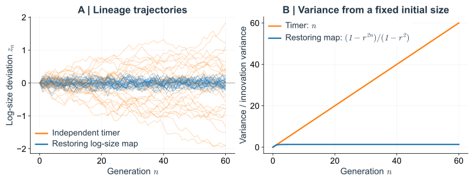
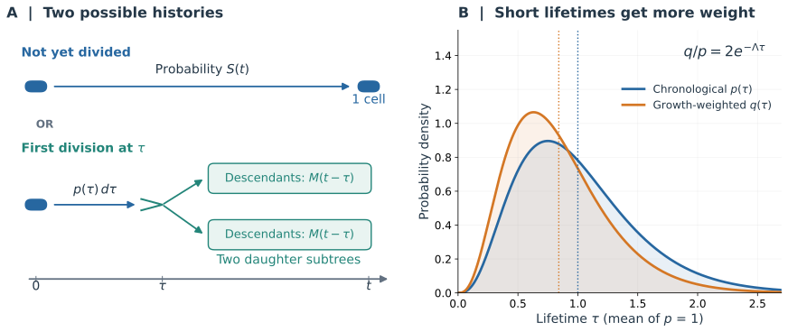

# 从单细胞分裂差异到群体增长
## 细胞大小稳态、分裂时间波动与代际相关性

> 西湖大学 2026 年秋季《定量生物学导论》课程学习笔记。

> **核心问题：** 单细胞的分裂波动能否转化为群体长期增长的差异？

<!-- Legacy heading anchors below preserve links to relocated sections. -->

## 概述 {#main-lecture}

在相同环境中，即使基因型相同，细胞也不会同时分裂：有些分裂间隔短，有些分裂间隔长。同时，cell size 虽然波动，却能够维持稳定的分布。单细胞追踪使这两类现象可以一起测量，也带来了一个预测问题：**知道单细胞分裂间隔时间的分布，是否足以推算群体的繁殖速度？**

最直接的估计是把沿 lineage 测得的平均分裂间隔时间当作群体倍增时间。但群体中各条 lineage 的后代数量并不相同，早分裂的祖先通常留下更多后代。[Hashimoto 等（2016）](https://doi.org/10.1073/pnas.1519412113)观察到，群体倍增时间可以短于平均分裂间隔时间；相关实验结果见正文第 2.1 节的[Fig. 4](#experimental-doubling-time-comparison)。这一观测说明，单细胞的平均分裂间隔不一定等于群体倍增时间，要联系这两个量，需要考虑不同 lineage 对群体增长的贡献。

另一个关键问题是：**一次提前分裂，能否变成持续许多代的时间领先？** 分裂得早，可能源于更快的生物量积累，也可能只是细胞在较小的时候就分裂。在后一种情况下，子细胞的 birth size 也会较小。如果细胞的分裂条件和 size 相关，那么 birth size 就会影响它下一次分裂所需的时间：较小的子细胞需要更长时间才能满足这些分裂条件。这样，母细胞提前分裂带来的时间领先，可能被子细胞较长的分裂间隔部分抵消。

这也是连续追踪比一张群体快照多出来的线索。快照能告诉我们细胞大小是否集中，却看不到偏小的细胞下一代是否会补回来；分裂时间的直方图能数出快慢各有多少，却会丢掉它们发生的顺序。下面的模型会逐步保留这些信息：先只记录一次分裂，再加入出生大小，最后把整段家系历史放进增长计算。每多保留一个变量，都要看它是否改变了原先的预测。

文中，**size homeostasis** 强调细胞能够纠正 size 偏差；**stationarity** 则指统计分布不随代数改变。文中还区分两个增长率：**群体增长率** $\Lambda=\lim\limits_{t\to\infty}t^{-1}\ln N(t)$（假定此极限存在），以及所有细胞共有的**单细胞 size growth rate** $\lambda$，满足 $\dot v=\lambda v$。**chronological lineage** 指每次分裂时以 $1/2$ 的概率选择一个子细胞，沿着这条 lineage 继续追踪，选择时不考虑它后来会有多少后代。**retrospective lineage** 则是在较晚时刻的群体中抽取一个细胞，再向前追溯其祖先。两种抽样方式通常会得到不同的统计结果。

希望解决如下几个问题：

1. **为什么单细胞的分裂时间存在显著波动，细胞大小的分布却能在世代之间保持稳定？**

2. **仅凭单细胞分裂时间的统计分布，能否预测整个细胞群体的长期增长率？ 群体倍增时间是否等于单细胞的平均分裂间隔？**

3. **一次提前分裂能否为一条细胞谱系（lineage）带来长期的繁殖优势？ 还是说，这种时间上的领先会被后续世代的分裂过程逐渐抵消？**

4. **如果两组细胞具有完全相同的单代分裂时间分布，但分裂时间的代际相关性不同，它们的长期群体增长率是否仍然相同？**

---

先把“分裂得早”放到群体里看：早分裂的细胞会更早留下后代，后来的快照也就更容易抽到这些后代。这个抽样偏向能让一个没有代际记忆的模型预测出增长加速。不过，同一批细胞还要遵守生物量的收支。将两种计算放在一起，才能看出独立分裂假设漏掉了什么。

## 1. 实验起点：分裂间隔有波动，size 却保持稳定 {#1-cell-size-homeostasis-and-the-failure-of-a-timer}

单细胞追踪不仅记录每次分裂的时间，也能记录 birth size、division size 以及两次分裂之间的生长轨迹。要理解这些测量，可以先考虑三种可能的理想化分裂规则：

- **Timer（定时分裂）：** 细胞出生后等待固定时间再分裂，分裂条件与 birth size 无关。
- **Adder（定增量分裂）：** 细胞从出生起增加固定的 size 后分裂。
- **Sizer（定 size 分裂）：** 细胞达到固定的 division size 后分裂。

这三种规则分别把分裂条件归于“经过多久”“增加多少”和“长到多大”。它们是比较细胞分裂行为的理想化模型；实际的分子调控可能更复杂。这里先不计算各规则的定量预测，而是关注一个贯穿全文的问题：**出生时偏大或偏小，会怎样改变下一次分裂的时间，又会给子细胞留下怎样的 size？**

birth size 偏离稳态均值时，后续几代细胞的平均 birth size 会逐渐向稳态均值靠近。同时，birth size 较大的细胞往往具有较短的分裂间隔，较小的细胞则往往需要更长时间才分裂。[Taheri-Araghi 等（2015）](https://doi.org/10.1016/j.cub.2014.12.009)的实验展示了如何用这些观测区分不同的分裂规则。

*Fig. 1. 实验中的 size control。* 引自 [Taheri-Araghi 等（2015）](https://doi.org/10.1016/j.cub.2014.12.009)的原文 Fig. 1。D 图显示，出生越大的细胞，分裂间隔时间越短，分裂时的 size 却越大。前一种趋势与 size 无关的 timer 不符，后一种趋势与固定阈值的 sizer 不符。A–C 图展示显微成像结果和培养条件。Adder 的实验检验将在第 3.1 节进一步介绍。

接下来先写出细胞生长与对称分裂的共同关系，再检验最简单的 timer 为什么无法纠正 size 偏差，最后比较三种规则如何影响 size 的代际继承。

### 1.1 指数生长、随机分裂与 size 稳定性 {#11-exponential-growth-and-symmetric-division}

先把两次分裂之间的生长单独拿出来。若细胞在相同时间内增加的体积大致正比于已有体积，那么较大的细胞每分钟增加得更多，但增加的比例相同。连续时间下，这就对应“变化率正比于当前大小”的方程。这里用一个共同的比例系数概括生物量积累，暂时不追踪营养、核糖体或代谢组分各自的变化；后面关于分裂时序的结论，都要放在这一生长条件下理解。

在某些细菌培养条件下，可以近似认为所有细胞都以相同的恒定速率 $\lambda>0$ 生长：

$$
\frac{dv}{dt}=\lambda v,\qquad v(t)=v_n e^{\lambda t}.
$$

如果细胞经过 $\tau_n$ 后分裂，两个子细胞各获得母细胞一半的体积，那么

$$
v_n^{\mathrm d}=v_n e^{\lambda\tau_n},\qquad
v_{n+1}=\frac12v_n e^{\lambda\tau_n}.\tag{1.1}
$$

这里，分裂规则决定 $\tau_n$；细胞如何生长、体积如何分配，则由上面的关系描述。在 birth size 相同、$\lambda$ 相同的条件下，提前分裂意味着 division size 更小，子细胞也更小。一次分裂的时序变化因此会改变下一代的初始状态。

考虑与 size 无关的定时分裂模型（timer），假设每个细胞的分裂时间都是独立同分布（i.i.d.）的正随机变量，均值为 $\mu$，方差为 $\sigma_\tau^2$。令 $y_n=\ln v_n$，对式（1.1）取对数并迭代，得到

$$
y_{n+1}-y_n=\lambda\tau_n-\ln2,\Rightarrow
y_n-y_0=\sum_{j=0}^{n-1}(\lambda\tau_j-\ln2).\tag{1.2}
$$

由于各代时间独立，均值和方差分别为

$$
\mathbb E[y_n-y_0]=n(\lambda\mu-\ln2),\qquad
\operatorname{Var}(y_n-y_0)=n\lambda^2\sigma_\tau^2.\tag{1.3}
$$

式（1.2）表明，log size 每代增加一个独立的随机量 $\lambda\tau_n-\ln2$，沿 lineage 形成 random walk。当 $\lambda\mu>\ln2$ 时，这个 random walk 平均向较大的 size 漂移；当 $\lambda\mu<\ln2$ 时，则平均向较小的 size 漂移。

若 $\mu=\ln2/\lambda$ ，每一步随机增量的均值为零，log size 成为无漂移的 random walk 。但只要 $\sigma_\tau^2>0$，这些随机增量就会不断累积：从固定的 initial size 出发，log size 的均值保持不变，方差随 $n$ 线性增长。因此，消除平均漂移仍不能维持稳定的 size distribution。

原因在于，timer 的分裂间隔不随 birth size 改变：细胞偏大或偏小时，都没有相应的调整来纠正偏差。即使去掉涨落，令分裂间隔固定为 $\ln2/\lambda$，也只能得到 $v_{n+1}=v_n$，每条 lineage 保持各自的 initial size；已有的 size 偏差不会缩小。要纠正这些偏差，分裂规则还需要随 birth size 作出相应调整。

可以比较两个刚出生的细胞，让一个比另一个大 10%。如果它们经历完全相同的生长时间，再各分成两半，下一代仍相差 10%。对称分裂虽然把绝对体积减半，却没有纠正相对偏差。随机 timer 还会在这种保留下来的偏差上继续叠加新的误差，所以把平均分裂时间调得恰好合适，也解决不了分布越来越宽的问题。

既然实验中偏差会逐代缩小，最简单的做法就是先描述平衡附近的恢复：这一代的偏差有多少被带到下一代？把一条平滑的继承规则在参考大小附近展开，一阶项给出已有偏差的保留比例，再用噪声描述每代新产生的变化。这样就得到下面的线性映射；它先概括可测的恢复行为，还没有指定负责恢复的分子机制。

这种恢复性反馈可以用一个简单的 log size 映射表示。令 $z_n=\ln v_n-\ln v_*$ 表示 log size 相对参考 size $v_*$ 的偏差，设

$$
z_{n+1}=rz_n+\xi_n,
$$

其中 $r$ 为偏差保留系数，$\xi_n$ 是均值为零、与当前偏差独立的随机噪声。**当 $|r|<1$ 且无噪声时，偏差的绝对值每代缩小为原来的 $|r|$ 倍。** 已有偏差会逐渐衰减，若噪声是独立同分布且方差有限，这种收缩可以使长期方差保持有限；而无漂移的 timer 对应 $r=1$，每代产生的偏差会一直保留并累积。

*Fig. 2. 随机游走与恢复性反馈下的 log size 动力学。* A：无漂移 timer（橙色）与偏差保留系数 $r=1/2$ 的线性 log size 反馈模型（蓝色）的模拟轨迹，两种模型使用相同的随机噪声。B：从固定 initial size 出发，log size 方差随代数的变化，以单步噪声方差归一化；timer 的方差为 $n$，反馈模型的方差为 $(1-r^{2n})/(1-r^2)$。

### 1.2 Timer、adder 与 sizer 的 size 继承 {#13-timer-adder-and-sizer}

现在回到本节开头介绍的三种规则。在相同的指数生长率和对称分裂条件下，可以比较它们如何把母细胞的 birth size 偏差传给子细胞：

| 规则 | 分裂条件 | 无噪声时，平衡附近的 birth size 如何变化 |
|---|---|---|
| 定时分裂（timer） | 等待固定时间，与 birth size 无关 | $v_{n+1}=v_n$：偏差保持不变，斜率为 $1$ |
| 定增量分裂（adder） | size 增加固定量 $\Delta$ | $v_{n+1}=(v_n+\Delta)/2$：偏差逐代缩小，斜率为 $1/2$ |
| 定 size 分裂（sizer） | 达到固定 division size $v_*$ | $v_{n+1}=v_*/2$：不再继承 size 偏差，斜率为 $0$ |

上表中的斜率表示，母细胞的 birth size 偏差有多少会传给子细胞：平衡的 timer 完整保留偏差，adder 保留一半，sizer 则消除偏差。因此，这些斜率描述了 size memory 在代际间的保留程度。

实际比较时，要把相近 birth size 的细胞放在一起，看它们平均增加多少、等多久、分裂时多大。只看整个群体的平均 added size，三种规则都可能给出相近的数值。真正有区分力的是这些量如何随出生大小改变。即使观察到 adder 关系，也还没有找到一个唯一的“增量计数器”：不同的内部调控过程可能产生相近的条件统计，分子解释需要另外的干预来筛选。

这些实验与模型说明，分裂间隔时间不能随意脱离 birth size 来指定。接下来暂时把 size feedback 放在一边，用独立分裂时间模型建立一个预测基准：为什么从单细胞平均时间出发，会低估这个模型中的群体繁殖速度？

---

## 2. 从单细胞统计预测群体增长：独立模型的基准 {#2-division-time-noise-and-the-population-growth-paradox}

考虑群体数量指数增长、且增长率近似恒定的情形。用连续近似描述细胞数量时，

$$
\frac{dN}{dt}=\Lambda N,
\qquad N(t)=N(0)e^{\Lambda t}.
$$

将群体倍增时间记为 $T_{\mathrm d}$，由 $N(t+T_{\mathrm d})=2N(t)$ 得到

$$
e^{\Lambda T_{\mathrm d}}=2
\quad\Rightarrow\quad
\Lambda=\frac{\ln2}{T_{\mathrm d}}.
$$

沿 chronological lineage 测得平均分裂间隔 $\mu$，若将它作为群体倍增时间，即 $T_{\mathrm d}\approx\mu$，得到估计 $\Lambda\approx\ln2/\mu$。但平均分裂间隔是单细胞统计量，它是否等于群体倍增时间，需要由具体的生长与分裂模型判断。

可以使用 branching model with i.i.d. interdivision times 说明这一估计为什么会遗漏群体中的后代数量差异：不同分裂间隔时间的 lineage，对后来群体的贡献不同。

### 2.1 Euler–Lotka 方程与群体抽样偏差 {#21-eulerlotka-and-sampling-bias}

考虑一个没有死亡的 binary branching model：每个新生细胞独立地从密度 $p(\tau)$ 中抽取一个分裂间隔时间，到时间后产生两个遵循相同规则的子细胞。设 $M(t)$ 为一个新生细胞在时刻 $t$ 的存活后代数的期望。

这里按日历时间记账。到观察时刻，初始细胞可能还没分裂；若它已经分裂，两个子细胞各自只拥有剩下的繁殖时间。之所以可以把后续过程重新写成同一个 $M$，是因为这个独立模型假定子细胞出生时重新抽取分裂时间，不需要继承母细胞的其他状态。按初始细胞首次分裂的时间分类，便得到更新方程：

$$
M(t)=\mathbb P(\tau>t)+2\int_0^t p(\tau)M(t-\tau)\,d\tau.\tag{2.1}
$$

为求出群体的长期增长率，采用指数增长作为试探解，假设长时间下 $M(t)$ 的主导项为 $Ae^{\Lambda t}$，并将其代入式（2.1）以确定候选增长率 $\Lambda$。这一假设在什么条件下成立的严格讨论，见[附录 A](#appendix-a)。具体地，将这一假设写成

$$
M(t)=Ae^{\Lambda t}[1+\varepsilon(t)],
\qquad A>0,\quad\Lambda>0,\quad\varepsilon(t)\to0.
$$

对任意固定的 $\tau$，当 $t\to\infty$ 时，$t-\tau$ 也趋于无穷，因此

$$
\frac{M(t-\tau)}{M(t)}
=e^{-\Lambda\tau}
\frac{1+\varepsilon(t-\tau)}{1+\varepsilon(t)}
\longrightarrow e^{-\Lambda\tau}.
$$

也就是说，首次分裂推迟 $\tau$，其后代就少了 $\tau$ 的繁殖时间，对应相对权重 $e^{-\Lambda\tau}$。下面将这个比值代入更新方程。先将式（2.1）两边除以 $M(t)$，得到

$$
1=\frac{\mathbb P(\tau>t)}{M(t)}
+2\int_0^t p(\tau)\frac{M(t-\tau)}{M(t)}\,d\tau.
$$

先处理第一项。由于 $M(t)\to\infty$，有

$$
0\le\frac{\mathbb P(\tau>t)}{M(t)}
\le\frac1{M(t)}\longrightarrow0.
$$

再处理积分项。这里不能只把比值的极限直接放进积分：积分上限 $t$ 也在变化。为把所有积分写在同一个区间 $[0,\infty)$ 上，定义

$$
f_t(\tau)=
\begin{cases}
p(\tau)\dfrac{M(t-\tau)}{M(t)},&0\le\tau\le t,\\
0,&\tau>t.
\end{cases}
$$

于是，原积分可以准确地改写为

$$
\int_0^t p(\tau)\frac{M(t-\tau)}{M(t)}\,d\tau
=\int_0^\infty f_t(\tau)\,d\tau.
$$

对每个固定的 $\tau$，只要 $t$ 足够大，就有 $\tau\le t$，故

$$
f_t(\tau)\longrightarrow p(\tau)e^{-\Lambda\tau}.
$$

还需要一个不随 $t$ 改变的可积上界。模型中没有死亡，细胞数只增不减，所以 $M(t-\tau)\le M(t)$。结合 $f_t$ 在 $\tau>t$ 时为零的定义，对所有 $\tau\ge0$ 都有

$$
0\le f_t(\tau)\le p(\tau),
\qquad \int_0^\infty p(\tau)\,d\tau=1<\infty.
$$

根据 dominated convergence theorem：当被积函数逐点收敛，且其绝对值始终由同一个可积函数控制时，可以交换极限与积分。这里的控制函数就是概率密度 $p(\tau)$，因此

$$
\begin{aligned}
\lim_{t\to\infty}
\int_0^t p(\tau)\frac{M(t-\tau)}{M(t)}\,d\tau
&=\lim_{t\to\infty}\int_0^\infty f_t(\tau)\,d\tau\\
&=\int_0^\infty\lim_{t\to\infty}f_t(\tau)\,d\tau\\
&=\int_0^\infty p(\tau)e^{-\Lambda\tau}\,d\tau.
\end{aligned}
$$

将两项的极限代回除以 $M(t)$ 后的更新方程，得到

$$
1=0+2\int_0^\infty p(\tau)e^{-\Lambda\tau}\,d\tau.
$$

右侧的积分就是对分裂间隔分布 $p$ 取期望。因此，候选增长率满足 **Euler–Lotka 方程（欧拉–洛特卡方程）**：

$$
\boxed{2\mathbb E_p[e^{-\Lambda\tau}]=1.}\tag{2.2}
$$

左侧随 $\Lambda$ 连续地从 $2$ 减小到 $0$，因此正根唯一。[附录 A](#appendix-a)用拉普拉斯变换推导该方程，并讨论更新方程解的渐近振幅与同步分裂的特殊情况。

这个根也可以从时间记账来理解：分裂给后代数带来两倍的增加，等待分裂却会损失一段繁殖时间。如果试探的增长率太低，时间折扣太轻，算出的两支后代贡献仍大于原来的一份；把增长率调高，晚出生的贡献便减小。两者恰好抵消时，才与所假定的长期指数增长相容。因此，方程是在用每次分裂的统计规律确定日历时间上的增长速度。

根据式（2.2），可以定义新的概率密度

$$
q(\tau)=2e^{-\Lambda\tau}p(\tau),\qquad \int_0^\infty q(\tau)\,d\tau=1.\tag{2.3}
$$

在上述独立模型的长期极限下，$q$ 对应以下抽样方式的概率：从当前存活的细胞中随机选取一个，查找它的母细胞，并记录母细胞从出生到分裂所经历的时间。重复这种抽样，所得分裂间隔的概率密度就是 $q(\tau)$。这里记录的是母细胞的分裂间隔，而不是当前被选中细胞的年龄。

$p$ 与 $q$ 描述的都是一个细胞从出生到分裂所需时间的分布，区别在于**如何选出这个细胞**。沿 chronological lineage 向前追踪、每次分裂随机选择一个子细胞，记录到的分裂间隔服从 $p$；先从后来的群体选取一个细胞，再回溯其母细胞，记录到的母细胞分裂间隔则服从 $q$。留下更多后代的祖先更容易通过后代被抽中，因此这种回溯抽样会提高较短分裂间隔的权重。

*Fig. 3. 分裂越早，留下的后代越多。* A 图展示式（2.1）中尚未分裂的细胞，以及分裂后两棵后代子树的贡献。B 图使用形状参数和速率参数均为 $4$ 的伽马分布，平均分裂间隔时间为 $1$，对应的 Euler–Lotka 增长率为 $4(2^{1/4}-1)$。按增长贡献加权后，祖先的分裂间隔时间分布向较短时间偏移。虚线标出两种分布的均值。

如果所有细胞的分裂间隔时间都固定为 $\mu$，群体增长率就是 $\ln2/\mu$。若分裂间隔时间有波动，但**沿 chronological lineage 测得的均值仍为同一个** $\mu<\infty$，利用凸性可得

$$
\frac12=\mathbb E_p[e^{-\Lambda\tau}]
\ge e^{-\Lambda\mathbb E_p[\tau]}=e^{-\Lambda\mu}.
$$

取对数，得到

$$
\boxed{\Lambda\ge\frac{\ln2}{\mu}.}\tag{2.4}
$$

只要独立的分裂间隔时间分布不是集中在一个值上，这个不等式就是严格的。在平均时间不变的条件下，早分裂的细胞对后续群体的贡献更大，而晚分裂造成的损失无法完全抵消这一收益。

这个模型甚至不需要有一群能够遗传的“快细胞”。一代抽到较短时间，它的子细胞下一代仍按同一个分布重新抽取。即便如此，事后从后代往回看，较早分裂的历史也会更常出现。群体中的统计偏向可以由繁殖过程本身产生，不能把回溯时看到的快分裂，直接解释为一项稳定遗传的细胞特征。

这个增长增量还可以用前面定义的 $p$ 与 $q$ 之间的差异来表示。Kullback–Leibler 散度（KL 散度，也称相对熵）衡量两个概率分布的差异。将式（2.3）的 $q(\tau)=2e^{-\Lambda\tau}p(\tau)$ 代入其定义，得到

$$
\begin{aligned}
D_{\mathrm{KL}}(p\|q)
&=\int_0^\infty p(\tau)\ln\frac{p(\tau)}{q(\tau)}\,d\tau\\
&=\int_0^\infty p(\tau)\ln\frac{p(\tau)}{2e^{-\Lambda\tau}p(\tau)}\,d\tau\\
&=\int_0^\infty p(\tau)(\Lambda\tau-\ln2)\,d\tau\\
&=\Lambda\mu-\ln2.
\end{aligned}
\tag{2.5}
$$

这里用到了 $\int_0^\infty p(\tau)\,d\tau=1$ 和 $\int_0^\infty\tau p(\tau)\,d\tau=\mu$。KL 散度非负，所以 $\Lambda\mu-\ln2\ge0$，再次得到式（2.4）。进一步整理可得

$$
\boxed{\Lambda-\frac{\ln2}{\mu}
=\frac{D_{\mathrm{KL}}(p\|q)}{\mu}.}
\tag{2.6}
$$

因此，在这个独立模型中，两种抽样方式得到的分裂间隔分布之间的 KL 散度，除以平均分裂间隔 $\mu$，就精确给出了群体增长率超过 $\ln2/\mu$ 的部分。相关分裂间隔需要改用多代时间的联合分布，其推广见[附录 H](03_lineage_correlations.md#appendix-h)。

这给了结果另一种实验含义：沿家系向前记录的时间分布，与从后代回溯得到的分布，差得越明显，独立模型中的增长加权也越明显。若两者能够分别测量，就可以把这项统计差异与直接从细胞总数测得的增长率对照。这里的 KL 散度描述的是观察者选取历史的方式造成的分布差异，并不要求细胞计算信息量，或根据这个量决定何时分裂。

对于弱噪声，若 $\Lambda\sigma_\tau\ll1$，且关于波动幅度的展开是正则的，高阶累积量在二阶近似中可以忽略，则有

$$
\Lambda\simeq\frac{\ln2}{\mu}
+\frac{(\ln2)^2}{2\mu^3}\sigma_\tau^2.\tag{2.7}
$$

弱噪声展开的推导见[附录 B](03_lineage_correlations.md#appendix-b)。[Hashimoto 等（2016）](https://doi.org/10.1073/pnas.1519412113)对平均分裂间隔时间与群体倍增时间的实验比较见 Fig. 4。式（2.4）比较的是平均分裂间隔相同的两个群体：一个具有独立的分裂时间波动，另一个具有固定的分裂间隔。这个比较尚未考虑 cell size 的增长与继承，因此不能直接说明，在固定 size growth rate 的条件下，分裂时间波动是否仍能提高群体增长率。

*Fig. 4. 实验中的平均分裂间隔时间与群体倍增时间。* 引自 [Hashimoto 等，*PNAS*（2016）](https://doi.org/10.1073/pnas.1519412113)的原文 Fig. 3。B 图比较平均分裂间隔时间与群体倍增时间；二者的比值大于一，表示群体倍增更快。C 图展示增长增益与分裂间隔时间变异的关系，E 图比较 Euler–Lotka 预测和测量结果。A、D 图分别展示分裂间隔时间分布和模型。原图未经修改；来源：[PMC](https://pmc.ncbi.nlm.nih.gov/articles/PMC4812751/#fig03)。

**符号说明。** 原文用 $\lambda=\ln2/\langle\tau\rangle_g$ 表示由平均分裂间隔计算的基准增长率；本笔记则用 $\lambda$ 表示 cell size 的指数增长率。阅读原图时，需要区分这两种含义。

### 2.2 数量增长与生物量增长的约束 {#23-the-conservation-constraint}

现在设想同时记录培养物的细胞总数和总体积。分裂发生的瞬间，前一个读数增加一个，后一个读数连续不变；两次分裂之间，总数不变，体积却还在增长。两条曲线记录了不同的过程。若许多代以后平均细胞大小仍在相同范围内，两条曲线的长期指数率就受到共同约束，这给了我们一个不依赖具体分裂规则的检查办法。

式（2.4）固定的是平均分裂间隔时间 $\mu$，并未固定 cell size 或生物量积累速度。为了区分提前分裂与更快生长，现在回到所有细胞都以同一个恒定速率 $\lambda$ 增长的情形。记 $v_i(t)$ 为细胞 $i$ 在时刻 $t$ 的体积，群体总体积为

$$
V_{\mathrm{tot}}(t)=\sum_{i\text{在 }t\text{ 时存活}}v_i(t).
$$

两次分裂之间，$\dot V_{\mathrm{tot}}=\lambda V_{\mathrm{tot}}$。分裂瞬间，两个子细胞的体积之和等于母细胞体积，因此总体积没有跳变。只要没有死亡、生物量损失，也不会在有限时间内发生无限次分裂（即分裂过程非爆炸），就有总体积为

$$
V_{\mathrm{tot}}(t)=V_{\mathrm{tot}}(0)e^{\lambda t}.\tag{2.8}
$$

分裂增加了细胞数量，却只是重新分配已有体积。把某一时刻群体中所有细胞的 mean size 记作 $\overline v_{\mathrm{snap}}(t)=V_{\mathrm{tot}}(t)/N(t)$，则严格有

$$
\frac{\ln N(t)}t=\lambda+
\frac{\ln V_{\mathrm{tot}}(0)-\ln\overline v_{\mathrm{snap}}(t)}t.
$$

因此，

$$
\boxed{\Lambda=\lambda\quad\text{若}\quad
\lim_{t\to\infty}\frac{\ln\overline v_{\mathrm{snap}}(t)}t=0.}\tag{2.9}
$$

**这里需要检查：在同一时刻，把所有存活细胞的体积取平均后，这个平均值是否以指数速度持续增大或减小。** 如果 $\overline v_{\mathrm{snap}}(t)$ 趋于某个有限的正数，那么 $\ln\overline v_{\mathrm{snap}}(t)$ 也趋于常数，除以 $t$ 后趋于零。它也可以一直波动；只要始终处于两个固定的正数之间，上述极限仍为零。由 $V_{\mathrm{tot}}(t)=N(t)\overline v_{\mathrm{snap}}(t)$，取对数并除以 $t$，有

$$
\frac{\ln V_{\mathrm{tot}}(t)}t
=\frac{\ln N(t)}t
+\frac{\ln\overline v_{\mathrm{snap}}(t)}t.
$$

总体积满足 $V_{\mathrm{tot}}(t)=V_{\mathrm{tot}}(0)e^{\lambda t}$，左侧趋于 $\lambda$。如果右侧最后一项趋于零，就有

$$
\lim_{t\to\infty}\frac{\ln N(t)}t
=\lim_{t\to\infty}\frac{\ln V_{\mathrm{tot}}(t)}t
=\lambda.
$$

按群体增长率 $\Lambda$ 的定义，得到 $\Lambda=\lambda$：细胞数量与总体积具有相同的长期指数增长率。

群体平均体积统计的是某一时刻所有存活细胞的当前体积，后代较多的 lineage 在其中占比更大。沿 chronological lineage 的测量则是在每次分裂时随机选择一个子细胞，逐代记录它的 birth size。因此，这两种测量得到的统计结果不能直接等同。即使沿 lineage 测得的 birth size 分布保持稳定，也还需要检查群体平均体积是否满足式（2.9）的条件。

这个关系说明，在固定 $\lambda$ 的条件下，若数量增长指数 $\Lambda>\lambda$，群体瞬时 mean size 就必须以指数速度减小。因此，第 2.1 节中“分裂间隔有波动时，群体增长率高于 $\ln2/\mu$”的结论，不能直接推广为“分裂时间波动也能使 size 保持稳定的群体增长得更快”。后者还需要考虑细胞如何生长，以及分裂规则如何影响子细胞的 birth size。

还可以把这个问题与沿 lineage 测得的平均分裂间隔联系起来。设 birth size 沿 chronological lineage 的分布具有 stationarity，且 $\mathbb E|\ln v_n|<\infty$，那么相邻两代的平均 log size 相同。对式（1.2）取期望，得到

$$
0=\mathbb E[\ln v_{n+1}]-\mathbb E[\ln v_n]
=\lambda\mathbb E[\tau_n]-\ln2
=\lambda\mu-\ln2,
$$

因此 $\mu=\ln2/\lambda$。这一步只用到了 size 的 stationarity、生长规律和对称分裂，并没有假设各代分裂间隔相互独立。

如果再把这个均值代入第 2.1 节的独立模型，只要分裂间隔有非零波动，就会得到

$$
\Lambda>\frac{\ln2}{\mu}=\lambda.
$$

但若群体平均体积也满足式（2.9）的条件，体积守恒又要求 $\Lambda=\lambda$。两种预测之所以不同，是因为我们额外加入了“各代分裂间隔独立”的假设。第 1 节已经表明：在固定 $\lambda$ 和对称分裂下，具有独立分裂时间波动的 timer 会使 log size 发生 random walk，无法同时维持稳定的 size distribution。

那么，size control 如何改变各代分裂间隔之间的关系？在 birth size 相同、$\lambda$ 固定的条件下，母细胞提前分裂会使子细胞的 birth size 更小。如果子细胞需要增加一定的 size 后才分裂，较小的 birth size 就会使它需要更长的生长时间。于是，母细胞较短的分裂间隔可能由子细胞较长的分裂间隔补偿。**size inheritance 与分裂规则由此把不同代的分裂间隔联系起来，产生代际 correlation。**

这也说明，只知道分裂间隔的均值和分布还不够：还需要知道一次较短的分裂间隔之后，更可能接着较短还是较长的分裂间隔。下一节用 adder 模型计算这种 correlation 如何产生，以及它如何改变多代累计时间的波动。

---

独立模型给出了一个清楚的比较基准：短分裂间隔在后代中被放大，因此只改变时间分布就可能改变数量增长。但若所有细胞以同一速率积累生物量，大小分布又保持稳定，数量增长就不能任意加快。接下来需要追踪的，正是一次提前分裂留给子细胞的出生大小。

更新方程、群体抽样与渐近振幅

## 技术附录 {#technical-appendices}

附录整理完整推导、可解模型和结论的适用条件。公式编号使用附录字母，图号接续正文。

### 附录 A. 更新理论、群体抽样与渐近振幅 {#appendix-a}

这里补充第 2 节所用的更新过程计算。首先得到的是群体数量期望的增长指数；要把它等同于典型实现中的增长指数，还需要 age-dependent branching process 通常采用的非爆炸、超临界等条件。

**A.1 用拉普拉斯变换推导**

对式（2.1）做拉普拉斯变换，可以求出群体增长率。

记 $S(t)=\mathbb P(\tau>t)$，并定义

$$
\widehat M(s)=\int_0^\infty e^{-st}M(t)\,dt,
\qquad
\widehat p(s)=\int_0^\infty e^{-s\tau}p(\tau)\,d\tau
             =\mathbb E[e^{-s\tau}],
$$

先取足够大的 $s$，使积分收敛。由于 $S(t)=\int_t^\infty p(\tau)\,d\tau$，其变换为 $\widehat S(s)=[1-\widehat p(s)]/s$。式（2.1）的卷积变为乘积，得到

$$
\widehat M(s)=\widehat S(s)+2\widehat p(s)\widehat M(s)
\quad\Rightarrow\quad
\widehat M(s)=\frac{1-\widehat p(s)}{s[1-2\widehat p(s)]}.
$$

分母在正值 $s=\Lambda$ 处为零，此时满足 **Euler–Lotka 方程**：

$$
\boxed{2\,\mathbb E[e^{-\Lambda\tau}]=1.}
$$

在正实轴上，$2\widehat p(s)$ 连续且严格地从 $2$ 减小到 $0$，所以这个根唯一。它是 $\widehat M(s)$ 的主导极点。因为 $1/(s-\Lambda)$ 是 $e^{\Lambda t}$ 的拉普拉斯变换，在这里假定的分裂间隔时间密度条件下，更新过程的渐近结果给出

$$
M(t)\sim Ae^{\Lambda t},
\qquad
\Lambda=\lim_{t\to\infty}\frac{\log M(t)}{t}.
$$

其中 $A=\lim_{t\to\infty}e^{-\Lambda t}M(t)>0$ 是从一个新生细胞出发时的渐近振幅；$\sim$ 表示 $M(t)/(Ae^{\Lambda t})\to1$。下面计算振幅，并说明同步分裂时需要怎样修正。

**A.2 更新方程的渐近振幅与格点分布例外**

第 2.1 节通过 $1-2\widehat p(s)=0$ 的正根 $\Lambda$ 得到群体增长指数。它右侧没有其他极点，因为

$$
|2\widehat p(s)|\le2\widehat p(\operatorname{Re}s)<1
\qquad\text{当 }\operatorname{Re}s>\Lambda.
$$

对于具有密度的分裂间隔时间分布，当 $\omega\ne0$ 时，$|2\widehat p(\Lambda+i\omega)|<1$ 也成立，所以同一条竖直线上没有其他极点。此外，

$$
-2\widehat p'(\Lambda)
=2\mathbb E_p[\tau e^{-\Lambda\tau}]
=\mathbb E_q[\tau]>0,
$$

因此这是一个简单极点。将附录 A.1 的拉普拉斯变换在该极点附近展开，得到

$$
\widehat M(s)=\frac{A}{s-\Lambda}+O(1),
\qquad
A=\frac{1-\widehat p(\Lambda)}{\Lambda[-2\widehat p'(\Lambda)]}.
\tag{A.1}
$$

利用 $\widehat p(\Lambda)=1/2$，留数变为

$$
\boxed{
A=\frac{1}{4\Lambda\,\mathbb E_p[\tau e^{-\Lambda\tau}]}
 =\frac{1}{2\Lambda\,\mathbb E_q[\tau]}.
}\tag{A.2}
$$

有密度的分裂间隔时间分布满足非格点条件，即时间取值不局限于某个固定步长的整数倍。相应的更新理论渐近结果给出 $e^{-\Lambda t}M(t)\to A$。这个振幅针对的是从一个新生细胞出发的群体，不必等于 $M(0)=1$，因为初始暂态并不由长期的指数渐近式描述。

固定分裂间隔时间是恒定渐近振幅的一个例外。如果所有细胞都在恰好经过 $\tau_0$ 后分裂，所有分裂事件就会同步发生，此时

$$
M(t)=2^{\lfloor t/\tau_0\rfloor},
\qquad
\Lambda=\frac{\ln2}{\tau_0}.
\tag{A.3}
$$

对数增长率仍趋于 $\Lambda$，但 $e^{-\Lambda t}M(t)$ 会周期性变化，而不会收敛到常数。因此，第 2.1 节所用的无噪声增长指数仍然有效；要使定义 $A$ 的更强极限成立，则需要非格点条件。

[本主题参考文献](03_lineage_correlations.md#references)。
