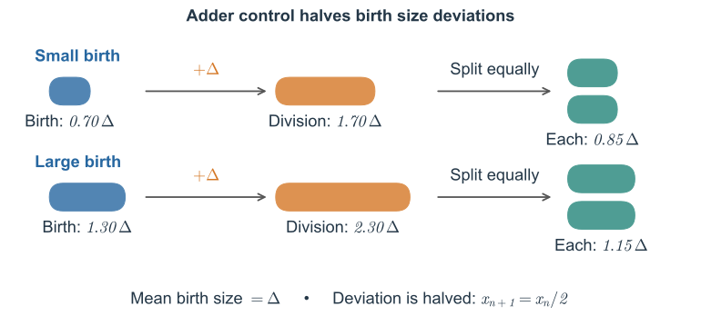
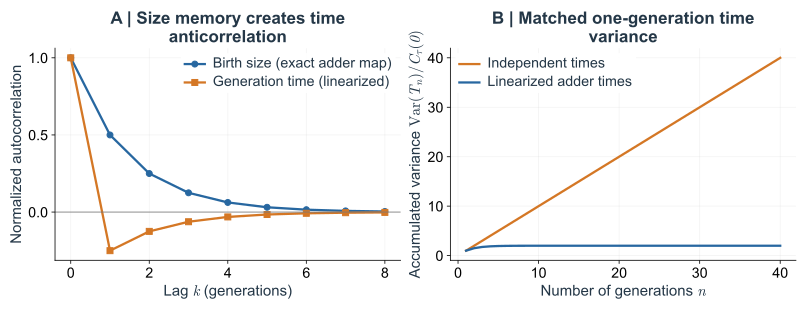

设想一个细胞比平常早分裂了一点。若这段提前来自较小的分裂大小，子细胞便从更小的体积起步。它要增加相同的 size，通常就需要等待更久。只看母细胞的一次分裂，会记下一项优势；沿着后代继续追踪，才能知道这项优势最后剩下多少。

Adder 提供了一个可以把这笔时间账算到底的模型。这里先推导大小偏差的恢复，再将每代分裂时间相加，最后用相关函数和频谱检查同一个补偿过程。

这里关心的领先是日历时间上的领先：两条谱系都完成同样多次分裂时，谁先到达。它不同于某个时刻哪条谱系暂时有更多细胞，也不同于哪一个细胞此刻更大。将比较的终点放在相同代数，才可以把一连串快慢间隔直接相加；随后再说明这种路径比较如何约束整个群体。否则，在中途挑一个快照，很容易把暂时多分裂了一次当成一直占优。

## 3. 一次提前分裂能否形成长期领先？size inheritance 与 adder {#3-size-feedback-the-adder-and-exact-cancellation}

现在追踪一次时序变化的后果。在 birth size 相同、生长率固定的条件下，某一代较早分裂会留下较小的子细胞；若下一代按增加固定 size 的规则分裂，较小的 birth size 就倾向于延长它的分裂间隔时间。Adder 提供了这种反馈的具体例子。我们先计算 size 偏差如何恢复，再问它是否能使多代累计时间偏离正常节奏。

### 3.1 Adder 中的 size 恢复与代际继承 {#31-the-stochastic-map-and-recovery-of-mean-size}

到这里，分裂间隔不再被当作一个可以任意抽取的输入。先给出生长规律，再规定分裂前需要增加多少体积，分裂时间就由这两件事共同决定。较小的细胞也要增加同样的量，却有较低的绝对体积增长速度，因而通常要等得更久。这个先后关系让 size control 自然进入了时间统计。

Adder 的分裂条件为

$$
v_n^{\mathrm d}=v_n+\Delta+\eta_n,\qquad
v_{n+1}=\frac12(v_n+\Delta+\eta_n).\tag{3.1}
$$

其中 $\eta_n$ 是独立同分布的 added size 波动，均值为零，方差 $\sigma_\eta^2$ 有限，且与继承的 size 独立。要求 $\Delta+\eta_n>0$，以保证增量和分裂间隔时间都为正。未经截断的高斯噪声只能作为小波动下的理想化近似。实验支持的是增量近似不依赖 birth size，不能单凭这一观察就认定噪声独立同分布。

*Fig. 5. Adder 模型的实验依据。* 引自 [Taheri-Araghi 等（2015）](https://doi.org/10.1016/j.cub.2014.12.009)的原文 Fig. 2。在各培养条件下，平均 added size 近似不依赖 birth size；重新缩放后，不同 birth size 对应的条件分布近似重合。A–C 图分别涉及大肠杆菌（*E. coli*）、枯草芽孢杆菌（*B. subtilis*）和 cell size 相关突变株。

增量噪声的放置位置决定了接下来的统计结果。这里把随机性放在分裂前增加的体积，而不是直接放在等待时间；相同的增量偏差落在大、小细胞上，会经过生长规律转成不同的时间偏差。若一个内部生理状态连续几代改变增量，它还会使增量噪声本身相关。因此，稳态继承关系与“每一代新噪声独立”的假设应分别检验，不能只因增量的平均值近似恒定，就把后一个假设也一并接受。

由式（3.1）的 $v_{n+1}=(v_n+\Delta+\eta_n)/2$，利用期望的线性性质，并代入 $\mathbb E[\eta_n]=0$，得到

$$
\begin{aligned}
\mathbb E[v_{n+1}]
&=\frac12\mathbb E[v_n+\Delta+\eta_n]\\
&=\frac12\bigl(\mathbb E[v_n]+\Delta+\mathbb E[\eta_n]\bigr)\\
&=\frac12\bigl(\mathbb E[v_n]+\Delta\bigr).
\end{aligned}
$$

两边减去 $\Delta$，就得到平均 birth size 相对 $\Delta$ 的偏差满足

$$
\mathbb E[v_{n+1}]-\Delta
=\frac12\bigl(\mathbb E[v_n]-\Delta\bigr).
$$

因此，每经过一代，均值与 $\Delta$ 的差就缩小为原来的一半。从第 $0$ 代开始迭代 $n$ 次，有

$$
\mathbb E[v_n]-\Delta
=\frac12\bigl(\mathbb E[v_{n-1}]-\Delta\bigr)
=\cdots
=2^{-n}(\mathbb E[v_0]-\Delta).\tag{3.2}
$$

*Fig. 6. Adder 中 birth size 偏差的逐代恢复。* 式（3.1）在无噪声条件下的示意：birth size 为 $0.70\Delta$ 和 $1.30\Delta$ 的细胞各增加 $\Delta$ 后对称分裂，子细胞的 birth size 分别为 $0.85\Delta$ 和 $1.15\Delta$，相对稳态值 $\Delta$ 的偏差均减半。

恢复并不要求细胞在一代内长到完全相同的终点。偏大的细胞增加同一个体积后，相对增幅较小；偏小的细胞相对增幅较大。再经过对称分配，原有差距就缩小一半。因此，观察到母、子细胞大小仍然正相关，与存在稳态恢复并不矛盾：偏差可以被部分继承，同时在后续几代逐渐消退。

均值恢复是对许多相同起点的重复过程而言的，不是对每个细胞下一代的保证。一个偏大的细胞仍可能遇到一次很大的新增量，生出更偏大的子细胞；另一个则可能一步越过均值。模型预测的是这些事件平均以后，初始偏差留下多少。将个别轨迹中的反向波动当成“没有大小控制”，与只看一条特别平滑的轨迹便断言噪声很小，同样都不可靠。

因此，稳态均值为 $\Delta$，mean size 的偏差每代减半。接下来计算稳态分布的方差。令 $x_n=v_n-\Delta$，式（3.1）变为

$$
x_{n+1}=\frac12x_n+\frac12\eta_n.
$$

新抽取的 $\eta_n$ 与已有偏差 $x_n$ 独立，所以交叉协方差为零：

$$
\begin{aligned}
\operatorname{Var}(x_{n+1})
&=\frac14\operatorname{Var}(x_n)
+\frac14\operatorname{Var}(\eta_n)
+\frac12\operatorname{Cov}(x_n,\eta_n)\\
&=\frac14\operatorname{Var}(x_n)+\frac14\sigma_\eta^2.
\end{aligned}
$$

在平稳状态下，相邻两代方差相同，记为 $\sigma_x^2$。于是

$$
\sigma_x^2=\frac14\sigma_x^2+\frac14\sigma_\eta^2
\quad\Rightarrow\quad
\sigma_x^2=\frac{\sigma_\eta^2}{3}.
$$

系数 $1/3$ 来自每代两种作用的平衡：已有 size 方差只保留四分之一，新 added size 噪声则经对称分配后补进四分之一。稳态分布保持宽度，允许每个细胞一直偏离均值。比较不同调控模型时，若只测这个宽度，很难分辨它来自较小的新噪声，还是较强的偏差恢复；再测扰动后的恢复过程和代际相关性，才能将这两种作用拆开。

再计算不同代之间的自相关。将偏差映射连续迭代 $k$ 次，得到

$$
x_{n+k}=2^{-k}x_n
+\sum_{j=0}^{k-1}2^{-(k-j)}\eta_{n+j}.
$$

求和中的后续噪声都与 $x_n$ 独立。因此，在平稳状态下，

$$
\begin{aligned}
\operatorname{Cov}(x_n,x_{n+k})
&=2^{-k}\operatorname{Var}(x_n)
+\sum_{j=0}^{k-1}2^{-(k-j)}\operatorname{Cov}(x_n,\eta_{n+j})\\
&=2^{-k}\sigma_x^2.
\end{aligned}
$$

这里用 $\operatorname{Corr}(X,Y)$ 表示两个随机变量的 Pearson 相关系数，定义为

$$
\operatorname{Corr}(X,Y)
=\frac{\operatorname{Cov}(X,Y)}
{\sqrt{\operatorname{Var}(X)\operatorname{Var}(Y)}}.
$$

当方差有限且非零时，该系数取值在 $[-1,1]$ 之间，正负分别表示正相关和负相关。比较同一过程相隔 $k$ 代的取值时，称为滞后 $k$ 的自相关系数。

在这里，平稳状态下 $x_n$ 与 $x_{n+k}$ 的标准差都为 $\sigma_x$，因此当噪声方差非零时，

$$
\operatorname{Corr}(x_n,x_{n+k})
=\frac{\operatorname{Cov}(x_n,x_{n+k})}{\sigma_x^2}
=2^{-k}.
$$

由于减去常数 $\Delta$ 不改变方差和相关系数，最终有

$$
\operatorname{Var}(v)=\frac{\sigma_\eta^2}{3},\qquad
\rho_v(k)\equiv\operatorname{Corr}(v_n,v_{n+k})=2^{-k},\quad k\ge0.\tag{3.3}
$$

例如，母细胞与子细胞的 birth size 相关系数为 $1/2$，相隔两代时为 $1/4$。这里噪声的强度决定分布有多宽，而偏差每代减半的反馈决定 size memory 消退得多快。恢复过程的实验比较见[附录 E](#appendix-e)。

### 3.2 从 size 变化到多代累计时间的抵消 {#32-from-growth-to-generation-time}

上一节说明了 birth size 的偏差如何传给后代，以及这些偏差在不同代之间的相关性。但群体增长取决于细胞何时分裂，因此还需要把 size 的变化转化为分裂间隔时间。这里先利用生长和分配关系，建立两者之间的联系。

第 $n$ 代细胞出生时的 size 为 $v_n$，经过 $\tau_n$ 时间的指数生长后，division size 为 $v_n^{\mathrm d}=v_ne^{\lambda\tau_n}$。对称分裂使子细胞继承其中一半，所以 $v_{n+1}=v_n^{\mathrm d}/2$。合起来得到

$$
v_ne^{\lambda\tau_n}=v_n^{\mathrm d}=2v_{n+1}.
$$

两边除以 $v_n$ 并取对数，得到 $\lambda\tau_n=\ln2+\ln v_{n+1}-\ln v_n$，即

$$
\boxed{\tau_n=\frac{\ln2}{\lambda}
+\frac{\ln v_{n+1}-\ln v_n}{\lambda}.}\tag{3.4}
$$

第一项 $\ln2/\lambda$ 是细胞在给定生长率下将体积增加到两倍所需的时间。如果母细胞与子细胞的 birth size 相同，即 $v_{n+1}=v_n$，母细胞就恰好在体积翻倍时分裂，分裂间隔等于这一基准时间。第二项表示实际分裂间隔相对这一基准的偏离。若 $v_{n+1}\gt v_n$，母细胞必须长到初始 size 的两倍以上，才能在分裂后留下更大的子细胞，因此 $\tau_n\gt\ln2/\lambda$；若 $v_{n+1}\lt v_n$，则母细胞在体积尚未翻倍时就分裂，$\tau_n\lt\ln2/\lambda$。因此，分裂间隔的快慢可以通过母、子细胞 birth size 的比值来表示。

对于前面的 adder，将式（3.1）代入，也可以写成

$$
\tau_n=\frac1\lambda
\ln\!\left(1+\frac{\Delta+\eta_n}{v_n}\right).
$$

这说明，在 added size 相同的条件下，birth size 越小，需要的生长时间越长，因为生长的 size 固定，但是生长速率和本身的 cell size 有关。即使每代的 added size 噪声 $\eta_n$ 独立，分裂间隔仍会受到继承的 $v_n$ 影响；分裂时间之间的 correlation 就需要结合这种继承关系来计算。

式（3.4）本身只需要 size 为正、所有细胞共有恒定的 $\lambda$，以及对称分裂，并不依赖 adder 的具体规则。它还给下面的计算提供了一个直接入口：$\tau_n$ 中包含相邻两代 log size 的差值，而下一代的分裂间隔中又会出现同一个 $\ln v_{n+1}$，但符号相反。因此，要判断某一代的时间领先能否持续，接下来应把多代分裂间隔加起来，检查这些 size 项如何相消。

把式（3.4）从 $0$ 到 $n-1$ 相加，得到

$$
\begin{aligned}
T_n&=\sum_{j=0}^{n-1}\tau_j\\
&=\frac{n\ln2}{\lambda}
+\frac1\lambda\big[(\ln v_1-\ln v_0)
 +(\ln v_2-\ln v_1)+\cdots+(\ln v_n-\ln v_{n-1})\big].
\end{aligned}
$$

每个中间时刻的 size 都以正负号各出现一次，最终只剩

$$
\boxed{T_n=\frac{n\ln2}{\lambda}
+\frac{\ln v_n-\ln v_0}{\lambda}.}\tag{3.5}
$$

*Fig. 7. 时间波动化为边界项。* 蓝色和紫色的 log size 项在相邻分裂间隔间抵消，只留下橙色的初始项和绿色的末尾项。这种抵消对每一个 $n$ 都严格成立。式（3.5）称为逐项相消恒等式（telescoping identity），也常称望远镜求和恒等式。

也可以反过来读这个等式。如果一条 lineage 每一代都比体积翻倍时间提前相近的一小段时间，而且这份领先始终不被偿还，那么经过许多代，它的末端 birth size 就必须越来越小。要让大小一直留在通常的范围内，累计领先就不能这样线性增长。这里的时间补偿来自生长和分配的约束，不需要细胞记住祖先曾经提前了几分钟，再主动安排一次延迟。

**单个分裂间隔时间有波动，并不意味着这些波动会经过许多代不断累积。** 如果各代时间独立，每一代都会给累计时间增加一份新的不确定性。而这里，同一个继承的 size 在相邻分裂间隔中以相反符号出现。反馈使起点和终点的 size 保持在平稳分布内，因此边界项的方差不会随分裂间隔数成比例增长。

更准确地说，设 $y_n=\ln v_n$ 是方差有限的平稳过程。由式（3.5）可得

$$
\operatorname{Var}(T_n)
=\frac{2\operatorname{Var}(y)-2\operatorname{Cov}(y_n,y_0)}{\lambda^2}
\le\frac{4\operatorname{Var}(y)}{\lambda^2}.\tag{3.6}
$$

所以 $D_\tau\equiv\lim_{n\to\infty}\operatorname{Var}(T_n)/n=0$。这个方差上界不需要混合性（mixing，即间隔足够远的状态逐渐失去统计依赖）。若两端的协方差趋于零，累计时间的方差就趋于 $2\operatorname{Var}(\ln v)/\lambda^2$。stationarity 加上有限的一阶对数矩，还能精确给出 $\mu=\ln2/\lambda$；遍历性则保证单条长记录的时间平均得到同样结果。注意，birth size 的方差有限，并不保证其对数的方差有限，问题可能出在接近 $v=0$ 的区域。

累计时间方差不再线性增长，也不意味着所有 lineage 会在同一时刻分裂。不同家系的起点和终点 size 仍然不同，分裂事件仍有时间差；受到抑制的是这份差异随代数不断扩大的部分。即使长期数量增长率相同，短时间内谁先分裂、家系间相差多少，以及大小分布的宽度，都还可以不同。

从端点看抵消，还能分清“消掉扰动”和“没有发生扰动”。如果中间某一代的增量偏大，它确实改变了那一代的分裂时间和后代的出生状态；只是这些改变在接下来的时间账中带着相反贡献出现。每代事件仍然不规则，细胞内部也仍在经历随机反应。没有累积下去的是某一类长期时序偏差，而不是所有可以测到的噪声。

这使端点控制成为一个很实际的检查。比较不同长度的谱系片段时，可以同时记录片段两端的大小与累计分裂时间；若时间差确实主要由端点状态解释，延长片段不会不断增加一份独立的残差。若残差还在持续增长，就该回头寻找共同生长率、对称分配或状态稳定性中哪一项不再适用，而不是立即修改单代时间的直方图。

进一步考察群体增长时，仅有上述方差上界还不够：增长计算会对累计时间较短的 lineage 历史赋予更大权重，还需要控制相应的指数权重。继续使用上面的逐项相消恒等式（3.5）。对任意 $s>0$（单位为时间的倒数），将等式两边乘以 $-s$ 后取指数，得到

$$
\begin{aligned}
e^{-sT_n}
&=\exp\!\left[-\frac{ns\ln2}{\lambda}
-\frac{s}{\lambda}(\ln v_n-\ln v_0)\right]\\
&=e^{-ns\ln2/\lambda}
\left(\frac{v_n}{v_0}\right)^{-s/\lambda}.
\end{aligned}
$$

再对不同 lineage 的随机分裂历史取期望，得到

$$
\mathbb E[e^{-sT_n}]
=e^{-ns\ln2/\lambda}
\mathbb E\left[\left(\frac{v_n}{v_0}\right)^{-s/\lambda}\right].\tag{3.7}
$$

式（3.7）右侧包含两部分：随代数 $n$ 指数衰减的因子，以及只涉及起点和终点 size 的期望。为了分辨它们对长期增长的贡献，先取对数，再除以 $n$：

$$
\frac1n\ln\mathbb E[e^{-sT_n}]
=-\frac{s\ln2}{\lambda}
+\frac1n\ln\mathbb E\!\left[
\left(\frac{v_n}{v_0}\right)^{-s/\lambda}\right].
$$

假设在 $s=\lambda$ 附近，最后一项随 $n\to\infty$ 趋于零，也就是

$$
\ln\mathbb E\!\left[
\left(\frac{v_n}{v_0}\right)^{-s/\lambda}\right]=o(n).
$$

这里 $o(n)$ 表示该量除以 $n$ 后趋于零。在这个条件下，端点 size 的随机性不会改变关于代数 $n$ 的指数率，因此

$$
\lim_{n\to\infty}\frac1n\ln\mathbb E[e^{-sT_n}]
=-\frac{s\ln2}{\lambda}.
$$

接下来把一条 lineage 的时间权重与整个 branching structure 联系起来。每次分裂产生两个子细胞，所以第 $n$ 代共有 $2^n$ 条从初始细胞出发的祖先路径。记第 $u$ 条路径到达第 $n$ 代出生时的累计时间为 $T_{n,u}$，并将所有路径的时间权重之和的期望记为 $Z_n(s)$。各条路径按相同规则产生，因此利用期望的线性性质，有

$$
Z_n(s)\equiv\mathbb E\!\left[
\sum_{u=1}^{2^n}e^{-sT_{n,u}}\right]
=2^n\mathbb E[e^{-sT_n}].
$$

这些路径可以共享祖先；上述求和并不要求路径之间相互独立。再次取对数并除以 $n$，得到

$$
\begin{aligned}
\lim_{n\to\infty}\frac1n\ln Z_n(s)
&=\ln2+\lim_{n\to\infty}\frac1n\ln\mathbb E[e^{-sT_n}]\\
&=\ln2-\frac{s\ln2}{\lambda}.
\end{aligned}
$$

右侧的 $\ln2$ 来自每代翻倍的路径数，$-s\ln2/\lambda$ 来自沿路径累积的时间权重。在第 4 节及[附录 C](03_lineage_correlations.md#appendix-c)给出的 branching process 条件下，群体增长率 $\Lambda$ 是使这一总权重的每代指数率为零的 $s$。因此令

$$
\ln2-\frac{\Lambda\ln2}{\lambda}=0,
$$

便得到 **$\Lambda=\lambda$**。端点条件 $o(n)$ 是否成立，以及这个加权路径条件能否确定群体增长率，是这里分别需要检查的两件事。

指数加权比普通方差更在意少数极端历史。一条很少见但持续提前的路径，在平均时间里可能几乎看不出来，在后代数量的计算中却可能得到很大权重。因此，累计时间方差有界给出了一个强烈的物理提示，却还没有替增长问题完成全部检验。下面控制端点的大、小尾部，正是为了排除这些罕见状态偷偷改变长期指数率的可能。

下面给出保证端点项为 $o(n)$ 的一组充分条件。这里考察的是**沿 chronological lineage 逐代记录的 birth size 序列 $v_0,v_1,\ldots$**：要求每代的 birth size 都为正，并且从一个具有 stationarity 的状态出发，使 $v_0$ 与任意 $v_n$ 具有相同的概率分布。这允许每条 lineage 的 birth size 逐代波动，也允许不同代之间存在 correlation；保持不变的是分布。

仅有这一分布不变的条件还不够，还需要控制极大或接近零的 birth size 对期望的贡献。用 $v$ 表示服从上述共同 birth size 分布的随机变量，进一步要求在 $s=\lambda$ 附近，$\mathbb E[v^{2s/\lambda}]$ 和 $\mathbb E[v^{-2s/\lambda}]$ 都有限。此时，Cauchy–Schwarz 不等式给出

$$
\mathbb E\!\left[\left(\frac{v_n}{v_0}\right)^{-s/\lambda}\right]
\le\sqrt{\mathbb E[v_n^{-2s/\lambda}]\,\mathbb E[v_0^{2s/\lambda}]}
=\sqrt{\mathbb E[v^{-2s/\lambda}]\,\mathbb E[v^{2s/\lambda}]}
\equiv C_s\lt\infty.
$$

由于两端的 log size 均值相同，Jensen 不等式还给出该期望的下界为 $1$（推导见[附录 G](#appendix-g)）。上下界都不随代数 $n$ 改变，因此

$$
0\le\frac1n\ln\mathbb E\!\left[
\left(\frac{v_n}{v_0}\right)^{-s/\lambda}\right]
\le\frac{\ln C_s}{n}\longrightarrow0.
$$

这就验证了所需的 $o(n)$ 条件。一个直观的例子是 birth size 始终处于固定区间 $0\lt v_{\min}\le v_n\le v_{\max}\lt\infty$，既不会无限增大，也不会无限接近零。上述条件是充分条件，不能仅由 adder 的 birth size 方差有限推出。

这个 lineage 解释与第 2.2 节对实际群体总体积的论证相互补充。两者都能给出精确的增长约束，但各自需要额外条件。Sizer 或其他维持 size homeostasis 的规则，也可以满足同样的逐项相消关系。真正属于 adder 的特定结果，是斜率 $1/2$、方差 $\sigma_\eta^2/3$ 和 birth size 的自相关函数（ACF）$2^{-k}$，而不是恒等式（3.5）本身。

### 3.3 size 正相关与分裂时间负相关 {#34-positive-size-memory-negative-timing-memory}

由第 3.1 节可知，birth size 的偏差具有正协方差 $C_x(k)=\sigma_x^2 2^{-|k|}$。分裂间隔却取决于相邻两代 size 的差值。当相对 size 波动很小时，

$$
\ln(\Delta+x_n)\simeq\ln\Delta+\frac{x_n}{\Delta}.
$$

代入式（3.4），得到

$$
\delta\tau_n\equiv\tau_n-\frac{\ln2}{\lambda}
\simeq\frac{x_{n+1}-x_n}{\lambda\Delta}.
$$

因此，要计算分裂间隔的自相关，需要先计算 size 差值的协方差。在零滞后处，

$$
\begin{aligned}
C_\tau(0)
&\simeq\frac{\operatorname{Var}(x_{n+1}-x_n)}{(\lambda\Delta)^2}\\
&=\frac{2C_x(0)-2C_x(1)}{(\lambda\Delta)^2}
=\frac{\sigma_x^2}{(\lambda\Delta)^2}.
\end{aligned}
$$

对于 $k\ge1$，将两个差值的协方差展开为四项：

$$
\begin{aligned}
C_\tau(k)
&\simeq\frac{\operatorname{Cov}(x_{n+1}-x_n,\,x_{n+k+1}-x_{n+k})}{(\lambda\Delta)^2}\\
&=\frac{C_x(k)-C_x(k-1)-C_x(k+1)+C_x(k)}{(\lambda\Delta)^2}\\
&=\frac{\sigma_x^2\bigl[2\cdot2^{-k}-2^{-(k-1)}-2^{-(k+1)}\bigr]}{(\lambda\Delta)^2}\\
&=-\frac{\sigma_x^2\,2^{-(k+1)}}{(\lambda\Delta)^2}.
\end{aligned}
$$

再除以单代方差 $C_\tau(0)$，就得到

$$
\boxed{\rho_\tau(k)=\frac{C_\tau(k)}{C_\tau(0)}
\simeq-2^{-(k+1)},\qquad k\ge1.}\tag{3.8}
$$

例如，相邻两代的分裂间隔相关系数约为 $-1/4$，相隔两代时约为 $-1/8$。

在线性化的 adder 中，birth size 保持正相关，分裂间隔时间却呈负相关。某一代耗时较长，通常会产生较大的子细胞；这个子细胞要再增加同样的 size，就只需要较短时间。这个解释针对的是上述模型。分裂间隔时间的负自相关公式是近似结果，而逐项相消关系是精确的。

分裂时间的负相关还需要排除一种测量上的来源：相邻两个间隔共享中间那次分裂时刻。若这个时刻被标晚了，前一个间隔会被记长，后一个则被记短，即使真实间隔没有补偿，也会出现相反变化。将分裂时刻的识别误差与大小、连续生长轨迹放在一起检查，比只看母子时间的一个相关系数更有说服力。模型同时给出大小继承、时间相关和端点关系，正好让这些相互独立的观测形成交叉检验。

*Fig. 8. 每次分裂有噪声，长期累计时间噪声却可以为零。* A 图比较 adder 精确的 birth size 相关性与式（3.8）中线性化的分裂间隔时间相关性。在单代时间方差相同的条件下，B 图显示：独立时间模型满足 $\operatorname{Var}(T_n)/C_\tau(0)=n$，线性化的平稳 adder 则满足 $2(1-2^{-n})$。一般反馈系数下的协方差计算与抵消验证见[附录 E](#appendix-e)。

---

在共同生长率与稳态大小等条件下，多代累计时间的随机部分只取决于谱系两端的大小，单代波动没有逐代累积起来。大小的正相关与分裂时间的负相关因而可以同时存在。这个结果也给下一篇留下了一个更一般的问题：不依赖 adder 的具体形式，怎样从一整段谱系统计判断长期增长？

一般大小反馈、零频抵消与适用条件

### 附录 E. Size 恢复实验与一般线性反馈的协方差抵消 {#appendix-e}

对于第 3 节中 added size 独立同分布的模型，以 $\Delta$ 为中心定义 $v_n$ 的偏差，写成

$$
x_{n+1}=r x_n+\xi_n,\qquad r=1/2,\quad\xi_n=\eta_n/2.\tag{E.1}
$$

**E.1 size 恢复与实验比较**

第 3.1 节已推导 adder 的稳态方差和 birth size 自相关。这里将其与恢复实验联系起来。模型预测

$$
\rho_v(1)=\frac12,
\qquad
\rho_v(2)=\frac14.
$$

这些数值与 [Ho 实验室资料](https://ho.lab.westlake.edu.cn/teaching_en.html)第 5 页列出的相关性 $\approx0.49$ 和 $\approx0.24$ 很接近（该资料引用 Ho 等，*Annual Review of Biophysics*，2018）。

关键不只是数值吻合，而是确定性的恢复系数决定了相关函数如何衰减。噪声决定方差，反馈决定记忆持续的时间。

*Fig. 13. birth size 向稳态值恢复的实验观察。* 引自 [Taheri-Araghi 等（2015）](https://doi.org/10.1016/j.cub.2014.12.009)的原文 Fig. 3。A 图给出固定增量下的收敛预测，B、C 图分别与大肠杆菌和枯草芽孢杆菌的实验比较，展示式（E.1）的恢复系数。条件均值的恢复与稳态自相关函数（3.3）彼此相关，但它们是不同的测量量。

**E.2 一般线性反馈下的分裂间隔时间协方差**

第 3.3 节已计算 $r=1/2$ 的 adder。这里保留一般反馈系数 $0<r<1$，并沿用小波动近似

$$
\delta\tau_n\simeq\frac{x_{n+1}-x_n}{\lambda\Delta}.
\tag{E.2}
$$

对一般的平稳 AR(1) 过程，

$$
C_x(k)=\sigma_x^2 r^{|k|},\qquad 0\lt r\lt 1,
$$

可以显式计算差分的协方差。在零滞后处，

$$
\begin{aligned}
C_{\delta\tau}(0)
&\simeq\frac1{(\lambda\Delta)^2}
\mathbb E[(x_{n+1}-x_n)^2]\\
&=\frac{2\sigma_x^2(1-r)}{(\lambda\Delta)^2}.
\end{aligned}
\tag{E.3}
$$

对于 $k\ge1$，

$$
\begin{aligned}
C_{\delta\tau}(k)
&\simeq\frac1{(\lambda\Delta)^2}
\operatorname{Cov}(x_{n+1}-x_n,\,x_{n+k+1}-x_{n+k})\\
&=\frac{2C_x(k)-C_x(k-1)-C_x(k+1)}{(\lambda\Delta)^2}\\
&=-\frac{\sigma_x^2(1-r)^2 r^{k-1}}{(\lambda\Delta)^2}.
\end{aligned}
\tag{E.4}
$$

除以式（E.3），得到

$$
\rho_\tau(k)
\simeq-\frac{1-r}{2}r^{k-1},
\qquad k\ge1.
\tag{E.5}
$$

取 $r=1/2$ 即回到正文式（3.8）的负自相关结果。

**E.3 显式验证抵消关系**

利用式（E.3）–（E.4），

$$
\begin{aligned}
D_\tau
&\simeq C_{\delta\tau}(0)+2\sum_{k=1}^\infty C_{\delta\tau}(k)\\
&=\frac{2\sigma_x^2(1-r)}{(\lambda\Delta)^2}
-\frac{2\sigma_x^2(1-r)^2}{(\lambda\Delta)^2}
\sum_{k=1}^\infty r^{k-1}\\
&=\frac{2\sigma_x^2(1-r)}{(\lambda\Delta)^2}
-\frac{2\sigma_x^2(1-r)}{(\lambda\Delta)^2}\\
&=0.
\end{aligned}
\tag{E.6}
$$

所有非零滞后的负协方差之和，恰好抵消正的单代方差。式（3.5）进一步说明，在累计时间层面，这个抵消其实是精确的；即使式（E.2）所用的小噪声近似不再适用，逐项相消关系仍成立。

> **size homeostasis 的动力学约束：** size homeostasis 不只是 size distribution 比较窄，它还约束整段 lineage 历史的动力学。在恒定指数生长和对称分裂下，这一约束消除了累计分裂间隔时间波动中随分裂间隔数成比例增长的部分。

### 附录 F. 频谱表示与零频噪声抵消 {#appendix-f}

本附录补充正文第 4.2 节的频域推导：先建立协方差与功率谱的关系，再计算线性反馈模型的 size 频谱，最后说明 size 的差分如何消除分裂间隔时间的零频噪声。频率以分裂间隔数为基准。

沿用第 3.1 节及附录 E 的线性反馈形式，令 $x_n$ 为 birth size 相对稳态均值的偏差：

$$
x_{n+1}=r x_n+\xi_n.
\tag{F.1}
$$

以下假设 $|r|<1$，噪声 $\xi_n$ 独立同分布、均值为零、方差为 $\sigma_\xi^2<\infty$，并在平稳状态下计算频谱。Adder 对应 $r=1/2$；adder 的稳态方差和自相关推导见[第 3.1 节](#31-the-stochastic-map-and-recovery-of-mean-size)。

**F.1 自协方差与 Wiener–Khinchin 关系**

对平稳离散时间过程 $y_n$，定义

$$
C_y(k)=\mathbb E[(y_n-\bar y)(y_{n+k}-\bar y)].
$$

其双边功率谱密度为

$$
S_y(\omega)=\sum_{k=-\infty}^{\infty}
C_y(k)e^{-i\omega k},
\qquad -\pi\le\omega\le\pi.
\tag{F.2}
$$

逆变换关系为

$$
C_y(k)=\frac1{2\pi}\int_{-\pi}^{\pi}
S_y(\omega)e^{i\omega k}\,d\omega.
\tag{F.3}
$$

这就是离散时间的 Wiener–Khinchin 关系（维纳–辛钦关系）：自协方差与功率谱密度互为傅里叶变换。这里 $\omega$ 是**以分裂间隔数为基准**的角频率。比较按分裂间隔编号的 lineage 记录与按实际时间间隔采样的测量时，必须注意这一点。

在零频处，

$$
S_\tau(0)=\sum_{k=-\infty}^{\infty}C_\tau(k)
=C_\tau(0)+2\sum_{k=1}^\infty C_\tau(k).
$$

因此，只要协方差级数收敛，就有

$$
S_\tau(0)=D_\tau.
$$

式（4.4）便可写成频谱形式：

$$
\Lambda\simeq
\frac{\ln2}{\mu}
+\frac{(\ln2)^2}{2\mu^3}S_\tau(0).
$$

**频域中的增长修正：** 在二阶近似下，长期群体增长由*分裂间隔时间噪声的零频分量*决定；完整功率谱还可以告诉我们，系统是否存在特征性的动力学时间尺度。

**F.2 AR(1) size control 模型的频谱**

迭代式（F.1），在平稳状态下得到

$$
x_n=\sum_{j=0}^\infty r^j\xi_{n-1-j}.
\tag{F.4}
$$

这相当于对白噪声进行线性滤波。在频域中，包含一代延迟的传递函数为

$$
H(\omega)=\frac{e^{-i\omega}}{1-re^{-i\omega}},
$$

因此

$$
\begin{aligned}
S_x(\omega)
&=\sigma_\xi^2|H(\omega)|^2\\
&=\frac{\sigma_\xi^2}
{1+r^2-2r\cos\omega}.
\end{aligned}
\tag{F.5}
$$

对于 adder，$r=1/2$。size 频谱在 $\omega=0$ 附近最大，随后向 $\pi$ 平滑下降，不存在内禀的*非零频率*振荡共振。

这对应于单调、正值的自相关：

$$
C_x(k)=\sigma_x^2(1/2)^{|k|}.
$$

**F.3 分裂间隔时间的频谱：差分滤掉零频噪声**

由式（E.2），

$$
\delta\tau_n\simeq\frac{x_{n+1}-x_n}{\lambda\Delta}.
$$

作差会使傅里叶模态 $e^{i\omega n}$ 乘以 $e^{i\omega}-1$，所以

$$
\begin{aligned}
S_\tau(\omega)
&\simeq\frac{|e^{i\omega}-1|^2}{(\lambda\Delta)^2}S_x(\omega)\\
&=\boxed{
\frac{4\sin^2(\omega/2)}{(\lambda\Delta)^2}S_x(\omega).
}
\end{aligned}
\tag{F.6}
$$

在零频处，分子为零：

$$
S_\tau(0)=0.\tag{F.7}
$$

同一个结果，已经在式（3.5）的逐项相消和式（E.6）的协方差抵消中出现过。这是**同一个物理机制**的三种数学描述。

要注意，即使原本的 size 过程没有振荡模态，差分也可能使高频波动更突出。因此，奈奎斯特频率 $\omega=\pi$ 附近的谱值较大，本身不足以证明存在生物振荡器。这里的奈奎斯特频率对应离散采样能分辨的最高频率。

### 附录 G. 精确抵消的适用范围与充分的渐近条件 {#appendix-g}

**G.1 恒等式、矩条件与增长结论是三个层次**

只要 size 为正、细胞共有恒定的指数增长率、分裂对称，恒等式（3.5）就对每个有限的 $n$ 成立。即使 size 过程不平稳，它也成立：size homeostasis 的作用是限制端点项，而不是让求和能够逐项相消。在平稳过程中，$\mathbb E|\ln v|$ 有限可确定平均时间；$\operatorname{Var}(\ln v)$ 有限可保证 $\operatorname{Var}(T_n)$ 有界，并给出 $D_\tau=0$。混合性进一步给出第 3.2 节的方差极限。但这些矩条件都不能单独控制式（3.7）的指数倾斜，也就是按指数因子对概率重新加权。

对平稳的正 size 过程，令 $q=s/\lambda>0$。控制该指数加权的一个实用充分条件是

$$
1\le\mathbb E[(v_n/v_0)^{-q}]
\le\big(\mathbb E[v^{2q}]\mathbb E[v^{-2q}]\big)^{1/2}<\infty.\tag{G.1}
$$

下界来自 Jensen 不等式和 $\mathbb E[\ln v_n-\ln v_0]=0$；上界来自 Cauchy–Schwarz 不等式，不需要两端独立。这些矩条件也保证对数可积，而且上下界对所有 $n$ 都成立。因此，$\lim_n n^{-1}\ln\mathbb E[(v_n/v_0)^{-q}]=0$。若这些条件对 $\lambda$ 邻域内的 $s$ 都成立，出生时间权重的期望在该邻域内就具有指数率 $\ln2-s\ln2/\lambda$，并在附录 C 的条件下选出增长率 $\lambda$。固定 initial size 也可用相应的端点一致界处理，但不能仅凭平稳边缘分布的假设就覆盖这一情形。

如果 adder 的 added size 有上界，且与零保持一定距离，就能构造一个满足全部这些矩条件的简单平稳过程。只要求增量为正、增量方差有限，并不自动保证负阶矩有限，也不保证群体瞬时 mean size 的条件成立。另一条守恒证明使用 $t^{-1}\ln\overline v_{\mathrm{snap}}(t)\to0$，直接适用于一次实际群体演化。不能把 chronological lineage 的 stationarity 和群体瞬时 size 的稳态条件当成同一件事。

**G.2 在给定生长与分配条件下的普适性**

式（3.4）只用到了

$$
v_n^{\mathrm d}=v_n e^{\lambda\tau_n},
\qquad
v_{n+1}=\frac12v_n^{\mathrm d}.
$$

推导没有用到 division size 调控规则的具体函数形式。因此，任何满足这两个关系的平稳正 size 过程都满足式（3.5）。Sizer、adder 或其他反馈规则，只要能提供足够的 size homeostasis，都可能出现同样的抵消。

如果分裂不对称，所追踪的子细胞获得母 cell size 的比例为 $f_n$，那么

$$
v_{n+1}=f_n v_ne^{\lambda\tau_n},
$$

于是

$$
\tau_n=\frac{-\ln f_n+\ln v_{n+1}-\ln v_n}{\lambda}.
$$

累计时间变为

$$
T_n=\frac1\lambda\sum_{j=0}^{n-1}(-\ln f_j)
+\frac{\ln v_n-\ln v_0}{\lambda}.
\tag{G.2}
$$

当分配比例有波动时，第一项就不再是确定性的。因此，在随机不对称分裂下，不能仅由 size homeostasis 推出 $D_\tau=0$。不过，只要每次分裂都保持总 size 守恒，且群体瞬时 mean size 保持平稳，群体层面的质量守恒仍给出 $\Lambda=\lambda$。此时，正确的 lineage 增长计算必须考虑子细胞分配比例，以及抽样时采用的权重。

单细胞生长率有波动时也需要注意。若第 $n$ 代中满足

$$
\dot v=\lambda_n v
$$

则

$$
\tau_n=\frac{\ln2+\ln v_{n+1}-\ln v_n}{\lambda_n},
$$

此时求和各项没有统一的前因子，因而不能再按原来的方式逐项相消。生长率波动由此可能带来新的增长与调控效应。

## 补充推导与阅读 {#problems-further-reading}

**1. 如何消除 size memory？**

对于 $x_{n+1}=rx_n+\xi_n$，size memory 可以用条件期望 $\mathbb E[x_{n+k}\mid x_n]$、稳态方差和自相关函数描述。反馈系数 $r$ 决定偏差如何衰减；$r\lt 0$ 时，偏差还会交替变号。

**结果：** $\mathbb E[x_{n+k}\mid x_n]=r^kx_n$，$\operatorname{Var}(x)=\sigma_\xi^2/(1-r^2)$，$\rho(k)=r^{|k|}$。对于方差有限且非零的独立噪声，要有有限稳态方差，需满足 $|r|\lt 1$。负的 $r$ 会使相关性的符号交替。

**3. 每代时间有噪声，长期噪声还能为零吗？**

对于具有混合性、且 $\operatorname{Var}(\ln v)$ 有限的平稳 size 过程，式（3.5）保证 $n\to\infty$ 时 $\operatorname{Var}(T_n)$ 仍然有界，而不要求每个 $\tau_n$ 都是确定性的。

**结果：** $T_n-n\ln2/\lambda=(\ln v_n-\ln v_0)/\lambda$。如果两端逐渐失去相关性，其方差趋于 $2\operatorname{Var}(\ln v)/\lambda^2$。每个分裂间隔时间仍有噪声，但跨分裂间隔协方差的总和抵消了方差的累积。

**4. 自相关函数与功率谱密度**

AR(1) 频谱也可以直接从自协方差函数求出。结合式（F.6），可以看出分裂间隔时间频谱在 $\omega=0$ 处为零的原因。

**结果：** 对几何级数求和，$\sum_{k=-\infty}^{\infty}r^{|k|}e^{-i\omega k}=(1-r^2)/(1+r^2-2r\cos\omega)$，再乘以 $\sigma_x^2=\sigma_\xi^2/(1-r^2)$。差分使每个傅里叶分量乘以 $e^{i\omega}-1$，该因子在零频处为零。

[本主题参考文献](03_lineage_correlations.md#references)。
