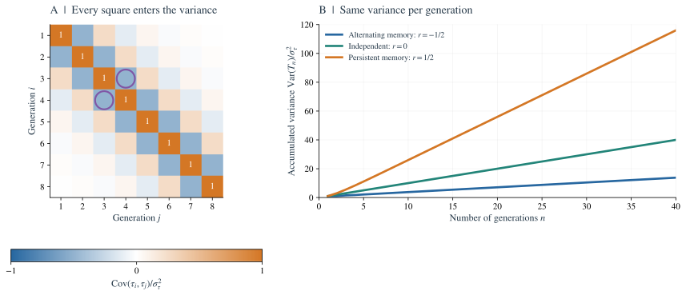
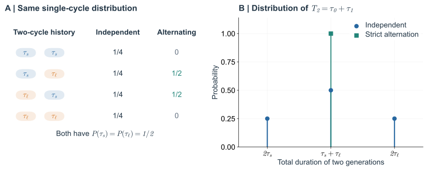
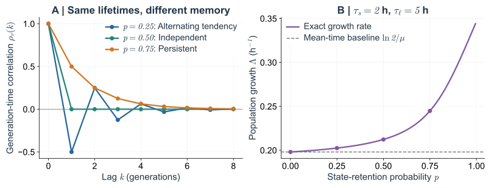
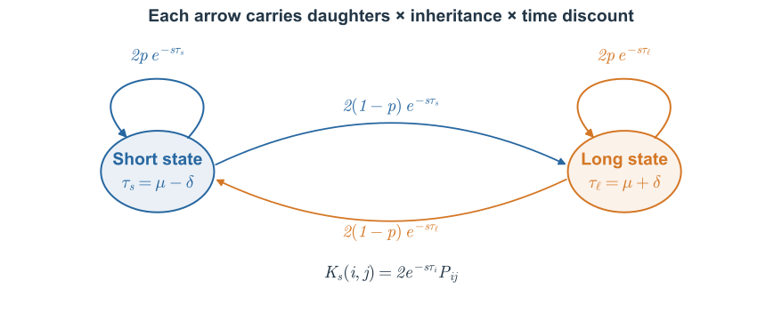

把同样一组快、慢分裂间隔重新排序，直方图完全不变，但连续快几代的家系可能变多。这样的家系在后来的群体中会留下更多后代。要预测增长，就需要给整段历史加权，而不能只给某一次分裂加权。

下面把时间相关性写进增长关系，再回到大小稳态的特殊情形。两状态模型用来检验：保持单代分布不变时，单独改变历史的排列究竟会造成什么后果。

“顺序”在这里有明确的繁殖后果。同样是连续两次短周期，若它们出现在同一个祖先和后代上，第二次分裂已经站在第一次提前留下的时间基础上；若短周期分别出现在两条互不相接的谱系上，就没有这一条路径上的连续提前。单细胞列表虽然包含同样多的快慢记录，繁殖树却把它们组织成了不同的历史。后面的计算保留的正是这种连接关系。

## 4. 预测群体增长需要哪些 lineage 统计量？ {#4-temporal-correlations-and-long-time-fluctuations}

Adder 表明，一张单代分裂间隔时间直方图并不告诉我们，较快的一代之后会继续较快，还是会被较慢的一代补偿。要预测群体增长，需要考虑同一条 lineage 上多个分裂间隔的联合分布。如果时间波动足够小，且高阶项可以忽略，就能用单代方差和不同代之间的协方差近似计算增长率。本节先给出包含多代分裂间隔的增长方程，再推导这个近似。

### 4.1 将整段 lineage 历史纳入增长方程 {#41-correlated-eulerlotka}

独立模型能把每一代分开加权，是因为当前抽到多长时间，不会改变下一代的抽取。加入 size inheritance 后，同一个短间隔可能意味着下一代从更小的体积开始，分开的权重便失去了这层联系。一个直接的修正是先保留整段路径，到第 $n$ 代出生时再统一计算它用了多久。路径数仍由二叉分裂决定，改变的是这些路径在日历时间上怎样展开。

设 $T_n$ 是沿 chronological lineage 到达第 $n$ 代出生时的累计时间。二叉繁殖产生 $2^n$ 条路径。即使这些路径共享祖先，按出生时间加权后，权重之和的期望仍为 $2^n\mathbb E_{\mathrm{chron}}[e^{-sT_n}]$。定义

$$
\psi(s)=\lim_{n\to\infty}\frac1n\ln\mathbb E_{\mathrm{chron}}[e^{-sT_n}].
$$

假定 branching process 的规则由局部状态决定、过程非爆炸、任意有限时间区间内的出生数期望有限，且极限 $\psi$ 存在；同时，增长指数由加权出生数级数的收敛边界确定。那么

$$
\boxed{\ln2+\psi(\Lambda)=0.}\tag{4.1}
$$

仅有 lineage 统计的 stationarity 和遍历性还不够：上面的极限必须存在，而且它确实要与群体增长指数相联系。共同随机环境或非遍历的混合过程，都可能使期望增长率与典型实现中的增长率不同。[附录 C](#appendix-c)给出多对一恒等式的推导和具体收敛论证，[附录 D](#appendix-d)提供完整的有限状态马尔可夫模型例子。

写下路径期望以后，还不能将实验中碰到的一条谱系当作所有可能历史的等价替身。如果一个生理状态的持续时间已经接近整段观测长度，单条记录可能几乎始终停在某一种状态；几条不同谱系的平均与一条谱系的长时间平均，也未必已经接近。增长关系中的极限是在模型条件下定义的，实验能否接近它，要由状态切换和记录长度的比较来判断。

独立时，$\mathbb E[e^{-sT_n}]=(\mathbb E[e^{-s\tau}])^n$，于是回到式（2.2）。相关性改变的则是整段历史的权重。对 $T_n$ 使用 Jensen 不等式，仍可得 $\psi(s)\ge-s\mu$；当式（4.1）成立时，便有 $\Lambda\ge\ln2/\mu$。与独立的有噪声分裂间隔时间不同，相关的有噪声分裂间隔时间可以取到等号，第 3 节已经展示了具体机制。

### 4.2 累计协方差与零频噪声 {#42-the-integrated-covariance}

对于方差有限的平稳分裂间隔时间过程，定义 $C_\tau(k)=\operatorname{Cov}(\tau_j,\tau_{j+k})$。将所有成对协方差相加，得到

$$
\operatorname{Var}(T_n)=nC_\tau(0)
+2\sum_{k=1}^{n-1}(n-k)C_\tau(k).\tag{4.2}
$$

对角线上有 $n$ 项；间隔为 $k$ 的配对有 $n-k$ 对，每一对按两个顺序计算。若 $\sum_{k\ge1}|C_\tau(k)|<\infty$，除以 $n$ 并取极限，得到

$$
\boxed{D_\tau=C_\tau(0)+2\sum_{k=1}^\infty C_\tau(k).}\tag{4.3}
$$

$D_\tau$ 表示长期累计时间的方差除以分裂间隔数 $n$ 后得到的极限，单位为时间的平方。因为它是非负量的极限，所以 $D_\tau\ge0$。单代方差描述局部噪声；协方差总和则描述后续分裂间隔会放大还是补偿当前波动。独立时间满足 $D_\tau=\sigma_\tau^2$；持续的正相关通常会增大这个量，负相关则可能将它抵消。协方差绝对可和保证了求和表达式成立；即使级数不收敛，直接通过方差极限定义 $D_\tau$ 仍可能有意义。

Adder 的例子还说明，只量母子两代可能会漏掉多少。在式（3.8）的线性近似下，若只保留相邻两代的相关系数 $-1/4$，式（4.3）会留下 $C_\tau(0)/2$；其余较弱、较远的负相关合起来，才抵消剩下的一半。每一项都小，不代表它们的总贡献可以忽略。实验记录若太短，或者远代相关已落入估计误差，就可能把完全补偿看成尚有一份长期噪声。

在数据上估计这份累计波动，可以先直接比较不同片段长度的总耗时分布，再与逐个滞后相加的协方差结果对照。两种计算应反映同一件事，却有不同的误差来源：很长片段的数目少，而远代协方差容易淹没在统计误差中。若仅因为远处的相关系数“不显著”就将它们全设为零，得到的长期噪声可能对截断位置非常敏感。实际可辨认的往往是某个长度范围内的趋势，而不是已经精确读出了无限长时间的极限。

如果渐近累积量具有正则的弱噪声展开，独立模型的结果（2.7）可推广为

$$
\boxed{\Lambda\simeq\frac{\ln2}{\mu}
+\frac{(\ln2)^2}{2\mu^3}D_\tau.}\tag{4.4}
$$

这一替换有明确的物理含义：长历史的二阶累积量是 $\operatorname{Var}(T_n)$，而不是 $n\operatorname{Var}(\tau)$。[附录 B](#appendix-b)给出推导，并说明交换极限和控制高阶累积量率所需的条件。如果相关性持续很久，仅有很小的单代方差并不足以保证近似有效。

**$D_\tau=0$ 只能消除弱噪声展开中的二阶修正，不能单凭这一点就断言精确地有 $\Lambda=\lambda$。** 第 3 节的精确等式依赖更强的端点结构和指数矩条件，也可以由独立的总体积论证得到。只保留累积量展开中的二次项，无法推出这两种精确结论。

对减去均值后的分裂间隔时间波动，采用如下双边功率谱密度（power spectral density，PSD）约定：

$$
S_\tau(\omega)=\sum_{k=-\infty}^\infty C_\tau(k)e^{-i\omega k},
\qquad -\pi\le\omega\le\pi.
$$

若协方差绝对可和，则

$$
\boxed{S_\tau(0)=D_\tau.}\tag{4.5}
$$

零频分量描述的是能够持续许多代的波动。令 $y_n=\ln v_n$，分裂间隔时间的精确关系为 $\delta\tau_n=(y_{n+1}-y_n)/\lambda$。差分使每个傅里叶模态乘以 $e^{i\omega}-1$，因此，对于具有正则谱密度的平稳 log size 过程，

$$
S_\tau(\omega)=\frac{4\sin^2(\omega/2)}{\lambda^2}S_y(\omega).\tag{4.6}
$$

若 $S_y$ 在零频处有限，差分就会消除分裂间隔时间的零频噪声。缓慢变化的 size 偏差在相邻周期中几乎相同，作差后便相互抵消。逐项相消、协方差总和为零、零频噪声被抑制，是同一机制的三种表达。协方差与频谱的关系、线性反馈模型的频谱及零频抵消的推导见[附录 F](02_adder.md#appendix-f)。

频率的横轴以代数而非分钟计量，也值得留意。一段缓慢的培养条件漂移，换到分裂代数以后仍可能在谱的低频端留下很强的成分，但它不等同于细胞内部可遗传的记忆。尤其在比较不同培养条件时，不能只因某条记录低频较强，就将差异全部归于大小反馈；应先看其平均分裂时间和生长条件在记录期间是否稳定。

这里可以把分裂事件看作一串有抖动的时刻：一快一慢的交替会让相邻间隔相差明显，但走过一长段以后，总时间仍可能很准；连续许多代都略快，则会形成越来越大的时间领先。单代方差无法分辨这两种记录，累计时间和低频部分能够分辨。频谱在这里的作用，是把“每次有多不准”与“会不会长期走快或走慢”拆开。

---

## 5. 回到生物问题：哪些单细胞差异能够影响长期增长？ {#5-synthesis-and-outlook}

沿 lineage 测得的平均分裂间隔时间，通常不足以预测群体倍增时间。独立模型中的早分裂祖先留下更多后代，Euler–Lotka 方程给出了相应的统计加权。但在固定 size growth rate 的细胞中，提前分裂还会改变子细胞的 birth size；后续分裂间隔如何响应这种变化，决定了单代时间差异是否会累积。

Adder 展示了具体机制：size feedback 纠正继承的偏差，并在小波动极限下产生分裂间隔时间的负相关。更一般地，当 $\lambda$ 恒定且分裂对称时，多代累计时间偏差只取决于起点与终点的 log size。若 log size 是方差有限的平稳过程，累计时间方差就保持有界，$D_\tau=0$。单代分裂仍然有快有慢，但这种时序波动没有持续累积的方差分量。

要进一步得到精确的群体增长率，还需要群体瞬时 mean size 的稳态条件，或者次指数的端点权重与有效的相关 branching growth relation。在相应条件下有 $\Lambda=\lambda$。这是固定生长率与 size 稳定性的共同约束；本文没有建立 size control 与繁殖速度之间的代价关系。对于更一般的相关时间模型，$D_\tau$ 或 $S_\tau(0)$ 只在有效的二阶弱噪声展开中决定增长修正，不能单凭其为零就推出任意噪声下的精确结论。

单代分裂间隔时间分布描述的是快慢各出现多少次，却没有说明它们如何沿 lineage 排列。[附录 D](#appendix-d)的两状态模型把这种区别展示得很清楚：短分裂间隔与长分裂间隔严格交替时，每两代的总时间固定；若同一种状态倾向于延续，就会出现连续多代较快或较慢的历史。单代分布可以完全相同，整段历史的时间权重和群体增长率却不同。因此，从单细胞到群体的推理必须保留分裂间隔之间的联系。

对一条足够长的记录，打乱各代分裂间隔的顺序，是一个直观的对照：直方图完全不变，原有的代际联系却被破坏了。比较打乱前后不同长度子段的累计时间波动，可以检验相关性补偿了多少单代噪声。不过，打乱后的记录只是统计替代数据；它未必还能与原来的 birth size 序列共同满足生长、分配关系，不能直接当作一个真实的新细胞群体。

两状态模型还提供了一种受控的思想实验：保持快、慢状态各自出现的比例不变，只改变停留在原状态的倾向。它让“有多少快周期”与“快周期是否结成连续历史”真正分开。因此，这个模型适合检查相关增长公式；若再把两个状态解释为实际细胞，就需要说明它们对应哪种可继承的生理差异，以及这些差异与大小收支如何相容。一个统计模型能够产生增长优势，不自动表示固定生长率、大小稳态的细胞也能照此实现。

size control 进一步限制了哪些时间历史能够出现。在本文的生长与分配条件下，一条 lineage 若持续积累分裂时间的领先或落后，其 birth size 就必须相应地持续变小或变大。size homeostasis 约束了这种长期积累，而不仅是 size distribution 的宽度。Adder 使这个约束的实现机制具体可算；逐项相消关系则适用于相同生长与分配条件下的其他 size control 规则。核心区别在于：单代分布给出局部波动，size inheritance 与反馈决定这些波动能否形成长期的 lineage 差异。

正文固定 $\lambda$，考察的是生物量积累规律给定时，分裂调控如何重新安排时间。下一步的生物问题是：**如果细胞之间的生物量积累速度本身不同，而且这种差异能够传给子代，群体增长会如何改变？** 当生长率在不同代之间变化时，分裂间隔时间与 log size 变化之间不再有统一的比例系数，累计时间也不能按本文的方式逐项相消。生长率差异及其代际相关性由此进入增长问题，超出了固定 $\lambda$ 模型的结论。[Lin 和 Amir（2020）](https://doi.org/10.1103/PhysRevE.101.012401)讨论了这类效应；生长率波动与随机不对称分配如何改变本文的关系，见[附录 G](02_adder.md#appendix-g)。

遗传与共同环境的影响也可以借助谱系树区分。两条已经分开的姐妹谱系若同时经历培养条件变化，会出现相似的时间漂移，却未必存在沿母子传递的内在状态。若相关性主要沿共同祖先附近延续，分离后逐渐消退，则与另一种机制更相容。两种现象可以叠加；要讨论生理记忆，除了沿一条线计算相关函数，也应比较谱系之间在同一日历时刻的共同变化。

因此，实验中看到平均分裂间隔缩短时，最好同时检查单细胞生长轨迹和大小分布。细胞可能积累生物量更快，也可能在更小的时候分裂，还可能刚经历一段尚未恢复的暂态。这几种变化对短时间细胞数都能有影响，却不必给出相同的长期增长率。把它们分开以后，才能判断改变的究竟是分裂安排、生长能力，还是两者的联系。

---

因此，要从单细胞记录走向培养物的增长，关键是分清哪些偏差会在后续世代被补偿，哪些生理差异能持续传给后代。短直方图、长谱系和选择性干预各自回答其中一部分；把它们放在同一模型中比较，才有机会判断观测到的相关性是否足以支撑增长预测。

这一组问题的实验难处，是长期增长对少见历史敏感，单细胞测量却通常只能提供有限深度的树。扩大单个细胞的成像精度，不一定补得上遗漏的祖先和后代；延长记录，又需要维持环境稳定并处理细胞丢失。模型的价值在于指出哪些统计值得保留：一次生长轨迹帮助区分生长与分裂调度，连续几代检验补偿，更深的家系才检验持久差异。它们各自给出的信息不能简单由更多的单代样本互相替代。

相关增长关系、两状态模型与轨迹统计

### 附录 B. 独立与相关情形下的弱噪声计算 {#appendix-b}

下面两种展开使用同一个思路：对 chronological lineage 历史权重的对数进行展开。式（2.7）对应独立情形，式（4.4）则是长历史下的推广。

**B.1 独立分裂间隔时间的展开**

不等式只能说明，相对于平均分裂间隔时间相同的定时基准，branching model with i.i.d. interdivision times 的增长率更大，不能给出增量有多大。为估计增长率的增量，先把 chronological lineage 分裂间隔时间分布的均值和方差写出来：

$$
\mu=\bar\tau=\int_0^\infty \tau p(\tau)\,d\tau,
\qquad
\sigma_\tau^2=\int_0^\infty (\tau-\mu)^2p(\tau)\,d\tau.
$$

我们在平均分裂间隔时间附近展开，因此指数中的小量为 $\Lambda(\tau-\mu)$。假定 $\Lambda\sigma_\tau\ll1$，且关于波动幅度的展开是正则的，三阶及更高阶中心矩在二阶近似中可以忽略。先提出 $e^{-\Lambda\mu}$，再展开剩下的指数项：

$$
\begin{aligned}
\mathbb E_p[e^{-\Lambda\tau}]
&=\int_0^\infty p(\tau)e^{-\Lambda\tau}\,d\tau\\
&=e^{-\Lambda\mu}\int_0^\infty p(\tau)e^{-\Lambda(\tau-\mu)}\,d\tau\\
&\simeq e^{-\Lambda\mu}\int_0^\infty p(\tau)
  \left[1-\Lambda(\tau-\mu)+\frac{\Lambda^2}{2}(\tau-\mu)^2\right]d\tau\\
&=e^{-\Lambda\mu}\left(1+\frac{\Lambda^2}{2}\sigma_\tau^2\right).
\end{aligned}
$$

常数项积分为 $1$；一次项由于 $\int_0^\infty(\tau-\mu)p(\tau)\,d\tau=0$ 而消失；二次项给出方差。取对数，并在 $x=\Lambda^2\sigma_\tau^2/2$ 时使用 $\ln(1+x)=x+O(x^2)$，得到

$$
\ln\mathbb E_p[e^{-\Lambda\tau}]
\simeq-\Lambda\mu+\ln\left(1+\frac{\Lambda^2}{2}\sigma_\tau^2\right)
\simeq-\Lambda\mu+\frac{\Lambda^2}{2}\sigma_\tau^2.
$$

这里的 $x$ 已经是波动幅度的二阶量，因此对数展开中新增的 $x^2$ 项属于四阶。代入 Euler–Lotka 方程的对数形式，得到二阶累积量展开。累积量（cumulant）是对数矩母函数展开中的系数；一阶为均值，二阶为方差：

$$
0=\ln2+\ln\mathbb E_p[e^{-\Lambda\tau}]
\simeq\ln2-\Lambda\mu+\frac{\Lambda^2}{2}\sigma_\tau^2.
\tag{B.1}
$$

为求增长率，令 $\Lambda=\Lambda_0+\delta\Lambda$，其中 $\Lambda_0=\ln2/\mu$ 是无噪声增长率。式（B.1）没有噪声的一阶项，所以 $\delta\Lambda$ 也从二阶开始。代入并保留到二阶，得到

$$
\begin{aligned}
0
&\simeq\ln2-\mu(\Lambda_0+\delta\Lambda)
       +\frac{(\Lambda_0+\delta\Lambda)^2}{2}\sigma_\tau^2\\
&\simeq-\mu\,\delta\Lambda+\frac{\Lambda_0^2}{2}\sigma_\tau^2.
\end{aligned}
$$

乘积 $\delta\Lambda\,\sigma_\tau^2$ 是四阶量，可以舍去；因此方差项中的 $\Lambda^2$ 可用 $\Lambda_0^2$ 替代。解得 $\delta\Lambda\simeq\Lambda_0^2\sigma_\tau^2/(2\mu)$，于是

$$
\Lambda\simeq
\frac{\ln2}{\mu}
+\frac{(\ln2)^2}{2\mu^3}\sigma_\tau^2.
$$

在独立模型中，最低阶修正由分裂间隔时间方差决定。下面的相关情形则会把单代方差替换为累计时间的长期方差率。

**B.2 如何计算协方差的贡献**

假设 $\tau_n$ 构成平稳过程，记

$$
C_\tau(k)
=\operatorname{Cov}(\tau_n,\tau_{n+k}),
\qquad C_\tau(-k)=C_\tau(k).
$$

由于 $T_n=\sum_{j=0}^{n-1}\tau_j$，

$$
\operatorname{Var}(T_n)
=\sum_{i,j=0}^{n-1}
\operatorname{Cov}(\tau_i,\tau_j).
$$

把这个求和看作协方差矩阵，就很容易数清每一项：对角线贡献各代自身的方差，非对角项则成对、对称地出现。

*Fig. 9. 哪些波动会累积？* A 图的每个方格都对 $\operatorname{Var}(T_n)$ 有贡献。圈出的两个方格，是同一个协方差按 $(i,j)$ 和 $(j,i)$ 分别计数，因而产生下式中的系数 $2$。B 图对 $C_\tau(k)=\sigma_\tau^2r^{|k|}$ 使用式（4.2），其中 $r=-1/2,0,1/2$；A 图对应 $r=-1/2$。三个过程的单代方差相同，但长期斜率 $D_\tau/\sigma_\tau^2=(1+r)/(1-r)$ 不同。图中协方差均来自平稳模型的解析结果。

间隔为零的项共有 $n$ 个，间隔为 $k$ 的有序配对共有 $2(n-k)$ 个。因此，对有限的 $n$，精确地有

$$
\operatorname{Var}(T_n)
=nC_\tau(0)
+2\sum_{k=1}^{n-1}(n-k)C_\tau(k).
$$

如果协方差绝对可和，除以 $n$ 再取极限，得到

$$
\boxed{
D_\tau
\equiv\lim_{n\to\infty}\frac{\operatorname{Var}(T_n)}{n}
=C_\tau(0)+2\sum_{k=1}^{\infty}C_\tau(k).
}
$$

$D_\tau$ 的单位是时间平方/分裂间隔。它描述的是*累计分裂时间的长期波动*，而不只是单个分裂间隔的波动。它是方差除以 $n$ 后的极限，因此非负。

当各代分裂时间独立时，所有非零滞后的协方差都为零，所以 $D_\tau=\sigma_\tau^2$。正相关会增大 $D_\tau$；负相关则能减小它，甚至将其降为零。

**B.3 渐近累积量**

一种足以支持上述计算的设定，是考虑 $\tau_j=\mu+\epsilon u_j$ 这一族正分裂间隔时间过程，保持相关尺度不变，并要求按分裂间隔数归一化的累积量生成函数在 $s=\ln2/\mu$ 附近能对 $\epsilon$ 作一致展开。相应的累积量率必须存在，满足 $K_m=O(\epsilon^m)$，且该邻域内的高阶余项可控。对大 $n$ 极限求导，或把累积量级数与极限交换，都需要这种正则性；仅有协方差可和并不够。即使每个分裂间隔时间的方差很小，若噪声减小时相关时间反而发散，近似也可能失效。

当 $s$ 足够小，且过程的渐近累积量满足所需正则性时，

$$
\begin{aligned}
\frac1n\ln\mathbb E[e^{-sT_n}]
&=-s\frac{\mathbb E[T_n]}{n}
 +\frac{s^2}{2}\frac{\operatorname{Var}(T_n)}{n}\\
&\quad-\frac{s^3}{6}\frac{\kappa_3(T_n)}{n}+\cdots.
\end{aligned}
$$

令 $n\to\infty$，得到

$$
\psi(s)=-s\mu+\frac{s^2}{2}D_\tau
-\frac{s^3}{6}K_3+\cdots,
\tag{B.2}
$$

其中 $K_3=\lim_{n\to\infty}\kappa_3(T_n)/n$，假定这个极限存在。

将 $s=\Lambda$ 代入式（C.6）：

$$
0=\ln2-\Lambda\mu
 +\frac{\Lambda^2}{2}D_\tau+O(\text{三阶累积量项}).
\tag{B.3}
$$

以 $\Lambda_0=\ln2/\mu$ 为无噪声解，得到

$$
\boxed{
\Lambda\simeq\frac{\ln2}{\mu}
+\frac{(\ln2)^2}{2\mu^3}D_\tau.
}
$$

这个近似要求波动足够弱、展开具有正则性。若相关状态持续很久，或分裂间隔时间分布很宽，它在数值上可能不再准确。

**累计噪声与群体增长：**

$$
\text{群体增长取决于沿 lineage 累积的噪声，}
\;\text{而不只是单代噪声。}
$$

这反映的是 chronological lineage 过程的*长时间、长波长*性质。

### 附录 C. 多对一恒等式与相关 Euler–Lotka 关系 {#appendix-c}

**C.1 从一个分裂间隔时间到整段 lineage**

考虑一条 chronological lineage，其分裂时间之间存在相关性：

$$
\tau_0,\tau_1,\ldots,\tau_{n-1}.
$$

到达第 $n$ 代出生（即沿该 lineage 完成第 $n$ 次分裂）的时间为

$$
T_n=\sum_{j=0}^{n-1}\tau_j.\tag{C.1}
$$

单代直方图只记录每种分裂间隔时间出现的频率，不记录它们的先后顺序。例如，设短时间 $\tau_s$ 和长时间 $\tau_\ell$ 各以 $1/2$ 的概率出现。下面的比较展示了不同排列如何改变总时间的分布。

*Fig. 10. 分裂间隔时间分布不能完全描述 lineage 历史。* 两种情形中，两种时间各自的概率都是 $1/2$。A 图列出有序时间对的概率：独立抽样允许全部四种配对，严格交替则只允许一长一短的两种配对。因此，B 图中独立抽样有三种可能的总时间，而交替配对的总时间始终为 $\tau_s+\tau_\ell$。有相关性时，必须使用取决于联合历史的 $T_n$ 分布。

经过 $n$ 代二叉分裂，有 $2^n$ 条可能的后代路径。对于规则由局部状态决定的 branching process，若每代均匀选择一个子细胞得到的路径服从 chronological lineage 的统计规律，利用期望的线性性可得

$$
\mathbb E\!\left[\sum_{\text{第 }n\text{ 代后代}}
   e^{-s\,T_{n,\mathrm{path}}}\right]
=2^n\,\mathbb E_{\mathrm{chron}}[e^{-sT_n}].
\tag{C.2}
$$

这就是基本的*多对一恒等式（many-to-one identity）*：把许多后代路径上的求和期望，转化为一条随机 lineage 上的期望。它不要求所有后代路径相互独立，只要求随机选出的子细胞路径具有正确的边缘分布。

定义按出生时间加权后的第 $n$ 代出生数期望：

$$
Z_n(s)=2^n\mathbb E_{\mathrm{chron}}[e^{-sT_n}].
\tag{C.3}
$$

全部出生事件的拉普拉斯变换取期望后，形式上可写为

$$
\widehat B(s)=\sum_{n=0}^{\infty}Z_n(s).
\tag{C.4}
$$

指数增长率对应这个级数的收敛与发散边界。如果相关过程存在适当的大 $n$ 极限，并满足 branching process 所需的正则性条件，定义

$$
\psi(s)=\lim_{n\to\infty}
\frac1n\ln\mathbb E[e^{-sT_n}].
\tag{C.5}
$$

那么 $Z_n(s)$ 的指数率为 $\ln2+\psi(s)$。临界值由下式确定：

$$
\boxed{\ln2+\psi(\Lambda)=0.}\tag{C.6}
$$

等价地，

$$
\ln2+
\lim_{n\to\infty}\frac1n
\ln\mathbb E\!\left[
\exp\left(-\Lambda\sum_{j=0}^{n-1}\tau_j\right)
\right]=0.
\tag{C.7}
$$

这就是后面使用的相关 lineage 推广式。对于附录 D 的有限状态马尔可夫模型，其推导尤其清楚，而且在数学上是精确的。

**检查假设。** 式（C.7）是渐近关系，不能无条件套用于任意相关群体或受随机环境驱动的群体。这里假定 lineage 的统计规律平稳且遍历，按分裂间隔数归一化的累积量生成函数具有适当极限，并且出生时间加权条件确实选出了 branching population 的马尔萨斯增长指数（Malthusian exponent，即长期指数增长率）。强烈的共同环境噪声、非遍历混合过程，以及增长无界等病态情况，都需要单独分析。

可以把收敛论证写得更具体。假设分裂间隔时间严格为正、branching process 非爆炸，且任意有限时间区间内的出生数期望有限。令 $B_{\mathrm{cum}}(t)$ 统计截至 $t$ 的全部出生数，包括最初的细胞。在没有死亡的二叉群体中，每次分裂产生两个新生细胞，并使存活数增加一个，因此对每条实现都有 $N(t)=[B_{\mathrm{cum}}(t)+1]/2$。对非负权重使用 Tonelli 定理，当实数 $s>0$ 时得到

$$
\int_0^\infty e^{-st}M(t)\,dt
=\frac{1+\widehat B(s)}{2s}.\tag{C.8}
$$

因此，存活数期望与加权出生数级数具有相同的正收敛边界。如果 $g(s)=\ln2+\psi(s)<0$，根值判别法保证 $\sum_n Z_n(s)$ 收敛；如果 $g(s)>0$，级数的项甚至不趋于零。在 $g(s)=0$ 处，根值判别法无法决定该点本身是否收敛。不过，只要 $g$ 连续，且在唯一的正值 $s_*$ 处穿过零，收敛边界仍然是 $s_*$。若 $\lim_{t\to\infty}t^{-1}\ln M(t)$ 存在，通过与指数函数比较，就能把该边界等同于此极限，从而证明式（C.6）描述的是**期望**增长率。仅知道 $\psi$ 存在，却没有连续性、过零条件或期望增长率极限，还不足以完成论证。

要在典型的实际群体中得到同一指数，还需要针对具体模型的 branching process 定理，包括适当的不可约性、可积性，以及繁殖由局部规则而非共同随机环境支配。例如，有限状态、不可约的 age-dependent branching process，如果分裂间隔时间有上界且与零保持距离，每次产生两个子细胞，且给定状态后两个子树相互独立，就是一组标准的充分条件。多对一恒等式的期望计算本身不要求姐妹细胞独立；但若繁殖存在依赖，要声称典型增长率相同，就必须另行给出条件。某些恒定渐近振幅的极限需要非格点条件，但并非所有对数增长指数都需要它。$\psi$ 使用的是平稳的 chronological lineage 规律；若初始细胞的分布不同，要使用同一个根，必须保证指数渐近行为相同。

**C.2 独立时间是一个特例**

若 $\tau_0,\ldots,\tau_{n-1}$ 相互独立，

$$
\mathbb E[e^{-sT_n}]
=\prod_{j=0}^{n-1}\mathbb E[e^{-s\tau_j}]
=\big(\mathbb E[e^{-s\tau}]\big)^n.
$$

于是

$$
\psi(s)=\ln\mathbb E[e^{-s\tau}],
$$

式（C.6）立即化为

$$
2\mathbb E[e^{-\Lambda\tau}]=1.
$$

原来的 Euler–Lotka 方程依然适用，它就是这个推广计算在无相关性时的结果。

**C.3 平均时间给出的不等式仍成立**

对于均值为 $\mu=\mathbb E[\tau_n]$ 的平稳分裂间隔时间过程，把 Jensen 不等式用于*整个时间之和*，得到

$$
\begin{aligned}
\frac1n\ln\mathbb E[e^{-sT_n}]
&\ge-\frac{s}{n}\mathbb E[T_n]\\
&=-s\mu.
\end{aligned}
$$

因此 $\psi(s)\ge-s\mu$。在 $s=\Lambda$ 处，

$$
-\ln2=\psi(\Lambda)\ge-\Lambda\mu,
$$

所以

$$
\Lambda\ge\frac{\ln2}{\mu}.\tag{C.9}
$$

与独立情形不同，**即使每个 $\tau_n$ 的方差都非零**，这里仍然可以取等号。关键在于：随着 $n$ 增大，$T_n$ 的波动是否按分裂间隔数成比例累积。

### 附录 D. 完整的两状态马尔可夫 branching model {#appendix-d}

这个模型在**保持单代分布不变**的条件下，单独考察时间相关性的作用。它是一个唯象 branching model，不能直接视为具有恒定 $\lambda$ 且维持 size homeostasis 的物理细胞模型。

**D.1 模型定义**

分裂间隔时间只有两个可能值：

$$
\tau_s=\mu-\delta,
\qquad
\tau_\ell=\mu+\delta,
\qquad 0\lt \delta\lt \mu.
$$

细胞处于 $s$（短）或 $\ell$（长）状态。从一代到下一代，以概率 $p$ 保持原状态：

$$
P=
\begin{pmatrix}
p&1-p\\
1-p&p
\end{pmatrix}.
\tag{D.1}
$$

状态为 $i$ 的细胞经过 $\tau_i$ 后产生两个子细胞。给定母细胞状态，每个子细胞的状态遵循转移矩阵 $P$。当 $0\lt p\lt 1$ 时，chronological lineage 的平稳状态概率为 $(1/2,1/2)$，与 $p$ 无关。因此

$$
\mathbb P(\tau=\tau_s)=\mathbb P(\tau=\tau_\ell)=\tfrac12,
\quad
\mathbb E[\tau]=\mu,
\quad
\operatorname{Var}(\tau)=\delta^2.
\tag{D.2}
$$

改变 $p$，改变的**只有分裂时间沿 lineage 的排列和相关性**。

*Fig. 11. 时间分布不变，相关性仍能改变增长率。* A 图绘制 $\rho_\tau(k)=(2p-1)^k$。B 图使用与下表相同的 2 小时和 5 小时分裂间隔时间，求解精确的 Perron 特征值条件（D.7）；圆点对应表中的四行。虚线为 $\ln2/\mu$。曲线在 $p=1$ 之前结束，因为该点的链变为可约。这些是两状态 branching model 的预测，不是维持 size homeostasis 的细胞的实验测量。

**D.2 精确自相关**

令 $s$ 状态对应 $z_n=-1$，$\ell$ 状态对应 $z_n=+1$，则

$$
\tau_n=\mu+\delta z_n.
$$

给定当前状态，

$$
\mathbb E[z_{n+1}\mid z_n]
=p z_n+(1-p)(-z_n)
=(2p-1)z_n.
$$

令

$$
r=2p-1.
$$

迭代条件期望，得到

$$
\mathbb E[z_{n+k}\mid z_n]=r^k z_n.
$$

由于 $\mathbb E[z_n]=0$ 且 $z_n^2=1$，

$$
C_\tau(k)=\delta^2 r^{|k|},\qquad r=2p-1.\tag{D.3}
$$

当 $0\lt p\lt 1$ 时，$|r|\lt 1$。由式（4.3）得到

$$
\begin{aligned}
D_\tau
&=\delta^2\left(1+2\sum_{k=1}^\infty r^k\right)\\
&=\delta^2\frac{1+r}{1-r}\\
&=\delta^2\frac{p}{1-p}.
\end{aligned}
\tag{D.4}
$$

因此有三种情形：

- $p\lt 1/2$：相邻分裂间隔时间倾向于交替，在奇数滞后处呈负相关。
- $p=1/2$：分裂间隔时间相互独立，$D_\tau=\delta^2$。
- $p>1/2$：状态倾向于持续，$D_\tau>\delta^2$。

恰好在 $p=0$ 时，状态确定性交替，式（4.3）中的协方差绝对值级数不收敛；但直接计算 $T_n$ 可得 $\operatorname{Var}(T_n)=O(1)$，所以 $D_\tau=0$。在 $p=1$ 时，链不再遍历，两个互不连通的子群体需要分别处理。

**D.3 用转移矩阵求精确群体增长率**

状态路径 $i_0,i_1,\ldots,i_n$ 的联合概率包含各步转移概率的乘积，按出生时间加权的因子则包含

$$
\exp\left(-\Lambda\sum_{j=0}^{n-1}\tau_{i_j}\right).
$$

每一代的二叉分裂贡献因子 2，状态继承贡献转移概率，母细胞的分裂间隔时间贡献指数衰减因子，如下图所示。

*Fig. 12. 将转移矩阵理解为 branching diagram。* 从状态 $i$ 出发的每条箭头，其权重为子细胞数的期望 $2P_{ij}$ 乘以 $e^{-s\tau_i}$。沿路径将这些权重相乘，便得到该路径对 $Z_n(s)$ 的贡献。图中使用试探增长率 $s$；在选定的增长率 $s=\Lambda$ 处，主特征值为 $1$，即式（D.7）。

因此，用来传播后代时间权重的期望的矩阵为

$$
K_\Lambda=
2\begin{pmatrix}
e^{-\Lambda\tau_s}&0\\
0&e^{-\Lambda\tau_\ell}
\end{pmatrix}P.
\tag{D.5}
$$

定义

$$
A=e^{-\Lambda\tau_s},\qquad B=e^{-\Lambda\tau_\ell}.
$$

则

$$
K_\Lambda=
2\begin{pmatrix}
pA&(1-p)A\\
(1-p)B&pB
\end{pmatrix}.
\tag{D.6}
$$

若初始状态概率写成行向量 $\boldsymbol\pi$，第 $n$ 代的时间权重为

$$
Z_n(\Lambda)=\boldsymbol\pi K_\Lambda^n\mathbf 1.
$$

当 $0\lt p\lt 1$ 时，Perron–Frobenius 理论给出主导增长因子 $\rho(K_\Lambda)^n$，其中 $\rho$ 表示谱半径，也就是特征值模的最大值。因此，式（C.6）等价于以下**精确特征值条件**：

$$
\rho(K_\Lambda)=1.\tag{D.7}
$$

为显式计算，先写出迹和行列式：

$$
\operatorname{tr}K_\Lambda=2p(A+B),
\qquad
\det K_\Lambda=4AB(2p-1).
$$

Perron 特征值为

$$
\rho(K_\Lambda)
=p(A+B)+\sqrt{p^2(A-B)^2+4(1-p)^2AB}.
\tag{D.8}
$$

对 $\Lambda$ 求解 $\rho(K_\Lambda)=1$，即可得到群体增长率。对这里定义的模型，这个计算是精确的，没有使用累积量近似。

**D.4 两个容易解析的极限**

**情形 1：$p=1/2$，各代独立。** 此时

$$
\rho(K_\Lambda)=A+B,
$$

因此式（D.7）变为

$$
e^{-\Lambda\tau_s}+e^{-\Lambda\tau_\ell}=1.
\tag{D.9}
$$

这恰好就是两点分布对应的 $2\mathbb E[e^{-\Lambda\tau}]=1$。

**情形 2：$p=0$，严格交替。** 此时

$$
\rho(K_\Lambda)=2\sqrt{AB}
=2e^{-\Lambda(\tau_s+\tau_\ell)/2}.
$$

因此

$$
\Lambda=\frac{\ln2}{(\tau_s+\tau_\ell)/2}
      =\frac{\ln2}{\mu}.\tag{D.10}
$$

单代分布仍有方差 $\delta^2>0$，但增长优势消失了，因为每两个相邻分裂间隔的总时间完全相同。

当 $p\to1^-$ 时，状态长时间保持不变，使快速 lineage 逐渐主导群体，增长指数趋于 $\ln2/\tau_s$。但 $p=1$ 本身是可约情形，观察到的增长指数取决于初始群体包含哪些状态类别。

**D.5 数值例子：边缘分布相同，增长率不同**

取

$$
\tau_s=2\ \mathrm h,
\qquad
\tau_\ell=5\ \mathrm h,
\qquad
\mu=3.5\ \mathrm h.
$$

求解式（D.8）与（D.7），得到

| 状态保持概率 $p$ | 相关结构 | $\Lambda$（$\mathrm h^{-1}$） | 倍增时间 $\ln2/\Lambda$（小时） |
|---:|---|---:|---:|
| 0 | 严格交替 | 0.198042 | 3.500 |
| 0.25 | 倾向于切换状态 | 0.202456 | 3.424 |
| 0.50 | 相互独立 | 0.212289 | 3.265 |
| 0.75 | 倾向于保持状态 | 0.244769 | 2.832 |

每一行都有**相同的** $p(\tau)$、$\bar\tau$ 和 $\operatorname{Var}(\tau)$，只有相关性不同。这个 branching model 用来隔离相关性的统计作用，并未要求各组同时满足固定 size growth rate 与 size homeostasis，不能将这些行直接解释为同一生理条件下的细胞对照。

表中的差别也不来自 chronological lineage 上快、慢状态的比例改变：两种状态仍各占一半。改变的是连续快几代的历史有多常见，而这些历史在后来的群体中占据更大的权重。随着 $p$ 接近 1，要等得足够久才会经历几次状态切换；短记录可能只看到一个长期偏快或偏慢的家系。因此，用有限家系记录估计这里的稳态统计时，要确认其中覆盖了足够的状态切换，不能把短记录中的局部均值直接当作共同的 $\mu$。

> **时间分布与相关性：** 单代直方图不足以预测群体增殖率。同样的随机变量，沿 lineage 以不同方式排列，就能产生不同的群体增长率。

### 附录 H. 相关分裂间隔的轨迹分布与 KL 散度 {#appendix-h}

第 2.1 节已用单代分布的 KL 散度表示独立模型的增长增量。本附录将这一关系推广到具有相关性的多代分裂历史。

对于相关分裂间隔时间，第 4.1 节说明增长率取决于完整的分裂历史。因此，KL 恒等式需要使用分裂间隔时间的联合分布。令 $\boldsymbol\tau=(\tau_0,\ldots,\tau_{n-1})$，用 $p_n(\boldsymbol\tau)$ 表示 chronological lineage 的联合概率分布，并记 $T_n=\sum_{j=0}^{n-1}\tau_j$。定义加权轨迹分布

$$
q_n(\boldsymbol\tau)
=\frac{2^n e^{-\Lambda T_n}p_n(\boldsymbol\tau)}{Z_n(\Lambda)},
\quad
Z_n(\Lambda)=2^n\mathbb E_p[e^{-\Lambda T_n}].
\tag{H.1}
$$

这个定义已经保证归一化。若分裂间隔时间独立，则 $Z_n(\Lambda)=1$，且 $q_n(\boldsymbol\tau)=\prod_{j=0}^{n-1}q(\tau_j)$，得到第 2.1 节中的单代加权。对于一般联合分布，KL 散度为

$$
\begin{aligned}
D_{\mathrm{KL}}(p_n\|q_n)
&=\mathbb E_p\!\left[
\ln\frac{p_n}{q_n}\right]\\
&=\Lambda\mathbb E_p[T_n]-n\ln2+\ln Z_n(\Lambda).
\end{aligned}
\tag{H.2}
$$

若 $\mathbb E[T_n]=n\bar\tau$，且 $\lim_{n\to\infty}\ln Z_n(\Lambda)/n=0$，除以 $n$ 后得到

$$
\lim_{n\to\infty}\frac1nD_{\mathrm{KL}}(p_n\|q_n)
=\Lambda\bar\tau-\ln2.
\tag{H.3}
$$

非负的 KL 散度*率*把式（2.5）推广到相关历史，并得到第 4.1 节的广义 Jensen 下界。这里“率”指长轨迹的 KL 散度除以分裂间隔数后的极限。对于相关过程，$q_n$ 是按指数权重重新加权的轨迹系综；要把它等同于某种具体回溯抽样得到的分布，还可能需要处理边界效应和额外假设。

在维持 size homeostasis、$\lambda$ 恒定的模型中，在保证 $\Lambda\bar\tau=\ln2$ 的同一组条件下，KL 散度除以分裂间隔数后的极限为零，但有限长度路径的两个分布仍不必完全相同。

---

**2. 直方图不变，相关性如何改变？**

两状态马尔可夫模型在任意 $0\lt p\lt 1$ 时，都具有相同的边缘分布 $\tfrac12\delta_{\tau_s}+\tfrac12\delta_{\tau_\ell}$，但式（D.3）中的相关性随 $p$ 改变。因此，式（4.4）的增长率修正也随 $p$ 改变，并在 $p\to1^-$ 时失去近似的有效性。

**结果：** 转移矩阵对称，因此平稳概率为 $1/2,1/2$。相关性按 $(2p-1)^k$ 衰减，所以 $D_\tau=\delta^2p/(1-p)$。当 $p\to1^-$ 时，相关时间发散，弱噪声或截断累积量展开不再一致有效，应改用精确矩阵条件。

**5. 频谱的哪一部分影响增长？**

两个随机 lineage 过程即使具有相同的 $\bar\tau$ 和 $\operatorname{Var}(\tau)$，也可能因相关函数不同而具有不同的增长率。非零频率谱峰的高度，不能单独确定群体增长率；在二阶弱噪声近似下，增长修正由 $S_\tau(0)$ 决定。

**结果：** 非零频率谱峰与零频噪声回答不同的问题。在有效的弱噪声累积量展开中，二阶增长修正正比于 $S_\tau(0)$，而不是非零频率谱峰的高度。超出这一近似后，高阶累积量率也可能产生影响。

### 进一步阅读 {#further-reading}

沿着 adder 往下追，一个具体的研究问题是：细胞究竟用什么分子过程把生长接到分裂上？[Si 等（2019）](https://doi.org/10.1016/j.cub.2019.04.062)通过周期性改变 FtsZ 或 DnaA 的表达，分别扰动分裂和复制起始，检验哪些 size 统计会随之改变；[Micali 等（2018）](https://pmc.ncbi.nlm.nih.gov/articles/PMC6224021/)则研究复制相关过程与分裂相关过程并行时，由哪一个较慢的过程决定分裂时间。这些工作把“能拟合 added size”推进到“改变一个过程后，其他量应怎样响应”。辨认这层因果关系，才能知道同一条分裂规则在营养、合成能力或复制条件改变后是否还成立。

再向群体层面走，关注点会转到哪些生理差异能持续传给后代，以及它们怎样改变增长加权。本文固定生长率以后，许多时间波动被 size 约束补偿；允许生长能力本身变化，这个约束就不再足够。理解这一步，关系到能否从单细胞记录预测培养物的增长，也关系到怎样区分一次暂时的提前分裂与能够维持的繁殖差异。[Lin 和 Amir（2020）](https://doi.org/10.1103/PhysRevE.101.012401)提供了从 size 调控继续走向生长率波动的入口。

大小、生长率和分裂时间共享同一段生长轨迹，看到相关性，并不能立即判断哪一个过程在控制另一个。共同环境还可能让多个家系一起变快，看上去像很强的继承。因此，需要在同一记录里尽量联系生长、复制与分裂，并比较有选择的干预怎样改变它们。要用长历史预测增长，还要面对少见的快速家系对结果权重很大、却很难采足的问题。

实验背景可以先读 Taheri-Araghi 等（2015）和 Hashimoto 等（2016）。关于相关历史的增长关系，可读 [Pigolotti（2021）](https://doi.org/10.1103/PhysRevE.103.L060402)，并结合附录 C 对期望增长率与典型增长率的区分。[Lin 和 Amir（2020）](https://doi.org/10.1103/PhysRevE.101.012401)进一步讨论了单细胞生长率波动对群体增长的影响。下列机制研究则有助于理解：为什么唯象模型中的 size control 斜率，不能唯一确定分子调控机制。

### 参考文献 {#references}

- Taheri-Araghi, S., et al. (2015). *Cell-size control and homeostasis in bacteria*. **Current Biology, 25**(3), 385–391. [doi:10.1016/j.cub.2014.12.009](https://doi.org/10.1016/j.cub.2014.12.009)。原文 Fig. 1–3 对应本笔记的 Fig. 1、5、13。
- Ho 等，*Annual Review of Biophysics*（2018）：cell size 调控、lineage 相关性与波动。
- Godin 等，*Nature Methods*（2010）：单细胞生长测量。
- Hashimoto, M., et al. (2016). *Noise-driven growth rate gain in clonal cellular populations*. **PNAS, 113**(12), 3251–3256. [doi:10.1073/pnas.1519412113](https://doi.org/10.1073/pnas.1519412113)。原文 Fig. 3 对应本笔记的 Fig. 4。
- Wallden 等，*Cell*（2016）；Ho 和 Amir，*Frontiers in Microbiology*（2015）；Micali 等，*Cell Reports*（2018）：与复制相关的模型，以及唯象 size control 和分子实现之间的区别。
- [Ho 实验室资料](https://ho.lab.westlake.edu.cn/teaching_en.html)
- Pigolotti, S. (2021). *Generalized Euler–Lotka equation for correlated cell divisions*. **Physical Review E, 103**, L060402. [doi:10.1103/PhysRevE.103.L060402](https://doi.org/10.1103/PhysRevE.103.L060402)。
- Lin, J., and Amir, A. (2020). *From single-cell variability to population growth*. **Physical Review E, 101**, 012401. [doi:10.1103/PhysRevE.101.012401](https://doi.org/10.1103/PhysRevE.101.012401)。
- Si, F., et al. (2019). *Mechanistic Origin of Cell-Size Control and Homeostasis in Bacteria*. **Current Biology, 29**, 1760–1770.e7. [doi:10.1016/j.cub.2019.04.062](https://doi.org/10.1016/j.cub.2019.04.062)。
- Micali, G., et al. (2018). *Concurrent processes set E. coli cell division*. **Science Advances, 4**, eaau3324. [全文](https://pmc.ncbi.nlm.nih.gov/articles/PMC6224021/)。
