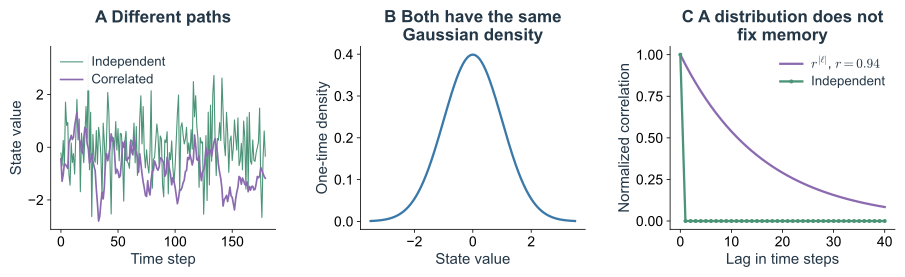
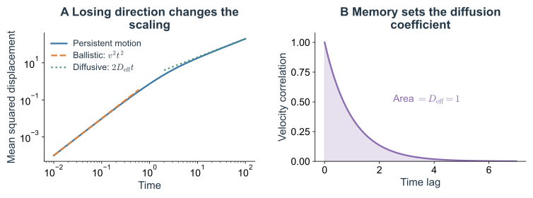
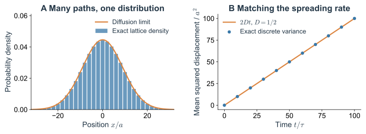
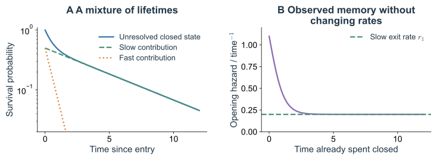

设想把一段运动录像交给两个人。第一个人知道粒子的精确初始位置和速度，第二个人只知道它落在哪一个小格子里。两个人面对同一套运动规律，却可能需要完全不同的预测：前者计算一条轨迹，后者计算一片随时间变化的概率分布。

随机描述正是在这个差别中出现的。但“不知道初值”还没有解释为什么概率会服从扩散方程，也没有解释为什么有些随机过程没有记忆，另一些却会记住过去。要得到这些规律，必须继续追问：观测保留了什么，省略的变量怎样运动，以及省略它们以后，当前状态是否还足以预测未来。

这条问题链会把确定性混沌、随机过程、粗粒化和马尔可夫性接在一起。分子反应与单细胞表达提供具体应用，但理论的起点更一般：**当一条轨迹不再能被唯一预测时，哪些关于未来的结构仍然可以被保留下来？**

## 1. 确定的运动规则怎样产生随机的观测 {#sd-observation-and-state}

### 1.1 一个只需要二进制的混沌模型

考虑区间 $0\leq z\lt1$ 上的确定性映射

$$
z_{m+1}=2z_m\pmod 1.
\tag{1.1}
$$

每一步将坐标加倍，再去掉整数部分。知道 $z_0$ 的全部数位，就知道以后所有的 $z_m$。为了看清观测会丢掉什么，把初值写成二进制：

$$
z_0=0.b_1b_2b_3\cdots,\qquad
z_1=0.b_2b_3b_4\cdots.
\tag{1.2}
$$

加倍相当于把二进制小数点向右移动一位。假设仪器每次只报告粒子在左半区还是右半区，那么第 $m$ 次报告恰好读出第 $m+1$ 位 $b_{m+1}$。一个确定性系统，因而把初值中更细的数位逐个推到观测尺度上。

现在给初值一个均匀分布。在这个准备系综中，任意指定的前 $M$ 位序列都对应长度为 $2^{-M}$ 的小区间，所以每一种长度为 $M$ 的观测序列都有概率 $2^{-M}$。左右报告在统计上就是独立的公平抛硬币。这个结论的计算见[附录 A.1](#sd-binary-appendix)。

这里同时存在两件事实：给定精确初值，轨迹确定；在指定初值分布和有限观测下，报告构成随机过程。随机性的概率规律来自动力学、初始准备与观测划分的共同作用。换一种初值分布或划分方式，报告未必仍然独立，也未必等概率。

如果初始精度只有 $\varepsilon$，尚未绕回以前，相邻初值的差约每步放大两倍。误差达到给定分辨率 $\Delta$ 所需的步数约为

$$
m_{\rm pred}\simeq\frac{\ln(\Delta/\varepsilon)}{\ln2}.
\tag{1.3}
$$

初值多测准十位二进制数，只能多预测约十步。这个例子把“规则确定”与“长期可预测”分开了，也说明随机描述有时可以精确表达我们仍然掌握的信息，而不只是计算失败后的临时替代。

### 1.2 概率描述还需要一个准备系综

同一个骰子，轻放、滚落和充分翻转，结果分布可以不同。说“没有测量碰撞细节”不能自动推出六面等概率；还需要指定投掷的准备方式，或找到使不同结果具有相同统计权重的机制。

物理中的概率通常也依附于一个准备系综。布朗颗粒的初始速度可以从热平衡分布抽取，也可以先被外力定向加速；同一随机方程在这两种准备下有不同的短时统计。平稳分布、初始分布和动力学规律是三个需要分清的对象。

认识论随机性强调未掌握的信息，本体论随机性讨论自然规律是否在最深层面唯一决定结果。量子理论使后一问题有了与经典力学不同的内容，但生物轨迹本身不能解决这种本体论争论。随机动力学先处理一个更可操作的问题：给定准备方式和保留变量，如何建立并检验条件概率。

因此，“内禀噪声”也总有模型语境。在分子计数模型里，它指给定所保留状态后，生成和降解事件仍然随机；把更多反应中间态、构象或环境变量纳入以后，噪声的划分可能改变。术语不会替代对状态的定义。

## 2. 从一个时刻的分布走向整条路径 {#sd-process-law}

### 2.1 同一张直方图可以来自两种不同的时间组织

先比较两个离散时间过程。过程一在每个时刻独立抽取标准高斯变量 $Z_m$。过程二按照

$$
X_{m+1}=rX_m+\sqrt{1-r^2}\,\eta_m,
\qquad |r|\lt1,
\tag{1.4}
$$

更新，其中 $\eta_m$ 独立且为标准高斯；初值 $X_0$ 也取标准高斯，并与未来的 $\eta_m$ 独立。因为两个独立高斯变量相加仍然高斯，而右边方差为 $r^2+(1-r^2)=1$，所以每个时刻都有

$$
Z_m\sim\mathcal N(0,1),\qquad X_m\sim\mathcal N(0,1).
\tag{1.5}
$$

只收集任意单一时刻的大量样本，两者没有区别。但沿时间看，$Z$ 不保留上一步的信息，$X$ 则保留了比例 $r$。将式（1.4）乘以 $X_m$ 再平均，得到 $\langle X_{m+1}X_m\rangle=r$；继续迭代，有

$$
\langle X_{m+\ell}X_m\rangle=r^{|\ell|}.
\tag{1.6}
$$

同样的幅度可以组织成快速交替，也可以组织成长时间持续的偏差。这不是额外的小细节：它会改变时间平均的误差、下游响应，以及到达某个阈值的机会。

*Fig. 1.1. 单时刻分布没有规定时间结构。* A：独立高斯序列与 $r=0.94$ 的平稳自回归序列。B：两者理论单时刻密度均为标准高斯。C：理论相关函数分别在非零滞后处为零和 $r^{|\ell|}$。轨迹是模型样本，密度与相关曲线为解析结果。

### 2.2 事件、变量与随机过程

“下一步落在右半区”是一个事件；某时刻的位置 $X_t$ 是一个随机变量；一组由时间标记的随机变量 $\{X_t\}$ 才是随机过程。给定每个 $X_t$ 的分布，还不等于给定了这个过程。

离散时刻 $t_0,\ldots,t_M$ 的联合分布记录了各时刻怎样联系。一般的概率乘法规则给出

$$
P(x_0,\ldots,x_M)
=P(x_0)\prod_{j=0}^{M-1}
P(x_{j+1}\mid x_j,x_{j-1},\ldots,x_0).
\tag{1.7}
$$

这个式子尚未作任何动力学近似。困难在于，越往后预测，条件里需要保存的历史越长。一个可用的动力学模型，通常希望把这段历史压缩成有限个当前状态变量。

“噪声”则是相对于某个动力学分解而言的。式（1.4）把可以由当前值预测的部分写成 $rX_m$，剩下的创新项写成 $\sqrt{1-r^2}\eta_m$。别的分解也可能把慢环境放进噪声里，这时噪声就不再逐步独立。指定噪声方差、噪声相关与它对状态的依赖，是模型的一部分。

### 2.3 马尔可夫性是对状态充分性的要求

如果给定当前状态以后，过去不再提高对未来的预测能力，就有

$$
P(x_{j+1}\mid x_j,x_{j-1},\ldots,x_0)
=P(x_{j+1}\mid x_j).
\tag{1.8}
$$

这称为马尔可夫性。式（1.4）具有这种性质，却显然不是时间独立的序列。当前值可以持续影响未来，只要当前状态已经充分承载过去的影响。

对时间齐次马尔可夫过程，定义转移核 $K_t(y\mid x)$：从状态 $x$ 出发，经过时间 $t$ 位于 $y$ 的条件概率或密度。先演化 $s$，再演化 $t$，应该等价于直接演化 $s+t$：

$$
K_{s+t}(z\mid x)
=\int K_t(z\mid y)K_s(y\mid x)\,dy.
\tag{1.9}
$$

离散状态把积分换成求和。这是 Chapman–Kolmogorov 关系。中间状态 $y$ 把两段运动连接起来；不必把更早的整段轨迹也传到第二段。

“状态”因此比“读数”要求更强。一个摆的当前位置不是完整状态，还需要速度；一个有持续朝向的游动粒子需要位置和朝向；一个表达系统可能需要分子数和启动子构象。是否马尔可夫，首先是对变量集合的判断。

### 2.4 平稳与独立没有相同的含义

如果把全部观测时刻同时平移，联合分布不变，就称过程严格平稳。它表示统计规律不随时间原点改变，没有要求相邻时刻互不相关。式（1.4）从平稳高斯初态出发时便平稳，相关仍可持续很久；若从固定 $X_0=0$ 出发，则先有方差增长的准备瞬态。

甚至周期运动也可以形成平稳过程。令 $X_t=\cos(\omega t+\Phi)$，其中初始相位 $\Phi$ 在一整圈上均匀分布。平移时间只使相位整体旋转，均匀分布不变；但相关为 $\langle X_tX_0\rangle=\tfrac12\cos(\omega t)$，始终不衰减。只看位置也不足以判断未来往上走还是往下走，需要恢复相位或运动方向。

因此，“已经达到稳态”“已经失去记忆”“能够用独立样本估计误差”不是同一判断。研究稳定涨落以前，要先说清稳定的是哪个分布，以及相邻记录仍然保留多少联系。后面出现的平稳相关函数，正是为了把这种联系保留下来。

对式（1.4），这些区别可以直接代数计算。给定当前 $X_m=x$，下一步分布是均值 $rx$、方差 $1-r^2$ 的高斯。无论过去是缓慢爬升到 $x$，还是突然下降到 $x$，在这个模型里下一步条件分布都相同；这才是马尔可夫性。

取 $r=0.94$，当前读数为 $2$ 时，下一步平均为 $1.88$，仍明显保留偏高状态；但给定当前后的剩余标准差为 $\sqrt{1-0.94^2}\simeq0.341$。当前状态提供预测，随机创新使预测仍有分布。若从稳态无条件抽样，方差又为 $1$，因为还要加上当前状态本身的不确定性。条件不确定性与系综不确定性由此分开。

## 3. 粗粒化为何同时带来噪声与记忆 {#sd-coarse-graining}

### 3.1 把未观测变量积分掉以后 方程未必封闭

设完整的确定性系统用 $(x,y)$ 描述，$\dot x=b(x,y)$，$y$ 代表所有被省略的自由度。即使完整初态有一个确定的系综密度 $\rho(x,y,t)$，实验仍可能只得到边缘分布

$$
p(x,t)=\int\rho(x,y,t)\,dy.
\tag{1.10}
$$

将完整的 Liouville 概率守恒方程对 $y$ 积分，在相应边界项消失时得到

$$
\partial_tp=-\partial_x\!\left[p(x,t)\,
\mathbb E\{b(x,Y_t)\mid X_t=x\}\right].
\tag{1.11}
$$

这个关系是精确的，但还没有形成只依靠 $x$ 的封闭动力学：条件平均中的 $Y_t$ 分布可能记得初始准备，也可能记得 $x$ 怎样走到现在。两群样本眼下拥有相同的 $x$，隐藏的速度或构象分布却不相同，于是下一刻也会不同。

有效随机方程要解决的，正是这个封闭问题。有时隐藏变量混合得很快，可以用近似局部平衡分布求条件平均，再把残余作用表示成短相关噪声；有时它们很慢，消去以后必须保留记忆。粗粒化本身并不自动产生白噪声或马尔可夫性。

### 3.2 持续运动让位置暂时记得过去

考虑一维粒子，速度只能为 $V_t=+v$ 或 $-v$，并以速率 $r$ 翻转。给定 $(X,V)$，运动规则已确定：位置沿当前速度变化，速度以恒定率翻转。只给位置，同一点上左行和右行的粒子却有不同的下一步。

令初始左右方向各半。速度符号的条件均值按 $e^{-2rt}$ 衰减，因为一次翻转对符号的改变是原来的两倍。于是

$$
C_V(t)=\langle V_tV_0\rangle=v^2e^{-2r|t|}.
\tag{1.12}
$$

位置增量是速度的时间积分。从 $X_0=0$ 出发，

$$
\langle X_t^2\rangle
=2\int_0^t(t-s)C_V(s)\,ds
=\frac{v^2}{r}\left[t-\frac{1-e^{-2rt}}{2r}\right].
\tag{1.13}
$$

短时 $t\ll1/(2r)$，粒子还没有来得及改变方向，均方位移近似 $v^2t^2$。长时经历很多次翻转，方向信息不断被更新，主导项变为 $2D_{\rm eff}t$，其中

$$
D_{\rm eff}=\int_0^\infty C_V(s)ds=\frac{v^2}{2r}.
\tag{1.14}
$$

同一过程在短时是持续运动，在长时出现扩散。扩散系数保存了被消去速度的时间积分信息。短时位置过程不满足无记忆描述，并不妨碍长时近似变成布朗运动。

*Fig. 1.2. 扩散可以是失去速度记忆后的有效规律。* 取 $v=1,r=0.5$。A：精确均方位移与短时弹道、长时扩散渐近线，双对数坐标显示斜率从 $2$ 变为 $1$。B：速度相关函数及其积分面积，面积为 $D_{\rm eff}=1$。

细菌的直游与转向给出了这种结构的生物实现。真实转向角度、适应记忆与三维运动会改变具体相关函数，但理论问题不变：需要等到朝向信息衰减后，才能用只记录位置的扩散模型。相关计算可与[趋化笔记](/notes/qbio_course/chemotaxis/chemotactic_transport/#stochastic-a8)对照。

### 3.3 布朗运动的白噪声处在哪一个尺度

对热浴中的颗粒，若溶剂碰撞的相关时间远短于颗粒速度变化时间，可以用线性阻力和近似白噪声描述速度：

$$
m\,dv=-\zeta v\,dt+\sqrt{2\zeta k_{\rm B}T}\,dW_t,
\qquad dx=v\,dt.
\tag{1.15}
$$

$W_t$ 是标准维纳过程；长度为 $\Delta t$ 的增量服从 $\mathcal N(0,\Delta t)$，不重叠区间增量独立。随机力没有普通有限函数意义下的逐点取值，方程应通过增量或积分解释。这里的涨落强度与阻力的关系来自平衡热浴，不能未经检验地用于主动细胞驱动。

速度相关时间为 $\tau_v=m/\zeta$。若观测又远慢于这个时间，可以进一步消去速度，得到

$$
dx=\sqrt{2D}\,dW_t,\qquad D=\frac{k_{\rm B}T}{\zeta}.
\tag{1.16}
$$

现在存在两次不同的尺度选择：先把快速溶剂碰撞换成作用于速度的白噪声，再把较快的速度换成位置扩散。第二个模型不应被拿去预测惯性尚未消失时的运动。[Uhlenbeck 与 Ornstein（1930）](https://doi.org/10.1103/PhysRev.36.823)的经典分析正将速度和位移的统计联系起来；具体短长时过渡见[附录 A.4](#sd-brownian-appendix)。

### 3.4 白噪声极限保留的不是瞬时力的方差

把快速变化的随机力称为白噪声，还隐藏了一项缩放。设零均值有色力 $\eta_\tau$ 的协方差为

$$
C_\eta(t)=\frac{D_0}{\tau}e^{-|t|/\tau}.
\tag{1.17}
$$

相关时间趋零时，瞬时方差 $D_0/\tau$ 变大，但整个相关峰的面积保持为 $2D_0$。作为分布，它趋向 $2D_0\delta(t)$。真正可观测的是力在有限时间内的累计效果；若 $Y_t=\int_0^t\eta_\tau(s)ds$，则

$$
\operatorname{Var}(Y_t)
=2D_0[t-\tau(1-e^{-t/\tau})]\longrightarrow2D_0t.
\tag{1.18}
$$

越来越快、越来越强的瞬时起伏，因而留下有限的累计展宽。反过来，若让相关时间趋零却固定瞬时方差，相关峰的面积也趋零，累计驱动会消失。两种极限不能混用。

这说明白噪声并不是一台仪器真的能在每个时刻测出一个无限大的普通力。它是一种积分层次的有效极限，保存有限时间增量的方差。将快环境换成白噪声时，必须明确哪些积分强度被保留；下一篇的连续高斯反应近似也会遇到同样的尺度要求。

## 4. 从等待时间理解最简单的随机事件 {#sd-poisson-events}

### 4.1 恒定速率到底意味着什么

连续时间中，“每一步抛一次硬币”还没有规定一步有多长。对稀疏事件，更自然的起点是一个短时间规则：给定当前状态，在 $dt$ 内发生一次事件的概率为 $kdt+o(dt)$，发生两次及以上的概率为 $o(dt)$。$k$ 为恒定事件率。

用 $T$ 表示下次事件的等待时间，$S(t)=\Pr(T\gt t)$ 表示直到 $t$ 仍未发生。已经没有事件地等到 $t$，再多等 $dt$，有

$$
S(t+dt)=S(t)(1-kdt)+o(dt).
\tag{1.19}
$$

除以 $dt$ 并取极限，$S'=-kS$，初值 $S(0)=1$，所以

$$
S(t)=e^{-kt},\qquad
\psi(t)=-S'(t)=ke^{-kt},\qquad \mathbb E[T]=\frac1k.
\tag{1.20}
$$

$S$ 是无量纲概率，$\psi$ 是等待时间密度，单位为时间的倒数。事件率 $k$ 可以大于 $1$，因为它从来不是某段固定有限时间内的概率；$kdt$ 只在很短时间里作一阶近似。

指数等待的无记忆性直接来自

$$
\Pr(T\gt s+t\mid T\gt s)=\frac{S(s+t)}{S(s)}=e^{-kt}.
\tag{1.21}
$$

已经等了很久，并不会使下一次事件变得更接近。这个结论适用于恒定危险率的理想事件，而不能用于所有“随机发生”的事件。

### 4.2 从等待一次到累计计数

若各次等待独立且服从同一个指数分布，令 $C_t$ 为时间 $t$ 内的事件总数，$Q_n(t)=\Pr(C_t=n)$。短时收支给出

$$
\dot Q_n=kQ_{n-1}-kQ_n,\qquad Q_0(0)=1.
\tag{1.22}
$$

从 $Q_0=e^{-kt}$ 开始，逐次解出 $Q_1=kte^{-kt}$，再递推得到

$$
Q_n(t)=e^{-kt}\frac{(kt)^n}{n!},\qquad
\mathbb E[C_t]=\operatorname{Var}(C_t)=kt.
\tag{1.23}
$$

指数等待与泊松计数，是同一个齐次泊松过程的两面。前者从一次事件出发看多久等到下一次，后者固定一个时间窗看发生多少次。若只说计数在一个时间点服从泊松，还不能推出所有不重叠窗口独立，因而不能直接宣布整个过程为泊松过程。

分子产生、受体结合和放射性计数经常从这个模型出发。现存分子数还会受到去除影响，因此不等于累积事件计数。下一篇将用生灭过程说明这个区别。

## 5. 许多微小事件为什么会汇成扩散 {#sd-walk-to-diffusion}

### 5.1 从格点概率开始而不是直接假设高斯

在一维格点 $x_i=ia$，每隔 $\tau$ 独立地向左或向右走一步，概率各为 $1/2$。记 $P_i(t)$ 为位置概率，则

$$
P_i(t+\tau)=\frac12P_{i-1}(t)+\frac12P_{i+1}(t).
\tag{1.24}
$$

每个状态得到的概率来自两个邻居。把所有格点相加，总概率仍为 $1$。从原点出发，$m$ 步位移为 $X_m=a\sum_{j=1}^m\sigma_j$，$\sigma_j=\pm1$，于是

$$
\langle X_m\rangle=0,\qquad \operatorname{Var}(X_m)=ma^2.
\tag{1.25}
$$

若恰有 $j$ 次右跳，则 $X_m=(2j-m)a$；所有路径等权，而到达这个位置的路径有 $\binom mj$ 条。因此有限步数的精确分布是二项分布，不是连续高斯。

### 5.2 连续极限保留的是单位时间的位移方差

让 $P_i(t)\simeq a p(x_i,t)$，其中 $p$ 为单位长度的概率密度。将式（1.24）减去当前概率并除以 $a\tau$，得到

$$
\frac{p(x,t+\tau)-p(x,t)}\tau
=\frac{a^2}{2\tau}
\frac{p(x-a,t)-2p(x,t)+p(x+a,t)}{a^2}.
\tag{1.26}
$$

对比左边的时间差商和右边的空间差商，只有同时缩小步长与等待时间，才可能得到有限连续动力学。取 $a,\tau\to0$，保持 $a^2/(2\tau)=D$，在平滑尺度上得到

$$
\boxed{\partial_tp=D\partial_x^2p,\qquad
j=-D\partial_xp,\qquad \partial_tp=-\partial_xj.}
\tag{1.27}
$$

若只缩短 $\tau$ 而不缩短 $a$，单位时间的方差会发散；若把 $a$ 缩得过快，运动又会冻结。扩散尺度的选择，是在两种退化之间保留每单位时间有限的随机展宽。

从原点出发，无限直线上的解为

$$
p(x,t)=\frac{e^{-x^2/(4Dt)}}{\sqrt{4\pi Dt}},\qquad
\langle X_t^2\rangle=2Dt.
\tag{1.28}
$$

这幅高斯形状不是先验规定的，而是独立、对称、小步长的概率收支在大尺度上的结果。

*Fig. 1.3. 精确离散分布如何接近连续密度。* 取 $a=\tau=1,m=80$。A：只有与步数同奇偶性的格点可达，因而以可达间距 $2a$ 将概率换成密度，再与 $D=1/2$ 的高斯比较。B：离散方差与连续公式 $2Dt$ 一致。连续密度描述经过格点尺度平滑的分布。

### 5.3 中心极限定理解释形状 时间关联决定是否扩散

还可以从特征函数看见同一个极限。单步的特征函数为 $\mathbb E[e^{iq\Delta X}]=\cos(qa)$，独立的 $m$ 步相乘：

$$
\mathbb E[e^{iqX_m}]=[\cos(qa)]^m
\simeq e^{-ma^2q^2/2}\longrightarrow e^{-Dq^2t}.
\tag{1.29}
$$

当 $a\to0,m=t/\tau\to\infty$，高阶累积量相对二阶项消失，留下高斯特征函数。中心极限定理将这一结构推广到独立同分布、有限方差等条件下的位移之和；整条过程收敛到布朗运动，还需要对多时刻行为和路径作相应控制。

独立性一旦放松，方差就多出交叉项。对平稳增量，记单步方差为 $\sigma^2$、滞后 $\ell$ 的协方差为 $C_\ell$，则

$$
\operatorname{Var}(X_m)
=m\sigma^2+2\sum_{\ell=1}^{m-1}(m-\ell)C_\ell.
\tag{1.30}
$$

若相关绝对可求和，长期方差仍可能正比于 $m$，但比例由全部相关贡献决定；要得到高斯极限还需适当混合条件。长程相关、无限方差步长或重尾等待，会使前面的普通扩散推导失去依据。

因此，近似高斯的单时刻分布、线性增长的均方位移、无记忆的轨迹，是三个不同层次的性质。它们在布朗运动里同时出现，却不能相互无条件推出。

### 5.4 确定的概率演化与随机的个体运动

扩散方程本身是一个确定的偏微分方程。给定初始密度和边界条件，它可以唯一决定以后的密度。这里确定的是整个系综的统计规律，并没有额外指定某个粒子下一步朝哪边走。

例如，所有粒子都从原点出发，对称性使平均位置始终为零；单个粒子却几乎不会一直停在零点。平均位置描述对称中心，均方位移描述展宽，二者都不是一条必须由个体遵循的轨迹。把概率方程的确定性误读为“随机性已经消失”，就混淆了统计对象与微观对象。

概率演化还可以表现出单向平滑。在长度 $L$ 的反射区间中，纯扩散最终趋向均匀密度 $p_{\rm ref}=1/L$。用相对熵量化当前分布与它的差别：

$$
H[p]=\int_0^L p(x,t)\ln\frac{p(x,t)}{p_{\rm ref}}dx,
\qquad
\frac{dH}{dt}=-D\int_0^L\frac{(\partial_xp)^2}{p}dx\leq0.
\tag{1.31}
$$

最后一步将扩散方程代入后分部积分，并使用两端零流条件；对光滑正密度成立。起伏越尖锐，梯度项越大，分布与均匀态的差别就越快被削弱。

这个过程还可以逐模态看见。若初态有一项 $\varepsilon\cos(m\pi x/L)$ 的相对密度起伏，其幅度会按 $e^{-D(m\pi/L)^2t}$ 衰减。尺度越细，波数越大，衰减越快。精确数学中的有限时间热演化并不一定把不同初态严格合并成同一个函数，但反推时必须指数放大微小测量误差；在有限精度下，细尺度初始信息逐渐无法恢复。有效不可逆性需要结合这种分辨限制理解。

这项数学衰减还不能单独解释为细胞的实际热力学熵产生。完整微观动力学可能保留更多信息，环境也可能持续提供驱动。更一般的稳态甚至可以在密度不再变化时仍有概率循环。第三篇会用路径方向把“分布不变”和“过程可逆”再分开。

## 6. 隐藏状态怎样变成可观测的记忆 {#sd-hidden-state-memory}

### 6.1 两种未被分辨的内部状态

考虑三个微观状态 $A_1,A_2,B$，其中 $A_1,A_2$ 都被仪器记作 $A$。从 $A_i$ 到 $B$ 的速率分别为 $r_i$；从 $B$ 以总速率 $q$ 离开时，以概率 $w$ 进入 $A_1$，以 $1-w$ 进入 $A_2$。微观过程的全部转移率恒定，所以三态描述是马尔可夫的。

从一次刚进入 $A$ 开始计时。若知道进入的是 $A_i$，等待为单一指数；不知道具体状态，就必须混合两种条件结果：

$$
S_A(t)=we^{-r_1t}+(1-w)e^{-r_2t}.
\tag{1.32}
$$

给定已经等了 $t$ 还没有离开，处于慢快两种构象的比例发生变化。例如 $A_1$ 的后验权重为

$$
w(t)=\frac{we^{-r_1t}}{we^{-r_1t}+(1-w)e^{-r_2t}}.
\tag{1.33}
$$

观测到的瞬时退出机会即危险率为

$$
\boxed{h_A(t)=-\frac{d}{dt}\ln S_A(t)
=w(t)r_1+[1-w(t)]r_2.}
\tag{1.34}
$$

若 $r_1\lt r_2$，快速离开的样本先消失，长时间留下来的样本越来越富集于慢状态。即使微观速率从未改变，观测危险率也会随已等待时间降低，最终趋向 $r_1$。求导可得 $h_A'(t)=-\operatorname{Var}_t(r)\leq0$。

*Fig. 1.4. 等待本身提供隐藏状态的信息。* 取 $w=1/2,r_1=0.2,r_2=2$。A：总生存概率在半对数图上弯曲；单一指数应为直线。B：危险率从 $1.1$ 降向 $0.2$。混合权重指刚进入 $A$ 时的比例，在随机时刻抽取已处于 $A$ 的样本会受到驻留时间偏置。

只记 $A/B$ 的过程便有了记忆：相同的当前标签 $A$，等待一秒和等待十秒对应不同未来。把 $A_1,A_2$ 重新分开，或在观测状态中加入进入 $A$ 后的年龄，就能恢复合适的状态描述。若 $r_1=r_2$，合并恰好不影响退出率，观测过程则可保持马尔可夫；一般的合并条件见[附录 A.2](#sd-lumpability-appendix)。

### 6.2 另一个方向的记忆来自必须完成的步骤

非指数等待并不总是危险率下降。若一次事件必须依次完成两个独立、速率均为 $r$ 的步骤，$T=T_1+T_2$，卷积得到

$$
\psi_T(t)=r^2te^{-rt},\quad
S_T(t)=(1+rt)e^{-rt},\quad
h_T(t)=\frac{r^2t}{1+rt}.
\tag{1.35}
$$

刚开始时，两个步骤几乎不可能在极短时间内全部完成，危险率从零起步；等得越久，越可能已经通过第一步，因而危险率上升。对比混合构象的例子，一种是“幸存者越来越慢”，另一种是“内部进度逐渐完成”。同样偏离单指数，背后可以是不同状态结构。

启动子、酶构象、细胞周期阶段都可能包含这些机制。一个分子数读数也可能把活跃与沉默的产生装置混在一起：给定当前 $N=n$，生成机会还取决于由历史推断的启动子状态。这时对 $N$ 单独写一个恒定规则的马尔可夫模型，就省略了有预测力的信息。

还要留意，“等待某个事件”未必等于“停留在一个微观状态”。完整多态链可以完全马尔可夫，但从起点到远处目标要经过多个中间态，首达时间一般不是指数分布。只有时间齐次跳跃链离开一个已充分分辨状态的等待，才由该状态的恒定总离开率给出单指数。

因此，非指数首达本身不能直接证明完整动力学非马尔可夫。真正需要检验的是：给定所声称的当前状态后，更早历史是否还改变未来条件分布。把事件、状态和历史分清，才能判断应补一个隐藏变量，还是仅仅需要计算一个多步到达问题。

### 6.3 消去变量后的精确结果通常包含记忆核

更一般地，两个相互耦合的线性变量也能展示这件事。设 $\dot x=-ax+by$，而 $y$ 有恢复率 $c$、受 $x$ 驱动并受到随机扰动。先解出 $y$ 再代回，$x$ 的演化就会含有

$$
\dot x(t)=-ax(t)+\int_0^t K(t-s)x(s)ds+\eta(t),
\qquad K(u)=bg\,e^{-cu}.
\tag{1.36}
$$

这里 $g$ 是 $x$ 对 $y$ 的耦合，$\eta$ 包含隐藏初值和后来随机力的影响。$x$ 先改变 $y$，$y$ 再在未来反馈给 $x$；延迟反馈便形成了卷积记忆。完整消元见[附录 A.3](#sd-elimination-appendix)。

当 $K$ 衰减比 $x$ 变化快得多，卷积才可能近似为局部漂移；相应随机力还需满足短相关条件和适当尺度，才能近似白噪声。[Zwanzig（1961）](https://doi.org/10.1103/PhysRev.124.983)的投影思想将这种“保留变量的演化加上记忆与未解析作用”推广到一般统计动力学。其物理意义，在这个两变量例子里已经可以直接看到。

## 7. 概率规律怎样成为可检验的物理描述 {#sd-testing-randomness}

### 7.1 重复系综与一条长轨迹不是同一个实验

在相同准备下重复许多次，可以估计一个时刻的系综分布。沿同一对象观察很久，可以估计时间占据和相关函数。只有在适当的遍历条件下，这两种平均才会在长时间极限一致。

例如，先随机选择一次环境 $Z$，以后一直不变；每个环境内部的表达波动都很快。同一时刻观察许多细胞，会看到不同环境对应分布的混合；追踪一个细胞很久，却只采样它自己的条件分布。没有环境切换，时间再长也不会自动扫过整个混合分布。

即使过程遍历，相关时间很长也会让有限记录里的有效独立样本很少。重复实验能否看到稳定规律，取决于准备的一致性和采样时间，而不是单凭“测了很多帧”。

### 7.2 生物观测提供对状态选择的检验

对表达系统，可以在同一当前计数下比较不同历史：刚上升和刚下降的样本，随后变化是否仍不同？也可以记录启动子活动，判断加入它后历史依赖是否减弱。等待时间危险率、不同时间间隔的转移核、报告蛋白的成熟与曝光核，分别约束不同的遗漏。

[Elowitz 等（2002）](https://doi.org/10.1126/science.1070919)的双报告设计，则增加了同一细胞中的并行观测。若两个报告 $Y_1,Y_2$ 在给定共享环境 $Z$ 后条件独立且同分布，总协方差公式给出

$$
\operatorname{Cov}(Y_1,Y_2)
=\operatorname{Var}(\mathbb E[Y_1\mid Z]),
\qquad
\frac12\operatorname{Var}(Y_1-Y_2)
=\mathbb E[\operatorname{Var}(Y_1\mid Z)].
\tag{1.37}
$$

共同偏移与条件内差异由此得到不同统计表征。它没有宣布所有共同变化都来自同一种机制；条件独立、归一方式与报告响应仍要由具体实验支持。

沿着这些检验，最初的“能否预测一条轨迹”逐渐变成了三个明确任务：选择状态、建立条件转移规律、确定规律在哪个时间尺度成立。下一篇暂时假定这三件事已完成，从一个转移核的短时变化出发，推导概率分布与可观测量各自的演化方程。

## 附录 A 从观测划分到有效动力学 {#sd-randomness-appendix}

### A.1 倍增映射的符号序列 {#sd-binary-appendix}

指定二进制前 $M$ 位 $b_1,\ldots,b_M$，等价于指定初值属于区间

$$
\left[\sum_{j=1}^M b_j2^{-j},\;
\sum_{j=1}^M b_j2^{-j}+2^{-M}\right).
\tag{1.A1}
$$

均匀初始测度给这个区间概率 $2^{-M}$，等于 $M$ 个独立公平二值变量的联合概率。具有两种二进制表示的二进有理数构成零测集，不影响上述概率结果。

这个论证依赖连续初值系综。计算机的有限位浮点状态只有有限多个，确定性迭代最终会进入周期；不能用无限精度模型的结论证明一个有限精度伪随机发生器永远独立。

### A.2 合并状态后何时仍是马尔可夫过程 {#sd-lumpability-appendix}

令微观连续时间链的转移率为 $w_{ij}$，把微观状态分成若干块 $B_\alpha$。若对同一块内任意 $i,i'\in B_\alpha$，到每个其他块的总速率都相等：

$$
\sum_{j\in B_\beta}w_{ij}
=\sum_{j\in B_\beta}w_{i'j},\qquad \beta\ne\alpha,
\tag{1.A2}
$$

那么块间转移率不依赖块内的隐藏构成，可以对任意初始准备得到封闭的块马尔可夫链。这是强可合并条件。

在正文三态例子里，$A_1,A_2$ 到 $B$ 的总速率分别为 $r_1,r_2$，只有相等时才满足这个条件。特殊初始系综有时能产生更弱的封闭性质，因此某次观测近似马尔可夫，不等于所有准备方式都如此。

### A.3 线性隐藏变量的精确消元 {#sd-elimination-appendix}

取 $a,c\gt0$，考虑

$$
dx=(-ax+by)dt,\qquad
dy=(-cy+gx)dt+\sqrt{2D_y}\,dW_t.
\tag{1.A3}
$$

第二式中的 $g$ 是耦合常数。先求隐藏变量的积分解：

$$
y(t)=e^{-ct}y_0+g\int_0^t e^{-c(t-s)}x(s)ds
+\sqrt{2D_y}\int_0^t e^{-c(t-s)}dW_s.
\tag{1.A4}
$$

代回第一式得到式（1.36），其中

$$
\eta(t)=be^{-ct}y_0+b\sqrt{2D_y}\int_0^t e^{-c(t-s)}dW_s.
\tag{1.A5}
$$

它包含初始隐藏状态，因而一般会与 $x_0$ 有关；不能不检查准备方式，就把它指定为独立平稳噪声。若 $d=0$，并让 $y_0$ 从方差 $D_y/c$ 的平稳 OU 分布抽取且独立于未来增量，则 $\langle\eta(t)\eta(s)\rangle=b^2D_y e^{-c|t-s|}/c$。

在 $a,c\gt0$ 下，耦合系统稳定还要求 $ac\gt bg$；局部消元进一步要求快慢模态充分分离。将短核积分近似为 $bg\,x(t)/c$ 只是主导阶结果。固定其他参数令 $c\to\infty$ 时，传给 $x$ 的噪声强度也会下降；若希望保留有限噪声，需要明确同时怎样缩放耦合或 $D_y$。

### A.4 有惯性布朗运动的完整均方位移 {#sd-brownian-appendix}

在平衡速度准备下，式（1.15）给出

$$
\langle v(t)v(0)\rangle=\frac{k_{\rm B}T}{m}e^{-|t|/\tau_v},
\qquad \tau_v=\frac m\zeta.
\tag{1.A6}
$$

将位移写成速度积分，对正方形积分域按时间顺序分成两个三角形：

$$
\begin{aligned}
\langle[x(t)-x(0)]^2\rangle
&=2\int_0^t(t-s)\langle v(s)v(0)\rangle ds\\
&=2D\left[t-\tau_v(1-e^{-t/\tau_v})\right].
\end{aligned}
\tag{1.A7}
$$

短时展开为 $(k_{\rm B}T/m)t^2$，长时主导项为 $2Dt$。持续翻转模型和热布朗运动具有不同的微观速度规则，却通过可积的速度关联得到相同的长时扩散结构。

## 参考文献 {#sd-randomness-references}

- [Uhlenbeck and Ornstein 1930, On the Theory of the Brownian Motion](https://doi.org/10.1103/PhysRev.36.823)：速度关联、位移统计与布朗运动的时间尺度。
- [Zwanzig 1961, Memory Effects in Irreversible Thermodynamics](https://doi.org/10.1103/PhysRev.124.983)：消去自由度后出现的记忆结构。
- [Elowitz et al. 2002, Stochastic Gene Expression in a Single Cell](https://doi.org/10.1126/science.1070919)：并行报告对表达涨落来源的约束。
- [下一篇：随机动力学的生成元与连续极限](02_events_to_dynamics.md)。
