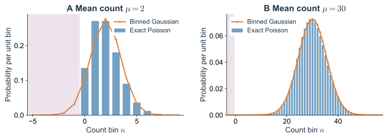

知道一个过程是马尔可夫的，还没有知道它怎样运动。当前位置足以预测未来，但这项预测究竟是什么？最直接的答案是一整族转移核 $K_t(y\mid x)$。然而，为每一个时间间隔分别指定一个核既笨重，也容易使不同时间之间的规则互相矛盾。

一个更有力的办法，是只规定极短时间内发生什么，再由这种局部规则生成所有有限时间的运动。这样得到的对象叫作**演化生成元**。它同时演化概率分布和可观测量，也把主方程、Langevin 方程与 Fokker–Planck 方程放进同一个结构。

这些描述之间有两种不同的联系：有些是在同一过程里换一种计算视角，有些则真的舍弃了信息、取了一个近似极限。分清二者，是使用随机动力学方程时最重要的判断之一。

## 1. 从有限时间转移到无穷小生成元 {#sd-semigroup-generator}

### 1.1 把演化作用在可观测量上

先考虑时间齐次的马尔可夫过程，即转移规则不依赖绝对时刻。设初态为 $X_0=x$，$F$ 是位置、能量、计数或某个状态的指示函数。定义

$$
(T_tF)(x)=\mathbb E_x[F(X_t)]
=\int K_t(y\mid x)F(y)dy.
\tag{2.1}
$$

$T_t$ 不把一个状态直接送到另一个确定状态，而把一个关于未来的观测量送回初态，告诉我们从这里出发的平均结果。由于马尔可夫性，先等待 $s$ 再等待 $t$ 与等待 $s+t$ 一致：$T_{s+t}=T_sT_t$，且 $T_0=I$。这一族算子称为转移半群。

如果 $F\equiv1$，平均后仍为 $1$，所以 $T_t1=1$；如果 $F\geq0$，条件平均也非负。概率守恒和非负性已经约束了什么样的演化算子才可能来自随机过程。

在适当函数域内，对短时间作展开：

$$
T_{dt}F=F+dt\,\mathcal LF+o(dt),\qquad
\mathcal LF=\lim_{dt\to0}\frac{T_{dt}F-F}{dt}.
\tag{2.2}
$$

$\mathcal L$ 就是后向生成元。它提取的是每单位时间的条件平均改变。半群关系进一步给出 $\partial_tT_tF=\mathcal LT_tF$；在有限状态空间中，可直接写成 $T_t=e^{t\mathcal L}$。

### 1.2 有限状态跳跃的最一般形式

令 $w_{ij}\geq0$ 为从 $i$ 到不同状态 $j$ 的速率。短时到达 $j$ 的概率为 $w_{ij}dt+o(dt)$，留在原处的概率为 $1-dt\sum_{j\ne i}w_{ij}+o(dt)$。代入式（2.2）：

$$
\boxed{(\mathcal LF)_i
=\sum_{j\ne i}w_{ij}(F_j-F_i).}
\tag{2.3}
$$

每项都是“发生速率乘以这次跳跃对观测量的改变”。取 $F=1$，每项自动为零，因此 $\mathcal L1=0$。取 $F_i=i$ 时，它给出状态标签的平均变化；取目标状态的指示函数时，则跟踪到达目标的概率。

用矩阵 $Q$ 表示，令非对角元 $Q_{ij}=w_{ij}$，对角元 $Q_{ii}=-\sum_{j\ne i}w_{ij}$。那么 $\mathcal LF=QF$，每行和为零。正的非对角元与由它们确定的负对角元不能任意调整；否则 $e^{tQ}$ 可能不再是合法转移矩阵。

有限状态链中，这些矩阵条件可以产生守恒的随机演化。无限状态空间还需排除在有限时间内发生无限多次跳跃的“爆炸”，并明确生成元的函数域。形式上每行和为零，不会自动解决逃向无穷远的问题。下面的线性生灭模型具有良好的非爆炸性质，后续平均与演化计算在相应矩存在的条件下进行。

### 1.3 前向与后向是在演化不同对象

若初始分布为列向量 $p(0)$，有限时间后

$$
p(t)=e^{tQ^{\mathsf T}}p(0),\qquad
\dot p=Q^{\mathsf T}p.
\tag{2.4}
$$

分量形式为

$$
\boxed{\dot p_i=\sum_{j\ne i}
[p_jw_{ji}-p_iw_{ij}].}
\tag{2.5}
$$

这就是前向主方程：所有到达当前态的概率流相加，减去所有离开的流。它与式（2.3）的后向方程没有矛盾；前者作用在分布上，后者作用在给定初态的条件期望上。

两种视角通过同一个平均值联系：

$$
\sum_i F_ip_i(t)=\sum_i(T_tF)_i p_i(0),\qquad
\frac{d}{dt}\langle F\rangle=\langle\mathcal LF\rangle.
\tag{2.6}
$$

左边可以先演化分布再取平均，右边可以先预测观测量再对初态取平均。这项对偶性以后会让矩方程、相关函数和首达时间都从同一生成元导出。

### 1.4 两态系统把稳态与恢复速度分开

考虑 $0\xrightleftharpoons[\beta]{\alpha}1$。若 $p_1$ 是处于状态 $1$ 的概率，则

$$
\dot p_1=\alpha(1-p_1)-\beta p_1,
\qquad
p_1(t)=\pi+[p_1(0)-\pi]e^{-(\alpha+\beta)t},
\quad \pi=\frac\alpha{\alpha+\beta}.
\tag{2.7}
$$

稳态比例由速率比决定，恢复时间由速率和决定。固定 $\pi$ 并同时将两个速率乘以 $c$，占据分布不变，全部动力学时钟却加快 $c$ 倍。

在生成元语言中，零特征值对应概率归一和稳态，另一个特征值为 $-(\alpha+\beta)$，控制偏离稳态的衰减。即使尚未加入任何非线性，分布与动力学之间已经存在多对一的关系。

例如，取 $\alpha=2,\beta=1$，从状态 $0$ 准备，时刻 $t$ 处于状态 $1$ 的概率为 $\tfrac23(1-e^{-3t})$。把两个速率都放大十倍，稳态仍为 $2/3$，但同样恢复程度只需原来十分之一的时间。一个只测稳态的实验，不能区分这两个时钟。

同一例子也能检查后向方程。令 $u_i(t)$ 为“从初态 $i$ 出发，经过 $t$ 处于状态 $1$”的概率，那么 $u_0'=\alpha(u_1-u_0)$、$u_1'=\beta(u_0-u_1)$，初值为 $(u_0,u_1)=(0,1)$。这里微分后同时比较的是不同起点的未来预测；前向方程则固定初始准备，追踪终点概率怎样流动。它们最终计算同一个可观测事件。

### 1.5 无穷小规则怎样累积成有限时间运动

矩阵指数并不是一个与事件规则无关的形式技巧。把时间 $t$ 分成 $M$ 段，每段 $h=t/M$，短时转移为 $I+hQ+o(h)$，连续相乘就趋向 $e^{tQ}$。一次短时近似的误差在合适极限下消失，局部规则于是生成整个转移核。

这也说明数值演化为什么需要小心。若用显式 Euler 写 $p(t+h)=(I+hQ^{\mathsf T})p(t)$，必须让每个状态的 $h\sum_jw_{ij}\leq1$，才能保证一步转移非负。若步长过大，对角“留下概率”变成负数，是离散算法失效，并不表示连续时间主方程会产生负概率。

对有限不可约链，除零模态外其余生成元特征值的实部为负，初始分布的不同成分逐渐衰减。最慢非零模态控制长时混合。两个状态的例子只有一个衰减率，多状态过程则会出现几个彼此分离的时间尺度；第三篇的亚稳态和准稳态正是这种谱结构的后果。

## 2. 从反应事件构造跳跃动力学 {#sd-birth-death-model}

### 2.1 倾向函数与计数变化是模型的输入

将状态换成计数向量 $\mathbf n$。通道 $r$ 发生一次，计数改变 $\boldsymbol\nu_r$；给定当前态，它的事件率为 $a_r(\mathbf n)$。于是

$$
\mathcal LF(\mathbf n)
=\sum_r a_r(\mathbf n)
[F(\mathbf n+\boldsymbol\nu_r)-F(\mathbf n)].
\tag{2.8}
$$

这已经是一般反应网络的生成元。主方程由同一组输入得到：

$$
\partial_tP(\mathbf n)
=\sum_r\left[
 a_r(\mathbf n-\boldsymbol\nu_r)P(\mathbf n-\boldsymbol\nu_r)
-a_r(\mathbf n)P(\mathbf n)\right].
\tag{2.9}
$$

不可达状态的概率和非法通道率取零。例如，没有足够反应物时，相应通道必须关闭。边界不是计算结束后才加上的装饰，它直接决定哪些事件存在。

这个结构适用于化学反应，也适用于群体出生死亡、离子通道开闭和离散构象转换。但具体倾向函数仍需物理依据。空间混合比反应快、碰撞与内部弛豫已被适当平均时，单靠分子计数的马尔可夫规则才可能成立。

### 2.2 同一生成元怎样产生一条路径 {#sd-gillespie}

在状态 $\mathbf n$，总离开率为 $a_0=\sum_ra_r$。只要没有事件发生，状态和各通道率就保持不变。因此等待时间生存概率为 $e^{-a_0\tau}$，下一次恰好由通道 $r$ 在时间 $\tau$ 发生的联合密度为

$$
\Pr\{\tau\in d\tau,R=r\mid\mathbf n\}
=a_r(\mathbf n)e^{-a_0(\mathbf n)\tau}d\tau.
\tag{2.10}
$$

对 $r$ 求和得到等待密度；对 $\tau$ 积分得到通道概率 $a_r/a_0$。它把路径抽样拆成两步：先抽指数等待，再按相对速率选择通道，更新计数后重新计算。这是 [Gillespie（1977）](https://doi.org/10.1021/j100540a008)事件模拟的基本结构。

主方程与这类精确事件模拟是同一个跳跃过程的两种计算方式。前者同时更新所有状态概率，后者抽取其中一条可能路径。模拟所谓精确，针对给定模型的事件规则；它不会修复遗漏的空间效应或慢隐藏状态。

若记录每个事件后的状态并等权统计，得到的也不是通常的时间占据分布。离开率高的状态会在事件列表中出现更多次。计算稳态应按驻留时间加权，或在等间隔时刻读取轨迹。显式随时间变化的速率则需要按累计危险率抽样，不能直接把当前速率的指数等待一直用下去。

### 2.3 从路径反推转移率需要记录什么

如果状态被连续分辨，一段跳跃记录包含两个信息：从 $i$ 跳到 $j$ 的次数 $N_{ij}$，以及总共在 $i$ 停留的时间 $\mathcal T_i$。给定初态，不计与速率无关的因子，路径似然为

$$
\mathscr P[\Gamma]\propto
\prod_{i\ne j}w_{ij}^{N_{ij}}
\exp\!\left[-\sum_i\mathcal T_i\sum_{j\ne i}w_{ij}\right].
\tag{2.11}
$$

每次跳跃贡献一个通道率，每段等待贡献一个无事件生存因子。取对数，对某个独立常数率求极大，得到 $\widehat w_{ij}=N_{ij}/\mathcal T_i$。估计的分母是处于出发状态的总时间，不是观察到的总跳跃次数。

如果仪器只每隔较长时间拍一帧，两帧之间可能发生多次往返；此时不能把相邻帧标签的改变直接等同于单次反应。数据约束的是有限间隔的 $K_\Delta=e^{\Delta Q}$，反推生成元成为另外一个推断问题。采样时间足够短、状态充分可见，才使简单的驻留计数估计成立。

这个联系让第一篇的状态选择变得具体：隐藏状态会改变路径似然，漏掉的快速事件会改变对速率的估计。理论模型与实验记录之间，需要由观测分辨率搭桥。

## 3. 一个可以贯穿各层描述的生灭过程 {#sd-master-and-stationary}

### 3.1 概率流怎样维持泊松稳态

取一维计数 $N\geq0$，上跳率为 $k$、下跳率为 $\gamma n$。作为化学模型，它对应恒定生成与独立去除；作为概率模型，它是最简单的线性恢复过程之一。生成元为

$$
\mathcal LF(n)=k[F(n+1)-F(n)]
+\gamma n[F(n-1)-F(n)],
\tag{2.12}
$$

主方程为

$$
\dot P_n=kP_{n-1}+\gamma(n+1)P_{n+1}-(k+\gamma n)P_n,
\quad P_{-1}=0.
\tag{2.13}
$$

生成率 $k$ 不随已有数量改变，去除率却随数量增大，因此高数量状态更容易向下恢复。零态下去除率为零，但仍有生成，故它不是吸收态。

定义边 $n\leftrightarrow n+1$ 上的向上净流

$$
J_n=kP_n-\gamma(n+1)P_{n+1},\qquad
\dot P_n=J_{n-1}-J_n.
\tag{2.14}
$$

稳态时每条边流相等。由于下边界没有流入负计数的通道，$J_{-1}=0$，全部稳态边流都必须为零。因此

$$
P_{n+1}^*=\frac{k}{\gamma(n+1)}P_n^*
\quad\Longrightarrow\quad
P_n^*=P_0^*\frac{(k/\gamma)^n}{n!}.
\tag{2.15}
$$

再由归一条件求得 $P_0^*=e^{-k/\gamma}$。记 $\mu=k/\gamma$，最终

$$
\boxed{P_n^*=e^{-\mu}\frac{\mu^n}{n!},\qquad
\langle N\rangle_*=\operatorname{Var}(N)_*=\mu.}
\tag{2.16}
$$

这里的零流与一维相邻跳跃、封闭边界有关。对有环路的状态图，稳态可以有持续循环，不能仅由“概率不变”推出详细平衡。

### 3.2 矩方程为什么有时能够封闭

将 $F=n$ 代入式（2.12），$\mathcal Ln=k-\gamma n$。所以平均值 $m=\langle N\rangle$ 满足

$$
\dot m=k-\gamma m,\qquad
m(t)=\mu+[m(0)-\mu]e^{-\gamma t}.
\tag{2.17}
$$

再取 $F=n^2$。上跳使平方改变 $2n+1$，下跳使它改变 $-2n+1$，故

$$
\frac{d}{dt}\langle N^2\rangle
=2km+k-2\gamma\langle N^2\rangle+\gamma m.
\tag{2.18}
$$

从中减去 $d(m^2)/dt$，得到方差方程

$$
\boxed{\dot V=k+\gamma m-2\gamma V.}
\tag{2.19}
$$

两种通道都引入计数不确定性，因而对方差的注入相加；净漂移却是两种通道之差。平均收支恰好平衡时，反应仍在进行，方差来源仍然非零。

这个模型的一、二阶矩不需要更高阶矩，是因为倾向函数至多线性。若上跳率为非线性函数 $g(n)$，平均方程出现 $\langle g(N)\rangle$；若 $g$ 含 $n^2$，则均值立即需要二阶矩，二阶矩又可能需要三阶矩。所谓矩封闭近似，正是在这里额外引入对分布形状的假设。

这也回答了一个常见疑问：确定性速率方程未必精确描述随机过程的平均值。本例恰好可以，因为线性允许平均与漂移交换；非线性系统一般没有这个性质。

### 3.3 生成函数保存的不只是几个矩

定义概率生成函数

$$
G(z,t)=\sum_{n=0}^\infty P_n(t)z^n.
\tag{2.20}
$$

它把无限多个概率系数编码为一个函数。在 $z=1$ 处求导会得到阶乘矩；如果保留整个 $G$，原则上就保留了整个计数分布，而不是作矩截断。

将式（2.13）乘 $z^n$ 后求和。生成项使幂次整体多一个，去除项通过 $nP_n$ 变成导数，整理得

$$
\partial_tG=k(z-1)G+\gamma(1-z)\partial_zG.
\tag{2.21}
$$

设初始函数为 $G_0$，令 $s=e^{-\gamma t}$，其解为

$$
\boxed{G(z,t)=G_0(1-s+sz)
\exp[\mu(1-s)(z-1)].}
\tag{2.22}
$$

它有一个比形式解更直观的解释：初始分子各自以概率 $s$ 存活，产生了 $G_0$ 中自变量的变换；后来生成并仍存活的新分子构成均值 $\mu(1-s)$ 的独立泊松部分。两部分独立相加，所以生成函数相乘。

若初始固定 $N_0=n_0$，第一部分是二项分布；若初始为空，第一部分消失，整个瞬态保持泊松。条件存活解释与特征线求解的联系见[附录 B.3](#sd-generating-function-appendix)。

*Fig. 2.1. 路径、分布与平均是同一模型的不同视角。* $k=12,\gamma=1,N_0=0$。A：一条 Gillespie 轨迹与精确均值 $12(1-e^{-t})$。B：$t=0.2,1,4$ 时的精确泊松分布，逐渐接近稳态。平均轨迹并不代表一条“典型阶梯线”必须沿它逐点运动。

### 3.4 生物解释需要额外确认哪一个状态被计数

用这个过程描述 mRNA，意味着启动子活性和转录能力近似恒定，转录本各自被独立去除。用它描述蛋白质，还把 mRNA 与翻译中间阶段平均掉了。如果一个短寿命 mRNA 能产生多个蛋白质，一次有效事件就可能增加一批分子，而非固定增加一个。

因此，泊松稳态首先是特定事件结构的结果。测到更宽的分布，会提示爆发、慢环境或其他机制，但不会凭一个 Fano 因子唯一定位原因。理论在这里提供可被推翻的基准，也提醒我们转移率必须与观测变量对应。

### 3.5 改变一次事件的大小会改变哪些统计量

保持平均生成量不变，还能改变事件的组织。设每次生成事件以速率 $a$ 到来，一次增加随机整数 $B\geq1$，其分布为 $q_b$；去除仍独立发生。生成元变成

$$
\mathcal LF(n)=a\sum_{b\geq1}q_b[F(n+b)-F(n)]
+\gamma n[F(n-1)-F(n)].
\tag{2.23}
$$

记有限的一、二阶矩为 $b_1=\mathbb E[B]$、$b_2=\mathbb E[B^2]$。同样代入 $F=n,n^2$，得到稳态均值 $m_*=ab_1/\gamma$，方差 $V_*=a(b_2+b_1)/(2\gamma)$，所以

$$
\frac{V_*}{m_*}=\frac{b_2+b_1}{2b_1}.
\tag{2.24}
$$

单位生成 $B=1$ 给出泊松的方差均值比 $1$；每次固定生成 $3$ 个，则为 $2$。只需将事件率减到原来的三分之一，就能保持同一平均生成通量，却留下更大的涨落。

这在转录或翻译爆发中有生物对应，但数学原因更一般：漂移对事件大小取一阶矩，方差注入取二阶矩。只固定净收支，没有固定事件统计。这也是下一节从跳跃到扩散时必须同时保留一、二阶增量的原因。

## 4. 小跃迁怎样产生连续生成元 {#sd-jump-to-diffusion}

### 4.1 用条件增量定义漂移与扩散

对连续变量 $X$，先问在给定 $X_t=x$ 后，短时增量有什么条件矩。定义

$$
A(x)=\lim_{dt\to0}\frac{\mathbb E[\Delta X\mid x]}{dt},
\qquad
B(x)=\lim_{dt\to0}\frac{\mathbb E[(\Delta X)^2\mid x]}{dt}.
\tag{2.25}
$$

第二式用未中心化二阶矩；因为漂移均值的平方是 $dt^2$ 阶，在这个极限下与条件方差率相同。如果更高阶增量矩在同一尺度下可忽略，将光滑 $F(x+\Delta X)$ 展开便得到

$$
\boxed{\mathcal LF=A(x)F'(x)+\frac12B(x)F''(x).}
\tag{2.26}
$$

一阶项描述有方向的平均移动，二阶项描述随机展宽。扩散系数习惯上也常记为 $D=B/2$；使用时必须先看方程中是否已包含 $1/2$。

若从跳跃生成元直接展开，形式上有

$$
\mathcal LF=\sum_{m\geq1}\frac{M_m(x)}{m!}F^{(m)}(x),
\qquad M_m(x)=\sum_r a_r(x)\nu_r^m.
\tag{2.27}
$$

对偶地得到 Kramers–Moyal 概率展开。只保留二阶并不是一个任意“保留重要项”的操作；需要一个尺度，让高阶项相对前两阶确实消失。

### 4.2 系统尺度说明高阶项为什么变小

引入系统尺度 $\Omega$，计数 $N=\Omega x$。假设通道率为 $\Omega w_r(x)$，每次浓度跃迁为 $\nu_r/\Omega$。于是

$$
\begin{aligned}
\mathcal L_\Omega F
&=\Omega\sum_r w_r(x)
[F(x+\nu_r/\Omega)-F(x)]\\
&=f(x)F'+\frac{b(x)}{2\Omega}F''+O(\Omega^{-2}),
\end{aligned}
\tag{2.28}
$$

其中 $f=\sum_r\nu_rw_r$，$b=\sum_r\nu_r^2w_r$。第 $m$ 阶导数前的系数量级为 $\Omega^{1-m}$：在固定的平滑观测尺度上，高阶项逐次减弱。

主导阶只有 $fF'$，对应确定性流 $\dot x=f(x)$。下一阶保留方差率 $b/\Omega$，对应随系统尺度缩小的连续噪声。这个展开展示了确定性极限和扩散近似之间的关系，但它对光滑、有限时间、远离奇异边界的典型行为最自然；分布远尾可能变化得很陡，不能直接沿用同一个逐项估计。

### 4.3 从多事件时间窗得到化学 Langevin 方程

还有一条更贴近反应事件的推导。在时间窗 $\Delta t$ 内，若各通道率近似不变，则反应数可近似为条件独立的泊松变量。生灭模型中

$$
\Delta N=K_+-K_-,\quad
K_+\sim\operatorname{Pois}(k\Delta t),\quad
K_-\sim\operatorname{Pois}(\gamma N\Delta t).
\tag{2.29}
$$

若每种期望计数又都远大于 $1$，将泊松变量近似为同均值同方差的高斯：

$$
\Delta N\simeq(k-\gamma N)\Delta t
+\sqrt{k\Delta t}\eta_+-\sqrt{\gamma N\Delta t}\eta_-.
\tag{2.30}
$$

这要求一个中间窗口同时满足两件事：已经发生很多事件，状态和事件率却尚未显著改变。窗口太短，事件仍然稀疏；太长，固定速率假设又失效。[Gillespie（2000）](https://doi.org/10.1063/1.481811)对这种近似的时间尺度条件作了明确讨论。

在有限事件率下，不能一面把 $dt$ 真正取到零，一面还要求每个 $dt$ 发生大量事件。连续随机微分方程是这段中间尺度的有效描述，或是大系统适当缩放后的极限。区分这两种解释，可以避免把粗粒化推导当成对任意小时间都成立的微观定律。

可以用一个数值尺度感受条件的必要性。若一段时间内纯生成事件的平均计数只有 $0.05$，精确泊松模型约有 $95\%$ 的概率一次都不发生，主要剩余概率发生一次。把它换成均值 $0.05$、方差 $0.05$ 的连续高斯，却会产生大量负的“生成数”。此时匹配一、二阶矩并没有保留事件的基本形状。期望计数很大以后，分布才在均值附近集中，高斯近似开始有用。

连续记号给出

$$
\boxed{dN=(k-\gamma N)dt+\sqrt{k}\,dW_+
-\sqrt{\gamma N}\,dW_-.}
\tag{2.31}
$$

两个独立通道在标量计数的方差率中相加，因而也可用一个有效维纳过程写为

$$
dN=(k-\gamma N)dt+\sqrt{k+\gamma N}\,dW.
\tag{2.32}
$$

合并保留了计数扩散的概率律，却不再保留两类通道各自的流。若要计算反应通道相关、守恒约束或化学耗散，原始通道结构仍有意义。

## 5. 随机积分为什么需要独立于普通微积分的规则 {#sd-ito-calculus}

### 5.1 随机增量的平方没有消失

对光滑确定性路径，$\Delta x=O(dt)$，所以二阶项是 $dt^2$，除以 $dt$ 后消失。维纳增量却有典型大小 $O(\sqrt{dt})$，平方正好是 $dt$ 阶。这就是随机微积分与普通链式法则不同的来源。

Itô 积分采用左端点的适应系数：先由当前信息决定噪声幅度，再抽取未来增量。这与式（2.29）的反应事件构造一致。对

$$
dX=A(X)dt+\sigma(X)dW,
\qquad B=\sigma^2,
\tag{2.33}
$$

Taylor 展开保留到二阶，可得到

$$
\boxed{dF(X)=\left(AF'+\frac12BF''\right)dt
+\sigma F'dW.}
\tag{2.34}
$$

这里常写 $(dW)^2=dt$，应理解为二次变差规则，而不是每次随机增量平方都恰好等于 $dt$。沿越来越细的分割把所有平方增量相加，它才在相应极限中趋向总时间；计算见[附录 B.2](#sd-quadratic-variation-appendix)。

### 5.2 用布朗位移的平方检查链式法则

最简单的检验是 $X_t=W_t^2$。直接由维纳过程分布知道 $\mathbb E[W_t^2]=t$，所以平方的平均必须随时间增长。如果误用普通链式法则写成 $d(W^2)=2W\,dW$，再利用 Itô 积分均值为零，就会得到错误的零增长。

正确展开保留二阶项：

$$
d(W_t^2)=2W_t\,dW_t+dt.
\tag{2.35}
$$

它不是在原过程上添加一个新的平均力。原来的 $W$ 仍然零均值，改变的是被观察的函数：正负位移在取平方后都成为正贡献，随机展宽因而产生确定的平均增长。Itô 公式系统地计算了这种由曲率引起的变化。

同理，坐标变换以后表面出现的“附加漂移”，不一定对应一个新的物理作用。判断是否真的改变过程，应把变换后的漂移、噪声和概率密度 Jacobian 一起比较。下面的乘性增长模型会给出一个无法忽略这项修正的例子。

### 5.3 一个平均增长却典型衰减的例子

考虑乘性噪声

$$
dX=\mu Xdt+\sigma XdW,\qquad X_0\gt0.
\tag{2.36}
$$

$X$ 大时，绝对涨落也大。它可作为随机增长率的理想连续模型，但尚未包括离散灭绝或容量限制。对 $F=\ln X$ 使用式（2.34）：

$$
d\ln X=\left(\mu-\frac{\sigma^2}{2}\right)dt+\sigma dW,
\quad
X_t=X_0e^{(\mu-\sigma^2/2)t+\sigma W_t}.
\tag{2.37}
$$

平均值为 $\mathbb E[X_t]=X_0e^{\mu t}$，而长期单轨迹的对数增长率为 $\mu-\sigma^2/2$，因为 $W_t/t\to0$ 几乎处处。若 $0\lt\mu\lt\sigma^2/2$，系综平均上升，典型长期轨迹却趋向零；少数很大的样本将均值拉高。

若直接套普通链式法则，就会漏掉决定这一差别的 $-\sigma^2/2$。随机微积分的额外项有可观测后果，也再次提醒我们平均行为、典型路径与状态分布不能互相替代。

### 5.4 Itô 与 Stratonovich 是过程的不同表示

Stratonovich 积分在合适定义下保留通常形式的链式法则。对标量过程，等价表示满足

$$
A_{\rm Ito}=A_{\rm Strat}+\frac12\sigma\sigma'
=A_{\rm Strat}+\frac14B'.
\tag{2.38}
$$

给定同一个过程，可以通过修正漂移在两种约定之间转换；只换积分记号而不改乘性噪声漂移，则一般换成了另一个过程。加性噪声的 $\sigma'$ 为零，两者一致。

化学事件的短时条件抽样自然产生 Itô 形式；某些由平滑外部有色驱动取白噪声极限得到的模型，则自然出现 Stratonovich 形式。应由微观构造或极限过程决定，不能用“哪种算起来方便”替代物理判断。

## 6. Fokker–Planck 方程与概率流 {#sd-fokker-planck}

### 6.1 对偶性给出密度演化

对式（2.26）的扩散生成元，任意合适 $F$ 都有

$$
\frac{d}{dt}\int Fp\,dx
=\int\left(AF'+\frac12BF''\right)p\,dx.
\tag{2.39}
$$

将右侧分部积分，把导数从 $F$ 移到概率上。在无穷远衰减或指定边界项的条件下，得到

$$
\boxed{\partial_tp=\mathcal L^\dagger p
=-\partial_x(Ap)+\frac12\partial_x^2(Bp).}
\tag{2.40}
$$

这就是 Fokker–Planck 方程。对已指定系数、解释和边界的 Itô 扩散，它与随机微分方程描述同一个过程；由离散主方程走到这里，则通常经过扩散近似。两种“相同”不能混为一谈。

写成守恒律可读出概率流

$$
\partial_tp=-\partial_xJ,\qquad
J=Ap-\frac12\partial_x(Bp).
\tag{2.41}
$$

噪声依赖状态时，导数作用于整个 $Bp$。遗漏 $B'$ 项会改变流、稳态和边界通量。非负性和归一需要配合正确的过程条件，而不只看偏微分方程的外形。

### 6.2 相同的微分表达式仍可能对应不同边界过程

在有限区间上，反射边界令概率流 $J=0$，总概率保留在域内；吸收边界则让概率流出，域内密度的积分给出尚未被吸收的概率。同一个内部算子配上不同边界，就会给出不同过程和不同首达问题。

这也解释了化学 Langevin 在零计数附近的困难。连续高斯增量可能把 $N$ 带到负数，而原跳跃过程不允许这种事件。截负、反射或重新注入都相当于添加新规则，不能自动视为原反应模型的精确实现。

*Fig. 2.2. 连续近似在哪些地方最脆弱。* 两图分别取泊松均值 $\mu=2$ 和 $30$。高斯模型采用相同均值和方差，并按单位计数箱积分后与精确概率比较；阴影标出对应负整数计数箱的区域。高计数时峰附近吻合改善，低计数时边界概率与偏斜明显。

### 6.3 零流稳态不总是简单的指数势

若一维区间两端反射，且域内 $B(x)\gt0$，稳态净流为零，式（2.41）给出

$$
\frac{p_*'}{p_*}=\frac{2A-B'}B,
\qquad
p_*(x)\propto\frac1{B(x)}
\exp\!\left[\int^x\frac{2A(y)}{B(y)}dy\right].
\tag{2.42}
$$

只有在 $B=2D$ 为常数、$A=-U'$ 时，才直接简化成 $p_*\propto e^{-U/D}$。乘性噪声改变的不只是轨迹粗糙程度，也会改变占据权重。并且概率密度本身依赖坐标的体积元：换变量时需要 Jacobian，不能把 $-\ln p$ 无条件认作一个坐标无关的物理势。

## 7. 线性噪声近似与 Ornstein–Uhlenbeck 过程 {#sd-system-size-and-ou}

### 7.1 确定性轨道周围的下一阶涨落

对式（2.28），写 $x(t)=\phi(t)+\Omega^{-1/2}\xi(t)$。确定性主导阶满足 $\dot\phi=f(\phi)$，下一阶为

$$
d\xi=f'(\phi(t))\xi\,dt+\sqrt{b(\phi(t))}\,dW.
\tag{2.43}
$$

这就是线性噪声近似。它把状态依赖的随机动力学，局部展开成沿确定性轨道变化的线性恢复与高斯驱动。多变量版本中的 Jacobian 和协方差方程见[附录 B.4](#sd-network-diffusion-appendix)。

生灭模型取 $k=\Omega\alpha$，有 $f=\alpha-\gamma x$、$b=\alpha+\gamma x$。稳态 $\phi_* =\alpha/\gamma$ 附近，计数偏差 $q=N-\mu$ 近似满足 $dq=-\gamma qdt+\sqrt{2k}dW$。

线性化估计的是集中在稳定轨道附近的典型涨落。若分布已经横跨多个吸引域，或正靠近吸收边界，$\xi=O(1)$ 的假设就可能失效。下一篇的稀有逃逸还将展示另一个更隐蔽的失效：峰附近非常准确，不代表远尾指数也准确。

### 7.2 OU 过程的转移核可以完整求出

考虑一般线性稳定扩散

$$
dq=-\lambda qdt+\sqrt{2D}\,dW,\qquad \lambda\gt0.
\tag{2.44}
$$

乘积分因子 $e^{\lambda t}$ 再积分，得到

$$
q_t=e^{-\lambda t}q_0
+\sqrt{2D}\int_0^t e^{-\lambda(t-s)}dW_s.
\tag{2.45}
$$

后一个积分是高斯变量，均值为零，方差由 Itô 等距关系给出 $2D\int_0^t e^{-2\lambda(t-s)}ds$。因此转移核是均值 $q_0e^{-\lambda t}$、方差

$$
v_t=\frac D\lambda(1-e^{-2\lambda t})
\tag{2.46}
$$

的高斯密度。给定初态后，平均先回到零，新的随机扰动同时不断积累；二者最终达到方差 $D/\lambda$ 的平衡。

稳态为 $p_*\propto\exp[-\lambda q^2/(2D)]$。它既可从转移核的长时极限得到，也可从式（2.42）求出，还可从矩方程 $\dot V=2D-2\lambda V$ 得到。这些独立途径是检查系数和约定的有效办法。

### 7.3 相关函数与谱从恢复模态产生

平稳时，将式（2.45）乘 $q_0$ 再平均，未来积分与初态独立，得到

$$
C_q(t)=\frac D\lambda e^{-\lambda|t|}.
\tag{2.47}
$$

采用双边角频率谱 $S_q(\omega)=\int_{-\infty}^\infty C_q(t)e^{-i\omega t}dt$，有

$$
\boxed{S_q(\omega)=\frac{2D}{\lambda^2+\omega^2},\qquad
C_q(0)=\int_{-\infty}^\infty\frac{d\omega}{2\pi}S_q(\omega).}
\tag{2.48}
$$

恢复越慢，相关越长，谱越集中于低频。若固定 $D/\lambda$ 同时改变二者，稳态高斯分布保持不变，谱形和动力学速度仍然改变。

生成元还直接给出衰减模式：$\mathcal Lq=-\lambda q$，$\mathcal L(q^2-D/\lambda)=-2\lambda(q^2-D/\lambda)$。均值偏差与方差偏差分别以 $\lambda$ 和 $2\lambda$ 恢复。相关时间因此与生成元的慢模态相连，而不是由稳态密度单独决定。

*Fig. 2.3. 占据与动力学时钟的分离。* 生灭模型取 $\mu=12$，比较 $\gamma=0.25$ 与 $2$，并保持 $k=\mu\gamma$。稳态分布相同，相关时间分别为 $4$ 与 $0.5$。图中相关和谱也恰好是原跳跃过程的精确二阶结果；其完整分布仍为离散泊松，高斯 OU 只在相应层次上近似。

精确性可以直接验证：生灭过程的条件均值为 $\mathbb E[N_t\mid N_0]=\mu+(N_0-\mu)e^{-\gamma t}$。以稳态 $N_0$ 再平均，立即得到 $\operatorname{Cov}(N_t,N_0)=\mu e^{-\gamma t}$。二阶统计一致，并不保证全部高阶分布和边界事件一致。

## 8. 等价表示与尺度近似 {#sd-choosing-description}

从转移率到跳跃生成元、主方程和精确事件模拟，是保留同一过程的不同表示。从一个已定义的 Itô 扩散到其 Fokker–Planck 方程，也是在适当边界下的等价表示。把跳跃过程换成连续扩散，或把非线性扩散换成 OU，则引入了新的尺度近似。

| 理论步骤 | 保留的信息 | 需要额外检查的条件 |
|---|---|---|
| 转移率到生成元与主方程 | 完整跳跃过程 | 状态充分性、允许通道、速率的物理依据 |
| 主方程到精确路径抽样 | 同一过程的路径概率 | 随时间变化的速率与采样加权 |
| 跳跃到扩散 | 漂移与二阶增量结构 | 小跃迁、多事件窗口、边界和远尾 |
| 扩散到线性噪声 | 稳定轨道附近的典型涨落 | 分布是否足够窄、恢复模态是否稳定 |
| 大系统到确定性轨道 | 有限时间的宏观漂移 | 初始缩放、极限次序、稀有事件时间尺度 |

这条结构使我们不必为每一个模型重新发明一套工具。先给事件和状态，建立生成元；再由问题选择演化分布、可观测量还是路径。下一篇将保留这个生成元视角，研究仅看稳态分布时最容易遗漏的三类信息：响应时间、罕见到达和时间方向。

## 附录 B 生成元与连续极限的计算 {#sd-dynamics-appendix}

### B.1 离散求和中的前后向对偶 {#sd-generator-duality-appendix}

从式（2.5）出发，对任意 $F_i$ 求平均：

$$
\begin{aligned}
\sum_iF_i\dot p_i
&=\sum_{i,j\ne i}F_i(p_jw_{ji}-p_iw_{ij})\\
&=\sum_i p_i\sum_{j\ne i}w_{ij}(F_j-F_i).
\end{aligned}
\tag{2.B1}
$$

第二行只在第一项交换了求和标签。这正是 $\langle\mathcal LF\rangle$。连续扩散中的分部积分是同一个操作的连续版本；有边界时留下的项则编码流入、流出和吸收。

### B.2 维纳过程的二次变差 {#sd-quadratic-variation-appendix}

将 $[0,t]$ 等分为 $M$ 段，$\Delta=t/M$，令 $V_M=\sum_{j=1}^M(\Delta W_j)^2$。独立高斯增量满足 $\mathbb E[(\Delta W_j)^2]=\Delta$、$\operatorname{Var}[(\Delta W_j)^2]=2\Delta^2$，所以

$$
\mathbb E[V_M]=t,\qquad
\operatorname{Var}(V_M)=\frac{2t^2}{M}\to0.
\tag{2.B2}
$$

因此 $V_M\to t$ 至少在均方意义成立。相比之下，光滑路径各段平方和趋于零。将这个结果用于 Taylor 展开，二阶项产生有限漂移修正；它不是逐步指定噪声偏向某个方向，而是非线性变量变换对随机展宽的响应。

### B.3 生成函数的特征线与一般初态 {#sd-generating-function-appendix}

令 $u=z-1$，式（2.21）写成 $\partial_tG+\gamma u\partial_uG=kuG$。沿特征线 $\dot u=\gamma u$，若末端为 $u$，初端为 $ue^{-\gamma t}$。沿线积分增长率得

$$
\int_0^t ku(s)ds=\frac k\gamma u(1-e^{-\gamma t}),
\tag{2.B3}
$$

于是得到式（2.22）。初态均值 $m_0$、方差 $V_0$ 任意时，存活计数的全方差公式进一步给出

$$
m(t)=sm_0+\mu(1-s),\qquad
V(t)=s^2V_0+s(1-s)m_0+\mu(1-s).
\tag{2.B4}
$$

第一项保留初始计数涨落，第二项来自初始分子的随机存活，第三项来自新分子。初值固定 $n_0$ 时 $V_0=0$；若初值已是均值 $\mu$ 的泊松分布，三项相加始终为 $\mu$。

### B.4 多通道噪声与协方差的 Lyapunov 方程 {#sd-network-diffusion-appendix}

一般反应网络的连续近似为

$$
d\mathbf N=\sum_r\boldsymbol\nu_ra_rdt
+\sum_r\boldsymbol\nu_r\sqrt{a_r}\,dW_r,
\qquad
B_{ij}=\sum_r\nu_{ir}\nu_{jr}a_r.
\tag{2.B5}
$$

同一次事件同时改变不同物种，因而造成相关噪声。若某个线性组合被每条反应守恒，相应方向上的漂移和噪声投影同时为零；给每种分子任意添加独立噪声会破坏这种结构。

在稳定轨道附近，写线性噪声方程 $d\boldsymbol\xi=J\boldsymbol\xi dt+Gd\mathbf W$。对协方差 $\Sigma=\langle\boldsymbol\xi\boldsymbol\xi^{\mathsf T}\rangle$ 用 Itô 乘法：

$$
\dot\Sigma=J\Sigma+\Sigma J^{\mathsf T}+GG^{\mathsf T}.
\tag{2.B6}
$$

稳态且 $J$ 所有特征值实部为负时，求解 $J\Sigma+\Sigma J^{\mathsf T}+B=0$ 即得到局部协方差。下一篇会用这个关系构造相同高斯稳态、不同概率流的二维过程。

## 参考文献 {#sd-dynamics-references}

- [Gillespie 1977, Exact Stochastic Simulation of Coupled Chemical Reactions](https://doi.org/10.1021/j100540a008)：由事件率生成跳跃路径。
- [Gillespie 2000, The Chemical Langevin Equation](https://doi.org/10.1063/1.481811)：反应计数的连续高斯近似及其尺度条件。
- [Uhlenbeck and Ornstein 1930, On the Theory of the Brownian Motion](https://doi.org/10.1103/PhysRev.36.823)：线性随机恢复过程的经典起点。
- [Vastola and Holmes 2020, Chemical Langevin Equation: A Path-Integral View of Gillespie’s Derivation](https://arxiv.org/abs/1910.05383)：离散反应与连续描述的路径积分联系。
- [下一篇：涨落、首达过程与非平衡稳态](03_noise_response_and_rare_events.md)。
