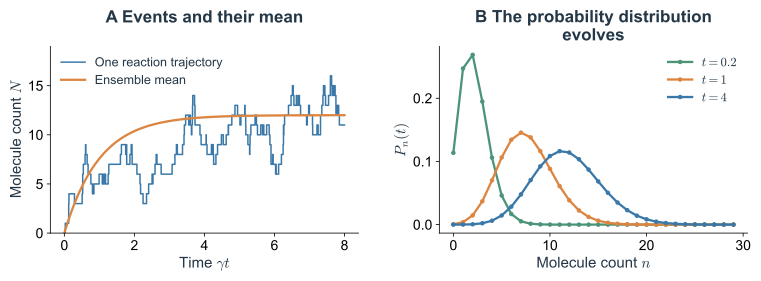
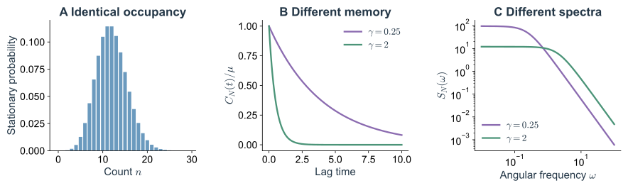

假设能够连续数出一个细胞里的某种分子。记录会是一条阶梯线：一次生成使计数加一，一次降解使计数减一。若重复实验，每次的阶梯位置和等待时间都不同，但分子数直方图可能逐渐稳定，平均表达也可能接近一条平滑的恢复曲线。

阶梯轨迹、分布和平均曲线描述的是同一套反应。这里从最简的生成–降解事件出发，先写出精确的概率收支，再判断什么时候可以把大量事件换成连续漂移和高斯噪声。不同方程之间的关系，由这些近似条件决定。

## 1. 从分子收支确定转移率 {#sd-birth-death-model}

考虑

$$
\varnothing\xrightarrow{k}X,
\qquad X\xrightarrow{\gamma}\varnothing.
\tag{2.1}
$$

令 $N(t)=n$。生成通道的总速率为 $a_+(n)=k$，降解通道为 $a_-(n)=\gamma n$。$k$ 的单位为分子计数／时间，$\gamma$ 为时间的倒数；计数视为无量纲整数时，两种倾向函数的单位都为时间的倒数。每个分子各自以速率 $\gamma$ 被去除，所以已有 $n$ 个时，总降解机会是单分子的 $n$ 倍。

在足够短的 $dt$ 内，$\Pr(\Delta N=1\mid n)=k\,dt+o(dt)$，$\Pr(\Delta N=-1\mid n)=\gamma n\,dt+o(dt)$，其余主要概率留在 $n$。它们定义了一个连续时间马尔可夫跳跃过程。

模型假设系统混合足够快、生成装置保持固定活性、分子去除独立，且相关参数在观察期间恒定。它适合用作持续转录的单步 mRNA 模型；若把 $X$ 叫作蛋白质，还隐含了对 mRNA 和翻译阶段的简化。翻译爆发、启动子切换、体积增长与分裂分配都尚未包含，因此不能把它当作所有表达系统的默认精确模型。

### 1.1 生成元把事件规则写成可计算的算子

对任意函数 $F(n)$，条件平均增量满足

$$
\mathbb E[F(N_{t+dt})-F(N_t)\mid N_t=n]
=({\cal L}F)(n)\,dt+o(dt),
$$

其中

$$
\boxed{({\cal L}F)(n)
=k[F(n+1)-F(n)]+\gamma n[F(n-1)-F(n)].}
\tag{2.2}
$$

$\mathcal L$ 称为后向生成元。每个通道贡献“发生速率乘以发生后 $F$ 的改变”。在 $n=0$，降解项为零，不需要访问一个真实的负分子态。

若取 $F(n)=n$，它给出平均分子数的变化；若取 $F$ 为某个状态的指示函数，它给出该状态的概率收支；若让 $F$ 表示到达目标所需时间，则会在下一篇得到首达时间方程。生成元因此把看起来不同的计算接到了同一套事件规则上。

## 2. 分子数分布怎样随时间演化 {#sd-master-and-stationary}

### 2.1 对到达与离开逐项记账

记 $P_n(t)=\Pr(N(t)=n)$。在 $dt$ 内，到达 $n$ 的两种方式是从 $n-1$ 生成一个，或从 $n+1$ 降解一个；离开 $n$ 则由两个通道共同造成。整理后得到化学主方程

$$
\boxed{\frac{dP_n}{dt}
=kP_{n-1}+\gamma(n+1)P_{n+1}-(k+\gamma n)P_n,\quad n\geq0,}
\tag{2.3}
$$

约定 $P_{-1}=0$。特别地，$\dot P_0=\gamma P_1-kP_0$，零态可以被生成事件带走，却不会继续向负数降解。

定义相邻状态之间向上的净概率流

$$
J_n=kP_n-\gamma(n+1)P_{n+1},\qquad
\dot P_n=J_{n-1}-J_n,
\tag{2.4}
$$

其中边界流 $J_{-1}=0$。对所有 $n$ 求和，中间流相消，概率保持归一。这个流是许多重复实验中状态之间的概率转移率，不是单条轨迹上连续流动的分子。

### 2.2 稳态泊松分布的完整计算

稳态要求 $J_{n-1}^*=J_n^*$。零态边界又要求 $J_{-1}^*=0$，因此每一条边都有 $J_n^*=0$：

$$
kP_n^*=\gamma(n+1)P_{n+1}^*.
$$

令 $\mu=k/\gamma$，逐步递推得到 $P_n^*=P_0^*\mu^n/n!$。利用 $\sum_nP_n^*=1$ 和指数级数，得到

$$
\boxed{P_n^*=e^{-\mu}\frac{\mu^n}{n!},\qquad
\langle N\rangle_*=\operatorname{Var}(N)_*=\mu.}
\tag{2.5}
$$

这里的零流来自一维相邻跳跃结构和封闭边界。在有环路的网络中，稳态只要求流入与流出相等，可以仍有环流；下一篇将具体比较。

平均 $4$ 个分子时，相对标准差为 $1/2$；平均 $100$ 个时为 $1/10$。增加分子数并未使单次反应变得可预测，而是减小了每次反应相对于总量的影响。

### 2.3 矩方程说明均值遗漏了什么

由生成元可直接得到 $d\langle F\rangle/dt=\langle\mathcal LF\rangle$。取 $F=n,n^2$，用 $(n\pm1)^2-n^2=\pm2n+1$，得到

$$
\frac{dm}{dt}=k-\gamma m,\qquad
\frac{d\langle N^2\rangle}{dt}
=2k m+k-2\gamma\langle N^2\rangle+\gamma m,
\tag{2.6}
$$

其中 $m=\langle N\rangle$。再减去 $d(m^2)/dt$，方差 $V$ 满足

$$
\boxed{\frac{dV}{dt}=k+\gamma m-2\gamma V.}
\tag{2.7}
$$

生成与降解都带来新的计数不确定性，所以出现在噪声来源里的两项相加。恢复作用则以 $2\gamma$ 消除已有的方差。稳态给出 $m=V=k/\gamma$，与完整分布一致。

本例的平均方程恰好封闭，因为速率对 $n$ 至多线性。若生成率是非线性反馈函数 $g(N)$，就会出现 $\dot m=\langle g(N)\rangle-\gamma m$；通常 $\langle g(N)\rangle\ne g(m)$，均值未必服从把随机变量直接替换成均值后的确定性方程。

### 2.4 概率生成函数压缩整组主方程

定义 $G(z,t)=\sum_{n=0}^\infty P_n(t)z^n$。$G(1,t)=1$，$\partial_zG(1,t)=\langle N\rangle$，二阶导数给出 $\langle N(N-1)\rangle$。将式（2.3）乘 $z^n$ 求和，得到

$$
\partial_tG=k(z-1)G+\gamma(1-z)\partial_zG.
\tag{2.8}
$$

设初始分子数固定为 $n_0$，记 $s=e^{-\gamma t}$，则解为

$$
G(z,t)=(1-s+sz)^{n_0}
\exp\!\left[\mu(1-s)(z-1)\right].
\tag{2.9}
$$

第一项是初始分子的独立存活：每个以概率 $s$ 留到时刻 $t$；第二项是后来生成并存活到现在的新分子。由此也可直接构造瞬态分布：一个二项变量与一个独立泊松变量相加。$t\to\infty$ 时初始分子的记忆消失，剩下式（2.5）。

若从 $N(0)=0$ 出发，整个瞬态都是均值 $\mu(1-e^{-\gamma t})$ 的泊松分布；若初始固定 $n_0\gt0$，瞬态一般不是泊松分布。只知道稳态泊松，并不能倒推所有时刻都泊松。

*Fig. 3. 同一反应规则的轨迹与分布。* 取 $k=12,\gamma=1,N(0)=0$。A：一条精确跳跃模拟的阶梯轨迹及平均值 $12(1-e^{-t})$。B：$t=0.2,1,4$ 时的精确瞬态分布，逐渐接近均值为 $12$ 的泊松稳态。所有曲线为模型结果。

## 3. 怎样直接生成一条反应轨迹 {#sd-gillespie}

主方程演化所有可能计数的概率。若关心单细胞的时间轨迹，可直接抽样下一次事件。[Gillespie（1977）](https://doi.org/10.1021/j100540a008)给出了与化学主方程一致的事件模拟方法。

在当前状态 $n$，两通道总速率为 $a_0=k+\gamma n$。状态没有改变以前速率保持不变，所以下一次事件的等待时间服从 $a_0e^{-a_0\tau}$。给定发生一次事件，选择生成通道的概率为 $k/a_0$，选择降解的概率为 $\gamma n/a_0$。两个独立的均匀随机数 $u_1,u_2\in(0,1)$ 即可完成更新：

$$
\tau=-\frac{\ln u_1}{a_0},\qquad
n\leftarrow
\begin{cases}
n+1,&u_2\lt k/a_0,\\
n-1,&u_2\geq k/a_0.
\end{cases}
\tag{2.10}
$$

将时间推进 $\tau$，按新状态重算速率，再重复。如果所有通道速率都为零，轨迹就在吸收态停止。一般反应网络只需把两个通道换成一组倾向函数 $a_r$ 和计数变化向量 $\nu_r$。

“精确”表示这种抽样没有有限步长的时间离散误差，针对的是给定跳跃模型。模型若遗漏了空间混合、转录延迟或慢状态，模拟不会自动补回这些机制。显式随时间变化的速率还需要按累计危险率抽样，不能直接沿用当前速率的指数等待。

统计时有一个容易忽略的区别：按等间隔时刻取样，与把每次反应后的状态等权收集，得到的直方图通常不同。反应快的状态在事件列表中更常出现。计算稳态占据率应按驻留时长加权，或在固定时间网格读取阶梯轨迹。

## 4. 大量离散事件怎样变成连续噪声 {#sd-jump-to-diffusion}

### 4.1 先找一个合适的中间时间窗

在短窗 $\Delta t$ 内，若各倾向函数变化很小，可把每个反应通道的事件数近似为条件独立的泊松变量。生灭模型中

$$
\Delta N=K_+-K_-,\qquad
K_+\sim\operatorname{Pois}(k\Delta t),\quad
K_-\sim\operatorname{Pois}(\gamma N\Delta t).
\tag{2.11}
$$

这一步称为泊松跃迁近似。进一步，若两种期望事件数都远大于 $1$，泊松变量可以近似为均值相同、方差相同的高斯变量，于是

$$
\Delta N\simeq(k-\gamma N)\Delta t
+\sqrt{k\Delta t}\,\eta_+
-\sqrt{\gamma N\Delta t}\,\eta_-,
\tag{2.12}
$$

$\eta_+,\eta_-$ 独立且服从标准正态分布。关键要求是存在一个中间窗口：事件已经很多，而速率和状态还没有发生显著相对变化。这两个条件未必能同时满足，尤其在分子数很少或靠近零态时。[Gillespie（2000）](https://doi.org/10.1063/1.481811)对化学 Langevin 近似的这些时间尺度条件作了系统讨论。

用维纳增量表示连续高斯极限，得到化学 Langevin 方程

$$
\boxed{dN=(k-\gamma N)dt+\sqrt{k}\,dW_+
-\sqrt{\gamma N}\,dW_-.}
\tag{2.13}
$$

对标量 $N$ 的概率律，可将两个独立噪声合并成一个：

$$
dN=(k-\gamma N)dt+\sqrt{k+\gamma N}\,dW_t.
\tag{2.14}
$$

净漂移是两个通道之差，方差率却是两者之和。即使平均生成恰好抵消平均降解，反应仍在不断发生，涨落不会消失。合并噪声保留了 $N$ 的扩散过程，却丢掉了生成和降解各自的事件记录；需要分通道研究反应流或耗散时，应保留通道结构。

### 4.2 为什么这里采用 Itô 解释

式（2.11）在时间窗开始时，根据当前计数确定事件率，然后抽取未来增量。这对应 Itô 约定：积分的离散近似取左端点值，未来 $dW$ 在给定当前历史后均值为零。

维纳过程满足 $\mathbb E[dW]=0$、$\mathbb E[(dW)^2]=dt$。因此对

$$
dX=A(X)dt+\sqrt{B(X)}dW_t
$$

及光滑函数 $F$，Taylor 展开中的二阶随机项仍为 $dt$ 阶，得到 Itô 公式

$$
dF=\left(AF'+\frac12BF''\right)dt+\sqrt B F'\,dW_t.
\tag{2.15}
$$

这也是为什么不能把 $dW/dt$ 当作普通有限函数，再照常使用微积分。白噪声只作为随机分布或积分增量被定义，其“瞬时方差”不是有限数。

加性噪声下 Itô 与 Stratonovich 描述相同；乘性噪声下，保持同一条方程的字面漂移而更换约定会改变过程。若把式（2.14）改写成等价的 Stratonovich 形式，其漂移需减去 $\tfrac14B'(N)=\gamma/4$。化学事件推导已经选定了 Itô 解释，无须再由记号任意选择。

### 4.3 从生成元得到 Fokker–Planck 方程

对一般跳跃过程，设状态为 $x$，通道 $r$ 的跃迁为 $\nu_r$、速率为 $a_r(x)$。生成元为 $\mathcal LF=\sum_ra_r(x)[F(x+\nu_r)-F(x)]$。若跃迁相对所关心的变化尺度很小，将 $F$ 展开至二阶：

$$
\mathcal LF\simeq A(x)F'(x)+\frac12B(x)F''(x),\qquad
A=\sum_r\nu_ra_r,\quad B=\sum_r\nu_r^2a_r.
\tag{2.16}
$$

概率密度 $p$ 满足 $d\int Fp\,dx/dt=\int(\mathcal LF)p\,dx$。在边界项消失或按指定概率流处理时，将右侧分部积分，得到

$$
\boxed{\partial_tp=-\partial_x(Ap)+\frac12\partial_x^2(Bp).}
\tag{2.17}
$$

这就是相应 Itô 扩散的 Fokker–Planck 方程。对生灭模型，$A=k-\gamma n$、$B=k+\gamma n$。噪声依赖状态时，二阶导数作用于整个 $Bp$，不能只写成 $B\partial_n^2p/2$。

保留全部 Taylor 项，会形式上得到 Kramers–Moyal 展开

$$
\partial_tp=\sum_{m=1}^\infty\frac{(-\partial_x)^m}{m!}
\left[M_m(x)p\right],\qquad
M_m=\sum_r\nu_r^m a_r.
\tag{2.18}
$$

二阶截断需要小跃迁极限的支持。不能把有限计数步长的高阶项随意删掉，再认为尾部或边界也被精确描述；一般的有限高阶截断还可能破坏概率非负性。

连续扩散在零附近可能走出非负计数域，甚至让式（2.13）的平方根失去定义。人为截断或反射会改变原过程。低拷贝数、灭绝概率和边界首达问题应优先返回跳跃模型，或另行验证边界近似。

## 5. 确定性极限和线性噪声近似 {#sd-system-size-and-ou}

### 5.1 系统变大时究竟固定什么

引入无量纲系统尺度 $\Omega$，把计数写为 $N=\Omega x$，并让生成率随尺度增长：$k=\Omega\alpha$。固定 $\alpha,\gamma$，则浓度型变量 $x$ 的方程为

$$
dx=(\alpha-\gamma x)dt
+\Omega^{-1/2}\sqrt{\alpha+\gamma x}\,dW_t.
\tag{2.19}
$$

平均漂移不变，相对涨落按 $\Omega^{-1/2}$ 缩小，因此在有限观测时间和适当正则条件下，$\Omega\to\infty$ 接近确定性方程 $\dot\phi=\alpha-\gamma\phi$。这项极限同时增加了分子数量和生成能力，不能只改变体积而把所有反应总率原封不动。

系统尺度展开进一步写为 $N=\Omega\phi(t)+\sqrt\Omega\,\xi(t)$。代入并按 $\Omega$ 的阶数展开，主导阶给出确定性方程，下一阶给出

$$
d\xi=-\gamma\xi\,dt+\sqrt{\alpha+\gamma\phi(t)}\,dW_t.
\tag{2.20}
$$

线性噪声近似描述确定性轨道附近、尺度为 $\sqrt\Omega$ 的典型计数涨落。它没有覆盖需要跨越宏观距离的罕见逃逸；系统变大与观察无限长时间也不一定可以交换顺序。

### 5.2 OU 过程给出涨落的持续时间

在稳态 $\phi_* =\alpha/\gamma$ 附近，令 $\delta N=N-\mu$。将噪声幅度冻结于稳态，得到 Ornstein–Uhlenbeck（OU）过程

$$
d\delta N=-\gamma\delta N\,dt+\sqrt{2k}\,dW_t.
\tag{2.21}
$$

从时刻 $0$ 积分到 $t$：

$$
\delta N(t)=e^{-\gamma t}\delta N(0)
+\sqrt{2k}\int_0^t e^{-\gamma(t-s)}dW_s.
\tag{2.22}
$$

后一个积分与初值独立，且均值为零。平稳时，Itô 等距关系给出方差 $k/\gamma=\mu$，于是

$$
\boxed{C_N(t)=\langle\delta N(t)\delta N(0)\rangle
=\mu e^{-\gamma|t|}.}
\tag{2.23}
$$

采用双边角频率谱的约定 $S_N(\omega)=\int_{-\infty}^\infty C_N(t)e^{-i\omega t}dt$，得到

$$
\boxed{S_N(\omega)=\frac{2\mu\gamma}{\gamma^2+\omega^2},\qquad
C_N(0)=\int_{-\infty}^\infty\frac{d\omega}{2\pi}S_N(\omega).}
\tag{2.24}
$$

恢复时间 $1/\gamma$ 同时是相关时间。高频起伏难以积累，低频部分则能保持较久。比较谱时必须统一双边／单边谱、角频率／普通频率的约定，避免凭系数差别判断机制不同。

本模型还有一个特别好的检查：精确跳跃过程满足 $\mathbb E[N_t\mid N_0]=\mu+(N_0-\mu)e^{-\gamma t}$，所以其稳态协方差也**精确**等于式（2.23）。OU 近似正确保留了一、二阶统计量，但把离散泊松分布换成了连续高斯分布。协方差相同，并不意味着两条过程完全等价。

*Fig. 4. 直方图没有告诉我们的时间尺度。* 取 $\mu=12$，比较 $\gamma=0.25$ 与 $\gamma=2$，同时令 $k=\mu\gamma$。A：两者精确稳态都为同一泊松分布。B：相关时间分别为 $4$ 和 $0.5$。C：双边噪声谱面积相同，慢系统的噪声更集中于低频。谱的横轴仅画出正频率部分。

## 6. 怎样选择描述层次 {#sd-choosing-description}

同一套反应规则可以用不同方式计算，但各层次所保留的信息不同。

| 描述 | 能直接得到什么 | 主要条件或代价 |
|---|---|---|
| 主方程 | 完整计数分布及其演化 | 对指定跳跃模型精确；状态空间可能很大 |
| Gillespie 模拟 | 单条离散轨迹、等待时间和首达事件 | 对指定跳跃模型精确抽样；罕见事件需要很多样本 |
| 矩方程 | 均值、方差和混合矩 | 线性模型可封闭；非线性通常需更高阶矩 |
| 化学 Langevin 与 Fokker–Planck | 连续轨迹或连续密度 | 需要多事件且速率近似不变的中间时间窗 |
| 线性噪声与 OU | 典型涨落、关联和谱 | 在稳定轨道或固定点附近展开，边界与远尾需另查 |
| 确定性速率方程 | 宏观漂移、固定点与恢复 | 大系统有限时间极限；不能给出个体切换概率 |

如果实验只测稳定状态附近的谱，OU 可能已经足够；如果要计算一个只有两份拷贝的调控因子何时清零，连续高斯近似就很可疑。即使同样研究表达，也应由测量问题决定所需层次。

到这里，最简模型已经给出了一个值得继续追问的结果：保持 $k/\gamma$ 不变，同时加快或减慢生成与降解，所有稳态直方图都不变，而轨迹的相关时间改变。下一篇让这样的信号驱动下游，再加入反馈、边界和环路，考察这些时间差别怎样变成不同的生物行为。

## 补充推导 {#sd-dynamics-appendix}

展开：一般反应网络的扩散矩阵与生成函数检查

对 $d$ 种分子的计数向量 $\mathbf N$，通道 $r$ 的化学计量向量为 $\boldsymbol\nu_r$，化学 Langevin 方程为

$$
d\mathbf N=\sum_r\boldsymbol\nu_ra_r\,dt
+\sum_r\boldsymbol\nu_r\sqrt{a_r}\,dW_r.
\tag{2.A1}
$$

漂移为 $A_i=\sum_r\nu_{ir}a_r$，扩散矩阵为 $B_{ij}=\sum_r\nu_{ir}\nu_{jr}a_r$。同一反应同时改变两种分子，会给它们带来相关噪声；分别给每种分子任意加一个独立噪声通常无法保留化学计量约束。对应密度方程为

$$
\partial_tp=-\sum_i\partial_i(A_ip)
+\frac12\sum_{ij}\partial_i\partial_j(B_{ij}p).
\tag{2.A2}
$$

式（2.9）可以不解偏微分方程而检查。其二项部分来自 $n_0$ 个独立寿命为指数分布的初始分子；新生部分的均值为 $\int_0^t k e^{-\gamma(t-s)}ds=\mu(1-s)$。对生成泊松过程按存活概率进行独立稀疏化，留下的仍是泊松变量。因此

$$
m(t)=n_0s+\mu(1-s),\qquad
V(t)=n_0s(1-s)+\mu(1-s).
\tag{2.A3}
$$

将这两式代入式（2.6）与（2.7），即可逐项核对。若初值本身有方差 $V_0$，还需在方差中加入 $s^2V_0$，并把 $n_0$ 换成初始均值。

## 进一步阅读 {#sd-dynamics-references}

- [Gillespie 1977, Exact Stochastic Simulation of Coupled Chemical Reactions](https://doi.org/10.1021/j100540a008)：从事件等待与通道选择建立随机模拟。
- [Gillespie 2000, The Chemical Langevin Equation](https://doi.org/10.1063/1.481811)：化学事件到连续高斯增量的近似条件。
- [Vastola and Holmes 2020, Chemical Langevin Equation: A Path-Integral View of Gillespie’s Derivation](https://arxiv.org/abs/1910.05383)：同一近似与路径积分结构的联系。
- [下一篇：相同的表达分布为什么会产生不同的细胞行为](03_noise_response_and_rare_events.md)。
