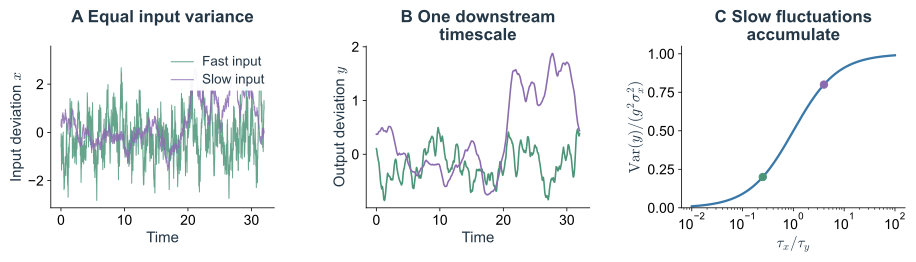
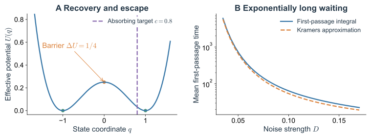
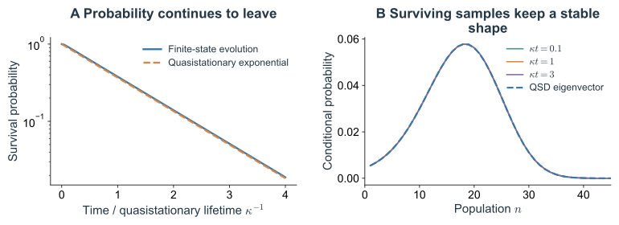
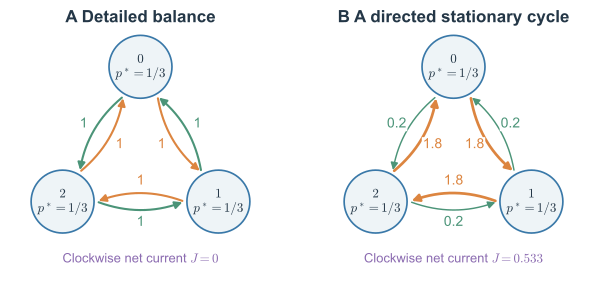

两个表达系统可以拥有完全相同的稳态分子数分布，却以不同速度更新分子。一个细胞若只在随机时刻读取一次，可能分辨不出它们；一个需要持续积累输入才能启动的下游回路，却可能给出很不同的响应。

这说明“噪声有多大”还不足以判断生物学后果。输入持续多久，恢复作用有多强，离阈值或吸收边界有多远，以及状态之间是否存在定向循环，都可能改变结果。下面先计算最简单的时间过滤，再追踪一次罕见的状态转换，最后比较同分布下的平衡与非平衡动力学。

第二篇已经把一次次反应接成了概率演化，并得到了均值、方差和相关时间。现在需要判断，哪一项统计差别真的会改变后续行为。下面仍沿着表达系统往前走：让下游读取它，加入缓慢启动子与反馈，再问一次极少发生的切换要等待多久。概率流和非平衡则说明，即使占据分布相同，反应经过的方向仍可能不同。

## 1. 相同幅度的噪声为什么会产生不同响应 {#sd-temporal-filtering}

### 1.1 让下游读取一段表达历史

记上游表达相对均值的偏差为 $x(t)$，平稳协方差为

$$
C_x(t)=\sigma_x^2e^{-|t|/\tau_x}.
\tag{3.1}
$$

上一篇的生灭模型精确具有这种协方差，其中 $\sigma_x^2=\mu,\tau_x=1/\gamma$。先取一个线性下游读出 $y$：

$$
\tau_y\frac{dy}{dt}=-y+g x(t).
\tag{3.2}
$$

$\tau_y$ 为下游恢复时间，$g$ 为静态增益。这里的 $y$ 是偏离稳态的连续读出，只计算上游噪声传递；真实下游分子的生成和降解还会贡献自身噪声。

将初始瞬态放到足够远的过去，式（3.2）的解是

$$
y(t)=\frac{g}{\tau_y}\int_0^\infty e^{-s/\tau_y}x(t-s)\,ds.
\tag{3.3}
$$

下游不断平均一段过去，而不是只读取当前的 $x$。若正负偏差快速交替，这段平均会互相抵消；若偏差在整个响应时间内保持同一方向，就能被积累。

例如，一次很短的表达尖峰可能在下游尚未积累时就已过去；幅度不大却持续很久的偏高，则可能让下游逐渐达到新的水平。方差没有记录这种先后组织，卷积核却会把它保留下来。这里先采用线性读出，是为了把相关时间的作用从阈值、反馈等非线性中单独分辨出来。

### 1.2 完整计算传递后的方差

先用具有式（3.1）协方差的 OU 输入，$dx=-(x/\tau_x)dt+\sqrt{2\sigma_x^2/\tau_x}\,dW$。对 $xy$ 求 Itô 微分，由于 $dy$ 没有维纳增量，交叉二阶项为零。稳态时

$$
0=-\left(\frac1{\tau_x}+\frac1{\tau_y}\right)\langle xy\rangle
+\frac{g}{\tau_y}\langle x^2\rangle,
\quad\Longrightarrow\quad
\langle xy\rangle=\frac{g\sigma_x^2\tau_x}{\tau_x+\tau_y}.
\tag{3.4}
$$

再对 $y^2$ 求导，稳态要求 $0=-2\langle y^2\rangle/\tau_y+2g\langle xy\rangle/\tau_y$，因此

$$
\boxed{\operatorname{Var}(y)
=g^2\sigma_x^2\frac{\tau_x}{\tau_x+\tau_y}.}
\tag{3.5}
$$

这个结果只依赖输入的二阶协方差。直接把式（3.1）代入式（3.3）的双重积分，会得到同样结果，因此它也适用于具有相同协方差的精确生灭输入，并不要求输入的所有统计量都高斯。

固定输入方差时，$\tau_x\ll\tau_y$ 给出强平均，输出方差约为 $g^2\sigma_x^2\tau_x/\tau_y$；$\tau_x\gg\tau_y$ 时，下游几乎能跟随输入，输出方差接近 $g^2\sigma_x^2$。

回到上一篇的两个系统：$\mu=12$，$\gamma=0.25$ 或 $2$，故 $\tau_x=4$ 或 $0.5$。若下游 $g=1,\tau_y=2$，两者输入方差都为 $12$，传递后的方差却分别为 $8$ 和 $2.4$。只测上游直方图，会漏掉这个三倍以上的差别。

*Fig. 3.1. 下游对慢噪声更容易积累。* A：单位方差的 OU 输入，相关时间为 $0.25$ 或 $4$；B：同一输入经 $g=1,\tau_y=1$ 的下游读取。两行采用相同时间轴，轨迹为模型模拟。C：式（3.5）给出的方差传递比例，标出上述两个参数点。

频域给出相同物理图像。响应函数为 $H(\omega)=g/(1+i\omega\tau_y)$，输出谱为

$$
S_y(\omega)=|H(\omega)|^2S_x(\omega),\qquad
\operatorname{Var}(y)=\int_{-\infty}^\infty\frac{d\omega}{2\pi}
\frac{g^2S_x(\omega)}{1+\omega^2\tau_y^2}.
\tag{3.6}
$$

噪声是否影响下游，取决于噪声谱与系统响应的重叠。以上比较固定了输入的瞬时方差；若改成固定白噪声极限中的积分强度 $\sigma_x^2\tau_x$，改变相关时间时也会改变方差，结论需按新的控制条件重算。

### 1.3 反馈会同时改变幅度和恢复时间

若表达满足 $dq=f(q)dt+\sqrt{2D}\,dW$，在稳定点 $q_*$ 附近记 $f'(q_*)=-\lambda\lt0$，线性近似给出

$$
\operatorname{Var}(q)\simeq\frac{D}{\lambda},\qquad
\tau_q\simeq\frac1\lambda.
\tag{3.7}
$$

固定局部噪声强度 $D$ 时，恢复作用减弱，起伏会更宽，也更持久。负反馈常能加强局部恢复，正反馈可能使恢复变慢；具体结果还受反馈引起的反应率变化、延迟和噪声来源影响。靠近稳定态消失的边界，$\lambda\to0$，线性近似预言放大的涨落与临界慢化，但当分布宽到采样非线性区域时，这个局部公式便不再自洽。

非线性还会改变均值。一般有 $d\langle q\rangle/dt=\langle f(q)\rangle$，小涨落展开给出 $\langle f(q)\rangle\simeq f(\langle q\rangle)+\tfrac12f''(\langle q\rangle)\operatorname{Var}(q)$。因此即使噪声均值为零，平均响应也可能移动。这个展开要求分布窄且相关矩存在；跨越多个状态时应计算完整分布。

## 2. 两个表达峰是否意味着两个稳定态 {#sd-bimodality-and-environment}

### 2.1 缓慢切换的产生环境已经可以造成双峰

令启动子 $S\in\{0,1\}$ 以 $k_{\rm on},k_{\rm off}$ 切换，两个状态下的生成率分别为 $r_0,r_1$，降解率仍为 $\gamma n$。固定某个 $S=s$ 时，分子数只有一个泊松稳态，均值为 $\mu_s=r_s/\gamma$。

若切换时间远长于 $1/\gamma$，每次开启或关闭后，分子数有机会先接近该条件下的分布。忽略切换后的短暂过渡，稳态近似为

$$
P_n^*\simeq(1-\pi)\operatorname{Pois}(n;\mu_0)
+\pi\operatorname{Pois}(n;\mu_1),\qquad
\pi=\frac{k_{\rm on}}{k_{\rm on}+k_{\rm off}}.
\tag{3.8}
$$

两均值分离足够大、权重也适当时，这个分布可以有两个峰。这里没有表达对自身的正反馈；两个峰来自缓慢的隐藏条件。[Raj 等（2006）](https://doi.org/10.1371/journal.pbio.0040309)利用单分子 mRNA 计数及启动子激活模型研究了表达异质性和转录爆发，为这类建模提供了实验背景。

这个模型也把前两篇的理论联系起来：只看分子数 $N$ 时，第一篇指出其未来仍取决于隐藏的 $S$；把状态扩成 $(N,S)$，第二篇的主方程就能直接计算它的涨落。若 $r_0=0,r_1=r$，记 $\kappa=k_{\rm on}+k_{\rm off}$，则精确稳态矩给出

$$
\langle N\rangle=\frac{r\pi}{\gamma},\qquad
\frac{\operatorname{Var}(N)}{\langle N\rangle}
=1+\frac{r(1-\pi)}{\gamma+\kappa}.
\tag{3.9}
$$

第一项是单步生成与去除的泊松基准，第二项来自产生条件持续偏高或偏低。固定活跃比例 $\pi$ 与 $r,\gamma$，只改变切换速度，就能保持同一均值、改变方差。慢环境在分子被去除以前持续作用，额外涨落更明显；快切换时，产生率更接近其平均值。

取 $r=20,\gamma=1,\pi=1/2$，无论切换多快，平均都有十个分子。若 $\kappa=0.4$，方差均值比约为 $8.14$；若 $\kappa=40$，则约为 $1.24$。完整矩计算见[附录 C.2](#sd-promoter-moments)。这给出一个具体例子：增加状态变量以后，可以把原先表现为“有色噪声”的效应重新写成明确的事件规则。

### 2.2 反馈双稳态需要另外的动力学证据

自激活则可能让同一个固定环境下的确定性漂移出现两个稳定固定点，中间由不稳定阈值分开。撤去一次诱导后，系统落在哪个吸引域，决定其随后恢复到哪个状态。现有 [GRN 笔记](/notes/qbio_course/grn_theory/memory_lifetime/#hysteresis)计算了这类迟滞与准备历史的作用。

要区分两种机制，可以同时记录启动子活动，比较条件分布；也可以把系统分别准备到高、低表达后，在同一环境中观察局部恢复和长期停留。干预启动子切换速率、反馈强度或分子更新时间，再比较峰的宽度与驻留时间，也会增加约束。迟滞实验须等待局部恢复完成，否则慢弛豫本身也会产生扫描方向差异。

从双峰快照直接写出 $U=-\ln P$，只能得到一个占据概率的表示。它没有给出运动速度、噪声状态依赖、隐藏环境或概率流。要把这幅图变成能预测切换的动力学势，必须补充过程和边界条件。

## 3. 稀有涨落怎样变成一次状态转换 {#sd-first-passage-and-switching}

### 3.1 先定义要等的事件

考虑一维连续有效模型

$$
dq=-U'(q)dt+\sqrt{2D}\,dW_t.
\tag{3.10}
$$

$q$ 可以是相对某个表达参考值的坐标，允许为负，不直接当作非负分子数。$U$ 是由漂移定义的动力学势，$D$ 为常数；除非另有热力学识别，$U$ 不等于细胞自由能。模型用于说明光滑势阱中的逃逸机制，具体基因开关仍需检查乘性噪声和离散反应。

设左侧 $a$ 为反射边界，右侧目标 $c$ 为吸收边界。首次到达时间及其均值为

$$
\tau_c=\inf\{t\geq0:q_t=c\},\qquad
T(q)=\mathbb E_q[\tau_c].
\tag{3.11}
$$

“到达阈值”与“进入另一个稳定态附近”是不同事件，目标位置应与实验的状态判据对应。某些越过阈值的轨迹还会立即返回；下文将 $c$ 放在势垒之后。

这里的“首次”需要保留。时刻 $t$ 的 $q_t$ 位于阈值右边，和此前已经越过阈值，是不同事件：一条轨迹可能先越界，再返回原阱。若实验把越过阈值视为完成切换，就应在越界时停止计时；若要求进入另一个表达态附近，目标 $c$ 就应相应移到更远处。

令 $S(t\mid q)=\Pr_q(\tau_c\gt t)$，它是在给定起点后尚未到达的样本比例。平均首达时间满足

$$
T(q)=\int_0^\infty S(t\mid q)dt.
\tag{3.12}
$$

每个尚未到达的样本都继续贡献一段等待，因此把生存比例对时间累积就得到均值。等价地，让目标吸收轨迹后，域内概率的损失率就是首达密度。这与第二篇 Fokker–Planck 方程的边界概率流相连。

### 3.2 从一步条件平均推导首达时间

从内部点 $q$ 出发，先演化很短的 $dt$，已经消耗的时间为 $dt$，之后还需平均等待 $T(q+dq)$，所以

$$
T(q)=dt+\mathbb E_q[T(q+dq)].
$$

展开到 $dt$ 阶，利用 $\mathbb E[dq]=-U'(q)dt$、$\mathbb E[(dq)^2]=2Ddt$，得到后向方程

$$
\boxed{-1=-U'(q)T'(q)+DT''(q),\qquad
T'(a)=0,\quad T(c)=0.}
\tag{3.13}
$$

反射边界保证没有从左侧离开的首达事件；从目标本身出发，无需再等。它使用的正是上一篇的后向生成元，只是作用对象由可观测量换成了等待时间。

两边乘积分因子 $e^{-U(q)/D}$，有

$$
D\frac{d}{dq}\left[e^{-U(q)/D}T'(q)\right]=-e^{-U(q)/D}.
$$

从 $a$ 积到 $y$，再用 $T(c)=0$ 从 $q$ 积到 $c$，得到

$$
\boxed{T(q)=\frac1D\int_q^c dy\,e^{U(y)/D}
\int_a^y dz\,e^{-U(z)/D}.}
\tag{3.14}
$$

这个公式直接显示了整段路径的作用：等待时间取决于起点与目标之间的漂移和噪声，无法只由某个峰附近的方差决定。

### 3.3 从积分看见 Kramers 指数律

设起始势阱底为 $q_L$，右侧势垒顶为 $q_b$，且 $\Delta U=U(q_b)-U(q_L)\gg D$。若局部极值非退化，边界 $a$ 远离左阱底、$c$ 位于势垒右侧并与它相隔多个局部噪声宽度，则内积分主要来自阱底附近，外积分主要来自势垒附近。

分别用 $U(z)\simeq U(q_L)+U''(q_L)(z-q_L)^2/2$、$U(y)\simeq U(q_b)-|U''(q_b)|(y-q_b)^2/2$ 展开，两次高斯积分给出

$$
\boxed{T(q_L)\simeq
\frac{2\pi}{\sqrt{U''(q_L)|U''(q_b)|}}
\exp\!\left(\frac{\Delta U}{D}\right).}
\tag{3.15}
$$

这是一维过阻尼弱噪声条件下的 Kramers 逃逸时间。[Kramers（1940）](https://doi.org/10.1016/S0031-8914(40)90098-2)的工作建立了热涨落与反应逃逸的经典联系。若把吸收边界恰好放在势垒顶，外积分只取半个高斯，当前边界设置下的前因子相应变为 $\pi/\sqrt{U''(q_L)|U''(q_b)|}$；讨论前因子前必须先说清到达目标。

以 $U(q)=(q^2-1)^2/4$ 为例，阱底在 $\pm1$，势垒在 $0$，$\Delta U=1/4$，$U''(-1)=2$、$|U''(0)|=1$。因此 $T\simeq\sqrt2\pi e^{1/(4D)}$。噪声强度的较小改变，就能使切换等待时间变化很多；局部恢复时间 $1/2$ 却保持不变。

*Fig. 3.2. 小涨落与状态转换对应不同时间尺度。* A：$U=(q^2-1)^2/4$，从左阱底 $-1$ 出发，反射边界 $a=-2$、吸收目标 $c=0.8$。B：式（3.14）的数值积分与式（3.15）的弱噪声近似，纵轴为对数刻度。噪声增大后，两条曲线的偏离提示势垒渐近近似的限制。

当阱内弛豫远快于逃逸，系统先在阱内形成近似不变的条件分布，随后以近似恒定的小概率率逃走。这时较长时间的生存概率近似为 $\Pr(\tau_c\gt t)\simeq e^{-t/T}$。它来自时间尺度分离，不能把所有首达时间都预设成指数分布；短时准备、移动边界或隐藏慢环境都会改变它。

等待很久不意味着一次成功切换本身也很慢。系统通常已经在原阱内反复恢复、尝试，再由少数连续偏向上坡的随机变化完成跨越。弱噪声下，阱内恢复与阱间等待分离，才有近似恒定的长时逃逸率。

这也给实验提出两个不同测量：在一个表达峰附近施加小扰动，测到的是局部恢复；追踪极少发生的跨峰事件，测到的是全局寿命。前者由阱底斜率决定，后者需要知道从阱底到阈值整段的漂移与噪声。仅用峰宽拟合成功，不能据此保证切换率也正确。

### 3.4 离散反应的稀有尾部可能需要保留跳跃结构

对浓度 $x=n/\Omega$ 的一维生灭系统，设上、下跳速率为 $\Omega w_+(x),\Omega w_-(x)$。常规扩散近似保留漂移 $w_+-w_-$ 与方差率 $(w_++w_-)/\Omega$，对稳定点附近的典型涨落很有用。弱噪声逃逸却采样分布的远尾，二阶近似不一定保留正确的指数。

令稳态概率有形式 $P_n\asymp e^{-\Omega\Phi(x)}$，将其代入相邻态的零流递推，在主导阶得到

$$
\Phi'(x)=\ln\frac{w_-(x)}{w_+(x)}.
\tag{3.16}
$$

这里 $\asymp$ 只比较系统尺度下的对数主导阶。扩散近似相应给出 $\Phi'_{\rm diff}=2(w_--w_+)/(w_-+w_+)$，仅在两率接近时与对数式一致。因此，得到漂亮的高斯峰并不足以验证极少发生的状态切换。WKB 和大偏差方法保留跳跃的指数结构，用于继续计算此类逃逸作用量与最可能路径。

## 4. 有稳定平均数量的群体为什么仍会灭绝 {#sd-extinction-and-absorbing-states}

考虑至多容纳 $K$ 个可复制个体的有限群体，$n=0,\ldots,K$。取

$$
b_n=\beta n\left(1-\frac nK\right),\qquad
d_n=\delta n,\qquad \beta\gt\delta\gt0.
\tag{3.17}
$$

可以把 $n$ 理解为有限宿主中的感染个体数：复制需要现存个体，还受可用容量限制，去除独立发生。用 $x=n/K$ 作大群体近似，得到

$$
\dot x=(\beta-\delta)x-\beta x^2,
\qquad x_* =1-\frac\delta\beta\gt0.
\tag{3.18}
$$

确定性方程中，从正初值出发会靠近正固定点。但随机模型中，$b_0=d_0=0$，零态一旦到达便不能离开。有限状态空间内，从任意正数状态都有一串连续去除的路径到达零态，且没有其他封闭通信类，因此最终以概率 $1$ 灭绝。唯一真正稳态是 $P_n^*=\delta_{n0}$。

大 $K$ 时，灭绝可能非常慢。实验在有限时间内看到的稳定正数量，往往接近**准稳态**：在“尚未灭绝”的条件下，数量分布近似稳定，而未灭绝的样本总比例继续下降。这个条件分布不能与无条件稳态混为一谈。

离散平均灭绝时间满足

$$
-1=b_n(T_{n+1}-T_n)+d_n(T_{n-1}-T_n),\qquad
T_0=0,\quad b_K=0.
\tag{3.19}
$$

这是式（3.13）的跳跃版本，直接保留整数计数和吸收边界。如果问题是少量质粒丢失、有限群体消失或低拷贝状态清零，优先检查这类边界，而不是围绕正固定点无限延伸高斯近似。

在 $K\to\infty$ 的宏观极限先取定有限时间，可以看到持久的正状态；对每个有限 $K$ 先等待 $t\to\infty$，则一定落入零态。噪声是否只是小修正，也取决于观察多久以及先取哪个极限。

可以把正数量状态中的概率写成

$$
q_n(t)=\Pr\{N_t=n\mid N_t\gt0\}
=\frac{P_n(t)}{S(t)},\qquad
S(t)=\sum_{m=1}^KP_m(t),\quad n\geq1.
\tag{3.20}
$$

若正状态之间混合得快，而流向零态很慢，$q_n(t)$ 可以先接近一个稳定形状，同时 $S(t)$ 继续下降。这正是准稳态与真正稳态的差别：前者每次都把已灭绝的样本排除，再对剩余样本归一；后者必须包含所有样本。

*Fig. 3.3. 准稳态不等于群体永久存在。* $K=60,\beta=1.5,\delta=1$，初始 $n_0=20$。A：完整有限状态主方程给出的生存概率，时间用准稳态寿命归一。B：不同时刻条件于未灭绝的数量分布，以及准稳态分布。寿命约为 $184.13$ 个模型时间单位；图示为模型计算。

连续平均和低阶涨落在这个例子里仍能解释大部分时间的数量波动，但吸收事件需要保留零态的特殊规则。主方程、后向首达方程和确定性近似所回答的问题，因而在同一个生物模型中自然分开。

## 5. 相同稳态分布能否隐藏不同方向的动力学 {#sd-stationary-currents}

### 5.1 一个三态循环已经足够

让分子装置有三个状态 $i=0,1,2$，下标按模 $3$ 计算。从 $i$ 到 $i+1$ 的速率为 $a$，从 $i$ 到 $i-1$ 的速率为 $b$，且 $a,b\gt0$。每个状态都以总速率 $a+b$ 离开，也从邻居收到相同总量的概率，所以稳态始终为

$$
p_i^*=\frac13.
\tag{3.21}
$$

当 $a=b$，每一对状态之间的正反向概率流都相等，满足详细平衡。当 $a\ne b$，沿顺时针每条边的稳态净流为

$$
\boxed{J=\frac{a-b}{3}.}
\tag{3.22}
$$

概率没有在任何状态积累，却持续绕环运动。这种稳态不能从均匀直方图中识别。

可以进一步固定 $a+b=2$，比较 $(a,b)=(1,1)$ 与 $(1.8,0.2)$。它们的稳态占据概率相同，每个状态的驻留时间也都服从均值 $1/2$ 的指数分布；区别在于离开后更常朝哪个方向走。后者的整圈路径 $0\to1\to2\to0$ 相对于反向路径的速率乘积之比为 $(a/b)^3$，直接暴露时间反演不对称。

*Fig. 3.4. 相同占据不等于相同路径。* 左：$a=b=1$；右：$a=1.8,b=0.2$。圆内均标出 $p_i^*=1/3$，边上箭头标出两个方向的转移率。右图每条顺时针边净流为 $1.6/3$。状态顺序只是模型标记，可对应分子构象循环。

### 5.2 详细平衡与熵产生的物理解释

一般连续时间马尔可夫链，令 $w_{ij}$ 为 $i\to j$ 的速率。详细平衡要求每一对连接态都有 $p_i^*w_{ij}=p_j^*w_{ji}$。稳态只要求各状态的净流之和为零，比这个条件弱。

在所有相关正反通道均有正速率的模型中，稳态的路径不可逆性可写为

$$
\dot S_{\rm tot}
=\frac{k_{\rm B}}2\sum_{i\ne j}
(p_i^*w_{ij}-p_j^*w_{ji})
\ln\frac{p_i^*w_{ij}}{p_j^*w_{ji}}\geq0.
\tag{3.23}
$$

每对正反流贡献 $(u-v)\ln(u/v)\geq0$，详细平衡时全部为零。对三态环，三条无向边相加得到

$$
\boxed{\dot S_{\rm tot}=k_{\rm B}(a-b)\ln(a/b).}
\tag{3.24}
$$

把这个路径不可逆性解释为实际热力学熵产生，需要状态和反应通道足以解析能量交换，并满足与热浴、化学势等一致的局部详细平衡。ATP 驱动的构象循环正是可能的物理实现。[Seifert（2005）](https://doi.org/10.1103/PhysRevLett.95.040602)将随机轨迹上的熵产生与涨落关系联系起来。

一个粗粒化生灭链即使在计数空间满足零流，也不能证明真实基因表达没有耗能。转录、翻译和分子降解中的化学通道已被省略；不同化学反应还可能在同一对计数态之间产生无法从计数分辨的流。隐藏变量会同时隐藏记忆和耗散。

对于一维加性扩散，零流稳态给出 $p_*\propto e^{-U/D}$；对于高维系统，稳态还可存在散度为零的概率环流。因此，用 $-\ln p_*$ 构造的地形通常不足以确定高维动力学。前面的三态环用最少状态展示了同一个缺口：需要轨迹和方向信息。

第一篇的平衡布朗运动提供了一个可作比较的基准。若迁移率为 $\mu$、实际势能为 $V(q)$，同一热浴约束下有

$$
dq=-\mu V'(q)dt+\sqrt{2\mu k_{\rm B}T}\,dW,
\qquad p_*(q)\propto e^{-V(q)/(k_{\rm B}T)}.
\tag{3.25}
$$

噪声强度与阻力受到同一温度约束，封闭零流稳态满足详细平衡。细胞中持续进行的生成、转化与去除可以受化学能驱动，漂移和涨落便不能只由一个温度参数配对。比较平衡与非平衡时，要检查具体正反通道和能量交换，而不只看分布是否稳定或是否近似高斯。

## 6. 从一个实验问题选择下一步计算 {#sd-method-map}

学习这些方法时，可以先明确所要解释的观测：一个峰的宽度、信号的持续时间、一次状态转换，还是一个循环的方向。它们分别约束动力学的不同部分。

| 观察或问题 | 先保留什么 | 主要计算 | 进一步的方法 |
|---|---|---|---|
| 单个表达峰的方差和恢复 | 稳定点附近的计数与漂移 | 矩方程、线性噪声、OU 谱 | 多变量响应与相关矩阵 |
| 低计数、间歇开启或爆发 | 离散反应、启动子状态 | 主方程、Gillespie、生成函数 | 多态启动子与更新过程 |
| 下游为什么响应慢波动 | 输入的相关时间、下游恢复 | 卷积核、响应函数、噪声谱 | 有记忆核的有效动力学 |
| 很久才发生的状态切换 | 阈值、完整路径与噪声结构 | 后向方程、首达时间 | WKB、大偏差、稀有事件采样 |
| 空间传播和局部反应 | 位置、分子输运与反应通道 | 空间跳跃、反应扩散 | 空间随机场与粒子模拟 |
| 稳态仍有定向循环 | 可分辨的状态和正反通道 | 概率流、路径反演、熵产生 | 随机热力学与涨落定理 |

回到最初那群处于相同培养条件的细胞：测量均值、直方图、时间关联、驻留时间与转移方向，实际是在逐步约束同一个随机动力学模型。只有把所保留的状态、事件规则和观测尺度同时说清，才知道噪声何时能被平均，何时会被下游积累，何时会主导一次生物状态转换。

## 附录 C 时间平均、启动子涨落与首达计算 {#sd-response-appendix}

### C.1 有限时间平均的方差 {#sd-time-average-appendix}

对式（3.1）的输入作长度 $T$ 的时间平均 $\bar x_T=T^{-1}\int_0^Tx(t)dt$，用协方差的二重积分得到

$$
\operatorname{Var}(\bar x_T)
=\frac2{T^2}\int_0^T(T-s)C_x(s)ds
=2\sigma_x^2\left[\frac{\tau_x}T
-\frac{\tau_x^2}{T^2}(1-e^{-T/\tau_x})\right].
\tag{3.C1}
$$

$T\ll\tau_x$ 时，整段平均仍主要读到同一次持续偏差，方差接近瞬时值；$T\gg\tau_x$ 时，约为 $2\sigma_x^2\tau_x/T$。增加采样帧数而不增加记录总时长，不会无限增加独立样本数。

### C.2 双态启动子怎样放大分子计数涨落 {#sd-promoter-moments}

取 OFF 时不生成，ON 时以速率 $r$ 生成；切换率为 $k_{\rm on},k_{\rm off}$，去除率为 $\gamma n$。令 $P_{n,s}$ 为联合分布，逐项记录生成、去除和切换：

$$
\begin{aligned}
\dot P_{n,0}&=\gamma(n+1)P_{n+1,0}-\gamma nP_{n,0}
-k_{\rm on}P_{n,0}+k_{\rm off}P_{n,1},\\
\dot P_{n,1}&=rP_{n-1,1}+\gamma(n+1)P_{n+1,1}
-(r+\gamma n)P_{n,1}+k_{\rm on}P_{n,0}-k_{\rm off}P_{n,1}.
\end{aligned}
\tag{3.C2}
$$

约定 $P_{-1,s}=0$；零计数时去除率为零。定义 $m=\langle N\rangle$、$u=\langle NS\rangle$、$\kappa=k_{\rm on}+k_{\rm off}$、$\pi=k_{\rm on}/\kappa$。与第二篇一样让生成元作用于 $N,S,NS$，稳态得到

$$
m=\frac{r\pi}{\gamma},\qquad
0=r\pi+k_{\rm on}m-(\gamma+\kappa)u,
\qquad
\operatorname{Cov}(N,S)=\frac{r\pi(1-\pi)}{\gamma+\kappa}.
\tag{3.C3}
$$

对 $N^2$ 继续做同样计算，方差满足 $V=m+(r/\gamma)\operatorname{Cov}(N,S)$，因此

$$
\frac Vm=1+\frac{r(1-\pi)}{\gamma+\kappa}.
\tag{3.C4}
$$

慢启动子造成的额外方差，来自产生率与已积累分子之间的相关。快切换极限中，固定 $r,\pi,\gamma$ 时该项趋零，回到平均产生率 $r\pi$ 的泊松基准；若同时缩放 $r$ 保留爆发产量，则是另一种极限，不能直接套用这个结论。

### C.3 首达方程的两个检验 {#sd-first-passage-checks}

若没有势垒，在 $[0,L]$ 内纯扩散，左端反射、右端吸收，则 $DT''=-1$、$T'(0)=0,T(L)=0$，解为

$$
T(q)=\frac{L^2-q^2}{2D}.
\tag{3.C5}
$$

等待按探索长度的平方增长，没有 Kramers 的指数因子。这个例子还说明，首达时间一般不是指数分布；指数生存需要额外的阱内混合与逃逸时间分离。

对于有限群体，令 $\Delta_n=T_n-T_{n-1}$，由式（3.19）得到 $b_n\Delta_{n+1}-d_n\Delta_n=-1$。从 $b_K=0$ 的上边界向下递推：

$$
\Delta_K=\frac1{d_K},\qquad
\Delta_n=\frac{1+b_n\Delta_{n+1}}{d_n},\qquad
T_n=\sum_{j=1}^n\Delta_j.
\tag{3.C6}
$$

所有正数量状态都有 $d_n\gt0$，所以递推良好定义。它可与三对角后向线性系统独立核对，而不必等待大量模拟中的罕见灭绝。

### C.4 与主线相连的延伸方法 {#sd-extended-methods}

这里还有几条延伸路线。**Mori–Zwanzig 投影**把被消去自由度的影响写成记忆核和依赖初始准备的随机力；平衡投影下二者可有涨落耗散联系。它延续了第一篇“省略状态为何留下记忆”的问题，马尔可夫近似对应记忆核相对目标动力学足够短的情形。

**WKB 与大偏差**关注整条罕见路径的指数权重，而不仅是峰附近的方差。对生灭过程，常见的 Hamiltonian 为 $H(x,p)=w_+(x)(e^p-1)+w_-(x)(e^{-p}-1)$；只把指数展开到 $p^2$ 就回到扩散近似，也解释了为什么逃逸时有时必须保留跳跃结构。

**MSRJD 与 Doi–Peliti 路径积分**将随机过程改写为轨迹的权重或场的作用量，便于研究响应、关联、相互作用和尺度行为。前者常从随机微分方程出发，后者直接编码离散反应的生成元；两者的近似关系仍受第二篇讨论的高斯极限约束。

**空间随机过程**需要同时描述输运与反应。将空间分箱后，每箱内有反应跳跃，相邻箱间有扩散跳跃，连续平均可连接反应扩散方程；但局部低分子数、扩散限制和相遇反应仍可能使平均场失效。**涨落定理**则继续比较正反轨迹的权重，在合适的反向过程与初始准备下，可得到如 $\langle e^{-\Delta S_{\rm tot}/k_{\rm B}}\rangle=1$ 的关系；它约束整个轨迹系综，而不是要求每条短轨迹的熵都单调增加。

## 进一步阅读 {#sd-response-references}

- [Raj et al. 2006, Stochastic mRNA Synthesis in Mammalian Cells](https://doi.org/10.1371/journal.pbio.0040309)：分子计数与间歇表达的联系。
- [Kramers 1940, Brownian Motion in a Field of Force and the Diffusion Model of Chemical Reactions](https://doi.org/10.1016/S0031-8914(40)90098-2)：势阱弛豫与弱噪声逃逸的经典起点。
- [Seifert 2005, Entropy Production along a Stochastic Trajectory and an Integral Fluctuation Theorem](https://doi.org/10.1103/PhysRevLett.95.040602)：随机轨迹的熵产生。
- [Seifert 2012, Stochastic Thermodynamics Fluctuation Theorems and Molecular Machines](https://arxiv.org/abs/1205.4176)：轨迹、驱动、耗散与涨落关系的系统延伸。
