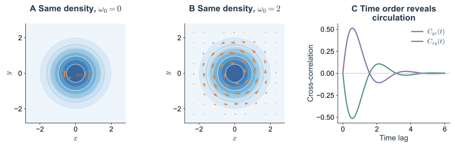

假设一个过程的稳态密度已经被精确测出，而且恰好是高斯。还缺少什么？上一篇的 OU 过程给出了第一个答案：只要同时改变噪声强度和恢复率，就能保持同一张高斯分布，却改变全部时间尺度。

还可以有更大的差别。两个峰相同的系统，可能有不同的跨峰等待时间；占据完全相同的几个状态，可能沿环路偏向不同方向。稳态分布记录系统把多少时间花在各处，生成元还规定它怎样到达、怎样离开，以及不同路径出现的相对权重。

这里依次研究这些从分布中遗漏的信息。先从峰附近的线性涨落出发，计算时间关联怎样影响响应；再离开峰附近，计算首次到达与弱噪声逃逸；最后保持稳态密度不变，向动力学中加入概率环流。局部涨落、全局路径和时间反演，将在同一个理论框架里逐步分开。

## 1. 占据分布为什么没有给出响应时间 {#sd-temporal-filtering}

### 1.1 同一高斯分布容许任意快慢的动力学

考虑

$$
dx=-\lambda xdt+\sqrt{2\lambda\sigma_x^2}\,dW.
\tag{3.1}
$$

不管 $\lambda$ 多大，稳态方差都是 $\sigma_x^2$，但相关时间为 $\tau_x=1/\lambda$。较大的 $\lambda$ 同时加强恢复和噪声注入，所以分布宽度不变，轨迹却更快地更新。

如果只在某时刻抽样，无从区分这些过程。若突然施加一个小扰动再观察恢复，或计算两次读数相隔多远才近似独立，$\lambda$ 就会显现出来。占据与响应分别约束“在哪里”和“以多快的速度运动”。

在生灭过程里，同样可以固定 $k/\gamma$ 而改变 $k,\gamma$。这种对应让分子计数成为一个具体检验，但时间尺度缺失本身是一般随机动力学的问题。

### 1.2 一个有恢复时间的系统读取的是过去

令输入 $x$ 为零均值平稳过程，协方差为 $C_x(t)=\sigma_x^2e^{-|t|/\tau_x}$。用一个最简单的线性读出检验它的作用：

$$
\tau_y\dot y=-y+gx(t).
\tag{3.2}
$$

$\tau_y$ 是响应时间，$g$ 为静态增益。若输入固定为 $x_0$，输出最终达到 $gx_0$；若输入变化，输出来不及瞬间调整。把初始恢复放到遥远过去，解为

$$
y(t)=\frac g{\tau_y}\int_0^\infty e^{-s/\tau_y}x(t-s)ds.
\tag{3.3}
$$

权重核的积分为 $g$，记忆范围约为 $\tau_y$。持续短于这个时间的正负扰动会在平均中抵消，持续更久的偏移则能推动输出。线性系统读取的不是输入的一张直方图，而是经过时间核加权的整段历史。

### 1.3 完整计算有色输入传递的方差

先把 $x$ 表示为式（3.1）的 OU 过程。对 $xy$ 用 Itô 乘法。因为 $dy$ 没有独立维纳增量，不产生额外的交叉二次变差；稳态时

$$
0=-\left(\frac1{\tau_x}+\frac1{\tau_y}\right)\langle xy\rangle
+\frac g{\tau_y}\langle x^2\rangle.
\tag{3.4}
$$

因此 $\langle xy\rangle=g\sigma_x^2\tau_x/(\tau_x+\tau_y)$。再从 $d\langle y^2\rangle/dt=0$ 得到 $\langle y^2\rangle=g\langle xy\rangle$，最终

$$
\boxed{\operatorname{Var}(y)
=g^2\sigma_x^2\frac{\tau_x}{\tau_x+\tau_y}.}
\tag{3.5}
$$

若 $\tau_x\ll\tau_y$，输出方差约为 $g^2\sigma_x^2\tau_x/\tau_y$；若 $\tau_x\gg\tau_y$，输出能跟随输入，方差趋向 $g^2\sigma_x^2$。固定输入方差而延长相关时间，会增加传给这个读出的涨落。

推导虽然使用了 OU 表示，结果只依赖二阶协方差。把式（3.3）平方后，对两个历史时刻使用 $C_x(s-u)$，可得到同一双重积分。所以具有相同指数协方差的非高斯输入，包括线性生灭计数，也得到同样的输出方差。

例如，两个均值同为 $12$ 的生灭过程，取 $\gamma=0.25$ 或 $2$，输入方差都为 $12$，相关时间却分别为 $4$ 和 $0.5$。若 $g=1,\tau_y=2$，输出方差分别为 $8$ 和 $2.4$。这种差别不需要反馈双稳态就会出现。

*Fig. 3.1. 动力学读取依赖时间结构。* 单位方差的 OU 输入分别取 $\tau_x=0.25$ 和 $4$，读出取 $g=1,\tau_y=1$。A、B：输入和输出样本轨迹；C：解析方差传递比。轨迹仅用于显示时间组织，方差比由式（3.5）计算。

### 1.4 频谱把噪声与系统响应放在同一个坐标上

对式（3.2）作 Fourier 变换，响应函数为 $H(\omega)=g/(1+i\omega\tau_y)$。因此

$$
S_y(\omega)=|H(\omega)|^2S_x(\omega),
\qquad
\operatorname{Var}(y)=\int_{-\infty}^\infty
\frac{g^2S_x(\omega)}{1+\omega^2\tau_y^2}\frac{d\omega}{2\pi}.
\tag{3.6}
$$

高于 $1/\tau_y$ 的频率被削弱，低频分量更容易通过。对于具有振荡或延迟的响应，频谱重叠还可能集中在某个有限频带，而不只是低通滤波。

这个比较固定的是输入瞬时方差。如果改为固定积分强度 $\int_0^\infty C_x(t)dt=\sigma_x^2\tau_x$，改变 $\tau_x$ 时也在改变瞬时方差，结论必须重新计算。白噪声极限尤其需要说清保留的是哪个面积，而不是只说相关时间趋零。

在生物信号传递中，$y$ 可以近似为稳定蛋白、慢修饰或适应变量的偏差，但真实下游还有自身反应噪声。式（3.5）只计算输入传递部分；若加入独立的下游噪声，输出方差会多出相应项。

### 1.5 平衡涨落与响应的联系

以上把相关函数和响应核分别指定。平衡热浴中，它们有时并不独立。以阻尼谐振子的过阻尼位置为例，设迁移率为 $\mu$、弹性系数为 $k_s$，施加小外力 $h(t)$：

$$
dx=-\mu k_sxdt+\mu h(t)dt+\sqrt{2\mu k_{\rm B}T}\,dW.
\tag{3.7}
$$

这里噪声和阻力来自同一温度为 $T$ 的平衡热浴，故 $\lambda=\mu k_s$、$D=\mu k_{\rm B}T$。无外力时 $C_x(t)=(k_{\rm B}T/k_s)e^{-\lambda t}$；对一个短促外力脉冲，因果线性响应核为 $\mathcal R(t)=\mu e^{-\lambda t}$，$t\gt0$。于是

$$
\mathcal R(t)=-\frac1{k_{\rm B}T}\frac{dC_x(t)}{dt},
\qquad t\gt0.
\tag{3.8}
$$

这个涨落耗散关系让不加扰动时的涨落预测小外力响应。积分后还得到静态易感率 $\int_0^\infty\mathcal R(t)dt=1/k_s$，而稳态方差为 $k_{\rm B}T/k_s$。同一恢复结构同时控制了自发波动和外力推动。

关系成立需要这里明确使用的平衡热浴、可识别的外力耦合和线性响应。一个由耗能反应持续驱动的信号也可能有指数相关，但不能只凭曲线相似就用温度乘系数换算响应。第 7 节的旋转 OU 将展示：保持相同高斯占据，仍可加入平衡公式没有包含的方向结构。

## 2. 从局部恢复走向非线性涨落 {#sd-local-nonlinearity}

### 2.1 恢复斜率控制一个峰的宽度和持续时间

令 $dq=f(q)dt+\sqrt{2D}dW$，稳定点 $q_*$ 满足 $f(q_*)=0$、$f'(q_*)=-\lambda\lt0$。在局部线性近似下，

$$
\operatorname{Var}(q)\simeq\frac D\lambda,
\qquad \tau_q\simeq\frac1\lambda.
\tag{3.9}
$$

固定 $D$ 时，恢复越弱，涨落越宽，也越持久。负反馈可能加强恢复，正反馈可能削弱恢复，但反馈还会改变反应率、延迟和噪声注入，不能只凭反馈名称判断方差。

当 $\lambda$ 很小，局部恢复很慢，一个看起来很小的随机驱动也可能积累成明显偏离。临界慢化首先是漂移几何的性质，放大的涨落则来自这种慢恢复与持续噪声的共同作用。

### 2.2 零均值噪声为什么仍能移动平均值

平均方程是 $d\langle q\rangle/dt=\langle f(q)\rangle$。若分布较窄，在均值 $m$ 附近展开：

$$
\langle f(q)\rangle
=f(m)+\frac12f''(m)V
+\frac16f'''(m)\langle(q-m)^3\rangle+\cdots.
\tag{3.10}
$$

线性系统没有曲率项，因此平均漂移只看均值；非线性系统会把分布宽度、偏斜等信息重新带回平均运动。噪声均值为零，只说明随机增量没有一阶偏向，并不说明经非线性动力学处理后平均响应不变。

例如 $f(q)=a-q-cq^2$ 时，精确平均方程含有 $-c(m^2+V)$。固定均值而增加方差，会使曲率对应的平均去除更强。这是一个局部例子；分布已跨越多个吸引域时，围绕单一均值作 Taylor 展开可能失去意义。

### 2.3 双峰分布没有唯一的动力学解释 {#sd-bimodality-and-environment}

一个固定环境下的非线性漂移可以有两个稳定点，这会在弱噪声下产生两个概率峰。但两个峰也可能来自缓慢切换的环境：隐藏状态 $S=0,1$ 分别选择两个单稳态过程，观测者却把它们混在一起。

以两个产生率 $r_0,r_1$、同一去除率 $\gamma$ 的计数过程为例。若环境切换远慢于计数恢复，条件分布有时间先接近各自的泊松稳态，边缘分布近似为

$$
P_n^*\simeq(1-\pi)\operatorname{Pois}(n;r_0/\gamma)
+\pi\operatorname{Pois}(n;r_1/\gamma).
\tag{3.11}
$$

适当分离的两均值会产生双峰，但每个固定环境中的漂移都只有一个稳定点。[Raj 等（2006）](https://doi.org/10.1371/journal.pbio.0040309)的单分子 mRNA 研究，提供了用启动子活动建模表达异质性的具体背景。

区分这些机制，需要条件分布、轨迹和干预，而不只需要更精确的直方图。记录隐藏环境能否消除双峰？从高、低状态分别准备后，是否在同一环境下保持不同局部恢复？改变反馈和改变环境切换率，是否留下不同驻留时间？这些问题将占据现象重新接回生成元。

### 2.4 稳定模态中的噪声放大

多变量系统还存在一维斜率看不到的结构。考虑两个线性变量

$$
dx=(-\lambda x+hy)dt+\sqrt{2D}\,dW_x,
\qquad dy=-\lambda ydt+\sqrt{2D}\,dW_y,
\tag{3.12}
$$

其中两个驱动独立。漂移矩阵的两个特征值始终都是 $-\lambda$，所以确定性长期稳定性不随耦合 $h$ 改变。可是一次 $y$ 偏差会先推动 $x$，然后二者才一起衰减；传播过程中可以先出现放大。

由稳态协方差方程逐项得到

$$
\langle y^2\rangle=\frac D\lambda,\qquad
\langle xy\rangle=\frac{hD}{2\lambda^2},\qquad
\langle x^2\rangle=\frac D\lambda+\frac{h^2D}{2\lambda^3}.
\tag{3.13}
$$

最后一项来自持续输入到 $y$ 的噪声沿耦合传播。$h$ 增大时，特征值不动，$x$ 方差却能大幅增加。恢复模态的衰减率与它们在状态空间里怎样相互叠加，都影响涨落；仅检查固定点特征值是否为负，还不足以判断一个多变量系统对噪声是否稳健。

在调控网络中，这可以近似为一个变量驱动另一个变量的前馈传播；在更一般的线性系统里，它是非正规漂移矩阵产生瞬态放大的最简例子。这个理论结构会在传播、响应与网络动力学中反复出现。

## 3. 首达过程把问题从分布改成事件 {#sd-first-passage-and-switching}

### 3.1 第一次到达与任意时刻在目标附近不同

给定目标边界 $c$，定义

$$
\tau_c=\inf\{t\geq0:X_t=c\},\qquad
T(x)=\mathbb E_x[\tau_c].
\tag{3.14}
$$

$\Pr(X_t\geq c)$ 只问时刻 $t$ 在哪里，$\Pr(\tau_c\leq t)$ 问此前是否曾经到达。一个样本可以先越界再回来，因而二者一般不同。首达定义通过停止路径，保留了事件发生历史。

这种事件可代表首次激活、分子数清零、群体灭绝或越过表达分界。目标应与观测判据对应：首次碰到分界、进入另一个状态附近、持续停留一段时间，是不同的停止规则。

### 3.2 吸收密度的损失就是首达概率

在目标处吸收路径，令 $p_{\rm abs}(y,t\mid x)$ 为仍未被吸收、且位于 $y$ 的密度。域内积分给出生存概率

$$
S(t\mid x)=\Pr_x(\tau_c\gt t)
=\int_{\rm domain}p_{\rm abs}(y,t\mid x)dy.
\tag{3.15}
$$

它不再总是归一为 $1$；缺掉的概率正是已经到达目标的样本。首达密度为 $\psi(t\mid x)=-\partial_tS$。将前向守恒律积分，$-\dot S$ 就是吸收边界的总向外流。

平均等待时间还有一个无需知道完整密度的表示：

$$
T(x)=\int_0^\infty S(t\mid x)dt.
\tag{3.16}
$$

一个样本若活到时间 $t$，就对总等待贡献一段 $dt$；对全部时刻与样本交换积分得到上式。若长尾使这个积分发散，平均首达时间就不存在，即使最终到达概率仍可能为 $1$。

### 3.3 后向生成元直接给出等待时间方程

从域内点 $x$ 出发，先走很短的 $dt$。已经用掉 $dt$，剩下的平均时间取决于新状态，所以

$$
T(x)=dt+\mathbb E_x[T(X_{dt})].
\tag{3.17}
$$

用生成元展开条件平均，得到一个与具体表示无关的关系：

$$
\boxed{\mathcal LT=-1.}
\tag{3.18}
$$

对扩散 $dX=A(X)dt+\sqrt{2D}dW$，它是 $AT'+DT''=-1$；对跳跃链，它是 $\sum_jw_{ij}(T_j-T_i)=-1$。目标处有 $T=0$，反射边界对应相应后向条件。我们没有为首达重新发明动力学，只是让同一生成元作用于一个新的函数。

先看无势垒的检验：区间 $[0,L]$ 内纯扩散，左端反射、右端吸收。解 $DT''=-1$、$T'(0)=0$、$T(L)=0$，得到

$$
T(x)=\frac{L^2-x^2}{2D}.
\tag{3.19}
$$

从左端出发的时间按 $L^2/D$ 增长。这是探索距离造成的等待，还没有指数长的稀有逃逸。下面加入向内恢复作用，才会出现另一种尺度。

### 3.4 先到哪一个目标由分裂概率回答

平均首达时间只问要等多久。有时还需要问：一次扰动以后，过程先回到原状态，还是先进入另一个状态？另将区间两端 $a,c$ 都设为吸收目标，定义 $h(x)=\Pr_x(\tau_c\lt\tau_a)$。它也常称为承诺概率。

从域内先走一个短步，尚未确定命运，所以 $h(x)=\mathbb E_x[h(X_{dt})]$，展开得到 $\mathcal Lh=0$，边界为 $h(a)=0,h(c)=1$。与平均等待的 $\mathcal LT=-1$ 相比，区别在于这里没有每步累加的时间代价。

对漂移 $-U'$、扩散强度 $D$ 的过程，解为

$$
h(x)=\frac{\int_a^x e^{U(y)/D}dy}{\int_a^c e^{U(y)/D}dy}.
\tag{3.20}
$$

在对称双阱、对称目标中，势垒顶的 $h=1/2$。刚到这里并不等于已经完成向另一阱的转换，之后仍有相同机会退回。弱噪声下，$h$ 在势垒附近迅速改变，而在阱内部接近零或一。

高维系统中，$h=1/2$ 的面给出一种直接由随机动力学定义的分界。它会受噪声结构、漂移和目标选择影响，未必等于对稳态密度作图后凭峰谷猜出的边界。这使“状态转换”成为可以按事件概率定义的对象。

## 4. 势垒逃逸为什么指数地缓慢 {#sd-kramers-escape}

### 4.1 一维加性模型中的势与概率

考虑

$$
dq=-U'(q)dt+\sqrt{2D}dW.
\tag{3.21}
$$

$q$ 可以是相对某参考值的坐标，允许为负，不直接等同于分子数。$U$ 由漂移定义；若没有额外的能量、迁移率与热浴关系，它只是一维动力学势。

在零概率流稳态，$J=-U'p-Dp'=0$，有 $p_*\propto e^{-U/D}$。稳定固定点位于 $U$ 的极小值，局部曲率给出恢复率；两个阱之间的极大值则形成离开原吸引域的阻碍。

小涨落沿阱底来回活动，较大的上坡偏移又不断被恢复力拉回。逃逸要求一段足够持续、总体偏向上坡的随机历史。等待很久的原因是成功历史在路径系综中很少，而不是粒子每次都缓慢地沿坡爬行。

### 4.2 从首达方程得到精确积分

令左端 $a$ 反射，右端 $c$ 吸收。式（3.18）变成

$$
DT''(q)-U'(q)T'(q)=-1,
\qquad T'(a)=0,\quad T(c)=0.
\tag{3.22}
$$

乘以积分因子 $e^{-U/D}$，左侧成为全导数：

$$
D\frac{d}{dq}\left[e^{-U(q)/D}T'(q)\right]
=-e^{-U(q)/D}.
\tag{3.23}
$$

先从 $a$ 积到 $y$，利用反射条件确定积分常数；再从起点 $q$ 积到 $c$，利用吸收条件得到

$$
\boxed{T(q)=\frac1D\int_q^cdy\,e^{U(y)/D}
\int_a^ydz\,e^{-U(z)/D}.}
\tag{3.24}
$$

内积分衡量到达位置 $y$ 前能积累多少阱内概率，外积分对离开的困难加权。两种指数一正一负，使低处的积累与高处的瓶颈同时出现在等待时间中。

### 4.3 弱噪声下的 Kramers 渐近式

设起始阱底为 $q_L$，势垒顶为 $q_b$，$\Delta U=U(q_b)-U(q_L)\gg D$。内积分由阱底附近主导，近似为

$$
e^{-U(q_L)/D}\sqrt{\frac{2\pi D}{U''(q_L)}}.
\tag{3.25}
$$

若目标 $c$ 在势垒右侧足够远，外积分包含势垒附近的完整高斯峰，近似为 $e^{U(q_b)/D}\sqrt{2\pi D/|U''(q_b)|}$。相乘再除以 $D$，得到

$$
\boxed{T(q_L)\simeq
\frac{2\pi}{\sqrt{U''(q_L)|U''(q_b)|}}
\exp\!\left(\frac{\Delta U}{D}\right).}
\tag{3.26}
$$

指数部分由势垒高度控制，前因子由阱底恢复和势垒附近的不稳定速度控制。这个结构来自 [Kramers（1940）](https://doi.org/10.1016/S0031-8914(40)90098-2)的逃逸理论，在这里采用一维过阻尼、常扩散和非退化极值的条件。

若吸收目标恰好放在势垒顶，外积分只有半个高斯，当前反射／吸收设置下前因子为 $\pi$ 而非 $2\pi$。首次碰到分界后仍可能返回，目标放在另一阱一侧则计算不同的成功事件。比较公式前必须先统一这项定义。

*Fig. 3.2. 阱内恢复与跨阱等待相差悬殊。* $U(q)=(q^2-1)^2/4$，起点 $-1$，左端 $a=-2$ 反射，右端 $c=0.8$ 吸收。阱底曲率为 $2$，势垒曲率绝对值为 $1$，势垒高 $1/4$，故渐近式为 $\sqrt2\pi e^{1/(4D)}$。右图用式（3.24）数值积分检验该近似。

### 4.4 局部稳定性与全局寿命是两种不同的量

在上述双阱中，左阱附近恢复时间约为 $1/2$，噪声变小时并不改变；逃逸时间却按 $e^{1/(4D)}$ 增长。峰附近看起来很活跃，并不意味着很容易切换；小方差也不能单独给出长寿命，因为离开原状态还取决于整段上坡结构。

接近稳定点与势垒合并的折叠边界时，两者才以一种特定方式联系。正规形 $\dot q=\varepsilon-q^2$ 有稳定点 $+\sqrt\varepsilon$、不稳定点 $-\sqrt\varepsilon$，局部恢复率为 $2\sqrt\varepsilon$，势垒为

$$
\Delta U=\frac43\varepsilon^{3/2}.
\tag{3.27}
$$

因此 $\varepsilon$ 变小时，恢复变慢，势垒同时降低。只有 $\Delta U\gg D$ 时才能继续用 Kramers 渐近式；不能把它越过自身条件外推到折叠点。具体表达反馈回路可与 [GRN 的记忆寿命笔记](/notes/qbio_course/grn_theory/memory_lifetime/#potential-barrier)对照。

## 5. 典型涨落的近似为什么可能算错稀有事件 {#sd-large-deviations}

### 5.1 逃逸先要求分清路径的代价

对小噪声 $dq=f(q)dt+\sqrt{2\epsilon}dW$，在固定端点、固定时间的路径概率中，弱噪声对数主导阶具有形式

$$
\Pr[q(\cdot)]\asymp
\exp[-I[q]/\epsilon],\qquad
I[q]=\frac14\int[\dot q-f(q)]^2dt.
\tag{3.28}
$$

这里是对细时间离散后的路径权重取弱噪声主导阶，忽略不影响该指数阶的前因子；不是声明布朗路径具有普通可导速度。作用量表示为了偏离确定性漂移，需要怎样持续组织随机增量。

在梯度系统 $f=-U'$ 中，作平方配方：

$$
\frac14\int(\dot q+U')^2dt
=\frac14\int(\dot q-U')^2dt
+U(q_{\rm end})-U(q_{\rm start}).
\tag{3.29}
$$

从阱底向势垒顶，代价至少为 $\Delta U$。理想最可能上坡路径在渐近意义下满足 $\dot q=+U'$，即沿确定性恢复运动的反向上坡；越过势垒后，确定性漂移可把它送下坡，主导代价不再增加。Kramers 指数由此有了路径解释。

这也说明为什么只看一次瞬时大偏差不够。逃逸是一段连贯历史；最有可能的成功历史取决于整段漂移和噪声。高维、非梯度或状态依赖噪声下，最可能路径一般不再是简单的反向确定性轨迹。

### 5.2 离散反应保留不同的指数结构

考虑大系统生灭过程，浓度步长 $1/\Omega$，速率为 $\Omega w_+(x),\Omega w_-(x)$。若小概率分布取 $P_n\asymp e^{-\Omega\Phi(x)}$，那么相邻概率之比近似为 $P_{n\mp1}/P_n\simeq e^{\pm\Phi'(x)}$。

代入主方程的主导指数阶，得到 Hamilton–Jacobi 结构，Hamiltonian 为

$$
H(x,p)=w_+(x)(e^p-1)+w_-(x)(e^{-p}-1),
\qquad p=\Phi'(x).
\tag{3.30}
$$

在一维零流或相应准稳态的主导逃逸分支上，$H=0$ 除了确定性分支 $p=0$，还给出

$$
\Phi'(x)=\ln\frac{w_-(x)}{w_+(x)}.
\tag{3.31}
$$

稳定点附近 $w_+\simeq w_-$，对数可以展开，扩散近似自然很好；远离稳定点，二者比值不接近一，完整指数就会重要。若只将 $H$ 展开至 $p^2$，相应结果为

$$
\Phi'_{\rm diff}(x)=\frac{2[w_-(x)-w_+(x)]}{w_-(x)+w_+(x)}.
\tag{3.32}
$$

两式只在近似平衡的局部相符。即使势垒作用量只差一点，乘上大尺度 $\Omega$ 再指数化，也可能使预测寿命相差很多。对峰宽验证成功后，还应单独验证尾部与首达统计。

WKB 和大偏差方法研究的正是这类指数结构；[Assaf 与 Meerson（2010）](https://arxiv.org/abs/0907.0070)将它用于亚稳群体的灭绝。这里的目的不是引入另一套与生成元无关的工具，而是保留生成元中被二阶展开舍弃的路径信息。

### 5.3 亚稳态使长时间动力学再次变成简单跳跃

若阱内恢复远快于阱间逃逸，过程先在一个阱内形成近似稳定的条件分布，再以很小的速率离开。长期可将两个阱视为有效状态，速率为 $k_{LH},k_{HL}$。驻留时间在充分局部混合之后近似指数，平均值分别为 $1/k_{LH}$ 和 $1/k_{HL}$。

高态占据为 $p_H^*=k_{LH}/(k_{LH}+k_{HL})$，慢恢复模态为 $k_{LH}+k_{HL}$。又一次出现同样的分离：占据取决于速率比，时钟取决于绝对速率。两个峰的权重相同，无法单独判断两次切换之间要等几秒还是几天。

这种两态约化有自己的条件。准备刚结束时，阱内还没有混合，短时驻留可能不是指数；若有另一个隐藏慢环境，整个观察时间内都可能没有恒定逃逸率。亚稳态是一个时间尺度结构，而不是看到两个峰以后即可自动赋予的标签。

## 6. 吸收态与准稳态揭示极限次序 {#sd-extinction-and-absorbing-states}

### 6.1 一个正的确定性固定点也可能最终消失

考虑有限状态 $n=0,\ldots,K$ 的生灭过程：

$$
b_n=\beta n\left(1-\frac nK\right),\qquad
 d_n=\delta n,\qquad \beta\gt\delta\gt0.
\tag{3.33}
$$

确定性大群体极限 $x=n/K$ 满足

$$
\dot x=(\beta-\delta)x-\beta x^2,
\qquad x_*=1-\frac\delta\beta\gt0.
\tag{3.34}
$$

从正初值出发，轨道趋向正固定点。可是在有限随机链中，零态没有产生事件，$b_0=d_0=0$；从任何正数状态都有一串去除事件到达零态。状态空间有限，又没有别的封闭通信类，因此最终以概率 $1$ 吸收。

唯一真正稳态是全部概率集中在 $n=0$。实验或模拟中看起来长期稳定的正数量，并不是这条链的无条件稳态。这种差别对于有限感染群体、复制分子和小种群都可能重要；若加入迁入或自发生成，零态便不再吸收，必须重新定义问题。

### 6.2 准稳态是一个有条件的谱问题

将所有正数状态组成暂态集合，限制其生成矩阵得到 $Q_T$。因为仍可流向零态，它的行和不再都为零。若存在正的归一向量 $q$ 满足

$$
Q_T^{\mathsf T}q=-\kappa q,\qquad
\sum_{n=1}^Kq_n=1,
\tag{3.35}
$$

从这个分布准备以后，正态上的未归一概率为 $e^{-\kappa t}q$。生存概率按 $e^{-\kappa t}$ 衰减，但在尚未灭绝条件下的分布始终为 $q$。这就是准稳态分布。

若从别的正初态出发，更快的谱模态先衰减，条件分布可能逐渐靠近 $q$；只有这个混合时间远短于 $1/\kappa$，才形成清楚的“先稳定、后灭绝”。从准稳态出发平均寿命恰为 $1/\kappa$，任意指定计数初态则还含有早期恢复过程。

*Fig. 3.3. 稳定形状可以与持续丢失样本同时发生。* $K=60,\beta=1.5,\delta=1$，初始 $n_0=20$。A：由完整有限状态生成矩阵求得的未灭绝概率，时间用准稳态寿命 $1/\kappa$ 归一，并与指数生存比较。B：不同时刻、条件于未灭绝的数量分布及准稳态特征向量。条件分布不含已经灭绝的样本。

### 6.3 平均灭绝时间可以直接由后向方程求出

对每个正数态，式（3.18）给出

$$
-1=b_n(T_{n+1}-T_n)+d_n(T_{n-1}-T_n),
\qquad T_0=0,\quad b_K=0.
\tag{3.36}
$$

不必等待大量模拟中的罕见灭绝，直接解三对角线性系统即可。令 $\Delta_n=T_n-T_{n-1}$，则从上边界出发递推

$$
\Delta_K=\frac1{d_K},\qquad
\Delta_n=\frac{1+b_n\Delta_{n+1}}{d_n},\qquad
T_n=\sum_{j=1}^n\Delta_j.
\tag{3.37}
$$

这个离散方程完整保留吸收边界。若围绕正固定点作无限支撑的高斯近似，零态的特殊事件结构会被抹去；局部方差小，并不足以保证吸收统计正确。

对每个有限 $K$ 先取 $t\to\infty$，结果必然灭绝；先取宏观极限并只看固定有限时间，则得到正的确定性状态。所谓“噪声只是一点小修正”必须同时给出系统尺度和观察时间。指数长时间上的小概率事件，不能由有限时间的确定性极限排除。

### 6.4 用同一个跳跃 Hamiltonian 估计灭绝指数

前面的 WKB 结构还能估计这个有限群体的长寿命。令 $R_0=\beta/\delta\gt1$，浓度率为 $w_+=\beta x(1-x)$、$w_-=\delta x$。从正固定点 $x_*=1-1/R_0$ 向零态运动，作用量势差为

$$
\begin{aligned}
\Delta\Phi
&=\int_{x_*}^0\ln\frac{w_-(x)}{w_+(x)}dx\\
&=\int_0^{1-1/R_0}\ln[R_0(1-x)]dx
=\ln R_0-1+\frac1{R_0}.
\end{aligned}
\tag{3.38}
$$

$R_0\gt1$ 时这个量为正。大 $K$ 下，准稳态寿命的主导指数因而为 $e^{K\Delta\Phi}$，前因子需要对零附近的离散边界另作匹配。这正是一个局部恢复正常、最终却会被极少数路径带向吸收态的例子。

当 $R_0$ 接近 $1$，写 $R_0=1+\varepsilon$，有 $\Delta\Phi\simeq\varepsilon^2/2$。只有 $K\varepsilon^2\gg1$，才期待清楚的指数长亚稳寿命；仅说 $K$ 很大还不够，距离确定性阈值的远近也进入近似条件。

这项估计把主方程、确定性固定点、作用量与灭绝时间接在了一起。生物模型并未要求一套特殊的随机理论，它只是使一般理论的边界条件和极限次序变得无法忽略。

## 7. 非平衡稳态怎样隐藏在同一占据分布中 {#sd-stationary-currents}

### 7.1 流守恒与详细平衡

对连续时间跳跃链，边净流为 $J_{ij}=p_iw_{ij}-p_jw_{ji}$，且 $J_{ij}=-J_{ji}$。稳态只要求每个节点 $\sum_jJ_{ij}=0$。概率不再积累，却仍可能从一个邻居进来、向另一个邻居离开。

详细平衡进一步要求每条边 $J_{ij}^*=0$。在没有环路的封闭一维相邻跳跃链中，边界和守恒会强制这个条件；有环路时，守恒容许绕圈流动。图的结构因而直接限制可能的非平衡行为。

### 7.2 三态环把这种区别算到最简单

取状态 $i=0,1,2$，按模 $3$ 编号。顺时针 $i\to i+1$ 的速率为 $a$，逆时针为 $b$。每个状态总离开率相同，稳态为

$$
p_i^*=\frac13,\qquad J_{i,i+1}^*=\frac{a-b}{3}.
\tag{3.39}
$$

保持 $a+b=2$，比较 $(a,b)=(1,1)$ 和 $(1.8,0.2)$。占据相同，平均驻留时间也同为 $1/2$，但后一过程离开时更常朝顺时针走。仅测占据和每个状态的驻留时间，还不足以恢复转移的方向结构。

顺时针一整圈与逆时针一整圈的速率乘积之比为 $(a/b)^3$。当 $a\ne b$，倒放录像会改变这些路径出现的统计权重。非平衡信息在路径顺序中出现，而静态直方图将它丢掉了。

*Fig. 3.4. 均匀占据并不排除定向循环。* 左图 $a=b=1$，右图 $a=1.8,b=0.2$。每个节点占据都为 $1/3$，每个节点的平均驻留都是 $1/2$。右图每条顺时针边的净流为 $1.6/3$。箭头数字是转移率，不是占据概率。

### 7.3 同一个高斯密度也可以不断旋转

现在回到开头的高斯分布，将它放在二维。令 $\mathbf r=(x,y)^{\mathsf T}$，$R=\begin{pmatrix}0&-1\\1&0\end{pmatrix}$，考虑

$$
d\mathbf r=(-\lambda\mathbf r+\omega_0R\mathbf r)dt
+\sqrt{2D}\,d\mathbf W.
\tag{3.40}
$$

第一项把状态拉回原点，第二项只沿圆周旋转。无论角速度 $\omega_0$ 为何，稳态密度都是

$$
p_*(\mathbf r)=\frac{\lambda}{2\pi D}
\exp\!\left[-\frac{\lambda|\mathbf r|^2}{2D}\right].
\tag{3.41}
$$

将它代入概率流 $\mathbf J=(-\lambda\mathbf r+\omega_0R\mathbf r)p_*-D\nabla p_*$，径向恢复恰好抵消扩散，只剩

$$
\boxed{\mathbf J_* =\omega_0R\mathbf r\,p_*.}
\tag{3.42}
$$

这个流与密度梯度垂直，散度为零，因而不会改变密度；但 $\omega_0\ne0$ 时，概率持续绕原点运动。它是三态环的连续版本，也回答了“仅给定稳态密度能否确定漂移”的问题。

*Fig. 3.5. 高斯稳态也可隐藏时间方向。* 取 $\lambda=D=1$。A：$\omega_0=0$，径向恢复与扩散平衡后稳态净流为零。B：$\omega_0=2$，同一密度上出现切向概率流；箭头方向由式（3.42）计算。C：后者的交叉关联 $C_{yx}(t)=-C_{xy}(t)=e^{-t}\sin(2t)$，显示路径的方向性。

事实上，对固定常数 $D$ 和给定正密度 $p_*$，漂移可以写成

$$
\mathbf A=D\nabla\ln p_*+\mathbf v,
\qquad \nabla\cdot(\mathbf v p_*)=0.
\tag{3.43}
$$

第一部分提供无流恢复，第二部分可以在不改变占据的前提下添加循环。二维 OU 的 $\mathbf v=\omega_0R\mathbf r$ 恰好满足这个条件。密度遗漏的自由度，因此可以明确写在漂移里，而不只是口头说“还有别的动力学”。

## 8. 从时间反演走向熵产生 {#sd-entropy-production}

### 8.1 路径比给出比静态密度更多的信息

对时间齐次、平稳准备的跳跃过程，一条路径依次经过 $i_0,\ldots,i_M$。它的概率密度包含初始占据、各段无跳跃生存因子和各次转移率。与时间倒放、仍用同一稳态动力学计算的路径比较，无跳跃因子抵消，得到

$$
\ln\frac{\Pr[\Gamma]}{\Pr[\Gamma^{\rm R}]}
=\ln\frac{p_{i_0}^*}{p_{i_M}^*}
+\sum_{m=0}^{M-1}\ln\frac{w_{i_mi_{m+1}}}{w_{i_{m+1}i_m}}.
\tag{3.44}
$$

这里假定变量在时间反演下为偶，正反通道均可发生。若包含速度、磁场或时变外部协议，反向过程必须相应定义，不能机械倒放标签。

详细平衡时，每个速率比都等于相反的稳态权重比，沿路径相乘后与端点因子抵消，正反路径等权。存在环流时，一整圈积累的偏向不能由端点势差消掉。

### 8.2 平均不可逆性非负

路径比乘以 $k_{\rm B}$ 可定义模型层次的熵产生。对平稳跳跃过程，单位时间平均为

$$
\dot S_{\rm tot}=\frac{k_{\rm B}}2\sum_{i\ne j}
(p_i^*w_{ij}-p_j^*w_{ji})
\ln\frac{p_i^*w_{ij}}{p_j^*w_{ji}}\geq0.
\tag{3.45}
$$

每一对正反流贡献 $(u-v)\ln(u/v)\geq0$。三态环因而有

$$
\dot S_{\rm tot}=k_{\rm B}(a-b)\ln(a/b).
\tag{3.46}
$$

对二维常扩散、时间反演偶变量的过程，相应表达为 $\dot S_{\rm tot}/k_{\rm B}=\int |\mathbf J_*|^2/(Dp_*)\,d\mathbf r$。代入旋转 OU 的流和 $\langle|\mathbf r|^2\rangle=2D/\lambda$，得到

$$
\frac{\dot S_{\rm tot}}{k_{\rm B}}=\frac{2\omega_0^2}{\lambda}.
\tag{3.47}
$$

占据分布与 $\omega_0$ 无关，不可逆性却随旋转速度平方增长。稳态 Shannon 熵保持不变，仍不排除持续的熵产生；系统内部没有继续积累熵，可以同时把熵输出到环境。

### 8.3 非负性还可以从两种路径系综的可区分性看见

把正向路径概率记为 $\mathscr P$，按已定义反向规则得到的归一路径概率记为 $\mathscr P^{\rm R}$。路径熵产生的平均是二者的相对熵：

$$
\frac{\langle\Delta S_{\rm tot}\rangle}{k_{\rm B}}
=\int\mathscr P[\Gamma]\ln
\frac{\mathscr P[\Gamma]}{\mathscr P^{\rm R}[\Gamma]}\,\mathcal D\Gamma
\geq0.
\tag{3.48}
$$

它量化观察整段录像时，能在多大程度上分辨正向与反向系综。详细平衡使两者相同；持续循环使它们可分。这个解释不依赖先画一幅势能地形，而直接依赖路径统计。

在相应概率相互可比较、反向系综归一的条件下，还可直接计算

$$
\left\langle e^{-\Delta S_{\rm tot}/k_{\rm B}}\right\rangle
=\int\mathscr P^{\rm R}[\Gamma]\,\mathcal D\Gamma=1.
\tag{3.49}
$$

Jensen 不等式由此再次给出平均非负。单条有限路径的比值仍可能小于一，因此会有负的轨迹熵产生；被限制的是整个系综的权重关系。若正反支持集不对应，或隐藏了某些不可逆通道，使用这一步归一论证以前必须先检查反向过程。

### 8.4 模型的不可逆性怎样连接实际耗散

把路径不可逆性解释为实际热力学熵产生，需要可分辨的状态和通道满足与热浴、化学势等一致的局部详细平衡。在过阻尼位置模型中，还需把迁移率、力与 $D$ 对应到同一物理装置。任意统计模型的一个非零数，不能不经识别就直接换算成细胞耗热。

反过来，一个计数链满足零流，也不能证明细胞没有耗能。转录、翻译和去除可能经由不同化学通道，在粗粒化后却只表现为同一计数变化。隐藏这些通道，会同时隐藏时间反演不对称和耗散。

[Seifert（2005）](https://doi.org/10.1103/PhysRevLett.95.040602)将单条随机轨迹的熵产生与涨落关系联系起来。在适当反向过程和初始准备下，积分关系 $\langle e^{-\Delta S_{\rm tot}/k_{\rm B}}\rangle=1$ 约束整个路径系综；单条有限轨迹可以出现负熵产生，平均不可逆性仍非负。条件和更广泛的物理实现可继续读其[2012 年综述](https://arxiv.org/abs/1205.4176)。

## 9. 理论描述应由所需的动力学信息决定 {#sd-method-map}

从一个稳定峰出发，线性噪声给出局部宽度与恢复；加上响应核，时间关联成为可传递的波动；进一步要求首次到达某个目标，边界和整段路径开始决定结果；若还要判断动力学有无方向，就必须比较流或正反路径。

这些问题逐步要求更多信息，却都与前两篇的同一个选择相连：保留什么状态，用哪个生成元描述它，以及在哪个极限下简化。主方程保留反应跳跃，扩散保留低阶增量，OU 保留局部线性结构，WKB 则保留罕见路径的指数权重。它们并非按“高级程度”取代彼此，而是在不同尺度上压缩不同信息。

在生物研究里，平均表达、双峰快照、长时间记忆和耗能循环也分别约束这些层次。用更多理论，最终应当能更清楚地说出：哪一个观测已经被解释，哪一个预测还依赖未检验的状态或近似。

## 附录 C 响应、首达与非平衡的计算 {#sd-response-appendix}

### C.1 时间平均与有效样本数 {#sd-time-average-appendix}

对平稳输入作长度 $T$ 的平均，$\bar x_T=T^{-1}\int_0^Tx(t)dt$。协方差双积分按滞后变量整理为

$$
\operatorname{Var}(\bar x_T)
=\frac2{T^2}\int_0^T(T-s)C_x(s)ds.
\tag{3.C1}
$$

指数相关输入给出

$$
\operatorname{Var}(\bar x_T)
=2\sigma_x^2\left[\frac{\tau_x}T
-\frac{\tau_x^2}{T^2}(1-e^{-T/\tau_x})\right].
\tag{3.C2}
$$

短时趋近瞬时方差，长时约为 $2\sigma_x^2\tau_x/T$。无论帧率多高，在固定记录长度中都不能凭无限加密采样获得无限多个独立样本。

### C.2 前向生存与后向平均等待的联系 {#sd-survival-backward-appendix}

给定起点 $x$ 的生存函数满足后向方程 $\partial_tS=\mathcal LS$，域内初值为 $S(0\mid x)=1$，吸收目标处 $S(t\mid c)=0$。如果最终吸收且平均等待有限，积分得到

$$
\mathcal L\int_0^\infty S(t\mid x)dt
=S(\infty\mid x)-S(0\mid x)=-1,
\tag{3.C3}
$$

于是恢复式（3.18）。前向方程演化未吸收密度，后向方程把初态映射到生存或等待，两者通过同一条件概率过程相连。

### C.3 旋转 OU 的协方差与时间反演 {#sd-rotating-ou-appendix}

漂移矩阵 $A=-\lambda I+\omega_0R$。由于 $R^{\mathsf T}=-R$，取 $\Sigma=(D/\lambda)I$ 可直接验证 $A\Sigma+\Sigma A^{\mathsf T}+2DI=0$。稳态协方差不依赖旋转项。

对于 $t\geq0$，时间关联矩阵为

$$
C(t)=\langle\mathbf r(t)\mathbf r(0)^{\mathsf T}\rangle
=e^{At}\Sigma
=\frac D\lambda e^{-\lambda t}
[\cos(\omega_0t)I+\sin(\omega_0t)R].
\tag{3.C4}
$$

因此 $C_{yx}(t)=-C_{xy}(t)=(D/\lambda)e^{-\lambda t}\sin(\omega_0t)$。单独测每个坐标的稳态分布，甚至只看同时协方差，都看不到这个反对称的时间结构。

### C.4 路径积分与大偏差怎样接回生成元 {#sd-path-integral-appendix}

将加性扩散按 Itô 左端点离散，条件增量密度为

$$
P(q_{j+1}\mid q_j)\propto
\exp\!\left[-\frac{(q_{j+1}-q_j-f(q_j)\Delta t)^2}
{4\epsilon\Delta t}\right].
\tag{3.C5}
$$

逐步相乘，在弱噪声对数主导阶得到式（3.28）。对这类路径权重引入响应场，可形成 MSRJD 表述，用来系统计算响应、关联和扰动；精确的作用量记号还需固定离散约定和 Jacobian。

离散反应则从跳跃生成元直接组织路径。Doi–Peliti 表述将计数与反应操作编码为场；WKB 的指数试探函数给出式（3.30）中 $e^{\pm p}$ 的结构。只保留 $p$ 的二阶项，就重新得到漂移与扩散。不同路径方法与正文理论的连接点，仍然是对生成元保留了哪些项。

加入空间以后，可以先将空间分箱，每箱内发生反应跳跃，邻箱间发生输运跳跃。平均连续极限连接反应扩散方程，低局部计数与扩散限制则可能使平均场失效。空间场论由此扩展状态空间，而没有改变从事件与路径建立模型的起点。

## 参考文献 {#sd-response-references}

- [Kramers 1940, Brownian Motion in a Field of Force and the Diffusion Model of Chemical Reactions](https://doi.org/10.1016/S0031-8914(40)90098-2)：弱噪声势垒逃逸。
- [Raj et al. 2006, Stochastic mRNA Synthesis in Mammalian Cells](https://doi.org/10.1371/journal.pbio.0040309)：隐藏启动子活动与表达分布的生物例子。
- [Assaf and Meerson 2010, Extinction of Metastable Stochastic Populations](https://arxiv.org/abs/0907.0070)：离散事件的 WKB 逃逸与灭绝。
- [Seifert 2005, Entropy Production along a Stochastic Trajectory and an Integral Fluctuation Theorem](https://doi.org/10.1103/PhysRevLett.95.040602)：路径不可逆性与熵产生。
- [Seifert 2012, Stochastic Thermodynamics Fluctuation Theorems and Molecular Machines](https://arxiv.org/abs/1205.4176)：随机热力学、物理实现与涨落关系。
