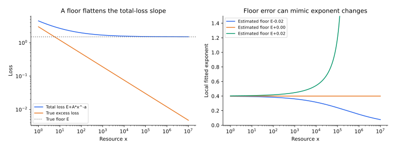

[专题目录](/notes/scaling_laws/) · ← [随机图与语言标度](/notes/scaling_laws/graph_language/)

## 前言：机制怎样进入实际的资源选择

给定同样的计算预算，一个更大的模型通常只能训练更少的步数，或者读取更少的 token。最终要选择的不是某一根独立增长轴，而是损失曲面上的一个位置。前面几篇解释这个曲面可能怎样产生；这一篇讨论如何在曲面上做约束优化，以及怎样从有限实验中估计它。

这两步需要分清。给定一个损失公式以后，求最优配置往往只是微积分；困难通常在于公式的适用范围、优化协议和损失底是否被正确识别。参数数目、独立样本、训练 token 与训练步数之间也存在不同关系。把这些量明确写出，才知道一个计算指数究竟在比较什么。

## 1. 计算标度：在共同预算下分配模型与数据 {#compute-scaling}

时间、数据与模型的限制在预算中重新耦合。给定一个损失曲面，资源优化可以严格求解；但这个解并没有替代对曲面本身的测量或微观推导。下面先完整求解可分双幂律，再与谱模型中的耦合风险作比较。

### 损失曲面与成本约定

假设已充分优化、在某个尺度区间内

$$
L(N,D)=L_\infty+AN^{-\alpha}+BD^{-\beta},
\qquad A,B,\alpha,\beta\gt 0,
$$

其中 $N$ 为按统一规则计数的模型规模，$D$ 为训练中使用的数据量。若一个样本重复出现，独立数据量与处理 token 数不同；本模型只有一个 $D$，所以使用前必须说明采用哪种操作定义。

先取训练成本 $C=kND$。这里的 $k$ 由架构、前反向传播和计量单位决定，不是普遍常数；推理、数据获取、通信及超参数搜索尚未计入。

### 最优配置：指数与领先常数

令 $D=C/(kN)$，超额损失变成

$$
E_C(N)=AN^{-\alpha}+B(kN/C)^\beta.
$$

对 $\log N$ 求导，最优条件为

$$
\alpha AN^{-\alpha}=\beta BD^{-\beta}.
$$

因此两项在最优点具有相同量级，但只有 $\alpha=\beta$ 时数值相等。解得

$$
\boxed{N_*=
\left(\frac{\alpha A}{\beta B}\right)^{1/(\alpha+\beta)}
\left(\frac Ck\right)^{\beta/(\alpha+\beta)},}
$$

$$
\boxed{D_*=
\left(\frac{\beta B}{\alpha A}\right)^{1/(\alpha+\beta)}
\left(\frac Ck\right)^{\alpha/(\alpha+\beta)}.}
$$

将 $u=\log N$ 代入后，目标是两个指数函数之和，二阶导数严格为正，所以这个内部驻点唯一且为全局最小值。代回还得到

$$
\boxed{L_*(C)-L_\infty\propto
C^{-\alpha\beta/(\alpha+\beta)}.}
$$

这三条指数关系都是**给定损失与成本模型内**的严格结果。它们没有证明语言、图像或任意网络都具有相同 $\alpha,\beta$。

#### 从一个微观可解风险推到计算配置

[谱机制一篇](/notes/scaling_laws/spectral_learning/#model-scaling)给出了不同于双幂律可加 ansatz 的联合风险：$E(N,D)=A N^{-a}+\sigma^2N/D$。第一项是正交截断尾部，第二项是估计 $N$ 个带噪系数的代价。这里的数据与模型项显式耦合。

在 $C=kND$ 下代入 $D=C/(kN)$，得到

$$
E_C(N)=A N^{-a}+\frac{k\sigma^2N^2}{C},
\qquad
N_* =\left(\frac{aAC}{2k\sigma^2}\right)^{1/(a+2)}.
$$

因而 $D_*\propto C^{(a+1)/(a+2)}$、$E_*\propto C^{-a/(a+2)}$。这些指数在这个序列观测与成本模型中有完整的微观来源，而不只是经验拟合后的分配计算。

如果先对 $N$ 优化，谱模型的最优数据包络指数是 $b=a/(a+1)$；将 $(a,b)$ 代入双幂律配置公式，恰好得到相同的计算指数。但两种损失曲面在偏离最优点时不同，领先常数也不同。沿最优包络的指数一致，并不证明全局联合损失必为两个独立幂律之和。

这个例子体现了两种理论层次如何连接：先由可解学习模型得到联合风险，再对明确成本作优化；而现实网络若尚无微观风险理论，则应把有效拟合与后续约束优化分别标明。

#### 最优条件的一般边际解释

在 $ND$ 固定时，令 $u=\log N$，则 $d\log D/du=-1$。对任意光滑损失函数，内部最优点都满足

$$
N\partial_N L=D\partial_D L.
$$

两边都是负数，表示将同一小比例预算分别投入模型或数据所能减少的损失。在最优点，两种边际收益配平。只有进一步代入双幂律，才变成 $\alpha AN^{-\alpha}=\beta BD^{-\beta}$。因此资源分配思想比幂律 ansatz 更一般；如果能可靠测量局部损失曲面，也可以在没有全局纯幂律的情况下寻找局部最优。

#### 偏离最优配置的代价通常是二阶的

记最优点的模型、数据误差贡献为 $U=AN_*^{-\alpha}$、$V=BD_*^{-\beta}$，则 $\alpha U=\beta V$。将模型放大 $r=e^u$ 倍并相应缩小数据，

$$
\frac{E(e^u)}{E(1)}
=\frac{Ue^{-\alpha u}+Ve^{\beta u}}{U+V}
=1+\frac{\alpha\beta}{2}u^2+O(u^3).
$$

最优附近的一阶项消失，曲率只由两指数的乘积控制。因而最优指数具有理论意义，但一个精确到很多位的最优参数数往往没有实验意义：损失曲面可能相当平坦，数据质量、训练稳定性和系统效率造成的差异更大。

### 数值例子与偏离最优线的代价

取 $\alpha=0.4,\beta=0.3,A=2,B=3,k=6$。则

$$
N_*\propto C^{3/7},\qquad D_*\propto C^{4/7},
\qquad E_*\propto C^{-6/35}.
$$

计算量增加 100 倍，最优模型约增大 $100^{3/7}\simeq7.20$ 倍，数据约增大 $100^{4/7}\simeq13.89$ 倍，超额损失乘以 $100^{-6/35}\simeq0.454$。这些参数是用于具体计算的示例设定，不是对某个现实模型的拟合。

固定预算时，如果模型比最优值大 $r$ 倍，数据就少 $r$ 倍，损失为

$$
E(r)=A N_*^{-\alpha}r^{-\alpha}
+B D_*^{-\beta}r^\beta.
$$

利用最优配平条件，可直接计算配置偏离的代价。最优附近对 $\log r$ 的一阶项消失，因此预算选择可能存在一段较平坦区间；不要把拟合不确定性下的一个最优数字报告到无意义的小数位。

### 固定计算预算的数值结果

*自制约束优化。* 参数取上一小节设定。左图显示 $N_*(C),D_*(C)$；右图在三个计算预算下画 $E(r)/E(1)$。双幂律的齐次性使三条归一化曲线重合。这是模型内计算，不涉及大语言模型的实际训练测量。

### 数据复用、成本模型与推理需求

若 $C=kN^aD^b$，$a,b\gt 0$，同样求导得到

$$
\alpha AN^{-\alpha}=\frac{a\beta}{b}BD^{-\beta},
$$

$$
N_*\propto C^{\beta/(b\alpha+a\beta)},\qquad
D_*\propto C^{\alpha/(b\alpha+a\beta)}.
$$

可检查 $a\log N_*+b\log D_*$ 对 $\log C$ 的系数恰为 1。如果还存在数据上限 $D_{\max}$、模型下限或推理成本，最优点可能落在边界，内部配平不再适用。

若训练没有充分收敛，应加入时间或优化残差 $E_{\rm opt}(N,D,T)$，成本也应随实际更新次数计数。先假设所有点都充分优化，再用同一预算要求所有点短训，是不一致的。

#### 数据集大小、训练 token 与训练轮数必须分开

令独立数据量为 $D_{\rm unique}$，实际处理量为 $P$，重复轮数为 $E=P/D_{\rm unique}$。稠密网络的训练计算近似 $C_{\rm train}=kNP$，而统计误差未必由 $P$ 单独决定。最初的 $C=kND$ 隐含了一个将数据量和处理量对应起来的训练协议。

如果加入优化残差，损失应更一般地写为 $L(N,D_{\rm unique},P)$。更多重复可以降低未收敛误差，却不能无限提供新的输入覆盖；是否值得重训取决于数据瓶颈和优化时间尺度。前文的时间标度与数据标度在这里同时进入，单独一条数据幂律不足以决定多轮训练的最优预算。

#### 生命周期成本会改变最优方向

若还要服务固定规模的推理需求，可以用一个简化成本 $C_{\rm total}=kND+qN$，其中 $q$ 包含推理 token 数与单位模型推理成本。固定总预算时

$$
D=\frac{C_{\rm total}}{kN}-\frac qk,
\qquad N\lt \frac{C_{\rm total}}q.
$$

模型增大会同时挤占训练数据预算和推理预算，原先纯 $ND$ 的齐次结构被打破。只有 $kD\gg q$ 时，训练主导的幂律配置近似恢复。系统吞吐、显存、并行通信和部署时延还可能引入额外约束，所以理论计算最优和实际成本最优需要采用一致的计量模型。

这不是说经验 scaling law 没有价值，而是其最有用的角色是一个在已测量区间内可检验、可更新的有效模型。损失形式、成本形式、数据定义和优化程度都固定后，约束优化才给出清楚的资源结论。

### 把训练轮数也作为决策变量

用一个额外可解模型说明优化不足的作用。令 $D$ 为独立数据量，$T$ 为全数据遍历轮数，成本 $C=kNDT$。假设统计风险为 $AN^{-\alpha}+BD^{-\beta}$，优化残差人为设为 $Ge^{-\kappa T}$，且 $\kappa$ 暂不依赖规模。这个最后假设很强，只为隔离第三个资源维度。

给定 $T$，统计部分相当于在预算 $C/T$ 下优化，因而最优统计风险为

$$
R_{\rm stat}^*(C,T)=K(C/T)^{-r},
\qquad r=\frac{\alpha\beta}{\alpha+\beta}.
$$

再优化 $T$，总风险为 $KC^{-r}T^r+Ge^{-\kappa T}$，内部最优满足

$$
\frac{r}{T}KC^{-r}T^r=\kappa Ge^{-\kappa T}.
$$

取对数整理，得到

$$
\kappa T=r\log C+(1-r)\log T
-\log\!\left(\frac{rK}{\kappa G}\right).
$$

因此主导尺度为 $T_*\sim(r/\kappa)\log C$，最佳风险含 $C^{-r}(\log C)^r$ 的缓慢修正。即使统计部分是纯双幂律，只要还需要额外训练轮数压低优化残差，计算曲线也不必严格保持纯幂律。

这不是实际大模型训练轮数的预测，因为真实 $\kappa$ 可依赖 $N,D$、学习率与任务，优化残差也可能幂律而非指数。它的用途是展示：一旦把“训练充分”从默认条件改为待分配资源，最优问题就改变。一个二维损失曲面可能是在第三维上取过最优后的包络，其指数已经包含优化协议。

## 2. 经验幂律与外推：哪些证据能够区分机制 {#interpretation}

前面给出了几种可解来源：固定谱松弛、目标尾部与估计方差、容量截止，以及给定成本下的边际配平。经验网络可以在某个尺度区间与这些结构相容，但相容并不表示机制已经唯一确定。拟合窗口、损失地板与训练协议，决定了指数应当怎样解释。

### Kaplan 与 Chinchilla：比较的是训练协议与风险面

[Kaplan 等（2020），Scaling Laws for Neural Language Models](https://arxiv.org/abs/2001.08361)研究模型、数据和训练计算下的经验尺度关系，给出偏向增长模型规模的资源配置；[Hoffmann 等（2022），Training Compute-Optimal Large Language Models](https://arxiv.org/abs/2203.15556)通过不同尺度与预算实验，提出模型和训练 token 应近似共同增长的配置，并以 Chinchilla 检验。

两者的比较涉及拟合范围、训练时长、优化规则和模型族，不能把不同实验的指数当成对同一数学定理的真假投票。上述双幂律是在固定训练协议和区间上的有效拟合；把它外推到远离测量尺度、不同数据质量或不同成本组成时，需要重新验证。

也要分清“独立样本增多”和“处理 token 增多”。在数据受限、重复训练或混合质量语料下，一个 $BD^{-\beta}$ 项通常不足以同时描述新信息、重复次数和优化程度。

#### 对数斜率与损失底的拟合退化

若真实单变量曲线为 $L=L_\infty+BD^{-\beta}$，直接拟合原损失的局部斜率得到

$$
-\frac{d\log L}{d\log D}
=\beta\frac{BD^{-\beta}}{L_\infty+BD^{-\beta}}.
$$

它会在接近损失底时下降，即使超额损失的指数完全没变。若 $L_\infty$ 未知，较小的底和较缓的幂律、较大的底和较陡的幂律，可能在有限区间里产生相近拟合。于是外推误差不仅来自指数估计方差，还来自损失分解是否可辨识。

双幂律还假设模型项和数据项可加，因此在对数坐标下的混合二阶导数为零。如果实验发现增大模型显著改变数据学习曲线的局部斜率，就可能需要交互项、交叉尺度或训练未收敛修正，而不是继续给同一可加模型增加拟合精度。

#### 指数误差怎样放大为资源配置误差

模型计算指数 $n=\beta/(\alpha+\beta)$ 的灵敏度为

$$
\delta n=\frac{\alpha\,\delta\beta-\beta\,\delta\alpha}
{(\alpha+\beta)^2}.
$$

在跨多个数量级的计算外推中，$\delta\log N_*\simeq\log(C/k)\,\delta n$，还要加上常数项的不确定性。因此很小的指数差，也可能在大幅外推时产生显著配置差。更合理的报告是带置信区间或稳健区间的预算曲线，并在新尺度上重新测量，而不是把一次拟合的最优比例当作普遍常数。

### 仅凭时间曲线不能唯一恢复微观谱

从 $E(t)$ 推断 $\mu(d\lambda)$ 是逆 Laplace 变换问题。有限、含噪的时间窗口通常只能分辨有限范围的速率，多个不同谱测度可以产生几乎相同曲线。训练时间很短看不到极慢模态，采样频率有限又看不到极快模态。

所以一条幂律曲线支持存在一组相容的慢尺度解释，却不能唯一恢复 Hessian 谱，更不能确定网络参数空间结构。额外的谱测量、目标投影与核漂移诊断，能显著减少这种不确定性。这里也回到了系列开头的原则：曲线是数据与算法共同投影后的观测，不是系统所有自由度的直接照片。

### 寻找配置本身也需要实验预算

寻找配置本身需要计算。若用很多小规模试验拟合指数，再把剩余预算用于最终训练，试验成本也属于总资源。对一张很平的最优谷，精确定位最优点的额外搜索可能得不偿失；对外推不确定性很大、失败代价很高的场景，更多校准又可能更有价值。

一个合理的实验设计会优先选择能区分候选曲面的点。例如可分模型 $AN^{-\alpha}+BD^{-\beta}$ 与耦合方差模型 $AN^{-a}+\sigma^2N/D$，在最优线附近可能相似，偏离最优线的固定规模切片却更容易区分。所有试验都沿预计最优线采样，反而会保留机制不可辨识性。

因此经验规律的用途可以分层：预算内插值要求局部预测准确，远预算外推要求指数和地板稳定，机制判断则要求多方向切片与可区分实验。三种目标使用同一拟合公式，也可能需要完全不同的数据点。

### 领先常数与有限预算同样重要

即使两个任务具有相同指数，系数 (A,B) 或成本常数 (k) 不同，实际最优模型也可能相差很大。指数描述预算变化时的相对增长速度，常数确定当前预算落在什么位置。有限范围规划往往更受常数和交叉区影响，不能只报告渐近斜率。

若训练包含固定启动成本、数据获取成本或最小批量约束，低预算区还可能完全偏离渐近公式。此时直接在可行配置上求解约束问题，比继续外推一个漂亮幂律更合适。理论公式仍然有用，但它应当帮助理解数值优化，而不取代实际约束。

对损失做常数归一化不会改变最优配置，但若归一化因子随模型或数据变化，就可能改变被优化的目标。跨任务比较时，损失单位与不可约地板也应一起保存；否则相同的纵轴数字未必表示相同质量。

## 3. 从一维切片到二维风险面 {#fitting-surface}

### 一维拟合成功，不等于误差可以相加

固定数据量 $D_0$ 时，也许可以拟合 $L(N,D_0)=E(D_0)+A(D_0)N^{-\alpha(D_0)}$；固定模型时，也许可以拟合 $L(N_0,D)=F(N_0)+B(N_0)D^{-\beta(N_0)}$。这并不能推出整个曲面必为 $L_\infty+AN^{-\alpha}+BD^{-\beta}$，因为切片中的系数、指数和平台都可能依赖另一条轴。

可加模型给出一个明确的可检验条件：

$$
\frac{\partial^2L}{\partial\log N\,\partial\log D}=0.
$$

对四个配置组成的小矩形，可以计算离散交互量

$$
\Delta_{ND}=L(N_2,D_2)-L(N_2,D_1)
-L(N_1,D_2)+L(N_1,D_1).
$$

如果它显著偏离测量噪声，就说明存在交互、未控制的优化差异，或某个切片还未进入同一标度区间。这个检查不依赖首先估计哪一个幂律指数。

例如序列模型中的 $\sigma^2N/D$ 是一个显式交互项。固定 $N$，它随数据呈 $1/D$；固定 $D$，它却随模型复杂度上升。充分正则化后的最优包络可以继续下降，但原始风险曲面并不满足“模型越大，每个配置都越好”。

### 更灵活的拟合提供了什么

[2026 年随机图与语言研究](https://arxiv.org/abs/2601.10684)还重新分析了常用二维可加幂律，并用神经网络与核回归拟合损失曲面。在其数据划分和评价协议下，更灵活的回归给出较低的验证误差。这个比较直接挑战的是某个特定全局拟合形式的充分性，不是所有关于计算配置的经验结果。

预测一张曲面时，可以选择可解释但受限的参数形式，也可以选择表达力更强的回归。两者的验证目标应当一致：在相同的训练配置上拟合，在相同的保留配置上预测，并保留实际优化与测量误差。函数越灵活，越需要检查边界行为、单调性与稀疏区域中的非物理弯折。

随机保留一部分网格点，主要检查已测量尺度内部的插值。若真正关心大模型、大预算外推，应另外保留最大的若干尺度，或者按预算区间划分。一个插值很好的回归器，没有自动获得超出观测范围的指数规律。

这也解释了为什么“拟合误差更小”与“机制解释更完整”是两种结论。回归器可以准确预测 $L(N,D)$，而不告诉我们改善来自覆盖、特征变化还是优化；机制模型可能刻画了其中一项，却不足以拟合整个实验曲面。

## 4. 损失底的不确定性如何进入指数 {#loss-floor}

设真实曲线为 $L(x)=E+Ax^{-a}$，拟合时减去估计底 $\widehat E=E+\delta$。被拟合的“超额损失”为 $Ax^{-a}-\delta$，其局部指数为

$$
\widehat a_{\rm eff}(x)
=-\frac{d\log[L(x)-\widehat E]}{d\log x}
=a\frac{Ax^{-a}}{Ax^{-a}-\delta}.
$$

若估计底偏低，$\delta\lt0$，曲线在后段变平，指数被压低；若估计底偏高，正的剩余部分可以表现得越来越陡，最终甚至失去正值。一个非常漂亮的短区间双对数直线，也可能来自恰好选中的平台。

在图随机游走中，真实转移矩阵允许直接计算熵率，这种退化可以明显减轻。在自然语言中，某个有限上下文、分词器和分布下的最优交叉熵通常不能直接测得；模型表示限制和训练不足又会产生额外平台。因此底参数应随训练协议解释，而不是当作一个可以自由平移、却没有统计含义的截距。

*图中真实函数为预先指定的 $E+Ax^{-a}$。左图显示总损失与真实超额损失，右图按上述公式计算平台估计偏高或偏低时的局部指数。该图用于说明拟合可辨识性，没有使用任何语言模型训练数据。*

即使给定一个正确的拟合形式，重采样得到的指数误差条也只描述该形式和数据范围内的统计变化。它不自动包含换一个拟合窗口、换一种平台假设或换一套模型族带来的变化。后者需要直接比较；若这些变化比重采样误差大，就不应只报告一个很窄的指数区间。

## 5. 训练协议是标度关系的一部分 {#protocol}

[Porian 等，Resolving Discrepancies in Compute-Optimal Scaling of Language Models](https://arxiv.org/abs/2406.19146)通过重现实验研究早期计算最优结果的差异，强调输出层计算计数、warmup 与随规模调整的优化器参数。它说明在比较指数以前，先对齐实际成本和训练程度，能够消除相当一部分表面冲突。

参数数目尤其需要明确：计入词嵌入和输出层，还是只计入主体层？固定词表的嵌入部分通常随隐藏宽度线性增长，而主体层可能近似随宽度平方增长。因此两种参数横轴之间不一定只是相差一个固定比例，尤其在小模型区间，换一个计数规则可能改变有效指数。

训练 token 与独立数据之间也不能无限互换。[Muennighoff 等，Scaling Data-Constrained Language Models](https://arxiv.org/abs/2305.16264)专门研究数据重复及其边际价值，提出包含重复收益递减的经验描述。额外一轮训练能否替代相同数量的新数据，取决于当前优化与数据覆盖的状态，不是一条固定的数据量指数能够独立回答的。

这些因素还会改变“最佳结果”的含义。如果每个规模都调优学习率，拟合的是超参数优化后的包络；如果所有模型共用一套设置，拟合的则包含设置对不同规模的适配程度。二者都可以成为有用的研究对象，但其结论必须跟随操作定义。

## 结语：计算指数是机制与实验设计的共同结果

给定风险曲面与成本函数，最优配置由边际收益决定；双幂律只是让这个条件有了简洁闭式解。数据回用、动态特征、优化不足和系统成本，都可能改变曲面或可行集合。

整个专题由此闭合：统计估计解释有限信息的波动，几何与谱解释分辨率，离散技能解释覆盖与能力形成，特征学习解释动态加速，随机图则帮助逐项移除或控制结构。资源配置把这些影响放回同一个预算里，拟合与外推再检验我们是否真的识别了需要的曲面。

一条经验幂律最有价值的地方，是在清楚的观测量与协议下提供可更新的预测。只有结合结构测量、多方向切片和新尺度上的验证，它才进一步成为关于学习机制的证据。

[专题目录](/notes/scaling_laws/) · ← [随机图与语言标度](/notes/scaling_laws/graph_language/)
