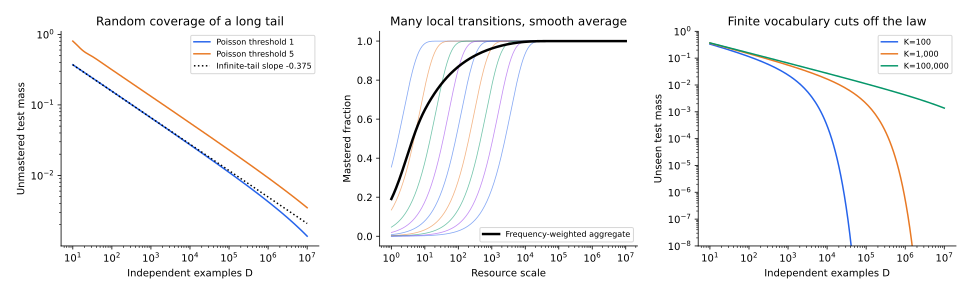

[专题目录](/notes/scaling_laws/) · ← [谱与学习分辨率](/notes/scaling_laws/spectral_learning/) · [特征学习与动态加速](/notes/scaling_laws/feature_learning/) →

## 前言：整体损失平滑下降，局部能力却可能突然形成

一个语言模型需要处理拼写、句法、事实、数值关系、专业术语和各种局部算法。扩大模型后，平均损失可能非常平滑；单独查看某种任务，却会发现性能在一段规模内几乎不变，随后迅速改善。这两种现象并不冲突：一条平均曲线可以叠加许多发生在不同位置的局部变化。

连续谱把目标分成正交方向；另一种解释则把预测需要的知识分成离散部件。每个部件出现的频率、学会它需要的样本，以及存储或计算它的代价可以不同。资源增加时，常见而容易的部件先被掌握，剩余损失逐渐由更稀有、更昂贵的部分支配。

[Michaud 等的 The Quantization Model of Neural Scaling](https://arxiv.org/abs/2303.13506)提出“技能量子”的假说，以长尾任务上的模型验证这种机制，并研究语言模型损失的分解。这里的 quantization 指知识或技能的离散性，与低精度参数量化无关。下面把它展开为可计算的理想模型，再讨论共享结构为什么会改变简单的计数图景。

## 1. 先给出一个明确的技能模型 {#skill-model}

设预测问题被分成技能 $k=1,2,\ldots$。第 $k$ 种技能在测试分布中的使用概率为 $p_k$，尚未学会时产生额外损失 $\Delta_k$。用 $s_k\in[0,1]$ 表示掌握程度，平均超额损失写成

$$
R=\sum_k p_k\Delta_k(1-s_k).
$$

这一式子已经包含实质假设：技能的贡献可以相加，并且一项技能的获得不会改变另一项的定义。最直接的实现是每个样本只依赖一种技能；如果一个样本需要多个部件协作，就必须重新说明怎样从部件成功率得到样本损失。

先取 $\Delta_k=\Delta$，并假定技能按使用频率依次被掌握：$s_k=1$ 对 $k\leq m$，其余为零。若

$$
p_k=c\,k^{-(1+a)},\qquad a\gt0,
\qquad c=\frac1{\zeta(1+a)},
$$

那么剩余风险就是概率尾部

$$
R(m)=\Delta c\sum_{k\gt m}k^{-(1+a)}
\sim\frac{\Delta c}{a}m^{-a}.
$$

每个技能的改善仍然是离散的。幂律来自越来越多技能被学会以后，未学会部分的总权重如何下降；并不要求每个技能内部都有一个幂律训练过程。

这里平均的是测试分布中的损失，而不是技能条目的完成比例。学会一项常见技能，可以明显降低平均损失；学会很多极罕见技能，合计影响也可能很小。因此，“掌握了多少种能力”和“平均损失还剩多少”并不等价。随着常见部分被解决，剩余误差逐渐集中到尾部，局部能力的获得可以越来越丰富，而整体曲线仍然只缓慢下降。

一个直观例子是专业术语：新增知识也许只影响很少的上下文，但大量罕见术语的总概率仍然不可忽略。模型已经掌握的常见部分很少贡献剩余损失，后面的学习逐步转向尾部。这是对一种可能机制的描述，不能仅凭词频服从 Zipf 定律，就认定真实模型的知识一定按独立术语存储。

## 2. 模型容量怎样转成技能数 {#capacity}

### 每项技能代价相同的情形

如果每项技能需要固定 $c_0$ 个有效参数，规模为 $N$ 的模型能容纳约 $m=N/c_0$ 项技能，因此

$$
R(N)\sim\frac{\Delta c}{a}(N/c_0)^{-a}.
$$

这里的模型指数为 $a$。但真正关键的假设是 $m\propto N$，而不是最后的积分。参数共享、稀疏激活、模型架构与知识间的相互干扰，都可能改变容量到技能数的映射。

若第 $k$ 项技能的代价随稀有程度增长，$c_k\asymp k^\delta$，$\delta\gt-1$，累计容量需求为

$$
N(m)\asymp\sum_{k\leq m}c_k\asymp m^{1+\delta}.
$$

于是

$$
R(N)\asymp N^{-a/(1+\delta)}.
$$

同样的技能频率，可以对应不同的模型指数。一个更有效的表示可能只降低常数 $c_0$；若它系统地改变高阶技能的代价增长率 $\delta$，才可能改变渐近指数。有限规模内，两种改善常常难以单凭损失曲线区分。

容量在这里应理解为能够稳定支持多少有效计算，而不是把参数当成可以任意切分的独立存储格。同一条规则可以为许多任务共用，多个规则也可能在相同参数上发生干扰。等成本假设让频率尾部到模型曲线的映射清楚可算；若实际曲线偏离预测，应该先检查这个映射，而不必立刻否定离散结构的意义。

### 技能价值也可能不同

并非所有预测的错误代价都相同。若罕见技能的额外损失满足 $\Delta_k\asymp k^{-b}$，则风险尾部的指数变为 $a+b$，前提是 $a+b\gt0$。若 $\Delta_k$ 随 $k$ 增大，反而可能增强尾部的影响。

因此需要区分三种分布：技能出现得多频繁、学会后能减少多少损失、学习和表示它有多昂贵。原始 token 频率通常不能同时替代这三个对象。它们共同决定资源增加时的有效优先顺序。

例如，一个少见符号可能只需沿用已经学会的语法，一个常见词却可能出现在许多不同结构中。表面频率没有直接给出任务复杂度。把技能作为理论单位，需要明确可重复使用的计算是什么，以及它减少哪一部分误差。若只是事后把每个失败样本命名成一项技能，这个模型便没有真正解释共享，也难以预测新样本。

一种更具体的理解，是看某项改善是否同时惠及一组不同表面问题。如果一条共同运算形成以后，许多未见实例一起获益，技能便具有超出样本编号的内容；如果每次改善只影响一个孤立条目，模型更接近逐项覆盖。两者都能贡献平滑平均曲线，但对组合测试和跨任务迁移的预期不同。

## 3. 数据规模：从硬阈值到真实的随机出现次数 {#occupancy}

### 平均计数阈值给出的近似

假定一项技能需要至少 $\tau$ 个相关样本才可能学会。$D$ 个独立样本中，第 $k$ 项技能的平均出现次数为 $Dp_k$。用 $Dp_m\simeq\tau$ 定义当前可学到的尾端，可得

$$
m_D\asymp(Dc/\tau)^{1/(1+a)},
\qquad
R(D)\asymp D^{-a/(1+a)}.
$$

于是最简模型预测，数据指数与容量指数满足 $\alpha_D=\alpha_N/(1+\alpha_N)$。这个关系依赖等技能代价、等损失收益和固定样本阈值；它不能直接用作所有神经网络的普遍约束。

硬阈值近似还隐藏了随机性：$Dp_k=\tau$ 并不意味着技能在每个训练集中恰好出现 $\tau$ 次。要理解曲线为什么平滑，可以把随机计数明确写出来。

### Poisson 计数与未见质量

先取极端简单的规则：一项技能只要出现一次就被完全学会。将样本总数 Poisson 化后，技能计数独立且 $n_k\sim\operatorname{Poisson}(Dp_k)$。未学会概率为 $e^{-Dp_k}$，期望风险为

$$
R(D)=\Delta\sum_k p_ke^{-Dp_k}.
$$

对长尾区用积分近似，令 $s=1+a$、$u=Dc\,x^{-s}$，则

$$
\begin{aligned}
R(D)&\simeq\Delta\int_1^\infty cx^{-s}e^{-Dcx^{-s}}dx\\
&\sim\frac{\Delta c^{1/s}}s
\Gamma\!\left(1-\frac1s\right)D^{-(1-1/s)}.
\end{aligned}
$$

指数仍然是 $a/(1+a)$，但转变是平滑的。最常见的技能几乎肯定已出现；非常罕见的技能几乎肯定未出现；主要的变化来自 $Dp_k$ 为一量级的中间区域。

可以把中间区域看成随数据移动的学习前沿。比它常见得多的条目已经基本不再贡献新增收益，比它罕见得多的条目暂时几乎没有机会被覆盖；扩大数据主要改变前沿附近的条目。前沿不断移向更低频部分，那里的总质量按规律减小，于是形成整体幂律。这个图景与谱模型的移动截止相似，但这里移动的是事件出现次数，而不是固定算子的松弛速率。

这条公式也叫作未见概率质量的计算。它描述“测试样本需要的技能在训练中是否出现过”，不是自动描述“网络能否从一次出现中学会”。它提供一个清楚的覆盖基线，真实训练还可能有识别、优化和共享结构的额外代价。

在固定有限技能表上，全部条目最终都被充分观察以后，覆盖误差会比中间区域的幂律更快消失。中间幂律之所以持久，是当前预算还不断遇到新的低频条目；它并不是每项有限知识永远只能按幂律学习。技能总数与数据一起增加时，又可能持续保留这个前沿。有限表与不断扩展的任务族，应当作为不同的标度极限理解。

一次出现可能只提供含混线索，多次出现有助于把真正规律与偶然上下文分开。更复杂的技能如果需要多个互补情境，门槛还会随技能变化。因此，覆盖模型刻画信息是否到场，实际掌握则要求到场的信息足以识别规则。两步分开以后，同样的长尾频率为什么可能对应不同学习速度，就更容易理解。

### 多次出现才能学习的情形

若需要 $\tau$ 次出现，未学会概率变成

$$
q_\tau(u)=\Pr\{\operatorname{Poisson}(u)\lt\tau\}
=e^{-u}\sum_{j=0}^{\tau-1}\frac{u^j}{j!}.
$$

将它代入同一个积分，只要 $\tau$ 固定，就有

$$
R_\tau(D)\sim
\frac{\Delta c^{1/s}}sD^{-(1-1/s)}
\sum_{j=0}^{\tau-1}\frac{\Gamma(j+1-1/s)}{j!}.
$$

固定阈值改变领先常数，没有改变数据指数。若学习阈值本身随技能增长，例如 $\tau_k\asymp k^\rho$，那么 $Dp_k\simeq\tau_k$ 给出 $m_D\asymp D^{1/(s+\rho)}$，数据指数就变成 $a/(1+a+\rho)$。问题从“是否见过”转向“稀有技能是否也更难学”。

*左图计算有限长尾表上的 Poisson 未掌握质量，并显示固定阈值如何改变曲线；中图将许多技能的平滑阈值叠加，得到整体连续改善；右图比较不同技能总数，展示有限尾部最终偏离中间区间的幂律。均为上述机制模型的直接计算。*

## 4. 训练时间为什么有时与数据量给出相同指数 {#training-time}

如果每步读取新的独立样本，固定 batch 为 $B$，处理的训练样本数是 $D_{\rm seen}=Bt$。若某项技能的梯度信号与使用频率成正比，它的典型形成时间可能为 $t_k\propto p_k^{-1}$。这会得到与计数阈值类似的可见技能边界。

但数据受限与时间受限仍然是不同机制。某个有限数据集中没有出现的技能，重复训练一百轮也无法凭空提供其独立信息；已经出现足够多次的技能，也可能因为优化平台而长时间没有被掌握。只有在明确的一遍在线训练条件下，时间和已见样本数才有简单映射。

重复数据仍然可能有用：优化器第一次遇到某个例子时，表示也许还不足以利用它；相关部件形成以后，同一个例子便能提供更有效的更新。但这种收益来自对既有信息的重新利用，不能等价地算成独立覆盖了更多技能。训练 token 数同时承载计算次数和信息暴露两种含义，多轮训练恰好将它们分开。

例如令技能的损失贡献为 $p_ke^{-\gamma p_kt}$。求和与上一节形式相同，得到时间指数 $a/(1+a)$。此时每项技能内部是指数学习，整体的幂律来自频率造成的一组宽时间尺度。若技能启动需要多个已有部件，形成时间还可能不是 $1/p_k$。

## 5. 共享部件与层次组合为什么会改变计数图景 {#composition}

独立技能表把每种任务视为单独的条目。层次结构则允许许多任务共用同一个部件。设有 $K$ 种对象和 $K$ 种关系，表面问题有 $K^2$ 种组合。如果每种组合都要独立记忆，样本必须逐渐覆盖二维组合表；若预测规律可分解为两个部件表示和一个共享运算，学习器可以利用见过的对象和关系处理未见组合。

以均匀采样为例，观察特定组合的概率是 $K^{-2}$，而观察某个对象或关系的概率是 $K^{-1}$。相应的稀有事件尺度相差一个 $K$。真正做到这种改善，还要求共享运算可辨识，且训练数据能约束正确的分解；仅有组合形式，并不保证神经网络自动获得组合泛化。

共享还会改变“未见”的含义。一道完整问题可以从未出现，但组成它的对象、关系和组合方式都已被约束；另一道问题即使表面相似，也可能引入一个从未识别的新部件。前者有机会通过组合泛化解决，后者需要额外信息。因而长尾能力应区分未见整题、未见组合与未见基本规则，否则不同的泛化要求会被合成一个覆盖率。

在随机层级模型中，难度还受到每层可替换规则数、隐变量字典大小和路径深度的影响。一个表面事件罕见，不一定意味着其所有内部规则都罕见；相反，一个经常出现的输出也可能依赖难以从低阶统计识别的高层规则。有关这些区别，可接着阅读[层次结构数据与学习理论](/notes/hierarchical_data/)，尤其是[语言统计与学习曲线](/notes/hierarchical_data/language_statistics/)。

对需要多个技能的样本，也可以直接看见加性假设的变化。若样本需要技能集合 $S$，各技能成功概率近似独立，则样本成功概率为 $\prod_{k\in S}s_k$。失败概率是

$$
1-\prod_{k\in S}s_k.
$$

只有在每项失败概率都很小时，才近似为 $\sum_{k\in S}(1-s_k)$。在能力形成早期，多个必要部件的相互依赖可以使整项任务突然改善，而平均 token 损失仍缓慢下降。

这提供了局部能力陡升的一种直观来源。许多部件已经分别改善，但只要一个必要环节仍经常失败，完整任务就很难成功；最后几个短板进入可靠区域以后，端到端表现才明显上升。变化可以来自平滑的部件学习，不要求每个部件在同一时刻突然获得。相应地，一项任务没有进步，也不意味着所有内部能力都没有进步。

同时，技能划分并不必然唯一。同一组行为可以按较粗任务分解，也可以按更细的必要步骤分解。合理的分解应当在改变数据和资源以后继续有预测力，例如解释哪些任务同步改善、哪些瓶颈相互依赖。仅从平均损失恢复唯一技能列表通常做不到；局部行为与受控变化，才会给这套解释增加约束。

## 6. 数据选择可以改变谁先被学会 {#data-selection}

如果训练分布与测试分布相同，常见技能自然获得更多观测。若主动提高稀有但有价值技能的采样概率，技能边界就不再由原来的 $Dp_k$ 决定。用 $q_k$ 表示训练采样频率，而测试仍按 $p_k$ 加权，则一次出现即学习的风险是

$$
R(D;q)=\Delta\sum_k p_ke^{-Dq_k}.
$$

相同的 $D$ 可以有不同风险，这说明数据量不能独立于数据选择来解释。为一个固定预算最小化上式，内点的边际条件为 $p_ke^{-Dq_k}$ 相同；很小的 $p_k$ 可能对应零采样分配。这种分配通常依赖预算，不等于永远均匀采样，也不等于永远按原频率采样。

[Sorscher 等，Beyond neural scaling laws: beating power law scaling via data pruning](https://arxiv.org/abs/2206.14486)研究数据筛选如何改变学习曲线，在特定设置中得到优于随机数据子集幂律的改善。它关注的对象包含筛选质量与难度，并不能简化为“删数据必然更好”。如果筛选指标只留下当前模型容易解释的样本，重要而罕见的结构也可能被删除。

在有限维带噪估计中，重新采样还有另一种代价。若技能 $k$ 的估计方差约为 $v_k/(Dq_k)$，测试风险约为 $D^{-1}\sum_k p_kv_k/q_k$，最优内点分配为 $q_k\propto\sqrt{p_kv_k}$。这个平方根规则与上面的覆盖规则不同，因为一个问题在避免完全遗漏，另一个问题在降低已经进入估计的测量噪声。

数据选择因此需要跟随当前瓶颈。尚未覆盖时，增加新条目可能最有价值；覆盖以后，重复测量困难条目可能更有效；共享部件形成以后，同一个样本的价值又可能变化。所谓数据质量并非一个永远固定的标签，而是样本对当前目标和当前学习状态能提供多少额外信息。这也是只按原始条目数比较学习曲线时容易遗漏的部分。

## 结语：长尾是一种机制，技能结构决定它怎样起作用

离散技能模型解释了平滑平均曲线与局部能力转变怎样共存。容量、数据和时间分别通过可容纳技能数、相关样本计数和形成时间进入风险；等成本、等收益和独立技能的假设给出简单的指数关系，改变这些假设就会改变预测。

真正有区分力的观察，不只是词频是否有长尾，还包括损失改善集中在哪些样本、技能之间是否共享部件、罕见任务需要多少样本，以及数据选择是否改变曲线。下一篇把注意力转向表示的形成：学习器不仅逐项填满一个既定列表，也可能改变哪些方向容易被学会。

[专题目录](/notes/scaling_laws/) · ← [谱与学习分辨率](/notes/scaling_laws/spectral_learning/) · [特征学习与动态加速](/notes/scaling_laws/feature_learning/) →
