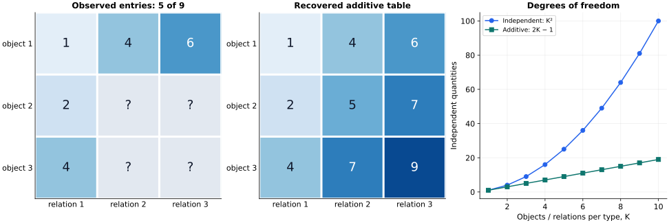

> **Scaling Laws · Note 04**　[专题目录](/notes/scaling_laws/) · 上一篇：[谱与学习分辨率](/notes/scaling_laws/spectral_learning/) · 下一篇：[特征学习与动态加速](/notes/scaling_laws/feature_learning/)

**学习问题：** 平均损失的平滑下降，怎样由局部技能的形成、长尾覆盖与组合共享共同产生？

## 0. 前言：整体损失平滑下降，局部能力却可能突然形成 {#前言整体损失平滑下降局部能力却可能突然形成}

一个语言模型需要处理拼写、句法、事实、数值关系和专业术语。扩大模型后，平均损失可能平滑下降；单独查看某种任务，性能却可能在一段规模内几乎不变，随后迅速改善。把许多发生在不同位置的局部变化加在一起，就可能得到一条平缓的总曲线。

连续谱把目标分成正交方向；另一种解释则把预测需要的知识分成离散部件。每个部件出现的频率、学会它需要的样本，以及存储或计算它的代价可以不同。资源增加时，常见而容易的部件先被掌握，剩余损失逐渐由更稀有、更昂贵的部分支配。

但“一个部件”应该怎样划分，还没有现成答案。模型做对一组算术题，可能只是熟悉了常见题型，也可能学到了能用于新数字的运算规则。前一种解释更接近样本覆盖，后一种则需要说明规则怎样共享。把词或题目逐项列出来，未必就找到了模型实际复用的技能。

[Michaud 等的 The Quantization Model of Neural Scaling](https://arxiv.org/abs/2303.13506)提出“技能量子”的假说，以长尾任务检验其预测，并研究语言模型损失的分解。这里的 quantization 指知识或技能的离散性，与低精度参数量化无关。

独立技能模型假定每个样本只需要一种技能，技能之间互不帮助，学会以后便能消除对应的误差。其学习曲线取决于技能频率、学习成本和所需样本数。若技能共享部件，或依赖其他技能先形成，这些关系也会改变。

## 1. 先给出一个明确的技能模型 {#skill-model}

设预测问题被分成技能 $k=1,2,\ldots$。第 $k$ 种技能在测试分布中的使用概率为 $p_k$，尚未学会时产生额外损失 $\Delta_k$。用 $s_k\in[0,1]$ 表示掌握程度，平均超额损失写成

$$
R=\sum_k p_k\Delta_k(1-s_k).
$$

这一式子已经包含实质假设：技能的贡献可以相加，并且一项技能的获得不会改变另一项的定义。最直接的实现是每个样本只依赖一种技能；如果一个样本需要多个部件协作，就必须重新说明怎样从部件成功率得到样本损失。

先取 $\Delta_k=\Delta$，并假定技能按使用频率依次被掌握：$s_k=1$ 对 $k\leq m$，其余为零。若

$$
p_k=c\,k^{-(1+a)},\qquad a\gt0,
\qquad c=\frac1{\zeta(1+a)},
$$

那么剩余风险就是概率尾部

$$
R(m)=\Delta c\sum_{k\gt m}k^{-(1+a)}
\sim\frac{\Delta c}{a}m^{-a}.
$$

每个技能的改善仍然是离散的。幂律来自越来越多技能被学会以后，未学会部分的总权重如何下降；并不要求每个技能内部都有一个幂律训练过程。

这里按测试频率加权损失。学会一项常见技能，可以比学会许多罕见技能减少更多误差。常见部分被解决以后，新增能力越来越多，总损失仍可能只缓慢下降。

一个直观例子是专业术语：新增知识也许只影响很少的上下文，但大量罕见术语的总概率仍然不可忽略。模型已经掌握的常见部分很少贡献剩余损失，后面的学习逐步转向尾部。这是对一种可能机制的描述，不能仅凭词频服从 Zipf 定律，就认定真实模型的知识一定按独立术语存储。

### 1.1 一个三技能表，怎样从局部掌握得到平均损失 {#section-1-1}

先不用无限长尾，取三项技能，测试使用概率为 $(0.6,0.3,0.1)$。未掌握一项时，假定每次使用它都多付出一个单位平方损失。完全不会时，平均超额损失为一；依次掌握前两项后，风险分别降到 $0.4$ 和 $0.1$。三项在“技能数”中等权，在测试损失中却相差六倍、三倍和一倍。

若第二项只掌握了一半，第一项已完全掌握、第三项仍不会，则

$$
R=0.6(1-1)+0.3(1-0.5)+0.1(1-0)=0.25.
$$

这里的掌握程度可以表示一组实例上的平均成功，也可以表示该项残余误差相对于初值减少了多少。选择哪种定义要跟损失一致。对交叉熵而言，回答对错不能直接线性替换成损失比例。本例假定三项风险可加；真实语言模型中的任务可能共享技能，不能直接沿用这种分区。

### 1.2 从样本群到技能，需要额外证据 {#section-1-2}

假如几个样本的损失一起下降，它们可能依赖同一规则，也可能只是都很容易，或者在同一训练阶段得到更多更新。要把这群样本解释为一个技能，至少还要检查未训练的变体能否同时受益。若改变数字、表面措辞或组合方式后收益保留，才更支持功能复用。

技能频率相同，形成门槛和参数代价仍可能不同；曲线偏离长尾预测时，这三项假设需要分别检验。

## 2. 模型容量怎样转成技能数 {#capacity}

### 2.1 每项技能代价相同的情形 {#每项技能代价相同的情形}

如果每项技能需要固定 $c_0$ 个有效参数，规模为 $N$ 的模型能容纳约 $m=N/c_0$ 项技能，因此

$$
R(N)\sim\frac{\Delta c}{a}(N/c_0)^{-a}.
$$

模型指数为 $a$ 依赖 $m\propto N$。参数共享、稀疏激活、模型架构与知识间的相互干扰，都可能改变容量到技能数的映射。

若第 $k$ 项技能的代价随稀有程度增长，$c_k\asymp k^\delta$，$\delta\gt-1$，累计容量需求为

$$
N(m)\asymp\sum_{k\leq m}c_k\asymp m^{1+\delta}.
$$

于是

$$
R(N)\asymp N^{-a/(1+\delta)}.
$$

同样的技能频率，可以对应不同的模型指数。一个更有效的表示可能只降低常数 $c_0$；若它系统地改变高阶技能的代价增长率 $\delta$，才可能改变渐近指数。有限规模内，两种改善常常难以单凭损失曲线区分。

同一条规则可以被许多任务共用，多个规则也可能在同一组参数上干扰。实际容量曲线偏离等成本模型时，应先检查参数到可支持技能数的换算。

### 2.2 技能价值也可能不同 {#技能价值也可能不同}

并非所有预测的错误代价都相同。若罕见技能的额外损失满足 $\Delta_k\asymp k^{-b}$，则风险尾部的指数变为 $a+b$，前提是 $a+b\gt0$。若 $\Delta_k$ 随 $k$ 增大，反而可能增强尾部的影响。

技能的频率、学会后的损失收益和学习代价，是三个不同的量。原始 token 频率通常只能提供其中的一部分信息。

例如，一个少见符号可能只需沿用已经学会的语法，一个常见词却可能出现在许多不同结构中。表面频率没有直接给出任务复杂度。把技能作为理论单位，需要明确可重复使用的计算是什么，以及它减少哪一部分误差。若只是事后把每个失败样本命名成一项技能，这个模型便没有真正解释共享，也难以预测新样本。

### 2.3 技能代价不同时，按频率学并不一定最优 {#section-2-3}

若技能 $k$ 的完整收益是 $p_k\Delta_k$，代价为 $c_k$，在允许分配连续资源的近似中，其单位代价收益由 $p_k\Delta_k/c_k$ 衡量。真正的离散选择是一个带预算的组合问题，单纯按比值排序也未必给出精确整数最优解；但它已经说明，频率最高不保证最先值得学习。

例如两项技能的频率分别为 $0.2$ 与 $0.1$，损失收益相同，而代价分别为十与一。预算只有一时，常见技能根本不可行，学习较稀有者反而能立即降低风险。若某个共享部件能同时帮助两项技能，代价还不能按技能独立相加。容量指数中的资源换算，实质上已经包含了这份表示与选择问题。

在实际网络中，优化也未必按上述收益排序。梯度信号、初始化和相互干扰会决定学习次序。长尾模型先规定学习次序，是为了得到可计算的基线；要解释真实训练顺序，还需要测量每个部件的训练信号。

## 3. 数据规模：从硬阈值到真实的随机出现次数 {#occupancy}

### 3.1 平均计数阈值给出的近似 {#平均计数阈值给出的近似}

假定一项技能需要至少 $\tau$ 个相关样本才可能学会。$D$ 个独立样本中，第 $k$ 项技能的平均出现次数为 $Dp_k$。用 $Dp_m\simeq\tau$ 定义当前可学到的尾端，可得

$$
m_D\asymp(Dc/\tau)^{1/(1+a)},
\qquad
R(D)\asymp D^{-a/(1+a)}.
$$

于是最简模型预测，数据指数与容量指数满足 $\alpha_D=\alpha_N/(1+\alpha_N)$。这个关系依赖等技能代价、等损失收益和固定样本阈值；它不能直接用作所有神经网络的普遍约束。

硬阈值近似还隐藏了随机性：$Dp_k=\tau$ 并不意味着技能在每个训练集中恰好出现 $\tau$ 次。要理解曲线为什么平滑，可以把随机计数明确写出来。

### 3.2 Poisson 计数与未见质量 {#poisson-计数与未见质量}

先取极端简单的规则：一项技能只要出现一次就被完全学会。将样本总数 Poisson 化后，技能计数独立且 $n_k\sim\operatorname{Poisson}(Dp_k)$。未学会概率为 $e^{-Dp_k}$，期望风险为

$$
R(D)=\Delta\sum_k p_ke^{-Dp_k}.
$$

对长尾区用积分近似，令 $s=1+a$、$u=Dc\,x^{-s}$，则

$$
\begin{aligned}
R(D)&\simeq\Delta\int_1^\infty cx^{-s}e^{-Dcx^{-s}}dx\\
&\sim\frac{\Delta c^{1/s}}s
\Gamma\!\left(1-\frac1s\right)D^{-(1-1/s)}.
\end{aligned}
$$

指数仍然是 $a/(1+a)$，但转变是平滑的。最常见的技能几乎肯定已出现；非常罕见的技能几乎肯定未出现；主要的变化来自 $Dp_k$ 为一量级的中间区域。

扩大数据主要改变计数在一量级附近的条目。这个区域逐渐移向低频部分，其总概率质量决定整体下降速度。它与谱模型的移动截止相似，不过这里控制的是事件是否出现，谱模型控制的是各模态恢复了多少。

这就是未见概率质量。它只计算测试所需技能是否在训练中出现过；从一次出现中识别规则，是另加的学习假设。

在固定有限技能表上，全部条目最终都被充分观察以后，覆盖误差会比中间区域的幂律更快消失。中间幂律之所以持久，是当前预算还不断遇到新的低频条目；它并不是每项有限知识永远只能按幂律学习。技能总数与数据一起增加时，又可能持续保留这个前沿。有限表与不断扩展的任务族，应当作为不同的标度极限理解。

一次出现可能只给出含混线索，多次互补的情境才足以辨认规则；出现一次即掌握只是特殊情形。

### 3.3 多次出现才能学习的情形 {#多次出现才能学习的情形}

若需要 $\tau$ 次出现，未学会概率变成

$$
q_\tau(u)=\Pr\{\operatorname{Poisson}(u)\lt\tau\}
=e^{-u}\sum_{j=0}^{\tau-1}\frac{u^j}{j!}.
$$

将它代入同一个积分，只要 $\tau$ 固定，就有

$$
R_\tau(D)\sim
\frac{\Delta c^{1/s}}sD^{-(1-1/s)}
\sum_{j=0}^{\tau-1}\frac{\Gamma(j+1-1/s)}{j!}.
$$

固定阈值改变领先常数，没有改变数据指数。若学习阈值本身随技能增长，例如 $\tau_k\asymp k^\rho$，那么 $Dp_k\simeq\tau_k$ 给出 $m_D\asymp D^{1/(s+\rho)}$，数据指数就变成 $a/(1+a+\rho)$。问题从“是否见过”转向“稀有技能是否也更难学”。

*图 1 · 左图计算有限长尾表上的 Poisson 未掌握质量，并显示固定阈值如何改变曲线；中图将许多技能的平滑阈值叠加，得到整体连续改善；右图比较不同技能总数，展示有限尾部最终偏离中间区间的幂律。均为上述机制模型的直接计算。*

### 3.4 Poisson 近似前，有限样本的精确答案是什么 {#section-3-4}

固定恰好 $D$ 个独立样本，第 $k$ 项技能一次也没出现的概率是 $(1-p_k)^D$，所以一次出现即掌握的精确平均风险为

$$
R_D=\Delta\sum_k p_k(1-p_k)^D.
$$

Poisson 化把它换成 $e^{-Dp_k}$。这是在稀有技能区域中使用 $\log(1-p_k)\simeq-p_k$，并不要求常见技能也满足近似：常见技能的未见概率已经很小，对晚期剩余质量影响有限。固定样本数下各技能计数并不独立，但计算风险的期望只用到各项未见概率，不需要额外假设独立性。

主导区域满足 $Dp_k$ 为一的量级。若 $Dp_k=0.1$，未见概率约为 $0.90$；若 $Dp_k=1$，约为 $0.37$；若 $Dp_k=10$，只约为 $4.5\times10^{-5}$。因此，新增数据主要改变中间区域，已经反复出现的条目对覆盖误差几乎不再贡献收益。

### 3.5 有限技能表什么时候离开幂律 {#section-3-5}

若只有 $K$ 项技能，且最小使用概率为 $p_{\min}\gt0$，则

$$
R_D\leq\Delta(1-p_{\min})^D
\leq\Delta e^{-Dp_{\min}}.
$$

幂律可以持续很长的中间窗口，却不会在固定有限表上延伸到无限数据。无限长尾极限中，始终有更稀有的条目；有限表中，最后剩下的是几个最罕见条目，风险最终转为更快的覆盖衰减。这一点也适用于许多声称“长期稳定指数”的有限任务：要同时检查当前规模是否已接近任务尾部的截止。

## 4. 训练时间为什么有时与数据量给出相同指数 {#training-time}

如果每步读取新的独立样本，固定 batch 为 $B$，处理的训练样本数是 $D_{\rm seen}=Bt$。若某项技能的梯度信号与使用频率成正比，它的典型形成时间可能为 $t_k\propto p_k^{-1}$。这会得到与计数阈值类似的可见技能边界。

但数据受限与时间受限仍然是不同机制。某个有限数据集中没有出现的技能，重复训练一百轮也无法凭空提供其独立信息；已经出现足够多次的技能，也可能因为优化平台而长时间没有被掌握。只有在明确的一遍在线训练条件下，时间和已见样本数才有简单映射。

同一个例子在相关表示形成后，可能比第一次遇见时更有训练作用。这属于对既有信息的再利用，统计覆盖仍由原来的独立样本决定。

例如令技能的损失贡献为 $p_ke^{-\gamma p_kt}$。求和与上一节形式相同，得到时间指数 $a/(1+a)$。此时每项技能内部是指数学习，整体的幂律来自频率造成的一组宽时间尺度。若技能启动需要多个已有部件，形成时间还可能不是 $1/p_k$。

## 5. 共享部件与层次组合为什么会改变计数图景 {#composition}

独立技能表把每种任务视为单独的条目。层次结构则允许许多任务共用同一个部件。设有 $K$ 种对象和 $K$ 种关系，表面问题有 $K^2$ 种组合。如果每种组合都要独立记忆，样本必须逐渐覆盖二维组合表；若预测规律可分解为两个部件表示和一个共享运算，学习器可以利用见过的对象和关系处理未见组合。

以均匀采样为例，观察特定组合的概率是 $K^{-2}$，而观察某个对象或关系的概率是 $K^{-1}$。相应的稀有事件尺度相差一个 $K$。真正做到这种改善，还要求共享运算可辨识，且训练数据能约束正确的分解；仅有组合形式，并不保证神经网络自动获得组合泛化。

共享还会改变“未见”的含义。一道完整问题可以从未出现，但组成它的对象、关系和组合方式都已被约束；另一道问题即使表面相似，也可能引入一个从未识别的新部件。前者有机会通过组合泛化解决，后者需要额外信息。因而长尾能力应区分未见整题、未见组合与未见基本规则，否则不同的泛化要求会被合成一个覆盖率。

在随机层级模型中，难度还受到每层可替换规则数、隐变量字典大小和路径深度的影响。一个表面事件罕见，不一定意味着其所有内部规则都罕见；相反，一个经常出现的输出也可能依赖难以从低阶统计识别的高层规则。有关这些区别，可接着阅读[层次结构数据与学习理论](/notes/hierarchical_data/)，尤其是[语言统计与学习曲线](/notes/hierarchical_data/language_statistics/)。

对需要多个技能的样本，也可以直接看见加性假设的变化。若样本需要技能集合 $S$，各技能成功概率近似独立，则样本成功概率为 $\prod_{k\in S}s_k$。失败概率是

$$
1-\prod_{k\in S}s_k.
$$

只有在每项失败概率都很小时，才近似为 $\sum_{k\in S}(1-s_k)$。在能力形成早期，多个必要部件的相互依赖可以使整项任务突然改善，而平均 token 损失仍缓慢下降。

这提供了局部能力陡升的一种直观来源。许多部件已经分别改善，但只要一个必要环节仍经常失败，完整任务就很难成功；最后几个短板进入可靠区域以后，端到端表现才明显上升。变化可以来自平滑的部件学习，不要求每个部件在同一时刻突然获得。相应地，一项任务没有进步，也不意味着所有内部能力都没有进步。

同时，技能划分并不必然唯一。同一组行为可以按较粗任务分解，也可以按更细的必要步骤分解。合理的分解应当在改变数据和资源以后继续有预测力，例如解释哪些任务同步改善、哪些瓶颈相互依赖。仅从平均损失恢复唯一技能列表通常做不到；局部行为与受控变化，才会给这套解释增加约束。

### 5.1 共享规则的一个可解例子：五个观测确定九个组合 {#section-5-1}

取三个对象与三种关系，目标是 $f_{ij}=a_i+b_j$。规定 $a=(1,2,4)$、$b=(0,3,5)$，完整目标表为

$$
F=\begin{pmatrix}1&4&6\\2&5&7\\4&7&9\end{pmatrix}.
$$

若把九格当作九个无关条目，观测五格以后，剩下四格仍没有被规定。若知道目标可以加性分解，只观察第一行和第一列，就能从差值得到全部九格：

$$
f_{ij}=f_{i1}+f_{1j}-f_{11}.
$$

例如 $f_{33}=4+6-1=9$。这个推断利用了共享假设；若真实目标还含独立交互 $c_{ij}$，同一公式就会遗漏交互，不能再保证正确。五个观测并没有凭空带来九个独立未知数的信息，而是任务本来只有五个可识别自由度。

一般的 $K\times K$ 加性表有 $2K-1$ 个可识别自由度，因为给所有 $a_i$ 加一个常数、同时从所有 $b_j$ 减去它，不改变目标。观测哪些格子也很重要：将对象与关系作为二部图的两侧，只有观测边把相关节点连通，才能沿路径恢复相对差值。观测集中在一个小子表，即使总数相同，仍可能完全看不到某个对象。

*图 2 · 自制加性组合算例。左图只给出第一行与第一列的五个观测，其余格用问号表示；中图展示在已知加性规则下恢复的完整表；右图比较独立表格与加性模型的可识别自由度。它说明共享规则如何改变所需观测，不是语言模型训练结果。*

### 5.2 共享怎样改变长尾解释 {#section-5-2}

若很多低频组合复用少数高频部件，组合本身未出现，也可能被正确处理。此时，决定损失的频率应当是部件的证据频率及其连接方式，而非每个表面组合的出现频率。反过来，部件虽各自常见，若组合运算尚未形成，模型仍会在未见组合上失败。

本例把正确分解直接给了学习器。端到端网络还要从有限样本中发现这种分解，所以它只是共享所能带来的表示收益上界之一。真实的学习曲线，还应包含发现规则的成本和错误共享造成的偏差。

## 6. 数据选择可以改变谁先被学会 {#data-selection}

如果训练分布与测试分布相同，常见技能自然获得更多观测。若主动提高稀有但有价值技能的采样概率，技能边界就不再由原来的 $Dp_k$ 决定。用 $q_k$ 表示训练采样频率，而测试仍按 $p_k$ 加权，则一次出现即学习的风险是

$$
R(D;q)=\Delta\sum_k p_ke^{-Dq_k}.
$$

相同的 $D$ 可以有不同风险，这说明数据量不能独立于数据选择来解释。为一个固定预算最小化上式，内点的边际条件为 $p_ke^{-Dq_k}$ 相同；很小的 $p_k$ 可能对应零采样分配。这种分配通常依赖预算，不等于永远均匀采样，也不等于永远按原频率采样。

[Sorscher 等，Beyond neural scaling laws: beating power law scaling via data pruning](https://arxiv.org/abs/2206.14486)研究数据筛选如何改变学习曲线，在特定设置中得到优于随机数据子集幂律的改善。它关注的对象包含筛选质量与难度，并不能简化为“删数据必然更好”。如果筛选指标只留下当前模型容易解释的样本，重要而罕见的结构也可能被删除。

在有限维带噪估计中，重新采样还有另一种代价。若技能 $k$ 的估计方差约为 $v_k/(Dq_k)$，测试风险约为 $D^{-1}\sum_k p_kv_k/q_k$，最优内点分配为 $q_k\propto\sqrt{p_kv_k}$。这个平方根规则与上面的覆盖规则不同，因为一个问题在避免完全遗漏，另一个问题在降低已经进入估计的测量噪声。

数据选择因此需要跟随当前瓶颈。尚未覆盖时，增加新条目可能最有价值；覆盖以后，重复测量困难条目可能更有效；共享部件形成以后，同一个样本的价值又可能变化。所谓数据质量并非一个永远固定的标签，而是样本对当前目标和当前学习状态能提供多少额外信息。这也是只按原始条目数比较学习曲线时容易遗漏的部分。

### 6.1 改变训练分布以后，测试仍然按什么加权 {#section-6-1}

提高稀有技能的采样概率，可以加快覆盖，但测试收益仍按原来的使用概率计入。若某项技能在训练中完全没有支持、又不能从共享规则推断，重要性加权也无法创造它的信息。样本选择因而应同时说明训练支持、测试分布与筛选成本。

一个简单的两类例子是：测试中九成是常见任务、一成是困难任务，而均衡采样让两类各占训练的一半。困难任务的观测增加，常见任务的观测却减少；总平均风险是否降低，要看两类当前处于哪一段学习曲线。若常见类已接近平台，转移预算可能划算；若它仍贡献大部分可改善损失，过度均衡也可能抬高总风险。数据质量的作用必须落到这份测试加权上，不能只看被加强类别的单项成绩。

## 7. 谱松弛与随机覆盖：相同的幂律，不同的机制 {#mixture-bridge}

### 7.1 小速率端的累计权重 {#71-小速率端的累计权重}

在固定方向、无噪声的总体梯度流中，目标误差可以写成指数松弛的叠加。把此前风险中的因子二吸收到速率 $\lambda$ 中，用 $u$ 表示资源轴，

$$
\begin{aligned}
R(u)&=\int_{[0,\infty)}e^{-u\lambda}\,\mu(d\lambda),\\
F(\lambda)&=\mu([0,\lambda]).
\end{aligned}
$$

设测度非负、总质量有限，零速率处没有原子，且 $F(\lambda)\sim A\lambda^\nu$、$\nu\gt0$。分部积分并令 $z=u\lambda$，得到

$$
\begin{aligned}
R(u)&=u\int_0^\infty e^{-u\lambda}F(\lambda)\,d\lambda\\
&\sim A u^{-\nu}\int_0^\infty e^{-z}z^\nu\,dz\\
&=A\Gamma(\nu+1)u^{-\nu}.
\end{aligned}
$$

累计权重不是单纯数慢单元有多少，还要计算它们合起来贡献多少剩余损失。许多极慢单元若几乎不承载目标能量，对风险仍可能没有影响；少量慢单元若权重很大，却可能在有限预算中形成明显平台。这里的测度总质量等于初始风险，不要求像概率分布那样归一为一。

这是给定规则尾部后推出风险的方向；尾部带缓变修正时，风险也会带相应修正。有限窗口内观察到幂律，不能据此唯一恢复微观速率分布。若零速率有非零权重，它给出残余平台；若所有正速率都有严格下界，晚期则会离开幂律区间。

### 7.2 技能频率怎样变成同一份测度 {#72-技能频率怎样变成同一份测度}

取单位未掌握损失、一次出现即掌握的 Poisson 模型，风险为 $R(D)=\sum_kp_ke^{-Dp_k}$。定义由 Dirac 点质量组成的测度

$$
\begin{aligned}
\mu&=\sum_k p_k\,\delta_{p_k},\\
R(D)&=\int e^{-D\lambda}\,\mu(d\lambda).
\end{aligned}
$$

这里频率同时进入指数中的等待尺度与测试风险权重。这两种作用需要分开读：某项技能很少出现，所以等待它要很久；但它在测试中也很少被使用，因此没有学会它只增加较小的平均风险。大量稀有技能的贡献能否累积起来，才决定整个尾部有多重要。若训练采样频率与测试使用频率不同，等待尺度和损失权重就不再由同一个数给出。若 $p_k\sim ck^{-s}$、$s\gt1$，频率小于 $\lambda$ 的技能大致满足 $k\gtrsim(c/\lambda)^{1/s}$。其总测试质量为

$$
F(\lambda)\sim
\frac{c^{1/s}}{s-1}\lambda^{(s-1)/s}.
$$

因此累计测度指数为 $\nu=(s-1)/s$，并且

$$
R(D)\sim\frac{c^{1/s}}s\,
\Gamma\!\left(1-\frac1s\right)D^{-(s-1)/s}.
$$

这与前面 $s=1+a$ 时的覆盖指数相同，还给出了领先常数。固定有限技能表有最小非零频率，最终由最稀有项的指数等待主导；无限长尾或持续扩展的任务族，才可能不断提供更慢的尺度。

### 7.3 同形关系到哪里停止 {#73-同形关系到哪里停止}

谱理论中的 $u$ 是训练时间，速率来自函数方向的动力学；技能模型中的 $u=D$ 是样本量，速率来自事件出现。只延长同一数据集上的训练，能够改变未收敛模态，却不会消除一次出现即学习模型中的未见质量。改变采样分布，则能直接移动覆盖的等待尺度。

这个联系也不完全依赖 Poisson 近似：固定样本数时，$(1-p_k)^D=e^{-D[-\log(1-p_k)]}$，只需将速率换成 $-\log(1-p_k)$。稀有端它与 $p_k$ 渐近相同，但有限样本值仍有差别。

若一项技能需要至少两次证据，未掌握概率变成 $(1+Dp_k)e^{-Dp_k}$，就不再是单项指数。这一函数在小 $D$ 区间的二阶导数可以为负，因而不能一般地表示为固定非负测度的纯指数混合。固定门槛下的长尾仍可能产生幂律，但需要保留新的覆盖滤波器。直观上，只要见一次就学会的技能，从最初增加样本就开始受益；需要两份证据的技能则可能先积累材料，随后才更明显地改善。这种先缓后快的局部过程，与固定非负指数混合从一开始就逐步放慢的下降形状不同。宏观尾部可以相似，早期响应仍能帮助区分机制。

共同的积分结构因此提供一种联系：宽广的慢尺度能使平均风险缓慢下降。它没有证明两种微观单元相同，也没有解释真实网络的有效难度分布怎样形成。[机制综合](/notes/scaling_laws/mechanism_synthesis/#comparison)进一步比较各套解释的独立预测与未解问题。

## 8. 结语：长尾是一种机制，技能结构决定它怎样起作用 {#结语长尾是一种机制技能结构决定它怎样起作用}

离散技能模型解释了平滑平均曲线与局部能力转变怎样共存。容量、数据和时间分别通过可容纳技能数、相关样本计数和形成时间进入风险；等成本、等收益和独立技能的假设给出简单的指数关系，改变这些假设就会改变预测。

词频尾部只告诉我们哪些符号常见。技能模型还需说明每项计算能在多少样本间复用、需要多少证据才能形成，以及学习次序是否会随表示变化。

### 8.1 技能的划分与共享 {#discussion-skill-units}

技能的划分应在未见样本上产生预测：同一个部件形成以后，一组不同表面实例应共同获益。若只把失败样本逐项命名成技能，模型便退回了逐项计数，无法说明共享。

组合任务还会破坏损失可加性。一个部件可能要等其他部件形成后才有用，上游规则也可能同时解锁许多任务。此时要保留技能之间的依赖，而不能继续只按固定频率排序。

### 8.2 评分阈值与内部技能 {#discussion-emergence}

局部能力陡然改善，与内部形成一项可复用规则相容，但仅看准确率还不能确定这一点。[Schaeffer、Miranda 与 Koyejo，Are Emergent Abilities of Large Language Models a Mirage?](https://arxiv.org/abs/2304.15004)讨论了评价指标怎样把平滑输出变化变成表观上的突然出现。一个答案必须所有位置都正确才得分的任务，就可能在局部错误率连续改善时呈现很陡的整体成功曲线。

评分阈值可以制造表观突变，但网络是否形成新算法仍需单独研究。跨实例迁移、成组错误的消失，以及干预某个表示部件后的共同变化，都是比单条准确率曲线更具体的证据。报告连续损失也能帮助判断评分阈值的影响。

#### 8.2.1 一个整句得分的算例 {#section-7-2-1}

假设一个十位置任务，每个位置独立地以概率 $p$ 正确，只有全对才得分，则整句成功率为 $p^{10}$。当局部正确率从 $0.8$ 连续改善到 $0.9$，整句得分从约 $0.107$ 增加到 $0.349$；到 $0.95$ 时又增加到约 $0.599$。如果实验点较稀，或只在得分超过某个阈值后报告“具备能力”，它就可能看起来突然出现。

这里没有引入新技能形成的开关，只有评价函数的非线性。反过来，若某个共享运算在训练中形成，局部概率也未必都平滑变化。要区分两者，应同时跟踪逐位置概率、整句分数和未见组合的表现。这一算例使用独立位置，是为了单独展示评分效应；真实语言中的位置相关还会改变整句概率，不能直接把它当作语言生成模型。

### 8.3 梯度分解与数据剪枝 {#discussion-progress}

[Michaud 等](https://arxiv.org/abs/2303.13506)尝试利用语言模型梯度分解行为，寻找跨样本聚合的单位。其技能频率结果仍是探索证据：梯度相似簇是否对应可复用功能，分解是否稳定、是否依赖具体模型，都还需要验证。

[Sorscher 等的数据剪枝研究](https://arxiv.org/abs/2206.14486)考察了样本选择对标度的影响。按本篇的模型，改变采样可以使尾部技能更早得到证据；若比较总资源，还须计入获取和筛选样本的成本，不能只按保留条目数计算效率。

### 8.4 组合测试与技能演化 {#discussion-tests}

已知生成规则时，可以保持表面频率相近，分别改变共享、组合深度和前置依赖。独立覆盖主要改善被训练到的条目，共享规则还应改善未见组合；即使平均损失相近，组合测试也能将两者分开。

技能分解也可能随训练改变：原先分开的几个部件，后来被一条更一般的规则替代。固定技能表难以描述这种过程，需要把功能的出现与表示的演化一起追踪。

## 9. 参考文献 {#references}

1. **Michaud, Liu, Girit, Tegmark（2023；修订 2024）**. [The Quantization Model of Neural Scaling](https://arxiv.org/abs/2303.13506)。NeurIPS 2023。技能量子假说、长尾玩具任务和语言模型梯度分解。本文的三技能表、有限覆盖与加性组合算例为独立展开。

2. **Sorscher, Geirhos, Shekhar, Ganguli, Morcos（2022）**. [Beyond neural scaling laws: beating power law scaling via data pruning](https://arxiv.org/abs/2206.14486)。NeurIPS 2022。数据剪枝如何改变学习曲线，以及实际筛选指标的成本与可扩展性。

3. **Schaeffer, Miranda, Koyejo（2023）**. [Are Emergent Abilities of Large Language Models a Mirage?](https://arxiv.org/abs/2304.15004)。NeurIPS 2023。评价指标造成表观能力突变的分析；与内部技能或算法形成的证据应分别讨论。

**继续阅读。** 下一篇允许表示随目标反馈而变化，继续追问技能或方向为什么会在训练中变得更容易学习。

[← 上一篇：谱与学习分辨率](/notes/scaling_laws/spectral_learning/) · [返回专题目录](/notes/scaling_laws/) · [下一篇：特征学习与动态加速 →](/notes/scaling_laws/feature_learning/)
