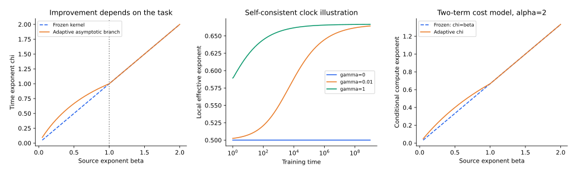

[专题目录](/notes/scaling_laws/) · ← [离散技能与长尾结构](/notes/scaling_laws/discrete_structure/) · [随机图与语言标度](/notes/scaling_laws/graph_language/) →

## 前言：学习过程中，容易与困难也在变化

固定核模型把数据映射成一组预先确定的特征，训练只决定怎样组合它们。某些目标方向一开始就具有较大的核本征值，能够很快学习；另一些方向被赋予很小的速率，成为长时间剩余误差的来源。在这个图景里，难度是训练之前已经确定的。

神经网络可以改变隐藏表示。目标相关的方向得到加强以后，原来困难的部分可能变得容易；训练的时钟本身也随学习改变。由此产生一个更具体的问题：特征变化只是让损失少一些，还是能改变损失随资源下降的指数？二者对远距离外推有完全不同的含义。

[Bordelon、Atanasov 与 Pehlevan 的 How Feature Learning Can Improve Neural Scaling Laws](https://arxiv.org/abs/2409.17858)，初稿发表于 2024 年并被 ICLR 2025 接收，构造了超出冻结核的可解模型。它区分目标相对于初始核的难度，分析特征变化何时改善训练时间和计算标度。本篇围绕这个问题，从一个小型动力学推导进入其渐近机制，再讨论结论的边界。

## 1. 两种改善：领先常数与幂律指数 {#constant-exponent}

假设两个模型的超额损失分别为 $R_A(t)=10t^{-0.4}$、$R_B(t)=t^{-0.4}$。第二个模型在所有时间都更好，达到相同损失所需时间也大幅下降，但长期指数并没有变化。若第三个模型为 $R_C(t)=5t^{-0.7}$，它可能在初期更差，足够晚才超过前两者。

判断特征学习改变了哪一种改善，需要比较局部斜率

$$
\chi_{\rm eff}(t)=-\frac{d\log R(t)}{d\log t}
$$

以及足够长的尺度窗口。一个启动平台后的快速下降，可以在有限区间产生很大的有效斜率，却不一定是新的渐近指数。若总损失还包含常数平台，应先说明怎样估计平台，否则斜率也会系统性偏小。

特征变化本身也不能证明指数改变。隐藏层可以发生明显运动，但最终只是改善常数；另一些运动发生在测试目标不敏感的方向上，甚至不改善泛化。需要把特征变化与风险贡献联系起来。

领先常数的改善同样可以很有价值。对下降缓慢的曲线，纵向减少一些误差，可能意味着达到同一目标所需资源减少很多。区分常数与指数，并不是给两类成果排重要性，而是明确它们能支持多远的外推：常数改善对应近似平行的曲线，指数改善则意味着相对优势随资源继续积累。有限实验中，两种曲线都可能优于基线，但长期含义不同。

## 2. 一个最小推导：表示更新怎样改变梯度流 {#adaptive-metric}

### 固定特征的学习时钟

先令 $z(x)\in\mathbb R^N$ 是固定特征，预测为 $f(x)=\theta^\top z(x)$。平方损失为 $\mathcal L=\frac12\mathbb E[(f-y)^2]$。设特征协方差为 $\Sigma_z$，可表示目标为 $y=\theta_*^\top z$，则

$$
\dot\theta=-\Sigma_z(\theta-\theta_*).
$$

在 $\Sigma_z$ 的本征方向上，残差为 $e_k(t)=e_k(0)e^{-\lambda_kt}$。每个方向拥有固定时钟，整体幂律来自不同速率和目标权重的叠加。这正是[谱与学习分辨率](/notes/scaling_laws/spectral_learning/)中的基线。

### 将同一组特征重新参数化

现在令 $f(x)=v^\top Bz(x)$，其中 $v\in\mathbb R^N$、$B\in\mathbb R^{N\times N}$ 都训练。函数仍在相同的线性张成空间内，但有效系数为 $\theta=B^\top v$。记

$$
g=\mathbb E[(f-y)z]=\nabla_\theta\mathcal L.
$$

在两个参数都采用单位学习率的梯度流下，

$$
\dot v=-Bg,\qquad \dot B=-vg^\top.
$$

对有效系数求导，得到

$$
\boxed{\dot\theta=-\bigl(B^\top B+\|v\|^2I\bigr)g.}
$$

括号内是随训练变化的正半定矩阵。相同的函数空间，不同参数化已经改变了运动的度量；哪些方向更快被更新，取决于训练历史。这里没有新增函数方向，却确实改变了动力学。

在直接训练有效系数的模型中，一步梯度更新就按既定度量移动；在因子模型中，同样的有效系数可以由许多不同因子实现，而这些实现又有不同的后续更新速度。也就是说，当前函数相同，不代表未来训练轨迹相同。这是参数化能够影响动力学、却不必先改变当前预测的一个具体原因。

可以把这个矩阵看成梯度转化为函数更新时经过的传动机构。相同的有效系数梯度，在不同因子状态下，会造成不同大小和方向的移动。训练因此既在修正预测，也在改变下一次修正怎样发生。这个例子的重要之处是，即使把表达能力固定，参数化仍然能够改变学习的快慢；更复杂网络中的性能优势，不必全部归因于能够表示更多函数。

对应的切线核为

$$
K_t(x,x')=z(x)^\top
\bigl(B^\top B+\|v\|^2I\bigr)z(x').
$$

即使特征张成空间不变，核也可以变化。因此“特征学习”至少有两种含义：改变既有方向的权重和几何，或者生成原来不可表示的新方向。讨论一个模型是否具有特征学习时，应先指出采用哪一种含义。

若分别使用学习率 $\eta_v$、$\eta_B$，上式中的矩阵变为 $\eta_vB^\top B+\eta_B\|v\|^2I$。这也说明更新尺度、初始化和参数化需要共同规定。仅仅说“网络很宽”并不足以决定它是否接近冻结核。

## 3. 一个保留容量瓶颈的特征学习模型 {#solvable-model}

上面的有限维构造可以接到无限特征基。设 $\psi_\infty(x)$ 是一个丰富的初始特征集合，先经过固定随机投影 $A_0$，得到 $z(x)=A_0\psi_\infty(x)$，再训练 $B$ 与 $v$。这与上述论文所用投影动力学的一种等价表示相联系，归一化和学习率可吸收到参数中。

固定投影的作用非常实质：有限模型始终只能访问初始 $N$ 维特征空间。若直接允许一个自由的全维输入权重朝任意目标移动，即使只有一个输出单元，也可能表示任意线性目标；那样模型规模的瓶颈就被构造本身取消了。

这可以类比为在一个固定房间里重新布置工具。调整工具的位置与组合方式，能让某些操作更顺手，却不能取来房间之外的材料。固定投影保留了后一种遗漏，因子训练则描述前一种适应。这样，模型才有可能同时出现更快的训练和不变的长期容量平台；两者并不矛盾，因为改善发生在可访问空间内部。

论文通过动力学平均场描述随机投影、有限 batch 和时变表示的联合影响。相关函数记录不同时刻残差的重叠，响应函数记录扰动的传播；两者共同保留训练历史。完整动力学并不能一般地化成一组互不相干、速率固定的指数模态。

本篇接下来讨论其幂律近似的核心：当初始核下的难方向持续贡献损失时，训练诱导的核增长可以加速这些方向。这个模型保留有限空间内的适应，仍然没有包含深层非线性网络所有的新特征生成机制。

## 4. 相对于初始核，什么叫困难的任务 {#source-condition}

令初始总体核的本征函数为 $\psi_k$，在数据分布下正交归一，

$$
K_0(x,x')=\sum_k\lambda_k\psi_k(x)\psi_k(x'),
\qquad f_*(x)=\sum_ka_k\psi_k(x).
$$

用两个指数描述初始核与目标：

$$
\lambda_k\asymp k^{-\alpha},\quad \alpha\gt1,
\qquad
\sum_{\ell\gt k}a_\ell^2\asymp k^{-\alpha\beta},\quad\beta\gt0.
$$

$\alpha$ 描述核谱的衰减，$\beta$ 描述目标能量相对学习速率的尾部。若 $a_k^2\asymp k^{-1-\alpha\beta}$，目标的核 Hilbert 空间范数为

$$
\|f_*\|_{\mathcal H_0}^2
=\sum_k\frac{a_k^2}{\lambda_k}
\asymp\sum_k k^{-1-\alpha(\beta-1)}.
$$

当 $\beta\gt1$ 时该级数收敛；当 $\beta\lt1$ 时发散，边界 $\beta=1$ 在这个理想尾部下为对数发散。目标的 $L^2$ 范数仍然有限，发散的是相对于这个初始核的表示代价。

因此“难”不是目标本身的绝对性质。一个网络的初始核可能把任务相关方向放在谱尾，另一个架构却可能将它们放到更前面。改变目标、输入分布或架构，都可能改变 $\beta$。初始核不适合某项任务，也不意味着所有核方法都不适合。

目标尾部较重时，尚未恢复的弱方向持续留下残差，因此训练一直有动力改变相关表示。目标主要位于强方向时，这部分残差较早消失，后续适应的驱动也可能较弱。这个机制并不主张损失大就必然学得更快：困难还需要通过模型允许的更新方式转成有用反馈，而不能只是停留在不可表示或不可辨认的方向。

从函数值看很简单的目标，也可能在某个核下昂贵。例如目标主要沿少数方向变化，但初始表示恰好很少响应这些方向；大量随机特征能够插值训练点，却仍然没有让该规律成为容易学习的方向。相反，架构预先提供合适的对称性或局部结构时，同一个目标可能集中在少数强模态。这里的难度描述学习器与任务的匹配，而不是给任务贴上绝对复杂的标签。

在冻结核、无噪声的总体梯度流中，时间 $t$ 大致解析到 $k_t\asymp t^{1/\alpha}$，于是

$$
R_{\rm lazy}(t)\asymp
\sum_{k\gt k_t}a_k^2\asymp t^{-\beta}.
$$

这个简单推导把后面的比较放在同一基线上：特征学习是否让可解析模态边界增长得更快？

## 5. 有效时钟的自洽加速 {#self-consistent-clock}

### 用一个标度方程理解反馈

在论文的总体、足够大宽度和合适的幂律区域中，时变特征的效果可以通过渐近有效时钟来理解。若风险 $R(t)\sim t^{-\chi}$，其自洽标度近似具有

$$
T_{\rm eff}(t)\asymp t+\gamma t^{2-\chi},
\qquad
R(t)\asymp[T_{\rm eff}(t)]^{-\beta}.
$$

$\gamma$ 控制特征演化强度。第一项是原有的线性时钟，第二项代表目标相关更新积累形成的反馈。这是从该模型提取的渐近关系，并非任意时变核都满足的恒等式。

有效时钟的含义是，用固定基线需要经历多少学习时间，才能达到当前适应模型的分辨率。它比实际时间增长得快，表示同样的更新次数正在产生越来越大的目标相关推进。这并不要求所有方向都同步加速，也不意味着模型的每个参数都变大；它只是对该渐近区域中风险控制尺度的一种概括。把它当成任意轨迹上的精确时间变换，会丢掉原模型中的历史依赖。

若新项最终占主导，比较时间幂次就得到

$$
\chi=\beta(2-\chi),
\qquad
\boxed{\chi=\frac{2\beta}{1+\beta}.}
$$

该分支还必须满足自己的前提 $2-\chi\gt1$，也就是 $\chi\lt1$，对应 $\beta\lt1$。若 $\beta\gt1$，原有的线性时钟主导，指数保持 $\chi=\beta$。因此模型给出

$$
\chi(\beta)=
\begin{cases}
2\beta/(1+\beta),&0\lt\beta\lt1,\\
\beta,&\beta\gt1.
\end{cases}
$$

边界附近可能出现对数修正和很长的交叉区间，不能只用两边的领先幂次描述有限时间。

自洽条件的作用，是防止仅从一个形式上可解的方程推出并不存在的加速区间。我们先假设反馈项主导，再算出风险指数，最后必须检查算出的指数是否真的让反馈增长得更快。若检查失败，就应回到原有线性时钟，而不是继续沿用漂亮的分式。这个逻辑使“特征学习总会改善指数”的直觉变成有条件的结论。

### 为什么困难任务的相对改善更显著

若 $\beta=1/2$，冻结核指数为 $1/2$，适应分支为 $2/3$。若 $\beta=0.1$，指数从 $0.1$ 提高到约 $0.182$，接近翻倍，但绝对下降仍然很慢。这里“接近翻倍”指指数的比值，并不表示损失直接减半，或者所有任务都获得同样加速。

直观上，容易任务的主要信号已经位于初始核较擅长的方向，长时间训练不再需要持续增强核；困难任务的尾部则不断推动目标相关表示变化。这个解释依赖模型中的反馈结构，尚不能据此断言任意真实网络在 $\beta\gt1$ 时都无法改善指数。

### 特征学习弱时，交叉可能很晚才出现

比较 $t$ 与 $\gamma t^{2-\chi}$，新项占主导需要 $\gamma t^{1-\chi}\gg1$。对应交叉时间估计为

$$
t_\times\asymp\gamma^{-1/(1-\chi)}.
$$

当 $\gamma$ 很小，或者 $\beta$ 接近边界导致 $\chi$ 接近一，交叉可能极晚。有限实验中看到冻结核指数，并不一定证明特征没有变化；看到短暂加速，也不能直接证明已经进入新的渐近区间。

实际观察还可能被另一条资源边界提前截断。模型也许尚未进入适应主导区域，就已经接近有限容量或有限数据的平台。这时理论上的长期分支仍然存在于相应极限中，却不会在这次有限实验里显现。判断指数有没有改变，需要同时看交叉时间、当前表示上限与数据精度，不能只把训练延长视为唯一条件。

*左图绘制论文幂律近似的指数关系；中图以自洽有效时钟方程计算交叉示意，不是完整动力学平均场的数值解；右图用正文中的两项风险和成本假设比较计算指数。*

## 6. 时间改善为什么不自动变成容量改善 {#different-resources}

在这个投影模型里，$B$ 和 $v$ 的训练改变有限特征空间中的几何，但没有移除初始投影造成的信息遗漏。因此对困难任务，长时间模型瓶颈仍为 $R_\infty(N)\asymp N^{-\alpha\beta}$，尽管到达它的时间可以明显缩短。论文还分析更光滑目标的饱和和有限规模暂态，不能把这一简单表达延伸到所有 $\beta$。

这给出一种很有用的区分：改变训练动力学，可以改善时间指数；改变有限模型可访问的目标方向，才可能进一步改善容量尾部。在真实深层网络中二者可能同时发生，但理论模型可以将它们拆开。

如果两种训练最终到达同一平台，但其中一种更早到达，优势主要体现在时间与计算；如果长期平台也下降，就还发生了表示或解选择的变化。短时间比较可能把前一种效果误读成更强容量，因为慢基线尚未走到自己的终点。反过来，只比较充分训练后的末态，又会漏掉在有限计算下很重要的加速。两种实验回答不同问题，都需要放回各自资源轴解释。

数据瓶颈也有类似区别。若训练始终使用同一个有限样本集，时变特征可能更快拟合数据，也可能选择不同的泛化解；它不能只凭动态加速就消除样本中没有的独立信息。在线新样本和离线数据回用，需要不同的相关与响应方程。

## 7. 加速怎样改变计算最优方向 {#compute-consequence}

设在一段区域内，风险近似为

$$
R(t,N)=At^{-\chi}+BN^{-\nu},\qquad A,B\gt0,
$$

并采用 $C=\kappa Nt$ 的成本模型。这里 $N$ 必须是与每步成本成比例的规模指标；若 $N$ 只是宽度而实际每步成本为 $N^2$，就应先改写成本。消去 $t$ 后，对 $N$ 优化得到

$$
N_*\asymp C^{\chi/(\nu+\chi)},\quad
 t_*\asymp C^{\nu/(\nu+\chi)},\quad
R_*\asymp C^{-\nu\chi/(\nu+\chi)}.
$$

在模型瓶颈指数 $\nu$ 不变时，时间指数 $\chi$ 增大，会提高最优配置中规模增长的幂次。原因是训练时间现在更有效，更大的模型可以在相同预算下得到足够训练；此前为了训练充分而保持小模型的压力减弱。

但两项近似本身需要检查。论文中的完整标度还包含有限 $N$ 与时间相乘的暂态，以及 batch 大小、学习率带来的 SGD 项。在容易或特别容易的任务上，计算最优包络可能由这些混合项决定，而不是由静态模型瓶颈和总体梯度流直接配平。知道一维的时间与容量曲线，仍不一定知道完整二维风险面。

### 有限模型和 SGD 为什么引入更多区域

在上述论文的冻结核模型中，忽略领先常数的一个渐近展开是

$$
R(t,N,B)\approx
 t^{-\beta}+N^{-\alpha\min(2,\beta)}
 +N^{-1}t^{-(1-1/\alpha)}
 +\frac{\eta}{B}t^{-(2-1/\alpha)}.
$$

这里 $B$ 是 batch 大小，$\eta$ 是步长；不同项的比较要求同时规定这些量怎样随规模变化。前两项是总体训练与长时间容量瓶颈，后两项是有限模型及随机梯度的暂态。暂态虽然最终下降，在固定计算预算的优化路径上却未必可忽略。

当任务足够容易，使 $\beta\gt2-1/\alpha$ 时，总体梯度流项下降得比最后一项更快，随机梯度的残余就可能成为主要时间项。一个学习器在确定性总体动力学里已经非常快，有限 batch 的影响反而更容易显现。对困难任务，总体误差尾部下降慢，这种残余通常较难主导。

这不是“噪声总会留下一个固定平台”：这里展示的是随时间下降的随机梯度项。它与固定步长、带持续标签噪声时可能出现的驻态平台属于不同设置。比较 SGD 标度时，需要说明噪声来源是否会随预测误差减小，以及是否采用衰减步长。

## 8. 从表示变化到可区分的证据 {#observables}

最直接的参照是固定初始特征，只训练读出层，再与完整训练比较。但比较应对齐实际计算和优化程度，否则更慢的基线会把训练不足误报为表示优势。

同样，核变化的总量并不是最直接的机制证据。若变化主要落在目标不使用的方向，幅度再大也未必有益；若只是整体乘了一个常数，可能主要改变有效学习率。更有解释力的是，当前剩余误差是否得到更强响应，以及这种响应是否在独立输入上也帮助预测。这样才能把表示运动与损失加速连接起来，而不只是看到两个量同时发生变化。

进一步可以测量目标在核本征方向上的能量、训练过程中的核变化，以及剩余误差是否朝更快的方向移动。只看核本征值还不够：核方向可能旋转，目标与本征向量的对齐也随之变化。对预测有意义的是目标加权的谱结构。

如果时间曲线改善，而充分训练后的容量曲线基本不变，结果更接近本篇的动态加速图景；如果小模型也能表示原来无法拟合的结构，就需要包含特征空间扩展或更有效共享的解释。若差异主要由学习率或初始化消除，则应重新判断原来的比较是否真正隔离了特征学习。

这个比较还可以按函数而非参数理解：若一种训练只是统一加快了已有时钟，它在相同基线风险处的误差构成应当相近；若它优先增强了某些目标方向，相同总风险下的误差分布也可能不同。后者能够帮助区分整体步长调整与任务相关适应。理论讨论中的加速，因而最好同时配有对正在改善哪些方向的解释。

## 结语：谱可以成为动态参照

特征学习并没有使谱语言失去作用，而是使谱、目标对齐和训练时钟成为相互反馈的对象。初始核仍然提供任务难度的参照，但不必决定训练全过程。

可解模型展示了一种具体结果：困难目标持续推动表示变化，形成自洽加速，改善时间和计算指数；有限投影的容量瓶颈可以同时保持。把这个结论放回真实网络时，关键是确认改善发生在哪条资源轴上，以及测得的核与表示变化是否真的解释了剩余损失。

[专题目录](/notes/scaling_laws/) · ← [离散技能与长尾结构](/notes/scaling_laws/discrete_structure/) · [随机图与语言标度](/notes/scaling_laws/graph_language/) →
