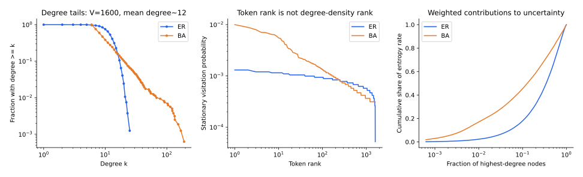

[专题目录](/notes/scaling_laws/) · ← [特征学习与动态加速](/notes/scaling_laws/feature_learning/) · [计算配置与经验外推](/notes/scaling_laws/compute_allocation/) →

## 前言：把语言缩减成一张可以完全掌握的图

自然语言同时包含长尾词频、句法层次、语义组合和知识关联。几种结构总在一起出现，仅从一条学习曲线很难判断各自的作用。我们可以逐步简化数据，保留下一词预测这个任务，看看去掉哪些结构以后，幂律仍然存在。

最简单的序列之一，是在图上随机行走：当前位置是一个 token，下一步只能沿着图的边移动。预测下一个 token 就是在学习转移概率。图可以有高度集中的度分布，也可以有幂律度分布；可以引入边权，也可以只允许一阶记忆。这样，数据结构与网络训练不再完全纠缠。

这个任务虽然简单，却不会因为知道整张图就变成零损失问题。只要当前节点有几条可能的出边，下一步仍然有随机性。生成器给出了精确的转移概率，也就给出了最优预测能达到的损失底。网络离这个底还有多远，可以直接计算，无须再把损失底当作一个待拟合参数。

[Barkeshli、Alfarano 与 Gromov，On the origin of neural scaling laws: from random graphs to natural language](https://arxiv.org/abs/2601.10684)于 2026 年比较了 ER 图、BA 图、语言 bigram 和简化生成语言。其中一个结果是，Transformer 在没有预置幂律频率结构的 ER 随机游走上，也能出现经验标度。

问题于是更具体了：已知概率表的估计，本来就有随样本量改善的统计误差；有限网络还要用共享参数表示这张表，并通过训练找到它。下面先算清计数器的基线，再看神经模型比这个基线多了哪些限制。只有这样，才能判断图数据上的幂律究竟解释到了哪一步。

## 1. 随机游走与下一词预测的对应 {#markov-prediction}

设图有 $V$ 个节点，转移矩阵为 $P_{vu}=\Pr(x_{t+1}=u\mid x_t=v)$。每一行概率和为一。如果序列满足一阶 Markov 性，

$$
p(x_{1:T})=p(x_1)\prod_{t=1}^{T-1}P_{x_t x_{t+1}}.
$$

节点对应词表中的 token，有向边及其权重对应 bigram 转移。只要知道当前节点，过去更早的历史就不再增加关于下一步的信息；最优条件分布就是当前行 $P_{v\cdot}$。

生成器已知，使这个问题有一个明确答案可以对照。我们能够分别问：模型是否知道哪些后继合法，是否估准合法后继的相对概率，以及是否在当前架构中实现了这张表。自然语言中的这些误差通常混在一起，随机图则把它们分开。它牺牲了语言的丰富语义，却换来了更清楚的机制辨认条件。

对无向无权图，设邻接矩阵为 $A$、节点度为 $k_v=\sum_uA_{vu}$、边数为 $E$，无偏游走满足

$$
P_{vu}=\frac{A_{vu}}{k_v},
\qquad
\pi_v=\frac{k_v}{2E}.
$$

$\pi$ 是平稳分布。因为 $\pi_vP_{vu}=A_{vu}/(2E)=\pi_uP_{uv}$，细致平衡直接成立。下面讨论连通且具有适当遍历性的图；孤立节点、断开分量或周期性需要单独规定采样方式。

这里已经有一个容易忽略的区别：均匀随机选取节点得到的度分布，与沿着游走遇到的度分布不同。后者按 $k_v$ 加权，高度节点更容易被访问。预测任务中的训练频率由游走分布决定，不能直接等同于图构造时的节点抽样分布。

这类似随机选一个地点与随机截取一名旅行者的位置：交通枢纽会在后一个样本中被反复遇到。对学习器来说，高度节点既更常出现，又有更多可能后继，所以拥有更多数据不等于每个条件概率都估得更准。访问频率与一行分布的复杂度同时变化，正是后面计数基线出现抵消的原因。

## 2. ER 与 BA 分别改变了什么 {#er-ba}

### ER 图中的集中连接数

在 Erdős–Rényi 模型 $G(V,p)$ 中，每一对不同节点独立以概率 $p$ 连边。单个节点的度满足

$$
k_v\sim\operatorname{Binomial}(V-1,p),
\qquad \mathbb E[k_v]=(V-1)p.
$$

当平均度适中而 $V$ 很大时，度可近似为 Poisson 分布；平均度较大时，度集中在均值附近。它没有 BA 那种渐近幂律度尾。对无偏游走，访问频率也由这些集中分布的度给出。

但“没有幂律度尾”不意味着数据没有随机结构，也不意味着转移表很小。一个平均度约十的万节点图，仍包含大量需要识别的局部连接与条件概率。网络可以同时受到表规模、参数共享和优化速度限制。

### BA 图中的优先连接

Barabási–Albert 模型通过增长和优先连接形成图。每增加一个节点，向已有节点连出 $m$ 条边，选择已有节点的概率与其当前度成正比。经典模型的度分布在尾部满足 $p(k)\propto k^{-3}$。[原始工作](https://arxiv.org/abs/cond-mat/9910332)讨论了增长和优先连接的结合如何产生这种结构。

一个连续近似能够说明指数的来源。时刻 $t$ 全图总度约为 $2mt$，出生于 $t_i$ 的节点的度满足

$$
\frac{dk_i}{dt}\simeq m\frac{k_i}{2mt}
=\frac{k_i}{2t},
\qquad k_i(t_i)=m.
$$

于是 $k_i(t)\simeq m(t/t_i)^{1/2}$。节点出生时刻近似均匀，因而 $\Pr(k_i\gt k)\propto k^{-2}$，对 $k$ 求导得到 $p(k)\propto k^{-3}$。这是一种大规模连续近似，有限图的最大度和尾部波动不会消失。

### 三种常被混淆的幂律

度的概率密度、按概率排序后的 token 频率，以及条件转移概率，是不同对象。若 $p(k)\propto k^{-3}$，度的降序排名近似满足 $k_{(r)}\propto r^{-1/2}$；平稳 token 频率也按相同比例排序，不能把密度指数三直接当成 token 排名指数三。

更有意思的是，无向无权图的平稳有向边联合概率为

$$
\Pr(x_t=v,x_{t+1}=u)=\pi_vP_{vu}=\frac1{2E}
\quad\text{对每条有向边成立}.
$$

因此即使 BA 图的节点访问频率很不均匀，每条存在的有向边在平稳游走中的联合使用概率却相同；条件概率 $P_{vu}=1/k_v$ 又随出发节点改变。讨论“bigram 是否有幂律”时，必须说清是在看联合概率、条件概率，还是某个排序统计。

枢纽虽然访问频繁，访问也被分到更多出边；低度节点出现较少，后继数目也少。节点频率、联合边频率和需要估计的条件概率，因而会有不同分布。

*图为独立生成的有限随机图统计；ER 使用固定边数版本，使两图的节点数与边数相同，平均度见图内标注。各图直接由邻接关系计算，没有训练 Transformer，也没有重绘论文的学习曲线。右侧比较度对熵率的加权贡献，说明相同边数不等于相同预测不确定性。*

## 3. 交叉熵的损失底可以精确知道 {#entropy-rate}

若模型在节点 $v$ 预测分布 $q(\cdot\mid v)$，平稳测试交叉熵是

$$
L(q)=-\sum_v\pi_v\sum_uP_{vu}\log q(u\mid v).
$$

加上并减去真实转移概率的对数，得到

$$
\boxed{L(q)=h(P)+\sum_v\pi_v
D_{\rm KL}(P_{v\cdot}\Vert q_{v\cdot}),}
$$

其中 $h(P)=-\sum_v\pi_v\sum_uP_{vu}\log P_{vu}$ 是熵率。最优预测的损失底是 $h(P)$，剩余 KL 项衡量模型与真实转移表的差距。

对无向无权图，每个节点的下一步均匀分布在 $k_v$ 个邻居上，因此

$$
h(P)=\sum_v\frac{k_v}{2E}\log k_v.
$$

如果图是 $k$ 正则图，熵率就是 $\log k$。即使模型已经完全掌握图，下一步仍有 $k$ 个等概率选择，这部分损失也不会消失。这个非零平台来自数据生成本身的随机性。

熵率与结构复杂度还不是同一回事。一个每步独立、均匀产生 token 的序列，熵率很高，预测规律却很简单；一个长程确定性程序可能具有低熵率，却难以从有限数据发现。条件熵度量剩余随机性，识别规则的样本与计算代价则是另一件事。

所以，两个模型的原始交叉熵不同，既可能是学习能力不同，也可能只是面对的数据有不同随机性。已知熵率后，超额交叉熵把后者扣掉，比较才更接近模型还差多少。即便如此，相同超额损失也不保证错误结构相同：一个模型可能遗漏少数连接，另一个可能在全部连接上有轻微概率偏差。生成器已知，还允许继续分解这些差异。

对 ER 与 BA 比较，不能因为 BA 存在幂律度尾就直接断言其熵率更低或学习更困难。图大小、平均度、边权、局部结构和访问分布都参与计算。控制变量以后，再观察学习曲线怎样变化，才有助于区分机制。

## 4. 一个无需神经网络的统计基线 {#counting-baseline}

### 估计一行概率分布

先假设某个节点有已知的 $k$ 个可能后继，真实概率为 $p_1,\ldots,p_k\gt0$，我们获得 $n$ 次独立后继观测。用平滑后的计数估计 $\widehat p$，在每个 $np_i$ 都足够大的区域，令 $\delta_i=\widehat p_i-p_i$。

将超额交叉熵展开，有

$$
\begin{aligned}
D_{\rm KL}(p\Vert\widehat p)
&=-\sum_i p_i\log(1+\delta_i/p_i)\\
&=\frac12\sum_i\frac{\delta_i^2}{p_i}
+\text{更高阶项}.
\end{aligned}
$$

一阶项消失，是因为两种概率都归一化，$\sum_i\delta_i=0$。计数方差领先项为 $p_i(1-p_i)/n$，于是

$$
\mathbb E[D_{\rm KL}(p\Vert\widehat p)]
=\frac{k-1}{2n}+o(n^{-1}).
$$

这就是统计波动通过平滑损失产生 $1/n$ 的实例。它不要求概率本身服从幂律。系数 $k-1$ 是一行概率在归一化约束下的自由度。

若不做任何平滑，只要一个真实正概率事件的样本计数为零，测试交叉熵就为无穷。上述展开不能直接用于这样的有限样本估计器；固定的正伪计数可使其良定义，而在规则的大样本区域不改变领先 $1/n$ 系数。

“已知支撑”尤其强：计数器预先知道哪些边可能存在，只需在这些边之间分配概率。若支撑未知，一次没有观察到的转移可能确实不合法，也可能只是还没遇见。模型必须在避免给不可能事件浪费概率与避免漏掉罕见事件之间权衡。因此，常规估计区间之前的覆盖过程可以很复杂，不能把大样本公式直接延伸到每条边都只有零星计数的阶段。

### 将所有节点放在一起

设总共观察 $D$ 次转移，节点 $v$ 被作为出发点访问约 $D\pi_v$ 次。对每行采用上面的估计，再按测试频率 $\pi_v$ 加权，有

$$
\begin{aligned}
L(D)-h(P)
&\simeq\sum_v\pi_v\frac{k_v-1}{2D\pi_v}\\
&=\frac{\sum_v(k_v-1)}{2D}
=\frac{2E-V}{2D}.
\end{aligned}
$$

这是已知稀疏支撑、所有相关行均进入常规估计区间的基线。对于有限的遍历 Markov 链，正确的条件似然估计也可以进行相应的大样本分析；它不能被不加区分地替换为“所有 token 完全独立”。转移表的支撑未知、稀有行尚未覆盖或图规模同时增长时，上式的适用范围都会改变。

这个结果带来一个很有用的对照：给定相同的 $V$ 与 $E$，ER 和 BA 的计数基线有相同的领先系数，尽管它们的度分布、熵率和有限样本交叉过程不同。幂律度尾不是出现 $1/D$ 的必要条件。

这项抵消可以从两种负担理解：高度节点被访问更多，但需要分配概率的后继也更多；低度节点计数较少，待估自由度也较少。在所有行都充分采样后，测试频率加权恰好抵消访问次数中的频率。这个结果依赖每行具有独立足够参数的计数器，并不是对任意共享嵌入或短训网络的结论。

领先系数相同不表示整条曲线相同。某些行还没有进入充分采样区间时，局部展开尚未成立；不同访问分布会改变这个交叉需要多久。这里固定图再增加数据，与同时增大图和数据，也是不同极限。后一种情形中，新的待估转移持续加入，有限表最终的统计规律可能迟迟无法成为主导。

## 5. 为什么神经网络仍然是一个独立问题 {#network-bottlenecks}

理想计数器已经知道应该保存每行概率，并且拥有足够的存储空间。Transformer 需要从优化中形成有效算法，还可能通过低维嵌入与共享参数压缩转移表。有限参数、有限步数、学习率与归一化都会影响它到达统计基线的方式。

例如模型的 logits 若只来自两个 $d$ 维嵌入的内积，其未归一化分数矩阵的秩受到 $d$ 限制。一般随机转移表未必能用很小的嵌入维数精确表示。增加模型规模可能改善近似，也可能主要改善在固定步数内的优化；这两种作用需要不同的实验来区分。

计数表允许每行概率独立变化，嵌入模型则把许多行放进共享坐标。若图缺少可利用的低维规律，这种压缩就会留下表示误差。参数规模曲线也包含了这部分误差。

即使每一行都很简单，很多彼此无关的行合在一起，也可能难以压缩到很小的共同坐标。相反，若若干节点拥有相似后继结构，共享表示就可能复用这种关系。图的平均度描述每次有哪些选择，转移表的可压缩性描述这些选择能否通过少数共同因素表达。两者不能用同一个结构复杂度数字替代。

因此，在 ER 数据上观察到神经模型的参数幂律，不能仅用计数器的 $1/D$ 解释。后者解释的是数据方向上的统计基线，前者还涉及架构、参数化和训练。一个充分训练的神经模型随参数变化的曲线，与固定训练 token 下扩大模型得到的曲线，也可能不同。

Barkeshli 等报告了 ER 无偏游走上的数据与模型标度，并比较 BA 和带偏置的游走。它们表明：在所研究的规模和训练协议下，数据预先具有明显幂律频率结构，并不是经验标度出现的必要条件。这并未排除训练形成的隐藏谱具有宽尺度结构，也没有给出所有参数指数的最终微观解释。[论文全文](https://arxiv.org/html/2601.10684)也将这些问题列为后续方向。

## 6. 边权、上下文与语言结构怎样逐步加入 {#toward-language}

### 从无权图到有权图

给存在的边赋予正权重 $W_{vu}$，令 $P_{vu}=W_{vu}/\sum_uW_{vu}$。若权重对称，平稳分布与节点强度 $s_v=\sum_uW_{vu}$ 成正比；如果权重有向且不对称，则必须解 $\pi=\pi P$，不能继续使用无向图的度公式。

边权可以在固定连接结构上改变访问概率、局部熵和稀有事件；改变 ER 为 BA 则改变连接结构本身。这两种操作可以分别检验：学习曲线究竟更敏感于访问频率，还是更敏感于可压缩的关联与表示结构。

### 从 bigram 到更长记忆

对严格的一阶 Markov 数据，给模型更长上下文不会降低理论损失底，因为

$$
H(X_{t+1}\mid X_t,X_{t-1},\ldots)
=H(X_{t+1}\mid X_t).
$$

长上下文仍可能影响具体网络的训练和实现方式，但不提供额外的 Bayes 预测信息。自然语言则不同：增加上下文可能继续揭示句法、话题和远距离约束，使条件熵降低。

若长上下文改善了可见状态的一阶图任务，收益应来自有限模型的估计或训练实现，因为更早历史没有额外预测信息。到了层级语言，远处输入本身可能降低条件熵；增加窗口时改变的统计问题已经不同。

若多个隐藏状态映射到同一个 token，历史可以帮助判断当前处在哪个状态。隐藏状态上的一阶游走，这时不再是观测 token 上的一阶 Markov 任务。是否直接观察图状态，必须写进生成规则。

论文用语言 bigram 以及一层、两层、四层 Transformer 生成的序列逐步改变数据，再与自然语言比较。生成器深度是一种操作性的简化轴，不应等同于一个严格单调、适用于所有数据的复杂度定义。一个较深的生成器也可能重复简单模式；熵率、可压缩规则和推断难度需要分别测量。

[层次结构数据专题](/notes/hierarchical_data/)中的已知语法提供了另一种参照：长上下文可以揭示共享祖先和隐变量，而可见状态的一阶游走只需当前节点。两者可以用来分别研究历史信息的收益。

## 7. 这些受控模型如何检验机制 {#mechanism-tests}

最有区分力的比较，是保持图规模、平均度和采样协议接近，分别改变度尾、边权与长程记忆。若去掉幂律度尾仍保留标度，解释就不能只依赖度尾；若改变边权主要移动数据覆盖的交叉位置，则应检查稀有事件而非立即宣称指数发生根本变化。

同样要比较计数器、受限秩的转移模型和神经模型。计数器给出统计基线，受限秩模型隔离表示压缩，网络则加入优化和动态表示。三者之间的差距，比单独一根神经学习曲线提供更多机制信息。

拟合也需要损失底。由于图生成器已知，$h(P)$ 可以直接计算；若把总交叉熵画成对数直线，接近平台时会系统性低估指数。在自然语言中无法同样精确地知道熵率，外推的不确定性就更大。下一篇会详细讨论这种拟合问题与计算最优配置之间的关系。

## 结语：简单序列使问题更可辨认

生成规则、熵率和充分采样后的计数风险可以直接计算。有限网络怎样压缩概率表、多久能到达这个基线，则还需要表示与优化的分析。

### ER 实验排除了什么 {#discussion-necessity}

ER 实验排除了幂律度尾是必要条件的说法，其他宽尺度结构仍需检查。原始度分布、转移算子的谱与训练后表示的谱是不同对象，前者没有幂律，不能据此判定后两者的形状。

若隐表示形成了宽谱，下一步是解释其形成过程，并用它预测未参与拟合的风险。单独在最终权重中观察到重尾，还没有建立这种联系。覆盖、统计波动和有限优化也应保留为参照。

### 固定图与开放语言 {#discussion-language-gap}

可见状态的一阶游走中，当前节点已经给出预测下一步所需的全部历史信息。自然语言中，当前 token 往往不能确定话题、指代或语法状态，较远历史可能持续减少不确定性。图任务中的长上下文实验，因而主要检验有限网络怎样实现已知的预测规则；语言中的长上下文还会改变可获得的信息。这两种收益需要分别评价。

固定有限图的数据足够多时，转移表最终可以被估准。若图随规模增加，新节点和新边却不断加入，待估对象也在增长。自然语料中的新实体、领域变化和数据混合，更接近哪种极限，要由具体任务决定。

### 从随机图到生成语言 {#discussion-progress}

[Barkeshli、Alfarano 与 Gromov](https://arxiv.org/html/2601.10684)沿随机图、语言 bigram、浅层生成模型序列到自然语言的路径，改变生成规则并重新测量标度。论文也指出，一遍训练将数据量与优化步数绑定，这会影响所测到的资源收益。

一遍训练中，新增数据也增加更新步数，因此还不能分别测出信息和优化的收益。生成器深度改变时，熵、记忆长度与规则共享也可能同时变化；指数移动究竟跟随哪一项，需要另外控制。

### 从转移表到规则迁移 {#discussion-tests}

可以先固定图、改变训练轮数，检查网络充分训练后离计数基线还有多远；再保持访问频率接近，改变概率表的低秩或共享结构。加入隐藏状态、状态混叠和已知层级语法后，还能逐项计算长上下文增加了哪些信息。

还应区分记住同一张图与学会处理新图的规则。新图、未见组合和改变后的生成规则，可以检验迁移；测试时要明确保留了哪些底层关系，避免将分布内的概率表估计当作规则学习。

[专题目录](/notes/scaling_laws/) · ← [特征学习与动态加速](/notes/scaling_laws/feature_learning/) · [计算配置与经验外推](/notes/scaling_laws/compute_allocation/) →
