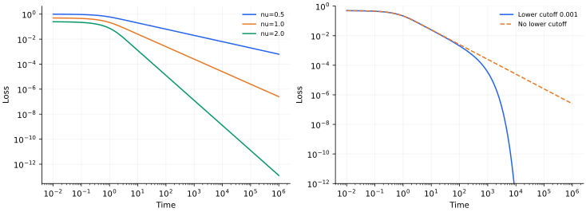

> **Scaling Laws · Note 02**　[专题目录](/notes/scaling_laws/) · 上一篇：[统计估计与几何分辨率](/notes/scaling_laws/statistical_geometry/) · 下一篇：[离散技能与长尾结构](/notes/scaling_laws/discrete_structure/)

**学习问题：** 单个方向按指数恢复，为什么总误差会像幂律；时间、数据和容量分别卡住哪些方向？

## 0. 前言：学习曲线背后的方向与尺度 {#前言学习曲线背后的方向与尺度}

想象把目标函数分解成许多独立方向。常见而平滑的部分可以很快恢复；细节可能弱、难以估计，或者根本不在当前模型的表示空间里。随着训练推进和资源增加，学习器逐步接近这些方向。一条整体损失曲线，就是尚未恢复的目标结构的总和。

例如拟合一条有细小起伏的曲线，学习器可能很快抓住整体轮廓，随后很长时间都在修正弱小的细节。每一项修正单独看都可能按指数衰减，但剩余误差不断转向更慢的部分，合起来便不再像单一的指数函数。谱方法记录的正是这些学习速率，以及各个速率还承载多少误差。

同一组输入和同一个核，也可能对应两条很不一样的学习曲线。目标若主要落在快方向上，慢方向虽多，却几乎不贡献风险；另一个目标若把能量放在慢方向，就会长期留下误差。所以，测出一张核谱以后，还需知道目标怎样分布在这组方向上。下面的公式会将这两份信息分别保留。

不过，学得慢、样本不足和根本不能表示，是三件不同的事。延长训练可以恢复一个慢方向；增加带噪观测可以把该方向的系数估得更准；扩大模型才可能纳入原来缺失的方向。若它们碰巧给出相近的学习曲线，也要沿着各自的观测和训练过程来推导，不能只凭曲线形状互相替换。

这里的“方向”是函数空间中的变化方式。它可以同时影响许多输入，一个样本也可以混合多个方向，未必能直接命名成某项知识。用这些坐标分解误差以后，时间、数据和容量便能放进同一个风险公式。我们先固定这组坐标，算清各条资源轴的作用；训练中表示本身的变化，接着在[特征学习一篇](/notes/scaling_laws/feature_learning/)讨论。

## 1. 一个共同的谱模型：学习的是哪些方向 {#joint-risk}

设总体正交基为 $\{\psi_i\}$，目标为 $f_* =\sum_i a_i\psi_i$。用 $\eta_i\gt 0$ 描述第 $i$ 个方向的学习速率或核尺度。理想化的序列观测是 $z_i=a_i+\sigma\xi_i/\sqrt D$，其中 $\xi_i$ 独立、均值为零、方差为 1；模型只能保留前 $N$ 个方向。

为了同时看见三种限制，令保留模态按 $\dot{\widehat a}_i=\eta_i(z_i-\widehat a_i)$ 从零开始训练。它对应加权序列平方损失

$$
\mathcal L_N(\widehat a)=\frac12\sum_{i\leq N}\eta_i(\widehat a_i-z_i)^2
$$

的梯度流。这里的损失给不同方向不同曲率，最终评价的总体函数风险则使用正交基的 $L^2$ 度量。这个构造不是任意随机输入回归的自动等价物。解为

$$
\widehat a_i(t)=
\begin{cases}
(1-e^{-\eta_i t})z_i,&i\leq N,\\
0,&i\gt N.
\end{cases}
$$

对观测噪声平均，总体函数的超额均方风险精确分解为

$$
\boxed{
R(t,N,D)=
\underbrace{\sum_{i\leq N}a_i^2e^{-2\eta_i t}}_{\text{保留方向中的优化偏差}}
+\underbrace{\sum_{i\gt N}a_i^2}_{\text{未表示的目标尾部}}
+\underbrace{\frac{\sigma^2}{D}\sum_{i\leq N}(1-e^{-\eta_i t})^2}_{\text{已经进入预测的观测噪声}}.}
$$

这三个项分别说明为什么“更多”不必单调改善全部风险。延长时间降低第一项，也逐渐放开第三项；增大模型降低第二项，却增加需要估计的方向；增加独立观测精度能降低第三项，但无法替固定模型表示遗漏方向。真实采样还会引入经验设计的随机性，后文会指出这一代理没有包含的部分。

三项分别保留优化残差、表示遗漏和已经学入预测的噪声。总风险只给出它们的和；即使曲线暂时不动，各项也可能正在此消彼长。增加数据、容量或训练时间的收益，要分别从这些项计算。

若 $\eta_i\asymp i^{-p}$、$a_i^2\asymp i^{-q}$，$p\gt 1,q\gt 1$，则时间对应大约 $i_t\asymp t^{1/p}$ 的分辨率，模型给出硬截止 $N$，正则化则给出软截止 $i_\lambda\asymp\lambda^{-1/p}$。它们可以放进同一张谱图，但使用不同滤波器，不能任意把 $t,N,D$ 相互替换。

例如，一个高编号方向没有进入预测，可以有完全不同的原因：模型没有该方向，模型有它但还没训练到，或者观测太嘈杂而被正则化压住。最终误差可能相近，追加资源后的反应却不同。延长训练只直接解决第二种等待，增加表示空间直接作用于第一种，增加独立信息才有机会降低第三种代价。统一坐标系的意义，是让这些差异能够被逐项比较，而不是让三种资源变成同一件事。

| 资源或观测 | 当前模型中改变的对象 | 需要另行确认的条件 |
| --- | --- | --- |
| 训练时间 $t$ | 已表示方向的恢复程度与噪声进入程度 | 时钟、学习率和核是否固定 |
| 独立数据量 $D$ | 谱系数的估计精度 | 真实采样是否也改善覆盖与设计 |
| 模型规模 $N$ | 可表示方向与近似尾部 | 参数数怎样映射到秩或模态数 |
| 计算预算 $C$ | 可行的模型、数据和训练组合 | 成本与损失曲面是否匹配训练协议 |

这里的 $R$ 是总体函数误差。训练损失还会给模态乘上不同权重；如果评价带噪新标签，还要另加不可约噪声。因此以下各节都先说明观测量，再比较它的标度。

### 1.1 先在两个模态上读一次统一风险 {#section-1-1}

设函数基在测试分布下正交归一，教师的两个系数为 $a_1=1,a_2=1/2$，学习速率为 $\eta_1=1,\eta_2=0.01$。零初始化、无噪声、允许表示两个方向时，

$$
R(t)=e^{-2t}+\frac14e^{-0.02t}.
$$

第一项在短时间内下降，第二项却几乎不动。取 $t=5$，第一项约为 $4.5\times10^{-5}$，第二项仍约为 $0.226$。继续训练主要是在处理第二方向；这时总损失的大小，并不能说明第一方向学得怎样。

现在限制学生只能表示第一方向。风险变成 $e^{-2t}+1/4$，第二项成为永久平台。若允许第二方向，但其带噪观测为 $z_2=a_2+\xi_2$，滤波后还会加入 $\operatorname{Var}(\xi_2)(1-e^{-0.01t})^2$。同样处在约 $1/4$ 的损失附近，可能分别对应慢优化、表示遗漏或开始拟合噪声；判断下一份资源的作用，必须回到每个方向的来源。

### 1.2 正交基为什么能把损失相加 {#section-1-2}

令 $e(x)=\sum_i e_i\psi_i(x)$。总体平方误差满足

$$
\mathbb E_x[e(x)^2]
=\sum_{i,j}e_ie_j\mathbb E_x[\psi_i\psi_j]
=\sum_i e_i^2.
$$

交叉项消失来自总体内积中的正交性。有限训练集上的经验内积一般不精确等于这个内积，所以经验训练误差未必以同一方式拆开。核本征函数既取决于核，也取决于输入分布；换了测试分布，即使函数本身没有变，误差方向的权重与正交关系也可能改变。本篇的逐模态公式首先是在指定的总体测试度量下成立。

## 2. 时间标度：指数模态怎样形成幂律 {#time-scaling}

训练时间首先是一个动力学变量。下面从固定特征或冻结核出发；[Note 01](/notes/neural_network_theory/linear_learning/#regression) 给出有限矩阵的完整解，[Note 03](/notes/neural_network_theory/wide_networks/#ntk) 说明固定核何时能近似非线性网络。

### 2.1 有限模态与损失加权谱 {#有限模态与损失加权谱}

在线性回归、固定随机特征或冻结 NTK 下，残差可写成

$$
r_k(t)=b_ke^{-\lambda_kt},\qquad
\mathcal L(t)=\frac12\sum_k b_k^2e^{-2\lambda_kt}.
$$

这里的 $b_k$ 是初始残差投影，不是第一节的目标系数 $a_i$。常数 $1/D$ 可吸收进 $b_k^2$；必须在整篇计算中保持一致。零模态给出永久平台 $\mathcal L_0=\frac12\sum_{\lambda_k=0}b_k^2$。

定义损失加权的谱测度

$$
d\mu(\lambda)=\sum_{\lambda_k\gt 0}b_k^2\delta(\lambda-\lambda_k)d\lambda.
$$

于是 $\mathcal L(t)-\mathcal L_0=\frac12\int e^{-2\lambda t}d\mu(\lambda)$，是谱测度的 Laplace 变换。仅知道特征值计数密度还不够：初始化或目标在各模态上的能量同样进入权重。

### 2.2 小速率端决定长期指数 {#小速率端决定长期指数}

假设相关窗口内 $d\mu/d\lambda\simeq A\lambda^{\nu-1}$，$\nu\gt 0$。若下边缘为零且其他部分可控，则

$$
\mathcal L(t)-\mathcal L_0\simeq
\frac A2\int_0^\infty\lambda^{\nu-1}e^{-2\lambda t}d\lambda.
$$

令 $u=2\lambda t$，得到

$$
\boxed{\mathcal L(t)-\mathcal L_0
\sim\frac{A\Gamma(\nu)}{2^{\nu+1}}t^{-\nu}.}
$$

指数来自小速率端的**加权**谱。若计数密度 $\rho(\lambda)\sim\lambda^a$、每模态平均初始能量 $\mathbb E[b_k^2\mid\lambda]\sim\lambda^b$，则 $\nu=a+b+1$。忽略目标权重会把时间指数算错。

当 $\nu\leq0$ 时，该连续密度在零端不可积；有限初始损失需要截断或不同权重，不能沿用这个公式再声称得到负指数增长。

#### 2.2.1 从谱推导曲线，与从曲线反推谱 {#从谱推导曲线与从曲线反推谱}

前面的计算是 Abelian 方向：给定小速率端的规则谱，推出长期损失。反方向需要额外的 Tauberian 条件，例如正测度的适当正则变化性质。有限时间窗内一条近似直线，并不足以唯一重建微观谱；不同谱、若干离散时间尺度，甚至时变核都可能产生相似曲线。

若 $d\mu/d\lambda=A\lambda^{\nu-1}\ell(1/\lambda)$，其中 $\ell$ 是缓变函数，损失也会带上 $\ell(t)$ 的缓慢修正。有限尺度拟合把对数因子吸收到有效指数里，可能误以为指数随时间变化。区分真正不同的幂次与缓变修正，需要比一次线性拟合更多的尺度信息。

#### 2.2.2 局部斜率对应正在主导损失的速率 {#局部斜率对应正在主导损失的速率}

对去掉零模平台后的损失 $L_+(t)$，定义随时间倾斜的概率测度

$$
dP_t(\lambda)=\frac{e^{-2\lambda t}d\mu(\lambda)}{2L_+(t)}.
$$

直接微分可得

$$
\beta_{\rm eff}(t)=-\frac{d\log L_+}{d\log t}
=2t\langle\lambda\rangle_t,
\qquad
\frac{d\beta_{\rm eff}}{d\log t}
=\beta_{\rm eff}-4t^2\operatorname{Var}_t(\lambda).
$$

纯幂律加权谱对应随时间尺度化的 Gamma 分布：均值 $\nu/(2t)$、方差 $\nu/(4t^2)$，局部指数因而保持 $\nu$。物理上是损失权重不断从快模态转移到速率约为 $1/t$ 的慢模态，每个单模态始终仍为指数松弛。

### 2.3 有限窗口、谱隙与极限顺序 {#有限窗口谱隙与极限顺序}

若谱仅在 $[\lambda_{\min},\lambda_{\max}]$ 上近似该幂律，那么幂律通常需要

$$
\lambda_{\max}^{-1}\ll t\ll\lambda_{\min}^{-1}.
$$

太早时，所有模态都未明显变化，损失接近初值；太晚时，谱下边缘或最慢单模态支配。连续密度若在正下边缘附近为 $B(\lambda-\lambda_{\min})^a$，长时间会出现 $e^{-2\lambda_{\min}t}t^{-(a+1)}$，而非无限延续的纯幂律。

任何有限正定矩阵最终都有最慢指数。先取系统规模无穷、再取时间无穷，才可能得到无谱隙幂律；反过来则一般得到最慢模态指数。两个极限不应默默交换。

### 2.4 模态编号、误差权重与优化时钟 {#模态编号误差权重与优化时钟}

若 $\lambda_k\sim k^{-p}$、$b_k^2\sim k^{-q}$，$p\gt 0,q\gt 1$，则

$$
\mathcal L(t)\simeq\frac12\int_1^\infty
k^{-q}e^{-2t k^{-p}}dk.
$$

变量替换 $u=2t k^{-p}$ 给出

$$
\boxed{\mathcal L(t)\sim
\frac{\Gamma((q-1)/p)}{2p}(2t)^{-(q-1)/p}.}
$$

直观上，时间 $t$ 大致学会 $k\lesssim t^{1/p}$ 的快模态，剩余尾部 $\sum_{k\gt t^{1/p}}k^{-q}\sim t^{-(q-1)/p}$。精确积分与这个移动截止尺度给出同一指数。

实际滤波是平滑的，模态不会在截止处突然学会。若放大尺度后，过渡区仍保持相近形状，硬截止近似就能给对领先幂次；过渡区细节主要进入常数。

同一核谱的时间指数还依赖目标系数；后续数据指数又包含估计噪声与正则化，二者不能只因共享一个谱就直接相等。

#### 2.4.1 插值临界点中的三个不同时间指数 {#插值临界点中的三个不同时间指数}

取 Note 01 的 Gaussian 回归，$d/D\to1$，小谱端为 $\rho(s)\simeq1/(\pi\sqrt s)$。零初始化，教师相对样本方向各向同性，平均信号能量为 $r^2$。训练信号损失带有额外的 $H$ 权重：参数误差映射到输出时乘 $\sqrt s$，平方后再乘 $s$。因此

$$
\mathbb E\mathcal L_{\rm train,signal}
\simeq\frac{r^2}{2}\int s\rho(s)e^{-2st}ds
\propto t^{-3/2}.
$$

标签噪声在训练预测空间近似各向同性，其残差损失则为

$$
\mathbb E\mathcal L_{\rm train,noise}
\simeq\frac{\sigma^2}{2}\int\rho(s)e^{-2st}ds
\propto t^{-1/2}.
$$

同一谱的两种初始能量权重产生不同训练指数。测试参数偏差没有训练损失中的额外 $s$，所以 $R_{\rm bias}\propto t^{-1/2}$。拟合噪声造成的测试方差更特别：

$$
R_{\rm var}(t)\simeq\sigma^2\int
\frac{\rho(s)}s(1-e^{-st})^2ds
\propto t^{1/2}.
$$

变量替换 $u=st$，并对积分分部，可以得到领先系数

$$
R_{\rm var}(t)\sim
\frac{4\sigma^2}{\sqrt\pi}
\left(1-\frac1{\sqrt2}\right)\sqrt t.
$$

临界谱既使训练损失幂律下降，也使测试噪声风险持续增长。训练幂律因而不是泛化改善的充分证据。有限矩阵最终还有最小正本征值，这些幂律仍受时间窗和极限顺序限制。

沿输入变化很小的方向，系数大幅变化也只产生很小的训练输出变化。为消除该方向上的噪声残差，参数可能被推得很大，独立测试时便暴露出放大的误差。慢模态既可以保留未学到的信号，也可以放大被拟合的噪声。

#### 2.4.2 学习率日程改变优化时钟 {#学习率日程改变优化时钟}

离散模态为 $r_{k,n}=r_{k,0}\prod_{j\lt n}(1-\eta_j\lambda_k)$。当所有相关 $\eta_j\lambda_k$ 足够小，$\log r_{k,n}\simeq-\lambda_k\sum_j\eta_j$，自然优化时间是 $t_n=\sum_j\eta_j$。

若 $\eta_j\propto j^{-a}$，$0\leq a\lt 1$ 时 $t_n\propto n^{1-a}$，原先的 $t^{-\nu}$ 表现为更新数上的 $n^{-\nu(1-a)}$；$a=1$ 时则可能表现为 $(\log n)^{-\nu}$。同一固定谱仅因时钟变化，就能产生不同的表观指数。实验横轴采用更新数、样本处理量还是累计学习率，会直接影响理论比较。

*图 1 · 同一个谱对应不同风险指数。* 使用 $\gamma=1$ 的完整 MP 密度，信号与噪声幅度均取 1，直接积分三个风险式。左图的晚期拟合斜率约为 $-1.5000,-0.5000,+0.5028$；右图将测试方差除以 $\sqrt t$，趋向解析常数 0.66099。图中没有训练非线性网络，也没有重新拟合谱。它展示的是误差权重和谱反演怎样改变同一谱的时间表现。

### 2.5 非负指数混合对曲线形状的限制 {#非负指数混合对曲线形状的限制}

固定正半定核下，去掉不可学习平台后，损失可写成 $E(t)=\int_0^\infty e^{-2\lambda t}\mu(d\lambda)$，其中 $\mu$ 是非负有限测度。于是对所有整数 $n\geq0$，

$$
(-1)^nE^{(n)}(t)=\int(2\lambda)^ne^{-2\lambda t}\mu(d\lambda)\geq0.
$$

除损失下降以外，曲线还具有凸性及更高阶交替导数符号。这是固定非负模态混合的限制。真实曲线若出现明显加速下降的凹区，或者平台后损失下降速度重新增强，就不能用同一个固定非负速率测度完整解释；可能存在时变特征、时钟变化或观测噪声。

高阶数值微分对噪声很敏感，实际检查时不宜直接逐阶估计导数。但如果一条可靠的总体曲线违反这些形状约束，固定非负谱的解释就需要修改。

从物理上说，固定非负混合中的快分量只会逐步退出，剩余曲线越来越依赖慢分量。系统可以持续下降很久，却没有机制让已经固定的方向突然获得更强驱动。若观察到长平台之后连续损失重新明显加速，就值得检查时钟、特征和观测是否改变。这比仅仅发现一段近似幂律更有区分力，因为它关注模型能否解释整段演化的形状。

### 2.6 少数离散速率也会产生很长的交叉区 {#少数离散速率也会产生很长的交叉区}

取 $E(t)=ae^{-2\lambda_1t}+be^{-2\lambda_2t}$，$\lambda_1\gt \lambda_2\gt 0$。瞬时对数衰减率为

$$
-\frac12\frac d{dt}\log E(t)
=\frac{a\lambda_1e^{-2\lambda_1t}+b\lambda_2e^{-2\lambda_2t}}
{ae^{-2\lambda_1t}+be^{-2\lambda_2t}}.
$$

它从能量加权平均速率逐渐靠近慢速率。即使只有两个指数，有限窗口的双对数曲线也可以看起来近似一段直线，但拉宽窗口后会显露交叉区，最终仍转为指数。

若慢模态权重 $b$ 极小，它要等到 $t\sim\log(a/b)/[2(\lambda_1-\lambda_2)]$ 才主导。这说明“长时间由最小特征值决定”还需要时间足以压过初始能量比。谱最慢不等于在实际预算里最重要。

### 2.7 有限规模怎样截断幂律窗口 {#有限规模怎样截断幂律窗口}

设有 $M$ 个近似独立速率，其低端累积分布为 $P(\lambda\leq s)\simeq cs^a$。最小速率的典型尺度由 $Mcs^a\sim1$ 给出，即 $\lambda_{\min}\asymp M^{-1/a}$。因此由连续低谱产生的幂律，最晚大约在 $t\sim M^{1/a}$ 附近遇到有限规模截断，之后转向少数最慢模态。

这个估计忽略速率间相关及能量权重；真实随机矩阵的极端谱可能需要更精确理论。它仍清楚说明宽度增加可能主要拉长幂律窗口，而不改变窗口内指数。若只在固定窄窗口拟合，就可能误以为宽度完全不影响动力学；若只观察最终指数衰减，又可能错过先前很长的幂律区。

还要检查最慢模态是否有足够损失权重。若其标签投影随 $M$ 极小，实际可见截断时间会被推迟。最低特征值、最低加权速率与实验噪声地板共同决定能够看到什么，这三者不宜混成一个“有限尺寸效应”参数。

从可检验预测看，固定谱解释通常要求随着可用模态数增加，交叉窗口按某种规律移动；特征学习则可能连加权谱本身都改变。比较多个宽度的完整局部斜率曲线，比在每个宽度上分别拟合一个指数更能区分这两种情形。

### 2.8 时间曲线的数值结果 {#时间曲线的数值结果}

*图 2 · 自制积分。* 左图取 $d\mu/d\lambda=\lambda^{\nu-1}$、$0\lt \lambda\lt 1$，$\nu=0.5,1,2$，用不完全 Gamma 函数计算完整曲线；右图在 $\nu=1$ 时加入 $\lambda_{\min}=10^{-3}$，用 1500 点谱积分比较无下截断结果。幂律窗口和最终偏离都来自同一个谱模型。

$\nu=1$ 时积分简化为 $\mathcal L(t)=(1-e^{-2t})/(4t)$，短时极限为 $1/2$，长时为 $1/(4t)$，与完整数值曲线一致。

实验拟合应同时报告局部斜率 $\beta_{\rm eff}(t)=-d\log(\mathcal L-\mathcal L_0)/d\log t$。若未知平台未减去、指数窗过短或时间横轴采用更新数而学习率在变化，直线拟合可能给出没有机制意义的指数。

### 2.9 核变化以后，需要重新辨认机制 {#核变化以后需要重新辨认机制}

若核随时间改变，模态会旋转，能量也会在方向间转移，通常不能继续写成同一组固定指数的非负叠加。即使瞬时特征值变化不大，基底旋转与不同时刻核的非对易性仍可能重要。幂律既不能单独证明固定谱解释，也不能单独证明特征学习；谱、目标投影与切线模型对照提供了进一步区分的依据。

第一节的共同模型还提示一个实际区别：无噪声的函数恢复可以随时间持续改善，含噪风险则可能先降后升。时间幂律解释训练曲线，并不自动解释泛化；同一张谱必须通过对应风险的权重才能进入预测。

### 2.10 从学习率到时间常数，不能省掉横轴约定 {#section-2-10}

对于离散梯度下降，一个模态满足 $e_i(n+1)=(1-\gamma\eta_i)e_i(n)$，于是

$$
e_i(n)=(1-\gamma\eta_i)^n e_i(0)
\simeq e^{-\gamma\eta_i n}e_i(0).
$$

近似要求该方向的步长足够小。固定步长时，连续时间对应 $t=\gamma n$；若步长随训练衰减，应使用累计时钟 $t_n=\sum_{j\lt n}\gamma_j$。因此，同一个函数风险对“更新步数”和对“累计学习率”可以有不同的曲线。batch 大小再改变时，更新次数、已见样本数和实际计算也会分开。

这给读实验曲线一个直接检查：若只是把所有速率乘以常数，曲线应主要沿横轴平移；若改变了慢方向相对于快方向的响应，局部斜率及残差组成才可能一起改变。前者可以节省大量时间，但不能由此判断底层的目标尾部已经变了。

## 3. 数据标度：偏差尾部与估计方差怎样配平 {#data-scaling}

现在将关注点从恢复速度转向信息精度。数据增加可以降低观测噪声，也可能改变方向覆盖；本节先使用独立 Gaussian 序列观测，将这两种效应分开。它允许完整计算最优分辨率，但不是一般有限点采样的无条件描述。

### 3.1 观测模型与目标正则性 {#观测模型与目标正则性}

设 $\eta_i\asymp i^{-p}$、$a_i^2\asymp i^{-q}$，其中 $p\gt 1,q\gt 1$。前者使核迹有限，后者保证目标 $L^2$ 能量有限。观察

$$
z_i=a_i+\frac\sigma{\sqrt D}\xi_i,
\qquad\hat a_i=\frac{\eta_i}{\eta_i+\lambda}z_i.
$$

风险为

$$
E(D,\lambda)=\sum_i\left(\frac\lambda{\eta_i+\lambda}\right)^2a_i^2
+\frac{\sigma^2}{D}\sum_i\left(\frac{\eta_i}{\eta_i+\lambda}\right)^2.
$$

记有效截止模态 $k_\lambda\asymp\lambda^{-1/p}$。大于它的模态被强烈抑制，小于它的模态主要受观测噪声限制。这里 $i$ 是排序后的模态编号；若原始系统有多维频率及简并度，必须先把简并度计入编号谱，才能使用下面的指数。

### 3.2 偏差估计与 ridge 饱和 {#偏差估计与-ridge-饱和}

高模态尾部满足

$$
B_{\rm tail}\asymp\sum_{i\gt k_\lambda}i^{-q}
\asymp k_\lambda^{1-q}.
$$

低模态残余偏差则为

$$
B_{\rm low}\asymp\lambda^2\sum_{i\leq k_\lambda}i^{2p-q}.
$$

若 $1\lt q\lt 2p+1$，求和由上端主导，两部分同阶 $k_\lambda^{1-q}$。若 $q=2p+1$，出现 $\lambda^2\log k_\lambda$；若 $q\gt 2p+1$，低模态求和收敛，偏差变成 $\lambda^2\asymp k_\lambda^{-2p}$，这是普通 ridge 的平滑度饱和。

因此不能对任意光滑目标都一直使用 $B\sim k^{1-q}$。换用更高阶谱滤波器或硬截止，饱和性质也会改变。

饱和时，误差已由前几个强方向的收缩偏差主导。继续减小目标尾部，无法消除这些偏差；普通 ridge 因而不能把目标额外的光滑性全部转化为更快的指数。

#### 3.2.1 连续谱积分还能保留领先常数 {#连续谱积分还能保留领先常数}

取 $\eta_i=c i^{-p}$、$a_i^2\sim A i^{-q}$，令 $k=(c/\lambda)^{1/p}$。在不饱和区域，对完整滤波作积分，

$$
B\sim A k^{1-q}\int_0^\infty
\frac{u^{2p-q}}{(1+u^p)^2}du,
\qquad
V\sim\frac{\sigma^2k}{D}\int_0^\infty
\frac{du}{(1+u^p)^2}.
$$

第一个积分在零端要求 $q\lt 2p+1$，在无穷远要求 $q\gt 1$，重新给出偏差估计的有效区间。饱和的本质，是误差主导位置从高编号尾部转移到有限个低模态，而不是积分方法失效。

第二个积分为 $\Gamma(1/p)\Gamma(2-1/p)/p$，与 [Note 02](/notes/neural_network_theory/kernel_methods/#learning-curves) 的噪声有效维数相同。因此有效截止模态的图像可以精确到领先常数，而不只匹配指数。

### 3.3 方差、最优分辨率与数据指数 {#方差最优分辨率与数据指数}

方差的低模态贡献约为 $\sigma^2 k_\lambda/D$。高模态部分为

$$
V_{\rm tail}\asymp\frac{\sigma^2}{D\lambda^2}
\sum_{i\gt k_\lambda}i^{-2p}
\asymp\frac{\sigma^2}{D}k_\lambda,
$$

所以两者同阶。在不饱和区间 $1\lt q\lt 2p+1$，

$$
E\asymp C_bk^{-(q-1)}+C_v\frac{\sigma^2 k}{D}.
$$

求导或配平得到

$$
k_*\asymp(D/\sigma^2)^{1/q},\qquad
\lambda_*\asymp(D/\sigma^2)^{-p/q},
$$

$$
\boxed{E_*(D)\asymp(\sigma^2/D)^{(q-1)/q},
\qquad\beta=\frac{q-1}{q}.}
$$

在饱和区间，偏差指数用 $2p$ 替换 $q-1$，给出 $\beta=2p/(2p+1)$，临界处带对数修正。这个可解代理里 $p$ 控制所需 $\lambda$，在不饱和区间最终的最优 $D$ 指数主要由目标能量尾部决定；这依赖当前用 $a_i$ 定义目标的方式，换成 RKHS 标准化系数时表达会重写。

最优分辨率不是“能够估计的方向越多越好”。多放开一个方向，一方面减少目标被忽略的偏差，另一方面引入新的估计波动。数据越多，后一个代价越低，值得使用的方向才会增多。因此，最优数据曲线实际上沿着不断改变的正则化前进。固定一个正则化参数再增加数据，通常会在相应偏差平台附近得到另一条曲线。

#### 3.3.1 与数值图一致的完整常数：$p=q=2$ {#与数值图一致的完整常数pq2}

取 $\eta_i=i^{-2}$、$a_i^2=A i^{-2}$，无限模态单位能量归一化给出 $A=6/\pi^2$。两个积分都可算出：$\int_0^\infty u^2/(1+u^2)^2du=\int_0^\infty(1+u^2)^{-2}du=\pi/4$。于是

$$
E(k)\sim\frac{A\pi}{4k}+\frac{\pi\sigma^2k}{4D},
\quad k_*\sim\sqrt{\frac{AD}{\sigma^2}},
\quad\lambda_*\sim\frac{\sigma^2}{AD},
$$

$$
\boxed{E_*(D)\sim\frac{\sqrt6}{2}\frac\sigma{\sqrt D}.}
$$

图中 $\sigma=0.3$，领先系数约为 0.3674。在远离低模态离散效应和高模态截断的区间，$\sqrt D\,E(D)$ 应接近这个数。只匹配指数通常不够约束理论，常数与交叉尺度提供了更严格的比较。

领先常数能够检验理论是否正确计算了误差的实际权重。两个模型即使给出同一指数，也可能对噪声强度变化、目标幅度变化和交叉位置作出不同预测。若只允许纵向平移与横向缩放后比较斜率，许多差异就会被主动抹掉。保留归一化和完整常数，可以让可解模型承受比“看起来像幂律”更严格的核对。

#### 3.3.2 函数正则性与维数怎样进入指数 {#函数正则性与维数怎样进入指数}

若一个 $d_x$ 维问题按频率排列后的目标尾部满足 $\sum_{i\gt k}a_i^2\asymp k^{-2r/d_x}$，当前模型中便有 $q-1=2r/d_x$，于是

$$
\beta=\frac{2r}{2r+d_x}.
$$

这里 $r$ 是由尾部衰减定义的有效正则性。这与 Sobolev 非参数回归的速率结构相同：更平滑的目标高阶能量衰减更快，更多输入维数使同一分辨率包含更多模态。

这不意味着可以从现实网络的数据指数直接反推出输入的真实维数。数据可能位于低维流形，核模态可能不是普通 Fourier 波，目标也可能只依赖少量特殊方向。恰在幂律边界上的系数序列，还可能需要对数修正才能属于相应的严格 Sobolev 空间。指数对应的是一组尾部与观测假设，并不能独立鉴定数据几何。

#### 3.3.3 Source 条件解释 ridge 的饱和 {#source-条件解释-ridge-的饱和}

另一种目标描述为 $a_i=\eta_i^s b_i$，$\sum_i b_i^2\lt \infty$。偏差是 $\sum_i[\lambda\eta_i^s/(\eta_i+\lambda)]^2b_i^2$。对于 $0\lt s\leq1$，令 $\eta_i=\lambda u$，乘子可由常数乘 $\lambda^s$ 控制，故 $B\lesssim\lambda^{2s}$。当 $s\gt 1$，有限低模态的残余收缩使普通 ridge 的典型领先偏差停在 $\lambda^2$。

这与按 $q$ 分类的饱和，是同一个滤波机制的两种写法。谱硬截断、迭代正则化或高阶滤波器可以改变目标光滑度与偏差的关系，因此数据指数既反映目标，也反映估计器。

### 3.4 噪声、重复观测与无噪声极限 {#噪声重复观测与无噪声极限}

若评价有噪声测试标签的 MSE，应加上 $\sigma^2$ 的不可约底噪；拟合幂律时要对超额风险做拟合。若学习的是确定性函数而只有训练观测含噪，则底噪的含义另行指定。

早停滤波 $1-e^{-\eta_it}$ 也产生 $k_t\asymp t^{1/p}$；但有限数据中的噪声滤波和经验谱必须重新计算，不能只把 $D$ 换成 $t$ 就宣称得到同一学习曲线。

尤其在 $\sigma=0$ 的高斯序列模型中，所有 $z_i=a_i$ 已被直接无噪声观测，$D$ 不再控制信息量，令 $\lambda\to0$ 就能恢复目标。它不能预测真实有限点采样的无噪声数据指数。若另定义“只观察前 $D$ 个模态”的任务，尾部给出 $D^{-(q-1)}$，但那已经是另一个观测模型。

#### 3.4.1 新样本、重复观测与相关数据 {#新样本重复观测与相关数据}

在序列实验中，$D$ 被定义为每个谱系数噪声方差缩小到 $\sigma^2/D$ 的观测预算。真实数据中，增加独立输入还会改善方向覆盖与经验算子估计；重复相同输入主要平均该点的观测噪声，未必增加新的可辨识模态。

若样本具有时间相关，均值估计的方差包含自协方差和，而不是简单的 $1/D$。不同模态还可能有不同相关时间，因此未必存在一个有效样本数替换所有 $D$。去重、数据质量与采样分布变化，都可能同时改变噪声和目标，不能只按条目数比较同一学习曲线。

处理 token 数能反映计算量，却不自动等于独立信息量。数据大量重复时，$BD^{-\beta}$ 的统计含义必须重新定义；后文的成本优化只有在这种操作定义固定后才有可比较的指数。

### 3.5 匹配先验时的 Bayes 学习曲线 {#匹配先验时的-bayes-学习曲线}

若教师系数独立，先验方差为 $\tau_k^2$，观测 $z_k=a_k+\xi_k$、$\operatorname{Var}\xi_k=\sigma^2/D$，则后验方差为

$$
V_k(D)=\left(\tau_k^{-2}+D/\sigma^2\right)^{-1}
=\frac{\tau_k^2\sigma^2}{\sigma^2+D\tau_k^2}.
$$

Bayes 平均风险是 $\sum_kV_k(D)$。当 $\tau_k^2\sim Bk^{-q}$ 时，转折由 $D\tau_k^2\sim\sigma^2$ 决定，同样得到 $D^{-(q-1)/q}$。但它平均了教师先验；固定教师上的 ridge 风险则包含具体 $a_k^2$。平均先验平滑度与每个目标的精确尾部，并不是同一假设。

这个表达还展示边际数据收益：$-\partial_DV_k=V_k^2/\sigma^2$。不确定性越大的方向，新增观测的潜在收益越大；已经估得很准的强模态则很快饱和。整体长尾来自新模态不断接替成为主要不确定性，而不是每个方向永远保持相同难度。

强方向与尾部方向在这里扮演不同角色。强方向开始时重要，却较早被数据确定；极弱方向每个都不重要，但数量很多，合起来可以支配后期误差。随着预算增长，主导不确定性的群体不断更换，整体才会保持较稳定的斜率。这种“接力”是许多标度模型的共同结构，谱模型的特殊之处在于接力规则可以由后验方差直接计算。

### 3.6 从序列观测回到随机输入采样 {#从序列观测回到随机输入采样}

总体正交并不保证一份有限数据上的经验模态正交。真实样本只给出 $f_*(x_\mu)+\varepsilon_\mu$，不同系数通过采样矩阵混合，误差会涉及随机 Gram 矩阵的逆。因此序列模型里的方差和，不包含插值附近的全部病态；即使本征值相同，局域与广泛分布的本征函数也可能有不同覆盖难度。

[Note 02](/notes/neural_network_theory/kernel_methods/#learning-curves) 进一步推导了有限设计风险与自洽尺度，并用等谱特例连接双下降。这里保留序列模型的观测定义，避免在推导途中把它换成随机设计。实际数据若有相关、去重或分布变化，还可能对不同模态产生不同有效样本数。

按系数幂尾、源条件或 Sobolev 正则性描述目标，也对应不同层次的假设：指定目标、函数类约束和随机教师平均并不相同。现实数据的一个拟合指数，不能独立识别输入维数或任务的全部光滑性。

### 3.7 数据曲线的数值结果 {#数据曲线的数值结果}

*图 3 · 自制可解序列实验。* 使用 100000 个模态、$p=q=2$、归一化目标能量、$\sigma=0.3$。每个 $D$ 在对数网格上最小化解析期望风险。左图比较所得风险与 $D^{-1/2}$；右图显示最优 $\lambda$ 对应的有效模态数。此次生成的中间区间斜率为 $-0.4998$。有限模态截断和超参数网格限制了可用拟合窗口。

在 $p=2$ 时，$q=4$ 对应不饱和指数 $3/4$；$q=7$ 则进入 ridge 饱和区间，指数为 $4/5$。这些是风险式的解析预测，图中实际计算采用 $p=q=2$。

这里按已知教师选取最优 $\lambda$，是一条 oracle 基线。实际学习算法需要验证集或其他选择规则，选择误差与计算预算不在当前解析风险里。

### 3.8 一个数据量增加、复杂度也增加的例子 {#section-3-8}

取目标尾部 $a_i^2\asymp i^{-2}$，使用前 $m$ 个独立系数。偏差尾部约为 $1/m$，噪声代价约为 $\sigma^2m/D$。将数据从一万增加到四万，最优模态数只增加约二倍，最优风险也只减少约二倍。单个已保留系数的方差下降了四倍，但学习器同时接纳了更多尚不精确的系数。

固定 $m$ 的曲线与每个数据量都重新选择 $m$ 的曲线因此不能共用一个解释。前者最终逼近一个固定表示平台，平台以上是估计误差；后者不断降低平台，同时支付新增方向的估计代价。普通 ridge 中的有效模态数是平滑变化的，原理与硬截止相同，但滤波器残留的收缩误差还会造成前面讨论的饱和。

### 3.9 训练误差很小以后，还缺哪一份信息 {#section-3-9}

在直接系数观测模型里，每个方向的信号和噪声已经按假定方式交给了学习器。真实随机输入则只提供有限个函数值，它们把许多方向混在一起。即使学生能插值所有训练点，也可能有大量函数在这些点上一致、在新输入上不同。正则化、最小范数与训练参数化，决定了选择哪一个延拓。

因此，无噪声并不等于有限数据不再受限。序列模型中“每个系数都获得无噪声观测”的理想极限，只能用来计算该观测协议本身。将其换成随机点采样以后，需要重新分析经验算子和目标，而不能在同一公式里简单把噪声设成零后宣称恢复所有函数。

## 4. 模型标度：可表示模态与可估计模态 {#model-scaling}

数据限制估计精度，模型则限制允许使用的函数方向。参数总数、特征数、隐藏宽度与表示秩并不是同一个量。先在嵌套正交子空间中计算近似误差，再加入有限数据，才能区分最佳表达能力与实际学习风险。

### 4.1 正交投影与近似误差尾部 {#正交投影与近似误差尾部}

总体输入空间中 $\{\psi_i\}$ 正交，教师

$$
f_* =\sum_{i\geq1}a_i\psi_i,\qquad
\mathcal H_N=\operatorname{span}(\psi_1,\ldots,\psi_N).
$$

已知教师时的最佳表示是正交投影 $f_N^*=\sum_{i\leq N}a_i\psi_i$，故

$$
\boxed{E_{\rm app}(N)=\|f_*-f_N^*\|_{L^2}^2
=\sum_{i\gt N}a_i^2.}
$$

若 $a_i^2\sim A_0i^{-q}$、$q\gt 1$，积分比较得到

$$
E_{\rm app}(N)\sim\frac{A_0}{q-1}N^{-(q-1)}.
$$

因此模型幂律指数 $\alpha=q-1$ 在这里来自表示能量尾部。它不是参数计数的维度分析；改变模态排序或表示族，就会改变模型规模对应的截止位置。

#### 4.1.1 目标平均误差与最坏情形逼近宽度 {#目标平均误差与最坏情形逼近宽度}

前面的尾部和描述一个指定教师，或一个具有已知能量分配的教师集合的平均误差。若研究最坏情形，指数可能不同。考虑函数椭球

$$
\mathcal E=\left\{\sum_i b_i c_i\psi_i:
\sum_i c_i^2\leq1\right\},\qquad b_1\geq b_2\geq\cdots.
$$

用前 $N$ 个模态表示时，最坏误差为 $b_{N+1}^2$：对手可以把全部允许能量放在第一个被遗漏方向。任意其他 $N$ 维子空间也无法同时覆盖前 $N+1$ 个独立方向，因此不能改善这个最坏阶数。

如果改为平均随机系数，且第 $i$ 模态平均能量为 $b_i^2$，平均截断误差则为 $\sum_{i\gt N}b_i^2$。当 $b_i^2\sim i^{-q}$ 时，前者按 $N^{-q}$，后者按 $N^{-(q-1)}$。二者没有矛盾，因为教师集合及平均方式不同。把逼近论的最坏界直接当作真实任务的平均 model scaling 指数，可能错一个幂次。

### 4.2 有限数据下的最优模型规模 {#有限数据下的最优模型规模}

采用前文相同的高斯序列观测 $z_i=a_i+\sigma\xi_i/\sqrt D$，保留前 $N$ 项、其余设为零。于是

$$
\boxed{E(N,D)=\sum_{i\gt N}a_i^2+\frac{\sigma^2 N}{D}.}
$$

这是本序列模型的精确偏差–方差分解。若用 $E\simeq AN^{-\alpha}+\sigma^2N/D$，优化 $N$ 得到

$$
N_*\simeq\left(\frac{\alpha AD}{\sigma^2}\right)^{1/(\alpha+1)},
\qquad
E_*\asymp D^{-\alpha/(\alpha+1)}.
$$

增加数据后，值得保留的模态也应增加。固定数据不断提高硬截止秩，噪声方差最终上升；如果采用软滤波或显式正则化，可以让名义模型更大而有效维数仍有限。

在随机输入回归中，$\sigma^2N/D$ 通常只在经验设计足够接近正交、远离插值病态时是合理近似。一般有限样本方差涉及经验 Gram 的逆，Note 01 的尖峰就在这里被简单序列代理省略了。

### 4.3 模型指数与数据指数的联系 {#模型指数与数据指数的联系}

本嵌套模型的模型指数为 $\alpha=q-1$；在有噪序列实验中最优数据指数为

$$
\beta=\frac{q-1}{q}=\frac\alpha{\alpha+1}.
$$

它们共享目标尾部，但数据增长还要支付每个估计模态的噪声成本，因而指数不同。若观测噪声、正则化或表示族改变，这个关系也可能失效。经验上观察两个相近指数，不能据此断言存在同一个微观谱机制。

若网络的参数数 $P$ 与有效秩满足 $N\sim P^\zeta$，则当前近似误差对参数数的指数为 $\zeta(q-1)$。这个映射必须由架构或独立测量给出，不能把 $\zeta=1$ 当成默认事实。

容量截止还包含一个顺序假设：前几个方向确实是当前表示最先获得的方向。按目标重要性排序、按核本征值排序和随机抽取方向，可能给出不同的覆盖效率。它们在无限规模时可以接近同一个函数空间，有限规模时却留下不同尾部。因此，从一个已知无限核推断有限参数曲线，还必须说明有限模型怎样走向这个核。

#### 4.3.1 参数计数与谱截止之间需要一个映射 {#参数计数与谱截止之间需要一个映射}

一个秩 $r$ 的 $d_{\rm out}\times d_{\rm in}$ 矩阵可由两个因子表示，名义参数数为 $r(d_{\rm in}+d_{\rm out})$，实际自由度还要扣掉因子内部的等价变换。若输入、输出维数固定且远大于 $r$，参数数大致正比于秩；若两个外部维数也与 $r$ 同阶增长，则参数数为 $O(r^2)$。

若教师奇异值平方尾部为 $\sigma_i^2\sim i^{-q}$，最优秩截断误差为 $r^{-(q-1)}$。前一种规模比较对参数数仍给出指数 $q-1$，后一种却给出 $(q-1)/2$。相同的教师奇异谱，仅因模型族的扩展方式不同，就会得到不同的参数标度指数。

神经网络中，宽度增加还可能同时改变特征数量、特征质量、优化路径和隐式范数。因此 $N$ 是表示秩、隐藏单元数还是非嵌入参数数，并非可以事后忽略的记号差别，它决定了理论横轴究竟是什么。

### 4.4 随机字典、方向适应与统计包络 {#随机字典方向适应与统计包络}

增加随机特征数量提高的是一个随机子空间的维数，未必按教师最有用的模态顺序扩展。其核近似误差、设计谱和统计误差可能耦合，因此未必满足本篇的理想尾部公式。

端到端特征学习还可以改变子空间方向。一个低秩教师若被任务适应的表示准确找到，可能只需少量特征；固定随机方向则可能需要很多。此时把改善全部拟合成一个固定 $N^{-\alpha}$，会把“表示方向变化”与“表示数量增加”混在一起。

一个实用实验是同时记录名义参数数、隐藏特征矩阵的奇异值、相对教师的投影误差和测试风险。有效秩可作摘要，但阈值定义和目标对齐也应报告；仅有谱平坦或秩高，并不能保证保留了任务方向。

#### 4.4.1 同样的表示维数，方向选择可以造成数量级差异 {#同样的表示维数方向选择可以造成数量级差异}

在一个有限 $M$ 维总体正交空间里，固定教师向量 $a$，随机取一个均匀的 $N$ 维子空间，投影为 $P_N$。由旋转不变性 $\mathbb EP_N=(N/M)I$，于是

$$
\mathbb E\|(I-P_N)a\|^2
=\left(1-\frac NM\right)\|a\|^2.
$$

若允许根据已知教师选择子空间，只用一维 $\operatorname{span}(a)$ 就能精确表示该教师。但这个 oracle 选择已经使用了全部目标知识；真实特征学习要用有限数据和有限优化找到相近方向，不能把寻找表示的成本当作零。

这给出一个清楚的分工：近似理论研究存在怎样的好表示，统计理论研究数据能否辨认它，动力学研究指定训练能否到达它。固定随机特征与端到端网络的性能差，可能发生在这三步中的不同位置，仅测最终秩无法区分。

#### 4.4.2 随机特征数量也可能通过覆盖概率产生幂律 {#随机特征数量也可能通过覆盖概率产生幂律}

Note 02 的随机频率模型中，平均近似误差为 $\sum_i a_i^2(1-p_i)^N$。若 $p_i\asymp i^{-p}$，它近似一个关于特征预算 $N$ 的 Laplace 和，给出 $N^{-(q-1)/p}$。理想按序谱截断却给出 $N^{-(q-1)}$，因为每增加一个模态都优先覆盖尚未表示的方向。

两种表示即使最终趋向同一个无限核，也可以有不同的有限规模曲线。特征抽样、冗余和目标对齐的差异，决定了名义特征数到有效覆盖模态数的转换。这也使 model scaling 与 time scaling 产生形式上的联系：两者都可能是对一组不同难度方向的逐渐覆盖，但横轴与实际机制仍然不同。

#### 4.4.3 模型变大后的饱和与统计包络 {#模型变大后的饱和与统计包络}

固定有限数据时，表示尾部可以继续下降，而统计估计误差或优化误差已开始主导。若更大模型允许复用小模型的函数，最小训练目标不会变差；但测试误差并没有同样的单调性保证，因为算法可能选择了另一个插值延拓。

重新选择正则化、停止时间和训练预算，可以得到更低的风险包络；固定协议下的原始曲线则可能出现饱和、尖峰或回升。经验 model scaling 若来自每个规模都充分调参的包络，其指数不能直接解释为一个固定动力学过程的自然指数。

### 4.5 模型曲线的数值结果 {#模型曲线的数值结果}

*图 4 · 自制序列模型。* 使用 $q=2.5$、100000 项归一化教师能量、$\sigma=0.3$。左图为精确尾部和；右图比较 $D=10^3,10^4,10^5$ 的总风险，标点为离散网格最优秩，本次分别约为 36、93、235。右图的上升来自直接估计更多带噪模态，不含随机设计插值尖峰。

固定 $D$ 改变 $N$ 与沿 $N_*(D)$ 同时改变两者，是不同的规模曲线。每个规模重新调参所得的包络，也不同于固定训练协议下的原始曲线。

有限 100000 模态只是数值截断；接近该上限时尾部不再代表无限幂律。图中选择的 $N\leq10000$，仍需在更精细指数估计时检查截断敏感性。

### 4.6 三种“最优”不能混为一条曲线 {#三种最优不能混为一条曲线}

最佳表示误差假设目标已经知道，只问函数空间里存在怎样的近似；统计最优风险问有限数据能否辨认这种表示；指定训练算法的结果还要支付发现与优化的成本。一个适应性一维子空间可以包含已知教师，不意味着学习者用一个参数就能找到它。

这三种最优还对应不同的信息权限。最佳表示可以先看完整目标再挑方向；统计估计只能看有限训练样本；实际优化还必须沿指定参数路径逐步到达。前一个问题的解可以为后一个问题提供理想参照，却不能把它所使用的信息免费交给学习器。许多关于“小模型已经足够”的争论，实际上是在这几种权限之间切换。

同样，嵌套表达类的最佳误差单调下降，不保证独立初始化网络的测试误差也单调下降。每个规模分别调正则化和停止时间得到的风险包络，与固定协议下的原始曲线，需要在经验比较中分别标明。

### 4.7 从参数数到有效方向数，要经过哪些换算 {#section-4-7}

假设某网络增加宽度以后产生的特征高度重复，名义上增加一倍参数，并不保证独立方向数也翻倍。若有效方向数满足 $m(N)\asymp N^\rho$，而最佳截断尾部为 $m^{-a}$，才得到条件性的容量关系

$$
R(N)\asymp[m(N)]^{-a}\asymp N^{-\rho a}.
$$

这里 $\rho$ 是模型资源到表示覆盖的换算，$a$ 才是目标尾部的性质。随机字典可能把预算花在已经有的方向上，适应性表示又可能把预算集中到任务使用的方向。核谱相同，不代表有限特征的这条换算相同。

做模型规模实验时，可以同时记录参数数、特征矩阵有效秩、目标投影误差和测试风险。若目标投影误差已经很小，继续扩大模型仍能降低短训测试误差，改善就未必来自新增表示方向；若充分训练后平台也随目标投影下降，才更接近容量限制。这些观测分别对应统一风险中的不同项。

## 5. 结语：谱给出了机制，也规定了解释的边界 {#结语谱给出了机制也规定了解释的边界}

在这个模型里，时间决定恢复了哪些速率，数据决定哪些系数估计得足够精确，容量决定哪些方向根本能够表示。目标尾部同时进入三种曲线，但每种资源都通过不同的分辨率映射进入；因此，指数相同不是必然，指数之间有关系也需要给出映射。

把学习曲线解释为谱尾部时，应同时知道谱的权重、目标的对齐和观测方式。原始输入协方差、固定核谱、训练过程中形成的特征谱，以及语言的词频分布是不同对象。后面的随机图实验尤其提醒我们：输入统计没有显著幂律，并不妨碍神经网络出现经验幂律；固定谱推导的充分条件不应被误读为所有机制的必要条件。

### 5.1 固定谱假设 {#discussion-sufficient}

逐模态计算固定了函数空间、学习速率和目标展开。若训练时表示显著转动，或目标相关方向的速率持续增长，就需要让这些量随时间演化；固定谱计算只能作为相应的基线。

有限秩截止会终止幂律，分离的谱带可以形成分阶段下降，窄谱或指数尾也会给出不同曲线。即使输入谱近似幂律，目标对齐仍会改变学习难度。这部分信息应当直接测量，而不宜全部归入一个拟合指数。

### 5.2 随机采样中的模态混合 {#discussion-sampling}

真实样本同时混合多个本征方向。经验本征向量的转动、小本征值的噪声放大和输入覆盖不足，都被独立序列观测省略了。将样本数直接当作精确已知模态数，只能得到一个截止近似。

正则化与早停会改变继续拟合噪声的程度，也可能改变主导风险项。[Cui 等的噪声交叉分析](https://arxiv.org/abs/2105.15004)中，样本增加便能使同一问题进入另一个渐近区间，核谱本身无需改变。

### 5.3 固定核与学得的权重谱 {#discussion-progress}

[2020 年的逐模态核学习曲线](https://proceedings.mlr.press/v119/bordelon20a.html)与 [2021 年发表的任务—模型对齐研究](https://www.nature.com/articles/s41467-021-23103-1)共同追踪核与目标；[Maloney 等的可解模型](https://arxiv.org/abs/2210.16859)又联合规定数据生成与随机特征，计算模型和数据两种限制。每一步都在补全从指定谱到测试风险所需的假设。

后续研究也开始直接分析训练以后形成的权重谱。[Defilippis 等，Scaling Laws and Spectra of Shallow Neural Networks in the Feature Learning Regime](https://arxiv.org/abs/2509.24882)于 2025 年提出、2026 年修订，在二次和对角网络中连接正则化、风险区域与学得的谱。这里的谱属于训练解，和预先给定的核谱有不同角色；其全局最优解分析，也不等于已经求出了梯度下降到达该解的计算成本。将两者衔接起来，仍是动力学问题。

### 5.4 谱预测的检验 {#discussion-tests}

可以先测核与目标投影，用小规模数据确定参数，再预测未参与拟合的时间、数据或容量切片。除了斜率，还应检查交叉位置、残差的方向，以及改变正则化后首先受到影响的模态。

固定输入和核，只把目标能量从谱头移向谱尾，可以直接检验任务对齐的作用。若一个仅依赖输入谱的拟合给所有目标都分配相同指数，这项检验就会暴露它遗漏的信息。

## 6. 参考文献 {#references}

1. **Bordelon, Canatar, Pehlevan（2020）**. [Spectrum Dependent Learning Curves in Kernel Regression and Wide Neural Networks](https://proceedings.mlr.press/v119/bordelon20a.html)。ICML，PMLR 119。核回归的逐模态学习曲线，以及谱和目标共同决定样本效率的分析。

2. **Canatar, Bordelon, Pehlevan（2021）**. [Spectral Bias and Task-Model Alignment Explain Generalization in Kernel Regression and Infinitely Wide Neural Networks](https://arxiv.org/abs/2006.13198)。Nature Communications 12, 2914。任务对齐、噪声与非单调学习曲线；帮助区分核的谱和目标在该谱上的分布。

3. **Mei, Montanari（2019）**. [The generalization error of random features regression: Precise asymptotics and double descent curve](https://arxiv.org/abs/1908.05355)。随机特征回归的高维精确渐近研究。对应有限随机设计、插值附近的病态与泛化，不能直接等同于独立系数观测。

4. **Maloney, Roberts, Sully（2022）**. [A Solvable Model of Neural Scaling Laws](https://arxiv.org/abs/2210.16859)。联合数据生成与随机特征模型。模型和样本限制可在共同设定中比较，有限谱范围也会终止中间幂律。

5. **Cui, Loureiro, Krzakala, Zdeborová（2021 / 2022）**. [Generalization Error Rates in Kernel Regression: The Crossover from the Noiseless to Noisy Regime](https://arxiv.org/abs/2105.15004)。NeurIPS 2021；J. Stat. Mech. 114004。无噪声到带噪声区域的交叉，及其对正则化的依赖。

6. **Defilippis, Xu, Girardin, Troiani, Erba, Zdeborová, Loureiro, Krzakala（2025；修订 2026）**. [Scaling Laws and Spectra of Shallow Neural Networks in the Feature Learning Regime](https://arxiv.org/abs/2509.24882)。ICLR 2026。二次、对角网络中学得的权重谱与全局最优风险；其优化终态分析与本篇固定谱动力学属于不同理论层次。

**继续阅读。** 下一篇把连续模态换成离散技能，观察频率、出现门槛与共享结构怎样改变覆盖和容量的换算。

[← 上一篇：统计估计与几何分辨率](/notes/scaling_laws/statistical_geometry/) · [返回专题目录](/notes/scaling_laws/) · [下一篇：离散技能与长尾结构 →](/notes/scaling_laws/discrete_structure/)
