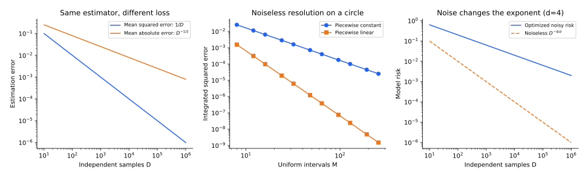

> **Scaling Laws · Note 02**　[专题目录](/notes/scaling_laws/) · 上一篇：[从学习曲线到 Neural Scaling Laws](/notes/scaling_laws/empirical_origins/) · 下一篇：[谱与学习分辨率](/notes/scaling_laws/spectral_learning/)

**学习问题：** 新增样本是在把已有规律测得更准，还是让学生第一次看见此前遗漏的结构？

## 0. 前言：同样是更多数据，为什么改善的速度不同 {#前言同样是更多数据为什么改善的速度不同}

把一枚硬币抛一百次，再抛一万次，我们对正面概率的估计会稳定下来。这个问题的未知量始终只有一个；增加数据主要是在重复测量同一个对象。另一种情况是绘制一张越来越精细的地图：原先没有被采样的山谷、弯道和边界不断进入视野。未知结构的有效数目随分辨率增长，增加数据同时意味着探索新的细节。

这两种图景都能给出损失随数据量下降的幂律，但指数来自不同地方。前者与统计波动的集中有关，后者与目标的光滑性、数据的内在维数和学习器的逼近方式有关。区分它们，可以解释为什么某些模型最终出现 $1/D$ 修正，而另一些学习曲线在很宽的区间内明显慢于 $1/D$。

实际实验里，这两种误差经常混在一起。固定一个小模型不断增加数据，最后可能只是在把已有参数估得更准；换成一个足够大的模型，新样本又可能揭示原先完全没有覆盖的细节。两次实验的横轴都叫数据量，增加数据所做的事却已经变了。模型也随数据一起扩大时，曲线还会经过两者的交叉区间。

纵轴同样会影响判断。一个模型即使拿到无限数据，也可能留下表示误差；带噪标签还会留下无法预测的随机性。测试损失已经接近平台时，总损失看起来几乎不动，减去平台后的误差却仍在下降。讨论改善有多快以前，必须先说清画的是哪一部分损失。

[Bahri 等的 Explaining Neural Scaling Laws](https://arxiv.org/abs/2102.06701)将它们区分为 variance-limited 和 resolution-limited，并分别讨论数据规模与模型宽度，得到四种标度情形。

Teacher–student 模型固定一个教师来生成标签，再分别限制学生能用的特征和它见到的样本。学生装不下教师、样本不够、标签有噪声，会留下不同的误差；其中一些随数据消失，另一些只会在扩大表示以后消失。

## 1. 首先分清总损失与超额损失 {#excess-risk}

用 $D$ 表示独立训练样本数，$P$ 表示模型参数数目。训练后的预测器还依赖初始化和优化随机性，因此记作 $\widehat f_{D,P}$。总体测试损失是

$$
L(D,P)=\mathbb E_{\mathcal D,\mathrm{init},\mathrm{opt}}
\mathbb E_{(x,y)\sim p}\bigl[\ell(\widehat f_{D,P}(x),y)\bigr].
$$

外层期望比较重复训练，内层期望评价独立测试数据。单次实验的测试均值只是这个量的估计。如果训练和测试共享样本，或者多次试验后根据测试结果选择配置，它们对应的统计对象就发生了变化。

对固定模型研究 $D\to\infty$ 时，应减去这个模型及其训练规则的极限 $L(\infty,P)$；研究模型无限增长时，则应明确比较的是 $L(D,\infty)$ 还是共同的最优损失。一般来说

$$
L(\infty,P)\neq L(D,\infty)\neq L_*.
$$

一个小模型即使拥有无限数据也可能无法表示目标；一个无限大的模型面对有限而带噪的数据，也不能获得无限的信息。把所有平台都叫作“不可约噪声”，会把表示误差、估计误差和优化误差混在一起。

对于随机标签的平方损失，$L_*$ 包含条件方差；对于下一词预测的交叉熵，理想损失底是给定信息下的条件熵。在后者中，扩大上下文本身就可能改变损失底，因此不是简单地沿着同一条曲线移动。

判断平台的来源，可以分别考虑两个极限：数据无限增加以后，有限测量造成的波动会消失，模型表达不出的部分仍然留下；再扩大模型，才可能减少后一项。观测本身的随机性则可能在两个极限下都存在。减去哪一个平台，应当与实验中允许改变的资源一致。

## 2. 波动受限：从均值估计得到一条完整的幂律 {#variance-limited}

### 2.1 一个未知数，损失却有不同的指数 {#一个未知数损失却有不同的指数}

设观测为 $y_a=\mu+\varepsilon_a$，其中噪声独立、均值为零、方差为 $\sigma^2$。均值估计器为 $\widehat\mu=D^{-1}\sum_a y_a$。它满足

$$
\mathbb E[\widehat\mu]=\mu,
\qquad
\mathbb E[(\widehat\mu-\mu)^2]=\frac{\sigma^2}{D}.
$$

这里不需要数据中存在任何幂律结构。误差来源只是有限次独立测量。若用平方误差评价均值预测，超额风险恰好是 $\sigma^2/D$；若评价均值的绝对偏差，在高斯噪声下则为 $\sigma\sqrt{2/(\pi D)}$。同一个估计器，换一个损失就可能改变指数。

这也说明“参数误差是 $D^{-1/2}$”与“损失误差是 $D^{-1}$”并不矛盾。前者是典型偏移的大小，后者是偏移的平方。统计集中怎样经过损失函数变成风险，是理论中不可省略的一步。

重复实验时，均值估计有时偏高、有时偏低，平均偏差可以抵消，平方误差却不会。因此，先平均多个模型的预测再计算损失，与先计算各自损失再平均，一般会得到不同结果；前一种操作还利用了集成来降低波动。

### 2.2 平滑损失怎样把波动变成平均损失 {#平滑损失怎样把波动变成平均损失}

设训练预测在某个极限预测附近写成

$$
\widehat f=f_\infty+\delta f,
\qquad
\mathbb E[\delta f]=\frac{b}{D}+o(D^{-1}),
\qquad
\mathbb E[\delta f\delta f^\top]=\frac{V}{D}+o(D^{-1}).
$$

在有限测试点上，可以把 $f$ 看成一个向量。对足够平滑的总体损失做 Taylor 展开，再取期望，有

$$
\mathbb E[\ell(\widehat f)]-\ell(f_\infty)=
\frac{\nabla\ell(f_\infty)^\top b}{D}
+\frac{\operatorname{Tr}[H_\ell(f_\infty)V]}{2D}
+o(D^{-1}).
$$

如果围绕的是均值预测，线性波动项直接平均为零；如果极限预测还是风险的驻点，一阶偏移也消失。剩下的二阶曲率与协方差相乘，给出 $1/D$ 修正。这个机制依赖集中、平滑性及非零的领先系数，并不保证所有训练算法都满足。

尤其要注意，有限数据改变的也可能是平均预测，而不仅是预测方差。Taylor 展开中两项都保留，才能判断一个经验 $1/D$ 系数究竟主要来自哪里。若领先系数恰好相消，或者训练过程在阈值附近不光滑，就可能出现不同的阶数。

### 2.3 从一个均值到有限维回归 {#从一个均值到有限维回归}

设输入 $x\in\mathbb R^k$，$y=x^\top\theta_*+\varepsilon$，训练与测试输入具有相同的非退化二阶矩 $\Sigma$。在 $k$ 固定、$D$ 足够大且常规最小二乘条件成立时，

$$
\operatorname{Cov}(\widehat\theta)\simeq
\frac{\sigma^2}{D}\Sigma^{-1}.
$$

独立测试点的超额预测误差于是为

$$
\mathbb E[(x^\top\widehat\theta-x^\top\theta_*)^2]
\simeq
\operatorname{Tr}\!\left(\Sigma\frac{\sigma^2}{D}\Sigma^{-1}\right)
=\frac{\sigma^2 k}{D}.
$$

未知方向的数目决定领先常数，但在这个极限中不改变指数。若让 $k$ 与 $D$ 同时增长，逆协方差的波动可能不再忽略，插值附近还会出现噪声放大；这就进入[高维泛化](/notes/neural_network_theory/linear_learning/)讨论的另一种极限。不能从“固定维数最终是 $1/D$”推断“所有规模下都是 $1/D$”。

固定维数时，新增数据始终在估计同一组未知数。若模型随数据增长而引入新方向，旧方向虽估得更准，新方向却又加入误差。总风险可能因此下降得更慢；改变的是待估对象的数目，单个方向的统计规律仍然成立。

### 2.4 为什么只给出一个误差条还不够 {#section-2-4}

均值估计中，可以直接比较三件事：一次估计离真实均值有多远，重复估计的分布有多宽，以及平方损失平均后有多大。取 $\sigma=1$，将数据从 $D=100$ 增加到 $D=400$，参数的标准差由 $0.1$ 降到 $0.05$，均方风险却由 $0.01$ 降到 $0.0025$。同一次资源增长，在这两个纵轴上分别是二倍和四倍改善。

因此，论文图里的 error、MSE、RMSE 和 excess loss 需要分别读。若标签是 $y_{\rm test}=\mu+\varepsilon_{\rm test}$，独立测试噪声还会给总 MSE 加一项：

$$
\mathbb E[(\widehat\mu-y_{\rm test})^2]
=\underbrace{\sigma^2/D}_{\text{估计误差}}
+\underbrace{\sigma^2}_{\text{新标签噪声}}.
$$

在上述两种数据量下，总 MSE 是 $1.01$ 与 $1.0025$。参数已经估得明显更准，总损失的相对变化却很小。若在总损失上直接求双对数斜率，就很难看见估计项真正的指数。这不是实验精度的问题，而是被测量的损失里含有一个不随训练数据改变的部分。

### 2.5 Taylor 展开中的曲率具体在做什么 {#section-2-5}

把单个参数的总体风险记作 $\mathcal R(\theta)$，在极小点 $\theta_\infty$ 附近，位移为 $\delta\theta$。驻点条件去掉一次项以后，

$$
\mathcal R(\theta_\infty+\delta\theta)-\mathcal R(\theta_\infty)
\simeq\frac12H(\delta\theta)^2.
$$

若 $\mathbb E[(\delta\theta)^2]\simeq V/D$，平均风险修正就是 $HV/(2D)$。曲率大，参数同样偏一点会造成更大代价；曲率小，参数波动可以很明显，预测风险却变化不大。多维式中的 trace 正是在所有方向上累加“波动乘以损失曲率”。这里需要保留风险在该点足够平滑、领先二次项非零等条件；分段阈值或插值奇异点附近，不能只按误差条的宽度猜损失指数。

## 3. 模型宽度也可能通过波动产生标度 {#width-fluctuations}

考虑随机特征核近似

$$
K_w(x,x')=\frac1w\sum_{a=1}^w
\phi_a(x)\phi_a(x').
$$

如果不同特征独立且二阶矩适当，$K_w-K_\infty$ 的典型大小为 $w^{-1/2}$。若预测对核矩阵的依赖足够平滑、逆矩阵远离奇异点，对初始化平均后的损失修正通常从 $1/w$ 开始。它的来源与均值估计相似，只是随机平均发生在特征上。

这个论证并不意味着每次初始化的损失偏差都只有 $1/w$。单次偏移可以有更大的 $w^{-1/2}$ 部分，经过初始化平均才消去；平均偏差和试验间波动应分别报告。在插值奇异点附近，平滑展开也可能失效。

对有限实验而言，这一点也影响我们能看见多小的平均改善。如果单次初始化波动明显大于相邻宽度之间的平均差异，只画每个宽度的一次运行，曲线可能显得不规则，甚至暂时逆转。那不一定说明平均标度失效，而是平均效应尚未从运行间波动中显露。平均规律、典型偏移与最好一次结果，应当保持为不同统计对象。

宽度增加在这里直接改善的是同一个核的随机近似，而不是逐步发现新的任务规律。这与后面的特征学习有所区别：后者允许表示朝目标方向调整，前者主要减小独立抽样的离散程度。两种方式都可能降低平均测试损失，但对重复初始化波动、目标对齐和训练中核变化的预测不同，可以用这些量辅助判断改善来自哪里。

具体地说，先固定一对输入，令 $Z_a=\phi_a(x)\phi_a(x')$。若这些随机量独立同分布且方差有限，便有

$$
\mathbb E[K_w(x,x')]=K_\infty(x,x'),
\qquad
\operatorname{Var}[K_w(x,x')]=\frac{\operatorname{Var}[Z_a]}{w}.
$$

这就是“更多神经元像更多次测量”的准确含义。不过，从核误差到预测误差还隔着一次求解。核回归需要计算 $(K_w+\lambda I)^{-1}y$；如果某个本征值接近零，很小的核扰动也可能被逆矩阵放大。因此，只有求解稳定时，核的集中才会顺利传递为预测的集中。这里的 $1/w$ 来自独立特征平均，不能直接套给任意正在学习和相互关联的神经元。

还需要把宽度换算成参数数。固定输入维数的单隐藏层网络常有 $P\propto w$，固定深度、隐藏层间为稠密矩阵的网络在足够大宽度下通常有 $P\propto w^2$。因此

$$
L(w)-L(\infty)\propto w^{-1}
\quad\Longrightarrow\quad
L(P)-L(\infty)\propto
\begin{cases}
P^{-1},&P\propto w,\\
P^{-1/2},&P\propto w^2.
\end{cases}
$$

指数的变化可能只来自横轴的定义。随机特征数、有效秩、隐藏宽度和总参数不能共用一个未经解释的 $N$。Bahri 等在讨论线性模型与深层网络时明确保留了这种区别；对实际 Transformer，还要检查词嵌入、深宽比和注意力模块怎样计数。

## 4. 分辨率受限：数据正在揭示新的空间结构 {#resolution-limited}

### 4.1 采样距离如何变成函数误差 {#采样距离如何变成函数误差}

设数据位于一个体积有限、密度不退化的 $d$ 维光滑流形上。把局部体积平均分给 $D$ 个样本，一个样本对应体积约为 $D^{-1}$，相应的典型线性间距为

$$
h_D\asymp D^{-1/d}.
$$

这是典型测试点附近的尺度；覆盖整个流形的最坏距离可能额外带上对数因子。如果密度在边界附近消失，或者数据集中在多个不同维数的部分，这个简单体积论证还要按位置修改。

若目标与插值器的局部差异为 $O(h_D^r)$，采用平方损失，就得到几何估计

$$
R(D)\asymp h_D^{2r}\asymp D^{-2r/d}.
$$

这里同时出现两个因素：空间被采样得多快，以及相邻样本之间能做多高阶的逼近。只说“数据内在维数决定指数”是不完整的，因为 $r$ 还取决于目标的正则性和学习器的逼近方式。

维数的影响可以用局部网格理解。在一条线段上，把采样间隔减半，大致只需让点数翻倍；在多个独立方向上都把间隔减半，需要同时填满更多小格子。数据量增长得很快，单个方向的分辨率却改善有限。另一方面，如果学习器已经知道局部斜率，就不必把函数在每个小格里当成常数。维数决定填满空间的代价，逼近方式决定填满以后还剩下哪一阶误差，二者共同进入指数。

从局部误差的上界到渐近等式，还要排除特殊目标、低阶项相消和不稳定插值。Bahri 等也分别讨论 Lipschitz 上界与解析展开估计：前者控制最坏允许误差，后者还需判断实际留下的第一个非零项。

### 4.2 论文中的距离上界，怎样一步步读出来 {#论文中的距离上界怎样一步步读出来}

取一个测试点 $x$，把最近的训练点记作 $x_a$。若学生已经精确拟合无噪声标签，便有 $\widehat f(x_a)=f_*(x_a)$。假设教师与学生的 Lipschitz 常数分别为 $K_*$ 和 $K_f$，三角不等式给出

$$
\begin{aligned}
|\widehat f(x)-f_*(x)|
&\leq |\widehat f(x)-\widehat f(x_a)|
+|f_*(x_a)-f_*(x)|\\
&\leq (K_f+K_*)\|x-x_a\|.
\end{aligned}
$$

它说的是：在锚点上两条曲线重合，从锚点往外走一小步，只要两条曲线都不能任意陡峭地转弯，它们就不能突然分开很远。对平方损失，如果最近邻距离的二阶矩为 $O(D^{-2/d})$，并且 $K_f$ 随规模保持有界，则

$$
R(D)\leq (K_f+K_*)^2\mathbb E\|x-x_a\|^2
=O(D^{-2/d}).
$$

这是把距离估计专门用于平方损失得到的上界。[Bahri 等第 2.2 节](https://arxiv.org/html/2102.06701#S2.SS2)对一般 Lipschitz 损失先给出较宽的 $O(D^{-1/d})$ 上界，再用局部展开讨论更快的典型阶数。因而 $1/d$、$2/d$ 和下面的 $4/d$ 有不同前提：一般损失上界、平方误差上界，以及消去低阶误差后的估计。尤其是，上界没有声称误差一定恰好按这个速度下降；若学生的局部斜率随 $D$ 剧烈增长，上面统一控制误差的前提也会失去。

### 4.3 一条曲线上的常数插值与线性插值 {#一条曲线上的常数插值与线性插值}

取 $f_*(x)=\sin(2\pi x)$，$x\in[0,1]$，均匀放置 $M$ 个小区间，每区间宽 $h=M^{-1}$。若只保存区间中心的函数值，误差领先项来自一阶变化，平均平方误差为 $O(h^2)$，即 $O(M^{-2})$。

若改用相邻节点的线性插值，一阶变化已经被重建。对一个二阶可微函数，区间内的插值误差为

$$
f_*(x)-I_hf_*(x)=\frac{f_*''(\xi_x)}2(x-x_i)(x-x_{i+1}),
$$

其大小是 $O(h^2)$，平方误差变成 $O(h^4)=O(M^{-4})$。数据维数没有变化，指数却翻倍，因为逼近器消除了更低阶的局部误差。

这个例子帮助理解论文中分辨率估计里的 $2/d$、$4/d$ 等形式：它们不是互相竞争的普遍常数，而是不同首个非零误差阶数除以空间维数。对于相同的局部平方误差阶数 $4$，$d=2$ 时估计为 $D^{-2}$，$d=20$ 时则为 $D^{-0.2}$。高维下空间分辨率改善缓慢，才会形成很小的有效指数。

用样本成本来读也很直观。若希望平方误差降低到原来的 $1/16$，线性插值图景要求把局部间距减半；填满一个 $d$ 维空间约需把样本量乘以 $2^d$。二维时只需约四倍样本，二十维时却需约一百万倍。公式中的维数出现在分母，对应的正是这个填充空间的代价。这里比较的是相同目标、相同插值阶数下的几何估计。

插值器消除了低阶误差，也会使指数变快；这种变化无需降低数据维数。反过来，表示不合适也会使学习变慢。将几何估计用于一个任务时，要说明模型能利用哪些局部关系，而不能只代入一个测得的维数。

像素数很多的图像，预测时可能只依赖少数关系；数据即使落在低维集合上，目标也可能沿这个集合剧烈变化。这里相关的是目标在所用表示中的复杂度，原始输入大小不能单独决定它。

例如，数据已经覆盖一个区域，并不意味着区域内部的边界已经被分辨。增加样本以后，一部分收益来自原有区域的统计更稳定，另一部分来自此前没有采到的局部变化开始出现。如果只在平均损失上拟合，这两项可以叠加成一条缓慢曲线；检查误差集中在哪些位置，则更容易知道当前应当使用波动还是分辨率图景。

*图 1 · 左侧是均值估计的精确均方风险；中间由周期正弦函数的分片常数与线性插值直接积分；右侧计算下面的噪声风险模型。三幅图分别对应不同统计问题，指数不能跨图直接视为同一个网络的预测。*

### 4.4 把正弦插值的领先常数也算出来 {#section-4-4}

前面的幂次还可以在一个小区间上直接积分。取区间中心为 $x_c$，局部坐标为 $u\in[-h/2,h/2]$。分片常数插值保存 $f_*(x_c)$，误差领先项是 $f_*'(x_c)u$。对区间平均，

$$
\frac1h\int_{-h/2}^{h/2}[f_*'(x_c)u]^2\,du
=\frac{h^2}{12}[f_*'(x_c)]^2.
$$

将所有区间相加，对 $f_*(x)=\sin(2\pi x)$ 得到

$$
R_{\rm const}\simeq\frac{h^2}{12}\int_0^1[f_*'(x)]^2dx
=\frac{\pi^2}{6}h^2.
$$

在线性插值中，端点值已经恢复了常数和斜率。把区间暂时写成 $[0,h]$，误差的领先形式为 $f_*''(x_c)x(x-h)/2$，从而

$$
R_{\rm linear}\simeq\frac{h^4}{120}\int_0^1[f_*''(x)]^2dx
=\frac{\pi^4}{15}h^4.
$$

这里使用光滑函数在小区间中的渐近展开，端点安排的差异只影响更高阶项。两种结果的差别已经能从被保留的信息读出：常数插值丢掉了局部斜率，线性插值先把这一误差消掉，剩下曲率。学习器的逼近方式因此与目标的光滑性共同进入指数，不能把较快的曲线全部解释为更低的数据维数。

## 5. 噪声为何会改变分辨率指数 {#bias-variance}

无噪声插值可以把每个样本当作精确锚点。带噪样本则不能无限细分：一个很小的区域里如果只有一个观测，局部预测会跟着噪声走。此时需要在分辨率和平均测量次数之间权衡。

设一个局部区域线性尺度为 $h$，典型包含 $Dh^d$ 个样本。若局部逼近偏差平方为 $Ah^{2r}$，对这些样本平均得到的噪声方差约为 $B/(Dh^d)$，于是

$$
R(h,D)\simeq Ah^{2r}+\frac{B}{Dh^d}.
$$

两项可以逐个读：第一项是“小区域还不够小”，同一区域内的真实函数仍有变化；第二项是“小区域里测量次数不够多”，样本平均仍含噪声。将 $h$ 减半，偏差平方缩小为原来的 $2^{-2r}$，但区域体积也缩小为原来的 $2^{-d}$，可用于平均的样本变少，方差反而增大到原来的 $2^d$ 倍。这里 $B$ 包含标签噪声强度以及密度、局部拟合方式等常数。

对 $h$ 求极值，得到

$$
2rAh^{2r-1}=\frac{dB}{D}h^{-d-1},
\qquad
h_*\asymp D^{-1/(2r+d)}.
$$

若把常数也保留，平衡条件是

$$
h_*^{2r+d}=\frac{dB}{2rAD},
\qquad
\underbrace{\frac{B}{Dh_*^d}}_{\text{方差}}
=\frac{2r}{d}\underbrace{Ah_*^{2r}}_{\text{偏差平方}}.
$$

因此最优点上两项具有相同的数量级，常数一般并不相等。只把它们直接设为相等，可以找对指数，却未必找对最优平滑尺度。

代回可得

$$
\boxed{R_*(D)\asymp D^{-2r/(2r+d)}.}
$$

这个指数与无噪声情况下的 $2r/d$ 不同。噪声使学习器不能把每一个新样本都直接用来提高几何分辨率，必须保留足够多的局部重复测量。指数变小来自明确的统计权衡，而不是目标突然失去了光滑性。

最优区域会随数据增加而缩小，但缩小得比无噪声采样间距更慢。这样，局部预测既能分辨更细变化，每个区域又仍有充分观测来平均噪声。若过早把区域切得很细，模型主要是在追逐随机起伏；若区域始终太大，细节又会被持续抹平。最优指数描述的是这两种需求随数据共同调整的轨迹，而不是一个固定平滑程度的学习器自动获得的结果。

这一点还能直接从局部样本数看出来：

$$
n_{\mathrm{local},*}\asymp Dh_*^d
\asymp D^{2r/(2r+d)}\longrightarrow\infty.
$$

也就是说，数据越多，地图确实画得越细，但每个小格里的重复测量也越多。在无噪声的距离估计中，每个格子只需数量级为一的锚点；有噪声时，最优解主动把格子放大，让随机误差有机会被平均。这两种实验协议不能只凭横轴都叫 $D$ 就互换。特别是 $B=0$ 时，上述内部极值不再存在，应回到采样间距所限制的无噪声问题。

对 $d=4,r=2$，无噪声几何估计给出 $D^{-1}$，上述噪声模型则给出 $D^{-1/2}$。如果只观察幂律形状，很容易把前者当成均值估计的 $1/D$，把后者当成参数的标准误。事实上，这三个推导的未知对象、噪声位置和损失都不同。

## 6. Teacher–student：让“没有学会什么”变得可计算 {#teacher-student}

### 6.1 教师规定规律，学生只看到例子 {#教师规定规律学生只看到例子}

Teacher–student 模型先把真实规则写出来。固定一个教师 $f_*$，抽取输入，再由教师生成标签；学生只拿到这些输入和标签，按照指定算法训练：

$$
\begin{aligned}
x_a&\overset{\mathrm{iid}}\sim p(x),\\
y_a&=f_*(x_a)+\varepsilon_a,\\
\widehat\theta&=\mathop{\arg\min}_{\theta}
\frac1D\sum_{a=1}^D\bigl(f_\theta(x_a)-y_a\bigr)^2.
\end{aligned}
$$

教师可以是一条直线，也可以是一个权重固定的深层神经网络；学生可以与教师使用相同架构，也可以更窄、使用不同特征。名字里的“教师”只表示我们知道数据生成规律。学生无需读取教师权重，也不必使用软标签、温度或专门的蒸馏损失。若最小值不唯一，还需规定学生选择哪个解，例如从零初始化的线性梯度下降所选的最小范数解。

这样的设定相当于做一道知道标准答案的实验题：可以分别控制题目有多复杂、学生能用什么表达方式、看多少例题，以及标签中混入多少噪声。它允许我们直接评价相对于教师的超额风险

$$
R(D,P)=\mathbb E_{\mathcal D,x}
\bigl[\bigl(\widehat f_{D,P}(x)-f_*(x)\bigr)^2\bigr].
$$

本节把初始化等其他随机性也吸收到外层平均中。若测试标签还含独立、零均值、方差为 $\sigma^2$ 的噪声，总测试 MSE 就是 $L(D,P)=R(D,P)+\sigma^2$。后面讨论的表示平台属于 $R$，不能再被算进测试噪声。

### 6.2 学生能够表示教师：有限样本只剩估计误差 {#学生能够表示教师有限样本只剩估计误差}

先取最容易算的情形：$x\in\mathbb R^k$ 的分量独立服从标准高斯分布，教师为 $f_*(x)=x^\top\theta_*$，学生也使用全部 $k$ 个坐标。标签噪声与输入独立，均值为零、方差为 $\sigma^2$，不同样本的噪声也独立。令 $X\in\mathbb R^{D\times k}$ 的每一行是一个训练输入。若 $D\gt k$，最小二乘解满足

$$
\begin{aligned}
\widehat\theta-\theta_*&=(X^\top X)^{-1}X^\top\varepsilon,\\
\operatorname{Cov}(\widehat\theta\mid X)
&=\sigma^2(X^\top X)^{-1}.
\end{aligned}
$$

第一式已经说明误差来源：教师信号可以完全装进学生，剩下的是标签噪声经过求逆传播。由于独立测试输入满足 $\mathbb E[xx^\top]=I_k$，给定 $X$ 后的平均预测风险等于 $\sigma^2\operatorname{Tr}(X^\top X)^{-1}$。再对 Gaussian 训练输入平均，利用逆 Wishart 一阶矩，得到

$$
\begin{gathered}
\mathbb E_X[(X^\top X)^{-1}]=\frac{I_k}{D-k-1},\\
\boxed{R(D,k)=\frac{\sigma^2k}{D-k-1}},
\qquad D\gt k+1.
\end{gathered}
$$

这把前面的渐近式 $\sigma^2k/D$ 变成了一个有限样本答案。例如 $k=10,\sigma^2=1$ 时，$D=100$ 的风险约为 $0.112$，$D=200$ 时约为 $0.053$；当 $D$ 远大于 $k$，数据翻倍才接近风险减半。在刚刚超过可解阈值时，分母里的 $k+1$ 不能忽略。

两个边界尤其有解释力。第一，如果 $\sigma^2=0$ 且 $X$ 满列秩，学生已经能精确恢复教师，风险直接为零，不会继续留下一条非零的 $1/D$ 尾巴。第二，如果 $k/D\to\gamma\in(0,1)$，风险趋于 $\sigma^2\gamma/(1-\gamma)$，并不随 $D$ 消失，因为待估方向也在同时增加。这个比例极限与 [Hastie 等的 ridgeless 回归结果，式 (8)](https://arxiv.org/html/1903.08560v5#S3.SS2)一致；过参数一侧还会出现未恢复教师方向的误差，完整讨论见[线性学习与高维泛化](/notes/neural_network_theory/linear_learning/)。

### 6.3 学生装不下教师：没有标签噪声，也可能出现统计波动 {#学生装不下教师没有标签噪声也可能出现统计波动}

现在把教师写成两组分量独立的标准高斯坐标的函数：

$$
\begin{aligned}
f_*(u,v)&=u^\top\theta_*+v^\top\beta_*,\\
f_\theta(u,v)&=u^\top\theta,\\
\tau^2&=\|\beta_*\|^2.
\end{aligned}
$$

学生只能使用 $u\in\mathbb R^P$，教师还依赖另一组坐标 $v$。即使有无限数据，学生也只能学到 $u^\top\theta_*$，遗漏部分的平均平方大小是 $\tau^2$。在有限训练集上，$v^\top\beta_*$ 对只观察 $u$ 的回归而言，恰好像一个独立、方差为 $\tau^2$ 的额外噪声。若标签还含方差为 $\sigma^2$ 的独立噪声，同一计算给出

$$
\boxed{R(D,P)=
\underbrace{\tau^2}_{\text{表示平台}}
+\underbrace{\frac{(\sigma^2+\tau^2)P}{D-P-1}}_{\text{有限样本估计误差}}},
\qquad D\gt P+1.
$$

这也是 [Hastie 等第 5 节](https://arxiv.org/html/1903.08560v5#S5)讨论的模型失配问题在独立 Gaussian 坐标下的直接版本。公式里的两份 $\tau^2$ 做着不同的事：一份是测试时学生永远表达不出的信号；另一份使训练时对可见参数的估计发生波动。只有第一份在无限数据后仍然留下。

举一个不用矩阵也能想清楚的例子。教师给出 $y=2u+v$，其中 $u,v$ 是独立标准高斯变量；学生坚持用 $\theta u$ 预测。某份训练集里 $u$ 与 $v$ 会偶然同涨，学生就把斜率估得略大于 $2$；另一份训练集又可能略小。这里根本没有人为加入的标签噪声，但学生的表达限制把遗漏变量变成了估计中的扰动。对应 $P=1,\sigma^2=0,\tau^2=1$，精确风险为 $1+1/(D-2)$。更多数据让斜率趋于 $2$，风险却只能趋于 $1$。

这使“固定模型附近的 $1/D$ 修正”有了具体含义：它描述对这个模型所能学到的最佳预测的接近速度。若允许学生再使用 $v$，表示平台就会改变；那已经是在沿另一条资源路径比较。

### 6.4 换成深层教师时，保留的是什么 {#换成深层教师时保留的是什么}

教师网络的权重固定后，每次都可以重新抽取输入，生成新的精确标签。这样就能保持同一条目标函数，单独改变数据量；也能先固定足够多数据，改变学生宽度。扫描输入的维数，则可控制一个相对清楚的几何因素。[Bahri 等的深层 teacher–student 实验](https://arxiv.org/html/2102.06701#S3.SS1)正是用这类控制来检验分辨率估计。

在线性插值有效的区间，$r=2$ 对应平方风险 $D^{-4/d}$。这提供一个可检验预期：固定局部逼近机制、改变输入维数时，指数应怎样变化。但深层网络是否真正达到这种局部逼近、学生是否足够大、优化是否充分，仍需从实验确认。Teacher–student 规定的是可控问题，并没有自动证明每个学生都能找到理想解。

## 7. 论文的随机特征模型：把“表示不够”写成投影 {#random-feature-teacher-student}

### 7.1 教师与学生共用一套底层特征 {#教师与学生共用一套底层特征}

前面的 Gaussian 例子把可见坐标和遗漏坐标直接分开。更一般的版本允许学生使用底层特征的线性组合。采用 [Bahri 等式 (1)](https://arxiv.org/html/2102.06701#S2.SS3)的结构，记

$$
\begin{aligned}
F(x)&=(F_1(x),\ldots,F_S(x))^\top,\\
f_*(x)&=\omega^\top F(x),\\
\phi(x)&=AF(x),\quad A\in\mathbb R^{P\times S},\\
f_\theta(x)&=\theta^\top\phi(x).
\end{aligned}
$$

$S$ 是教师的底层特征数，$P$ 是学生可训练的线性系数数目。$A$ 固定，决定学生能使用哪些特征组合；训练只调整 $\theta$。特征 $F_m(x)$ 本身可以是输入的非线性函数，所以“线性模型”指的是对可训练系数线性。这里通常把构造特征的权重视为固定；$P$ 因而不等于一个所有层都训练的网络的总参数。

可以把 $F_m$ 想成一套描绘地图的图层：有的表示大尺度起伏，有的表示细小纹理。教师能混合全部图层，学生只拿到由 $A$ 组合出来的 $P$ 张。增加数据可以帮助学生估准已有图层的系数；增加独立特征则可能让学生终于画出此前缺失的纹理。这是统计精度和表示分辨率的具体区别。

### 7.2 数据无限：还剩多少教师信号没有被表示 {#数据无限还剩多少教师信号没有被表示}

先固定 $A,\omega$，设无标签噪声，并定义底层特征的二阶矩 $C=\mathbb E_x[F(x)F(x)^\top]$。总体平方风险是一个二次型：

$$
R(\theta)=(\omega-A^\top\theta)^\top
C(\omega-A^\top\theta).
$$

对 $\theta$ 求导，最优系数满足 $ACA^\top\theta_\infty=AC\omega$。若 $ACA^\top$ 可逆，将解代回便得

$$
\begin{aligned}
\theta_\infty&=(ACA^\top)^{-1}AC\omega,\\
R(\infty,P\mid\omega,A)
&=\omega^\top
\bigl[C-CA^\top(ACA^\top)^{-1}AC\bigr]\omega.
\end{aligned}
$$

方括号中的 $C$ 计量全部教师特征的变化，第二项扣掉学生能够解释的部分。投影按输入分布定义的 $C$ 度量进行，遗漏方向的影响由其信号权重决定，不能只按方向的数目计数。

再采用论文中的教师平均：$\omega\sim\mathcal N(0,I_S/S)$，且独立于 $A$ 和训练输入。由 $\mathbb E[\omega^\top B\omega]=\operatorname{Tr}(B)/S$，得到

$$
\boxed{\mathbb E_\omega R(\infty,P\mid A)
=\frac1S\operatorname{Tr}
\bigl[C-CA^\top(ACA^\top)^{-1}AC\bigr].}
$$

这就是 [Bahri 等式 (2)](https://arxiv.org/html/2102.06701#S2.SS3)在本文平方损失约定下的写法：原文使用平方误差的一半，因此其右侧多一个 $1/2$。若有退化方向，可以在相应可识别子空间使用伪逆。教师平均也不能被悄悄省略：对一个指定教师，应使用前面的二次型，而不是把每个方向都按平均权重计入 trace。

例如 $C$ 的本征值为 $\lambda_1\geq\cdots\geq\lambda_S$，若学生恰好保留前 $P$ 个本征方向，上式简化为 $S^{-1}\sum_{j>P}\lambda_j$。这只是一个有利的理想选取，随机抽到的特征未必恰好覆盖前 $P$ 个方向；即便特征数相同，选取方式不同也会留下不同平台。

### 7.3 表示充分、数据有限：哪些方向还没有被样本约束 {#表示充分数据有限哪些方向还没有被样本约束}

接下来让学生使用全部教师特征，即取 $A=I_S$，仍保持无噪声，并从零出发拟合训练标签。把教师平均定义的核记为

$$
K(x,x')=\mathbb E_\omega[f_*(x)f_*(x')]
=\frac1S F(x)^\top F(x').
$$

给定训练输入，令 $\mathbf K_{ab}=K(x_a,x_b)$，$k(x)_a=K(x_a,x)$。当 $\mathbf K$ 可逆时，最小范数学生的预测为 $\widehat f(x)=k(x)^\top\mathbf K^{-1}y$。这时平均残差为

$$
\boxed{\mathbb E_\omega R(D,S\mid X)
=\mathbb E_x\bigl[K(x,x)-k(x)^\top\mathbf K^{-1}k(x)\bigr].}
$$

这是 [Bahri 等式 (3)](https://arxiv.org/html/2102.06701#S2.SS3)对应的另一侧极限，同样按本文约定去掉 $1/2$；总体学习曲线还要对训练输入 $X$ 平均。它也可以直接由协方差算出来：对 $\widehat f(x)-f_*(x)$ 平方展开，交叉项给出 $-2k^\top\mathbf K^{-1}k$，预测本身的方差给出 $+k^\top\mathbf K^{-1}k$，合起来就是方框中的差。可逆性失败时，可对无噪声相容数据使用伪逆。

第一项是教师在新输入上的原始方差，第二项是训练样本已经解释的方差。在训练点上，两项完全相消；在一个与所有训练点的核相似度都很低的位置，第二项很小，学生对教师仍知道得很少。每增加一个样本，至多增加一个独立约束方向。学生的表示虽然充分，数据仍可能没有揭示全部结构。

无限数据风险来自学生缺失的表示方向，全特征风险来自有限样本尚未约束的方向。遗漏方向的能量分布决定风险是否呈现幂律。若学生和训练数据最终覆盖全部 $S$ 个独立方向，无噪声风险可以直接归零；有限 $S$ 下，持续的幂律要求测量区间尚未触及有限秩截止。

### 7.4 用两个特征看清投影公式 {#section-7-4}

取底层特征为两个独立、单位方差的坐标，因而 $C=I_2$；教师是 $f_*(x)=\omega_1x_1+\omega_2x_2$。学生只保留第一坐标时，$A=(1,0)$，总体最优系数为 $\theta_\infty=\omega_1$，剩余风险恰好为 $\omega_2^2$。trace 公式中的残余矩阵就是 $\operatorname{diag}(0,1)$。

若教师按前面的分布平均，$\mathbb E\omega_2^2=1/2$，所以无限数据风险为 $1/2$。这个数并非测试噪声：指定教师若恰好有 $\omega_2=0$，风险就是零；若教师恰好只使用第二坐标，学生则完全看不到目标。平均教师给出的一个数字，掩盖了指定任务之间的差别。

还可以不改变维数，只把学生方向转为 $a=(\cos\varphi,\sin\varphi)$。对指定教师，

$$
R(\infty,1\mid\omega,a)
=\|\omega\|^2-(a^\top\omega)^2.
$$

当方向与教师对齐时，一维学生就足够；方向正交时，再多样本也不能恢复遗漏信号。对各向同性教师平均，任意固定方向仍给出同样的 $1/2$。因此，“平均模型容量相同”与“对某个目标同样有效”是两个不同结论。这个二元例子也说明了为什么后续谱理论必须保留目标对齐，特征学习必须说明如何从数据中找到方向。

## 8. 四种区域怎样放在同一张图里 {#four-regimes}

### 8.1 先固定一边，读懂另一边的变化 {#先固定一边读懂另一边的变化}

在前面的固定特征模型中，$P$ 同时是特征数和可训练系数数。把一个资源充分放开，再扫描另一个，便得到 Bahri 等区分的四种区域。下表是这种受控模型中的常见极限路径；仅凭 $D/P$ 的大小，还不足以保证具体指数成立。

| 实验路径 | 主要剩余误差 | 要观察的量与典型规律 |
| --- | --- | --- |
| 固定 $P$，令 $D$ 充分大 | 已有表示中参数估计的波动 | $L(D,P)-L(\infty,P)\sim c_P/D$ |
| 固定 $D$，增加独立特征，且求解稳定 | 有限特征对极限预测的随机近似 | $L(D,P)-L(D,\infty)\sim c_D/P$ |
| 表示充分，扫描较小的 $D$ | 未被样本分辨的函数结构 | 在无噪声局部逼近图景中，$R(D)\sim D^{-2r/d}$ |
| 数据充分，扫描受限的 $P$ | 学生尚不能表示的函数结构 | 若 $P$ 控制有效局部单元数，$R(P)\sim P^{-2r/d}$ |

前两行减掉的是各自的极限平台；后两行则观察主导的结构误差本身。在随机特征模型里第二行的 $P$ 可以对应前面所说的宽度 $w$；换成稠密深层网络，应重新做宽度到总参数数目的换算。第四行也要求参数能有效换来更多逼近单元，不能从“多一个参数”直接推出“多一个空间格子”。

例如学生遗漏了一块结构，表示平台为 $0.1$。数据从一万增到十万时，统计修正可能从 $0.01$ 降到 $0.001$：修正确实改善了十倍，总风险却只从 $0.11$ 降到 $0.101$。直接对总风险拟合幂律，会得到接近零的斜率；这与修正项的指数为一完全相容。

### 8.2 同时增加复杂度，为什么得到另一条指数 {#同时增加复杂度为什么得到另一条指数}

取一个有效秩为 $M$ 的近似器，用下面的风险模型连接表示误差和估计误差：

$$
R(M,D)=AM^{-s}+\frac{\sigma^2M}{D},\qquad s\gt0.
$$

这里取 $A\gt0,\sigma^2\gt0$。它是一个可分析的偏差—方差模型，例如独立系数观测的截断估计可以精确实现这种形式；对随机输入回归则一般只在稳定、远离插值阈值的区域近似成立。$M$ 表示实际估计的独立模态数，不必等于网络总参数。它把前面的细格子数换成有效方向数：方向更多时，遗漏信号变少，但每个方向都要从数据中估计。

固定 $M$，第一项是一个不动的平台，第二项按 $1/D$ 下降。若每次增加数据都重新选择复杂度，就要对 $M$ 求极值：

$$
\begin{gathered}
sAM^{-s-1}=\frac{\sigma^2}{D},\\
M_*=\left(\frac{sAD}{\sigma^2}\right)^{1/(s+1)},\\
R_*(D)\asymp D^{-s/(s+1)}.
\end{gathered}
$$

取 $s=1,A=\sigma^2=1$。固定 $M=10$ 时，风险是 $0.1+10/D$；让 $M$ 随数据优化时，$M_*\simeq\sqrt D$，风险约为 $2/\sqrt D$。后者下降得比 $1/D$ 慢，是因为学生不断把新数据的一部分用于估计新方向。比较的是同一个风险曲面上的两条路径。

与第 5 节的几何模型对照，令 $M\asymp h^{-d}$，就有 $h^{2r}\asymp M^{-2r/d}$，即 $s=2r/d$。于是

$$
\frac{s}{s+1}=\frac{2r}{2r+d}.
$$

这样，两种计算得到同一个最优指数：局部平滑中的小格子数，对应模态模型里实际估计的独立方向数。

“处在哪个区域”是对资源窗口和实验路径的判断。同一任务可以先受表示不足限制，随后受统计波动限制；换一个模型族或重新选择正则化，主导误差又可能改变。比较两个指数时，先写出各自固定了什么、减去了哪个平台，就能排除许多表面上的矛盾。

## 9. 数据与模型的对偶为什么需要条件 {#data-model-duality}

### 9.1 同一组奇异值，两种求解空间 {#同一组奇异值两种求解空间}

数据点限制可观测的信息，特征限制可表示的函数，两者在随机特征模型中具有相似的线性代数角色。设设计矩阵 $\Phi\in\mathbb R^{D\times P}$ 的元素为 $\Phi_{a\mu}=\phi_\mu(x_a)$。采用目标函数 $\|\Phi\theta-y\|^2+\lambda\|\theta\|^2$，$\lambda\gt0$，ridge 解可写成

$$
\begin{aligned}
\widehat\theta
&=(\Phi^\top\Phi+\lambda I_P)^{-1}\Phi^\top y\\
&=\Phi^\top(\Phi\Phi^\top+\lambda I_D)^{-1}y.
\end{aligned}
$$

第一行在 $P$ 维参数空间求解，第二行在 $D$ 维训练样本空间求解。若训练损失写成平均平方误差再加固定惩罚系数，相应的矩阵正则项应为 $D\lambda$；这里先明确未除以 $D$ 的约定，避免在改变数据量时无意中改变惩罚强度。

对 $\Phi=USV^\top$ 作奇异值分解，两边都在非零奇异方向上乘以 $s_j/(s_j^2+\lambda)$。因此，两边看见同一组非零谱，并用同样的滤波系数抑制小奇异值。维数不同只改变还存在哪些零空间。这解释了为什么有限样本和有限特征经常出现相近的瓶颈，也解释了实际求解时可以选择较小的一侧矩阵求逆。

### 9.2 从共同的尾部，怎样读出相同指数 {#从共同的尾部怎样读出相同指数}

为了看清机制，先作一个理想化近似：无噪声、前 $M$ 个重要方向已被恢复，其余方向还未恢复。在正交函数基中写

$$
f_*(x)=\sum_{j\geq1}a_j\psi_j(x),
\qquad
\mathbb E_x[\psi_i(x)\psi_j(x)]=\delta_{ij}.
$$

若前 $M$ 个系数精确已知，平方风险就是遗漏目标能量的和 $R_M=\sum_{j>M}a_j^2$。假设 $a_j^2\sim c\,j^{-(1+\alpha)}$，积分近似给出

$$
R_M\sim c\int_M^\infty u^{-(1+\alpha)}\,du
=\frac{c}{\alpha}M^{-\alpha},\qquad\alpha\gt0.
$$

多一个已恢复方向，就少一份遗漏能量；能量尾部下降多快，决定总体损失改善多快。真实随机样本并不直接交付前 $D$ 个精确系数，随机特征也不一定交付前 $P$ 个最优方向，因此还要分析模式混合、谱和目标的对齐；[Bordelon、Canatar 与 Pehlevan 的核学习曲线](https://proceedings.mlr.press/v119/bordelon20a.html)正是对这种逐模态学习的更具体处理。

在 Bahri 等采用的各向同性教师平均下，底层特征的谱决定平均目标能量；对合适的幂律谱，其[式 (4)](https://arxiv.org/html/2102.06701#S2.SS3)给出数据受限和模型受限两侧共享指数的结果。它的直觉是：两种资源分别打开不同的观测或表达通道，却在消除同一类能量尾部。取有效截止分别为数据或特征控制的尺度，就可能得到相同的幂律指数。

指定教师也会改变结论。目标若只依赖几个容易学习的方向，恢复它们以后风险便可归零；若能量集中在小本征值方向，学习就可能很慢。[下一篇谱模型](/notes/scaling_laws/spectral_learning/)因此同时保留核本征值和目标系数。

### 9.3 矩阵恒等式怎样才会变成统计对偶 {#矩阵恒等式怎样才会变成统计对偶}

岭回归的两种写法对每一份设计矩阵都成立。要进一步声称把 $D$ 与 $P$ 交换后风险相同，则必须同时说明随机特征怎样抽样、教师怎样生成、测试输入怎样分布，以及对哪些随机量取平均。[Maloney、Roberts 与 Sully 的可解模型](https://arxiv.org/abs/2210.16859)也明确联合规定了数据、标签和随机特征的生成规则，再计算平均测试损失。统计对偶属于这些规则所定义的模型，不能仅从矩阵形状推出。

尤其容易看到的是标签噪声的不对称性。对同一个教师增加独立样本，通常能改善信号估计；对同一份带噪标签增加特征，却可能使学生更充分地拟合噪声。插值附近的小奇异值还会放大这部分波动。因而两侧即使共享非零谱，风险也未必相同。

回看两个投影公式，数据受限时缺的是对教师的约束，模型受限时缺的是表达教师的方向。它们可以在受控的教师平均与谱结构下产生相近指数；实际任务是否满足这些条件，应由目标对齐、噪声和训练方式共同判断。

## 10. 结语：先判断剩下的误差属于什么 {#结语先判断剩下的误差属于什么}

学习曲线中的幂律不一定需要幂律分布。对有限维对象，集中与平滑损失就能产生 $1/D$；对不断细化的函数结构，空间维数、光滑性和逼近方式共同决定指数；加入噪声后，最优复杂度又改变了数据标度。

拟合以前，应先辨认固定模型的表示平台、有限样本波动和未被解析的结构。模型族、损失和训练协议固定下来以后，指数之间的比较才有确定含义。

### 10.1 波动与分辨率分类的适用范围 {#discussion-regimes}

波动与分辨率的区分，首先回答“更多资源正在消除哪类误差”。它允许不同任务共享相似的曲线，也允许同一任务在不同规模区间更换主导机制。它还没有回答一个具体网络怎样选择表示、为什么某个优化器更快，以及一个规模窗口会延续多久。仅凭观测到某个指数，往往不能反向唯一确定机制：固定维数估计和某个几何插值问题，都可能给出相同的损失下降速度。

这里尤其需要区分总体平均与单次训练。重复训练的平均损失接近平台，不代表每个初始化都以同样速度改善；一个难方向上的罕见失败，也可能被平均值遮住。若增加数据同时改变了任务组成、标签质量或重复比例，新增样本也不再等于对同一对象增加独立测量。此时应先重新定义统计问题，再判断还能保留哪些标度推论。

### 10.2 内在维数与目标变化 {#discussion-dimension}

地图的类比依赖局部距离有预测意义：附近的点具有相近标签，而且学习器能稳定地利用这种关系。在图像中这可能需要先学会合适的表示；对离散 token，则需要解释使用哪种距离。几何维数的测量方法、观察尺度和模型表示一旦变化，“相邻”也可能变化。即使同一数据集有稳定的维数估计，两个目标沿这个集合变化的方式仍可以完全不同。

从指数倒推“真实维数”，还会遇到插值阶数、噪声和局部密度的影响。可以把风险按位置或类别拆开，检查低密度区域是否承载了大部分剩余误差。若各部分的下降速度不同，整体拟合就会掩盖这些局部差别。

### 10.3 噪声交叉与任务对齐 {#discussion-progress}

[Bahri 等](https://arxiv.org/abs/2102.06701)提供了四种区域的组织方式；更具体的学习曲线研究则继续追问区域怎样交叉。[Cui 等，Generalization Error Rates in Kernel Regression](https://arxiv.org/abs/2105.15004)在 Gaussian 设计的核回归中，分析噪声、正则化和样本规模共同控制的变化，说明带噪任务也可能先表现出接近无噪声的下降区间，随后转入另一个主导区间。有限窗口里测得的快指数，因而未必能一直外推。

[Canatar、Bordelon 与 Pehlevan 的工作](https://arxiv.org/abs/2006.13198)进一步把任务与核的匹配纳入学习曲线。重要信号落在哪些方向上，与数据空间怎样被采样同样影响样本效率。

### 10.4 控制维数、噪声与学生表示 {#discussion-tests}

有区分力的实验应当在同一教师下分别改变输入维数、噪声强度和学生的局部逼近能力。若只增加无关输入坐标，指数是否仍然变化；若改变标签噪声，交叉位置是否移动；若学生已能表达教师，无噪声风险是否在有限样本后直接归零，这些结果都能约束解释。相比只让更多模型落在一条直线上，这些干预能说明公式中的每一项是否对应实际瓶颈。

更远的边界是分布变化。本篇主要评价同分布测试风险，训练区域被测得更精细，并不保证训练范围之外的预测改善。几何分辨率解释了已采样分布中的局部信息如何增加；跨分布的规则迁移，还需要关于表示、对称性或生成机制的额外假设。

## 11. 参考文献 {#references}

1. **Bahri, Dyer, Kaplan, Lee, Sharma（2024；初稿 2021）**. [Explaining Neural Scaling Laws](https://arxiv.org/abs/2102.06701)。PNAS 121, e2311878121。四种标度区域、随机特征投影以及几何分辨率的主要来源；阅读时区分严格上界、局部展开估计和实验结果。

2. **Hastie, Montanari, Rosset, Tibshirani（2019；修订 2020）**. [Surprises in High-Dimensional Ridgeless Least Squares Interpolation](https://arxiv.org/abs/1903.08560)。高维最小范数回归的原始研究。对应本篇 Gaussian 回归、比例极限和遗漏特征的讨论；本文另外展开了有限样本逆 Wishart 算例。

3. **Cui, Loureiro, Krzakala, Zdeborová（2021 / 2022）**. [Generalization Error Rates in Kernel Regression: The Crossover from the Noiseless to Noisy Regime](https://arxiv.org/abs/2105.15004)。NeurIPS 2021；J. Stat. Mech. 114004。噪声与正则化导致的核回归交叉区域，说明有限窗口指数为何会随数据量改变。

4. **Canatar, Bordelon, Pehlevan（2021）**. [Spectral Bias and Task-Model Alignment Explain Generalization in Kernel Regression and Infinitely Wide Neural Networks](https://arxiv.org/abs/2006.13198)。Nature Communications 12, 2914。任务—模型对齐与核学习曲线，补充几何维数之外的目标信息。

5. **Bordelon, Canatar, Pehlevan（2020）**. [Spectrum Dependent Learning Curves in Kernel Regression and Wide Neural Networks](https://proceedings.mlr.press/v119/bordelon20a.html)。ICML，PMLR 119。逐模态核学习曲线；与下一篇中时间、数据和容量的谱分解相衔接。

6. **Maloney, Roberts, Sully（2022）**. [A Solvable Model of Neural Scaling Laws](https://arxiv.org/abs/2210.16859)。可解的联合生成与随机特征模型。可与本篇的数据—模型投影比较，但教师平均和风险约定应分别核对。

**继续阅读。** 下一篇把目标分解成函数方向，分别计算学习速率、目标能量与可表示范围；这里的统计误差和分辨率由此进入同一个谱风险。

[← 上一篇：从学习曲线到 Neural Scaling Laws](/notes/scaling_laws/empirical_origins/) · [返回专题目录](/notes/scaling_laws/) · [下一篇：谱与学习分辨率 →](/notes/scaling_laws/spectral_learning/)
