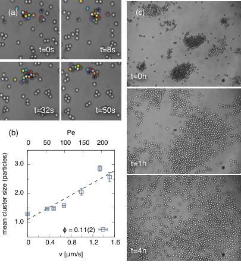
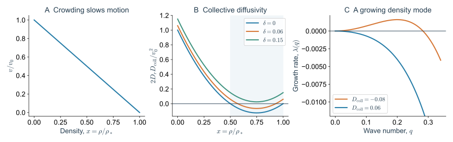
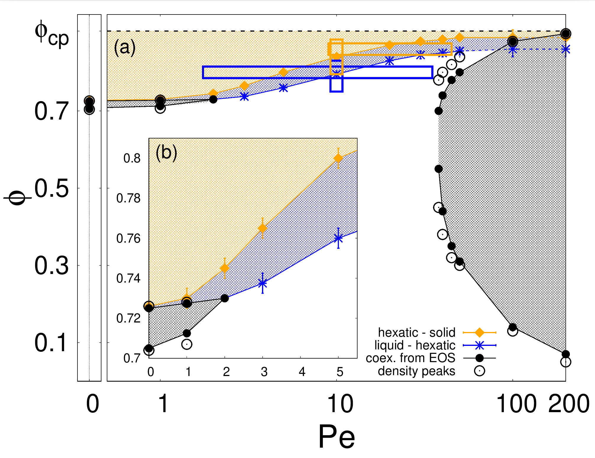
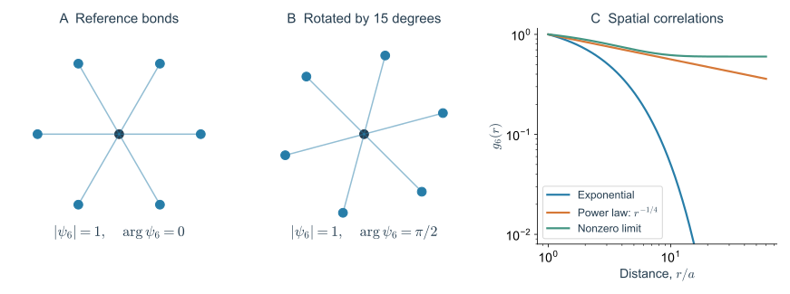
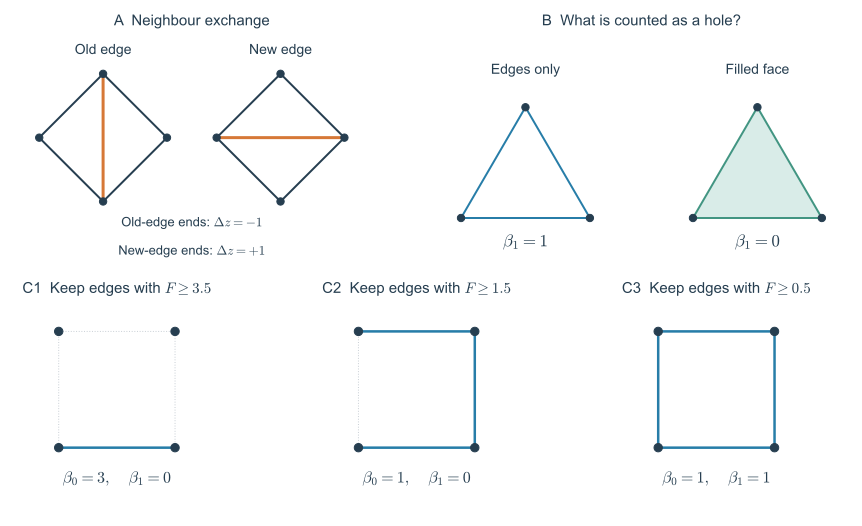
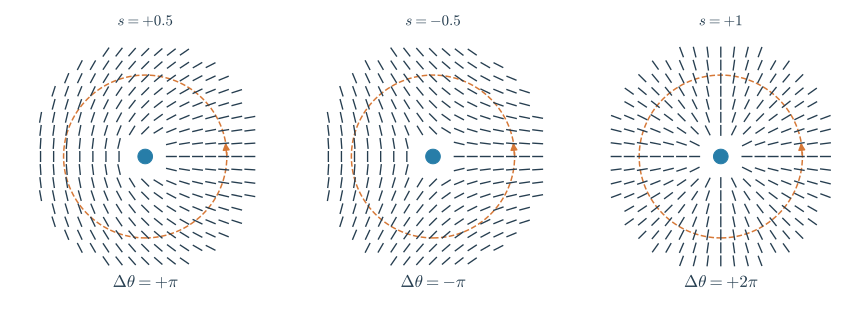
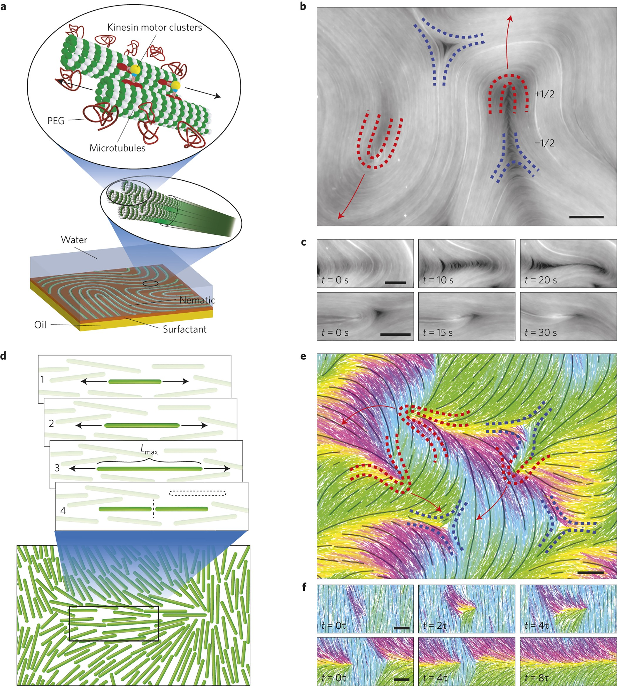
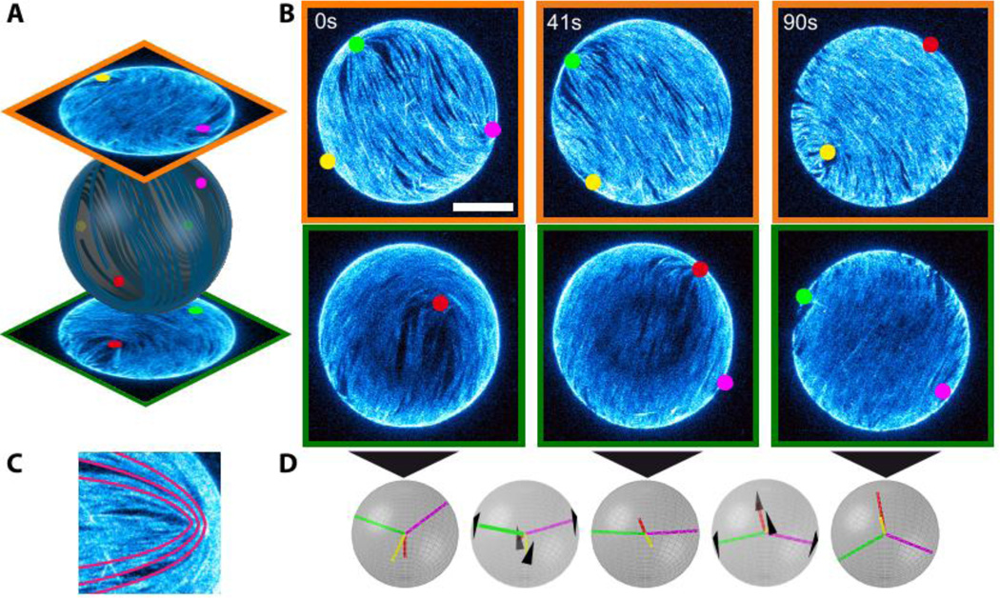
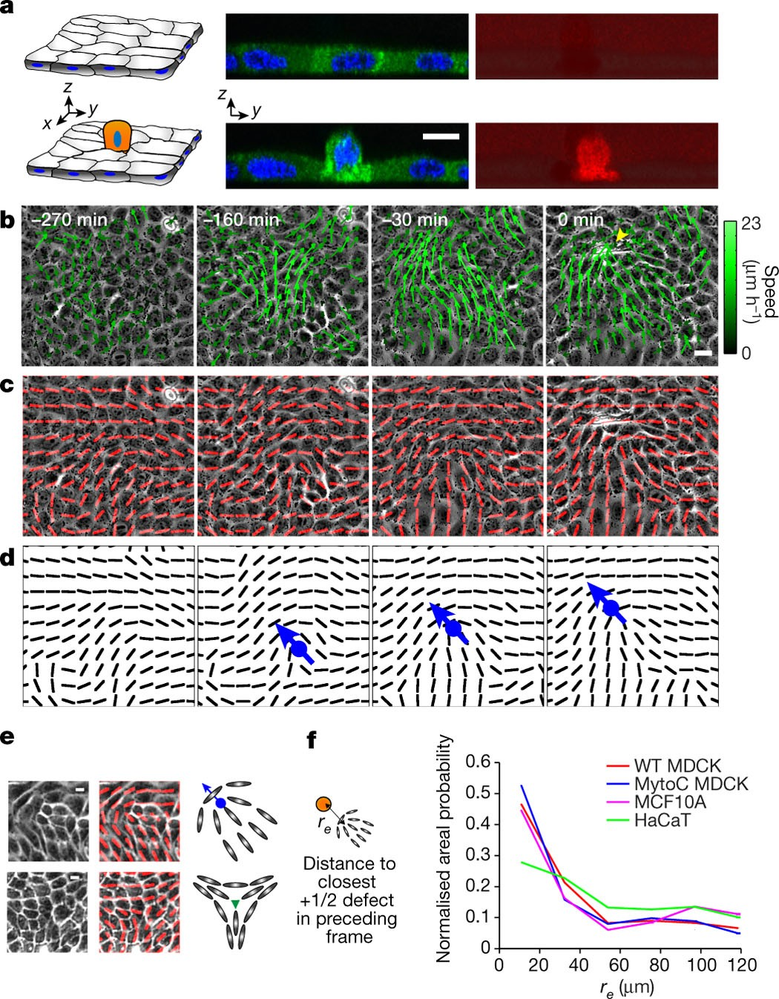
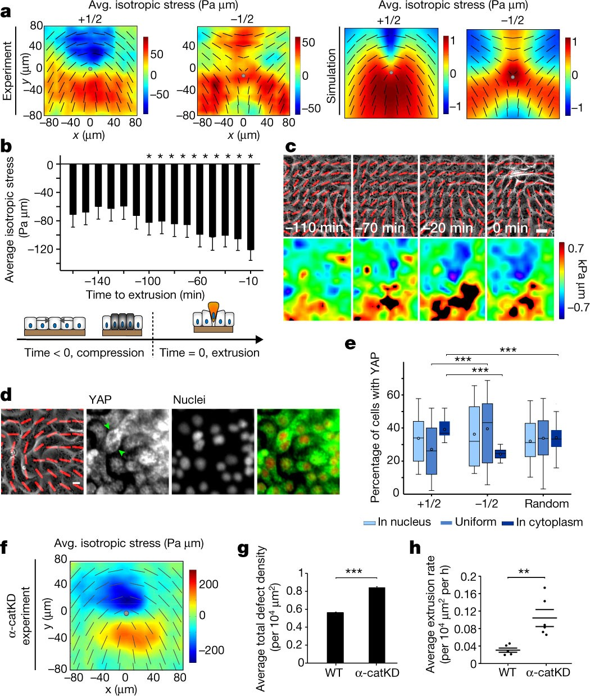

> **Part VI · Note 08**　[专题目录](/notes/vertex_model/) · 上一篇：[形态发生与实验检验](/notes/vertex_model/morphogenesis/)

**物理问题：** 自己会动的颗粒为什么有时聚成一团，有时被邻居困住，有时又不断产生缺陷和流动？堆积的几何、接触的拓扑和取向的拓扑，分别限制了什么？

## 1. 密、硬、有序，是三个不同的判断 {#main-lecture}

一群颗粒聚在一起，最直接的变化是局部密度增加。但密集区域仍可能像液体一样更新邻居；颗粒排列得很整齐，也不表示在持续驱动下完全不会流动。反过来，无序的泡沫、乳液或软颗粒堆积也能支撑剪切。

主动软物质还多了一项：组成它的单元持续把能量转成机械运动。主动胶体从光或化学环境中获得驱动，微管网络由消耗 ATP 的分子马达推动，细胞则通过皮层、黏附和基底牵引做功。因此，结构与运动要一起讨论：某个时刻怎样排列，不能完整确定下一段时间怎样重组。

“拓扑”在这些问题里有几种具体用法。颗粒接触图记录谁碰着谁；由位置构造的三角网格记录几何邻居；取向场的缺陷记录绕一圈时方向怎样转；同调方法则记录连通分量、环和空腔。它们都不依赖一条边究竟长了几微米，却并非同一个对象。

| 观察 | 常用量 | 对应的问题 |
| --- | --- | --- |
| 某些地方颗粒很多，另一些地方很少 | 局部密度分布、共存区域 | 是否发生相分离？ |
| 施力后难以继续变形 | 剪切模量、松弛、接触寿命 | 是否具有刚性或长期运动停滞？ |
| 邻居大致排成六角形 | 六重键取向与位置相关 | 是否存在晶体或六角相的有序？ |
| 拉长单元的朝向不能平滑接上 | 取向绕数、缺陷位置和运动 | 是否存在向列缺陷？ |

### 1.1 一个带排斥作用的主动颗粒模型

在二维平面中，用直径 $a$ 的圆盘表示颗粒，位置为 $\mathbf r_i$，推进方向为 $\mathbf n_i=(\cos\theta_i,\sin\theta_i)$。最简单的主动布朗颗粒（active Brownian particle，ABP）动力学为

$$
\dot{\mathbf r}_i=v_0\mathbf n_i-\mu\sum_{j\ne i}\nabla_iU(r_{ij})
+\sqrt{2D_t}\boldsymbol\xi_i(t),
\qquad
\dot\theta_i=\sqrt{2D_r}\eta_i(t).
$$

$v_0$ 是没有邻居阻挡时的推进速度，$\mu$ 是迁移率，即单位力引起多大速度；$U$ 描述颗粒间的排斥，$D_t$ 与 $D_r$ 分别控制位置和角度的随机变化，$\boldsymbol\xi_i,\eta_i$ 是独立的单位白噪声。这个模型没有让相邻颗粒主动对齐方向的规则。

二维自由粒子的方向记忆时间为 $\tau_r=D_r^{-1}$。在明显转向以前，它沿原方向推进的典型距离为 $\ell_p=v_0/D_r$，称为持续长度。若 $\ell_p$ 远大于颗粒直径，它撞上邻居后还会继续朝邻居推一段时间；若很快转向，则更容易脱离这次碰撞。

这里用 $\mathrm{Pe}_r=v_0/(aD_r)=\ell_p/a$ 表示持续长度与粒径之比。文献中的 Péclet 数不只有这一种定义，也常使用 $v_0a/D_t$ 或主动力与热能之比；比较相图时要连同定义一起比较。

圆盘模型的名义面积分数为 $\phi=\sum_i\pi a_i^2/(4A_{\rm box})$。硬圆盘不允许重叠；软圆盘允许有限压缩或重叠，这个名义值就不再等于实际被占据的面积比例。完全汇合的 Vertex 模型又不同：细胞已经铺满空间，实际占据比例为 1，但细胞数密度、形状和受力仍然可以变化。

## 2. 没有吸引力，为什么仍然会聚集 {#mips}

两个被动、只相互排斥的颗粒碰在一起，通常会分开。两个有持续推进方向的颗粒迎面相撞，却可能互相顶住；它们需要等方向改变到合适角度，才能离开。若很多颗粒同时遇到这种限制，碰撞区的平均移动速度就会下降。

这形成一种反馈：颗粒较多的区域使运动变慢，运动慢又让颗粒停留得更久，从而继续增加局部密度。当这种反馈足够强，系统可能分成稀疏和密集两部分，称为**运动诱导相分离**（motility-induced phase separation，MIPS）。[Tailleur 与 Cates（2008）](https://doi.org/10.1103/PhysRevLett.100.218103)在游走—翻转模型中讨论了自困与相分离；[Fily 与 Marchetti（2012）](https://doi.org/10.1103/PhysRevLett.108.235702)则研究了没有对齐作用的二维自推进排斥圆盘。

*图 1 · 碰撞与持续推进可以延长颗粒停留在团簇中的时间。* 引自 [Buttinoni 等（2013），Fig. 1 的作者稿版本](https://arxiv.org/html/1305.4185v1#S0.F1)，对应 [Phys. Rev. Lett. 110, 238301](https://doi.org/10.1103/PhysRevLett.110.238301)，原图未修改。A 追踪小团簇的生成与解体，B 比较平均团簇大小与推进速度，C 显示较密体系关闭照明后的变化。

实验中的 Janus 胶体只有一侧覆盖碳层，在合适的液体和照明条件下获得自推进。这使驱动强度可以从外部调节。图中的团簇不断交换成员，关掉驱动后又会解体；团簇存在与颗粒永远黏在一起，是不同的状态。

### 2.1 从密度依赖的速度推导不稳定性

用 $v(\rho)$ 概括碰撞后实际降低的平均推进速度，$\rho$ 是局部数密度。令 $\mathbf p$ 为推进方向的局部第一矩，既包含方向偏好，也按粒子数加权。忽略更高阶取向矩和较高阶空间梯度时，密度与方向满足近似关系

$$
\partial_t\rho=-\nabla\cdot[v(\rho)\mathbf p]+D_t\nabla^2\rho,
\qquad
\partial_t\mathbf p\simeq-D_r\mathbf p-\frac12\nabla[v(\rho)\rho].
$$

第一式是粒子数守恒：一个区域的颗粒增加，必须来自周围的净流入。第二式中，方向记忆以 $D_r$ 的速率丢失；密度和速度在空间上不均匀，又会产生净的方向偏差。

若研究的变化比方向调整慢，令第二式的左边近似为零，将 $\mathbf p$ 消去，得到

$$
\mathbf J=-D_{\rm coll}(\rho)\nabla\rho,
\qquad
\boxed{D_{\rm coll}(\rho)=D_t+\frac{v(\rho)[v(\rho)+\rho v'(\rho)]}{2D_r}.}
$$

$D_{\rm coll}$ 是密度扰动的集体扩散系数，区别于单粒子的长期扩散系数。它为正时，流动抹平密度差；为负时，流动反而增强密度差，均匀状态会失稳。忽略 $D_t$ 时，条件为

$$
\frac{d\ln v}{d\ln\rho}\lt-1.
$$

也就是说，密度增加一点导致的减速足够强，流出变慢的影响超过了颗粒数本身增加带来的流出增长。这比“越挤越容易聚集”更具体：只有减速反馈达到一定程度，才出现这类长波不稳定性。

取一个明确的速度形式 $v=v_0(1-x)$，其中 $x=\rho/\rho_*$、$0\lt x\lt1$。令 $\delta=2D_rD_t/v_0^2$，有

$$
\frac{2D_rD_{\rm coll}}{v_0^2}=\delta+(1-x)(1-2x).
$$

当 $D_t=0$ 时，这个近似在 $1/2\lt x\lt1$ 给出负扩散；加入平移扩散会缩小或消除不稳定区。速度形式在这里是预设的，用于算清反馈条件，并未拟合图 1 的实验。

*图 2 · 自困反馈怎样进入守恒方程。* A 使用 $v/v_0=1-x$；B 精确计算 $\delta+(1-x)(1-2x)$。C 计算加入正的梯度正则项后 $\lambda(q)=-D_{\rm coll}q^2-\kappa q^4$ 的增长率，取无量纲 $\kappa=1$。曲线只描述均匀态附近的线性稳定性，没有求解完整的相分离过程。

负扩散确定的是均匀态的失稳边界，通常称为自旋分解线。稀相与密相各自的共存密度，还涉及界面、涨落和非线性输运，不能仅由这一个符号确定。稳定的小团簇、暂时聚集和宏观相分离，也需要用尺寸与长时间演化区分。

## 3. 聚集以后，是不是就堵住了 {#active-jamming}

MIPS 回答密度是否分开；jamming 回答运动是否受到足够的几何和力学限制。密相中的颗粒可能仍快速换邻居，也可能缓慢蠕变，或者在给定时间里只在原位置附近起伏。这些状态需要分别测量。

对软颗粒，可以用重叠代价表示排斥：

$$
U_{ij}=\frac{k}{2}(a_{ij}-r_{ij})^2\Theta(a_{ij}-r_{ij}),
$$

其中 $a_{ij}$ 是接触距离，$\Theta$ 表示只在两颗粒重叠时计入能量。对于接触网络中的无摩擦圆盘，每条接触在一阶上限制一个相对位移分量。去掉不承力颗粒，在大体系、一般无序位置和标准中心力假设下，等静计数给出 $z_{\rm iso}\simeq2d$，二维约为 4。

这里的接触配位数约为 4，与平面三角网格的平均几何邻居数 6 没有矛盾。前者数实际承力接触，后者数由位置构造的邻接；两者不是同一张网络。预应力、冗余约束、摩擦和边界也会影响稳定性，独立约束的处理见 [Note 03](/notes/vertex_model/rigidity/)。

### 3.1 主动力与接触刚度，还需要一个比值

若主动推进力的尺度为 $f_a=v_0/\mu$，它与接触力尺度 $ka$ 的比值为 $f_a/(ka)$。这个比值增大，意味着主动推动更有能力压缩或挤开邻居。持续时间也很重要：相同大小的力，短暂推一下和长时间沿同一方向推，会产生不同的位移和事件相关。

[Henkes、Fily 与 Marchetti（2011）](https://doi.org/10.1103/PhysRevE.84.040301)研究了高密度自推进软圆盘中的流动与受困状态，并将受困状态的运动同低频集体模态联系起来。原模型还让极性方向逐渐追随实际速度，包含极性与运动的反馈，因而不能将它的相边界直接搬到不带对齐反馈的 ABP 模型中。

“主动性增强”于是可能有几种不同后果：帮助已有密集网络重排，使其流体化；通过自困形成更密的区域；或在有方向反馈时产生集体运动。观察到总体速度增大，也可能只是整片材料一起平移。相对位移、接触更新和受控应力松弛，才能进一步区分它们。

### 3.2 受困以后，为什么仍有集体运动

在一个机械稳定、接触暂时不变的构型附近，位移 $\mathbf u$ 的回复力可以用 Hessian 矩阵 $H$ 近似。设各自由度受到相同的阻力系数 $\Gamma_p=1/\mu$，线性方程为

$$
\Gamma_p\dot{\mathbf u}=-H\mathbf u+\mathbf f^{\,a}(t).
$$

投影到刚度为 $h_\alpha\gt0$ 的归一化模态上，就得到 $\Gamma_p\dot u_\alpha=-h_\alpha u_\alpha+f_\alpha^a(t)$。模式的恢复时间是 $\tau_\alpha=\Gamma_p/h_\alpha$：刚度小的模式，需要更长时间才能回到原位。整体平移的零模不包括在这里。

进一步取各颗粒推进方向独立、各向同性、没有对齐反馈，且方向相关按 $e^{-|t|/\tau_r}$ 衰减。在 $d$ 维中，模态力的相关为 $\langle f_\alpha^a(t)f_\alpha^a(0)\rangle=(f_a^2/d)e^{-|t|/\tau_r}$。对这个线性受迫方程积分，稳态方差为

$$
\boxed{\langle u_\alpha^2\rangle=
\frac{f_a^2}{d\,h_\alpha(h_\alpha+\Gamma_p/\tau_r)}.}
$$

若方向在模式恢复前已改变许多次，即 $\tau_r\ll\tau_\alpha$，则 $\langle u_\alpha^2\rangle\simeq f_a^2\tau_r/(d\Gamma_p h_\alpha)$，类似快速随机敲击软弹簧。若推进方向保持很久，即 $\tau_r\gg\tau_\alpha$，颗粒能接近当前推力下的位移，方差变成 $f_a^2/(d h_\alpha^2)$。两种极限都更容易激发软模式，但对刚度的依赖不同。

这说明，被邻居困住并不意味着每个颗粒只独立抖动：同一个软模态可以让许多颗粒协同移动。这一计算只适用于接触和模态仍近似固定的时候；一旦位移足以打开接触或触发重排，就要更新网络。不同模态通常也不能共用一个“有效温度”，因为活动的持续时间会分别与它们的恢复时间竞争。它与 [Note 02 的模态响应](/notes/vertex_model/linear_response/)相接，但驱动力的时间结构多了一层物理。

驱动的空间相关还会改变它在不同模式上的投影；同向推动可以增强共同位移，同时减少相对形变。[Note 09](/notes/vertex_model/fluctuations/#spatially-correlated-forces)用两个耦合自由度计算这一差别，并继续讨论涨落频谱和接触更新。

## 4. 堆得整不整齐：六重键取向与二维熔化 {#hexatic-order}

圆盘的推进箭头和圆盘周围邻居的排列方向也要分开。即使推进方向彼此杂乱，颗粒中心仍可能排成近似三角晶格。后者可以用六重**键取向序参量**描述：

$$
\psi_{6,i}=\frac1{z_i}\sum_{j\in\mathcal N_i}e^{6i\theta_{ij}}.
$$

$\theta_{ij}$ 是从颗粒 $i$ 指向几何邻居 $j$ 的连线角度。这里的“键”是一条几何连线，并不要求有化学键或真实接触。若六个邻居恰好每隔 $60^\circ$ 排列，乘以 6 后各复数方向一致，$|\psi_{6,i}|=1$。

把整套六角排列一起旋转，不改变有序程度，却改变 $\psi_6$ 的相位。因此，单看 $|\psi_{6,i}|$ 很大，还不知道远处的六角排列是否朝着同一方向。

空间相关函数

$$
g_6(r)=\langle\psi_{6,i}^*\psi_{6,j}\rangle_{|\mathbf r_i-\mathbf r_j|\simeq r}
$$

比较相隔 $r$ 的两个局部排列还保留多少共同方向。指数衰减表示方向记忆具有有限长度；代数衰减表示准长程有序；趋于非零值则表示长程取向有序。位置是否形成长期规则排列，还要另外测量相对于晶格倒格矢的密度相关。

*图 3 · 密度相分离与排列有序需要分别确定。* 引自 [Digregorio 等（2018），Fig. 1 的作者稿版本](https://arxiv.org/html/1805.12484v2#S0.F1)，对应 [Phys. Rev. Lett. 121, 098003](https://doi.org/10.1103/PhysRevLett.121.098003)，原图未修改。黑色为共存区，蓝色为六角相，橙色为固相。原图的 $\mathrm{Pe}=F_a a/(k_BT)$，与本文按持续长度定义的 $\mathrm{Pe}_r$ 不同。

**六角相（hexatic phase）**保留键取向的准长程有序，但位置有序仍是短程的；它与二维晶体不同。[Digregorio 等（2018）](https://doi.org/10.1103/PhysRevLett.121.098003)同时分析有序相关和密度共存，说明 MIPS 的密相可以具有不同的排列状态。因而“出现密相”和“结晶”不能共用一条判据。

*图 4 · 局部形状规则与远距离取向一致，是两层信息。* A、B 由理想六邻居位置直接计算 $\psi_6$；B 相对 A 旋转 $15^\circ$。C 绘制指定的指数、$r^{-1/4}$ 和非零平台形式，用于比较衰减方式，并非论文数据或对主动熔化指数的拟合。

在相分离区域里，还要说明相关函数是在密相内部计算，还是混合了稀相、密相与界面。两个取向不同的晶粒，也可能让整盒平均序参量很小；局部有序、空间相关和全局平均承担不同的判断。

密度在大尺度上是否均匀，还需要窗口数目方差与结构因子。[Note 09 的密度涨落部分](/notes/vertex_model/fluctuations/#density-fluctuations)推导两者的联系，并区分巨数目涨落、超均匀与取向有序。

## 5. 从配位数到接触网络的拓扑 {#packing-topology}

### 5.1 五邻居、七邻居与换边

对无边界的二维三角剖分，若其顶点数为 $N$、边数为 $E$、三角面数为 $F$，则 $3F=2E$，而 Euler 关系为 $N-E+F=\chi$。每条边被两端点计数，$\sum_i z_i=2E$，所以

$$
\boxed{\sum_i(6-z_i)=6\chi.}
$$

周期平面的拓扑相当于环面，$\chi=0$，平均几何邻居数为 6；球面 $\chi=2$，总偏差为 12。有限平面区域有边界修正，不能将边缘颗粒也按无边界公式计数。

在接近三角晶格的区域，五配位与七配位分别对应相对于六配位的正、负偏差。相邻五/七配位常构成位错的核心；完整确认位错还要检查晶格平移沿闭合回路是否接得上，即 Burgers 回路。一个五配位点也不能仅凭邻居数就赋予细胞长轴的 $+1/2$ 向列电荷。

Delaunay 网格的一次换边，会让旧边两端各少一个几何邻居，新边两端各多一个。若四点原来都六配位，就会产生两处五配位和两处七配位，总偏差仍为零。这与多边形细胞图中的 T1 对偶对应，但只在正确识别了细胞边界和对偶关系时，几何换边才代表真实的细胞接触交换。

*图 5 · 邻接、环和填充面，需要明确各自的定义。* A 仅计算一次对角边替换导致的 $\Delta z$；B 比较同样三个顶点、三条边在有无填充面时的 $\beta_1$；C 使用固定四顶点和边权 $4,3,2,1$，逐步降低保留边的力阈值。该图没有求解实际颗粒的受力或运动。

### 5.2 环、孔洞与持续同调

一张图可以只有一个连通分量，内部却有许多独立的环。用 $\beta_0$ 记连通分量数、$\beta_1$ 记独立环数，对只有顶点和边的图，有

$$
\beta_1=E-N+\beta_0.
$$

三个点围成三条边时，存在一个环，$\beta_1=1$。如果分析对象还包括中间那块填满的三角面，环就是一个面的边界，不再代表未填充的孔洞，$\beta_1=0$。所以，“接触图里有一个环”不等于“组织里有一个液体空腔”，也不等于“网络有一个机械零模”。

在颗粒材料中，可以给接触边标上力的大小，先保留较强的接触，再逐渐降低阈值。某些连通分量随阈值改变而合并，某些环形成或被填充。**持续同调（persistent homology）**记录这些结构在参数变化中出现与消失的位置。[Kramár 等（2013）](https://doi.org/10.1103/PhysRevE.87.042207)用这类方法分析压缩颗粒的力网络。

这里“持续”通常指结构跨越多大的阈值或长度尺度仍然存在，不一定是持续了多少秒。分析时要说明保留哪些顶点、怎样加入边、何时填充三角面；换一种构造方法，得到的孔洞统计也可能不同。它提供力网络组织方式的信息，材料能否承受剪切还要回到独立约束、预应力与实际响应。

### 5.3 邻居数什么时候可以直接进入动力学

在理想二维晶粒的曲率驱动模型中，边界张力相同，三条边以 $120^\circ$ 相交；相关理论见 [Mullins（1956）](https://doi.org/10.1063/1.1722511)。沿一个有 $n$ 条边的区域绕行，光滑边界曲率与角点转角满足

$$
\oint\kappa\,ds+n\frac{\pi}{3}=2\pi.
$$

取外法向速度为正，凸边界的曲率为正。若运动规律为 $v_n=-M\gamma\kappa$，其中 $M$ 是边界迁移率、$\gamma$ 是均匀线张力，则面积变化率为

$$
\frac{dA}{dt}=\oint v_n\,ds
=\frac{M\gamma\pi}{3}(n-6).
$$

五边区域缩小，七边区域增大；这个结论来自指定的曲率运动规律与交汇角条件。它说明拓扑计数在合适的物理方程下可以约束动力学，也说明为什么不能单独把 $n-6$ 当成所有组织的生长律。主动边界、非均匀张力、细胞分裂和体积调节都会改变这些假设。

## 6. 拉长单元的方向：为什么会出现半整数缺陷 {#nematic-topology}

向列排列描述“一条长轴朝哪里”，不区分长轴的两端。例如把一根没有箭头的短棒转 $180^\circ$，它的取向没有改变。这与带有前后方向的推进极性不同。

令局部长轴为 $\mathbf n=(\cos\theta,\sin\theta)$，$\theta$ 与 $\theta+\pi$ 等价。二维向列序可写成

$$
\Psi_2=S e^{2i\theta},
\qquad
Q_{\alpha\beta}=S\left(n_\alpha n_\beta-\frac12\delta_{\alpha\beta}\right).
$$

$S$ 记录朝向是否清楚且一致；$Q$ 同时记录排列强度与方向。当单元近似圆形，或者一个区域里方向互相抵消时，$S$ 会很小，长轴方向也难以可靠确定。

绕一个闭合圈连续跟踪方向，返回起点时，取向必须与原来等价，因而 $\Delta\theta=m\pi$。定义缺陷电荷

$$
\boxed{s=\frac1{2\pi}\oint d\theta=\frac m2,
\qquad
s=\frac1{4\pi}\oint d\arg\Psi_2.}
$$

于是 $s$ 可以是 $+1/2$ 或 $-1/2$。这不是把半个细胞放在核心，而是绕圈时长轴只需累计旋转半圈，就已回到同一向列取向。离开核心以后，排列仍然可以连续；核心附近则需要降低有序度、改变结构，或离开当前二维描述。

*图 6 · 缺陷电荷来自取向沿闭合回路的绕转。* 各图直接绘制 $\theta=s\varphi$，其中 $\varphi$ 是绕核心的极角，短线均无箭头。虚线圈沿逆时针方向绕行时，三图分别累计 $+\pi,-\pi,+2\pi$ 的长轴转角；它们是几何场，不包含缺陷核心结构或主动流动。

六重键序也可以定义绕数，但使用的是 $\Psi_6$，不是 $\Psi_2$。对 $m$ 重取向，最小角度电荷单位为 $1/m$。因此，六角排列的 $1/6$ 角度缺陷、三角网格的整数配位偏差 $6-z$，以及向列场的 $1/2$ 缺陷，需要各自定义后再联系。

## 7. 主动应力怎样推动缺陷 {#active-defects}

被动向列材料中的方向畸变需要弹性能。在平面、单弹性常数近似下，Frank 能为

$$
F_{\rm F}=\frac K2\int |\nabla\theta|^2dA.
$$

对 $\theta=s\varphi$ 的孤立缺陷，在核心半径 $a_c$ 与外部尺度 $L$ 之间积分，得到

$$
F_{\rm defect}\simeq\pi Ks^2\ln\frac{L}{a_c}+F_{\rm core}.
$$

畸变越强、影响范围越大，代价越高。能量的 $s^2$ 依赖也解释了为什么较大电荷可能倾向于拆成较小电荷：局部自能系数满足 $2(1/2)^2\lt1^2$。不过，在远大于两个核心间距的地方，总电荷仍为 $+1$，不能把那里也当成两个互不相干的半电荷场；总能量还要计入相互作用、边界和核心能。

### 7.1 应力不必来自当前构型的能量梯度

主动向列的一项常用应力为

$$
\sigma^{\rm act}_{\alpha\beta}=-\zeta Q_{\alpha\beta}.
$$

本文约定 $\zeta\gt0$ 表示伸展型主动应力，$\zeta\lt0$ 表示收缩型。空间中方向不同，应力也不同，其散度形成体力密度 $\mathbf f^{\rm act}=-\zeta\nabla\cdot Q$（此处先取均匀 $\zeta$）。因此取向畸变不仅储存弹性能，还会成为主动流动的来源。

在忽略惯性、以黏性和基底摩擦抵抗运动的近似下，力平衡可写成

$$
0=-\nabla p+\eta\nabla^2\mathbf u-\Gamma\mathbf u
+\nabla\cdot\boldsymbol\sigma^{\rm el}-\zeta\nabla\cdot Q.
$$

$\eta$ 表示黏性阻力，$\Gamma$ 表示相对基底的摩擦，$\boldsymbol\sigma^{\rm el}$ 包含取向畸变的弹性作用。主动过程持续提供机械功，缺陷对可以不断产生，即便被动弹性本来倾向于消除畸变。

*图 7 · 在主动材料中，缺陷也是持续运动的集体结构。* 引自 [DeCamp 等（2015），Fig. 1](https://www.nature.com/articles/nmat4387/figures/1)，原图未修改。A–C 是微管—马达体系、显微图和缺陷事件；D–F 是原文的杆模型模拟。实验与模拟的组成单元不同，比较的是集体取向与缺陷动态。

在这类重构材料中，马达将 ATP 的化学能用于推动微管相对滑动，微管束在界面上形成近二维的向列排列。$+1/2$ 缺陷具有彗星状、带极性方向的结构，因而对称性允许它沿自身方向运动；理想的孤立 $-1/2$ 缺陷有三重对称性，不具有同样的最低阶极性推进。但背景流、其他缺陷和边界也能带动 $-1/2$ 缺陷，不能把它称为静止点。

可以直接把一个方向场代入主动应力。取核心外的 $S$ 为常数、$\theta=\varphi/2$，则

$$
Q=\frac S2
\begin{pmatrix}\cos\varphi&\sin\varphi\\
\sin\varphi&-\cos\varphi\end{pmatrix},
\qquad
\mathbf f^{\rm act}=-\frac{\zeta S}{2r}\,\hat{\mathbf x}.
$$

绕核心不同位置的局部驱动都指向同一方向，这使该缺陷具有极性的原因更具体。式中的 $1/r$ 只适用于核心外；核心处 $S$ 会改变，流场还受压力、阻力、其他缺陷和边界影响，因此不能把这个体力密度直接当成缺陷速度。

### 7.2 活动长度来自哪两项的竞争

若在尺度 $\ell$ 上方向改变一的量级，弹性应力约为 $K/\ell^2$，主动应力约为 $|\zeta|S$。在 $S$ 为一的量级、黏性主导的估计中，两者平衡给出

$$
\ell_a\sim\sqrt{\frac{K}{|\zeta|}},
\qquad
u_a\sim\frac{|\zeta|\ell_a}{\eta}.
$$

$\ell_a$ 常被称为活动长度：弹性较强，维持平滑排列的区域较大；主动应力较强，更小尺度的畸变也能被推动。这个尺度估计不表示缺陷间距在所有系统中都严格等于 $\ell_a$。

有基底时，还出现摩擦屏蔽长度 $\ell_\Gamma=\sqrt{\eta/\Gamma}$。若摩擦主导，在尺度 $\ell$ 上应比较 $\Gamma u$ 与 $|\zeta|S/\ell$，速度估计相应改变。培养细胞与漂浮的微管界面受到不同阻力，不能仅用同一个活动长度就认定流场相同。

## 8. 把材料包到球面上：总电荷由什么决定 {#curved-active-nematics}

球面上不存在处处非零、连续而无奇点的切向向列排列。对闭合曲面上的切向向列场，用与局部曲面平行移动一致的缺陷电荷定义，有

$$
\sum_a s_a=\chi.
$$

球面 $\chi=2$，因此总电荷为 $+2$。四个 $+1/2$ 缺陷满足这个要求，但“必须恰好四个”还需要额外条件：允许哪些核心、各自的能量，以及是否还有正负缺陷对。拓扑只固定总和。

*图 8 · 总电荷固定，缺陷位置和运动仍可以持续改变。* 引自 [Keber 等（2014），Fig. 1](https://pmc.ncbi.nlm.nih.gov/articles/PMC4401068/#F1)，原图未修改。A 标出球面上的四个 $+1/2$ 缺陷；B、D 比较一个振荡周期中的近四面体与近平面构型；C 显示单个缺陷的形态。图中的位置通过三维成像与投影确定。

[Keber 等（2014）](https://doi.org/10.1126/science.1254784)将主动微管膜限制在囊泡表面，观察到缺陷构型的持续变化。这使几何与动力学的分工很清楚：球面拓扑要求净电荷，主动驱动使缺陷运动，弹性和囊泡形变影响它们怎样相互作用。

同样在球面上，三价细胞铺砌满足 $\sum_i(6-n_i)=12$，向列场却满足 $\sum_a s_a=2$。前者数多边形边数，后者数取向绕转。只有建立具体的几何映射后，才能比较缺陷位置，不能直接将“十二个五边形”换成“四个半整数缺陷”。

## 9. 培养上皮中的缺陷与细胞挤出 {#epithelial-defects}

上皮细胞常有可识别的长轴。对一片细胞轮廓作局部平均，可以构造形状向列场，追踪其中的 $+1/2$ 与 $-1/2$ 缺陷。这是一种从细胞几何得到的集体描述；它不要求每个细胞都像液晶分子，也不把细胞的运动极性当成长轴方向。

[Saw 等（2017）](https://doi.org/10.1038/nature21718)在 MDCK 等培养上皮中比较了取向缺陷、集体流动、应力与细胞挤出。**挤出（extrusion）**指细胞离开上皮层，由周围细胞重新封闭空位；它与一个细胞的长轴旋转、一次四细胞 T1 都不同。

*图 9 · 从细胞轮廓识别的取向缺陷，可以与后续生物事件配对。* 引自 [Saw 等（2017），Fig. 1](https://www.nature.com/articles/nature21718/figures/1)，原图未修改。A 显示挤出与细胞死亡相关标记，B–E 配对运动、取向和缺陷，F 分析挤出位置与缺陷的距离。长轴场里的线段是从图像得到的方向，不是细胞间的承力边。

#### 论文视频 · 一个向列缺陷与后续细胞挤出

<figure class="vertex-video" id="video-saw-extrusion" style="--vertex-video-width: 820px">
<video controls preload="metadata" playsinline width="1280" height="720" aria-label="MDCK 上皮：向列缺陷、细胞流动与挤出" src="https://media.springernature.com/original/springer-static/esm/art%3A10.1038%2Fnature21718/MediaObjects/41586_2017_BFnature21718_MOESM66_ESM.mp4">
<a href="https://media.springernature.com/original/springer-static/esm/art%3A10.1038%2Fnature21718/MediaObjects/41586_2017_BFnature21718_MOESM66_ESM.mp4">直接打开原始视频</a>。
</video>
<figcaption><strong>显微成像与分析叠加</strong>｜Saw 等（2017），Supplementary Movie 1。四栏显示同一事件的相差成像、速度、长轴方向和缺陷跟踪；画面时间 0 min 为挤出事件。视频未修改，权利与许可见原文。<a href="https://www.nature.com/articles/nature21718#MOESM66" target="_blank" rel="noopener">原文与完整视频说明</a> · <a href="https://media.springernature.com/original/springer-static/esm/art%3A10.1038%2Fnature21718/MediaObjects/41586_2017_BFnature21718_MOESM66_ESM.mp4" target="_blank" rel="noopener">直接打开原始视频</a>。</figcaption>
</figure>

四栏不是四次独立实验。从左到右，第一栏保留原始相差图像；第二栏的箭头表示局部速度，颜色表示快慢；第三栏红色短线表示长轴方向；第四栏蓝箭头跟踪 $+1/2$ 缺陷的核心及其尾到头方向。按原视频图例，缺陷在 $-200$ 至 $-160$ min 左右出现，向画面左上方运动，随后在 0 min 附近出现挤出的亮点。

同一段运动可以同时有速度箭头和长轴短线，但它们测的是不同的量。视频能显示缺陷形成、移动与挤出的时间先后；仅凭这些叠加线，还不能量出压缩应力或判定细胞的死亡途径。

缺陷附近有更多挤出，还需要进一步回答：是否在事件前已经有特定应力，细胞有没有相应的机械响应，改变局部排列是否改变事件位置。论文进一步比较了压缩应力、YAP 分布、黏附干预和边界诱导的缺陷，相关结果见下图及原文。

*图 10 · 空间相关之外，还要比较事件前后的力学和细胞响应。* 引自 [Saw 等（2017），Fig. 3](https://www.nature.com/articles/nature21718/figures/3)，原图未修改。A–C 比较缺陷和挤出附近的应力，D、E 分析 YAP 的核内外分布，F–H 比较细胞间连接受干预后的结果。图中的应力正负与原文约定一致，正值为拉伸、负值为压缩。

YAP 是参与机械响应的转录调节因子，核内外分布可以提供细胞状态信息；caspase-3 活化是细胞凋亡相关的标记。它们与形状、应力和时间先后配对，才使取向缺陷同细胞行为之间的联系变得具体。某个缺陷并不确定下一次挤出的全部信息，细胞状态、边界与观测尺度仍会影响结果。

缺陷识别本身也有尺度：平均区域过小，轮廓分割噪声和近圆形细胞会使方向不稳定；平均过大，则可能抹去相邻的正负缺陷。需要同时报告局部有序度、平均尺度、缺陷寿命及跟踪方法，避免把方向难以确定的位置一律当作物理核心。

## 10. 与 Vertex Model 的连接

Vertex Model 可以同时保留细胞边界、邻接和形状向列场，但这些量进入模型的方式不同。被动面积—周长能控制某些形变的代价；T1 规则控制边界如何换接；主动推动、张力变化和极性反馈决定系统如何持续运动。长轴场及其缺陷可以从模型结果中计算，也可以在有充分依据时进入连续应力描述。

| 要解释的变化 | 必须区分的量 | 对 Vertex 模型的要求 |
| --- | --- | --- |
| 密区与稀区形成 | 占据比例、细胞数密度和细胞大小 | 允许相应的密度自由度；有空隙时保留自由表面 |
| 固体样支撑与长期流动 | 瞬时恢复力、接触更新和观测时间 | 能量、耗散与拓扑动力学共同给出响应 |
| 五/七配位及玫瑰结 | 邻接关系、多价交汇与事件持续时间 | 保留实际网络与合法的换接规则 |
| 向列缺陷持续产生和运动 | 长轴取向、主动应力和边界 | 从细胞形状构造 $Q$，并校验产生流动的实际机制 |
| 某处更容易出现挤出 | 取向、应力、细胞状态与面外运动 | 不只分析二维快照，还需事件动力学与必要的三维自由度 |

同一张细胞图中，接触连通、几何有序、机械刚性和取向电荷可以同时存在，却不由同一个数字决定。将这些定义分开后，才能具体判断一次干预改了什么：是增加接触、延长接触寿命、改变推进的持续性，还是改变方向场的应力来源。

## 主要文献

- [Tailleur & Cates (2008), Statistical Mechanics of Interacting Run-and-Tumble Bacteria](https://doi.org/10.1103/PhysRevLett.100.218103)。密度依赖运动与自困的早期理论。
- [Fily & Marchetti (2012), Athermal Phase Separation of Self-Propelled Particles with No Alignment](https://doi.org/10.1103/PhysRevLett.108.235702)。无对齐相互作用的排斥主动颗粒。
- [Buttinoni et al. (2013), Dynamical Clustering and Phase Separation in Suspensions of Self-Propelled Colloidal Particles](https://doi.org/10.1103/PhysRevLett.110.238301)。主动胶体的团簇与相分离实验。
- [Henkes, Fily & Marchetti (2011), Active jamming: Self-propelled soft particles at high density](https://doi.org/10.1103/PhysRevE.84.040301)。高密度软颗粒、方向反馈与受困动力学。
- [Digregorio et al. (2018), Full Phase Diagram of Active Brownian Disks: From Melting to Motility-Induced Phase Separation](https://doi.org/10.1103/PhysRevLett.121.098003)。二维熔化、六角相与 MIPS 的比较。
- [Kramár et al. (2013), Persistence of force networks in compressed granular media](https://doi.org/10.1103/PhysRevE.87.042207)。力网络与持续同调。
- [Mullins (1956), Two-Dimensional Motion of Idealized Grain Boundaries](https://doi.org/10.1063/1.1722511)。理想二维晶粒的曲率驱动与面积变化。
- [Giomi et al. (2013), Defect Annihilation and Proliferation in Active Nematics](https://doi.org/10.1103/PhysRevLett.110.228101)。主动向列缺陷的生成、分离与湮灭；另见 [Erratum](https://doi.org/10.1103/PhysRevLett.111.209901)。
- [DeCamp et al. (2015), Orientational order of motile defects in active nematics](https://doi.org/10.1038/nmat4387)。微管体系与缺陷动态。
- [Keber et al. (2014), Topology and dynamics of active nematic vesicles](https://doi.org/10.1126/science.1254784)。闭合曲面上的拓扑约束与主动运动。
- [Saw et al. (2017), Topological defects in epithelia govern cell death and extrusion](https://doi.org/10.1038/nature21718)。培养上皮的取向、应力与细胞挤出。

[← 形态发生、实验检验与开放问题](/notes/vertex_model/morphogenesis/) · [涨落、相关与组织重塑 →](/notes/vertex_model/fluctuations/) · [返回专题目录](/notes/vertex_model/)
