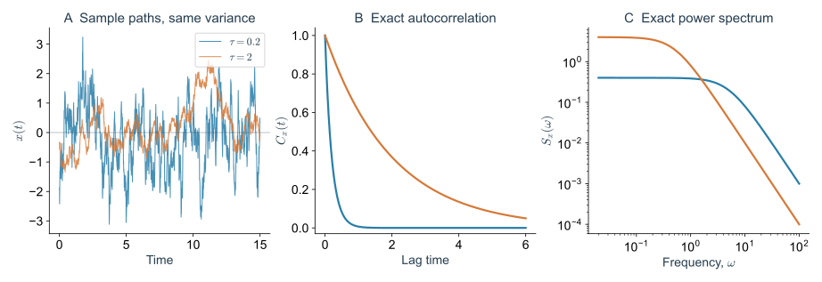
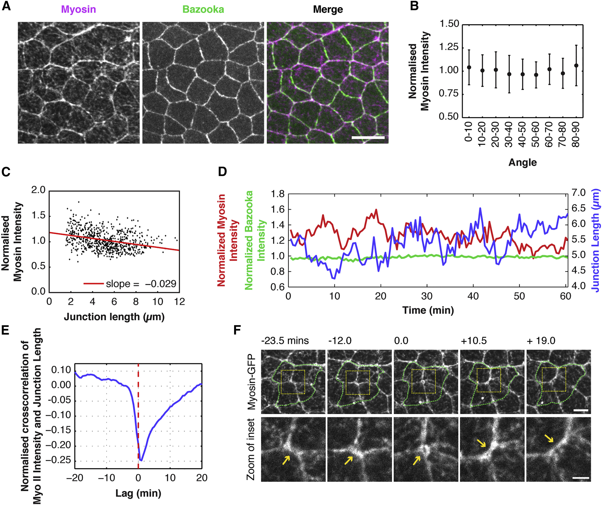
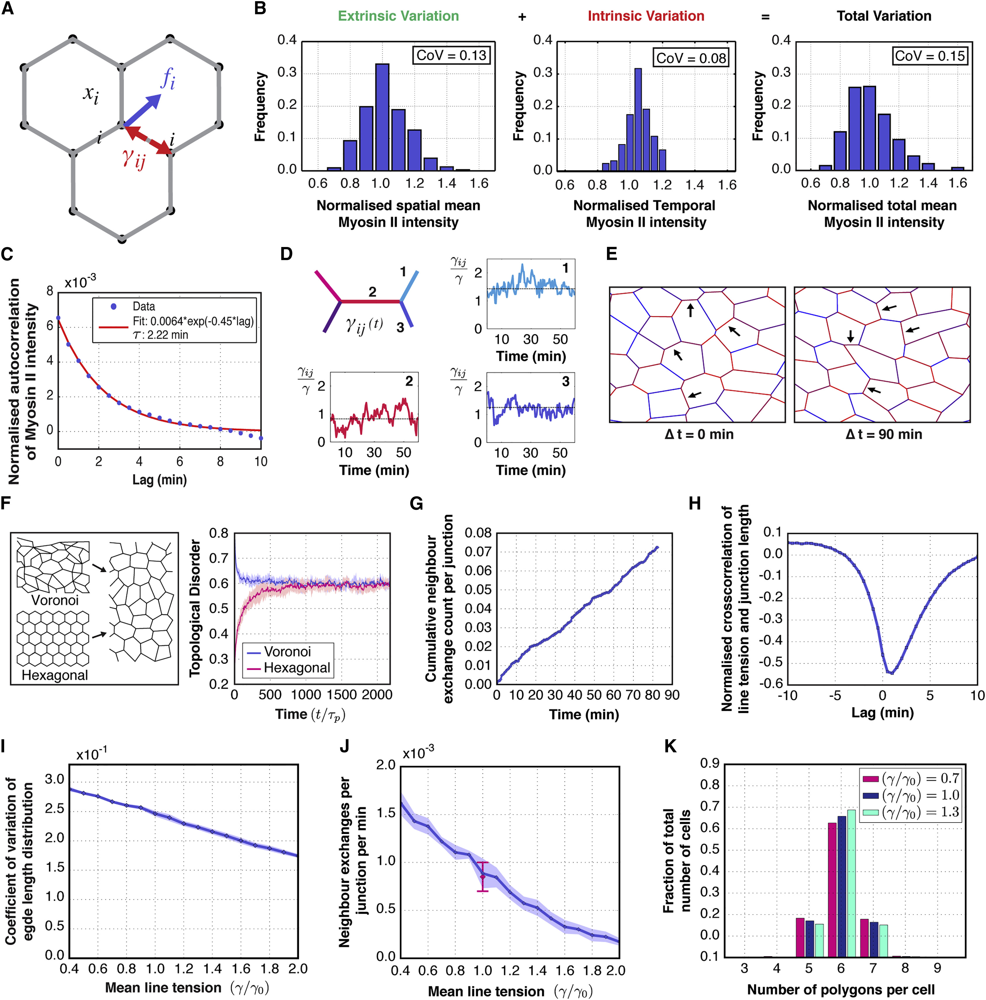
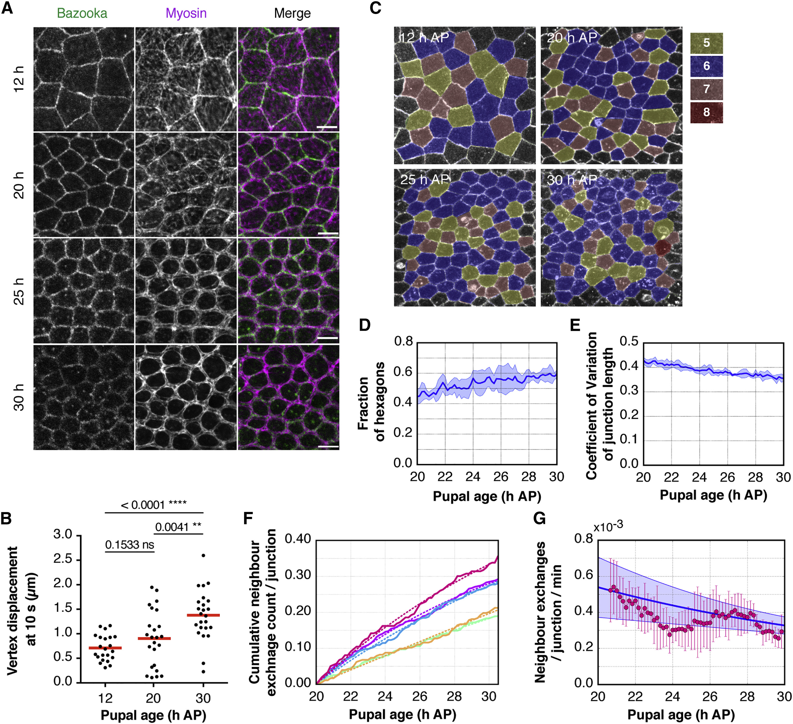
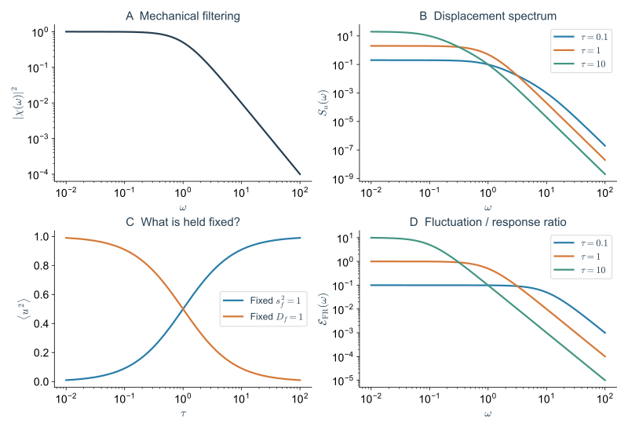
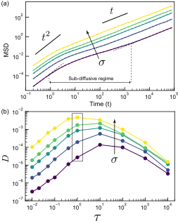
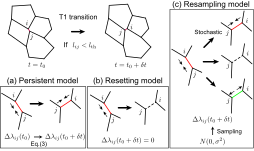
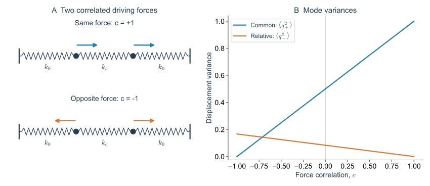
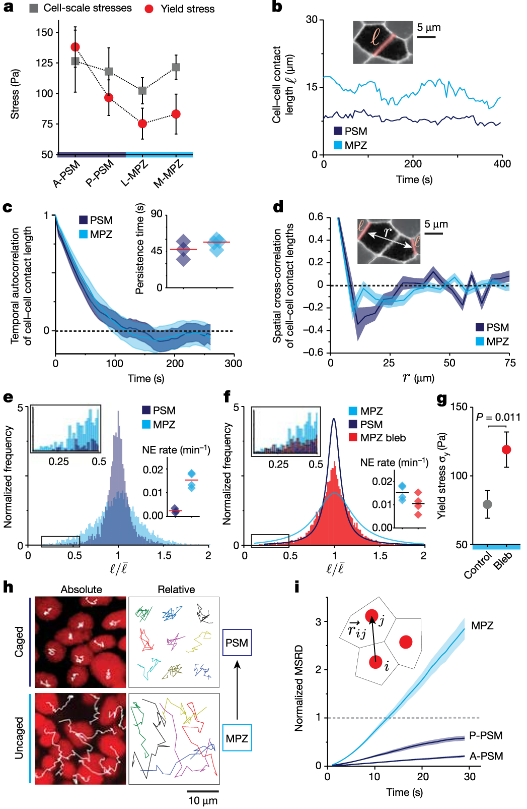
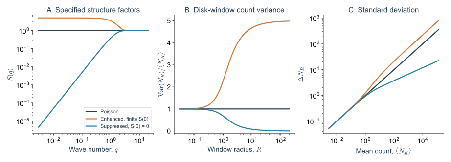

> **Part VI · Note 09**　[专题目录](/notes/vertex_model/) · 上一篇：[主动软物质的堆积与拓扑](/notes/vertex_model/active_packing/)

**物理问题：** 平均受力相同的两片组织，为什么一片只是轻轻起伏，另一片却不断换邻居？一次收缩持续多久、周围细胞是否跟着动，怎样影响最后留下的形变？

## 1. 涨落是哪些量在变化 {#main-lecture}

显微镜下，一条细胞交界可能忽长忽短，肌球蛋白的亮度也在变化。把许多时刻叠在一起看，平均图像可以很稳定，但每一条交界都在活动。**涨落**就是这些量偏离所选平均值的部分；它可以是材料本身的物理过程，也可能混有测量误差。

涨落的来源并不相同。胶体受到周围分子的热碰撞；细胞消耗能量，让皮层收缩、黏附更新和牵引不断变化；细胞分裂又会带来离散而明显的扰动。实验上都能看到“动来动去”，模型却需要说明究竟哪个变量在变。

| 观测量 | 起伏可能反映什么 | 还需要什么信息 |
| --- | --- | --- |
| 交界长度 $\ell_e(t)$ | 张力变化和周围网络共同作用下的形变 | 周围几何、机械响应及追踪误差 |
| 肌球蛋白荧光 $I_e(t)$ | 标记蛋白的局部数量或分布变化 | 标记方式、背景和力学标定 |
| 液滴局部曲率 | 周围细胞施加的应力变化 | 滴面张力及探针的响应时间 |
| 细胞速度 $\mathbf v_i(t)$ | 推进、组织流动与邻居约束的综合结果 | 整体运动、相对运动和接触更新 |

同一条边的时间变化，与不同边之间的差别也要分开。写成

$$
x_e(t)=m_e+\delta x_e(t),\qquad
\langle\delta x_e\rangle_t=0,
$$

$m_e$ 是第 $e$ 条边在所选时间窗口里的平均值。一个时刻看到的空间分布较宽，可能是某些边一直较强、某些边一直较弱，也可能是每条边都在大幅波动。对同样的边和等权时间采样，全方差公式给出

$$
\operatorname{Var}_{e,t}(x)
=\operatorname{Var}_e(m_e)
+\left\langle\operatorname{Var}_t(x_e)\right\rangle_e.
$$

第一项是边与边之间的平均差别，第二项是每条边自身的时间涨落。有限时间下，估计的 $m_e$ 本身仍有误差；一条边在观察期内几乎没变，也可能只是变化比拍摄时间更慢。

### 1.1 平均值、方差和稀有事件

对同一个量，平均值 $\bar x$ 描述它通常处在什么水平，方差 $s_x^2=\langle(x-\bar x)^2\rangle$ 描述起伏幅度。变异系数 $\mathrm{CV}=s_x/|\bar x|$ 还会受到分母影响：平均值升高、绝对起伏不变时，CV 也会下降。

方差只保留分布的一部分信息。两种随机驱动可以有相同方差，却有不同的大脉冲概率；若一次重排需要超过阈值，分布尾部就可能比日常小起伏更重要。因此，把组织的活动压缩成一个标准差，会丢掉与重塑直接有关的信息。

## 2. 相关函数：一次起伏能记住多久，传到多远 {#correlation-functions}

### 2.1 时间自相关

先考虑统计性质在所选窗口里近似稳定的过程。定义

$$
C_x(\Delta t)=\langle\delta x(t+\Delta t)\delta x(t)\rangle,
\qquad
c_x(\Delta t)=\frac{C_x(\Delta t)}{C_x(0)}.
$$

$C_x(0)=s_x^2$ 是方差。$c_x$ 去掉幅度，比较不同时间相隔的起伏是否还保持同号。若一条交界在此刻比平时短，过一会儿还倾向于偏短，自相关就为正；若常常在收缩后反弹，则可能出现负相关。

最简单的指数形式为 $C_x(\Delta t)=s_x^2e^{-|\Delta t|/\tau}$。此时相关时间为 $\tau$，半衰时间为 $\tau\ln2$，两者并不相同。对更一般的曲线，可以定义积分相关时间

$$
\tau_{\rm int}=\int_0^\infty c_x(t)\,dt.
$$

多个过程叠加、振荡和反弹都会改变这个积分。若相关曲线有明显正负交替，一个积分值不足以概括完整运动，应保留曲线或频谱。

*图 1 · 幅度相同，时间结构仍可以不同。* A 是零均值 OU 过程的数值样本，设方差为 1、$\tau=0.2,2$，使用精确离散更新和固定随机种子 20261020；样本不是实验轨迹。B、C 直接计算 $C(t)=e^{-|t|/\tau}$ 和 $S(\omega)=2\tau/(1+\omega^2\tau^2)$。有限样本的方差不必恰好等于设定的稳态方差。

### 2.2 空间相关与互相关

两条交界之间可以定义

$$
C_\ell(r,\Delta t)=
\left\langle
\delta\ell_e(t)\delta\ell_{e'}(t+\Delta t)
\right\rangle_{|\mathbf R_e-\mathbf R_{e'}|\simeq r},
$$

其中 $\mathbf R_e$ 表示交界中点。$r$ 很小时两条边是否一起缩短？这种联系能延伸几层细胞？沿组织前后轴和横向是否相同？这些是空间相关的问题。若方向性很强，只按距离平均可能把它抹掉，需要保留方向或分别计算纵向和横向相关。

还可以比较两个不同变量，例如

$$
C_{I\ell}(\Delta t)=
\frac{\langle\delta I(t)\delta\ell(t+\Delta t)\rangle}
{s_I s_\ell}.
$$

按这个约定，正的 $\Delta t$ 比较“现在的肌球蛋白”与“稍后的边长”。若负相关最强的位置在正时间差，意味着蛋白信号的增加往往先于交界缩短。时间先后缩小了机制的可能范围，但共同上游信号、机械反馈和成像延迟仍可能影响结果，因果关系还需干预检验。

### 2.3 功率谱把不同时间尺度分开

采用双边频谱约定，

$$
S_x(\omega)=\int_{-\infty}^{\infty}
C_x(t)e^{i\omega t}\,dt,
\qquad
C_x(0)=\int_{-\infty}^{\infty}\frac{d\omega}{2\pi}S_x(\omega).
$$

低频对应慢变化，高频对应快变化。相同总方差可以分配在不同频率上；组织能否跟上这些变化，还取决于它自身的恢复时间。下面会用一根受随机力推动的弹簧，把驱动的频谱与材料的响应接起来。

## 3. 果蝇背板：局部涨落怎样参与排列变化 {#fly-notum-fluctuations}

果蝇蛹的**背板上皮（notum）**形成胸部背侧表面。[Curran 等（2017）](https://doi.org/10.1016/j.devcel.2017.09.018)追踪其中的交界和肌球蛋白：在他们分析的早期窗口，组织没有明显的整体伸长，细胞仍会换邻居。这与胚带延长中有方向的重排形成比较，说明局部交换并不总会累积成同一方向的组织形变。

*图 2 · 同时测量驱动相关信号和几何响应。* 引自 [Curran 等（2017），Fig. 4](https://pmc.ncbi.nlm.nih.gov/articles/PMC5703647/#fig4)，CC BY，原图未修改。D 并列蛋白信号与边长轨迹，E 使用带时间差的互相关，F 显示一次交换附近的成像。荧光强度是蛋白信号，不能直接按比例读成张力。

#### 论文视频 · 果蝇背板中一次邻居交换

<figure class="vertex-video" id="video-curran-neighbour-exchange" style="--vertex-video-width: 640px">
<video controls preload="metadata" playsinline width="636" height="636" aria-label="果蝇背板：交界起伏与邻居交换" src="https://ars.els-cdn.com/content/image/1-s2.0-S1534580717307712-mmc4.mp4">
<a href="https://ars.els-cdn.com/content/image/1-s2.0-S1534580717307712-mmc4.mp4">直接打开原始视频</a>。
</video>
<figcaption><strong>显微视频</strong>｜Curran 等（2017），Movie S2。DE-cadherin–GFP 标记细胞交界；黄色箭头依次标出消失的交界、四细胞交汇和新生交界。原图例覆盖约 12–13.5 h APF，采样间隔 30 s，标尺 10 μm。视频未修改，权利与许可见原文。<a href="https://pmc.ncbi.nlm.nih.gov/articles/PMC5703647/#mmc4" target="_blank" rel="noopener">原文与完整视频说明</a> · <a href="https://ars.els-cdn.com/content/image/1-s2.0-S1534580717307712-mmc4.mp4" target="_blank" rel="noopener">直接打开原始视频</a>。</figcaption>
</figure>

视频放大了一个四细胞区域，周边也有接触变化。持续追踪黄色箭头标出的交界，可以看见长度变化何时真正改变了邻接关系；画面只标记细胞边界，没有直接显示肌球蛋白或力。播放器的秒数对应压缩后的播放时间，APF 表示化蛹后的发育小时数。

实验中的长短变化与邻居交换，需要逐帧配对：交界缩短后重新伸长，仍可能回到原来的邻居；只有识别了失去和新生的接触，才能确认拓扑改变。发生交换的交界也可能随后换回，因而事件总数和留下的结构变化需要分别统计。

*图 3 · 一张静态分布不能替代时间序列。* 引自 [Curran 等（2017），Fig. 5](https://pmc.ncbi.nlm.nih.gov/articles/PMC5703647/#fig5)，CC BY，原图未修改。B 区分不同交界的时间平均、单条交界的时间变化和瞬时空间分布；C 测量时间相关，D–J 将这些统计与随机张力模型、排列和交换联系起来。相关函数的归一化以原文图例为准，不能将所有纵轴都当成本文的 $c_x(0)=1$。

这类比较给出的是一组约束：模型既要描述几何起伏，也要描述事件和排列。只匹配边长直方图，仍可能遗漏起伏持续多久、哪条边先变，以及交换是否可逆。

*图 4 · 发育中的平均受力和局部变化需要一起看。* 引自 [Curran 等（2017），Fig. 6](https://pmc.ncbi.nlm.nih.gov/articles/PMC5703647/#fig6)，CC BY，原图未修改。A、B 结合蛋白定位与切割响应，C、D 显示排列，E–G 统计边长变化和交换；激光回缩还受耗散和周围约束影响。

原研究观察到，发育中的交界肌球蛋白增加伴随交换减慢与排列变整齐。这里同时涉及平均水平及其差异，不能用“肌球蛋白越多，随机推动就越强”概括。更一般地，平均张力改变机械背景，涨落再围绕这个背景驱动形变，两者需要分别进入模型。

## 4. 随机驱动怎样经过材料的响应 {#fluctuations-and-response}

### 4.1 先把噪声作用的变量写清楚

在 Vertex 能量中加入交界线能，

$$
E(\mathbf r,t)=E_0(\mathbf r)+
\sum_e[\bar\lambda_e+\delta\lambda_e(t)]\ell_e(\mathbf r).
$$

这里的 $\bar\lambda_e$ 是额外线能的平均系数，$\delta\lambda_e$ 是其涨落。它们要与 $E_0$ 内已经包含的面积、周长作用一起求力，不能把每一项都重复解释为独立的实验张力。

一个常用的时间模型是 Ornstein–Uhlenbeck（OU）过程：

$$
\frac{d\delta\lambda_e}{dt}
=-\frac{\delta\lambda_e}{\tau_\lambda}
+\sqrt{\frac{2s_\lambda^2}{\tau_\lambda}}\eta_e(t),
\qquad
\langle\eta_e(t)\eta_{e'}(t')\rangle
=\delta_{ee'}\delta(t-t').
$$

第一项让偏离逐渐恢复，第二项不断产生随机输入。稳态有

$$
\langle\delta\lambda_e(t)\delta\lambda_{e'}(0)\rangle
=\delta_{ee'}s_\lambda^2e^{-|t|/\tau_\lambda}.
$$

白噪声是输入 $\eta$ 的性质，张力本身具有有限记忆。这一写法还假设不同交界的输入独立；需要空间协同时，可以将 $\delta_{ee'}$ 换成合适的正半定相关矩阵。高斯过程允许任意正负值，若模型要求总张力非负，就需要说明如何截断或修改动力学；修改后不应继续默认所有高斯公式原样成立。

### 4.2 材料会过滤驱动的频率

在固定接触、稳定构型附近，取一个正刚度模态，

$$
\Gamma\dot u=-ku+f(t)+h(t).
$$

$k\gt0$ 是刚度，$\Gamma$ 是阻力；$f$ 是自发随机驱动，$h$ 是额外施加、用于测响应的小力。取时间变化为 $e^{-i\omega t}$，响应函数为

$$
\chi(\omega)=\frac{1}{k-i\Gamma\omega},
\qquad
S_u(\omega)=|\chi(\omega)|^2S_f(\omega).
$$

随机力变化很快时，位移来不及跟随；变化足够慢时，位移接近当前力下的静态值 $f/k$。因此，位移的相关时间与输入力的相关时间可以不同。观察到边长变化慢，既可能是驱动慢，也可能是材料恢复慢。

若 $C_f(t)=s_f^2e^{-|t|/\tau}$，则

$$
S_f(\omega)=\frac{2s_f^2\tau}{1+\omega^2\tau^2},
\qquad
\langle u^2\rangle
=\frac{s_f^2}{k(k+\Gamma/\tau)}.
$$

这个方差与 [05 的单模态计算](/notes/vertex_model/rheology_activity/)及 [08 的软模态](/notes/vertex_model/active_packing/#active-jamming)相接。这里进一步看到：同一个输出谱由驱动谱和材料响应相乘得到，仅测 $S_u$ 通常不能唯一分离两者。

### 4.3 固定瞬时方差，还是固定积分强度

保持 $s_f^2$ 固定而增大 $\tau$，力在同一方向维持更久，线性模态的方差增大并趋于 $s_f^2/k^2$。但若保持的是 $D_f=s_f^2\tau$，有

$$
\langle u^2\rangle
=\frac{D_f}{k(k\tau+\Gamma)}.
$$

此时增大 $\tau$ 会降低瞬时方差，位移方差反而下降。两句话描述不同的控制实验，没有矛盾。“相关时间变长”必须连同保持不变的量一起说明。

*图 5 · 看见相同的位移，未必有相同的驱动力。* 各面板直接计算本节线性方程，取 $k=\Gamma=1$。A 绘制响应增益；B 比较 $s_f^2=1$、$\tau=0.1,1,10$ 的位移谱；C 分别固定 $s_f^2=1$ 与 $D_f=1$；D 绘制 $\omega S_u/(2\,\operatorname{Im}\chi)$。这些曲线不包含接触更新或组织流体化。

### 4.4 自发涨落什么时候能推出材料响应

对与温度 $T$ 的热浴达到平衡的线性模态，涨落耗散关系要求热随机力满足

$$
\langle f_{\rm th}(t)f_{\rm th}(t')\rangle
=2\Gamma k_BT\,\delta(t-t'),
\qquad
S_u(\omega)=\frac{2k_BT}{\omega}\operatorname{Im}\chi(\omega).
$$

这里随机推动的强度和阻力通过同一温度相连。对于前面的主动 OU 力，可以用相同的比值定义一个频率相关的能量尺度，

$$
\mathcal E_{\rm FR}(\omega)
\equiv\frac{\omega S_u(\omega)}
{2\,\operatorname{Im}\chi(\omega)}
=\frac{s_f^2\tau}{\Gamma(1+\omega^2\tau^2)}.
$$

它随频率变化，通常无法用一个温度概括。若另有匹配的热噪声，上式右侧再加 $k_BT$。只有在适当的白噪声极限、控制 $s_f^2\tau$ 且噪声与耗散匹配时，才出现与平衡弹簧一致的形式。

对真实组织，参考状态、漂移、各模态的驱动和耗散可能不同。因此，从自发边长或应力的相关函数直接计算剪切模量，需要额外验证。测量一个已标定小扰动引起的平均增量，仍是区分“驱动变了”和“材料变了”的重要办法。

## 5. 从局部起伏到重排：持续越久不一定流得越快 {#nonmonotonic-fluidization}

前面的弹簧一直留在同一个势阱内。组织重塑则可能需要交界缩到很短、接触消失、新接触伸长，最终进入另一个构型。弹簧方差变大，只表明局部探索范围变大，尚未算出跨越整个重排路径的概率。

*图 6 · 局部持续推动与长期重排速度可以有不同趋势。* 引自 [Yamamoto 等（2022），Fig. 3 的作者稿版本](https://arxiv.org/html/2008.13007v2#S2.F3)，对应 [Soft Matter 18, 2168–2175](https://doi.org/10.1039/D0SM01559H)，原图未修改。A 比较不同涨落幅度的 MSD，B 比较固定幅度下扩散系数与持续时间；符号 $\sigma,\tau$ 及其无量纲化沿用原文。

[Yamamoto 等（2022）](https://doi.org/10.1039/D0SM01559H)在汇合 Vertex 模型中发现：固定张力涨落幅度，增加持续时间时，长期细胞扩散先增加、随后下降。时间很长时，张力网络变化缓慢，体系可以在较长区间里接近当前受力下的平衡，新的重排要等待驱动网络进一步更新。

一个忽略网络反馈的计算能说明短持续时间的一侧。令局部边长变化满足 $\dot\ell=-m_\ell\delta\lambda(t)$，其中 $m_\ell$ 是该简化的迁移率。对 OU 张力积分，

$$
\left\langle[\ell(t)-\ell(0)]^2\right\rangle
=2m_\ell^2s_\lambda^2
\left[\tau_\lambda t-\tau_\lambda^2
(1-e^{-t/\tau_\lambda})\right].
$$

长时间下对应的长度扩散尺度为 $D_\ell=m_\ell^2s_\lambda^2\tau_\lambda$。它只计算没有边界、恢复力和接触更新的长度变量；真实交界不能无限增长或穿过零长度，细胞扩散系数也不等于 $D_\ell$。持续时间很长时，完整网络的力平衡与事件规则会进入，因而不能把这个单调公式外推到整条相图。

*图 7 · 拓扑改变时，随机变量也需要更新规则。* 引自 [Yamamoto 等（2022），Fig. 1 的作者稿版本](https://arxiv.org/html/2008.13007v2#S2.F1)，原图未修改。三种规则分别保留旧涨落值、重置为零、从稳态分布重新抽取。图中的正负数表示额外张力项相对平均值的偏离。

这涉及一个直接的物理选择：新接触是否继承旧接触的分子状态或张力记忆？即便在拓扑不变时使用相同的 OU 方程，换接时的更新也会改变后续运动。模拟中观察到的持续时间效应，应连同这些规则和所用流动判据一起报告。

## 6. 空间协同：一起移动，还是互相挤压 {#spatially-correlated-forces}

相同大小的推力，作用方向不同，后果可以很不一样。两个细胞一起向右移动，彼此距离可能几乎不变；若一个向左、另一个向右，相对位置就会改变。局部驱动的空间相关，决定它更容易进入整体位移，还是进入内部形变。

### 6.1 两个自由度就能算清的例子

令两个位移 $u_1,u_2$ 各自受到回复刚度 $k_0$，彼此再通过刚度 $k_c$ 耦合：

$$
\Gamma\dot u_1=-k_0u_1-k_c(u_1-u_2)+f_1,
\qquad
\Gamma\dot u_2=-k_0u_2-k_c(u_2-u_1)+f_2.
$$

$k_0$ 表示周围材料提供的约束，避免共同平移无限扩散。假定两个力具有相同的方差和持续时间，交叉相关为

$$
\langle f_i(t)f_j(0)\rangle
=s_f^2e^{-|t|/\tau}
\begin{cases}1,&i=j,\\ c,&i\ne j,\end{cases}
\qquad -1\leq c\leq1.
$$

定义共同和相对模态 $q_\pm=(u_1\pm u_2)/\sqrt2$。它们的刚度分别为 $k_+=k_0$、$k_-=k_0+2k_c$，驱动力方差分别为 $s_f^2(1+c)$ 和 $s_f^2(1-c)$。套用前面的单模态结果，

$$
\langle q_\pm^2\rangle
=\frac{s_f^2(1\pm c)}
{k_\pm(k_\pm+\Gamma/\tau)}.
$$

正相关增强共同运动、压低相对运动，负相关则相反。每个单独驱动力的方差都没改，两个模态的刚度也没改，变化完全来自力的相关方式。因此，看见位移更整齐，不能据此断定材料变软；看见单细胞运动更大，也不保证接触更容易被打开。

*图 8 · 驱动相关性改变的是哪些运动被推动。* A 示意同向与反向推力，B 精确计算上述两模态方差，取 $k_0=k_c=\Gamma=\tau=s_f^2=1$。图中回复弹簧与两个自由度构成一个线性算例，不表示已模拟真实细胞边界或 T1。

### 6.2 组织中的力谱与软模态

对稳定接触网络，线性方程写成 $\Gamma\dot{\mathbf u}=-H\mathbf u+\mathbf f$。若各自由度阻力相同，投影到归一化 Hessian 模态 $\mathbf e_\alpha$，对应的驱动力频谱是

$$
S^f_{\alpha\beta}(\omega)
=\mathbf e_\alpha^{\mathsf T}
S^f(\omega)\mathbf e_\beta,
\qquad
S^u_{\alpha\beta}(\omega)
=\chi_\alpha(\omega)
S^f_{\alpha\beta}(\omega)
\chi_\beta^*(\omega).
$$

因此，组织中哪一片区域协同运动，取决于驱动在模式上的投影及其恢复时间。某个空间相关长度增大，可以来自更协调的驱动，也可以来自接近失稳的机械响应；两者同时变化也很常见。存在非均匀摩擦时，应保留完整的阻力矩阵，不能默认能量模态已经让动力学完全独立。

## 7. 斑马鱼：把起伏、接触更新和材料响应配在一起 {#zebrafish-fluctuations}

斑马鱼尾端的中胚层祖细胞区 MPZ 持续向前方的体节前中胚层 PSM 供给细胞。这里既有身体延长的整体运动，也有局部接触变化；两者要在相同的发育阶段、空间区域和时间尺度上比较。

*图 9 · 起伏幅度、相关时间和接触更新是不同观测。* 引自 [Mongera 等（2018），Fig. 3](https://www.nature.com/articles/s41586-018-0479-2/figures/3)，原图未修改。B 是边长轨迹，C、D 分别分析时间与空间相关，E–G 比较接触分布、交换和肌球蛋白干预，H、I 使用相对运动。MPZ 和 PSM 的位置定义见 [05](/notes/vertex_model/rheology_activity/)。

这组实验将交界起伏与重排、液滴力学测量放在一起。其意义在于，单独看“细胞动得快不快”会混合整体运动、局部扰动与材料约束；配对接触更新和受控探针以后，才有更多信息判断局部活动是否帮助组织重塑。[原文](https://doi.org/10.1038/s41586-018-0479-2)

### 7.1 分布的尾部怎样接到一次重排

对每条交界先除以自己的平均长度，可以比较相对起伏。但将所有边的数值合并，得到的只是取样到的长度分布；边消失后的处理、短边的识别下限和长寿命接触的筛选，都会影响接近零长度的一端。

有时会用 $-\ln P(\ell)$ 画一个“势能地形”。只有在平衡、合适的集体坐标和采样条件下，它才与以热能为单位的平均力势相连。在主动组织里，它首先是概率分布的另一种表示。若几乎没采到接近重排的构型，就不能仅凭势阱底部附近的分布推出完整势垒高度。

### 7.2 重排维持多久，决定晚期应力能否继续释放

*图 10 · 早期形变后的重排，与持续涨落维持的重排。* 引自 [Kim 等（2021），Fig. 4](https://pmc.ncbi.nlm.nih.gov/articles/PMC8336761/#F4)，原图未修改。A、B 将应力和邻居交换配对，C 区分两类重排，D、E 改变驱动与界面条件。图中采用有限形变和原文定义的松弛判据，不能直接将其全部解释为小应变线性模量。

[Kim 等（2021）](https://doi.org/10.1038/s41567-021-01215-1)的模型与斑马鱼实验比较强调了持续接触更新的作用：初始形变触发的一批事件结束以后，主动过程仍能维持后续重排，释放更慢的应力。对应的模型动画和实验加载见 [05 的主动泡沫部分](/notes/vertex_model/rheology_activity/#video-kim-active-relaxation)。

在主动背景上定义响应，可以比较施加小形变后与未施加形变时的平均差：

$$
G_{\rm resp}(t)=
\lim_{\gamma_0\to0}
\frac{\langle\sigma(t)\rangle_{\gamma_0}
-\langle\sigma(t)\rangle_0}{\gamma_0}.
$$

未扰动组的应力自相关 $C_\sigma(t)$ 仍需另测。若驱动本来就在变化，把两组平均增量与自发背景分开，才能判断晚期剩下的是材料响应还是主动起伏。发育很快时，也不能随意将早期和晚期片段当作同一个稳态的重复样本。

## 8. 密度涨落：局部热闹与大尺度不均匀 {#density-fluctuations}

前面关心“一条边在变什么”，现在换成“一个区域里有多少个单元”。在大小固定的观察窗中数颗粒或细胞中心，记为 $N_R$。移动观察窗，或在近似稳态中取不同时间，可以测量均值 $\langle N_R\rangle$ 和方差 $\operatorname{Var}N_R$。

对独立均匀的 Poisson 点分布，

$$
\operatorname{Var}N_R=\langle N_R\rangle,
\qquad
\Delta N_R=\sqrt{\langle N_R\rangle}.
$$

这是比较的参照。更一般地，若大窗口下 $\Delta N_R\sim\langle N_R\rangle^\alpha$，$\alpha\gt1/2$ 表示相对这个参照更快增长的数目涨落。只有一个窗口里的标准差很大，还不能确定指数，也不能排除空间密度梯度或相分离界面在移动。

### 8.1 结构因子怎样记录长波涨落

对均匀体系，令

$$
\rho_{\mathbf q}=\sum_{j=1}^N e^{-i\mathbf q\cdot\mathbf r_j},
\qquad
S(\mathbf q)=\frac1N
\left\langle|\rho_{\mathbf q}-\langle\rho_{\mathbf q}\rangle|^2\right\rangle.
$$

小波数 $q$ 对应大空间尺度。$S(q)$ 描述这个尺度的密度起伏有多强；它与 [08 的六重键取向相关](/notes/vertex_model/active_packing/#hexatic-order)测的是不同的量。位置数密度不均匀，与六角排列是否朝着同一方向，不能互相替代。

若观察窗的指示函数为 $w_R(\mathbf r)$，则 $N_R=\int w_R(\mathbf r)\rho(\mathbf r)d^dr$。把密度协方差代入，可得

$$
\boxed{\operatorname{Var}N_R
=\rho_0\int\frac{d^dq}{(2\pi)^d}
S(\mathbf q)|\widetilde w_R(\mathbf q)|^2.}
$$

窗口越大，傅里叶权重越集中在小 $q$。这使“不同大小窗口中的计数”与“结构因子的低波数部分”成为同一个问题的两种表述。该式要求统计均匀，并保留粒子自身贡献，相关背景见 [Torquato 与 Stillinger（2003）](https://doi.org/10.1103/PhysRevE.68.041113)。

在没有额外大尺度截断、$0\lt\beta\lt d$ 的标度区间，若 $S(q)\sim q^{-\beta}$，规则窗口的变量代换给出

$$
\operatorname{Var}N_R\sim R^{d+\beta},
\qquad
\Delta N_R\sim
\langle N_R\rangle^{\,1/2+\beta/(2d)}.
$$

这是长波增强如何进入计数指数的一个推导。边界、有限体系和边际指数需要分别处理，不能只在两三个窗口上拟合一条直线就宣称得到了渐近标度。

### 8.2 巨数目涨落与超均匀是两种相反的长波行为

活动向列材料中，弯曲的取向场可以产生粒子流；取向的长波起伏于是进入密度动力学。[Ramaswamy、Simha 与 Toner（2003）](https://doi.org/10.1209/epl/i2003-00346-7)建立了这一机制的连续理论。[Narayan 等（2007）](https://doi.org/10.1126/science.1140414)在受振动的棒状颗粒向列层中测量了巨数目涨落；这里的驱动来自外部振动，单元并非细胞。

一个体现耦合方式的守恒方程为

$$
J_i=-D_\rho\partial_i\delta\rho
+a\,\partial_jQ_{ij}+\Lambda_i,
\qquad
\partial_t\delta\rho=-\partial_iJ_i.
$$

第一项抹平密度差，第二项让取向畸变驱动粒子流，$\boldsymbol\Lambda$ 是随机流。其散度保证粒子数守恒。接近沿 $x$ 方向排列的向列态时，$Q_{xy}\simeq S\theta$，所以小角度起伏通过 $\partial_x\partial_y\theta$ 进入密度变化。实际低波数强度还要联立取向动力学求出，并受非线性、缺陷和边界影响。

另一种情况是长波涨落被压低，即 $S(q\to0)\to0$，称为**超均匀（hyperuniform）**。它是一种跨尺度的密度统计性质，并不要求局部排列是晶体，也不能单凭它判定材料具有剪切刚性。相反，低波数增强也不是所有主动系统必然具有的性质。

*图 11 · 涨落较大与增长指数异常，需要分别判断。* A 指定 $S(q)=1$、$1+4e^{-q^2/2}$ 和 $1-e^{-q^2/2}$；B、C 按二维圆窗的重叠面积积分计算对应方差，取 $\rho_0=1$、相关长度为 1。增强曲线在大窗下仍保持正常的体积标度，只提高系数；抑制曲线则趋向边界标度。这里未生成实际颗粒堆积，也未拟合实验数据。

对有限且总粒子数固定的样本，包含整个体系的窗口必然没有数目涨落，$q=0$ 模态也被约束。这与热力学极限中的 $q\to0$ 不同。判断超均匀需要用远小于体系、又足以覆盖局部结构的大窗口，检查尺寸效应。

完全汇合的细胞层还有一个容易混淆的地方：它的实际面积占据率恒为 1，但每个窗口里的细胞中心数仍可因细胞面积不同而变化。细胞中心数密度、面积加权密度和细胞外孔隙不是同一个观测量；分裂、挤出和进出观察面的细胞还会改变数目守恒的条件。

## 9. 动态异质性：平均运动相同，重塑可以集中在不同地方 {#dynamic-heterogeneity}

假设两片组织有相同的 MSD。第一片中，每个细胞都以相近幅度移动；第二片中，大多数细胞被困住，只有少数区域发生大幅重排。平均位移平方相同，并不表示重塑在空间中同样分布。

选一个位移阈值 $a_*$，定义在间隔 $t$ 内仍留在附近的指标

$$
c_i(t_0,t)=
\Theta\!\left(a_*-|\Delta\mathbf r_i(t_0,t)|\right),
\qquad
Q(t_0,t)=\frac1N\sum_i c_i(t_0,t).
$$

$Q$ 是留在原位置附近的细胞比例。对不同起始时刻或重复样本计算其方差，

$$
\chi_4(t)=N\left[
\langle Q(t_0,t)^2\rangle-\langle Q(t_0,t)\rangle^2
\right]
=\frac1N\sum_{ij}
\operatorname{Cov}(c_i,c_j).
$$

最后一式说明为什么它能感受协同：若每个细胞独立决定是否离开，交叉项很小；若一群细胞同时离开或同时留下，交叉项会增加。在一个分成相互独立、每块含 $m$ 个细胞的理想块模型中，若每块以概率 $p$ 一起留下，便有 $\chi_4=mp(1-p)$。这只是解释量的意义，真实相关区未必是大小一致的块。

测量前需要处理整体漂移，并明确是否减去了局部邻居的平均运动。二维系统中的长波弹性位移也能产生大范围相关，因此 $\chi_4$ 不能独自证明发生了不可逆塑性；还要与接触更新、局部应变或卸载后的残余形变配对。

### 9.1 事件频繁与永久更新

同一条交界反复缩短、恢复，或者四个细胞换邻居后很快换回，都能增加事件计数，却不一定有效释放长期应力。接触存活率、事件反向率、重排方向和残余形变提供不同信息。

若外部应力或细胞极性选择了方向，局部交换才可能形成净的形态变化。涨落参与系统探索和触发事件，方向偏置与结构记忆影响哪些事件能够保留；这些过程可以由不同生物机制调节。

## 10. 从成像回到物理模型 {#measuring-fluctuations}

### 10.1 观察到的方差里有什么

设记录的坐标或边长为 $x_{\rm obs}=x_{\rm phys}+\epsilon$。在误差独立于物理信号、均值已校正时，

$$
C_{\rm obs}(t)=C_{\rm phys}(t)+C_\epsilon(t).
$$

若逐帧误差近似独立，它主要增加零时间差的方差。用带噪声的 $C_{\rm obs}(0)$ 归一化，会使其余相关看上去下降得更快。另一方面，曝光时间会把快速变化平均掉，使测得的方差降低。误差和时间平均可能朝相反方向影响结果。

图像分割错误也不总是独立噪声：共享一个顶点的两条边，会共享部分定位误差，从而产生人为的空间相关。对短边、近圆形细胞的方向和面外运动，最好直接检查原始图像与跟踪结果。

### 10.2 多拍一帧，增加多少独立信息

对总时长 $T$ 的时间平均 $\bar x_T$，在稳态下

$$
\operatorname{Var}(\bar x_T)
=\frac{2}{T^2}\int_0^T(T-t)C_x(t)\,dt.
$$

当 $T$ 远大于相关时间，且积分收敛，有

$$
\operatorname{Var}(\bar x_T)\simeq
\frac{2s_x^2\tau_{\rm int}}{T}.
$$

因此，对均值估计而言，独立信息的数量大致随 $T/(2\tau_{\rm int})$ 增长。把拍摄间隔缩到远小于相关时间，可以帮助解析轨迹，却不会让每一帧都变成独立重复。许多条边来自同一个胚胎时，还共享发育状态和系统误差，实验间差异也需要保留。

### 10.3 模型需要同时解释哪些结果

| 模型中的选择 | 可比较的观测 | 为什么只看一个数不够 |
| --- | --- | --- |
| 平均张力、面积和周长参数 | 平均形状、受控响应、回缩 | 不同参数可产生相近形状 |
| 涨落幅度及分布 | 时间方差、分布尾部 | 同方差未必有相同稀有脉冲 |
| 持续时间与驱动频谱 | 自相关、互相关、位移谱 | 输出还经过材料响应过滤 |
| 交界之间的协同 | 空间相关、模态与相对运动 | 共同平移和内部形变不同 |
| 换接与张力继承 | T1 寿命、反向事件、接触存活 | 瞬时事件数不等于永久重塑 |
| 长期材料更新 | 应力松弛、蠕变、残余形变 | 起伏活跃不保证能释放剪切应力 |

同一套参数若能同时解释自发起伏、干预后的响应与接触重排，就比只拟合一种分布提供了更多机制约束。实验还可以改变一个候选驱动，再检查模型是否正确预测其他观测怎样变化；药物同时影响平均张力、黏附和耗散时，需要保留这些可能的共同变化。

## 技术附录：从两个稳态矩得到模态方差

对 $\Gamma\dot u=-ku+f$ 和 $\dot f=-f/\tau+\sqrt{2s_f^2/\tau}\eta$，稳态有 $\langle f^2\rangle=s_f^2$。由于 $u$ 没有独立白噪声项，

$$
0=\frac{d\langle uf\rangle}{dt}
=-\left(\frac{k}{\Gamma}+\frac1\tau\right)
\langle uf\rangle+\frac{s_f^2}{\Gamma},
$$

$$
0=\frac{d\langle u^2\rangle}{dt}
=-\frac{2k}{\Gamma}\langle u^2\rangle
+\frac{2}{\Gamma}\langle uf\rangle.
$$

先解第一式，再代入第二式，得到

$$
\langle uf\rangle=\frac{s_f^2}{k+\Gamma/\tau},
\qquad
\langle u^2\rangle=
\frac{s_f^2}{k(k+\Gamma/\tau)}.
$$

这个计算没有要求 $f$ 在所有高阶统计上都服从高斯分布；在线性系统中，给定相同的二点相关也会给出相同的二阶位移统计。但跨越非线性势垒时，更高阶统计可能改变首次到达和稀有事件，不能只靠这个方差判断重排率。

## 主要文献

- [Curran et al. (2017), Myosin II Controls Junction Fluctuations to Guide Epithelial Tissue Ordering](https://doi.org/10.1016/j.devcel.2017.09.018)。果蝇背板的交界、蛋白信号、涨落与排列变化。
- [Yamamoto et al. (2022), Non-monotonic fluidization generated by fluctuating edge tensions in confluent tissues](https://doi.org/10.1039/D0SM01559H)。涨落持续时间与长期重排的非单调关系。
- [Mongera et al. (2018), A fluid-to-solid jamming transition underlies vertebrate body axis elongation](https://doi.org/10.1038/s41586-018-0479-2)。斑马鱼尾部的应力、接触起伏、空间相关和相对运动。
- [Kim et al. (2021), Embryonic tissues as active foams](https://doi.org/10.1038/s41567-021-01215-1)。主动接触张力与组织的慢松弛。
- [Ramaswamy, Simha & Toner (2003), Active nematics on a substrate: giant number fluctuations and long-time tails](https://doi.org/10.1209/epl/i2003-00346-7)。活动向列取向与密度涨落的连续理论。
- [Narayan, Ramaswamy & Menon (2007), Long-lived giant number fluctuations in a swarming granular nematic](https://doi.org/10.1126/science.1140414)。受振动棒状颗粒中的数目涨落实验。
- [Torquato & Stillinger (2003), Local density fluctuations, hyperuniformity, and order metrics](https://doi.org/10.1103/PhysRevE.68.041113)。观察窗数目方差与结构因子的联系。
- [Bi et al. (2016), Motility-driven glass and jamming transitions in biological tissues](https://doi.org/10.1103/PhysRevX.6.021011)。主动细胞模型的笼困、位移分布和慢动力学，另见 [05](/notes/vertex_model/rheology_activity/)。

[← 主动软物质的堆积与拓扑](/notes/vertex_model/active_packing/) · [返回专题目录](/notes/vertex_model/)
