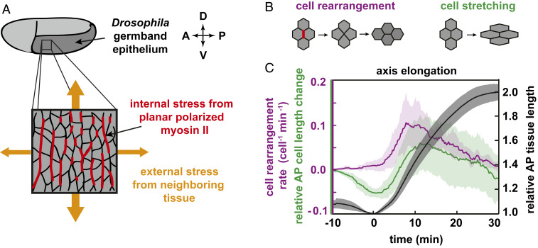
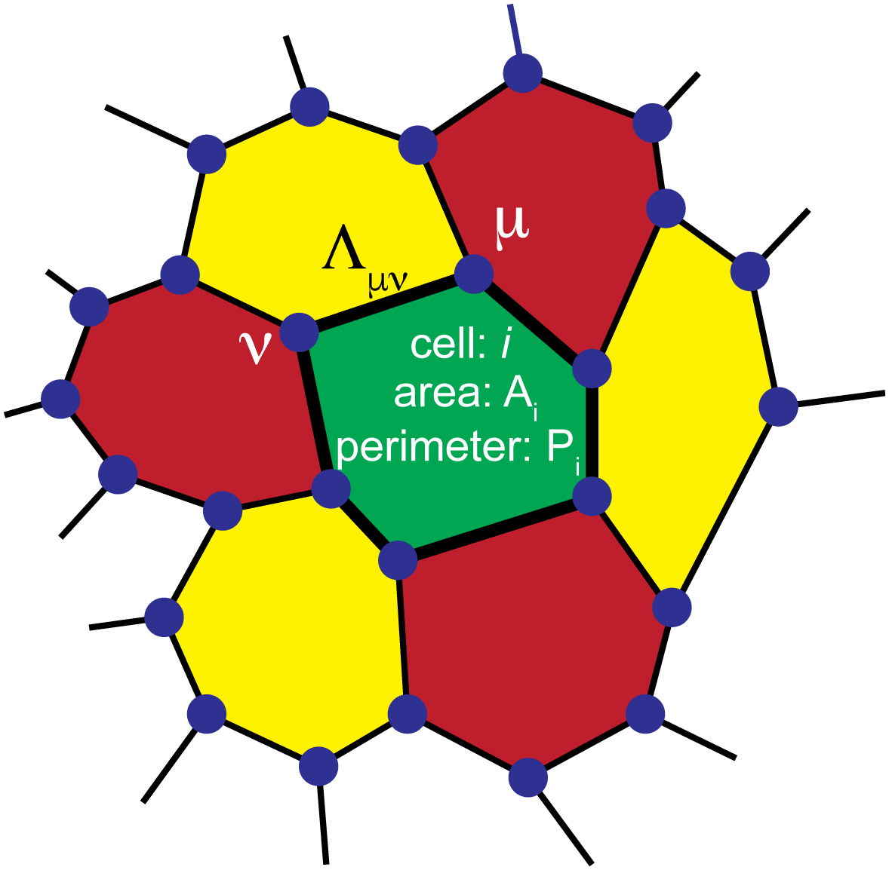
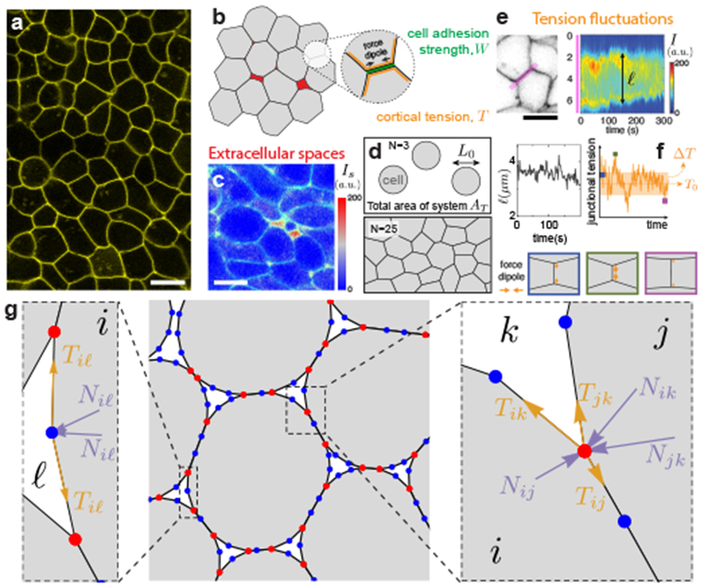
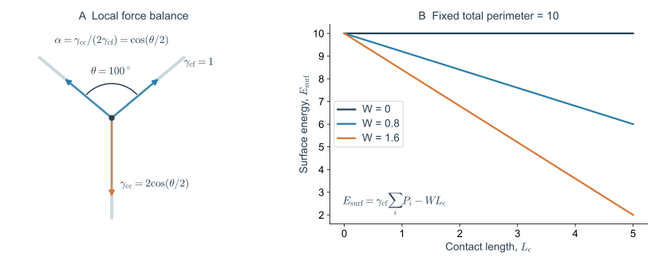
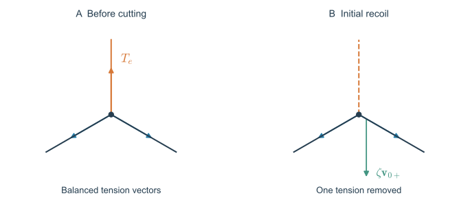
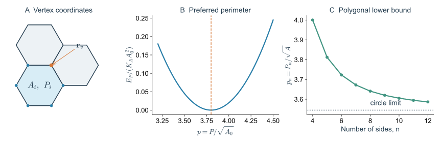
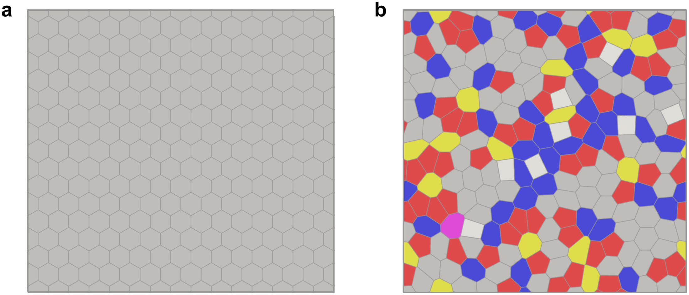
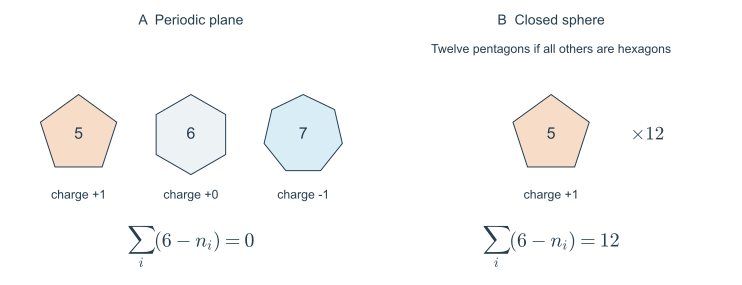

> **Part I · Note 01**　[专题目录](/notes/vertex_model/) · 下一篇：[线性响应与非仿射弹性](/notes/vertex_model/linear_response/)

**物理问题：** 只追踪细胞交界处的顶点，怎样描述一整片上皮的几何与受力？

## 概述：组织伸长时，细胞究竟改变了什么 {#main-lecture}

设想观察一片正在延长的胚胎上皮。几十分钟以后，组织比原来更长、更窄，但它始终被细胞填满，没有先腾出一片空地供细胞移动。组成组织的每个细胞怎样配合，才能完成这种形变？

有两种直观上不同的可能。第一，每个细胞都沿组织长轴拉长，原来左右相邻的细胞仍然相邻。第二，细胞本身的形状变化不大，却通过交换邻居，让更多细胞排到长轴方向。这两种过程可以同时发生，而它们需要的受力、允许的运动和能量代价并不相同。

*图 1 · 先区分组织形变的细胞来源。* 引自 [Wang 等（2020），Fig. 1](https://pmc.ncbi.nlm.nih.gov/articles/PMC7306759/#fig01)，原图未修改。A 标出胚带位置与内外应力；B 对照邻居交换与细胞拉伸；C 将组织长度变化和细胞尺度的贡献放在同一时间轴上。它包含示意和定量分析，不应将整个面板都视为显微成像。

先看 B。左边的细胞通过改变接触关系，让排列在一个方向上的细胞转移到另一个方向；右边则保留接触关系，只拉长细胞。再看 C：黑色曲线使用右侧的相对长度坐标，紫色与绿色使用左侧的速率坐标。因此不能把图上曲线的高度直接相加，应该比较它们在时间上的先后与相应的累计形变。

这个例子提出了 Vertex Model 最适合回答的一类问题：**细胞之间如何传递力，以及共享交界的几何约束如何把局部运动变成组织形变？** 要回答它，不必先描述每一根肌动蛋白丝的运动，但必须保留细胞边界和邻接关系。下面的模型正是在这两个层面作出取舍。

这一篇分三步建立模型。先确定“什么在动”；再写“改变形状要付出什么代价”；最后对能量求导，得到“这些代价怎样变成顶点上的力”。组织的刚性要等下一篇加入微小外部形变后才能定义；细胞换邻居的规则则留到 Note 04。

## 1. 从上皮交界网络选择自由度

考虑没有间隙、没有重叠的单层上皮。在顶端黏附连接所在的平面上，每个细胞占据一个多边形区域，相邻细胞共享一条边，通常有三条边在一个顶点相遇。Vertex Model 将这些顶点的位置 $\mathbf r_v=(x_v,y_v)$ 作为独立自由度；给定顶点坐标与邻接关系，就能计算每个细胞的面积 $A_i$、周长 $P_i$ 和每条交界的长度 $\ell_e$。

这个简化保留了细胞形状和接触关系，省略了膜的细小起伏、细胞内部的流动及独立的高度变化。因此，使用二维模型前需要判断：顶端交界的变化是否足以代表研究中的主要机械过程？若基底侧突出、厚度或弯曲是主要驱动，需在 [Note 06](/notes/vertex_model/geometry_3d/) 增加相应自由度。

### 1.1 一个细胞、一条交界和一个顶点

细胞轮廓上的一个点不一定是模型顶点。标准直边 Vertex Model 中，只有交界的端点才作为独立坐标；两个端点之间的轮廓由直线补上。若实验中一条交界有显著弯曲，可以增加边上的中间点、引入曲线自由度，或改用含界面曲率的模型。这些选择都会改变自由度数目和力的计算。

更重要的是，一条内部交界只保存一次。两个相邻细胞引用同一对端点，所以移动一个顶点，会同时改变围绕它的几个细胞。如果把每个细胞单独画成可以自由变形的多边形，却不要求共享端点，就可能出现间隙或重叠，也不再是这里的连续铺砌模型。

*图 2 · 模型的几何对象。* 引自 [Barton 等（2017），Fig. 1](https://doi.org/10.1371/journal.pcbi.1005569.g001)，CC BY，原图未修改。蓝点为顶点，黑线为交界，绿色多边形为细胞 $i$。图中 $\mu,\nu$ 是顶点编号，$\Lambda_{\mu\nu}$ 是交界参数；它们与本文的顶点下标 $v$、边下标 $e$ 只是记号差异。

在图里移动绿色细胞右上方的蓝点，绿色细胞的面积和周长都会改变，红色细胞与右侧黄色细胞也会变化。因此顶点受到的是这些细胞的**合力**。只对绿色细胞求能量梯度，会漏掉其他相邻细胞的贡献。

一个完整状态可记为 $(\mathbf x,\mathcal T)$，其中 $\mathbf x$ 保存全部独立顶点坐标，$\mathcal T$ 保存细胞—边—顶点的连接信息。固定 $\mathcal T$ 时，能量是坐标的函数；允许 T1、细胞分裂或细胞消失时，还需更新 $\mathcal T$。这种“连续坐标＋离散拓扑”的结构贯穿后面的各篇。

### 1.2 相同细胞形状不保证相同运动空间

| 模型 | 独立自由度 | 几何限制 |
| --- | --- | --- |
| 二维 Vertex | 多边形顶点坐标 | 共享边，但顶点通常可独立移动 |
| 二维 Voronoi | 每个细胞的生成点坐标 | 全部交界由 Voronoi 构造决定 |
| 一般粒子模型 | 细胞中心及可能的内部变量 | 通常不自动保证连续铺砌 |

前两种可以使用形式相同的 $E(A_i,P_i)$，却不具有相同的允许变形空间。因此不能只根据能量表达式判断它们具有相同的刚性转变。[Note 03](/notes/vertex_model/rigidity/) 会回到这一点。

这也能用链式法则写清。若 Voronoi 生成点为 $\mathbf R$，顶点坐标由构造给出 $\mathbf x=\mathbf x(\mathbf R)$，则

$$
\frac{\partial E}{\partial R_a}
=\sum_b\frac{\partial E}{\partial x_b}\frac{\partial x_b}{\partial R_a}.
$$

即使在某一时刻，两种模型画出完全相同的多边形网络，独立顶点模型允许的某些 $\delta\mathbf x$ 也未必能由任何 $\delta\mathbf R$ 产生。比较两种模型时，需要比较这张从生成点到顶点的映射，而不只是把目标面积、周长设置成相同数值。

## 2. 面积弹性与目标周长从哪里来

### 2.1 面积项是一种局部恢复近似

面积能写成平方，是在一个偏好的面积附近作最低阶稳定展开。设单个细胞的有效面积自由能是 $U(A)$，在 $A_0$ 处有 $U'(A_0)=0$、$U''(A_0)=K_A\gt 0$，则 $U(A)\simeq U(A_0)+K_A(A-A_0)^2/2$。它不要求真实细胞在很大压缩范围内仍服从同一抛物线。

为什么二维顶端面积会有恢复力？一种可能来自体积约束与高度代价的组合。若细胞体积近似为 $V=Ah$，并有偏好高度 $h_0$，在 $V\simeq V_0$ 下，面积偏离会使高度 $h=V_0/A$ 改变。把高度能在平衡点附近展开，就能得到对面积的有效惩罚。这个例子解释面积模量可以概括被消去的自由度，并不意味着所有组织的 $K_A$ 都来自同一微观机制。

### 2.2 黏附与收缩怎样竞争

先写一个均匀的、无方向偏好的有效能量：

$$
E=\sum_i\left[\frac{K_A}{2}(A_i-A_0)^2+\frac{\Gamma}{2}P_i^2\right]
+\Lambda\sum_e\ell_e.
$$

面积项惩罚顶端面积偏离目标值，可近似编码体积约束和高度变化的代价；周长平方项表示随皮质拉伸增强的收缩趋势；$\Lambda$ 表示收缩与黏附合在一起的有效交界线能。黏附增强通常使这个有效系数降低。它们是粗粒化参数，不能从一个系数直接读出某种蛋白的含量。

在周期边界或没有自由边界的内部网络中，每条边被两个细胞共享，所以 $\sum_e\ell_e=\frac12\sum_iP_i$。对周长配方，令 $K_P=\Gamma$、$P_0=-\Lambda/(2\Gamma)$，得到

$$
\boxed{E=\sum_i\left[\frac{K_A}{2}(A_i-A_0)^2+
\frac{K_P}{2}(P_i-P_0)^2\right]+\text{constant}.}
$$

目标周长由黏附与收缩的竞争产生。较大的 $P_0$ 倾向于允许更长的细胞接触边界，但实际 $P_i$ 仍受面积、相邻细胞与整体铺砌限制。配方的等价关系要求线能均匀且内部边计数一致；自由边界、异质交界或方向依赖张力一般需要保留显式边项。$P_0$ 也不保证一定为正，能量形式本身允许不同的有效参数区间。

配方还揭示一个容易忽略的区别。原来的 $\Lambda\ell$ 是对一条交界长度的线性代价，周长平方项则同时耦合一个细胞的全部交界。把其中一条边稍微拉长，会改变这个细胞的 $P_i$，从而改变它对其余各条边的周长共轭力。这个模型并非一组彼此独立的边弹簧。

例如，面积暂时固定时，若 $P_i\lt P_0$，周长项对增加周长给出负的一阶能量变化；若 $P_i\gt P_0$，则给出正变化。前者不是说细胞可以无代价地无限伸长：随着 $P_i$ 增大，导数会增至零再变正，而且邻居的面积与周长也需要同时变化。

### 2.3 一个可实际代入的例子

取 $A_0=100\,\mu\mathrm m^2$、$P_0=38\,\mu\mathrm m$，则 $p_0=3.8$。如果某细胞实际面积为 $100\,\mu\mathrm m^2$、周长为 $40\,\mu\mathrm m$，它没有面积残差，但有 $2\,\mu\mathrm m$ 的周长残差，周长项的共轭力为 $2K_P\,\mu\mathrm m$。若其邻居具有不同残差，这条共有边的实际线张力仍要把两边贡献相加。

这是一组用于理解量纲的假设参数，不是某种胚胎的测量值。实验标定还需要独立确定能量或力的尺度，而细胞图像通常只能直接给出长度与面积。

[Farhadifar 等（2007）](https://doi.org/10.1016/j.cub.2007.11.049)将面积、交界线能与皮质收缩放入同一个模型，并把细胞排列和激光切割后的响应联系起来。这里采用目标面积、目标周长的形式，方便随后讨论几何相容性。

### 2.4 斑马鱼迫使我们重新检查：细胞之间有没有空隙 {#adhesion-interfaces}

前面的配方有一个强条件：组织内部完全由细胞填满。斑马鱼尾部中胚层和早期胚盘的深层细胞之间存在可成像的细胞外液体，因此同一细胞的边界既有细胞—细胞接触，也有细胞—液体自由表面。把两者都叫作“周长”，会在写能量之前就删去关键物理。

*图 3 · 为什么完全铺满的多边形不是唯一合理起点。* 引自 [Kim 等（2021），Fig. 1](https://pmc.ncbi.nlm.nih.gov/articles/PMC8336761/#F1)，原图未修改。成像显示细胞外间隙与接触长度变化；模型区分接触边界、自由表面、实际多细胞交点及用于表示曲线的中间几何点。后两类点不能都解释为细胞连接处的物理顶点。

用一个二维、单位厚度下的界面模型把问题算清楚。令 $L_{\rm c}$ 是所有细胞—细胞接触的总长度，每段只数一次；$L_{\rm f}$ 是细胞—液体自由边界的总长度。于是

$$
\sum_iP_i=L_{\rm f}+2L_{\rm c}.
$$

取自由界面线能 $\gamma_{\rm cf}$，黏附功 $W$ 表示把两条自由边界变成一条接触所降低的单位长度能量。在这个明确的记账约定中，接触线能为 $\gamma_{\rm cc}=2\gamma_{\rm cf}-W$，从而

$$
\boxed{E_{\rm surf}=\gamma_{\rm cf}L_{\rm f}
+\gamma_{\rm cc}L_{\rm c}
=\gamma_{\rm cf}\sum_iP_i-WL_{\rm c}.}
$$

若额外保留独立的皮质伸展项 $K_P\sum_iP_i^2/2$，只有在 $L_{\rm f}=0$ 时才能将全部界面作用配成单一目标周长，得到这个特定模型中的

$$
P_0=\frac{W/2-\gamma_{\rm cf}}{K_P}.
$$

这是前面 $\Lambda$ 配方的一个显式实现，并非从任意黏附分子浓度换算 $P_0$ 的普遍公式。如果原有 $K_P,P_0$ 已经有效包含皮质和黏附，再加入同一来源的界面能便会重复计数。三维表面能按面积计量，不能直接把二维线能的数值代入。

**这一推导解释了一个表面上的矛盾。** 在固定接触拓扑的完全汇合模型中，提高 $W$ 可通过提高 $P_0$ 使材料接近柔软区；在有空隙的组织中，提高黏附还可能拉长接触、生成新接触，并使承力网络贯通。前者改变给定网络上的能量曲率，后者改变网络本身。实验中观察到不同趋势，不需要假定其中一个结果错误。

### 2.5 从接触角得到张力比，还不能得到黏度

在两个相同细胞的对称接触边缘，假设局部准静态、界面张力各向同性且没有额外连接点力。两条自由界面张力的横向分量相消，沿接触方向的分量与接触张力平衡。采用文献中的完整夹角 $\theta$，有

$$
\gamma_{\rm cc}=2\gamma_{\rm cf}\cos\frac\theta2,
\qquad
\alpha\equiv\frac{\gamma_{\rm cc}}{2\gamma_{\rm cf}}
=\cos\frac\theta2=1-\frac{W}{2\gamma_{\rm cf}}.
$$

因此在这个约定中，**更强的相对黏附对应更小的 $\alpha$**，并不是更大的 $\alpha$。最后一个等号只适用于上一节的界面记账；接触处主动皮质重塑也可以改变 $\gamma_{\rm cc}$，不能一律解释为黏附功改变。这一张力比与角度的关系用于 [Rustarazo-Calvo 等（2026）](https://doi.org/10.1038/s41567-026-03276-6)的斑马鱼胚盘研究。

*图 4 · 接触角测的是相对界面作用。* 自制解析图。左侧向量严格满足局部张力平衡，图中取 $\theta=100^\circ$、$\gamma_{\rm cf}=1$；右侧固定 $\sum_iP_i=10$、$\gamma_{\rm cf}=1$，用界面能公式比较不同 $W$，不包含面积项、皮质弹性或几何可达性约束。它展示记账关系，不能当作组织平衡相图。

角度是无量纲信息：把两种张力同时乘十，角度不变。因此还需要力标定才能得到绝对张力；还需要接触更新和耗散测量才能推断黏度。若界面不对称、连接点快速运动或有明显三维投影，简单的角度公式也要修改。

由此得到后面反复使用的三个独立控制方向：细胞体积分数 $\phi$、相对界面张力 $\alpha$、以及主动张力涨落的幅度和持续时间。改变它们中的任何一个都可能使组织“更容易流动”，但所走的物理路径并不相同。[Note 03](/notes/vertex_model/rigidity/)讨论承力接触网络，[Note 05](/notes/vertex_model/rheology_activity/)讨论网络如何随时间更新，[Note 07](/notes/vertex_model/morphogenesis/)再用独立干预区分这些机制。

## 3. 无量纲化：形状参数控制什么

以 $\sqrt{A_0}$ 为长度单位、$K_AA_0^2$ 为能量单位，定义

$$
a_i=\frac{A_i}{A_0},\qquad \tilde p_i=\frac{P_i}{\sqrt{A_0}},\qquad
p_0=\frac{P_0}{\sqrt{A_0}},\qquad r=\frac{K_P}{K_AA_0}.
$$

于是

$$
\varepsilon=\frac{E}{K_AA_0^2}
=\frac12\sum_i\left[(a_i-1)^2+r(\tilde p_i-p_0)^2\right].
$$

此处的 $\tilde p_i$ 为用**目标面积**归一化的周长；实验里常用的实际形状指数是 $p_i=P_i/\sqrt{A_i}=\tilde p_i/\sqrt{a_i}$。当面积起伏很小时两者接近，只有在这一条件下才可近似对应。目标参数 $p_0$ 与实测形状 $p_i$ 始终是不同层面的量。

$p_0$ 改变希望达到的形状，$r$ 改变面积与周长偏差的相对代价。实际组织还包含参数异质性、边界牵引与活性时间尺度，不能把所有差异压缩进一个 $p_0$。

### 3.1 总面积约束不等于每个细胞达到目标面积

在面积固定为 $A_{\rm box}$ 的周期盒中，铺砌自动要求 $\sum_iA_i=A_{\rm box}$。即使取 $A_{\rm box}=NA_0$，它也只要求平均面积等于 $A_0$；一个细胞可以大一些，另一个小一些。面积项控制的是这些局部偏差的代价。

反过来，若 $A_{\rm box}\neq NA_0$，所有细胞的面积目标不可能同时满足。此时即使没有无序，也会有由外部盒面积强加的面积残差。研究几何不相容时，要区分这种整体压缩与周长目标受铺砌限制的情况。

### 3.2 还需要一个时间单位

将 $\mathbf r=\sqrt{A_0}\,\tilde{\mathbf r}$、$E=K_AA_0^2\varepsilon$ 代入 $\zeta\dot{\mathbf r}=-\nabla E$，得到

$$
\frac{d\tilde{\mathbf r}}{d\tilde t}=-\nabla_{\tilde{\mathbf r}}\varepsilon,
\qquad \tilde t=\frac{t}{t_0},\qquad
t_0=\frac{\zeta}{K_AA_0}.
$$

因此一张模拟图里标注 $t=10$，通常指十个模型时间单位，未必是十秒。若没有对摩擦或松弛时间作标定，形状相似不能同时保证时间尺度正确。

## 4. 由能量计算压力、张力和顶点力

在固定拓扑下，以逆时针顺序记录细胞顶点：

$$
A_i=\frac12\sum_{v\in i}(x_vy_{v+1}-y_vx_{v+1}),\qquad
P_i=\sum_{v\in i}|\mathbf r_{v+1}-\mathbf r_v|.
$$

对细胞内的一个顶点，直接求导得到

$$
\frac{\partial A_i}{\partial\mathbf r_v}
=\frac12(y_{v+1}-y_{v-1},\ x_{v-1}-x_{v+1}),
$$

$$
\frac{\partial P_i}{\partial\mathbf r_v}
=\frac{\mathbf r_v-\mathbf r_{v-1}}{|\mathbf r_v-\mathbf r_{v-1}|}
+\frac{\mathbf r_v-\mathbf r_{v+1}}{|\mathbf r_v-\mathbf r_{v+1}|}.
$$

定义二维压力和每个细胞的周长共轭力

$$
\Pi_i=-\frac{\partial E}{\partial A_i}=-K_A(A_i-A_0),\qquad
t_i=\frac{\partial E}{\partial P_i}=K_P(P_i-P_0).
$$

则顶点受力为

$$
\boxed{\mathbf F_v=-\frac{\partial E}{\partial\mathbf r_v}
=\sum_{i\ni v}\left[\Pi_i\frac{\partial A_i}{\partial\mathbf r_v}
-t_i\frac{\partial P_i}{\partial\mathbf r_v}\right].}
$$

内部边 $e=(i,j)$ 的有效线张力是 $T_e=t_i+t_j$；如果额外加入 $\lambda_e\ell_e$，还应加上 $\lambda_e$。压力量纲为能量/面积，张力量纲为能量/长度，乘几何导数以后都得到力。小于目标面积的细胞具有正 $\Pi_i$，趋向扩张；大于目标周长的细胞具有正 $t_i$，趋向缩短边界。

### 4.1 为什么面积导数指向法向，周长导数沿相邻边

考虑逆时针细胞边界上的顶点 $v$。移动它，相当于改变左右两个小三角形的面积。沿边切向移动主要重新分配局部边长，沿边法向移动则直接增加或减少细胞区域。上面的面积导数正是这两个三角形变化的合成。

对长度 $\ell=|\mathbf r_v-\mathbf r_w|$，有 $\partial\ell/\partial\mathbf r_v=(\mathbf r_v-\mathbf r_w)/\ell$。力取负梯度，所以正线张力把顶点拉向边的另一端。两条邻边对周长的贡献相加，便得到顶点处两根切向拉力的合成。

*图 5 · 从能量导数到可以观测的运动。* 自制几何示意。左图显示正张力沿交界拉动顶点；右图显示移除一条受拉交界后，原先与它平衡的其余合力可以驱动回缩。箭头是方向示意，不是组织中测得的力。

### 4.2 力平衡为什么不意味着内部没有张力

一个三价顶点处可以有三根非零张力，矢量和却为零。最简单的例子是三条大小相等的张力彼此成 $120^\circ$；若再有压力差或张力异质性，平衡角也会改变。因此观察到顶点静止，只能说明净力近似为零，不能说明皮质张力为零。

还要留意直边近似。连续界面在压力差下可通过曲率满足局部法向力平衡；标准直边网络没有独立的边曲率，压力通过端点力进入离散平衡。它可以描述许多铺砌与形变问题，但不能自动用于解释显著弯曲的交界轮廓。

### 4.3 激光切割为什么提供额外信息

若切割前有 $\mathbf F_{\rm cut}+\mathbf F_{\rm rest}=0$，切割瞬间理想化地移除该边张力，剩余合力成为 $\mathbf F_{\rm rest}$。在过阻尼近似下，初始回缩速度约满足 $\zeta\mathbf v_{0+}=\mathbf F_{\rm rest}$。

因此初速反映的是力与耗散的比值。不同组织回缩更快，可能因为原先张力更大，也可能因为有效摩擦更小。后续位移与松弛时间还受到周围网络的刚度影响。用同一模型同时解释初速、最终回缩幅度与细胞形状，比只拟合其中一个量更有约束力。

*图 6 · 自由度与几何代价。* 左：多边形与共享顶点；中：$r=1$、$p_0=3.8$、$a=1$ 时周长项的精确抛物线；右：单位面积正 $n$ 边形的周长 $p_n=\sqrt{4n\tan(\pi/n)}$。右图描述单个多边形的下界，不是组织相图。

## 5. 平衡、拓扑与六邻居

简单的过阻尼松弛是 $\zeta\dot{\mathbf r}_v=\mathbf F_v$。固定参数、固定边界且无主动驱动时，

$$
\frac{dE}{dt}=-\frac1\zeta\sum_v|\mathbf F_v|^2\leq0.
$$

它将系统带向驻点。$\mathbf F_v=0$ 是力平衡条件，稳定性还需检查 Hessian；也不能据此保证到达全局最低能量。

设周期平面上有 $N$ 个细胞、$N_v$ 个顶点、$N_e$ 条边。Euler 关系为 $N_v-N_e+N=0$；若所有顶点三价，则 $3N_v=2N_e$，推出 $N_v=2N$、$N_e=3N$，因此平均邻居数 $2N_e/N=6$。

平均为六不要求每个细胞都是六边形。五边形与七边形可以成对出现；分裂、重排、边界和多价顶点都改变局部计数。对 Euler 示性数为 $\chi$ 的闭合曲面，三价网络满足 $\sum_i(6-n_i)=6\chi$，球面上总缺陷电荷为 12。几何约束限制可实现的排列，能量与动力学再从中选择实际构型。

### 5.1 六邻居平均值为什么容许很强的无序

*图 7 · 同样满足铺砌，并不具有相同局部排列。* 引自 [Tong 等（2022），Fig. 1](https://doi.org/10.1371/journal.pcbi.1010135.g001)，CC BY，原图未修改。a 为规则六边形网络；b 的颜色按邻居数编码，灰色六邻居、红色五邻居、蓝色七邻居、黄色八邻居，四邻居为白色。

规则结构中，每个细胞的环境等价，局部受力与允许变形也有高度对称性；无序结构中，各个细胞需要相互协调才能保持面积和周长。二者平均邻居数都可以为六，但其非仿射运动、残余应力和局部重排路径可能不同。这也是后面比较有序临界几何 $p_6$ 与无序临界条件时必须区分初态的原因。

将 $q_i^{\rm top}=6-n_i$ 定义为拓扑电荷，周期平面要求总和为零。一个五边形有 $+1$，一个七边形有 $-1$；但这不表示任意五、七边形必须紧挨着成对出现。这个约束只固定全局总量，不能给出缺陷的位置、相关性和动力学寿命。

*图 8 · 用计数约束整体，而不替代局部力学。* 自制计数图。左：周期网络的总电荷为零；右：球面三价网络的总电荷为 12。示意中的五、六、七边形仅用于说明电荷，不表示完整可拼接网格。

### 5.2 平稳、稳定和最低能量不是同一个条件

把一个球放在势能峰顶，梯度也可以为零，但任意小扰动会使它离开。对应到组织，最小化程序如果只报告力残差很小，还需要检查是否存在负曲率方向。即使所有非平凡局部方向稳定，也只能确认处于局部极小值。

由于细胞排列存在许多能量盆地，同一组参数从不同初态松弛，可能停在不同的亚稳构型。比较文献中的刚性、势垒或细胞邻居分布时，需要同时比较制备历史：规则初态、随机初态、生长分裂后的网络以及主动运动停止后的网络，未必采样同一组状态。

## 6. 这一最小模型能解释到哪一步

给定能量、自由度、边界和拓扑，已经可以计算平衡形状与受力；尚不能从静态能量单独决定重排速度或组织流动。接下来的两篇固定拓扑研究微小扰动，随后才开放邻居交换与主动驱动。

一个可直接复核的练习：用同一面积比较正五、六、七边形的最小周长，再问“每个细胞都想达到的 $A_0,P_0$，能否被一片共享边的网络同时满足？”这个问题正是几何刚性的入口。

### 一组可以逐项复核的计算

**计算 A：整体平移不应产生净恢复力。** 因为 $E(\{\mathbf r_v+\mathbf a\})=E(\{\mathbf r_v\})$，对 $\mathbf a$ 求导得到 $\sum_v\mathbf F_v=0$。在周期、无外力的数值程序中，这也是检查几何导数是否正确的办法；若固定边界或施加外力，则应把边界反力计入。

**计算 B：共有边的张力不能只取一边。** 设两个相邻细胞的周长残差分别为 $\Delta P_i$、$\Delta P_j$，则只改变共有边长度时，$\partial E/\partial\ell_e=K_{Pi}\Delta P_i+K_{Pj}\Delta P_j$。即使第一个细胞刚好达到目标周长，这条边也未必没有张力。

**计算 C：目标参数可以控制形状，却不能仅由一张图唯一反推。** 将全部能量系数同时乘以 $c\gt 0$，平衡坐标不变；再把 $\zeta$ 也乘以 $c$，确定性松弛轨迹仍然不变。因此没有独立的力或耗散测量时，绝对能量尺度不可辨识。Note 07 会将这个例子发展成机制识别的问题。

读完这一篇，应当能从一份顶点坐标和邻接表计算面积、周长、能量与顶点受力，并清楚说明模型省略了哪些自由度。下一步是把盒子稍微剪切，判断网络是否产生恢复应力。

## 技术附录：把一个细胞的受力完整算一遍 {#technical-appendices}

### A. 移动正方形的一个角

取一个逆时针单位正方形，四点依次为 $(0,0),(1,0),(1,1),(0,1)$。只将右上角改为 $(1+u,1+v)$。用鞋带公式直接计算，面积为

$$
A(u,v)=1+\frac{u+v}{2}.
$$

与这个角相连的两条边长度分别为 $\sqrt{u^2+(1+v)^2}$ 和 $\sqrt{(1+u)^2+v^2}$，另外两条边不变。因此在原点附近

$$
P(u,v)=4+u+v+\frac{u^2+v^2}{2}+O(|\mathbf u|^3).
$$

所以面积梯度为 $(1/2,1/2)$，周长梯度为 $(1,1)$。若 $A_0=1$、$P_0=3.8$、$K_P=1$，原来没有面积残差，右上角受到这个细胞贡献的力为 $(-0.2,-0.2)$，方向指向内部。

也可以从能量差检查符号：$\delta E=0.2(u+v)+O(u^2,v^2)$。向右或向上移动使周长更偏离目标，能量上升，所以力应向左下。这个例子把“压力法向、张力切向”的几何说法变成可以逐项代入的导数。完整铺砌中还需加上相邻细胞的贡献。

### B. 让面积与周长真正竞争

现在保持正方形对称，只改变边长 $\ell$。单细胞能量为

$$
E(\ell)=\frac{K_A}{2}(\ell^2-1)^2
+\frac{K_P}{2}(4\ell-3.8)^2.
$$

平衡条件是

$$
\frac{dE}{d\ell}=2K_A\ell(\ell^2-1)+4K_P(4\ell-3.8)=0.
$$

面积项希望 $\ell=1$，周长项希望 $\ell=0.95$。两者无法同时满足，平衡边长位于其间。取 $K_A=1$，解这个一元方程得到：

| $K_P$ | 平衡边长 $\ell$ | 面积 $A$ | 周长 $P$ | 实际形状指数 $P/\sqrt A$ |
| --- | --- | --- | --- | --- |
| 0.1 | 0.98549 | 0.97119 | 3.94196 | 4 |
| 1 | 0.95951 | 0.92067 | 3.83806 | 4 |
| 10 | 0.95113 | 0.90466 | 3.80453 | 4 |

增大 $K_P$ 让实际周长更接近 3.8，却增加了面积偏差。最右列始终为 4，因为相似缩放不会改变形状指数。这个简单事实说明：**实际周长接近 $P_0$，并不等于实际形状指数接近 $p_0$**，分母中的面积同样重要。

这里是有对称性限制、可改变整体面积的单细胞算例，不是固定面积周期组织的平衡预测。它的用途是展示局部偏好怎样竞争，并检查模型参数与观测量的对应。

### C. 在有残差的平衡点检查顶点合力

在边长为 $\ell$ 的正方形右上角，面积梯度为 $(\ell/2,\ell/2)$，周长梯度仍为 $(1,1)$，因此该细胞的力为

$$
\mathbf F=\left[\frac{\Pi\ell}{2}-t\right](1,1),
\qquad \Pi=1-\ell^2,\quad t=K_P(4\ell-3.8).
$$

对 $K_P=1$ 的数值，$\Pi\simeq0.07933$、$t\simeq0.03806$，而 $\Pi\ell/2\simeq0.03806$，两项正好抵消。面积和周长都没有达到目标，顶点却可以平衡。这也是理解后面“残差形成自平衡内应力”的一个最小入口。

## 主要文献

- [Kim et al. (2021), Embryonic tissues as active foams](https://doi.org/10.1038/s41567-021-01215-1)。
- [Rustarazo-Calvo et al. (2026), Adhesion-driven rigidity transition decoupled from density-driven jamming triggers epithelial organization in embryonic tissues](https://doi.org/10.1038/s41567-026-03276-6)。
- [Farhadifar et al. (2007), The influence of cell mechanics, cell-cell interactions, and proliferation on epithelial packing](https://doi.org/10.1016/j.cub.2007.11.049)：能量模型与上皮排列的实验联系。
- [Sussman & Merkel (2018), No unjamming transition in a Voronoi model of biological tissue](https://doi.org/10.1039/C7SM02127E)：说明自由度的选择会改变力学结论。

[下一篇：线性响应与非仿射弹性 →](/notes/vertex_model/linear_response/)
