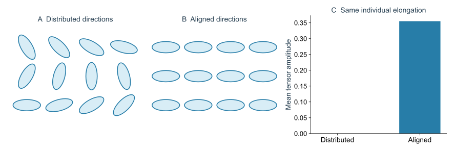
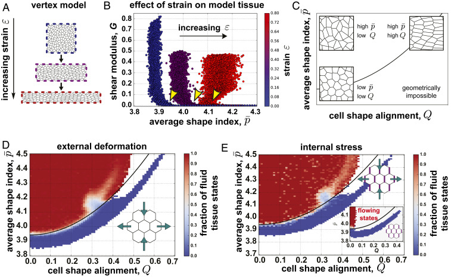
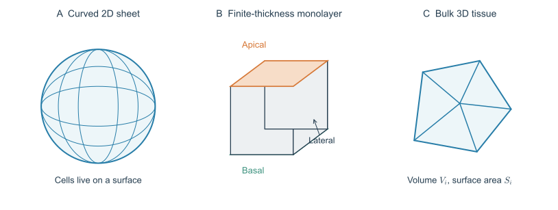
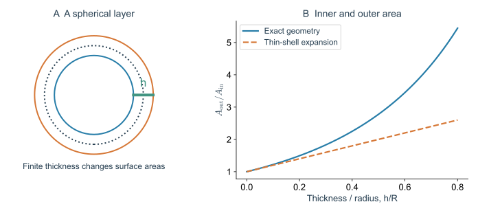
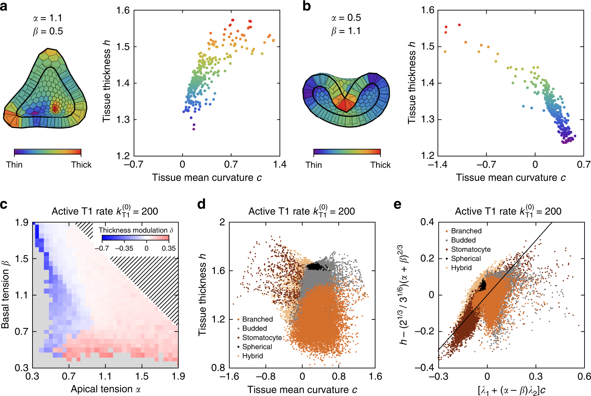
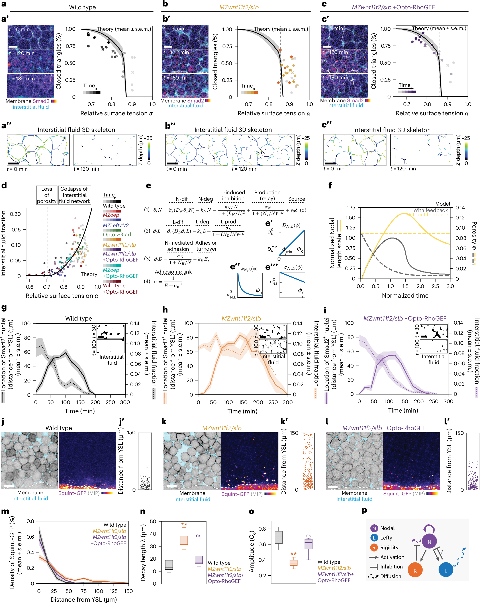
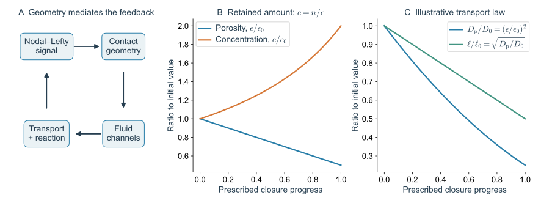

> **Part IV · Note 06**　[专题目录](/notes/vertex_model/) · 上一篇：[流变与活性](/notes/vertex_model/rheology_activity/)

**物理问题：** 将各向同性平面网络推广到有方向、有曲率和有细胞高度的组织时，哪些物理量需要重新定义？

## 概述：推广模型之前，先判断缺失的是哪个自由度 {#main-lecture}

一个细胞在显微图像中变长，可能是平面内拉伸，也可能是倾斜的曲面投影；一个上皮出现芽，可能主要改变整体曲率，也可能同时改变细胞厚度与顶基底面积差。它们看起来都比二维平面模型“更复杂”，但需要增加的自由度不同。

本篇沿三个问题展开。先研究同样拉长的细胞是否朝向一致，说明为什么形状标量不能完整描述方向性力学；再让二维网络位于曲面上，区分空间弯曲与细胞厚度；最后比较有顶基底极性的单层壳体和填充三维空间的体组织。

这些推广仍遵循前面的理论框架：确定允许怎样变形，写出几何量和能量，再计算稳定性与重排。改变维度以后，不能只替换一个形状指数的数值而保留全部旧结论。

## 1. 相同的形状指数可以隐藏不同方向

把一个细胞拉长，$P/\sqrt A$ 通常增大，但这个标量不记录长轴朝向。同样拉长的细胞若方向随机，组织的平均形状各向异性可以很小；若长轴排列一致，则可能有明显的方向性受力。

一种便于教学的细胞形状张量是面积二阶矩：

$$
M_i=\frac1{A_i}\int_{\text{cell }i}
(\mathbf r-\mathbf r_{c,i})(\mathbf r-\mathbf r_{c,i})^{\mathsf T}\,dA,
\qquad
Q_i=\frac{M_i}{\operatorname{tr}M_i}-\frac12I.
$$

$Q_i$ 无迹，给出伸长程度与方向；组织平均 $Q=\langle Q_i\rangle$ 还受到取向抵消的影响。不同研究采用的 shape/alignment tensor 归一化可能不同，本式不直接等于文献中所有同名的 $Q$。

### 1.1 从椭圆的二阶矩理解张量

对半轴 $a,b$ 的均匀椭圆，主轴坐标中的二阶矩为 $M=\operatorname{diag}(a^2,b^2)/4$。归一化后

$$
Q=q\begin{pmatrix}\cos2\theta&\sin2\theta\\
\sin2\theta&-\cos2\theta\end{pmatrix},\qquad
q=\frac{a^2-b^2}{2(a^2+b^2)}.
$$

角度出现 $2\theta$，是因为一条细胞长轴没有箭头：$\theta$ 与 $\theta+\pi$ 表示同一取向。圆形 $a=b$ 时 $q=0$；拉长程度相同的椭圆具有相同 $q$，但组织平均可以因方向抵消而接近零。

*图 1 · 单细胞拉长与组织取向是两层信息。* 自制确定性椭圆阵列。两组椭圆的轴比和面积相同，一组长轴均匀分布在多个方向，另一组全部沿同一方向；右侧按正文定义计算平均张量幅度。它是形状统计例子，不是能量最小化的细胞铺砌。

因此，一个平均形状指数升高的组织可能包含很多方向随机的拉长细胞；另一个平均指数相同的组织则可能整体沿前后轴排列。二者在同一方向剪切下的响应、已有应力和重排偏好，都可能不同。

在能量中加入 $\sum_e\lambda_e\ell_e$，例如取 $\lambda_e=\lambda_0+\lambda_2\cos2(\theta_e-\theta_n)$，可以引入方向选择。这里若 $\lambda_e$ 显式依赖边方向 $\theta_e(\mathbf x)$，计算力时必须对方向也求导；把它当作固定标签张力则是另一种动力学假设。

各向异性弹性一般写成 $\sigma_{\alpha\beta}=C_{\alpha\beta\mu\nu}\epsilon_{\mu\nu}$。不同方向的剪切响应可能不同，一个标量 $G$ 不再足以描述全部力学。

### 1.2 定向张力与外部拉伸也不是同一输入

外部盒形变改变边界条件；定向交界张力改变内部驱动或能量。两者都能使细胞排列一致，但对于未施加额外形变的组织，可能产生不同的残余应力与稳态运动。

这可以从能量导数看出。若 $\lambda(\theta_e)$ 随当前交界方向变化，$\partial(\lambda\ell)/\partial\mathbf r$ 包括 $\lambda\,\partial\ell/\partial\mathbf r$ 和 $\ell(\partial\lambda/\partial\theta_e)(\partial\theta_e/\partial\mathbf r)$。如果某个模型只让边带着固定的张力标签运动，它就没有后一项。两种选择分别描述不同的物理假设，应通过具体动力学定义区分。

## 2. 组织伸长来自细胞变长还是邻居交换

在小形变粗粒化层面，可示意地分解偏应变率：

$$
D^{\rm dev}\simeq\overset{\circ}{Q}+R.
$$

$\overset{\circ}{Q}$ 表示扣除刚体旋转后的细胞伸长变化，$R$ 汇总重排等贡献。这个简式强调观测层次；精确三角网格分解还需加入细胞分裂、消失以及相关修正，并取决于张量定义，不能把它当成任意数据处理下的严格恒等式。

[Merkel 等（2017）](https://doi.org/10.1103/PhysRevE.95.032401)给出了细胞尺度运动学的精确框架。[Wang 等（2020）](https://doi.org/10.1073/pnas.1916418117)结合果蝇胚胎与 Vertex 模拟发现，预测快速重排需要同时考虑形状和排列方向，考虑 packing disorder 还能改进预测。由此不能推出某个固定的形状指数适用于所有各向异性组织。

### 2.1 运动学分解先不需要知道力

给定细胞追踪，就可以把相邻中心连成三角网格，比较同一个三角形前后的形变。局部形变梯度可以分解为伸长与旋转；再对三角形统计，得到细胞形变与邻接网络变化对组织形变的贡献。

这项分解首先回答“发生了什么”，不是“什么力驱动了它”。如果组织主要通过邻居交换延长，仍可能由内部定向收缩、细胞突出或外部组织拉力驱动；如果细胞先被拉长再重排，也不说明二者之间只有单向因果关系。

在连续描述中使用 $\overset{\circ}{Q}$，是为了避免刚体旋转被误认为细胞形状改变。精确的客观导数和相关项需要与三角形伸长变量的定义一致；换一种 $Q$ 的归一化，不能保持所有系数原样不变。

### 2.2 形状判据怎样增加取向信息

*图 2 · 同一个平均形状指数可以对应不同力学状态。* 引自 [Wang 等（2020），Fig. 3](https://pmc.ncbi.nlm.nih.gov/articles/PMC7306759/#fig03)，原图未修改。A 施加面积保持的各向异性形变；B 比较不同预形变下的剪切模量；C 区分拉长与一致取向；D、E 比较外部形变和内部应力产生的状态分布。

先在 B 中选定同一个横坐标，再比较不同颜色的纵坐标：不同预形变下，剪切刚度可以不同。因此单一的平均形状指数不足以决定状态。D、E 进一步把形状和取向放进同一张图，边界随取向改变。

原文在其特定形状张量定义与样本集合中，用 $\bar p_{\rm crit}=\bar p_*+4bQ^2$ 概括边界。二次依赖与取向反转对称性相容，但 $b$、截距和 $Q$ 的归一化不能直接搬到前面的二阶矩定义。原图还使用实际平均形状指数，而不是直接把目标参数 $p_0$ 放在横轴；读出 3.94 等数值时，要连同变量与制备方式一起解释。

## 3. 曲面二维上皮：增加嵌入维数不等于增加细胞厚度

第一种推广是细胞仍然是二维多边形，只是顶点位于三维中的一个曲面 $\mathbf r_v\in\mathcal S$。面积按曲面面积计算，边长可取测地长度或三维弦长；两者在大曲率下不同，必须明确选择。

若曲面固定，只需将力投影到局部切平面；若曲面也可变形，则需要额外的形状能，例如

$$
E_{\rm bend}=\frac\kappa2\int_{\mathcal S}(2H-C_0)^2dA
+\bar\kappa\int_{\mathcal S}K\,dA.
$$

$H$、$K$ 分别为平均曲率和高斯曲率，$C_0$ 为自发曲率。在闭合且拓扑不变的曲面上，$\int KdA=2\pi\chi$，高斯项为常数；有边界或拓扑变化时不能这样略去。

三价闭合铺砌满足 $\sum_i(6-n_i)=6\chi$。球面 $\chi=2$，因此必须有净正缺陷电荷；若仅有五、六边形，则恰好有十二个五边形。这不规定缺陷一定均匀分布，也不直接决定组织是否刚性。

### 3.1 为什么曲率与拓扑不能互相替代

球面上无论细胞有多大，闭合三价铺砌的净电荷都为 12，这是全局拓扑要求。但一个局部弯曲的圆柱面，其高斯曲率为零，仍可有非零平均曲率和弯曲能。一个环面虽然处处可能有曲率，Euler 示性数却为零，总电荷也为零。

因此，观察到组织弯曲，不能直接推断它必须包含某个非零总缺陷数；观察到五边形，也不能直接计算局部曲率或刚度。局部几何、全局拓扑和力学能量之间有联系，但各自提供的约束不同。

固定曲面和可变曲面也有根本区别。前者的曲率由外部给定，顶点只能在曲面上移动；后者允许组织本身通过法向位移改变曲率，需要将面外力与弯曲响应一起求解。

*图 3 · 三种不同的几何推广。* 左：约束在曲面上的二维交界网络；中：具有 apical、basal、lateral 表面的有厚度单层；右：填充空间的多面体体组织。图只说明自由度类别，不表示完整细胞铺砌或模拟构型。

## 4. 有厚度的单层：表面张力如何改变形态

第二种推广让一个细胞具有顶端、基底和侧面。最小表面能可以写成

$$
E=\sum_i\left[
\Gamma_aA_i^a+\Gamma_bA_i^b+
\frac{\Gamma_l}{2}A_i^l+
\frac{K_V}{2}(V_i-V_{0i})^2\right].
$$

$A_i^l$ 定义为该细胞全部侧面面积之和，因此内部侧面被两个细胞计数，需乘 $1/2$；自由侧边界则单独处理。$\Gamma_a\neq\Gamma_b$ 区分顶端与基底的力学，使细胞厚度和曲率耦合。是否加入弯曲项取决于具体离散模型：不能把已由细胞几何产生的有效弯曲代价未经校准再重复计入。

### 4.1 厚度使内外面积必然不同

取厚度为 $h$、中面半径为 $R$ 的球形单层，内外表面半径为 $R-h/2$ 与 $R+h/2$，于是

$$
\frac{A_{\rm out}}{A_{\rm in}}
=\left(\frac{R+h/2}{R-h/2}\right)^2
\simeq1+\frac{2h}{R},\qquad h/R\ll1.
$$

因此，即使中面上的细胞足迹完全相同，外侧与内侧表面也不可能具有相同面积。若模型把细胞压成无厚度多边形，这项几何不对称就丢失了。

*图 4 · 有限厚度带来的几何信息。* 自制球壳计算，左图标出中面、内外表面与厚度；右图比较精确面积比与薄壳展开。这里只计算几何关系，不包含细胞表面张力的平衡预测。

### 4.2 从表面张力差看自发曲率的来源

在选定法向与平均曲率符号后，距离中面 $z$ 的平行表面面积元可以写成 $dA(z)=dA(1+2Hz+Kz^2)$。若顶、基底分别在 $z=\pm h/2$，两侧表面能在薄层极限包含

$$
E_{a+b}\simeq\int dA\left[
(\Gamma_a+\Gamma_b)
+h(\Gamma_a-\Gamma_b)H
+\frac{h^2}{4}(\Gamma_a+\Gamma_b)K\right].
$$

线性的 $H$ 项表示一种弯曲方向偏好。若再有独立有效弯曲代价 $2\kappa H^2$，配方可以引出自发曲率；但系数还受到侧面、体积约束与厚度松弛影响，不能把这一个薄层展开当成所有三维细胞模型的完整连续极限。

这一推导的价值在于明确方向性来源：交换顶端和基底的物理角色，同时反转法向，能量描述应保持一致。若只把两侧表面张力加成一个系数，就无法保留这种极性信息。

[Rozman 等（2020）](https://doi.org/10.1038/s41467-020-17535-4)用表面张力驱动的三维上皮壳层模型研究出芽、内陷和分支，并考察主动重排与拓扑缺陷的作用。这类模型的问题是有极性的单层怎样改变空间形状，与体组织的剪切刚性问题不同。

*图 5 · 一个保留顶基底极性的单层模型。* 引自 [Rozman 等（2020），Fig. 1](https://www.nature.com/articles/s41467-020-17535-4/figures/1)，CC BY，原图未修改。a 定义顶端、基底、侧面与内腔；c、d 对照不同重排活性下的形态；e、f 是参数平面中的结果，g 对照约化体积与总表面张力尺度。

这类图应该先比较“模型里什么被固定”。内腔体积、细胞数、细胞体积、表面张力与重排规则共同限定了可实现形态。不能只挑一个看起来像类器官的轮廓，再把参数平面中的所有结果都解释为真实器官的发育阶段。

*图 6 · 形态之外还有可检验的细胞尺度关系。* 引自 [Rozman 等（2020），Fig. 3](https://www.nature.com/articles/s41467-020-17535-4/figures/3)，CC BY，原图未修改。a、b 将局部厚度与曲率配对，c–e 比较不同参数与形态。散点中的一个点对应一个细胞，不能当成独立类器官样本。

相比只看“有没有一个芽”，厚度—曲率关系更接近模型保留的具体机械自由度。若在同一形态下，实验的厚度变化方向与模型预测相反，就提示表面极性、约束或被省略的基底作用需要重新判断。

## 5. 三维体组织：周长目标换成表面积目标

第三种推广把组织视为填满三维空间的多面体细胞，没有统一的 apical–basal 单层结构。在固定平均体积等于 $V_0$ 的设置中，一个类比能量是

$$
E=\sum_i\left[\frac{K_V}{2}(V_i-V_0)^2+
\frac{K_S}{2}(S_i-S_0)^2\right],\qquad
s_0=\frac{S_0}{V_0^{2/3}}.
$$

量纲上的推广很直接，但允许的拓扑操作并非把二维四细胞 T1 原样搬入三维；面消失、边消失与新的接触形成涉及不同局部几何。若使用 Voronoi 生成点，自由度也与独立多面体顶点模型不同。

[Merkel 与 Manning（2018）](https://doi.org/10.1088/1367-2630/aaaa13)在特定三维 Voronoi 体组织模型中得到由目标表面积控制的刚性转变，临界 $s_0$ 约为 5.413，并联系到几何不相容与残余应力。这个数值属于该模型，不能用来判断任意有厚度的上皮或直接替换二维的 3.81。

### 5.1 单细胞等周界与空间填充约束

在三维，固定体积的球具有最小表面积，其无量纲表面积为 $(36\pi)^{1/3}\simeq4.836$。但球不能无间隙地铺满三维空间，所以单细胞的几何下界并不等于体组织可共同达到的目标表面积。

这和二维“圆的等周界、正六边形铺砌、无序网络转变”之间的区别相似。首先有单个形状的界限，然后有空间填充的相容性，最后才有由自由度、预应力和制备状态决定的刚性。不同层次的数值不能互相替代。

三维细胞的拓扑也不再由一个邻居数完全概括。面、边、顶点具有不同的连接关系；一条二维交界的消失与一个三维接触面的消失不是同一个局部操作。代码需要维护多面体网络的合法性，力学分析则需要使用实际三维几何的导数。

## 6. 斑马鱼中的另一张网络：细胞外通道与形态素运输 {#porosity-transport}

### 6.1 承力网络与运输网络不能只画一张

前面的三维模型仍假设细胞填满空间。如果研究早期斑马鱼胚盘，细胞外液体的体积分数和通道结构也需要作为自由度。此时有两张相关但不同的网络：细胞接触形成承力路径，细胞外间隙形成可供分子运输的路径。

黏附使相邻细胞接触扩大时，承力接触可能增加，三细胞之间的液体通道同时缩窄或关闭。但**刚性贯通与液体通道断开不是一般数学等价关系**。一个刚性的多孔材料仍可渗透；相同孔隙率也可对应连通通道、孤立液囊或很多很细的瓶颈。只测体积分数不能确定扩散或渗透率。

[Autorino 等（2026）](https://doi.org/10.1038/s41556-026-01954-4)在斑马鱼中把这层几何与 Nodal 信号联系起来：细胞接触重组伴随细胞外通道和形态素分布改变。这使“组织力学参与信号调控”成为可以从界面几何、运输与反应逐步追踪的机制，而不是给化学反应方程任意添加一个“刚度系数”。

*图 7 · 力学与信号之间有具体的几何中介。* 引自 [Autorino 等（2026），Fig. 3](https://www.nature.com/articles/s41556-026-01954-4/figures/3)，原图未修改。a–d 比较接触与液体空间；e–i 将孔隙变化纳入运输和 Nodal–Lefty 动力学；j–o 检查形态素空间分布。p 总结反馈。原图的多个临界值来自特定界面几何模型，不能视作任意三维组织的常数。

#### 论文视频 · 斑马鱼边缘区：细胞外间隙与 Nodal 信号响应

<figure class="vertex-video" id="video-autorino-nodal" style="--vertex-video-width: 760px">
<video controls preload="metadata" playsinline width="4048" height="2304" aria-label="斑马鱼边缘区：细胞外间隙与 Nodal 信号响应" src="https://media.springernature.com/original/springer-static/esm/art%3A10.1038%2Fs41556-026-01954-4/MediaObjects/41556_2026_1954_MOESM5_ESM.mp4">
<a href="https://media.springernature.com/original/springer-static/esm/art%3A10.1038%2Fs41556-026-01954-4/MediaObjects/41556_2026_1954_MOESM5_ESM.mp4">直接打开原始视频</a>。
</video>
<figcaption><strong>显微视频</strong>｜Autorino 等（2026），Supplementary Movie 2。Smad2–GFP 与 dextran-647 成像；比较野生型及信号、Wnt 和光遗传干预条件，标尺 25 μm。视频未修改，权利与许可见原文。<a href="https://www.nature.com/articles/s41556-026-01954-4#MOESM5" target="_blank" rel="noopener">原文与完整视频说明</a> · <a href="https://media.springernature.com/original/springer-static/esm/art%3A10.1038%2Fs41556-026-01954-4/MediaObjects/41556_2026_1954_MOESM5_ESM.mp4" target="_blank" rel="noopener">直接打开原始视频</a>。</figcaption>
</figure>

**先看哪里：** 先看各栏的条件标签。洋红箭头标出 Smad2 阳性的细胞核；空心白箭头指开放间隙，实心白箭头指闭合间隙，虚线表示信号作用范围。按画面时间比较这些变化的先后，并留意干预及救援条件。

**怎样读物理：** Smad2 的核定位是信号响应的读出，并不是 Nodal 分子的直接运动轨迹。这段适合观察孔隙与响应范围如何共同变化；扩散系数及反馈机制仍要结合原文的形态素测量、模型和干预来判断。

### 6.2 先写守恒，再决定“浓度”除以哪个体积

令 $\phi$ 为细胞体积分数，$\epsilon=1-\phi$ 为细胞外孔隙率。注意这里的 $\phi$ 指细胞；有些论文图中的同名字母指细胞外空间，阅读时必须先换约定。令 $c$ 是每单位细胞外液体体积中的形态素量，则每单位组织总体积的量是 $n=\epsilon c$。两种浓度的变化含义不同。

在固定组织坐标下，一个最小的守恒式为

$$
\partial_t(\epsilon c)+\nabla\cdot(\epsilon c\mathbf v_{\rm f})
=\nabla\cdot(\epsilon D_{\rm p}\nabla c)+S-R.
$$

其中 $\mathbf v_{\rm f}$ 是细胞外液体速度，$S,R$ 按组织体积计量，$D_{\rm p}$ 编码当前通道中的有效扩散，必要时应推广为张量并区分可达孔隙率与总孔隙率。该式不包含全部配体结合、内吞和反应，只先明确运输记账。

在可忽略平流的近似下展开，得到

$$
\boxed{\partial_t c=\frac1\epsilon\nabla\cdot(\epsilon D_{\rm p}\nabla c)
-c\,\partial_t\ln\epsilon+\frac{S-R}{\epsilon}.}
$$

第二项的意义很直接：若一段时间内局部溶质保留，而它能占据的液体空间缩小，液体中的浓度可以升高，即使总分子数没有增加。例如 $n$ 不变而 $\epsilon$ 从 0.2 变为 0.1，$c$ 就增加一倍。这是体积归一化的结果，不能误读为生产加倍；实际排液带走溶质时，平流和边界通量也必须保留。

与此同时，关闭瓶颈可以降低 $D_{\rm p}$。在系数均匀、无流动且线性降解率为 $kc$ 的简化极限，稳态衰减长度仍为

$$
\ell=\sqrt{D_{\rm p}/k}.
$$

因而局部浓度升高与空间作用范围缩短可以同时发生。若孔隙率空间不均匀、形态素结合明显或反应具有反馈，便不能用这一条平方根公式概括完整梯度。这里与 [qbio_course 的位置信息讲义](/notes/qbio_course/positional_information/)形成直接联系：发育系统不仅可以改变源与降解，也能改变运输所经过的介质。

*图 8 · 几何变化怎样进入运输方程。* 自制守恒算例：一组局部保留溶质的体积元中，$n=0.1$、孔隙率从 0.2 下降到 0.1；分别绘制 $c=n/\epsilon$，以及人为选取 $D_{\rm p}/D_0=(\epsilon/0.2)^2$ 时的相对扩散与线性稳态长度。后一个关系仅作教学假设，不拟合论文数据，也不是普遍孔隙定律。左侧箭头归纳反馈路径，数值曲线只计算其中的两个几何后果。

### 6.3 什么使这个联系成为发育机制，而不是材料类比

在上述斑马鱼研究中，Nodal、相对黏附、细胞外几何与 Lefty 抑制形成反馈。信号改变界面作用；界面重组改变运输和局部浓度；这些变化又影响信号的空间传播与终止。完整预测因此需要同时保留运输、产生、降解和抑制，不能只降低扩散系数就宣称已经解释信号终止。

一个可区分的实验问题是：改变接触几何以后，若恢复细胞外通道的运输能力而不完全恢复原来的力学状态，信号范围能否恢复？反过来，只改变反应速率是否能补偿几何改变？这是从最小方程提出的机制检验方向，并不表示论文已完成这两种理想化干预。

这一例子也限定了“Vertex Model 专题”的范围：经典汇合多边形模型给出承力几何的起点；要解释细胞外运输，必须扩展其自由度与守恒量。保留模型之间的推导关系，比把一切都改称 $p_0$ 控制更有解释力。

## 7. 什么时候值得引入三维

如果主要观测是近似平面内的细胞排列与应力，二维模型能先隔离关键机制；若空间曲率已改变边长和拓扑约束，需使用曲面几何；若顶基底面积差、细胞高度或侧面受力决定出芽和内陷，就需保留有厚度的单层；若细胞在组织内部具有全三维邻接，则应使用体组织模型。

共同的分析框架仍然是“自由度、目标几何、残余应力与允许重排”，但具体约束矩阵、形状参数和拓扑事件都要重新计算。

## 技术补充：从离散细胞到连续理论应保留什么

粗粒化不只是把顶点数减少。一个连续理论至少需要明确密度或面积变化、细胞伸长、组织取向、拓扑重排率以及必要的曲率和厚度变量。哪些变量可以快速松弛并消去，要由时间尺度判断。

例如，若细胞形状比组织形变松弛得快，可以在当前应变率下近似消去 $Q$，得到黏性关系；若形状保留长时间记忆，就要把 $Q$ 作为内部状态，得到黏弹性或主动本构。若厚度与曲率强耦合，把厚度预先固定可能改变有效弯曲响应。

因此，模型“更统一”的含义应是能指出不同极限之间的对应与遗漏，而不是给所有体系使用同一个形状阈值。最后一篇将用具体生物过程检验这些选择是否抓住了真实的驱动。

### 一个二维近似的判断需要至少两个尺度比较

几何上，可以比较细胞厚度 $h$、曲率半径 $R$ 与形变波长 $L$。当 $h/R\ll1$、$h/L\ll1$ 时，薄层连续展开通常更容易成立，但这并不自动意味着可以删除所有顶基底差异：很小的厚度仍然可以承载决定弯曲方向的张力不对称。

动力学上，还要比较高度松弛时间 $\tau_h$ 与观测时间。如果高度能很快达到当前平面形变对应的状态，可以尝试将它消去，得到有效二维能；如果高度具有长记忆或主动反馈，就需要把它作为独立变量。

更直接的判断来自机制。例如，一个很薄的细胞仍可能靠基底侧突出完成间插，此时只因“薄”就删除基底侧驱动，仍然会丢掉主要原因。近似应由目标观测和驱动共同决定，而不只由外观维度决定。

| 保留的描述 | 可以首先解释的观测 | 需要额外检查的内容 |
| --- | --- | --- |
| 平面二维网络 | 面内排列、固定高度近似下的剪切 | 面外位移、明显曲率、基底侧驱动 |
| 曲面二维网络 | 给定或可变曲面上的细胞足迹 | 厚度、顶基底面积差与侧面受力 |
| 有厚度单层 | 高度、曲率、内陷、出芽 | 多层接触、基质耦合与体内迁移 |
| 三维体组织 | 全三维接触和体积—表面积约束 | 特定细胞极性与实际组织边界条件 |

表中不是模型精度的单向排名。更复杂的模型增加可动自由度，也增加难以辨识的参数和数值拓扑问题。只有当新增变量改变了关键、可检验的预测时，三维推广才对当前问题提供明确收益。

## 主要文献

- [Autorino et al. (2026), Tissue rigidity phase transition shapes morphogen gradients](https://doi.org/10.1038/s41556-026-01954-4)。
- [Merkel et al. (2017), Triangles bridge the scales](https://doi.org/10.1103/PhysRevE.95.032401)。
- [Wang et al. (2020), Anisotropy links cell shapes to tissue flow during convergent extension](https://doi.org/10.1073/pnas.1916418117)。
- [Merkel & Manning (2018), A geometrically controlled rigidity transition in a model for confluent 3D tissues](https://doi.org/10.1088/1367-2630/aaaa13)。
- [Rozman et al. (2020), Collective cell mechanics of epithelial shells with organoid-like morphologies](https://doi.org/10.1038/s41467-020-17535-4)。

[← 流变与活性](/notes/vertex_model/rheology_activity/) · [下一篇：形态发生、实验检验与开放问题 →](/notes/vertex_model/morphogenesis/)
