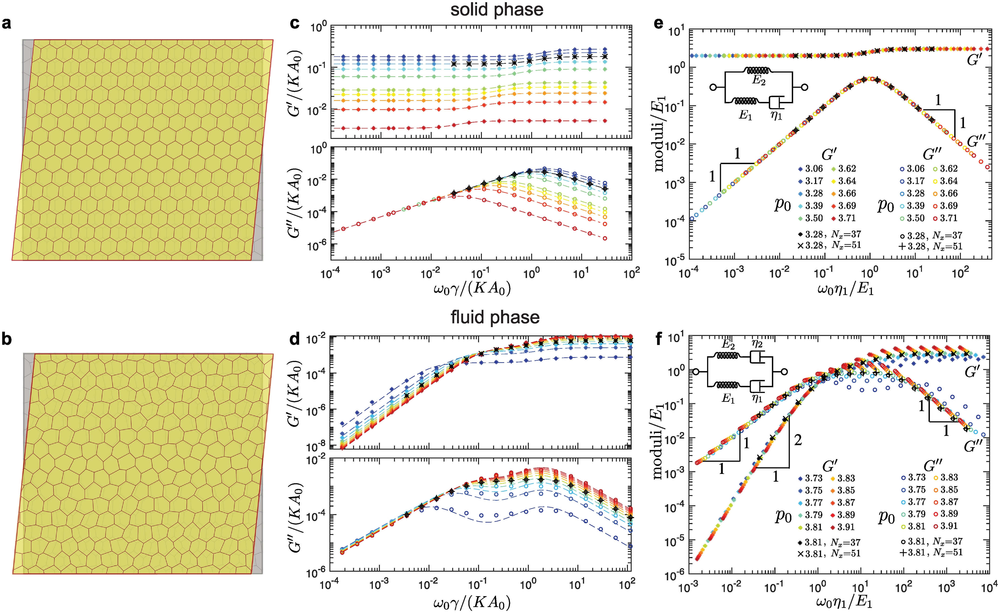
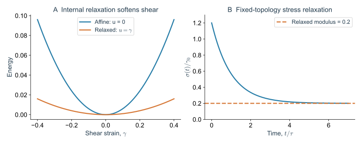
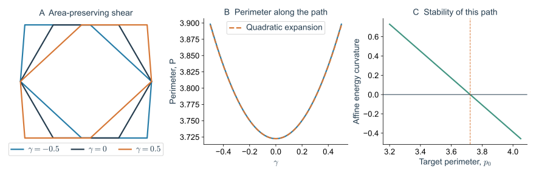
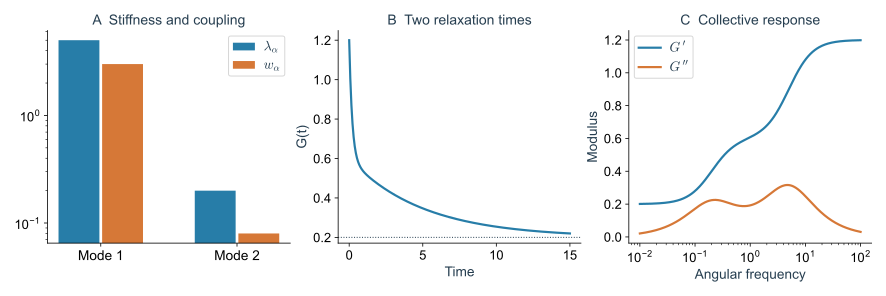
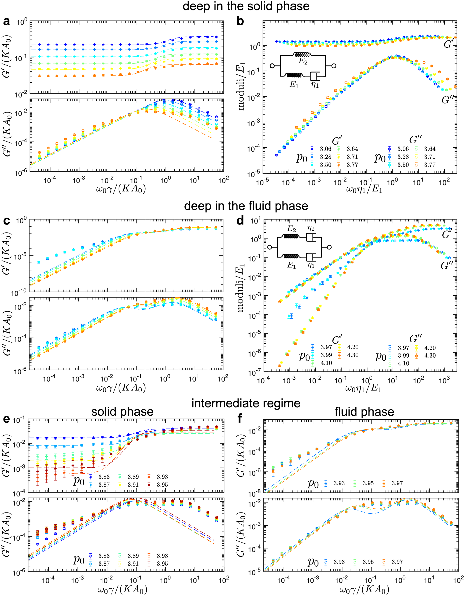
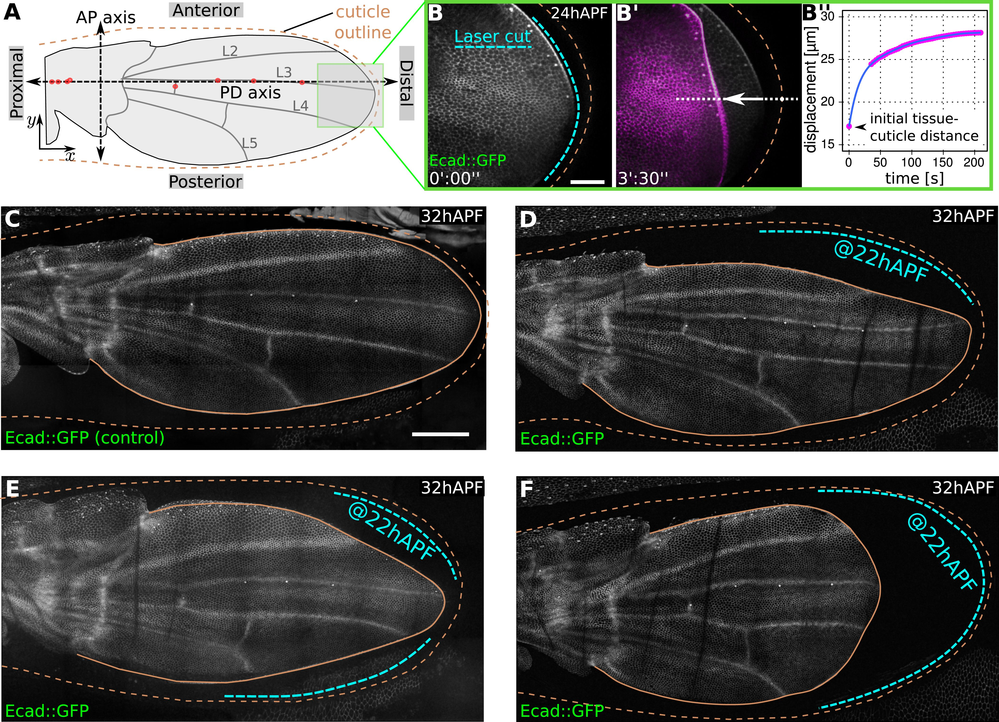

> **Part I · Note 02**　[专题目录](/notes/vertex_model/) · 上一篇：[几何、能量与力学平衡](/notes/vertex_model/foundations/) · 下一篇：[几何不相容、预应力与刚性转变](/notes/vertex_model/rigidity/)

**物理问题：** 把组织轻轻剪切一下，要用多大力？如果给细胞时间重新挪动位置，为什么会更容易变形？

## 概述：给同一片组织一次快剪切和一次慢剪切 {#main-lecture}

用手很快拉动一个具有内部结构的材料，内部单元来不及调整，往往需要较大的力；缓慢拉动时，单元可以改变相对位置，恢复力可能减小。Vertex Model 也有这种区别，即使细胞完全没有交换邻居，顶点在原有网络内的松弛就足以改变测得的刚度。

因此，“组织的剪切模量是多少”还需要补上一句话：顶点是否被迫跟随盒子作相同的几何变换，还是允许它们寻找新的平衡位置？实验测量也有对应问题：驱动得有多快，哪些内部运动来得及发生？



*图 1 · 同一模型需要同时考虑频率与几何状态。* 引自 [Tong 等（2022），Fig. 2](https://doi.org/10.1371/journal.pcbi.1010135.g002)，CC BY，原图未修改。上排为固体侧，下排为流体侧；a、b 的形变被放大以便辨认；c、d 比较储能与损耗模量随频率的变化，e、f 展示重新缩放后的曲线及相应弹簧—黏壶表示。

读这张多面板图时，先看 c、d 的横轴：向左是慢驱动，向右是快驱动。再分别追踪一种颜色的储能曲线与损耗曲线，比较低频端是否保留平台。不同颜色对应不同目标形状参数，不是在同一条轨迹上连续经过的时间。最后再看 e、f 的缩放，思考哪些变化只是刚度或时间尺度改变，哪些需要改变响应函数的形式。

这一篇从能量的二次展开推导上述联系。第一步用 Hessian 描述内部恢复力；第二步把外部剪切与内部位移耦合；第三步允许位移随时间松弛，得到静态与有限频率的模量。论文中的具体数值结果提供对照，后面的解析例子则帮助逐项理解公式。

### 先看一次剪切测量会记录什么

想象一块长方形样品：底边固定，把顶边往右推，样品就变成斜的平行四边形。这叫**剪切**。顶边移动距离除以样品高度，得到剪切应变 $\gamma$。高度 100 μm、移动 1 μm，就是 $\gamma=0.01$，也就是约 1% 的小形变。

研究者一边规定移动多少，一边记录需要多大力。对三维样品，把力除以承受这股力的面积，得到应力，单位为 Pa；在本文的二维模型里，相应的力按长度折算，单位会不同。在小形变下，应力增加量除以应变，就是剪切模量 $G$。同样推歪一点，所需应力增加得越多，模量就越大。

例如，对一块三维样品施加 1% 的剪切，应力增加了 2 Pa，就得到 $G=200$ Pa。这只是说明算法的假设算例，不是论文中的组织数据。真正测量时，还要说明是刚推完就读数，还是保持形状、等一会儿再读数。

为什么等待会影响答案？边界被推歪以后，细胞内部不一定已经平衡。有些顶点可以再挪一点，让过度拉长的边松一些。组织外形仍然保持剪切，内部却找到了较省力的排列。本篇计算的，就是这部分额外调整能减小多少恢复力。

**Hessian 记录各个点怎样互相牵动；本征模把复杂运动拆成几种集体运动；非仿射修正计算内部调整能省掉多少剪切代价。**

## 1. 在一个力平衡构型附近展开

将独立顶点坐标排成向量 $\mathbf x$。先固定细胞邻接网络、固定周期盒形状，在平衡构型 $\mathbf x_* $ 附近写 $\mathbf u=\mathbf x-\mathbf x_*$。由于一阶力为零，

$$
E(\mathbf x_*+\mathbf u)=E_*+\frac12\mathbf u^{\mathsf T}H\mathbf u+O(u^3),
\qquad H_{ab}=\left.\frac{\partial^2E}{\partial x_a\partial x_b}\right|_*.
$$

$H$ 叫 **Hessian 矩阵**，也就是能量对坐标求两次导数后排成的表。它的每一项都在回答：把一个坐标挪一点，另一个坐标受到的恢复作用会改变多少？在一维弹簧里，类似的量就是弹簧常数；这里把它推广到许多相互连接的顶点。

本征值描述某种集体运动有多难。正值表示沿这个方向挪动会增加二次能量；负值表示一挪反而降低能量，当前位置会失稳；零值表示这一阶看不出代价。零值可能来自整片组织平移，也可能需要看更高阶能量才能判断。

### 1.1 为什么一次微小位移可以分解成独立模态

对实对称 Hessian，可以选择一组正交本征向量 $\mathbf e_\alpha$，将任意位移写成 $\mathbf u=\sum_\alpha c_\alpha\mathbf e_\alpha$。二次能量就成为

$$
\delta E=\frac12\sum_\alpha\lambda_\alpha c_\alpha^2.
$$

可以把一个模态想成一张“大家怎样一起动”的箭头图。$c_\alpha$ 表示沿这张图移动了多少，$\lambda_\alpha$ 表示这种运动有多费力。有的箭头图牵动几乎所有细胞，有的只牵动一个小区域。参与率用于量化这种运动的空间范围。

还可以计算模态的参与率。若一个模态已归一化，按顶点二维位移写成 $\mathbf e_{\alpha v}$，定义

$$
\mathcal P_\alpha=\frac{\left(\sum_v|\mathbf e_{\alpha v}|^2\right)^2}
{N_v\sum_v|\mathbf e_{\alpha v}|^4}.
$$

所有顶点幅度相近时，$\mathcal P_\alpha$ 为一的量级；若只有少数顶点参与，则接近这些顶点占总数的比例。它帮助判断模式的空间范围，但仍没有告诉我们该模式是否被给定的剪切激发。

周期边界下整体平移不改变面积、周长，因此至少有两个平凡零模。自由有限组织还可能有转动零模，固定盒则通常没有独立的整体转动对称性。计算之前必须说明边界条件。

对单一顶点摩擦 $\zeta$，小扰动满足 $\zeta\dot{\mathbf u}=-H\mathbf u$。若 $H\mathbf e_\alpha=\lambda_\alpha\mathbf e_\alpha$，该模态弛豫时间为 $\tau_\alpha=\zeta/\lambda_\alpha$。这里 $\lambda_\alpha$ 是**刚度**本征值，不是振动频率；只有引入惯性后才有 $\omega_\alpha^2=\lambda_\alpha/m$。

把单模态方程 $\zeta\dot c_\alpha=-\lambda_\alpha c_\alpha$ 积分，就有 $c_\alpha(t)=c_\alpha(0)e^{-t/\tau_\alpha}$。软模态的恢复力小，所以在同样摩擦下松弛慢。靠近某些失稳点，最小非平凡 $\lambda$ 下降，便产生很长的机械时间；有限时长的最小化程序可能因此把尚未松弛的构型误认为平衡。

## 2. 把盒子剪切与细胞内部松弛分开

对周期盒施加简单剪切 $x\mapsto x+\gamma y$。先将所有顶点随盒子作仿射移动，再允许其相对仿射位置产生位移 $\mathbf u$。将能量写成 $E(\mathbf u,\gamma)$，在 $\gamma=0$ 附近展开：

$$
E=E_*+A_{\rm tot}\sigma_0\gamma
+\frac12\mathbf u^{\mathsf T}H\mathbf u
+\gamma\boldsymbol\Xi^{\mathsf T}\mathbf u
+\frac12 B\gamma^2+\cdots,
$$

$$
\Xi_a=\frac{\partial^2E}{\partial u_a\partial\gamma},\qquad
B=\frac{\partial^2E}{\partial\gamma^2}.
$$

这几个符号分别负责一件事。$B$ 是强迫所有点只跟着盒子一起剪切时的能量曲率；$H$ 描述内部点再移动时的恢复作用；$\boldsymbol\Xi$ 告诉我们，外部剪切会把内部哪些点推离原来的平衡。

“仿射”就是对每个点都应用同一套宏观变形规则；“非仿射”是各个点在此基础上各自作出的额外调整。初态也可能已经有剪切应力 $\sigma_0$，此时我们算的是在它上面再加一点形变时，应力还会增加多少。

### 2.1 仿射到底固定了什么

初始坐标为 $(x_v,y_v)$ 的顶点，在简单剪切后仿射地变成 $(x_v+\gamma y_v,y_v)$。任何水平距离相同但高度不同的两点，都会获得不同的水平位移。这是把宏观形变直接施加到所有微观坐标上的构造，不要求它已经满足新的力平衡。

非仿射位移 $\mathbf u$ 是在这个新坐标基础上的附加移动。例如，一个三价顶点可以在邻居的拉力下向上挪一点，另一个向下挪一点；组织边界的总剪切保持不变，内部细胞却借此减小面积或周长偏差。

计算时，先把盒子推歪，再固定盒子的形状，只让内部顶点移动。如果连盒子也一起放开，它可能干脆恢复原来的形状；那就没有测到“保持这次剪切需要多大力”。

对固定 $\gamma$ 最小化内部位移，得到 $H\mathbf u_*=-\gamma\boldsymbol\Xi$。去除平移等无关零模后，

$$
\mathbf u_*=-\gamma H^+\boldsymbol\Xi,
$$

其中 $H^+$ 为广义逆。代回能量，充分松弛的剪切模量为

$$
\boxed{G=\frac1{A_{\rm tot}}
\left[B-\boldsymbol\Xi^{\mathsf T}H^+\boldsymbol\Xi\right].}
$$

把公式读成两部分：$B/A_{\rm tot}$ 是内部不调整时的刚度，后面减去的项是内部调整省掉的部分。在当前排列稳定、二次近似够用时，给内部更多移动机会，只会使保持同一剪切所需的力减小或不变。

$H^+$ 是处理矩阵零方向的一种逆运算。例如，整片组织平移并不会改变形状，这类无关移动要先排除。如果剪切真正推着系统沿一个完全没有二次恢复力的内部方向走，就要继续算高阶能量或寻找新的平衡；只在矩阵里删掉这一方向，并不能代表它真的稳定了。

### 2.2 从平衡条件直接推出非仿射修正

也可以不依赖显式的二次展开。设平衡位置为 $\mathbf x_*(\gamma)$，满足 $\partial_{\mathbf x}E(\mathbf x_*(\gamma),\gamma)=0$。对应变求导：

$$
H\frac{d\mathbf x_*}{d\gamma}+\boldsymbol\Xi=0.
$$

因此 $d\mathbf x_*/d\gamma=-H^+\boldsymbol\Xi$。沿松弛分支的应力是 $\sigma=A_{\rm tot}^{-1}dE_{\min}/d\gamma$。第一次求导时，内部坐标的链式项因力平衡而消失；第二次求导时，内部位置随应变的变化重新进入：

$$
\frac{d^2E_{\min}}{d\gamma^2}
=E_{\gamma\gamma}+E_{\gamma\mathbf x}\frac{d\mathbf x_*}{d\gamma}
=B-\boldsymbol\Xi^{\mathsf T}H^+\boldsymbol\Xi.
$$

两种求导回答的是两个不同问题。只对 $\gamma$ 求偏导，相当于让内部点保持在规定位置上；沿着 $\mathbf x_*(\gamma)$ 求全导数，则让内部点在每次剪切后重新找到平衡。实验若等到内部充分调整，比较的应当是后一种结果。

### 2.3 从面积、周长导出组织应力

对一个微小对称应变 $\epsilon$，面积变化为 $\delta A_i=A_i\operatorname{tr}\epsilon$。一条长度 $\ell_e$、单位切向为 $\hat{\mathbf t}_e$ 的边，其长度变化为 $\delta\ell_e=\ell_e\hat{\mathbf t}_e^{\mathsf T}\epsilon\hat{\mathbf t}_e$。代入 $\delta E=-\sum_i\Pi_i\delta A_i+\sum_i t_i\delta P_i$，整理共有边，得到二维拉应力取正的表达：

$$
\boxed{\sigma_{\alpha\beta}=\frac1{A_{\rm tot}}
\left[-\sum_i\Pi_iA_i\delta_{\alpha\beta}
+\sum_eT_e\ell_e\hat t_{e\alpha}\hat t_{e\beta}\right].}
$$

这里是内部周期网络的弹性能贡献，不包括额外主动、边界或耗散应力。面积压力项各向同性，剪切应力则依赖交界的方向及张力：同样大的张力，若方向分布不同，也可以产生不同的宏观偏应力。

## 3. 为什么低能模态未必都控制剪切

将修正项分解到本征模：

$$
G=\frac1{A_{\rm tot}}\left[
B-\sum_{\lambda_\alpha\gt 0}
\frac{|\mathbf e_\alpha\cdot\boldsymbol\Xi|^2}{\lambda_\alpha}\right].
$$

一个模式虽然很软，也得被这次剪切推动，才会影响测量。比如组织里某处很容易上下挪动，而我们施加的剪切主要推动另一种运动；那个软方向可能几乎没有被用到。公式中分母 $\lambda_\alpha$ 表示“有多软”，分子表示“这次剪切推动它有多强”。两项要一起看。

定义剪切权重 $w_\alpha=|\mathbf e_\alpha\cdot\boldsymbol\Xi|^2$，每个模态的非仿射修正为 $w_\alpha/\lambda_\alpha$。例如，一个很软的模式若因对称性有 $w_\alpha=0$，它完全不降低这个方向的模量；另一个更硬但耦合更强的模式，反而可能贡献更多软化。

这说明两个组织即使具有近似相同的本征值分布，仍可能有不同的剪切响应。需要知道本征向量怎样与外部加载相配合。各向异性体系更明显：旋转加载方向会改变 $\boldsymbol\Xi$，却不必改变未加载初态的 $H$。

一个只有单个内部坐标的例子可以直接算清：

$$
E(u,\gamma)=\frac{k}{2}(u-c\gamma)^2+\frac{g}{2}\gamma^2,
\qquad k\gt 0,\quad g\geq0.
$$

若冻结内部坐标 $u=0$，模量为 $(kc^2+g)/A_{\rm tot}$；充分松弛到 $u=c\gamma$ 后，模量为 $g/A_{\rm tot}$。内部模态仍有刚度 $k$，却可以把一部分甚至全部剪切代价释放掉。这里 $g=0$ 是存在剪切软方向的特例。



*图 2 · 松弛如何降低测得的刚度。* 左：$k=c=A_{\rm tot}=1$、$g=0.2$ 的精确能量曲线；右：同一模型在阶跃剪切后、$\zeta=1$ 时的 $\sigma(t)/\gamma_0=g+kc^2e^{-kt/\zeta}$。这是二次玩具模型，没有 T1 事件。

### 3.1 一个真的多边形计算：仿射剪切正六边形

取面积为 1 的规则六边形，初始周长 $p_6=\sqrt{8\sqrt3}$。将每条边随盒子作面积保持的简单剪切。若边的初始方向为 $\theta$、长度为 $\ell$，剪切后长度为

$$
\ell(\gamma)=\ell\sqrt{1+2\gamma\cos\theta\sin\theta+\gamma^2\sin^2\theta}.
$$

在 $\gamma=0$ 处，$\ell'=\ell\cos\theta\sin\theta$、$\ell''=\ell\sin^4\theta$。对相隔 $\pi/3$ 的六条边求和，有 $P'(0)=0$，$P''(0)=3p_6/8$。简单剪切保持面积，所以只有周长能贡献这条仿射路径的二阶曲率：

$$
G_{\rm aff}=\left.\frac{d^2E}{d\gamma^2}\right|_0
=\frac{3K_P}{8}p_6(p_6-p_0),\qquad A=1.
$$



*图 3 · 可逐边计算的几何弹性。* 自制解析与数值图。左：同一个单位面积六边形在不同剪切下的轮廓；中：直接求和得到 $P(\gamma)$；右：$K_P=1$ 时上式给出的仿射曲率，负值表示该规则构型沿此路径不稳定，不能当成稳定材料的负剪切模量。

这个结果还解释了为什么必须说清初态。当 $p_0$ 小于规则六边形周长时，细胞已有正的周长残差，进一步剪切增加周长就产生二次代价；当 $p_0=p_6$，该仿射路径上的周长变化从 $\gamma^2$ 开始，能量从 $\gamma^4$ 开始，二次曲率为零。这是有序单元的几何计算，不是无序网络临界值 3.81 的推导。


## 4. 零频、有限频率与测量时间

实验中也可以让顶边来回移动。一个周期是一来一回，频率越高，给细胞调整位置的时间就越短。下面的 $\omega$ 是角频率，等于每秒循环次数乘 $2\pi$。储能模量 $G'$ 描述可恢复的弹性部分；损耗模量 $G''$ 描述在被动模型中，一个循环里有多少机械能被耗散。它们把“拉起来有多硬”和“来回拉时有多大阻力”分开了。

令外部剪切为 $\gamma(t)=\operatorname{Re}[\gamma_0e^{i\omega t}]$。为使非仿射坐标与耗散一致，这里先假设摩擦相对随剪切运动的仿射背景，耗散函数为 $\mathcal R=\zeta\dot{\mathbf u}^{\mathsf T}\dot{\mathbf u}/2$。于是

$$
(H+i\omega\zeta I)\mathbf u_0=-\boldsymbol\Xi\gamma_0,
$$

$$
G^*(\omega)=\frac1{A_{\rm tot}}
\left[B-\boldsymbol\Xi^{\mathsf T}(H+i\omega\zeta I)^{-1}\boldsymbol\Xi\right].
$$

低频时内部坐标有时间松弛，趋近静态模量；高频时来不及重排内部位置，趋近仿射弹性模量。这里没有额外的溶剂黏性应力，也没有拓扑改变。若摩擦相对固定基底，应使用包含仿射速度的总顶点速度，方程会增加与 $\dot\gamma$ 耦合的驱动，测量应力也可能含额外耗散项；不能直接照搬上式。非对角或内部耗散同样需要从实际耗散函数重新推导。

所以“固定拓扑”也可以产生一定的黏弹性；它不自动表示存在长时间的持续塑性流动。[Note 05](/notes/vertex_model/rheology_activity/) 将补上跨势垒的重排松弛。

### 4.1 把每个模态的响应写出来

在 $H$ 的本征基底中，受迫模态满足

$$
\zeta\dot c_\alpha+\lambda_\alpha c_\alpha
=-\Xi_\alpha\gamma(t),\qquad
\Xi_\alpha=\mathbf e_\alpha\cdot\boldsymbol\Xi.
$$

若 $\gamma=\gamma_0e^{i\omega t}$，则 $c_\alpha=-\Xi_\alpha\gamma_0/(\lambda_\alpha+i\omega\zeta)$。将分母实部、虚部分开，每个模态对储能与损耗的贡献均可单独追踪。

令 $a_\alpha=w_\alpha/(A_{\rm tot}\lambda_\alpha)$、$\tau_\alpha=\zeta/\lambda_\alpha$，并记当前拓扑内充分松弛后的模量为 $G_{\rm eq}^{\rm(top)}$。下面简记为 $G_{\rm eq}$；它不包括后续换邻居的松弛。相应瞬时值为 $G_{\rm inst}=G_{\rm eq}+\sum_\alpha a_\alpha$，可将同一公式改写为

$$
G^*(\omega)=G_{\rm eq}+
\sum_\alpha a_\alpha\frac{i\omega\tau_\alpha}{1+i\omega\tau_\alpha}.
$$

对应的阶跃应变松弛为

$$
G(t)=G_{\rm eq}+\sum_\alpha a_\alpha e^{-t/\tau_\alpha}.
$$

这是一组有不同松弛时间的 Maxwell 支路与长期弹性支路并联的表示。它来自当前二次能量、坐标约定与顶点摩擦假设；若耗散还直接依赖外部应变率或存在内部摩擦，完整应力中会出现额外项。



*图 4 · 低能谱需要和加载耦合一起阅读。* 自制两模态模型，$G_{\rm eq}=0.2$、$(a_1,a_2)=(0.6,0.4)$、$(\tau_1,\tau_2)=(0.2,5)$。频率响应由上式精确计算。它展示多个耗散时间如何出现，不代表完整组织中只有两个模态。

### 4.2 无序使单一时间尺度变得不够



*图 5 · 将规则网络的经验推广到无序网络时，需要重新检验。* 引自 [Tong 等（2022），Fig. 4](https://doi.org/10.1371/journal.pcbi.1010135.g004)，CC BY，原图未修改。a–d 展示远离转变的响应与缩放，e、f 展示更接近转变的中间区间；误差棒为均值标准误。

看这种图时，可以先在每个面板找到低频端，再判断储能是否趋于平台。然后比较损耗曲线：峰的位置反映显著松弛过程的大致频率范围，峰宽与形状则可能提示多个时间尺度。曲线拟合得好，说明一个简化本构形式能概括这些观测，并不意味着真实细胞中存在图中画出的实体弹簧和黏壶。

需要同时区分结构无序与参数无序。前者指多边形排列不规则，即使所有 $K_A,K_P,A_0,P_0$ 相同也存在；后者指不同细胞的力学系数不同。二者都能改变模态，但不是同一项模型输入。

### 4.3 果蝇蛹翅：剪开外部连接后，怎样读回缩 {#fly-wing-ablation}

前面的计算一直强调边界怎样固定。果蝇蛹翅提供了一个看得见的例子：翅上皮位于外部的角质层囊内，部分位置通过细胞外基质连接到角质层。这里的角质层可以想成包在外面的壳，连接则把上皮和壳耦合起来。

[Etournay 等（2015）](https://doi.org/10.7554/eLife.07090)切断翅边缘与角质层之间的连接，观察翅边缘回缩和后续形状变化。它检验的是组织外侧原本有哪些牵制；这类切割会改变边界和受力，不能直接当成前面“固定拓扑、施加极小剪切”的测量。



*图 6 · 外部连接本身也是力学模型的一部分。* 引自 [Etournay 等（2015），Fig. 1](https://doi.org/10.7554/eLife.07090.003)，CC BY，原图未修改。A 先定位翅与外壳；B、B′ 对照切割前后，B′′ 记录位移；C–F 比较不同位置切割后的翅形。hAPF 是形成蛹壳后的小时数。

先追踪同一段翅边缘相对于角质层的位置，而不是相对于摄像头的位置。刚切断时的回缩方向提示原来的拉力方向；回缩速度还取决于阻力。等得更久，主动运动和重排也会改变形状，所以要将早期响应与后续发育分开读。

#### 论文视频 · 果蝇蛹翅：切断外部连接后，边缘怎样回缩

<figure class="vertex-video" id="video-etournay-cut" style="--vertex-video-width: 512px">
<video controls preload="metadata" playsinline width="512" height="512" aria-label="果蝇蛹翅：切断外部连接后，边缘怎样回缩" src="https://static-movie-usa.glencoesoftware.com/mp4/10.7554/15/a281fa076aaeecaaab37e46e5f014bf5a25f2f4b/elife-07090-media1.mp4">
<a href="https://static-movie-usa.glencoesoftware.com/mp4/10.7554/15/a281fa076aaeecaaab37e46e5f014bf5a25f2f4b/elife-07090-media1.mp4">直接打开原始视频</a>。
</video>
<figcaption><strong>显微视频</strong>｜Etournay 等（2015），Video 1。Ecad::GFP 显示上皮轮廓；绿色线标示切割位置，切割对象是翅与角质层之间的顶端细胞外基质。 视频未修改，权利与许可见原文。<a href="https://doi.org/10.7554/eLife.07090.004" target="_blank" rel="noopener">原文与完整视频说明</a> · <a href="https://static-movie-usa.glencoesoftware.com/mp4/10.7554/15/a281fa076aaeecaaab37e46e5f014bf5a25f2f4b/elife-07090-media1.mp4" target="_blank" rel="noopener">直接打开原始视频</a>。</figcaption>
</figure>

**先看哪里：** 先认出绿色切割线，再看切断后翅边缘相对于外部角质层怎样移动。这里切的是外部基质连接，不是只移除一条细胞间交界。

**怎样读物理：** 回缩提示切割前存在由连接传递的拉力。速度和距离还受周围结构与阻力影响，应与上图的位移测量配对。

从线性理论看，可以将切断连接后的早期残余合力看成一个新输入：哪些集体运动被它推动，取决于力的方向；各运动放松多快，取决于刚度与摩擦。这和前面的模态分析有联系。若要由回缩曲线反推模量，还必须具体建模切口、周围组织和耗散，而不能把回缩时间简单写成某一根边的弹簧常数。

## 5. 如何在数值上测量而不混入塑性

先将初态力残差降到远小于目标应变诱发的力，再在相同邻接网络上分别最小化 $\pm\delta\gamma$ 的构型。用

$$
G_{\rm FD}=\frac{E_{\min}(\delta\gamma)+E_{\min}(-\delta\gamma)-2E_{\min}(0)}
{A_{\rm tot}(\delta\gamma)^2}
$$

与 Hessian 公式对照。有限差分要比较多个小应变：太大会触发非线性或换盆地，太小会被最小化误差淹没。若触发 T1，就已经离开固定拓扑的线性响应问题。

体积模量也可从各向同性面积应变推导，但应明确应变是 $\delta A/A$ 还是长度应变；两者相差系数。各向异性组织则需要测多个独立应变，得到完整弹性张量。

同一周期 Vertex 网络上的 Hessian、仿射模量与重新最小化结果，在 [Note 03 的贯穿算例](/notes/vertex_model/rigidity/#unified-case)中逐项比较；对应数据保留完整矩阵，能将这里的计算落实到实际多边形构型。

### 5.1 一个不需要直接求逆的计算核心

对于已组装并处理好边界约束的 $H$、$\boldsymbol\Xi$ 和 $B$，非仿射项可以在本征基底中求和。下面只是线性响应的计算核心，几何、能量和导数仍需由实际网络提供：

```python
eigenvalues, modes = np.linalg.eigh(H)
cutoff = 1e-9 * max(1.0, np.max(np.abs(eigenvalues)))
assert eigenvalues.min() >= -cutoff, "The state is not a stable minimum"
keep = eigenvalues > cutoff
coupling = modes.T @ Xi
assert np.linalg.norm(coupling[~keep]) < coupling_tolerance
correction = np.sum(coupling[keep]**2 / eigenvalues[keep])
G = (B - correction) / total_area
```

截断不是一个可以随意调节、直到得到理想答案的参数。要检查改变数值精度与截断后，结果是否稳定；若被排除的非平凡软模态与剪切强耦合，必须回到高阶能量或构型失稳问题。

### 5.2 如何读出一个负的结果

若 $G_{\rm aff}\gt 0$ 而松弛后得到 $G\lt 0$，可能是当前盒形状并非对剪切稳定，也可能是内坐标最小化、混合导数或边界处理不一致。若只有非常接近零的小负数，则要比较误差尺度，而不能直接宣布出现“负弹性材料”。

另一方面，Hessian 对固定盒坐标没有负本征值，也不保证盒形状本身稳定。盒剪切是额外自由度，扩展二次型的 Schur 补正是 $A_{\rm tot}G$。这把内部顶点稳定性与宏观形变稳定性放进同一数学框架。

## 技术补充：模量的量纲与二维、三维比较

本文的 $E$ 是总能量，$A_{\rm tot}$ 是二维组织面积，所以二维 $G$ 的量纲为能量/面积，即力/长度。实验若报告三维应力与模量，量纲为力/面积；需要给出组织厚度及相应的力学假设，才能转换。随时间改变的厚度可能使简单除以一个常数不再成立。

在周期盒中，非仿射修正比较的是相同外部应变下的两种约束强度，因此在稳定前提下只会降低模量。这是变分性质。它不表示真实生物过程中“允许更多细胞行为总会使组织变软”：新增行为可以同时改变能量、预应力和驱动，而不只是放开同一个能量的约束。

### 为什么失去剪切刚度不必失去面积刚度

对 Note 03 的几何转变，一个重要问题是：如果组织对剪切变软，是不是所有变形都不再需要能量？答案要从不同加载路径分别计算。

仍以单位面积规则六边形为例，施加均匀面积应变 $\epsilon_A$，令 $A=1+\epsilon_A$，所有长度放大 $\sqrt{1+\epsilon_A}$，于是 $P=p_6\sqrt{1+\epsilon_A}$。代入能量，对面积应变求两次导数，得到这条仿射各向同性路径的曲率：

$$
K_{\rm area}=K_A+K_P\left[(P')^2+(P-p_0)P''\right]_{\epsilon_A=0}
=K_A+\frac{K_Pp_6p_0}{4}.
$$

对 $p_0=p_6$，剪切路径的二次曲率为零，但 $K_{\rm area}=K_A+K_Pp_6^2/4\gt 0$。取 $K_A=K_P=1$，该曲率约为 4.464。组织可以抵抗压缩，同时对某些面积保持的剪切很软。

若参考构型带有各向同性应力，还应保留或扣除相应的线性加载功，并明确所用应变定义。上式是指定路径下的参考面积曲率，不应和任意边界、任意松弛协议的体积模量混为一谈。

### 将内部稳定性与盒稳定性放在同一个二次型

把 $\mathbf u$ 与 $\gamma$ 合并为扩展坐标，二次型矩阵为

$$
\mathcal H=\begin{pmatrix}H&\boldsymbol\Xi\\
\boldsymbol\Xi^{\mathsf T}&B\end{pmatrix}.
$$

如果对允许的全部内部位移与盒剪切都稳定，则这个二次型必须半正定。在 $H$ 可逆的相关子空间上，配方得到

$$
2\delta E=
(\mathbf u+H^{-1}\boldsymbol\Xi\gamma)^{\mathsf T}
H(\mathbf u+H^{-1}\boldsymbol\Xi\gamma)
+\left(B-\boldsymbol\Xi^{\mathsf T}H^{-1}\boldsymbol\Xi\right)\gamma^2.
$$

第一项描述偏离最佳内部松弛位置的代价，第二项是松弛后剩下的宏观剪切代价。这就是 Schur 补出现在模量公式中的原因，也给出一个清晰判断：仅检查 $H\succeq0$，只保证固定盒内部稳定；还需检查第二项才能保证盒剪切稳定。

这种推导也适用于多个外部应变分量。把 $\gamma$ 换成应变向量、$B$ 换成仿射弹性矩阵、$\Xi$ 换成混合导数矩阵，就能得到完整的非仿射弹性张量。每一个允许的外部变形都需要自己的耦合，而不能只用一个最低本征值概括。

## 主要文献

- [Etournay et al. (2015), Interplay of cell dynamics and epithelial tension during morphogenesis of the Drosophila pupal wing](https://doi.org/10.7554/eLife.07090)。果蝇蛹翅的外部约束、切割与细胞运动分解。

- [Bi et al. (2015), A density-independent rigidity transition in biological tissues](https://doi.org/10.1038/nphys3471)：Vertex Model 的剪切模量与软模态。
- [Damavandi et al. (2022), Energetic rigidity II](https://doi.org/10.1103/PhysRevE.105.025004)：Hessian、预应力和宏观模量的关系。
- [Tong et al. (2022), Linear viscoelastic properties of the vertex model for epithelial tissues](https://doi.org/10.1371/journal.pcbi.1010135)：规则与无序网络在宽频率范围的线性响应。

[← 几何、能量与力学平衡](/notes/vertex_model/foundations/) · [几何不相容、预应力与刚性转变 →](/notes/vertex_model/rigidity/) · [返回专题目录](/notes/vertex_model/)
