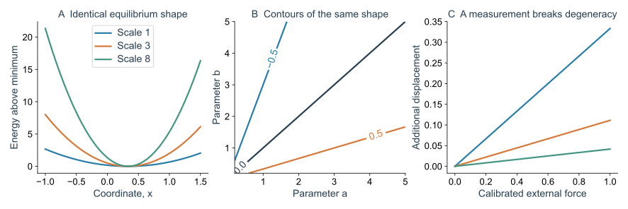
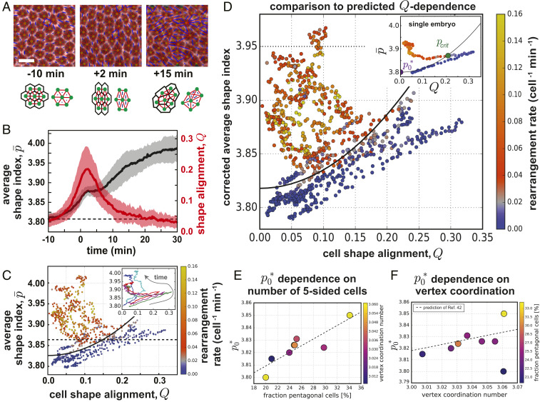
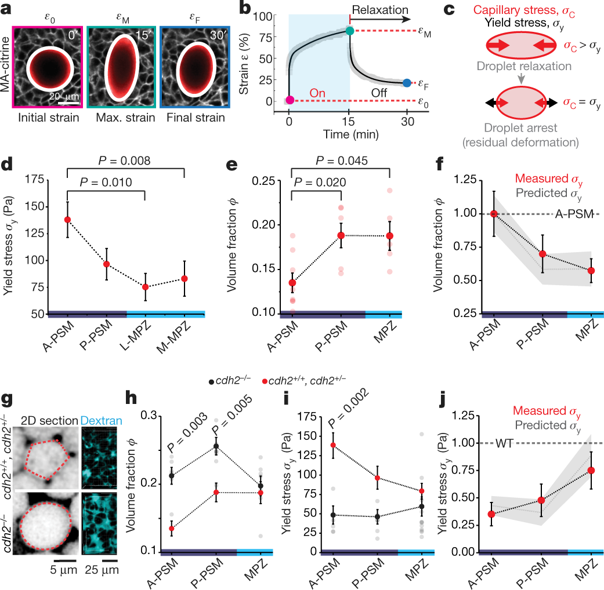
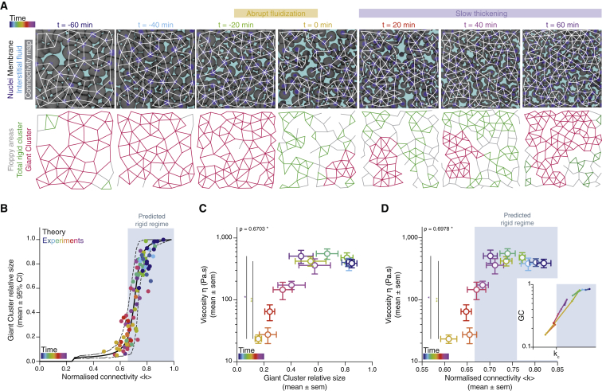
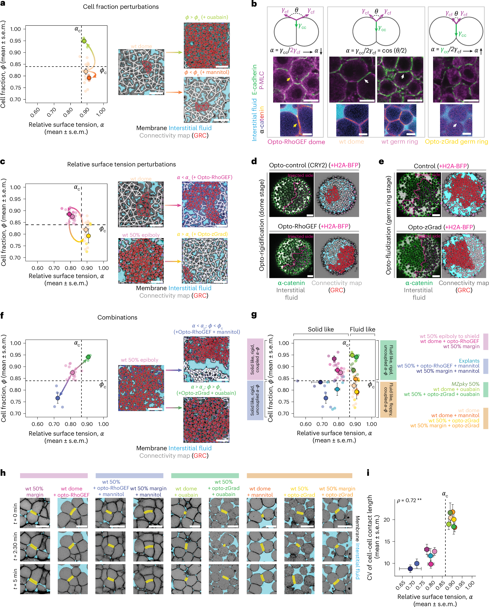
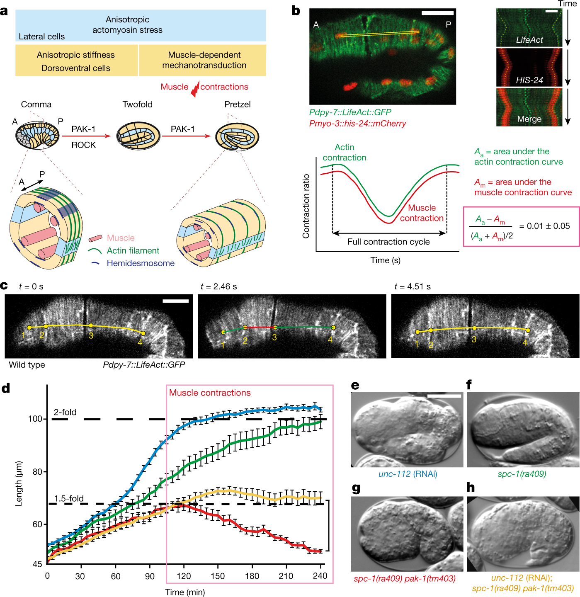
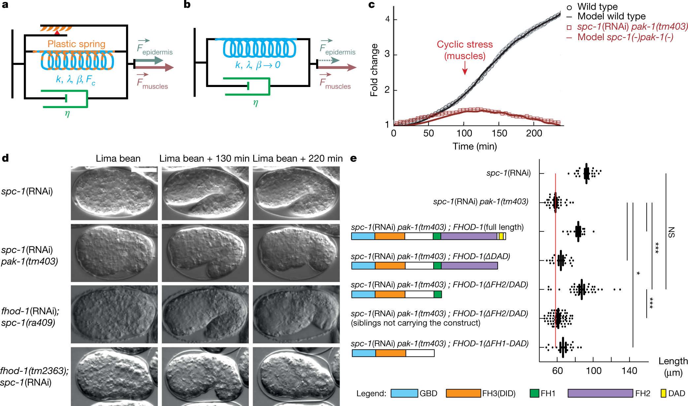
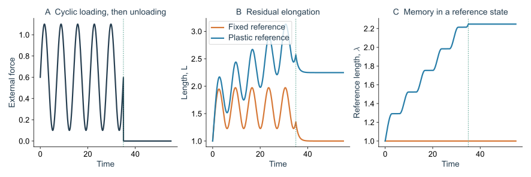
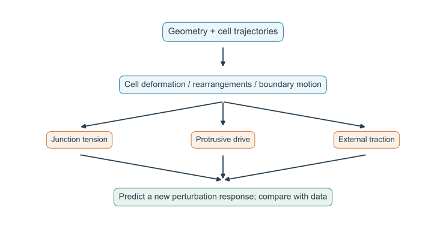

> **Part V · Note 07**　[专题目录](/notes/vertex_model/) · 上一篇：[几何推广](/notes/vertex_model/geometry_3d/)

**物理问题：** 一个模型画出了像胚胎或类器官的形状，怎样进一步判断它是否保留了真实的力学机制？

## 概述：用发育过程检验理论，而不只展示模拟形状 {#main-lecture}

**形态发生**指胚胎中的细胞通过运动、变形和重新排列，逐渐形成身体结构的过程。比如斑马鱼细胞在卵黄上铺开，果蝇的一片细胞层变窄变长，线虫表皮从两侧相遇并闭合。这些过程都可以在视频中看见，但“形状怎样变了”和“什么推动它变化”是两个需要分别回答的问题。

前面几篇给出了分析的工具：用能量描述变形的代价，用恢复力描述小扰动下的软硬，用重排和松弛描述时间。现在把这些工具放回具体胚胎，看看怎样从显微图、力学测量和生物干预一步步判断机制。

本篇以果蝇和斑马鱼为主要发育案例。果蝇从胚带、蛹翅到腹沟和卵室，提供了排列、定向重排、边界牵拉与三维弯曲的比较；斑马鱼则让我们在胚盘和尾部测量材料响应，并把接触几何与信号联系起来。培养上皮和线虫用于进一步检验这些解释的适用范围。

检验模型时，一个具体问题是：如果模型说某种力或某类重排负责这次变化，减弱它以后，胚胎应该出现什么不同？这种对新实验的预测，比单看模拟终点像不像更能检验解释。

## 1. 从“像不像”走向“干预以后会怎样”

假设一片组织已经变长，我们至少能提出几种解释：两端被周围组织拉开；内部细胞沿某个方向收缩、挤出另一方向的伸长；细胞主动钻入邻居之间；或者某一端不断加入新细胞。它们有时会产生相似的最终轮廓，却预期不同的受力位置、运动顺序和干预结果。

因此，模拟得到相似形状是一个起点。下一步要找几种解释各自预期不同的地方，例如切断一条交界会往哪里回缩、抑制某个驱动以后哪一段运动先停止。

更有力的检验要求模型同时约束时间顺序、空间分布和干预响应。例如，拟合细胞形状以后，再预测激光切割后的速度方向、改变驱动后的松弛时间，或在不重新调参的条件下预测邻接变化的位置。

下面用数学把这种歧义说清楚。把所有测量值放进 $\mathbf y$，把模型中的刚度、张力、摩擦等参数放进 $\boldsymbol\theta$，模型预测记为 $\mathbf y=\mathcal F(\boldsymbol\theta)$。在当前拟合结果附近，参数改一点，预测改多少，可写为

$$
\delta\mathbf y\simeq\mathcal J\delta\boldsymbol\theta,
\qquad\mathcal J_{ab}=\frac{\partial\mathcal F_a}{\partial\theta_b}.
$$

$\mathcal J$ 像一张敏感度表：每一列说明某个参数改一点，会让各项测量怎样变化。如果“增大张力”和“减小摩擦”对现有测量的影响几乎能够相互抵消，这些数据就难以分清两者。数学上把完全看不见的组合称为零空间方向，变化很小的组合则对应近零方向。

多拍几帧可以减少随机误差，却未必解除这种参数之间的补偿。更有用的办法是加入一种对两者反应不同的测量，下面的两根弹簧是一个能完整算出的例子。

### 1.1 一个能精确指出歧义的力学例子

设一个点同时被左右两根弹簧牵住，左右偏好的位置分别是 $-1$ 和 $+1$，两根弹簧的刚度为 $b$ 和 $a$。总能量为 $E(x)=a(x-1)^2/2+b(x+1)^2/2$。求最低能量的位置，再求这个位置附近的恢复力，得到

$$
x_* =\frac{a-b}{a+b},\qquad k_{\rm eff}=a+b.
$$

测出 $x_*$ 只能确定 $a/b$，不能确定 $a+b$。将 $a,b$ 同时乘十，平衡位置不变，材料却硬十倍。再令过阻尼系数 $\zeta$ 也乘十，未受标定外力的松弛时间 $\tau=\zeta/(a+b)$ 仍然不变。

如果两根弹簧同时变硬十倍，点仍停在同样的位置；如果摩擦阻力也同时增大十倍，松弛回去的时间也不变。只看位置和这段松弛，我们可能把这些体系当成同一种。

这时施加一个事先知道大小的小外力 $F$，再量额外移动的距离 $\Delta x=F/(a+b)$，就能分辨总刚度：同样的力，越硬就移动越少。“标定外力”指在模型之外知道它有多大，这正是它能带来新信息的原因。

*图 1 · 一个形状可以对应许多力学参数。* 自制二次能量计算。不同系数整体缩放保持极小值位置，标定外力下的位移斜率则不同。它用于解释反问题的结构，不是对胚胎力学参数的拟合。

### 1.2 拟合、预测与机制证据分别增加了什么

用一组细胞形状调整参数，是拟合；用这组参数计算尚未参与拟合的切割响应或重排方向，是预测；将不同机制的预测放在同一种干预下比较，才开始形成机制判别。

这些层次不要求模型包含所有分子。一个最小模型可以省略大量细节，却对关键干预给出准确预测；一个复杂模型也可能因为参数很多而能复现现有数据，却无法排除竞争解释。应该根据可区分的预测评价新增变量是否值得保留。

## 2. 果蝇：从胚带到翅、腹沟与卵室 {#drosophila}

果蝇早期胚胎有一片称为**胚带（germband）**的细胞层。胚带延长时，整体沿头尾方向变长、横向收窄。可以把它想成一块由许多小格子组成的布：布变长，既可能是格子被拉长，也可能是格子通过换邻居从横排重新排成纵排。

从膜标记视频中逐个追踪细胞，能量出细胞长轴、形状和接触何时变化；对局部运动做分解，可以估计这些变化各自贡献多少组织伸长。随后才继续问，是什么力让它们朝这个方向发生。

[Wang 等（2020）](https://doi.org/10.1073/pnas.1916418117)把果蝇胚胎数据与 Vertex 模拟比较，研究哪些几何信息能预测快速重排。除了细胞有多细长，还包括它们朝向是否一致，以及邻居数和排列有多不规则；后者常叫 **packing disorder（排列无序）**。

这些指标是从图像得到的状态描述。它们与重排的对应关系很有用，但要知道材料恢复力和驱动来源，还需要加入受力或干预实验。

*图 2 · 从成像构造力学代理量。* 引自 [Wang 等（2020），Fig. 4](https://pmc.ncbi.nlm.nih.gov/articles/PMC7306759/#fig04)，原图未修改。A 为膜标记成像和三角网格；B 为形状与取向随时间变化；C、D 将每个胚胎、每个时间点放入二维指标空间，颜色表示细胞重排速率；E、F 检查排列无序的影响。

先从 A 看测量过程：红色三角网格连接被追踪的细胞中心，蓝色伸长标记用于构造取向信息。然后读 B：平均形状与平均取向不是同一条随时间变化的曲线，所以丢掉取向会把不同几何状态投影到同一个标量上。

再看 C、D 的点。一个点不是一个细胞，也不是一次 T1，而是某个胚胎在某个时间点的组织统计。点的颜色表示该时刻的重排指标。把这些层次混淆，会错误估计独立样本数，也会把组织层面的相关性当成单细胞的确定性规则。

### 2.1 怎样设计对形状判据更严格的检验

如果使用一部分胚胎拟合几何边界，应在未参与拟合的胚胎或扰动条件上评估预测。还需要比较重排前后的时间滞后：形状先变化、重排后变化，与重排推动形状变化，可能产生相似的同一时刻相关图。

若能同时改变外部拉力与内部收缩，便可以问：相近的形状和取向，是否仍然给出相近的重排？若答案依赖实际驱动，就需要把形状视作状态指标的一部分，并补上驱动信息，而不是给一个标量寻找更精确的阈值。

一个针对这一系统的检验设计是：先比较形状与取向，再比较 T1 的方向、持续性和空间相关；最后引入力学扰动，区分“重排容易发生”与“存在足够强的定向驱动”。即使两片组织的 T1 频率相同，它们的净延伸也可能不同。

### 2.2 蛹翅：组织能不能变长，也取决于外面怎样牵住它 {#fly-pupal-wing}

翅发育提供了胚带之外的第二个比较。蛹翅包含近身体的翅铰和更远端的翅片，外围又有角质层及其连接。细胞自身的收缩、重排与外部约束共同决定翅的形状。

[Etournay 等（2015）](https://doi.org/10.7554/eLife.07090)比较正常翅和 $dumpy$ 突变翅。Dumpy 是参与将上皮连接到外部角质层的细胞外基质蛋白。改变这些连接，相当于改变组织周围怎样传力；这与直接抑制细胞内部的收缩是不同的操作。相关切割实验已放在 [Note 02](/notes/vertex_model/linear_response/#fly-wing-ablation)。

*图 3 · 同样研究细胞重排，也要把组织外部的连接画出来。* 引自 [Etournay 等（2015），Fig. 2](https://doi.org/10.7554/eLife.07090.005)，CC BY，原图未修改。A、B 比较发育轨迹；C–H 定位 Dumpy 连接；I、I′ 比较圆形切割响应和细胞伸长。图中的方向和幅度应按原图例分别阅读。

#### 论文视频 · 果蝇蛹翅：正常与 dumpy 突变翅怎样逐渐形成不同形状

<figure class="vertex-video" id="video-etournay-wing" style="--vertex-video-width: 650px">
<video controls preload="metadata" playsinline width="668" height="720" aria-label="果蝇蛹翅：正常与 dumpy 突变翅怎样逐渐形成不同形状" src="https://static-movie-usa.glencoesoftware.com/mp4/10.7554/15/a281fa076aaeecaaab37e46e5f014bf5a25f2f4b/elife-07090-media2.mp4">
<a href="https://static-movie-usa.glencoesoftware.com/mp4/10.7554/15/a281fa076aaeecaaab37e46e5f014bf5a25f2f4b/elife-07090-media2.mp4">直接打开原始视频</a>。
</video>
<figcaption><strong>显微视频</strong>｜Etournay 等（2015），Video 2。Ecad::GFP 标记细胞交界；WT 与 dumpy 突变翅的同步延时成像，原文按约 26.5 hAPF 的组织事件对齐时间。 视频未修改，权利与许可见原文。<a href="https://doi.org/10.7554/eLife.07090.009" target="_blank" rel="noopener">原文与完整视频说明</a> · <a href="https://static-movie-usa.glencoesoftware.com/mp4/10.7554/15/a281fa076aaeecaaab37e46e5f014bf5a25f2f4b/elife-07090-media2.mp4" target="_blank" rel="noopener">直接打开原始视频</a>。</figcaption>
</figure>

**先看哪里：** 上方是 WT 正常翅，下方是 dumpy 突变翅。先比较整体轮廓、翅铰与翅片的相对变化。画面的发育时间与播放器秒数不同，按时间标记对照。

**怎样读物理：** 先建立正常和突变体的形态变化印象，再回到细胞追踪、切割和应力分析。整体形状差异本身不能告诉我们每次 T1 的位置或受力大小。

这个实验适合检验模型的边界。如果把蛹翅当成周期平面，无论内部参数多精细，都没有外部连接可供切断。合理的最小模型至少要表示翅铰、翅片和可改变的边界连接，再比较干预后的回缩、细胞伸长、重排和整体翅形。

### 2.3 腹沟和卵室：同样是收缩，施力位置与形变变量并不相同

胚带通过定向接触更新延长，腹沟通过顶端收缩与面外运动向内折，卵室则有基底侧周期收缩参与形状变化。它们都依赖细胞骨架，却不宜用“提高一个统一的活性参数”代替具体过程。

| 果蝇过程 | 先追踪什么 | 模型中要保留什么 |
| --- | --- | --- |
| 胚带延长 | 哪类旧接触缩短、新接触沿哪里打开 | 有方向的驱动、持续邻接变化与多细胞交汇 |
| 蛹翅重塑 | 翅片、翅铰与外部连接各自怎样移动 | 实际边界、外部牵拉与细胞过程分解 |
| 腹沟形成 | 顶面面积、收缩后的回弹与内陷深度 | 脉冲、形变保留和面外自由度 |
| 卵室延长 | 基底骨架、卵室宽度与长轴 | 顶基底差异、基质连接和曲面受力 |

腹沟的脉冲与稳定机制见 [Note 05](/notes/vertex_model/rheology_activity/#fly-pulsed-constriction)，腹沟和卵室的空间几何见 [Note 06](/notes/vertex_model/geometry_3d/#fly-ventral-furrow)。这样比较以后，模型省略了哪一项就有具体含义：省略外部连接会漏掉蛹翅的边界作用，省略基底面会漏掉卵室中的施力位置，而只数 T1 又会漏掉没有换邻居的形变。

## 3. 斑马鱼：同一个胚胎里，为什么需要几种组织物理 {#zebrafish}

### 3.1 先给不同实验放回正确的发育位置

先看早期胚胎。大的卵黄提供营养，胚盘细胞像一个帽子位于卵黄上方。随后细胞层逐渐变薄、向周围扩展，覆盖更多卵黄表面，这个过程称为**外包或铺展（epiboly）**。图中的 50% epiboly 是发育位置的标记，大致指细胞覆盖的前沿到达卵黄赤道附近，不是“完成了一半的细胞分裂”。胚盘深层细胞的接触、间隙和材料响应，是下面一组实验的对象。

再看较晚的阶段。胚胎已经出现头尾和身体轴，尾端仍在加入和重新安排细胞，使身体向后延长。尾部的 **MPZ** 是中胚层祖细胞区；它前方的 **PSM** 是体节前中胚层，之后会分段形成体节。论文比较的“前后材料梯度”，主要发生在这一带。它和早期胚盘铺展的几何、边界都不同。

还有一组实验关注早期胚盘边缘的 Nodal 信号：哪些细胞收到信号、细胞外液体通道是否改变。下面的表把这些问题放在一起，方便读文献时确认研究的是哪个时期、哪块组织。

| 系统与过程 | 直接测什么 | 首先要解释的物理问题 | 不能直接替代的量 |
| --- | --- | --- | --- |
| 胚盘深层细胞，铺展前后 | 微吸管蠕变与恢复、接触网络 | 有限时间黏度怎样随承力接触组织改变 | 黏度不是静态剪切模量 |
| 尾部 MPZ 与 PSM，体轴延长 | 液滴受力、驱动与卸载、相对细胞运动 | 能重塑的后部怎样与保留支撑的前部配合 | 运动速度不是材料流动性 |
| 胚盘独立密度与界面干预 | 细胞体积分数、接触角、材料响应 | 自然发育中的共变，究竟由哪个控制方向驱动 | 接触数不是完整的界面力学 |
| 边缘区形态素与细胞外空间 | 液体通道、形态素分布、信号动力学 | 接触重组怎样反馈到运输和反应 | 组织刚度不是分子扩散系数 |

图例里常见的 **WT／wt（野生型）**指用来比较的正常遗传背景。**突变体**改变了特定基因，**RNAi**则通过 RNA 干扰降低某些基因的表达。它们用于追问某个分子过程是否参与变化，但一种处理也可能同时影响黏附、收缩和细胞行为，不能直接当成“只把模型里的一个数改了”。

**荧光标记**帮助识别结构，比如膜标记显示细胞轮廓，核标记帮助跟踪细胞。颜色通常是人为指定的显示方式；洋红、青色并不是细胞本来的颜色。看视频时先读标记说明，再认位置和时间，后面的力学比较会更容易。

#### 论文视频 · 斑马鱼正常发育：先看清胚盘铺展的空间过程

<figure class="vertex-video" id="video-rustarazo-epiboly" style="--vertex-video-width: 760px">
<video controls preload="metadata" playsinline width="4048" height="2304" aria-label="斑马鱼正常发育：先看清胚盘铺展的空间过程" src="https://media.springernature.com/original/springer-static/esm/art%3A10.1038%2Fs41567-026-03276-6/MediaObjects/41567_2026_3276_MOESM7_ESM.mp4">
<a href="https://media.springernature.com/original/springer-static/esm/art%3A10.1038%2Fs41567-026-03276-6/MediaObjects/41567_2026_3276_MOESM7_ESM.mp4">直接打开原始视频</a>。
</video>
<figcaption><strong>显微视频</strong>｜Rustarazo-Calvo 等（2026），Supplementary Video 5。野生型胚胎约 30%–60% epiboly 的光片成像；膜为洋红，细胞外液体为绿色，采样间隔 15 min，标尺 100 μm。视频未修改，权利与许可见原文。<a href="https://www.nature.com/articles/s41567-026-03276-6#MOESM7" target="_blank" rel="noopener">原文与完整视频说明</a> · <a href="https://media.springernature.com/original/springer-static/esm/art%3A10.1038%2Fs41567-026-03276-6/MediaObjects/41567_2026_3276_MOESM7_ESM.mp4" target="_blank" rel="noopener">直接打开原始视频</a>。</figcaption>
</figure>

**先看哪里：** 左栏是发育时间推进的三维投影；中、右栏分别旋转展示起点和终点的构型。后两栏的转动是观察视角变化，不是胚胎真的按那个方向旋转。视频很短，建议减速后反复拖动比较。

**怎样读物理：** 先用它建立组织位置与空间尺度，再进入下面的局部材料测量。大尺度铺展、局部细胞换邻居和接触长度涨落是三个层次，不能从全胚形状直接读出后两者。

### 3.2 尾部材料梯度：测出“前方能支撑”与“后方能重塑”

[Mongera 等（2018）](https://doi.org/10.1038/s41586-018-0479-2)在不同位置放入能响应磁场的小液滴。普通油滴的表面张力倾向于让它恢复成球，加入磁性成分后，外部磁场又能把它拉长。这样就能在胚胎内部施加一个受控的局部变形，而不只观察细胞自发怎样动。

实验可以按三步读：先记录液滴和周围细胞的初态；打开磁场，让液滴拉长并推动组织；关闭磁场，观察它恢复多少、多久后趋于停止。若组织很容易重新排列，液滴的表面张力更容易推动周围细胞，让它接近恢复球形；若周围组织能撑住较小的回复应力，液滴就可能保留明显的残余形变。已知界面张力、结合剩余曲率，可以估计这段测量时间内的屈服响应。

*图 4 · 材料图谱来自受控力学测量。* 引自 [Mongera 等（2018），Fig. 2](https://www.nature.com/articles/s41586-018-0479-2/figures/2)，原图未修改。a–c 定义液滴驱动、残余形变与毛细回复应力；d–f 比较沿体轴的屈服响应和细胞外空间；g–j 加入 $cdh2$ 扰动。原图中的 $\phi$ 表示细胞外空间比例，本文统一记为 $\epsilon$，以免与细胞体积分数混淆。

图 a–c 先看“开磁场—关磁场”的时间顺序，再看残余形变怎样换算为应力。之后读 d–f，比较不同身体位置：前方 PSM 在这套加载和等待条件下更难被持续重塑，后方 MPZ 更容易重塑。

这里的屈服响应描述“多大的机械作用能让组织继续发生不可恢复的变化”。它与 Note 02 中“轻轻剪切时的恢复模量”有关，却不是同一个测量。等待更久或用更大的力，还可能看到新的变化，所以应将结论与这次实验的时间和加载条件一起理解。

还有一个重要密度区别：细胞数密度是 $N/V_{\rm tissue}$，细胞体积分数则为 $\sum_iV_i/V_{\rm tissue}$。当细胞体积改变时，前者近似不变并不要求后者不变。原研究没有把明显的前后细胞数密度梯度作为前提；不能将“细胞外空间减少”随手改写成“细胞数越挤越多”。

$cdh2$ 是编码 **N-cadherin** 的基因。N-cadherin 是参与细胞间黏附的膜蛋白，改变它会影响细胞怎样接触。把正常与 $cdh2$ 突变胚胎的接触、间隙和液滴响应放在一起比较，可以检验界面作用是否参与前后差异。

这个例子也告诉我们模型要保留什么：若要解释细胞之间的空隙，模型必须允许自由表面、新接触以及接触面积变化。强制每处都被细胞填满的二维铺砌，可以研究另一类问题，却无法产生这些孔隙作为预测。

### 3.3 材料变软以后，谁决定伸长方向

后部更容易重排，并没有自动指定“向后”。局部快速张力涨落可以帮助越过构型障碍；定向组织应力、细胞从背侧区域进入 MPZ 的供给，以及较稳固 PSM 的边界作用，共同限制组织在哪里、沿哪个方向扩张。

*图 5 · 方向选择与材料更新承担不同功能。* 引自 [Mongera 等（2018），Fig. 4](https://www.nature.com/articles/s41586-018-0479-2/figures/4)，原图未修改。a、b 提出材料状态与发育过程的联系；c–e 比较含有和不含所设材料转变的连续模型。图中的“有效温度”是主动涨落的现象类比，不代表已验证热平衡涨落—响应关系。

为什么还需要细胞供给和边界？设后部细胞已经很容易换位置，如果没有定向的力，也没有限制扩张方向的周围组织，它可能朝多个方向变形。若同时有新细胞进入，这个区域还必须安排新增体积的去向。要算出整体运动，需要把这几件事放入同一套方程。

这里用连续介质近似，把许多细胞平均成一个材料。胚胎尺度的运动通常可忽略惯性：一处运动并不是靠“冲出去的惯性”维持，而是不断受力并克服阻力。下面第一式是各处力平衡，第二式是细胞体积的收支：

$$
\nabla\cdot\boldsymbol\sigma+\mathbf f_{\rm ext}=0,
\qquad
\partial_t\phi+\nabla\cdot(\phi\mathbf v)=s_V.
$$

$\mathbf v$ 是平均运动速度，$\boldsymbol\sigma$ 是各方向的内部应力，$\mathbf f_{\rm ext}$ 表示外部作用；$s_V$ 记录单位体积、单位时间新增多少细胞体积。若细胞从区域边界进入，收支也可通过边界通量表示，应和所选区域一致。

再用 $\boldsymbol\sigma=-p\mathbf I+2\eta(\mathbf x)\mathbf D+\boldsymbol\sigma^{\rm a}$ 作最简单的黏性近似：$p$ 是压力，$\eta(\mathbf x)$ 表示黏度随位置变化，$\mathbf D$ 记录局部变形速度，$\boldsymbol\sigma^{\rm a}$ 表示主动产生的应力。要得到流场，还得指定边界怎样受力、细胞怎样加入；若材料有明显屈服或长记忆，则需要更完整的本构关系。

这说明几项输入无法互相替代：材料场决定变形代价；应力和边界提供方向约束；供给决定局部需要容纳多少细胞。各向同性提高重排频率只会使更新更容易，仍不足以指定速度场，详见 [Note 05 的双通道推导](/notes/vertex_model/rheology_activity/#activity-direction)。

在模型里可以做一个直接的对照：保持新细胞进入的位置和速率、保持主动应力，只把前后材料差异抹平，再看身体是否仍向后伸长、是否出现横向膨胀。另一次保留材料差异，却改变细胞进入的位置或边界作用。这样的“假如只改这一项”叫反事实比较。

这是数值模型能够实施的检验设计，不代表实验已经能只改一项而让其他条件完全不变。它的作用是先算出几种机制各自预期怎样的流场和形态，再寻找能够区分它们的实际干预。

### 3.4 胚盘铺展：发育程序怎样暂时撤去约束

现在回到早期胚盘，问题变成：细胞仍彼此黏着，组织怎样先容易铺开，随后又变得更难变形？细胞进入分裂时常会变圆，原来的接触面积和邻接关系随之改变。这可能暂时撤去一部分运动限制，让周围细胞更容易重新排列。

[Petridou 等（2019）](https://doi.org/10.1038/s41556-018-0247-4)把分裂圆化、接触改变与铺展时的流体化联系起来，并研究 Wnt 信号对不同区域的调节；[2021 年的工作](https://doi.org/10.1016/j.cell.2021.02.017)进一步分析接触网络里的刚性簇。Wnt 是一类细胞间信号；这里关心的是它怎样通过改变细胞行为，影响接触和材料响应。

*图 6 · 发育轨迹可以进入、再离开容易重塑的区间。* 引自 [Petridou 等（2021），Fig. 2](https://pmc.ncbi.nlm.nih.gov/articles/PMC8055543/#fig2)，原图未修改。A 将成像与刚性图配对；B 与相同尺寸的随机网络比较；C、D 联结刚性簇、连接度与黏度。颜色编码时间，因而首先描述的是一条自然发育轨迹。

这一图景将基因调控放到了可计算的位置：它能改变细胞接触的生成、断裂和寿命，使独立约束的空间分布变化。调控不必直接改一个抽象“组织黏度参数”，也能通过局部几何事件改变大范围响应。[Note 03](/notes/vertex_model/rigidity/)中的铰链算例说明为什么组织仍然连通，却能因少数关键约束消失而明显变柔。

不过，胚胎正常发育时，细胞密度、接触张力、分裂和活动往往一起变化。只看“时间越晚，接触越多，黏度也越大”，仍难判断是哪一项起主要作用。要进一步分开它们，需要找到自然发育中不会自动出现的组合，比如较低密度配较强界面作用，或较高密度配较弱界面作用。

### 3.5 独立干预：黏附驱动的刚化与密度 jamming 怎样区分

[Rustarazo-Calvo 等（2026）](https://doi.org/10.1038/s41567-026-03276-6)把几类干预组合起来，分别研究细胞体积分数 $\phi$ 和相对界面张力 $\alpha=\gamma_{\rm cc}/(2\gamma_{\rm cf})$。$\phi$ 回答“空间有多少被细胞占据”；$\alpha$ 比较细胞—细胞界面与细胞—液体界面的力学代价，其定义和接触角在 [Note 01](/notes/vertex_model/foundations/#adhesion-interfaces)中解释。

**渗透干预**通过改变环境的渗透条件，使水在细胞与外液之间重新分配，从而改变细胞体积和占据比例；这不同于增加细胞数。**光遗传干预**是先让细胞表达能响应光的工具，再用光改变特定蛋白的定位或稳定性，以调节收缩、黏附等过程。这里的光并非直接把组织照硬，而是通过细胞内的分子工具起作用。

组合这些操作，才能得到密度相近、界面作用不同，或界面条件相近、密度不同的组织。若材料响应随其中一项改变，就比沿正常发育时间观察到的相关性更能区分原因。

*图 7 · 打破控制量之间的共变，才能区分机制。* 引自 [Rustarazo-Calvo 等（2026），Fig. 3](https://www.nature.com/articles/s41567-026-03276-6/figures/3)，原图未修改。a 改变细胞体积分数；b–e 改变界面作用并进行局部操作；f、g 联合干预覆盖不同参数组合；h、i 比较接触动力学。图中分界对应原文模型和实验条件，不能外推为物种无关常数。

这里的关键比较是：在所测条件下，低细胞体积分数也能出现较高黏度，高细胞体积分数也不保证较高黏度；还需知道界面作用及接触组织。仅从“更拥挤”推断材料状态，会把两个物理方向压成一个。

为什么平均接触数也可能不够？因为图上的一条边只记录“有接触”，没有记录接触面积、曲率、相对张力、滑动和更新时间。两个接触图相似的组织，仍可能具有不同的力学响应。这限制了将早期结构关联直接推广成普适本构定律的做法，也说明新结果与旧结果应在控制参数和观测窗口上比较。

可以把这种依赖写成局部变化的记账：若某个观测 $O$ 依赖 $\phi,\alpha,\tau_{\rm contact},a$，其中 $a$ 是主动驱动参数，那么沿实验路径

$$
\frac{dO}{d\lambda}
=\frac{\partial O}{\partial\phi}\frac{d\phi}{d\lambda}
+\frac{\partial O}{\partial\alpha}\frac{d\alpha}{d\lambda}
+\frac{\partial O}{\partial\tau_{\rm contact}}\frac{d\tau_{\rm contact}}{d\lambda}
+\frac{\partial O}{\partial a}\frac{da}{d\lambda}.
$$

一个分子干预改变的通常是这条路径，而非单一偏导数。“增强黏附后组织更硬还是更软”因此需要补全条件：是否允许新接触？是否改变孔隙与接触寿命？是否保持主动性？这个问题回接 [Note 01 的界面能记账](/notes/vertex_model/foundations/#adhesion-interfaces)，也解释为什么不能直接把实验黏附量等同于经典汇合模型的 $p_0$。

#### 论文视频 · 斑马鱼四种材料条件：盯住同一条细胞接触

<figure class="vertex-video" id="video-rustarazo-contacts" style="--vertex-video-width: 760px">
<video controls preload="metadata" playsinline width="2024" height="1152" aria-label="斑马鱼四种材料条件：盯住同一条细胞接触" src="https://media.springernature.com/original/springer-static/esm/art%3A10.1038%2Fs41567-026-03276-6/MediaObjects/41567_2026_3276_MOESM4_ESM.mp4">
<a href="https://media.springernature.com/original/springer-static/esm/art%3A10.1038%2Fs41567-026-03276-6/MediaObjects/41567_2026_3276_MOESM4_ESM.mp4">直接打开原始视频</a>。
</video>
<figcaption><strong>显微视频</strong>｜Rustarazo-Calvo 等（2026），Supplementary Video 2。α-catenin-citrine 膜标记为洋红，细胞外液体为青色；采样间隔 10 s，标尺 50 μm。四栏对应原文的不同 α–φ 材料条件。视频未修改，权利与许可见原文。<a href="https://www.nature.com/articles/s41567-026-03276-6#MOESM4" target="_blank" rel="noopener">原文与完整视频说明</a> · <a href="https://media.springernature.com/original/springer-static/esm/art%3A10.1038%2Fs41567-026-03276-6/MediaObjects/41567_2026_3276_MOESM4_ESM.mp4" target="_blank" rel="noopener">直接打开原始视频</a>。</figcaption>
</figure>

**先看哪里：** 先读四格条件：左列为两种固体样状态，右列为两种流体样状态。再选择一对细胞，看共享接触怎样伸缩，以及周围液体空间是否持续重组。比较联合光遗传与渗透干预后，图中看起来同样“拥挤”的组织是否仍有不同动态。

**怎样读物理：** 这里将“密度与界面作用可以分开改变”变成可见的接触动力学比较。固体样、流体样标签来自原文的整体实验判定，不能只靠几秒视频中谁移动得多重新分类；镜头内的整体漂移也应与相对重排分开。

### 3.6 从力学再走回信号：模型必须允许双向反馈

最后，界面与孔隙不只是决定材料响应。它们还决定形态素经过的细胞外通道。[Autorino 等（2026）](https://doi.org/10.1038/s41556-026-01954-4)把 Nodal 信号、接触重组和运输反馈联系起来，相关原图与守恒推导见 [Note 06](/notes/vertex_model/geometry_3d/#porosity-transport)。

可以顺着变化的先后读这个反馈：信号改变细胞的界面作用，接触扩大或缩小，液体通道随之改变，分子运输和局部浓度也可能变化，最后影响细胞收到的信号。一次接触重组可能同时改变承力和运输，但要解释信号范围，仍要测量中间的通道、浓度与反应步骤。相关模型和视频放在 Note 06。

贯穿这几组斑马鱼实验的共同方法，是让**材料定义、测量协议与发育功能逐一对应**：先确定测到的是哪种响应，再找出能独立操纵的局部机制，最后检验该机制是否改变预测的流场、形态或信号范围。

## 4. 上皮壳层：三维形态提供什么约束

再看三维细胞层。**类器官**通常指在培养条件下形成、具有部分器官结构或功能的细胞体系。这里引用 [Rozman 等（2020）](https://doi.org/10.1038/s41467-020-17535-4) 的模型：它将细胞组成一个围绕内腔的壳层，改变顶端、基底和侧面的张力，并允许主动重排，得到出芽、内陷和分支等形态。

“出芽”是局部向外鼓出，“内陷”是向内凹入。这些形状与某些类器官相似，但模型首先研究的是一层有极性细胞怎样改变空间形状，并没有同时模拟特定器官的所有分化和功能。

要进一步检验机制，可同时测量局部曲率、细胞高度、顶基底面积差和缺陷分布，并检验改变重排活性以后，出芽位置与分支时间是否按预测变化。仅凭壳层出现一个芽，难以区分差异表面张力、局部增殖或外部约束。

*图 8 · 把形态、事件与细胞排列联系起来。* 引自 [Rozman 等（2020），Fig. 2](https://www.nature.com/articles/s41467-020-17535-4/figures/2)，CC BY，原图未修改。a 对照不同活性下的最终构型；b 比较能量；c、d 检查拓扑缺陷的空间组织；后面的面板改变活性时间过程或采用张力涨落驱动。

读这些模型结果时，可以选一个参数连续比较：例如主动重排更频繁以后，出芽的位置、分支形成的时间和缺陷聚集是否也改变。细胞需要经过一串中间构型才能形成分支，末态能量较低，也未必在给定时间里到得了。把形成顺序与终点一起比较，会比只数最后有几个芽提供更多信息。

### 4.1 形态相图不一定是平衡相图

在持续主动驱动或规定重排历史的体系里，参数平面中的不同形态可能是动态制备得到的末态分布。它们不必对应全局自由能最小态，也不必满足平衡相共存条件。是否存在形态转变、滞后与路径依赖，需要根据实际驱动和观测协议判断。

因此，实验对照应尽量包含发育轨迹，而不只比较终点类别。相同最终芽数可能来自不同的形成顺序；芽的位置、局部厚度、缺陷寿命与形成时间可以提供额外区分。

## 5. 线虫的三个过程要求不同最小模型 {#worm-comparison}

线虫的例子有助于看清“同样变长，驱动也可能不同”。它的表皮最初还没有围成完整外壳，之后经历细胞插入、包被闭合和整体伸长。先按画面认识三个过程：

**背侧间插**：背部两排表皮细胞交错插入彼此之间，逐渐排成更窄的一列。**腹侧包被**：表皮从两侧向腹部推进，前沿相遇后建立接触，把胚胎包起来。**胚胎伸长**：包好的表皮及内部组织继续改变形状，身体由短粗逐渐变长变细。下面的表整理了每个过程最需要保留的运动和受力。

| 过程 | 需要保留的物理 | 对标准二维模型的要求 |
| --- | --- | --- |
| Dorsal intercalation，背侧细胞间插 | 方向性基底侧突出、细胞邻接与主动运动 | 单纯缩短顶端交界可能丢掉主要驱动；需显式主动极性或基底侧自由度 |
| Ventral enclosure，腹侧包被闭合 | 自由边界迁移、接触建立与封闭 | 需开放边界及接触形成规则；没有自由边界的周期模型无法描述闭合过程 |
| Embryonic elongation，胚胎伸长 | 表皮收缩、外部肌肉牵引、细胞骨架重塑 | 需方向性应力与随时间改变的参考构型，不能默认形变主要来自 T1 |

背侧间插中，[Walck-Shannon 等（2015）](https://doi.org/10.1242/dev.127597)研究了 Rac 依赖的极性基底侧突出。这提醒我们，图像里出现邻居变化，并不唯一指向由顶端收缩性 T1 驱动的解释。

*图 9 · 邻居交换可以伴随标准顶端网络没有保留的运动。* 引自 [Walck-Shannon 等（2015），Fig. 1](https://pmc.ncbi.nlm.nih.gov/articles/PMC4631769/#DEV127597F1)，原图未修改。A 为胚胎背侧视图和细胞位置；B、C 显示肌动蛋白标记及基底侧突出；D 比较早晚阶段的突出方向分布。

读图时先找 C 的截面：它让我们看到细胞不仅在顶面改变轮廓，还可以从更靠基底的一侧伸出突起。这些突起依赖细胞骨架，能帮助细胞向邻居之间前进。Rac 是参与调节这类突出和运动的信号蛋白。

如果模型只规定顶端交界收缩，也许能画出类似的邻接变化，却没有表示这次前进实际依赖的突出。可以用一个有效主动推动来简化突出，但应检查它能否预测突出方向、运动顺序及相关干预后的结果。

腹侧包被时，最前方的先导细胞沿自由边缘迁移，两侧相遇后才形成新的接触。[Williams-Masson 等（1997）](https://pubmed.ncbi.nlm.nih.gov/9247332/)研究了这一迁移与随后肌动蛋白参与的闭合过程。这里的关键变量包括边缘在哪里、移动多快、何时黏合。模型若从一开始就把组织设成无边界的连续铺砌，就会省略要解释的闭合步骤。

伸长时还会出现另一种塑性：细胞之间几乎没有换邻居，细胞内部的骨架却在更新。可以想象弹簧一边被反复拉长，一边慢慢改变自己的原长；外力撤去以后，它就不会完全回到最初长度。[Lardennois 等（2019）](https://doi.org/10.1038/s41586-019-1509-4)将肌肉作用与表皮肌动蛋白网络中保留形变的机制联系起来。这个例子说明，寻找不可恢复的形变时，除了数 T1，还要看细胞内部的结构有没有改变。

*图 10 · 驱动力存在以后，还要解释形状怎样保留下来。* 引自 [Lardennois 等（2019），Fig. 1](https://www.nature.com/articles/s41586-019-1509-4/figures/1)，原图未修改。a 为组织受力框架；b、c 将肌肉运动与表皮骨架运动联系；d–h 比较不同扰动下的长度轨迹和末态。

这类轨迹的重要信息是“先伸长，随后又回缩”。如果一个模型只包含产生延长的力，可能能解释前半段，却不能解释为什么有些扰动后无法维持形状。需要判断外力是否减弱、弹性参考构型是否更新，以及表皮是否能把周期性输入转化为持久变化。

*图 11 · 把本构假说与独立干预放在一起。* 引自 [Lardennois 等（2019），Fig. 4](https://www.nature.com/articles/s41586-019-1509-4/figures/4)，原图未修改。a、b 画出力学模型，c 对照长度轨迹，d、e 增加分子干预。力学弹簧—黏壶是粗粒化描述，并不表示胚胎内部存在这些实体元件。

### 5.1 不改变邻接，也可以改变参考形状

用一个长度变量 $L$ 表示组织形变，参考长度为 $\lambda$，最小黏弹性力平衡可以写成

$$
\eta\dot L=F(t)-k[L-\lambda(t)].
$$

若 $\lambda$ 固定，周期驱动停止后，弹性力会将 $L$ 拉回原来的参考长度附近。若细胞骨架在受拉阶段更新参考结构，$\lambda$ 可以逐渐增大，卸载后便保留一部分形变。

一个用于演示的规则是

$$
\dot\lambda=\beta\max(\dot L,0)\,\Theta(L-\lambda),\qquad0\lt \beta\lt 1.
$$

这里采用预设的更新规则，只在组织正在伸长、弹簧也处于受拉状态时增加参考长度；未包含原论文的完整分子或本构模型，也未引入细胞邻居交换。

*图 12 · 塑性不必全部归因于 T1。* 自制一维方程积分，$k=\eta=1$，比较 $\beta=0$ 与 $\beta=0.25$；外力在若干周期后撤去。参考长度可以更新时，组织保留残余伸长。数值为任意单位，不拟合线虫的真实时长或长度。

这个例子也帮助区分“材料流动”和“持续生长式改变参考构型”。相同的最终不可逆形变，可以由拓扑重排、骨架塑性或其他内部变量更新实现。需要依靠细胞邻接、骨架和卸载响应来辨别。

关于线虫各阶段更完整的生物背景，可与[线虫胚胎形态发生专题](/notes/celegans/embryonic_morphogenesis/)对照阅读；这里保留它们对 Vertex Model 自由度选择的启发。

## 6. 把不同机制放入同一检验流程

除了胚胎，还可以用培养上皮检查同一套推理。MDCK 细胞绕障碍物流动的实验，将细胞形变与重排同 Maxwell 模型比较；人支气管上皮的实验则比较培养成熟过程中形状与运动停滞的关系，分别见 [Note 05](/notes/vertex_model/rheology_activity/#mdck-maxwell) 和 [Note 03](/notes/vertex_model/rigidity/#airway-jamming)。

培养细胞通常更容易控制基底、几何和处理条件，胚胎则提供发育中的空间约束与功能。比较时要先对齐测量：轨迹中的停滞、受控加载得到的松弛，以及发育最终形成的形状，各自需要不同证据。

*图 13 · 机制识别的最小流程。* 将形状、运动学、力学和干预放入同一链条。三个假说只用于说明可区分的驱动类别，不是对某个物种的完整机制分类。

可以按下面的顺序，把一个观察变成能检验的解释：

1. **固定几何层次。** 确定追踪的是顶端网络、曲面单层还是三维细胞，说明分割误差与未观察到的自由度。
2. **分解组织形变。** 计算细胞自身伸长、持续邻居交换、分裂或消失的贡献，避免把整体移动当作内部流动。
3. **约束力学与时间尺度。** 将切割、受控形变或松弛数据与模型比较，并说明从切割回缩速度推力还需要耗散假设。
4. **预测新的干预。** 用已经拟合的参数预测改变极性、收缩或外部牵引后的响应，再比较竞争机制能否同样解释结果。

这是一条逐步检验物理假说的路线。它不要求每个系统都做全部测量，但要求清楚说明现有数据排除了什么、仍允许什么。

### 6.1 同一套数据中应当保留哪些层次

静态几何包括细胞面积、周长、取向、邻居数和厚度；运动学包括速度梯度、细胞形变、持久邻接变化及组织边界；力学观测包括受控加载、切割、松弛或独立的牵引信息；生物调控则包括改变驱动和参考结构的分子过程。

这些量不必都达到相同测量精度，但应避免重复使用同一信息而误以为获得独立验证。例如，从同一组轮廓计算的多个形状指标通常相关；用其中一个拟合，再用另一个相近指标验证，强度弱于加入独立加载后的位移响应。

### 6.2 一个具体的竞争机制比较

设两种模型都能产生有方向的邻居交换。模型 A 通过提高某方向交界张力，模型 B 通过细胞极性突出。只比较平均 T1 率可能无法区分它们。可以进一步比较：切割某方向交界后的初速、基底侧突出是否先于接触变化、改变外部边界牵引后事件方向是否重排。

如果两种机制都能解释这些数据，就应保留这种不确定性，并寻找能产生不同预测的新干预。机制识别的进展不在于给一个模拟贴上唯一的生物解释，而在于逐步缩小仍然允许的机制集合。

## 7. 值得继续追问的物理问题

**细胞集体运动必须流体化吗？** 整片刚性组织可以平移，有静态刚性的组织也能在有限应力下塑性变形。应区分速度、内部应变率、重排与应力松弛。

**形状何时能作为力学代理量？** 只有在已验证的几何、各向异性、驱动与制备条件下，形状与刚性之间的经验映射才可用于预测；外推时要重新检验。

**相似流变是否说明相同微观机制？** 不同细胞过程可能给出相近的 $G^*(\omega)$。还需考察事件相关、干预响应和额外内部变量，才能判断这种相似性来自共同机制还是观测分辨率有限。

**三维自由度带来什么可检验的收益？** 如果二维与三维模型对现有观测给出同样预测，新增自由度可能暂时无法辨认；若厚度、突出或曲率决定干预结果，就应明确将它们保留下来。

贯穿整个系列的联系是：局部几何和能量约束允许的构型，残余应力决定局部恢复力，动力学与拓扑事件决定应力怎样松弛；真正的生物解释还需要识别实际驱动，并验证模型对新观测的预测。

## 技术附录：把“增加一个实验”变成明确的判别问题 {#technical-appendices}

### A. 先按观测精度衡量参数敏感度

如果不同观测的单位和误差不同，不能直接比较 $\mathcal J$ 的各行大小。设观测协方差为 $\Sigma$，局部加权信息矩阵为

$$
\mathcal I=\mathcal J^{\mathsf T}\Sigma^{-1}\mathcal J.
$$

它描述在当前模型、当前参数和噪声假设下，哪些参数组合更容易被数据约束。小本征值表示某些组合仍然难以辨识；参数单位也需适当无量纲化或改用相对变化，避免把单位选择误读为物理敏感度。

这是一种局部分析。它不能保证在远处没有另一个参数集合给出同样好的拟合，也不能替代不同模型之间的比较。模型选择还需要检验残差结构、外推预测和复杂度是否得到数据支持。

### B. 用最小例子整理形状、动力学和标定力各自提供的信息

在前面的二次能量例子里，取 $a=2c$、$b=c$、$\zeta=3c$。三种整体尺度给出：

| 尺度 $c$ | 平衡位置 $x_*$ | 松弛时间 $\tau$ | 单位小外力产生的额外位移 |
| --- | --- | --- | --- |
| 1 | $1/3$ | 1 | $1/3$ |
| 3 | $1/3$ | 1 | $1/9$ |
| 8 | $1/3$ | 1 | $1/24$ |

前两列测得再精确，也不能区分这三种尺度；最后一列能区分，是因为外力已经在模型之外得到标定。如果外力本身也未知，就会增加一个新的歧义。真实组织的受力反演中，经常需要面对这类尺度自由度。

### C. 竞争机制应该用哪些新观测比较

如果“定向交界收缩”“极性突出”“外部牵引”都能产生相似伸长，可以围绕以下可区分信息建立预测：交界切割的方向依赖，顶基底运动先后，外部组织固定后内部流动是否改变，以及驱动移除后的残余形变。

这些观测的具体正负响应需要由各个模型算出，不能事先规定“某种实验一定只对应某种机制”。新实验的价值，在于竞争模型给出不同、可测的预测，并且结果不靠再次任意调整参数就能比较。

机制研究可以从一个观测出发建立最小机制，算出它必然带来的其他结果，再让新数据决定保留、修正或放弃哪些假设。

## 主要文献

- [Farhadifar et al. (2007)](https://doi.org/10.1016/j.cub.2007.11.049)、[Etournay et al. (2015)](https://doi.org/10.7554/eLife.07090)：果蝇翅上皮的排列、切割、外部约束与细胞运动。
- [Rauzi et al. (2010)](https://doi.org/10.1038/nature09566)、[Martin et al. (2009)](https://doi.org/10.1038/nature07522)、[He et al. (2010)](https://doi.org/10.1038/ncb2124)：胚带的皮层流动、腹沟顶端收缩与卵室基底收缩。
- [Park et al. (2015)](https://doi.org/10.1038/nmat4357)、[Tlili et al. (2020)](https://doi.org/10.1103/PhysRevLett.125.088102)：培养上皮中的运动停滞和黏弹性比较。

- [Mongera et al. (2018), A fluid-to-solid jamming transition underlies vertebrate body axis elongation](https://doi.org/10.1038/s41586-018-0479-2)。
- [Kim et al. (2021), Embryonic tissues as active foams](https://doi.org/10.1038/s41567-021-01215-1)。
- [Petridou et al. (2019), Fluidization-mediated tissue spreading by mitotic cell rounding and non-canonical Wnt signalling](https://doi.org/10.1038/s41556-018-0247-4)。
- [Petridou et al. (2021), Rigidity percolation uncovers a structural basis for embryonic tissue phase transitions](https://doi.org/10.1016/j.cell.2021.02.017)。
- [Rustarazo-Calvo et al. (2026), Adhesion-driven rigidity transition decoupled from density-driven jamming triggers epithelial organization in embryonic tissues](https://doi.org/10.1038/s41567-026-03276-6)。
- [Autorino et al. (2026), Tissue rigidity phase transition shapes morphogen gradients](https://doi.org/10.1038/s41556-026-01954-4)。
- [Wang et al. (2020), Anisotropy links cell shapes to tissue flow during convergent extension](https://doi.org/10.1073/pnas.1916418117)。
- [Rozman et al. (2020), Collective cell mechanics of epithelial shells with organoid-like morphologies](https://doi.org/10.1038/s41467-020-17535-4)。
- [Walck-Shannon et al. (2015), Polarized Rac-dependent protrusions drive epithelial intercalation in the embryonic epidermis of C. elegans](https://doi.org/10.1242/dev.127597)。
- [Williams-Masson et al. (1997), An actin-mediated two-step mechanism is required for ventral enclosure of the C. elegans hypodermis](https://pubmed.ncbi.nlm.nih.gov/9247332/)。
- [Lardennois et al. (2019), An actin-based viscoplastic lock ensures progressive body-axis elongation](https://doi.org/10.1038/s41586-019-1509-4)。

[← 各向异性、曲面与三维组织](/notes/vertex_model/geometry_3d/) · [返回专题目录](/notes/vertex_model/)
