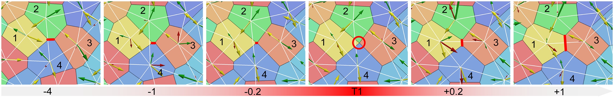
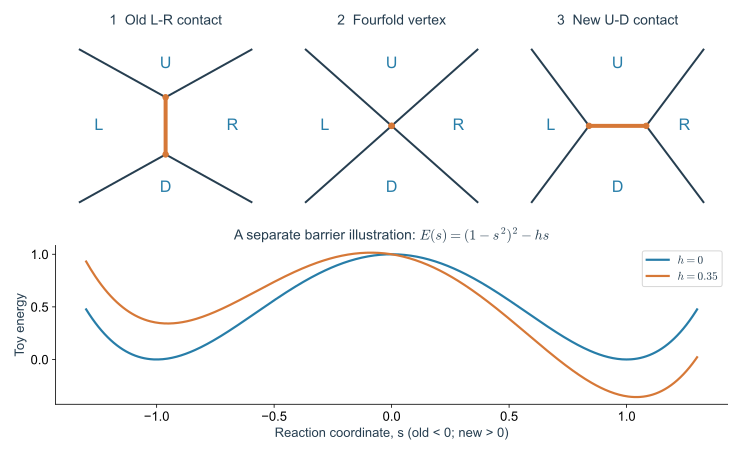
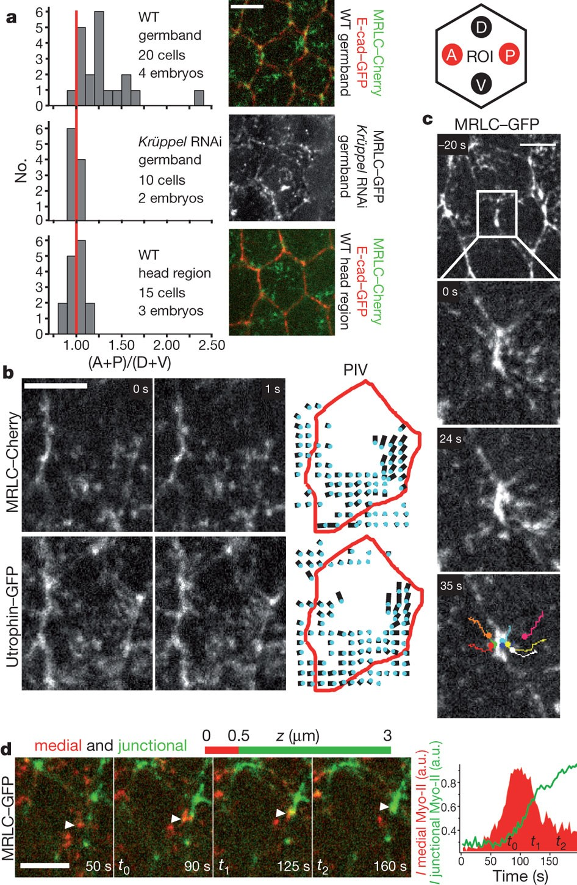
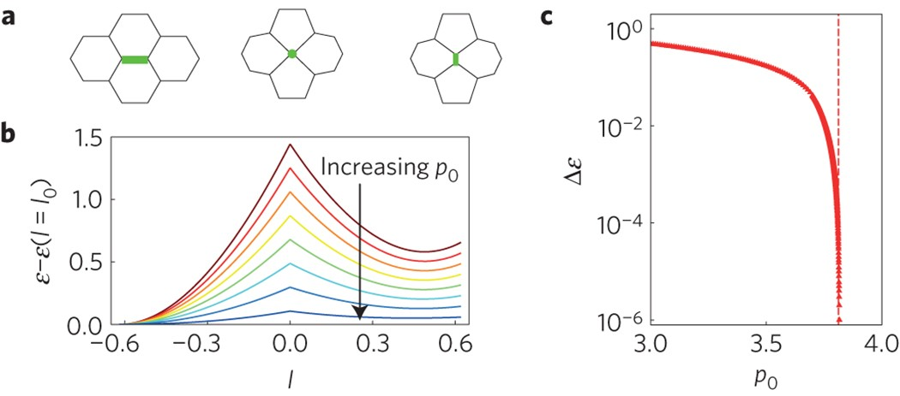
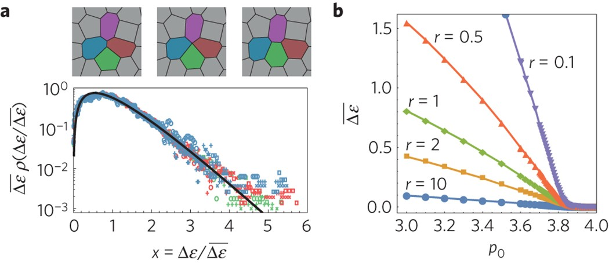
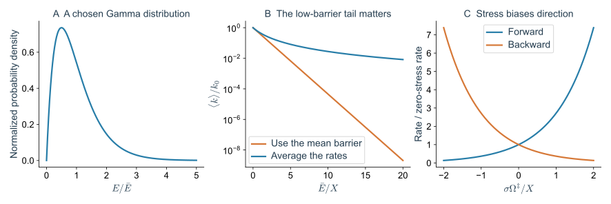
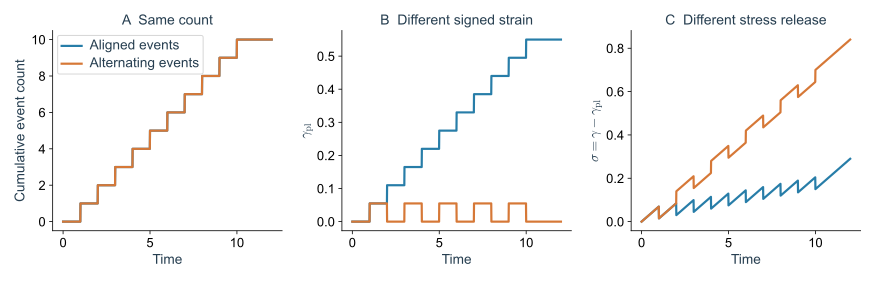

> **Part III · Note 04**　[专题目录](/notes/vertex_model/) · 上一篇：[刚性转变](/notes/vertex_model/rigidity/)

**物理问题：** 顶点连续移动到什么时候会改变邻接关系？一次邻居交换为什么可能产生不可逆形变？

## 概述：一条交界消失以后，材料改变了什么 {#main-lecture}

前两篇的剪切响应把邻接关系固定下来：细胞可以拉长、顶点可以松弛，但一对邻居始终共享同一条交界。若持续拉动组织，这种描述最终可能失效。一条边缩得很短，原来的两个端点合并，另外两个细胞开始接触。此后即使撤去一部分外力，系统也可能保留新的排列。

**T1 就是一次局部“换邻居”**。四个细胞的身份都保留着，改变的是哪一对有共同边界。它常常有助于组织持续变形：一排细胞可以通过交换接触，逐步排进另一排，而不必一直把每个细胞拉得更长。

“塑性”描述的是撤去外力后仍留下的形变，比如金属丝弯过以后不能完全复原；“弹性”则描述能恢复的部分。细胞组织里的塑性可以来自重新排列，不一定需要组织破裂。一次 T1 是否留下塑性，要等新接触形成并维持、再看卸载后的结果；短暂换过去又换回来，可能没有留下净变化。

*图 1 · 从一条边的缩短到新接触打开。* 引自 [Barton 等（2017），Fig. 5](https://doi.org/10.1371/journal.pcbi.1005569.g005)，CC BY，原图未修改。细胞 2、4 原来接触，随后细胞 1、3 建立新接触；黑线为 Voronoi 交界，白线为对偶 Delaunay 网络，箭头表示不同力分量。这里采用生成点自由度的主动模型，不能把其全部动力学直接等同于独立顶点版本。

沿着时间从左向右看，可以区分“旧边慢慢变短”和“新边迅速打开”。这提醒我们，整个事件可能包含不同的等待与运动阶段。只记录最短边出现在哪一帧，会丢掉前面的收缩过程，也会丢掉后面的接触成熟或反向退回。

## 1. 固定拓扑能量盆地之外

先想象显微视频里有四个已经编号的细胞。开始时，左右两个细胞共享一条竖直交界；上下两个细胞没有直接接触。竖直交界逐渐缩短，两个端点靠到一起，四个细胞短暂交汇在同一点。随后这个点沿左右方向分开，打开一条横向交界，上下两个细胞就成了新邻居。这是理想化的 **T1 转换**，下图把这几步分开画出。

在这个过程中，顶点坐标可以连续变化，邻接表却必须更新。固定拓扑的计算只允许“原来的边变长或变短”，还需要额外规则说明旧边消失后怎样连接新边。

将四个细胞标成左 L、右 R、上 U、下 D。竖直的旧边原来分隔 L 与 R；边收缩以后，水平的新边分隔 U 与 D。因此 L–R 失去邻接，U–D 获得邻接。两种拓扑对应不同坐标图，不能指望固定网络的平滑动力学自动跨越这个操作。

*图 2 · T1 的拓扑与势垒是两个不同问题。* 上：旧边收缩、四价顶点、新边打开的局部示意，外侧线段仅表示相邻交界；下：$E(s)=\Delta(1-s^2)^2-hs$ 的玩具势能，$\Delta=1$，比较 $h=0$ 与 $h=0.35$。$s\lt 0$、$s\gt 0$ 分别表示两种邻接状态；此曲线不是由上方几何计算的 Vertex 能量。

另外两种图像中常见的变化也值得分开。**T2** 是一个细胞缩小并从网络中消失，细胞数会改变；**玫瑰结（rosette）** 是五个或更多细胞围绕一个交汇区聚集，随后可能沿不同方向解开。看到多细胞交汇，未必只对应一次四细胞的 T1。

### 1.1 用有符号长度连接两种拓扑

旧边的物理长度始终非负，新边的长度也非负。为了把两种状态画到一条曲线上，可以定义人为的有符号坐标 $s$：旧拓扑时 $s=-\ell_{\rm old}$，新拓扑时 $s=+\ell_{\rm new}$，四价构型位于 $s=0$。负号是路径标签，不表示存在负的实际边长。

这个坐标让我们可以比较两侧能量，却不保证能量在 $s=0$ 的导数连续。真实路径还可能通过四价顶点停留、选择另一条出口，或与周围事件协同发生。把路径假设写清楚，才能判断一张平滑势垒曲线究竟近似了哪一步。

### 1.2 局部拓扑守恒哪些量

理想的内部 T1 不改变细胞数、顶点数或边数，也不改变全局 Euler 关系，但会改变四个参与细胞的邻居数：失去旧接触的两细胞各少一个邻居，获得新接触的两细胞各多一个邻居。总邻居数因此保持不变。

比如一个细胞原本有六个邻居，失去接触后会变成五个；另一个原本有六个邻居的细胞获得接触后，则会变成七个。在接近六边形铺砌的组织中，五边形、七边形常被称为拓扑缺陷。“缺陷”只是相对于规则六边形的偏离，不表示细胞受损。T1 能改变这些偏离的位置和配对方式；若还同时发生细胞消失或组织开孔，就需要另算细胞数和边界的变化。

#### 论文视频 · 果蝇胚带：交界收缩与顶点滑移

<figure class="vertex-video" id="video-vanderleest-sliding" style="--vertex-video-width: 640px">
<video controls preload="metadata" playsinline width="640" height="480" aria-label="果蝇胚带：交界收缩与顶点滑移" src="https://static-movie-usa.glencoesoftware.com/mp4/10.7554/817/bb95403d5365e97a3e061b4b5a2440424568ee8f/elife-34586-video2.mp4" poster="https://iiif.elifesciences.org/lax/34586%2Felife-34586-video2.jpg/full/full/0/default.jpg">
<a href="https://static-movie-usa.glencoesoftware.com/mp4/10.7554/817/bb95403d5365e97a3e061b4b5a2440424568ee8f/elife-34586-video2.mp4">直接打开原始视频</a>。
</video>
<figcaption><strong>显微视频</strong>｜Vanderleest 等（2018），Video 2。Gap43:mCherry 标记细胞膜；前方在左、腹侧在下。原图例覆盖约 118.8 s 的真实过程，标尺 3 μm。视频未修改，权利与许可见原文。<a href="https://doi.org/10.7554/eLife.34586.007" target="_blank" rel="noopener">原文与完整视频说明</a> · <a href="https://static-movie-usa.glencoesoftware.com/mp4/10.7554/817/bb95403d5365e97a3e061b4b5a2440424568ee8f/elife-34586-video2.mp4" target="_blank" rel="noopener">直接打开原始视频</a>。</figcaption>
</figure>

**先看哪里：** 选定一条正在缩短的交界，分别追踪它的两个端点，再看相邻轮廓怎样重新分配。不要只追踪整片组织向画面边缘漂移；应比较顶点相对于同一细胞轮廓的位置。

**怎样读物理：** 端点可以不同步移动，一条交界也不必像对称拉链一样从两端等速收缩。这是 T1 收缩阶段的活体例子；确认完整邻居交换，还需核对旧接触消失后新接触是否建立并保持。

### 1.3 果蝇胚带：缩短一条边的力从哪里来 {#fly-junction-remodelling}

上面的 T1 图只告诉我们连接怎样换，真实细胞还要产生拉力。**肌球蛋白 II**可以利用 ATP，沿肌动蛋白网络产生相对运动。看它的荧光分布，有助于找到收缩网络；但亮度与实际力之间还隔着网络连接、运动和受力传递。

[Rauzi 等（2010）](https://doi.org/10.1038/nature09566)在果蝇胚带中研究了顶端皮层中央的收缩网络怎样向特定交界流动，并与交界重塑相联系。这个结果提示我们：一条边变短，施力过程可以涉及细胞内部的一大片皮层，以及它同黏附连接之间的耦合。

*图 3 · 交界变短以前，先观察收缩网络怎样移动。* 引自 [Rauzi 等（2010），Fig. 3](https://www.nature.com/articles/nature09566/figures/3)，原图未修改。该图分析中央皮层肌球蛋白的各向异性流动；应结合原文标记、时间序列和流动分析阅读，不能将荧光图直接换算成边张力。

在最简 Vertex 模型中，可以用随方向和时间变化的有效作用来概括这类推动。若要解释“为什么这一类边先收缩”，则需要进一步引入皮层活动、黏附分布或极性变量。几何上的切边规则负责更新接触，动力学方程负责把细胞带到那里，两部分要配合。

还要注意胚带中不止有孤立四细胞事件。[Blankenship 等（2006）](https://doi.org/10.1016/j.devcel.2006.09.007)研究了多细胞玫瑰结的形成与解开。几条边相继缩短时，多个细胞会暂时围在同一个交汇区，再沿新的方向分开。若把所有四价以上顶点都立即拆成独立 T1，模型就预先删掉了这个中间状态；分析事件率时也要保留它持续了多久、最后从哪个方向解开。

### 为什么换邻居可能需要先费一点力

初始排列可能已经很稳定：稍微推动它，周围细胞会把它拉回来。要换成另一种排列，细胞必须先挤压或拉伸到一个更不舒服的中间形状，之后才可能重新放松。这有点像把珠子从一个碗推到旁边的碗：两个碗底都能让珠子停住，中间的高处却需要额外能量。

能量图里的“势阱”或“盆地”就是一类能稳定停留的排列；沿一条路径离开它时需要达到的最高额外能量，叫**势垒**。能量来自哪里是另一件事：可以由外部拉动提供，也可以由细胞消耗 ATP、收缩皮层或更新黏附提供。画出势垒，并没有同时解释细胞怎样跨过去。

## 2. 给定一条收缩路径，怎样定义势垒

计算时不能把所有细胞运动都画在一条横轴上，于是先选一个容易描述进度的量，例如旧交界的长度 $\ell$，称为**反应坐标**。这个名称沿用自跃迁理论，在这里不涉及化学反应。每次把这条边固定在一个长度，再允许周围顶点调整到局部最低能量，就得到一条能量曲线：

$$
E_{\rm old}(\ell)=\min_{\mathbf x:\,\ell_e=\ell}E(\mathbf x;\mathcal T_{\rm old}).
$$

对新拓扑同样得到 $E_{\rm new}(\ell)$。两条分支在四价构型附近连接；沿选定路径的最高能量与初态能量之差，是这条路径的势垒。最小能量路径还要求对全部允许路径最小化最高点：

$$
\Delta E_{\min}=\min_{\mathcal C}\max_{s\in[0,1]}
\left[E(\mathcal C(s))-E_{\rm initial}\right].
$$

“把一条边强行压到零”的计算给出特定路径的代价，未必等于真正的最低势垒。周围细胞是否松弛、盒子是否变形、是否允许其他 T1，都可能改变结果。[Bi 等（2015）](https://doi.org/10.1038/nphys3471)的四细胞模型与无序网络势垒计算，是理解几何条件怎样影响局部重排的起点。

### 2.1 四细胞模型与无序网络

*图 4 · 一个可控的局部重排问题。* 引自 [Bi 等（2015），Fig. 5](https://www.nature.com/articles/nphys3471/figures/5)，原图未修改。a 标出被收缩并重新打开的交界；b 为不同目标周长下沿路径的能量变化；c 为相应势垒与几何估计的对照。

看 b 时，先认清纵轴减去了初始能量，所以起点被放在同一基线上；曲线最高点与起点的差才是势垒。增大 $p_0$ 时曲线降低，表示这条指定路径在该局部模型中更容易跨过。它还没有给出一次事件每秒发生多少次。

四细胞模型的优势是路径和边界容易明确；代价是它无法包含一大片无序网络中的所有协同变形。用它解释势垒消失的几何原因，与把它作为完整组织的定量跃迁率模型，是两个强度不同的结论。

### 2.2 冻结周围与松弛周围的势垒不同

若收缩旧边时冻结其他顶点，得到一条受限能量曲线；若每一步都允许其余顶点松弛，在同一个固定反应坐标下能量不会更高。这是极小化的变分性质。

但是两条路径的势垒比较还需使用同一个初态与一致的能量基准。若松弛中跳到了另一个盆地，所得曲线便不再只是原路径的局部修正。对于能量存在尖点、拓扑规则有离散跳跃的实现，还要检查“最高点”是否受到数值重新开边的方式影响。

顶点代码常在 $\ell\lt \ell_c$ 时切边，再以一个很短的新边重新打开。$\ell_c$、新边长度、四价顶点等待时间都是动力学实现的一部分。必须检查结果是否随这些数值选择收敛，不能把一次阈值触发直接解释成真实细胞克服了某个已知生物势垒。

比较不同代码时，一个有用的问题是：在没有外部加载、没有噪声的充分松弛状态中，这个拓扑操作是否可能人为增加或释放能量？如果切边规则直接把体系搬到更低能的构型，那么它已经加入了跨越路径的额外动力学信息。仅比较最终的能量函数不够。

## 3. 有势垒不代表一定发生，势垒小也不等于重排快

先看一个较简单的热激活情形：微小的随机碰撞不断推动体系，偶尔把它推过势垒。若这些扰动来自热平衡、势垒足够高，而且每次跃迁前都能在原势阱内充分调整，事件发生率可近似写成

$$
k_{\rm T1}\simeq k_0\exp\left[-\frac{\Delta E}{k_BT}\right].
$$

$k$ 是每单位时间的事件率；$\Delta E$ 是势垒高度；$k_BT$ 是热扰动的能量尺度。势垒比扰动能量高得越多，指数就越小，平均等到一次事件的时间越长。$k_0$ 给出尝试的时间尺度，它还受摩擦和能量曲线在碗底、山顶附近弯曲程度的影响。

真实细胞经常通过持续收缩和黏附更新来换邻居，这些驱动消耗能量、有方向也有记忆。把上式用于细胞之前，需要先确认这种随机跨越的图像是否合适。后面的指数率计算用于说明势垒分布会带来什么后果；它不是默认胚胎的 T1 都由热运动触发。

### 3.1 为什么平均势垒不能直接代入指数

*图 5 · 除了平均值，还要观察势垒的分布。* 引自 [Bi 等（2015），Fig. 1](https://www.nature.com/articles/nphys3471/figures/1)，原图未修改。a 对不同参数下的势垒按各自均值归一化后作比较；b 展示平均势垒随目标形状参数改变。原图的 $r$ 仍采用逆周长模量约定。

无序网络中的不同位置不具有同一个势垒。若暂时假定各位置独立，且都有热激活速率 $k(E)=k_0e^{-E/X}$，其中 $X=k_BT$，平均速率为

$$
\langle k\rangle=k_0\int_0^\infty\rho(E)e^{-E/X}dE,
$$

而不是 $k_0e^{-\langle E\rangle/X}$。指数对低势垒特别敏感，少数容易重排的位置就可能显著影响平均速率。

设势垒服从均值为 $\bar E$ 的 Gamma 分布：

$$
\rho(E)=\frac{(a/\bar E)^a}{\Gamma(a)}E^{a-1}e^{-aE/\bar E}.
$$

积分得到

$$
\frac{\langle k\rangle}{k_0}
=\left(1+\frac{\bar E}{aX}\right)^{-a}.
$$

若 $a=2$、$\bar E/X=10$，平均速率比为 $1/36$，而直接代入平均势垒得到 $e^{-10}$。这里的分布参数为自选例子，不是对论文数据的重新拟合；它说明需要分布信息。真实重排还会消耗原有软位置并创造新环境，所以一个静态分布的平均也不自动等于稳态流动速率。

*图 6 · 从势垒到速率需要额外假设。* 自制 Gamma 分布与热激活计算，取 $a=2$；右图比较小应力下双向速率的偏置。横轴中的 $X$ 是本例的噪声能量尺度，不应未经检验替换成生物活性幅度。

外应力也会偏置两种状态。一个最小描述为

$$
U(s;\sigma)=\Delta(1-s^2)^2-\sigma\Omega s,
$$

其中 $s$ 无量纲，$\Omega$ 具有面积量纲，使二维应力乘以 $\Omega$ 成为能量。它表示应力降低顺向跃迁势垒、升高反向势垒的可能性；$\Delta$、$\Omega$ 与真实 Vertex 网络的关系需要另外计算。

### 3.2 激活、失稳和等待时间是不同情形

对这个双阱玩具模型，$U'=4\Delta s(s^2-1)-\sigma\Omega$、$U''=4\Delta(3s^2-1)$。旧的负 $s$ 势阱在 $s=-1/\sqrt3$ 处与势垒顶合并，对应

$$
\sigma_c\Omega=\frac{8\Delta}{3\sqrt3}.
$$

小于此应力时，无噪声体系可停在旧势阱；有噪声时可以提前激活；达到失稳后，原势阱不再存在。这个精确算例区分了“克服仍然存在的势垒”与“势垒随加载消失”两种重排机制。

此外，即使几何边长已经很短，黏附更新或四价顶点解开也可能引入等待时间。若在模型中规定必须等待 $\tau_{\rm wait}$ 才能重排，就新增了独立时间尺度，不能仅用被动能量的 Hessian 预测它。

## 4. 从局部事件到塑性应变

可以把组织的总形变想成两部分相加。一部分来自细胞本身被拉歪、拉长，卸载后能缩回去；另一部分来自细胞已经重新排列，卸载后仍保留。用 $\gamma_{\rm el}$ 和 $\gamma_{\rm pl}$ 分别记这两部分，下面的关系就是这种分账。

将总剪切应变分成弹性与塑性两部分：

$$
\gamma=\gamma_{\rm el}+\gamma_{\rm pl},\qquad
\sigma\simeq G\gamma_{\rm el}.
$$

在固定总应变下，若一次重排释放了有符号的塑性增量 $\Delta\gamma_{\rm pl}$，则局部线性近似下 $\Delta\sigma\simeq-G\Delta\gamma_{\rm pl}$。应力下降来自事件是否沿原应力方向释放形变，而不只取决于有没有发生 T1。

对于面积 $A_{\rm tot}$ 的组织，可以定义每次事件的有符号应变面积 $\Omega_k$，使

$$
\dot\gamma_{\rm pl}(t)=\frac1{A_{\rm tot}}
\sum_k\Omega_k\delta(t-t_k).
$$

如果正反事件数量相当，T1 很多也可能没有净塑性剪切；如果事件空间相关，还可能协同触发雪崩。实际分解中还需分离细胞形状变化、旋转与相关项，不能把每个 T1 指定为同一个固定应变。[Merkel 等（2017）](https://doi.org/10.1103/PhysRevE.95.032401)用三角网格建立了从细胞变化到组织形变的定量联系。

### 4.1 同样十次 T1，为什么释放的应力可以不同

设一次沿外部剪切方向的事件贡献 $+\Omega_{\rm pl}$，反向贡献 $-\Omega_{\rm pl}$。十次都沿同一方向，净塑性应变为 $10\Omega_{\rm pl}/A_{\rm tot}$；五次顺向、五次反向，净值为零。两种情况的事件数完全相同，但应力释放不同。

*图 7 · 事件数不是塑性应变的替代量。* 自制确定性事件序列，两组都有十次事件；一组方向一致，一组正负交替。应力根据 $\sigma=G(\gamma-\gamma_{\rm pl})$ 计算，取 $G=1$。事件序列由预设方向构成，不包含 Vertex 网络的顶点运动与受力求解。

### 4.2 从双向跃迁率得到一个低应力塑性率

下面用一个简化的双向事件模型，把“沿应力方向的重排更常发生”换算为流动速度。设单位面积有 $\rho_s$ 个可能重排的位置，每个位置都可以顺向或反向交换；一次完整事件贡献的应变面积为 $\Omega_{\rm pl}$，外应力对半程势垒的影响用 $\Omega^{\ddagger}$ 表示。$X$ 是假设的随机驱动能量尺度，$k_0$ 是尝试率。取

$$
k_\pm=k_0\exp\left[-\frac{\Delta E\mp\sigma\Omega^{\ddagger}}{X}\right],
$$

则平均塑性率为

$$
\dot\gamma_{\rm pl}=\rho_s\Omega_{\rm pl}(k_+-k_-)
=2\rho_s\Omega_{\rm pl}k_0e^{-\Delta E/X}
\sinh\frac{\sigma\Omega^{\ddagger}}{X}.
$$

低应力时 $\sinh z\simeq z$，于是得到近似线性关系 $\dot\gamma_{\rm pl}\simeq\sigma/\eta$。这为下一篇的 Maxwell 方程提供一个可能的微观入口。

要特别区分 $\Omega_{\rm pl}$ 与 $\Omega^{\ddagger}$：一个是完整事件的净形变，另一个是到势垒顶的应力耦合尺度。对前面的对称双阱 $s=-1\to+1$，若应变完全由共轭坐标定义，则完整增量对应两倍的半路径面积。真实细胞网络中，两者需要分别计算。

## 5. 怎样判断不可逆与屈服

在模拟中，可以每次只增加一点形变，等顶点充分放松后再加下一步，这叫**准静态加载**。“零温”表示计算中没有加入热随机力，并非把真实胚胎冷却到绝对零度。在同一稳定排列里，应力通常随拉动逐渐上升；发生失稳或重排时，曲线可能突然下降。再把外加形变慢慢退回去，检查组织是否回到原来的形状和接触关系，就能检验是否留下不可逆变化。

不过，拓扑改变本身并不保证最终不可逆：新边可能很快收回，发生反向 T1。要识别净塑性，至少应跟踪持续的邻接变化、卸载后的残余应变或完整的应力循环。屈服也不只是“第一条边切换”，它可能指持续稳态流动所需的应力，定义要随测量协议写清。

### 5.1 一次事件还会改变邻居的重排条件

局部重排释放的应力需要通过周围组织重新平衡，因此它可能稳定某些位置，也可能使另一些位置更接近失稳。局部事件的时间和空间相关性，正是从单事件塑性走向集体流变时增加的内容。

在数据分析中，可以比较事件之间的距离、时间差和方向相关，并在控制局部细胞密度与形状后，检验一个事件是否提高了附近后续事件的概率。仅看到事件成簇，还要排除共同的外部驱动或成像阈值变化。

### 5.2 一份足以区分机制的事件记录

对每次重排，至少保留参与细胞、旧边与新边方向、边长随时间变化、四价状态持续时间，以及新接触是否在后续时间中保留。有力学数据时，再记录事件前后应力和外部加载。

不同时间分辨率会改变“看到多少次 T1”：过慢的采样可能漏掉短暂反向交换，过快的采样又可能把同一个边反复跨阈值计为许多事件。应根据持续接触定义和跟踪时间窗报告事件率，并检验结论对这些选择是否稳健。

从一次 T1 到组织流动，中间有三步需要连起来：当前形状和内部张力决定哪些路径容易走；细胞驱动与运动阻力决定走得多快；事件的方向和相互影响决定最后释放多少应力。下一篇把这些变化与随时间测得的应力曲线联系起来。

## 技术附录：从等待时间走向慢松弛 {#technical-appendices}

### A. 一个固定跃迁率对应什么时间分布

若一个位置每单位时间有固定速率 $k$ 发生事件，并且没有年龄或历史依赖，那么等待到 $t$ 仍未发生的生存概率满足 $\dot S=-kS$，故 $S(t)=e^{-kt}$。等待时间密度为 $\psi(t)=ke^{-kt}$，均值为 $1/k$。

若不同位置具有不同 $k$，混合后的 $S(t)=\int\rho(k)e^{-kt}dk$ 通常不再是单指数。测到宽等待时间并不唯一证明存在事件之间的协作：静态速率异质性本身已经可以产生宽分布。反过来，细胞状态持续变化时，固定速率混合也可能不够。

### B. 平均速率与平均等待时间甚至可能给出不同印象

仍取前文的静态 Gamma 势垒分布。对均匀抽取的一个位置，平均等待时间为

$$
\langle\tau\rangle=\frac1{k_0}\int_0^\infty\rho(E)e^{E/X}dE.
$$

若 $\bar E\lt aX$，积分得到 $k_0^{-1}(1-\bar E/(aX))^{-a}$；若分布没有高势垒截断且 $\bar E\geq aX$，这个理想化平均发散。与此同时，前面算出的平均瞬时速率始终有限。

两者不矛盾。平均速率对容易发生事件的位置敏感，平均等待时间对极慢位置敏感。若按“实际观察到的事件”抽样，还会进一步偏向快速位置，不能与均匀位置抽样直接比较。

这只是固定势垒、独立激活的数学例子，不能据此宣布组织在某个参数下具有无限黏度。真实网络的势垒会随重排更新，观测区域有限，外部或主动驱动也可以改变高势垒尾部。

### C. 为什么事件发生了，应力仍可能没有充分松弛

一次事件对某个应力分量的作用取决于方向、位置与周围弹性传播。若事件主要垂直于所测剪切方向，或很快发生反向事件，数量很多也可能留下较大应力记忆。

因此可以同时比较两个相关函数：接触网络的记忆，以及剪切应力的记忆。前者迅速下降而后者仍有平台，提示拓扑变化并没有等比例释放所测应力；反过来，细胞内部参考结构更新也可能在没有大量 T1 的情况下释放应力。这个对照将“发生多少事件”推进到“事件对哪种力学记忆起作用”。

## 主要文献

- [Rauzi et al. (2010), Planar polarized actomyosin contractile flows control epithelial junction remodelling](https://doi.org/10.1038/nature09566)。果蝇胚带中的皮层流动与交界重塑。
- [Blankenship et al. (2006), Multicellular rosette formation links planar cell polarity to tissue morphogenesis](https://doi.org/10.1016/j.devcel.2006.09.007)。多细胞玫瑰结与定向重排。

- [Vanderleest et al. (2018), Vertex sliding drives intercalation by radial coupling of adhesion and actomyosin networks during Drosophila germband extension](https://doi.org/10.7554/eLife.34586)。
- [Bi et al. (2015), A density-independent rigidity transition in biological tissues](https://doi.org/10.1038/nphys3471)：局部重排势垒及四细胞模型。
- [Merkel et al. (2017), Triangles bridge the scales: Quantifying cellular contributions to tissue deformation](https://doi.org/10.1103/PhysRevE.95.032401)：从细胞变化到组织形变的运动学分解。
- [Barton et al. (2017), Active Vertex Model for cell-resolution description of epithelial tissue mechanics](https://doi.org/10.1371/journal.pcbi.1005569)：主动驱动与拓扑操作的模型实现。

[← 几何刚性](/notes/vertex_model/rigidity/) · [下一篇：组织流变与主动动力学 →](/notes/vertex_model/rheology_activity/)
