> **Part III · Note 05**　[专题目录](/notes/vertex_model/) · 上一篇：[T1 与塑性](/notes/vertex_model/rearrangements/)

**物理问题：** 一片具有局部恢复力的组织，怎样在长时间表现为流动？主动驱动怎样改变这个时间尺度？

## 概述：组织的“固体”和“流体”需要用时间来定义 {#main-lecture}

把一片上皮轻轻拉开后松手，观察它是否回缩，是一种力学测量；在恒定应力下等待很久，看它会不会持续变形，是另一种。再让细胞主动运动，观察其位移是否逐渐积累，又增加了一个非平衡问题。三种实验都常被用于讨论组织流动性，却不测量同一个物理量。

这种“施加怎样的力，材料就怎样随时间变形”的研究，叫**流变学**。它关心的不只是硬或软，还关心等多久、拉多快、卸载后能不能恢复。细胞接触在短时间内可能像弹簧一样支撑拉力，过一会儿接触更新，原来的拉力又会逐渐释放。

**松弛**是保持形变不动时，所需维持的力逐渐减小；**耗散**是机械能经摩擦等过程转化、不能完整收回。松弛是我们观察到的响应，耗散是能量去向，两者需要结合模型联系起来。

先用一个可以完整求解的 Maxwell 模型建立时间尺度，再用论文的 Vertex 结果检验这个简化能解释到哪里；最后加入细胞极性与张力涨落，区分主动动力学与热平衡激活。

## 1. 先明确怎样施加形变

想象一小片组织夹在两个夹具之间。固定下方夹具，横向移动上方夹具，就能让组织发生剪切。移动距离除以上下夹具间距，是应变 $\gamma$；维持这种变形所需的力除以相应截面积，是应力 $\sigma$。实际胚胎未必能这样夹持，但下面三种加载方式可以用不同探针实现，图 1 先用理想装置说明它们的区别。

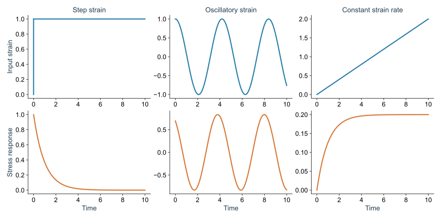

*图 1 · 先看施加的是什么，再比较应力曲线。* 自制 Maxwell 方程的精确响应，取 $G_0=\tau=1$。上排是应变输入，下排是相应应力；振荡列为已达到周期稳态的响应，其他两列从零应力开始加载。幅度为预设值，阶跃的瞬时跳变是理想化输入。

| 怎样操作 | 保持什么、记录什么 | 想知道什么 |
| --- | --- | --- |
| 很快拉开一点，停在新位置 | 保持形变；记录维持它的应力随时间变化 | 原来的应力能保持多久？这是阶跃应变与应力松弛实验 |
| 小幅来回拉动 | 改变来回的频率；比较应力和应变的幅度、时间差 | 拉得快或慢时，材料分别怎样储存和耗散能量？这是振荡剪切 |
| 一直以固定速度拉动 | 保持应变率；记录应力是否稳定、途中是否有峰值 | 持续流动需要多大的应力？这是启动和持续剪切 |

还有一种容易混淆的操作：一直保持**力**，让形变自由增加，称为蠕变。它和“拉开以后固定位置”恰好交换了输入与输出。读实验图时，先确认装置控制的是力还是位移，再判断曲线下降或上升意味着什么。

这三个协议还必须检查线性范围。把 $\gamma_0$ 减半，若应力也近似减半、归一化曲线重合，才有理由用振幅无关的线性模量。若细胞发生不可逆重排，仍可能存在一定的有效线性响应，但需要确认结果不依赖振幅、准备历史和测量周期。

如果每次只拉一点，且两次小拉动的响应可以相加，就可以把任意加载历史拆成很多小步。每一步留下的应力都会随它发生以来的时间衰减，把这些贡献加起来，就是下面的积分。数学上叫“历史卷积”，物理上是在计算材料还记得多少过去的拉动：

$$
\sigma(t)=\int_{-\infty}^{t}G(t-t')\dot\gamma(t')\,dt'.
$$

$G(t)$ 称为**松弛模量**：突然施加单位小应变后，过了时间 $t$ 还剩多少应力。因此，应变为 $\gamma_0$ 时，$\sigma(t)=\gamma_0G(t)$。若很久后还剩一个非零值 $G_\infty$，说明在这个线性测量中仍保留弹性支撑；若完全衰减，并且曲线下面积有限，这个面积就是零剪切黏度 $\eta_0=\int_0^\infty G(t)dt$。

这里的“零剪切”是向很小剪切速率外推的意思。较大的黏度意味着维持同样缓慢流动需要更大的应力，或在同样应力下流得更慢。上面的描述还假定组织在测量期间没有明显成熟或改变自身状态。

卷积形式包含两项假设：响应与输入成线性关系，以及相同的输入平移到另一个时刻会产生相同的响应。如果组织在测量中持续成熟、增长或改变细胞骨架状态，第二项可能失效，就需要 $G(t,t')$ 而不是仅依赖时间差的 $G(t-t')$。

这也解释为什么实验中的“应力逐渐下降”并不自动等于同一种黏性松弛。它可能来自拓扑重排，也可能来自细胞内部参考长度改变、主动张力下降或边界滑移，需要额外观测区分。

## 2. 一个能算到底的 Maxwell 模型

Maxwell 模型可以画成**一根弹簧与一个黏壶首尾相接**。黏壶可以想成装着黏液、活塞有阻力的小筒：持续施力，活塞就持续移动；撤去力，它本身不会像弹簧那样把位移弹回来。

串联时，两者承受同样的力，总形变等于弹簧伸长加上活塞位移。弹簧暂时储存能量，黏壶让形变随时间积累。它们分别代表组织的可恢复形变和逐渐更新的结构；真实细胞中没有这样一只实体黏壶，这是用来概括材料响应的最小模型。

用 $G_0$ 表示短时间弹性刚度，并假设净塑性应变率与当前应力成正比：

$$
\sigma=G_0(\gamma-\gamma_{\rm pl}),\qquad
\dot\gamma_{\rm pl}=\frac{\sigma}{\eta}.
$$

求导并消去 $\gamma_{\rm pl}$，得到

$$
\boxed{\dot\sigma+\frac{\sigma}{\tau}=G_0\dot\gamma,\qquad
\tau=\frac{\eta}{G_0}.}
$$

这个方程最值得先理解的是 $\tau=\eta/G_0$：黏壶阻力越大，放松得越慢；弹簧越硬，同一变形产生的力越大，也就能更快推动黏壶。$\tau$ 是模型的**松弛时间**，其精确结果为 $G(t)=G_0e^{-t/\tau}$。

例如，假设一个材料的 $\tau=10$ 秒，保持形变不动，10 秒后应力约剩初始值的 37%，30 秒后约剩 5%。这只是帮助读指数曲线的例子，不是某种胚胎的实测数值。接下来改成频率为 $\omega$ 的来回拉动，得到

$$
G^*(\omega)=G_0\frac{i\omega\tau}{1+i\omega\tau},\qquad
G'=G_0\frac{(\omega\tau)^2}{1+(\omega\tau)^2},\qquad
G''=G_0\frac{\omega\tau}{1+(\omega\tau)^2}.
$$

来回拉得很快时，黏壶还来不及明显移动就要反向，响应主要来自弹簧，储能模量 $G'$ 较大。拉得很慢时，黏壶有时间移动，应力更多表现为与流动速度有关的阻力，损耗模量 $G''$ 占主导。$\omega\tau$ 比较的就是外部拉动与内部放松的快慢：它很大时变化太快，材料来不及松弛；很小时则能边拉边松弛。

### 2.1 直接求解三种加载协议

阶跃以后，外部应变率回到零，Maxwell 方程成为 $\dot\sigma=-\sigma/\tau$，所以应力按指数下降。恒定应变率 $\dot\gamma_0$ 从 $t=0$ 开始时，则有

$$
\sigma(t)=\eta\dot\gamma_0\left(1-e^{-t/\tau}\right),
\qquad\sigma(\infty)=\eta\dot\gamma_0.
$$

这条曲线单调上升，没有应力过冲。因此，如果某个 Vertex 启动剪切曲线先出现峰值再下降，固定 $G_0,\tau$ 的 Maxwell 模型就遗漏了状态随应变演化的机制。

恒定应力 $\sigma_0$ 是另一个有用对照。弹性支路先产生 $\sigma_0/G_0$ 的瞬时应变，随后黏性部分持续积累：

$$
\gamma(t)=\frac{\sigma_0}{G_0}+\frac{\sigma_0}{\eta}t.
$$

这就是蠕变。相同材料在很短时间看起来像弹簧，在很长时间却可以不断变形。单一照片无法确定观察处于哪一阶段。

### 2.2 损耗模量怎样对应实际耗散

采用 $\gamma(t)=\gamma_0\cos\omega t$，复模量约定为 $G^*=G'+iG''$，则 $\sigma(t)=\gamma_0[G'\cos\omega t-G''\sin\omega t]$。一个周期内单位面积做功为

$$
W_{\rm cycle}=\oint\sigma\,d\gamma=\pi\gamma_0^2G''.
$$

储能部分来回交换能量，周期净值为零；损耗部分留下正的循环面积。在本文的被动线性模型中应有 $G''\geq0$。对主动材料，需要重新处理驱动做功和稳定性，不能无条件套用被动耗散的结论。

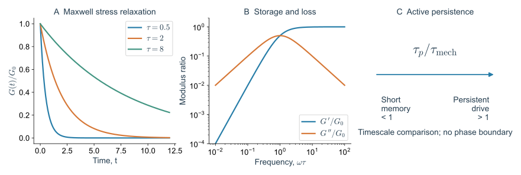

*图 2 · 局部弹性与长时间流动可以共存。* 左：$G_0=1$、$\tau=0.5,2,8$ 的精确松弛曲线；中：Maxwell 模型的 $G',G''$；右：用 $\tau_p/\tau_{\rm mech}$ 标记主动驱动的短记忆与持续驱动极限，只是时间尺度示意，没有绘制相边界。

Maxwell 模型假设一个松弛时间和线性塑性率，不由 Vertex 能量自动推出。T1 若具有宽势垒分布、方向相关与空间协作，就可能产生多时间尺度、记忆或非指数松弛。应将它作为可检验的最小本构关系。

若线性长期模量不为零，可以在 Maxwell 支路旁并联一个弹簧，得到 $G(t)=G_\infty+\Delta G e^{-t/\tau}$。若存在多个显著时间，则改为一组支路之和。这些形式与 Note 02 的模态分解联系起来：拟合的弹簧—黏壶参数是集体响应的概括，并不唯一对应单个细胞过程。

### 2.3 MDCK 培养上皮：让细胞绕过障碍物来检验 Maxwell 模型 {#mdck-maxwell}

Maxwell 模型在实验里怎样检验？一个办法是让材料流过障碍物，同时观察它先怎样被拉歪、之后怎样恢复。[Tlili 等（2020）](https://doi.org/10.1103/PhysRevLett.125.088102)使用 **MDCK 细胞**，一种常用于上皮力学的犬肾来源细胞系。细胞在狭长的黏附条带上集体迁移，遇到不能黏附的圆形区域后从两侧绕过。

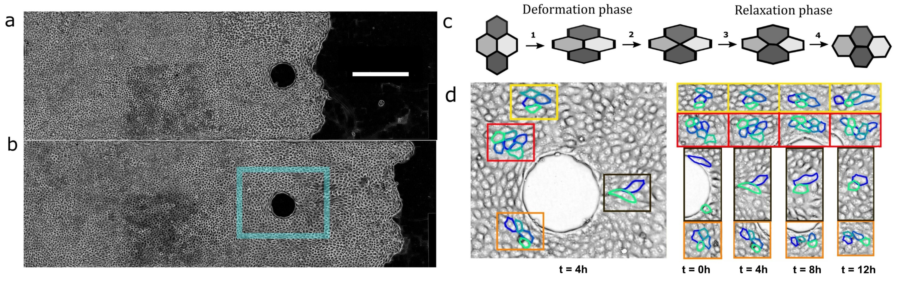

*图 3 · 同一片流动上皮中，可以同时比较形变与重排。* 引自 [Tlili 等（2020），Fig. 1 的作者稿版本](https://arxiv.org/html/1811.05001v2#S0.F1)，对应 [Phys. Rev. Lett. 125, 088102](https://doi.org/10.1103/PhysRevLett.125.088102)，原图未修改。A、B 比较绕障碍物的运动，C 区分细胞变形和换邻居，D 追踪局部排列。

障碍物前方、两侧和后方的运动不同，因而同一实验里就有多种变形方向和历史。研究者从图像估计组织形变率、细胞伸长和重排率，比较它们之间的关系，结果与 Maxwell 型黏弹性相容。这里是通过运动与形状检验本构关系，并没有在每个位置直接测出应力。

用一个剪切分量解释这种检验：设细胞暂时储存的可恢复形变为 $e$，重排释放形变的速率为 $R$。若总形变率等于细胞自身变化与重排之和，再作 $R=e/\tau$ 的近似，便有

$$
\dot e=\dot\gamma-\frac{e}{\tau}.
$$

再假设 $\sigma=G_0e$，就回到前面的 Maxwell 方程。这个推导告诉我们应该比较哪两组图像测量：细胞已伸长多少，以及重排正在释放多少形变。真实分析要保留方向、旋转和空间变化；上式只拿一个分量帮助理解，不能把流过障碍物的整片组织都当作同一只弹簧。

培养上皮的优点是几何容易控制，胚胎则能检验这些材料性质怎样参与正常发育。两类实验回答的问题不同，放在一起才更容易判断一个简化模型能用到哪里。

## 3. 线性固体也能在有限应力下流动

零温、无噪声的组织可能在小应变保持 $G\gt 0$，却在足够大应力下跨越失稳点并持续重排。若稳态流动曲线满足

$$
\sigma(\dot\gamma)=\sigma_y+C\dot\gamma^{\,n},\qquad \dot\gamma\gt 0,
$$

则 $\sigma_y$ 是该协议下的动态屈服应力。这是常用的经验形式，指数 $n$ 并非所有 Vertex 模型共用。存在噪声时，极慢的蠕变还会使有限时间的“屈服阈值”与真正无限时间极限不同。

[Fielding 等（2023）](https://doi.org/10.1103/PhysRevE.108.L042602)将 Vertex 模拟与包含细胞形状变量的连续模型比较。这里的“本构关系”指给定变形和内部状态后，怎样计算应力。细胞被拉长会改变应力，重排又会改变形状，因此材料在拉动过程中也会变化；固定 $G_0,\tau$ 的 Maxwell 模型只能近似其中一部分。

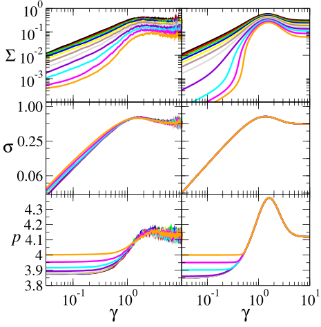

*图 4 · 不能只拟合最后的稳态应力。* 引自 [Fielding 等（2023），Fig. 2 的作者稿版本](https://arxiv.org/html/2210.02893#S0.F2)，对应 [Phys. Rev. E 108, L042602](https://doi.org/10.1103/PhysRevE.108.L042602)，原图未修改。左列为 Vertex 模型，右列为连续本构模型；从上到下比较应力、取向张量的剪切分量和细胞周长，颜色区分目标周长。

比较左右两列时，应该逐行对照同一种物理量，再看该量随累计应变怎样变化。如果只把上排的稳态高度拟合一致，仍可能在中排的取向和下排的周长演化上失败；这些额外观测可以约束模型内部变量，而不只是增加拟合点。

### 3.1 为什么本构关系需要内部状态

只知道外面拉了多少，未必足以预测下一刻的应力，还要知道细胞此刻已经被拉成什么样。这种记录材料内部状态的变量，称为**内部变量**。例如，用 $Q$ 记录一群细胞平均朝哪个方向伸长、伸长多少；它是包含方向信息的一组数，下一篇会从椭圆图解释“张量”的含义。

在小变形、缓慢转动时，可以先写 $\sigma^{\rm dev}=C Q$、$\dot Q=D^{\rm dev}-Q/\tau$。前式说细胞越被拉歪，产生的剪切相关应力越大；后式说外部剪切使细胞变长，而松弛和重排使伸长逐渐消失。上标 dev 表示去掉均匀膨胀或压力部分，保留改变形状的部分。这里两式用于说明思路，论文的完整非线性模型还要处理方向转动和状态依赖。

若形状幅度影响刚度、重排速率或主动反馈，就需要让系数依赖内部状态，并采用适当的客观张量导数处理转动。上面两式采用线性近似，忽略了这些状态依赖及转动修正。

有些材料拉得越多，再多拉一点就越费力，称为**应变硬化**。细胞网络中，较大的变形可能拉紧原先松软的方向，或建立新的内部张力，从而让后续变形更难。判断这种变化，要比较不同已变形状态附近的局部刚度，也就是应力曲线的斜率。

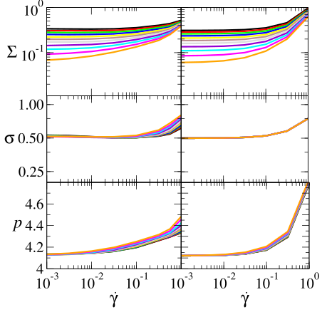

*图 5 · 将不同剪切速率下的稳态放在一起。* 引自 [Fielding 等（2023），Fig. 3 的作者稿版本](https://arxiv.org/html/2210.02893#S0.F3)，原图未修改。各行物理量与上一图相同，横轴改为剪切速率。应先确认达到稳态，再讨论低速率极限。

低剪切速率意味着需要更长时间才能积累相同应变。如果每个速率都只运行相同的有限时长，较慢的曲线可能根本没有达到稳态。因此屈服应力的推断不仅依赖横轴范围，也依赖每个数据点背后的等待与平均协议。

## 4. 主动运动与主动交界张力是不同的驱动

这里的**主动**有明确的生物含义：细胞消耗 ATP 等能量，通过肌动蛋白、肌球蛋白和黏附更新产生机械作用。这和被热碰撞随机推着走不同。我们先考虑两种常见的简化：细胞持续朝某个方向推进，以及细胞接触处的收缩强弱随时间起伏。

第一种需要一个方向变量，叫**极性**。可以先把它想成画在细胞上的箭头：箭头指向哪里，主动推动就朝哪里。极性在这里指运动的方向偏好，和上一节说的正负应力不是一回事。

一个主动 Vertex 动力学可以写成

$$
\zeta_v\dot{\mathbf r}_v=-\nabla_vE+\mathbf f_v^{\rm act}.
$$

例如，一个顶点被相邻的几个细胞共同推动，就把这些细胞的极性箭头按权重相加：$\mathbf f_v^{\rm act}=f_0\sum_{i\ni v}w_{vi}\mathbf n_i$，其中 $\sum_iw_{vi}=1$、$\mathbf n_i=(\cos\theta_i,\sin\theta_i)$。$f_0$ 控制推动有多强，$\theta_i$ 控制朝哪个方向。

若方向角不断随机改变，可写成 $\dot\theta_i=\sqrt{2D_r}\eta_i(t)$。$D_r$ 越大，变向越快；二维情况下方向记忆的时间为 $\tau_p=D_r^{-1}$，叫持续时间。这里用随机变向作为最简选择，实际细胞也可能因邻居、流动或信号而重新定向。

另一个选择是在能量中加入随时间变化的交界项 $\sum_e\lambda_e(t)\ell_e$，并令

$$
\dot\lambda_e=-\frac{\lambda_e-\bar\lambda_e}{\tau_\lambda}
+\sqrt{\frac{2s_\lambda^2}{\tau_\lambda}}\,\eta_e(t).
$$

式中的 $\eta_e(t)$ 是随机输入。“白噪声”表示不同时刻的输入没有记忆，满足 $\langle\eta_e(t)\eta_{e'}(t')\rangle=\delta_{ee'}\delta(t-t')$；但经过前面那条随时间恢复的方程以后，张力 $\lambda_e$ 会有持续一段时间的相关，称为“彩色噪声”。颜色只是随机过程的数学名称。

在同一条边持续存在时，$s_\lambda^2$ 控制张力起伏的方差，$\tau_\lambda$ 控制这种起伏能记住多久。新接触生成时还要规定从什么张力开始。这里的 $\lambda_e$ 是相对于原有能量额外加入的有效线能，可以为负；它与实验中非负的肌球蛋白荧光强度并不是同一个量。

细胞极性推动与交界张力涨落作用于不同自由度。即使均方力相同，驱动方向、持续时间和与低能模态的耦合也不同，因此可能产生不同的重排统计。

### 4.1 主动驱动怎样打破能量单调下降

对于固定的被动能量，运动方程给出

$$
\frac{dE}{dt}=-\sum_v\zeta_v|\dot{\mathbf r}_v|^2
+\sum_v\mathbf f_v^{\rm act}\cdot\dot{\mathbf r}_v.
$$

第一项是耗散，第二项是主动过程对机械自由度做功。被动松弛时能量只能下降；主动驱动可以持续补充能量，让系统离开局部极小值、越过势垒或形成动态稳态。若能量本身显式含有变化的 $\lambda_e(t)$，还需计入 $\sum_e\ell_e\dot\lambda_e$。

因此，一个细胞在图像中持续移动，既可能顺着能量梯度释放应力，也可能由主动功推着上坡。仅用瞬时速度大小不能判断被动能量是否接近刚性转变。

### 4.2 先求一个没有邻居的主动粒子

先不放入邻居，看看“持续走一会儿再转向”本身会产生什么轨迹。**均方位移（MSD）**的计算办法是：选一个起点时刻，量过了 $t$ 以后细胞中心移动了多远，把距离平方，再对许多细胞和起点时刻求平均。它能区分快速走开与被限制在附近，但不直接测量细胞承受的力。

对自由二维粒子 $\dot{\mathbf R}=v_0\mathbf n(t)$，极性角作旋转扩散。由于 $\langle\mathbf n(t)\cdot\mathbf n(0)\rangle=e^{-D_rt}$，位移平方为速度相关函数的双重积分：

$$
\langle|\Delta\mathbf R(t)|^2\rangle
=2v_0^2\int_0^t(t-s)e^{-D_rs}ds
=\frac{2v_0^2}{D_r^2}\left(D_rt-1+e^{-D_rt}\right).
$$

短时间展开指数，得到 $v_0^2t^2$ 的弹道运动；长时间得到 $4D_{\rm free}t$，其中 $D_{\rm free}=v_0^2/(2D_r)$。这个结果建立了判断组织 MSD 的参照：单个自由细胞已经可以从弹道转为扩散，组织中额外的平台才提示受到邻居笼困。

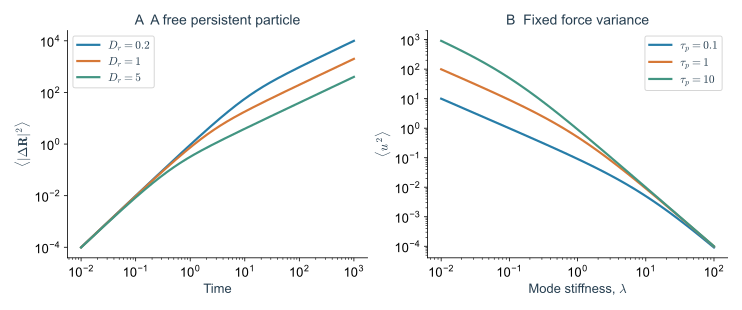

*图 6 · 先分清单粒子持续性与集体约束。* 自制精确计算。左：$v_0=1$、$D_r=0.2,1,5$ 时自由主动粒子的 MSD；右：固定力方差下，不同持续时间的彩色噪声驱动一个线性模态的稳态位移方差。两图均不包含细胞邻居或 T1。

### 4.3 果蝇腹沟：为什么反复收缩还需要“保住这一步” {#fly-pulsed-constriction}

果蝇胚胎腹侧的一片细胞会缩小顶面，随后向胚胎内部折入，形成腹沟。[Martin 等（2009）](https://doi.org/10.1038/nature07522)发现，这些细胞的顶面收缩有明显的脉冲：收紧一阵，停顿一阵，再继续收紧。理解这个过程，要将“产生一次收缩”和“在下一次收缩前维持结果”分开。

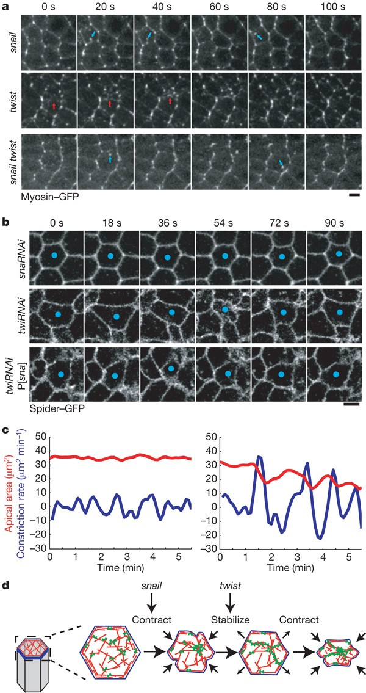

*图 7 · 驱动有多强与形变能保留多少，可以由不同过程控制。* 引自 [Martin 等（2009），Fig. 4](https://www.nature.com/articles/nature07522/figures/4)，原图未修改。A 比较肌球蛋白动态，B、C 比较细胞轮廓与面积，D 示意收缩和稳定交替。RNAi 是降低相应基因表达的处理；Snail、Twist 是调节发育基因表达的转录因子。

先看 C 的红色面积曲线，再看蓝色收缩速率：有些处理后仍能看到明显收缩，却会在两次收缩之间重新展开，净缩小很少。论文用这些差异区分 Snail 与 Twist 对收缩、稳定阶段的作用。D 中的“棘轮”是力学类比，意思是一步步保留变化，细胞里并没有一只实体齿轮。

这与“增加随机起伏，让细胞更容易换邻居”不同。若要在模型中留下每次收缩的效果，需要说明当前形状为什么不会完全回弹，例如是否更新了参考结构，或持续维持了某种张力。即便脉冲大小相同，保留程度不同，也会产生不同的长期形变。

还要将面积收缩与剪切流动分开：本例主要改变细胞顶端面积，胚带延长则涉及有方向的细胞伸长和接触更新。把两者都写成同一个“活性增大”，就会丢掉真正被驱动的变量。腹沟由平面收缩走向内陷的几何，在 [Note 06](/notes/vertex_model/geometry_3d/#fly-ventral-furrow)继续讨论。

## 5. 为什么活性不能只压缩成有效温度

取一个代表性机械松弛时间 $\tau_{\rm mech}\sim\zeta/\lambda_{\rm typ}$。如果 $\tau_p\ll\tau_{\rm mech}$，快速变向的驱动在某些粗粒化观测中可近似为短相关噪声；如果 $\tau_p\gg\tau_{\rm mech}$，驱动足以沿某个方向积累形变、选择模态并改变事件相关性。临界附近有一整套机械时间，单个 $\tau_{\rm mech}$ 只是估计。

### 5.1 彩色噪声对一个机械模态的作用

设 $\zeta\dot u=-\lambda u+f(t)$，$f$ 为零均值、方差 $s_f^2$、相关时间 $\tau_p$ 的 Ornstein–Uhlenbeck 力。在稳态联立 $d\langle uf\rangle/dt=0$ 与 $d\langle u^2\rangle/dt=0$，可以得到

$$
\langle u^2\rangle
=\frac{s_f^2}{\lambda(\lambda+\zeta/\tau_p)}.
$$

在固定方差 $s_f^2$ 下，快速驱动力来不及维持同一方向，位移较小；持续驱动能把软模式推得更远。但如果固定的是积分噪声强度 $s_f^2\tau_p$，而不是瞬时方差，改变 $\tau_p$ 时的比较就不同。讨论“持续性增强使组织更容易流动”之前，必须先说明究竟保持了什么驱动量不变。

### 5.2 从运动轨迹辨认慢动力学

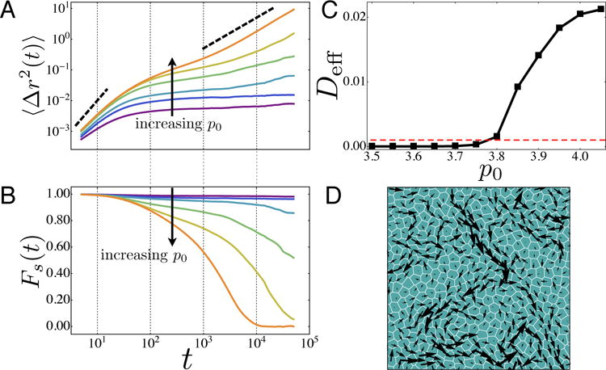

*图 8 · 轨迹给出的玻璃动力学指标。* 引自 [Bi 等（2016），Fig. 1](https://pmc.ncbi.nlm.nih.gov/articles/PMC5619672/#F1)，原图未修改。A 为细胞中心 MSD，B 为自中间散射函数，C 为扩散指标，D 为结构松弛时间附近的细胞位移图。

先读图 A 的横轴“等了多久”和纵轴“平均走开多远的平方”。自由细胞短时间大致朝同一个方向走，距离与时间成正比，MSD 就与时间平方成正比，这叫弹道区，双对数图斜率为 2。经过多次随机转向后，MSD 与时间近似成正比，这叫扩散区，斜率为 1。

若中间出现平台，意味着细胞在一段时间里主要在邻居围成的小范围内活动，这种限制常叫**笼困**。平台很长可以说明结构更新很慢；要知道它最后会不会离开，还得把轨迹拍得更久。分析前也要扣除整片组织的平移，否则一块整体移动的组织也会给出很大的 MSD。

图 B 的自中间散射函数是另一种记录“还记不记得原来位置”的方式，写成 $F_s(k,t)=N^{-1}\sum_i\langle e^{i\mathbf k\cdot[\mathbf R_i(t)-\mathbf R_i(0)]}\rangle$。先不必逐项计算复指数：$k$ 选择观察的长度尺度，移动远到在这个尺度上失去原位置记忆时，曲线就下降。由它得到的结构松弛时间，需要连同所选尺度和下降阈值一起报告。

[Bi 等（2016）](https://doi.org/10.1103/PhysRevX.6.021011)在自推进 Voronoi 模型中研究了运动强度、持续时间和目标形状对玻璃动力学的影响。它提供一个主动体系的具体例子；[Note 03](/notes/vertex_model/rigidity/) 中的二维 Voronoi 静态结果提醒我们，有限时间运动停滞的边界不能自动等同于静态零温的刚性转变。

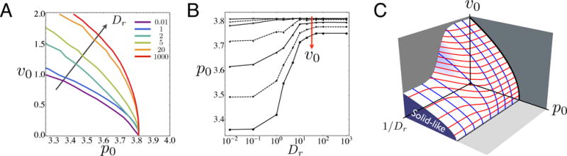

*图 9 · 一个参数不足以刻画主动动力学。* 引自 [Bi 等（2016），Fig. 3](https://pmc.ncbi.nlm.nih.gov/articles/PMC5619672/#F3)，原图未修改。A、B 为不同参数切片，C 为该文组织出的三维动力学示意。原文对小活性极限的解释应结合后来二维 Voronoi 静态研究来阅读，不能把图中外推当成所有模型的普适零温临界点。

## 6. 怎样从 T1 数据走向流变

若只测每分钟 T1 次数，会丢掉事件方向与协同。更有判别力的比较是同时记录应力松弛、净重排剪切率、等待时间分布与空间相关，再检验它们是否能用同一个 $\tau$ 描述。

观察时间 $t_{\rm obs}\ll\tau$ 时，一片终会松弛的组织也可能表现为固体；若施加应力足够强，原有静态刚性又不妨碍持续塑性流动。因此报告“组织流体化”时，应同时写清驱动、观察窗口和实际测量量。

可以用三个无量纲组合整理协议：$\omega\tau$ 比较振荡频率与松弛时间，$\dot\gamma\tau$ 比较持续加载与松弛，$\tau/t_{\rm obs}$ 比较材料时间与观察窗口。它们探测的问题不同，不应把同一个“高/低”标签互相替换。

可以在同一批细胞中把两组数据对上：每次接触更新时，应力有没有下降；一段时间里积累了多少有方向的重排，应力又释放了多少。若模型能解释细胞移动的距离，却解释不了受控拉动后的应力曲线，就还需要补充受力与松弛的机制。

## 7. 斑马鱼尾部：怎样在活体中区分应力、涨落和松弛

### 7.1 一个液滴的不同形变模式测量不同尺度的力

这里先把位置放清楚：斑马鱼已经形成头尾方向，身体仍在向后延长。最靠后的中胚层祖细胞区叫 **MPZ**，其中的细胞随后进入位置更靠前的**体节前中胚层 PSM**。PSM 会继续参与形成沿身体成对排列的体节；体节之后参与构成肌肉、脊柱周围等结构。A-PSM 指 PSM 较靠前的部分。

这一节问的是尾部不同位置怎样承受和释放机械作用，与早期“一团胚盘细胞在卵黄上铺开”的实验属于不同发育阶段。先认清这几个位置，再比较图中的材料响应。

[Mongera 等（2018）](https://doi.org/10.1038/s41586-018-0479-2)把微小油滴放入组织，作为一个能被周围细胞推挤的探针。为什么油滴能测力？表面张力倾向于把它拉成球，组织的推挤让它偏离球形。若事先知道滴面的表面张力，再测出三维形状和曲率，就可以估计把它压成当前形状需要多大的机械作用。

近似均匀的界面张力记为 $\gamma_{\rm d}$，法向应力差与 $2\gamma_{\rm d}H$ 平衡，$H$ 是表面弯曲程度的平均曲率。球本来就有 $2\gamma_{\rm d}/R$ 的内外压差，因此读组织的不均匀作用时，要将球形背景与非球形变形分开。

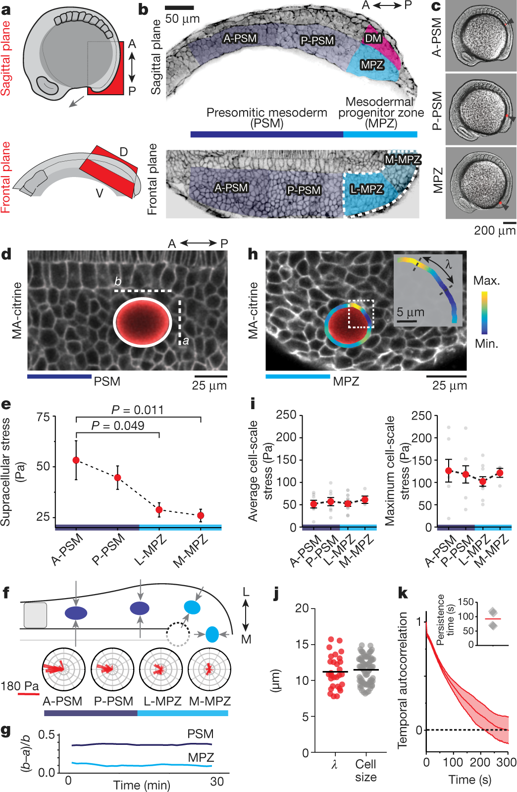

*图 10 · 同一个组织里存在不同空间和时间尺度的力。* 引自 [Mongera 等（2018），Fig. 1](https://www.nature.com/articles/s41586-018-0479-2/figures/1)，原图未修改。椭圆形变用于估计跨细胞尺度的各向异性应力；高阶轮廓变化反映更局部的作用；k 分析局部形变的时间相关。不同模式与尺度的区分，是解释主动组织的关键。

读这类液滴图，可以先分两个尺度。整个液滴沿某个方向被拉长，提示跨越多个细胞的定向作用；轮廓上局部凹凸不断变换，提示附近单个细胞的推挤和收缩在变化。前者可以长时间保持方向，后者变化得快。

所以，一个组织完全可以同时有持续的方向性应力和活跃的局部起伏。起伏可能帮助细胞离开原来的排列，方向性应力则可能让这些变化更常朝某个方向积累。它们在形状图上已经表现为不同的空间模式，也需要分别统计时间上的变化。

但一个被动液滴形状只能说明组织正在施加何种力，不能单独确定组织是固体还是流体。流体在持续驱动下也能维持非球形液滴；有屈服的组织又可能在卸载后留下残余形变。必须进一步施加已知扰动，并记录时间和恢复过程。

#### 论文视频 · 斑马鱼 A-PSM：看见细胞起伏，并不等于看见组织流动

<figure class="vertex-video" id="video-mongera-jiggling" style="--vertex-video-width: 420px">
<video controls preload="metadata" playsinline width="244" height="242" aria-label="斑马鱼 A-PSM：看见细胞起伏，并不等于看见组织流动" src="https://media.springernature.com/original/springer-static/esm/art%3A10.1038%2Fs41586-018-0479-2/MediaObjects/41586_2018_479_MOESM4_ESM.mov">
<a href="https://media.springernature.com/original/springer-static/esm/art%3A10.1038%2Fs41586-018-0479-2/MediaObjects/41586_2018_479_MOESM4_ESM.mov">直接打开原始视频</a>。
</video>
<figcaption><strong>显微视频</strong>｜Mongera 等（2018），Supplementary Video 1。Tg(actb2:MA-Citrine) 膜标记；A-PSM 局部共聚焦延时成像，真实过程约 30 min，原始文件为 MOV。视频未修改，权利与许可见原文。<a href="https://www.nature.com/articles/s41586-018-0479-2#MOESM4" target="_blank" rel="noopener">原文与完整视频说明</a> · <a href="https://media.springernature.com/original/springer-static/esm/art%3A10.1038%2Fs41586-018-0479-2/MediaObjects/41586_2018_479_MOESM4_ESM.mov" target="_blank" rel="noopener">直接打开原始视频</a>。</figcaption>
</figure>

**先看哪里：** 先固定几只细胞的身份，慢放观察边界起伏，再检查邻居排列是否随之长期改变。这段播放只有约 4 s，时间尺度应读原图例和画面标记，而不是按播放器秒数理解。

**怎样读物理：** 原视频来自 A-PSM，不能误标成更易重塑的 MPZ。它说明具有支撑作用的组织也能持续发生局部主动起伏；判定流体化还需接触更新、相对运动和受控材料响应。

### 7.2 主动涨落的相关函数不等于材料响应函数

令未扰动主动组织的应力为 $\sigma_0(t)$。在匹配发育时刻和空间区域的重复实验中，施加小阶跃应变 $\gamma_0$，可以定义平均增量响应

$$
G_{\rm resp}(t)=\lim_{\gamma_0\to0}
\frac{\langle\sigma(t)\rangle_{\gamma_0}
-\langle\sigma_0(t)\rangle}{\gamma_0}.
$$

另一个量是未扰动组织的自发应力相关

$$
C_\sigma(t)=\langle\delta\sigma_0(t)\delta\sigma_0(0)\rangle.
$$

这两个量回答的是不同问题。$G_{\rm resp}$ 问“我额外拉一下以后，平均多出多少应力”；$C_\sigma$ 问“我什么也不做时，应力本身能记住先前状态多久”。后者有应力平方的单位，前者有模量的单位。

在热平衡里，两者可以在特定条件下通过温度、体积和响应定理联系起来。活细胞却一直在输入能量，起伏还取决于细胞收缩有多强、有多久，因此不能只看自发起伏就定量求出黏度。实验需要保留未受扰动的对照，再比较施加已知扰动后增加的平均响应。

一个实际后果是：若晚期应力落到主动背景涨落的噪声水平，原始信号仍不为零，并不意味着存在非零弹性平台。需要比较受扰动组与匹配对照的平均增量及其置信区间。反过来，在有限观察窗口内未检测到进一步衰减，也不足以证明 $t\to\infty$ 平台存在。

### 7.3 主动泡沫模型把“后续松弛来自哪里”变成可检验问题

[Kim 等（2021）](https://doi.org/10.1038/s41567-021-01215-1)在允许细胞外间隙的模型中，比较给定形变后的松弛：没有持续主动张力涨落时，形变诱导的一批邻居交换结束后，后续重排可能停止；持续涨落则能维持重排并释放更慢的应力。

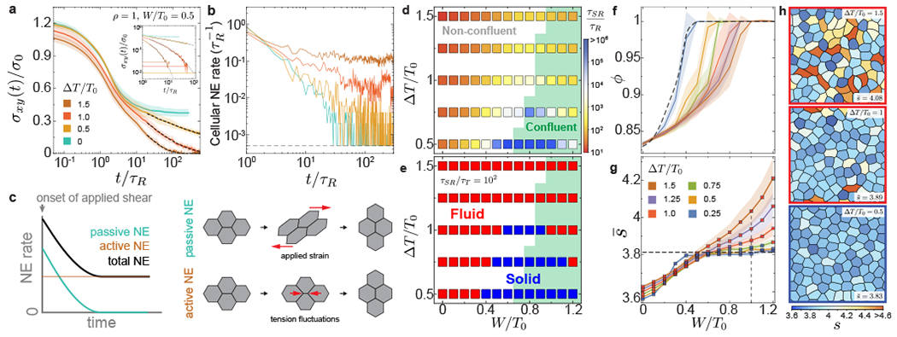

*图 11 · 快速机械响应之后，还存在主动维持的慢过程。* 引自 [Kim 等（2021），Fig. 4](https://pmc.ncbi.nlm.nih.gov/articles/PMC8336761/#F4)，原图未修改。a、b 将应力与邻居交换率配对；d、e 改变界面作用与涨落强度。原文的加载和拟合定义决定这里的松弛时间，不能未经小应变极限检验就把整条曲线命名为线性 $G(t)$。a 中的晚期水平还需和主动应力背景比较。

这比“活性像温度”更具体：模型指定涨落作用在接触张力上，给出了作用变量、记忆时间以及重排路径。若只把最终扩散系数调到一致，却给不出相同应力松弛和干预响应，便没有验证同一种机制。

#### 论文视频 · 主动泡沫模型：形变以后，重排怎样继续发生

<figure class="vertex-video" id="video-kim-active-relaxation" style="--vertex-video-width: 680px">
<video controls preload="metadata" playsinline width="720" height="606" aria-label="主动泡沫模型：形变以后，重排怎样继续发生" src="https://media.springernature.com/original/springer-static/esm/art%3A10.1038%2Fs41567-021-01215-1/MediaObjects/41567_2021_1215_MOESM7_ESM.mp4">
<a href="https://media.springernature.com/original/springer-static/esm/art%3A10.1038%2Fs41567-021-01215-1/MediaObjects/41567_2021_1215_MOESM7_ESM.mp4">直接打开原始视频</a>。
</video>
<figcaption><strong>模型动画</strong>｜Kim 等（2021），Supplementary Video 5。论文数值模拟；给定阶跃形变后保留主动张力涨落，红色标出发生拓扑变化的细胞。视频未修改，权利与许可见原文。<a href="https://www.nature.com/articles/s41567-021-01215-1#MOESM7" target="_blank" rel="noopener">原文与完整视频说明</a> · <a href="https://media.springernature.com/original/springer-static/esm/art%3A10.1038%2Fs41567-021-01215-1/MediaObjects/41567_2021_1215_MOESM7_ESM.mp4" target="_blank" rel="noopener">直接打开原始视频</a>。</figcaption>
</figure>

**先看哪里：** 分别跟踪非汇合与汇合构型：先看施加形变后快速发生的结构变化，再看较晚是否还出现新的重排。红色表示事件标记，不是张力大小或细胞类型。

**怎样读物理：** 这段是模型动画，不能当作斑马鱼显微成像。它将上图中的“慢松弛”还原为具体接触变化；仅凭动画中的运动也不能读出应力，仍需和 Fig. 4 的应力曲线配对。

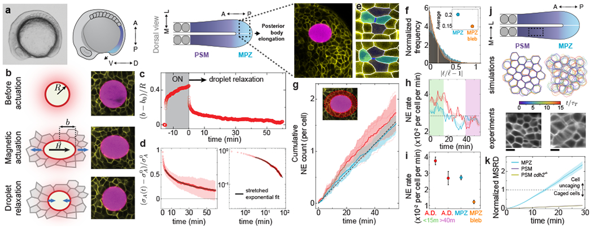

*图 12 · 对照组决定怎样解释细胞重排。* 引自 [Kim 等（2021），Fig. 5](https://pmc.ncbi.nlm.nih.gov/articles/PMC8336761/#F5)，原图未修改。磁场驱动与撤除提供受控加载；g–i 比较滴周围与远离液滴处的邻居交换。部分涨落、药物和相对位移数据由早期研究重新分析，不能把所有面板都当作完全独立的新重复实验。

先看液滴周围早期增加的邻居交换，再看它如何回到远离液滴处的背景速率。两者分别对应扰动诱发的重排和组织持续发生的重排；将它们混在一个总计数里，会高估探针测量的是完全未受扰动材料的行为。

抑制肌球蛋白后，接触长度涨落和邻居交换一同降低，为主动过程参与重塑提供支持。但药物也可能改变平均张力、黏附、接触寿命和耗散；严格的因果解释需要把这些量与模型中的“只改涨落幅度”分别比较。模型参数干预可以很纯粹，生物干预通常不是单一旋钮。

## 8. 为什么“流体化”不自动给出体轴的方向 {#activity-direction}

### 8.1 将重排的总活性和方向偏置分开

考虑一个粗粒化区域，暂将事件分成两类：每次沿测量轴贡献 $+\varepsilon_{\rm e}$ 或 $-\varepsilon_{\rm e}$ 的塑性应变，发生率分别是 $k_+,k_-$。定义

$$
\Gamma=k_++k_-,\qquad
b=\frac{k_+-k_-}{k_++k_-},\qquad
\boxed{\dot\varepsilon^{\rm pl}=\varepsilon_{\rm e}\Gamma b.}
$$

这里假设每次事件的形变大小相同，只分正反两个方向，因此净变化就是两类事件贡献相减。真实细胞网络的事件大小、方向各不相同，计算时要逐个加权；这个例子先把“发生得多不多”和“更偏向哪个方向”拆开。

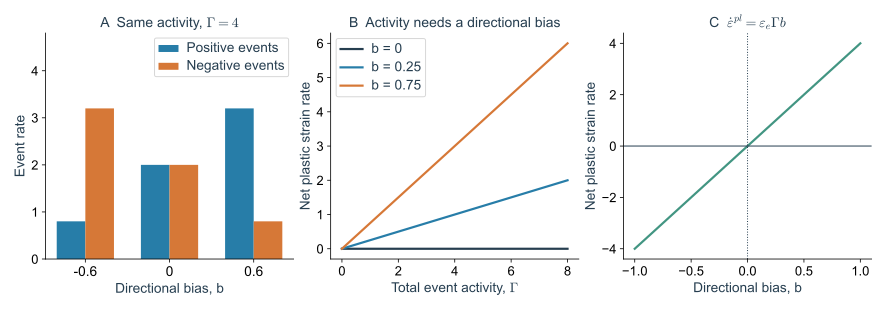

*图 13 · 事件很多也可以没有定向形变。* 自制双通道事件模型，取 $\varepsilon_{\rm e}=1$，直接计算 $k_\pm=\Gamma(1\pm b)/2$ 与净应变率。事件率由 $\Gamma$ 与 $b$ 设定，未使用斑马鱼的事件数据。

若正反方向同样常见，$b=0$，即使事件总数 $\Gamma$ 很大，净伸长仍为零。要让变化朝一个方向积累，需要持续的应力、运动极性、周围边界或细胞供给等给出偏向。因此，解释胚胎伸长要同时回答两个问题：细胞为什么容易重新排列，以及这些排列变化为什么最终沿着身体轴积累。

斑马鱼尾部给出具体对应：局部快速应力变化帮助解除笼困；组织尺度的持续应力、前方较稳固的 PSM 与细胞输入共同约束整体流动。原研究图中使用的“有效温度”可作为涨落强弱的历史性类比，但不代表已验证了某个同时描述响应、相关和跨势垒率的热力学温度。

### 8.2 材料状态要和发育时间比较

把这个结果放回发育过程，最有用的问题是：**组织放松需要多久，而胚胎给了它多久？** 用 $\mathrm{De}(\mathbf x)=\tau_{\rm relax}(\mathbf x)/t_{\rm morph}$ 比较两者，$t_{\rm morph}$ 是所研究形态变化的时间。比值小，表示组织能在形态变化期间多次放松；比值大，表示这段过程中仍能保留较强的机械记忆。

同一条身体轴上，后部可以来得及重排，前部则保留支撑。这个比较使“后面软、前面硬”更具体：它们是相对于同一发育时间而言的材料差异。

这还给出一个反事实预测：只把后部变得更易重排，而取消定向边界或改变细胞输入位置，组织未必继续沿原轴伸长；只保留定向应力而使后部更新极慢，伸长又可能受阻。要验证材料状态对发育的功能，需要同时问流动是否发生、方向是否保持、支撑是否足够。这个检验在 [Note 07](/notes/vertex_model/morphogenesis/#zebrafish)中继续展开。

## 技术附录：把主动参数变成可比较的量 {#technical-appendices}

### A. 速度、持续时间和机械单位

沿用 Note 01 的长度 $\ell_0=\sqrt{A_0}$ 与时间 $t_0=\zeta/(K_AA_0)$，主动速度和角扩散应写成 $\tilde v_0=v_0t_0/\ell_0$、$\tilde D_r=D_rt_0$。相同的物理速度，在机械松弛快慢不同的组织中可以对应不同无量纲驱动。

另一个量是持续长度 $\ell_p=v_0/D_r$。它表示自由主动粒子在明显变向前可以沿原方向推进的距离。$\ell_p$ 大于细胞尺度，并不保证组织中的细胞能走这么远：邻居约束、交界张力和重排路径仍然决定实际运动。

因此比较主动相图时，至少应说明固定的是速度、力幅度、力方差还是输入功率；改变摩擦时，也需说明是否同时改变了运动速度。参数名相同不代表实验控制量相同。

### B. 有效温度在一个线性极限怎样出现

彩色力的相关函数为 $\langle f(t)f(0)\rangle=s_f^2e^{-|t|/\tau_p}$。若保持 $s_f^2$ 固定，让 $\tau_p\to0$，相关函数的积分趋于零，机械自由度受到的长期扰动也消失。

若改为保持 $D_f=s_f^2\tau_p$ 固定，极限相关函数为 $2D_f\delta(t)$，前面的模态方差变成

$$
\langle u^2\rangle\longrightarrow\frac{D_f}{\zeta\lambda}.
$$

它形式上等同于一个温度满足 $k_BT_{\rm eff}=D_f/\zeta$ 的热平衡线性弹簧。但这只建立该极限中这个观测的对应：如果各模式受到不同噪声、噪声与耗散不匹配，或跨越势垒的过程具有持续性，同一个 $T_{\rm eff}$ 未必还能描述它们。

### C. 线性模态的发散提示什么时候需要回到完整网络

当 $\lambda\to0$ 时，线性公式可能预测很大的位移。实际组织不会无限保持在原构型附近：高阶能量、有限应变、交界消失或其他拓扑操作会介入。因此大方差往往意味着当前线性近似即将失效，而不是一个可以无限外推的真实位移。

这正好把全系列连接起来。几何刚性决定低能方向，持续驱动选择并放大某些方向，有限位移再接触到能量势垒与拓扑变化，最后影响宏观应力松弛。孤立地研究其中一个参数，很难完整解释组织的流动状态。

## 主要文献

- [Tlili et al. (2020), A migrating epithelial monolayer flows like a Maxwell viscoelastic liquid](https://doi.org/10.1103/PhysRevLett.125.088102)。MDCK 细胞绕障碍物流动时的形变与重排。
- [Martin et al. (2009), Pulsed contractions of an actin–myosin network drive apical constriction](https://doi.org/10.1038/nature07522)。果蝇腹沟中的脉冲收缩与收缩后稳定。

- [Mongera et al. (2018), A fluid-to-solid jamming transition underlies vertebrate body axis elongation](https://doi.org/10.1038/s41586-018-0479-2)。
- [Kim et al. (2021), Embryonic tissues as active foams](https://doi.org/10.1038/s41567-021-01215-1)。
- [Fielding et al. (2023), Constitutive model for the rheology of biological tissue](https://doi.org/10.1103/PhysRevE.108.L042602)。
- [Barton et al. (2017), Active Vertex Model for cell-resolution description of epithelial tissue mechanics](https://doi.org/10.1371/journal.pcbi.1005569)。
- [Bi et al. (2016), Motility-driven glass and jamming transitions in biological tissues](https://doi.org/10.1103/PhysRevX.6.021011)。

[← T1 与塑性](/notes/vertex_model/rearrangements/) · [下一篇：各向异性、曲面与三维组织 →](/notes/vertex_model/geometry_3d/)
