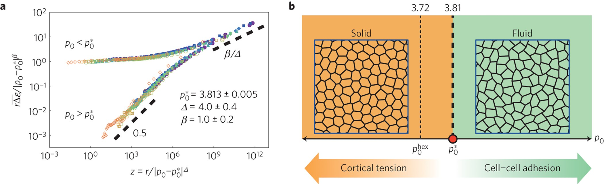
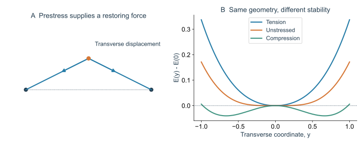
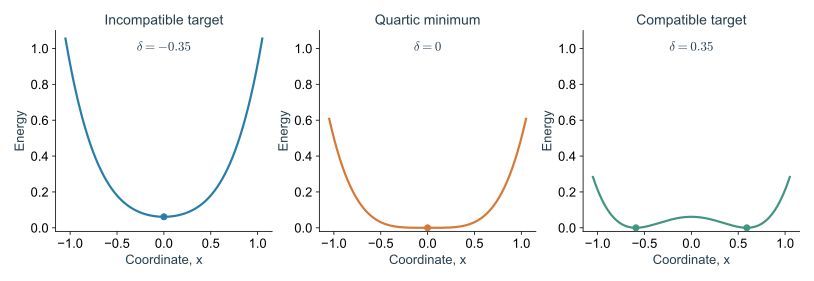
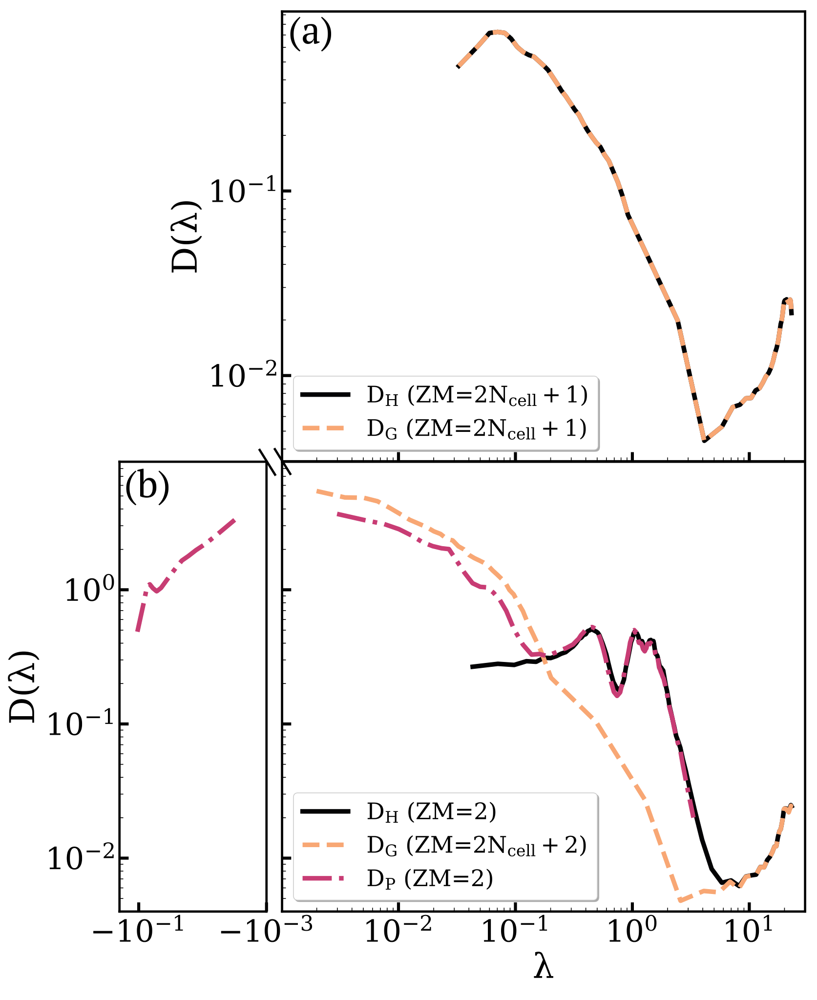
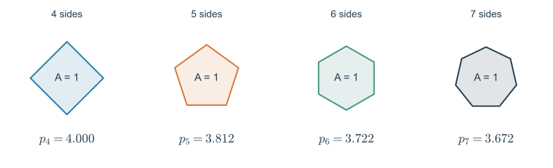
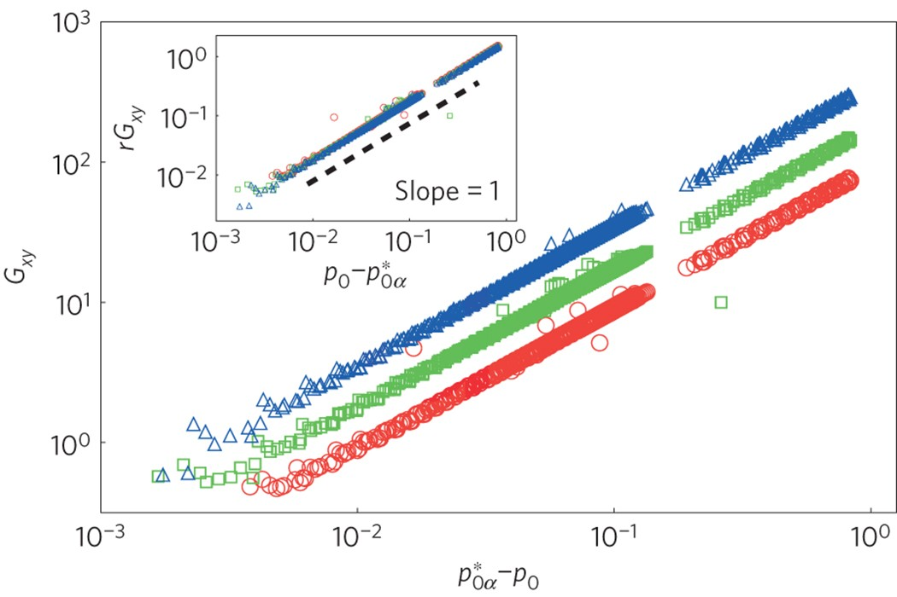
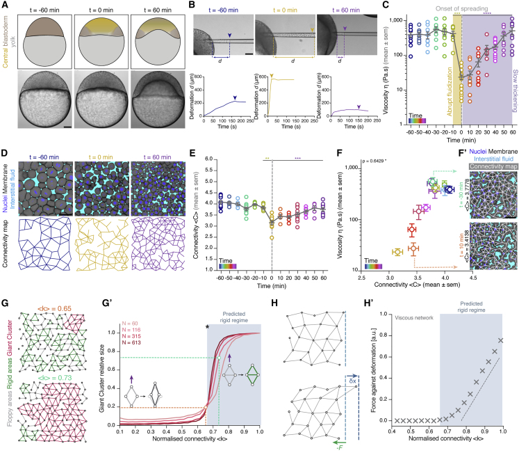
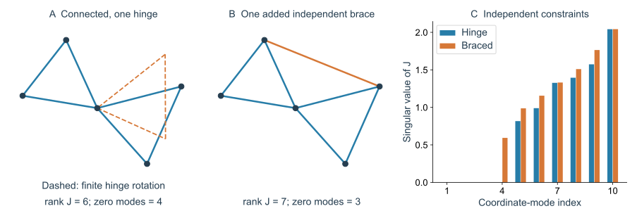
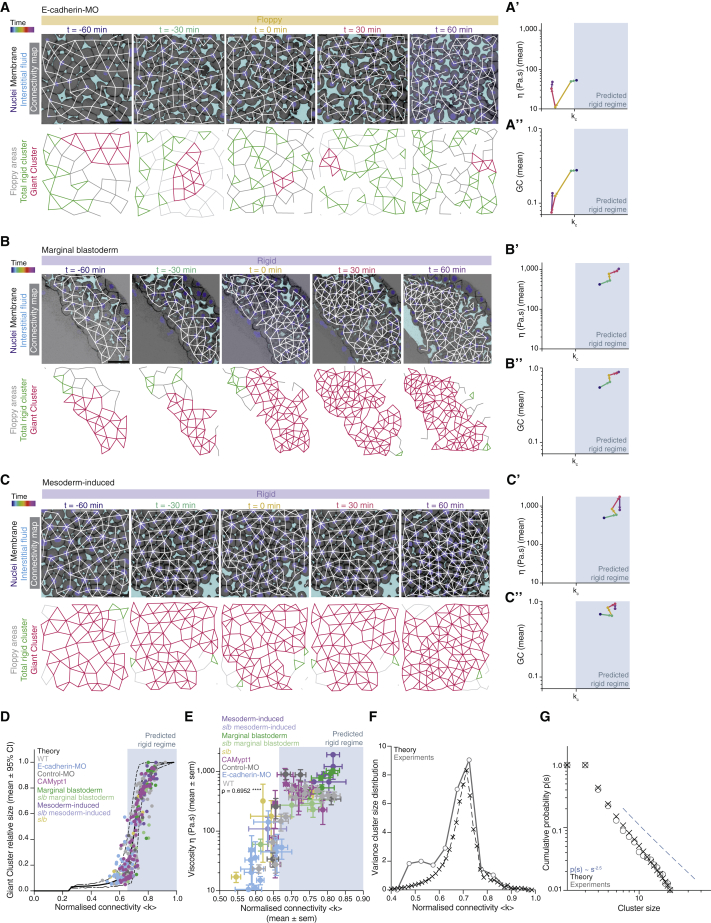

> **Part II · Note 03**　[专题目录](/notes/vertex_model/) · 上一篇：[线性响应](/notes/vertex_model/linear_response/)

**物理问题：** 面积和周长约束的数目比顶点自由度少，组织为什么仍然可能具有有限刚性？

## 概述：几何目标怎样决定材料能否成为固体 {#main-lecture}

如果把颗粒挤得越来越密，更多接触常会阻碍相对运动。连续铺砌的组织提出了另一种问题：没有空隙、细胞始终接触，仍然可以在易于重排与难以重排之间改变。既然填充分数已经为一，控制因素就不能只用“还剩多少空位”来描述。

这里先区分两个密度。无空隙铺砌固定的是面积填充分数；细胞数密度 $N/A_{\rm tot}$ 仍可通过增长或改变盒面积变化。本篇讨论的是细胞数与盒面积也固定的情形：在相同数密度下改变目标周长，研究几何与能量状态的改变。

*图 1 · 同一填充状态中可以出现不同机械响应。* 引自 [Bi 等（2015），Fig. 2](https://www.nature.com/articles/nphys3471/figures/2)，原图未修改。a 是重排势垒的缩放检验；b 对照刚性和流体样构型，并区分规则六边形的几何尺度与无序亚稳态的转变位置。图中的参数 $r$ 是逆周长模量约定，与 Note 01 的 $r=K_P/(K_AA_0)$ 互为倒数。

先看 b 中约为 3.72 与 3.81 的两条竖线。它们对应不同问题：规则六边形能否达到目标周长，以及无序网络在特定制备条件下何时失去刚性。把这两个数看成同一个“普适临界值”，会把初态的几何差异掩盖掉。

本篇的理论主线是：约束数目告诉我们有多少一阶变形机会，约束的非线性几何决定这些机会能否延续，未满足目标留下的内应力则可能把它们变成有恢复力的模式。下面先把这三个层次逐个推导。

## 1. 先做计数，再看它漏掉什么

周期、三价的二维 Vertex 网络有 $N_v=2N$ 个顶点，即约 $4N$ 个坐标自由度；每个细胞只有一个面积目标和一个周长目标，共 $2N$ 个标量条件。忽略有限个整体平移以及约束依赖后，系统明显欠约束。

如果这些条件全部能满足，而且相互独立，一阶计数确实预示大量不改变面积、周长的无穷小位移。但真实能量的局部曲率不仅来自一阶约束，还包含未满足目标时的几何贡献。要判断刚性，必须把两者分开。

### 1.1 计数的正确形式包括约束之间的依赖

对于有 $D$ 个坐标、$M$ 个残差的约束矩阵 $J$，记秩为 $R$。其右零空间维数为 $N_0=D-R$，左零空间维数为 $N_s=M-R$，两式相减得到 Maxwell–Calladine 关系：

$$
\boxed{N_0-N_s=D-M.}
$$

$N_0$ 计入一阶零模，包括尚未移除的刚体模态；$N_s$ 是自应力状态数。它是一条线性代数恒等式，并没有假定每个条件都独立，也没有给出能量是否在二阶上升的结论。

周期盒总面积固定，使 $\sum_i\nabla A_i=0$，所以面积梯度之间本来就有一条线性依赖。对加权残差，给所有面积行赋予相应的逆权重，就得到一个平凡的面积自应力。处理这类依赖，是精确比较零模数目的必要步骤。

例如 $N=100$ 的三价周期 Vertex 网络具有 $D=400$ 个顶点坐标、$M=200$ 个面积和周长残差。即使约束矩阵几乎达到最大可能秩，一阶零模也仍有大约两百个。这和一个只含几个平移自由度的普通弹性固体，在线性约束层面非常不同。

### 1.2 Hessian 多出来的项是什么

将带权残差统一记为

$$
f_{iA}=\sqrt{K_A}(A_i-A_{0i}),\qquad
f_{iP}=\sqrt{K_P}(P_i-P_{0i}),\qquad
E=\frac12\sum_\alpha f_\alpha^2.
$$

令 $J_{\alpha a}=\partial f_\alpha/\partial x_a$，对能量求两次导数，得到恒等式

$$
\boxed{H=J^{\mathsf T}J+S,\qquad
S_{ab}=\sum_\alpha f_\alpha\frac{\partial^2f_\alpha}{\partial x_a\partial x_b}.}
$$

第一项是约束梯度的 Gram 矩阵；第二项是残余应力与几何二阶导数的耦合，通常称为预应力项。对于 $J\mathbf u=0$ 的一阶零模，$\mathbf u^{\mathsf T}H\mathbf u=\mathbf u^{\mathsf T}S\mathbf u$：一阶不改变约束，不等于二阶没有能量代价。

这条分解可以直接从一个坐标分量开始检查：

$$
\frac{\partial E}{\partial x_a}=\sum_\alpha f_\alpha J_{\alpha a},
\qquad
\frac{\partial^2E}{\partial x_a\partial x_b}
=\sum_\alpha J_{\alpha a}J_{\alpha b}
+\sum_\alpha f_\alpha\frac{\partial J_{\alpha a}}{\partial x_b}.
$$

第一项只问约束随位移的一阶变化；第二项问约束曲面本身怎样弯曲，并由当前残差加权。因为面积与周长是顶点坐标的非线性函数，后一项一般不能省略。

## 2. 几何不相容怎样留下内应力

若所有细胞能同时达到目标，则 $f_\alpha=0$，预应力项消失。若铺砌限制让目标不能同时实现，最小能量态仍有 $f_\alpha\neq0$。它可以保持力平衡，因为

$$
\nabla E=J^{\mathsf T}\mathbf f=0.
$$

这意味着残差形成一个自平衡应力状态，内部压力和张力相互抵消。它们是否稳定一阶零模，还要看 $S$ 在这些方向上的符号：有残差并不自动保证所有方向都稳定，预应力也可以导致屈曲。

### 2.1 一根绷紧的结构为什么抵抗横向运动

考虑一个中心点，被两根相同弹簧连到 $(\pm L,0)$。先限制中心点只沿 $y$ 方向移动，每根弹簧的原长为 $\ell_0$、弹簧常数为 $k$。两根弹簧总能量为

$$
E(y)=k\left(\sqrt{L^2+y^2}-\ell_0\right)^2.
$$

在 $y=0$ 附近展开，减去常数能量后得到

$$
E(y)-E(0)=k\frac{L-\ell_0}{L}y^2+O(y^4),
\qquad H_{yy}=2k\frac{L-\ell_0}{L}.
$$

一阶横向移动不改变弹簧长度，因为 $d\ell/dy|_0=0$。但如果两根弹簧已经绷紧，即 $L\gt \ell_0$，横向运动在二阶上增加长度，现有张力就使它产生二次能量代价。如果恰好没有张力，$L=\ell_0$，领先能量变成 $ky^4/(4L^2)$。若处于压缩状态，$L\lt \ell_0$，中心位置反而会向横向失稳。

*图 2 · 无穷小几何约束相同，预应力可以改变稳定性。* 自制精确弹簧计算，取 $k=L=1$，比较 $\ell_0=0.8,1,1.2$；图中能量均减去 $E(0)$。这个体系只有一个允许坐标，作为预应力机制的例子，不承担 Vertex 网络临界点的预测。

它与细胞网络的共同点是：一个位移可以在一阶上保持几何量不变，却在二阶上改变它；若几何量已有非零共轭力，这个二阶改变会进入能量的二次项。不同之处在于组织具有大量相互耦合的面积、周长约束，不能用单根弹簧的计数替代完整分析。

### 2.2 残差与局部刚度的另一种精确例子

下面这个单约束能量可把“不相容”与“曲率”的关系完全算出：

$$
E(x;\delta)=\frac12(x^2-\delta)^2.
$$

目标是让 $x^2=\delta$。当 $\delta\lt 0$，目标不可达，最低点为 $x=0$，残差 $f=-\delta\gt 0$；此处 $J=2x=0$，但 $H=-2\delta\gt 0$，刚性全来自预应力项。当 $\delta=0$，$E=x^4/2$，线性刚度为零，有限位移仍有四阶代价。当 $\delta\gt 0$，最低点为 $x=\pm\sqrt\delta$，残差为零，局部刚度 $H=4\delta$ 来自 $J^{\mathsf T}J$。

*图 3 · 几何相容性改变能量曲率。* 精确绘制 $E=(x^2-\delta)^2/2$，比较 $\delta=-0.35,0,0.35$。该模型展示不相容产生刚度的可能机制；它没有组织的拓扑和自由度数目，也不代表 Vertex Model 在相容侧一定具有有限模量。

## 3. 一阶零模、二阶刚性与能量刚性

沿路径 $\mathbf x(t)=\mathbf x_*+t\mathbf u+t^2\mathbf v/2$，约束的变化为

$$
f_\alpha(\mathbf x(t))-f_\alpha(\mathbf x_*)
=t(J\mathbf u)_\alpha+
\frac{t^2}{2}\left[(J\mathbf v)_\alpha+
\mathbf u^{\mathsf T}(\nabla^2f_\alpha)\mathbf u\right]+O(t^3).
$$

一阶零模只要求 $J\mathbf u=0$。若无法找到 $\mathbf v$ 使所有二阶变化也消失，就存在二阶几何阻碍。在无残差构型中，这种阻碍可能对应 $O(t^4)$ 的能量，而非有限二次模量。因此必须区分“有限微小位移会升能”的能量刚性，与“线性剪切模量非零”。

### 3.1 用自应力检验二阶路径能否存在

要在二阶仍保持所有残差不变，需要解 $J\mathbf v=-\mathbf b(\mathbf u)$，其中 $b_\alpha=\mathbf u^{\mathsf T}\nabla^2f_\alpha\mathbf u$。如果 $\mathbf s$ 位于 $J$ 的左零空间，即 $J^{\mathsf T}\mathbf s=0$，那么两边左乘 $\mathbf s^{\mathsf T}$ 就得到必要条件：

$$
\sum_\alpha s_\alpha\,
\mathbf u^{\mathsf T}(\nabla^2f_\alpha)\mathbf u=0.
$$

只要存在一个自应力使该式不为零，就不可能用二阶修正 $\mathbf v$ 补偿所有几何变化。这把“二阶阻碍”变成可计算的线性可解性问题，而不只是说网络看起来被拉紧。

不过，二阶路径不存在与宏观 $G\gt 0$ 仍不是同一命题。后者还涉及盒剪切怎样耦合到内部自由度，以及能量上升从二次还是更高次开始。讨论一个体系“rigid”之前，要先写清是在测试哪一种变形、哪一阶能量。

### 3.2 在真正的 Vertex 谱中寻找预应力的贡献

*图 4 · 为什么只对约束梯度做计数会漏掉刚性。* 引自 [Damavandi 等（2022），Fig. 4 的作者稿版本](https://arxiv.org/html/2107.06868#S3.F4)，对应 [Phys. Rev. E 105, 025004](https://doi.org/10.1103/PhysRevE.105.025004)，原图未修改。a 为柔软侧，b 为刚性侧；黑线是完整 Hessian，虚线是 Gram 项，点划线是预应力项。

先看图例中的零模数，再看正本征值部分。刚性侧的 Gram 矩阵仍有很多零模，但完整 Hessian 只保留平移零模。这正是前面“$J\mathbf u=0$ 仍可有 $\mathbf u^{\mathsf T}S\mathbf u\gt 0$”的网络版本。

横轴是矩阵本征值 $\lambda$，不是直接测得的组织振动频率。还要注意：一般有 $\operatorname{spec}(J^{\mathsf T}J+S)\neq\operatorname{spec}(J^{\mathsf T}J)+\operatorname{spec}(S)$，不能把两条谱曲线按纵向或横向直接相加来得到黑线。两个矩阵通常没有共同本征向量。

[Damavandi 等（2022）](https://doi.org/10.1103/PhysRevE.105.025004)用 energetic rigidity 框架分析 Vertex Model 等欠约束材料；本节的恒等式给出其机制入口。它不意味着二阶刚性、预应力稳定性和所有定义下的宏观刚性都可以互换。

## 4. 3.81 的几何提示与适用条件

单位面积正 $n$ 边形具有最小周长

$$
p_n=\sqrt{4n\tan(\pi/n)},\qquad
p_6\simeq3.722,\quad p_5\simeq3.812.
$$

### 4.1 从三角形拼接推导多边形几何界限

取边长为 $\ell$ 的规则 $n$ 边形，从中心分成 $n$ 个等腰三角形。每个三角形高为 $\ell/[2\tan(\pi/n)]$，因此

$$
A=\frac{n\ell^2}{4\tan(\pi/n)},\qquad P=n\ell,
\qquad \frac{P^2}{A}=4n\tan\frac\pi n.
$$

在同面积的简单 $n$ 边形中，规则形状达到最小周长。这个几何界限意味着：若固定一个五边形的面积为 1，却要求周长为 3.75，就没有可以满足的形状。允许它改变面积，会产生面积残差；允许邻居关系改变，又会改变多边形边数。实际模型是在这些代价之间寻找折中。

*图 5 · 局部几何目标有可达范围。* 自制精确几何图，所有多边形面积均为 1。数值只表示每个给定边数的周长下界；是否能在周期盒中共同铺砌并同时满足全部目标，还需加入共享边与全局约束。

规则六边形的下界说明有序铺砌的几何尺度；T1 收缩边附近细胞可以暂时减少一条边，五边形的几何限制因此给无序组织重排提供一个有用提示。[Bi 等（2015）](https://doi.org/10.1038/nphys3471)在经典二维无序 Vertex Model 的数值研究中得到接近 3.81 的刚性临界目标形状指数，并用四细胞模型联系重排势垒。

**正五边形公式是解析几何结果，完整无序网络的临界值与临界行为则不是由这一行公式严格推出的。** 需要指定网络制备、面积/周长能量、边界、拓扑操作和极限顺序。有限体系之间可出现临界点差异；改变有序程度、活性或各向异性，也会改变判据。

### 4.2 一张剪切模量图应该怎样读

*图 6 · 临界点的样本差异需要先处理。* 引自 [Bi 等（2015），Fig. 4](https://www.nature.com/articles/nphys3471/figures/4)，原图未修改。横轴使用各个构型自己的 $p_{0\alpha}^*-p_0$；不同颜色对应原文的逆周长模量参数，插图检验相应缩放。

一个容易漏掉的步骤是先确定每个样本的 $p_{0\alpha}^*$，再把横轴平移到距该样本转变的位置。如果将所有初态直接画成对同一个名义 3.81 的距离，有限尺寸和制备差异就会扩大散布。图中的缩放因此同时依赖如何定义样本临界点。

这张图比较的是微小剪切响应，前面的图 1a 比较的是重排势垒。两者在经典模型中可以给出联系紧密的转变证据，但一个是局部二次响应，一个是到另一个拓扑状态的有限路径代价；它们的数学定义始终不同。

### 4.3 为什么 Voronoi 是一个重要对照

二维 Voronoi 模型尤其能说明自由度的重要性。它只有约 $2N$ 个生成点坐标，与面积、周长条件数同阶。[Sussman 与 Merkel（2018）](https://doi.org/10.1039/C7SM02127E)在所研究的标准二维 Voronoi 模型零温极限下没有发现对应的 unjamming transition。不能将这一结论推广成“所有 Voronoi 模型始终刚性”，也不能把主动模型中的玻璃动力学边界等同于静态 Vertex 临界点。

从约束矩阵的角度，Voronoi 模型将允许位移限制到 $\delta\mathbf x=(\partial\mathbf x/\partial\mathbf R)\delta\mathbf R$。顶点模型中的某个一阶软方向若不属于这个像空间，在 Voronoi 模型里就根本不是可实现运动。自由度减少不是一种数值细节，而是改变几何可达性的建模决定。

这也解释为何不能只比较两个模型中都叫作 $p_0$ 的参数。应同时比较实际构型、残差、完整 Hessian、允许的拓扑操作和驱动。模型之间出现差异，可能帮助定位哪些自由度对生物问题重要。

## 5. 斑马鱼胚盘：刚性渗流与形状不相容是两种机制

### 5.1 先分清两张不同的网络

早期斑马鱼的深层胚盘细胞不是一个完全汇合的平面上皮。[Petridou 等（2021）](https://doi.org/10.1016/j.cell.2021.02.017)用微吸管吸引测量蠕变与恢复，同时从深层细胞的成像截面构建接触图：**图的节点是细胞，边表示细胞之间有接触**。本系列经典 Vertex Model 的节点则是细胞交界的顶点。两者的节点、自由度和约束数都不同，不能直接搬用前面的 Euler 计数或 $p_0^*$。

*图 7 · 结构变化要和独立力学测量配对。* 引自 [Petridou 等（2021），Fig. 1](https://pmc.ncbi.nlm.nih.gov/articles/PMC8055543/#fig1)，原图未修改。A–C 是胚盘铺展、吸引实验与有效黏度；D–F 是细胞接触及其与黏度的关系；G、H 再引入刚性网络和可更新的黏性网络。不能把 H 的黏性响应当成 G 中静态弹簧的剪切模量。

网络“连通”只要求细胞间存在路径；网络“刚性贯通”还要求大范围相对位移受到足够独立的约束。即使整片组织是一个连通分量，也可能由多个刚块通过柔软铰链连接。因此研究中的最大刚性簇（giant rigid cluster，GRC）不是普通的最大连通分量。

#### 论文视频 · 斑马鱼胚盘：从接触图追踪刚性簇

<figure class="vertex-video" id="video-autorino-rigidity" style="--vertex-video-width: 700px">
<video controls preload="metadata" playsinline width="992" height="822" aria-label="斑马鱼胚盘：从接触图追踪刚性簇" src="https://media.springernature.com/original/springer-static/esm/art%3A10.1038%2Fs41556-026-01954-4/MediaObjects/41556_2026_1954_MOESM4_ESM.mp4">
<a href="https://media.springernature.com/original/springer-static/esm/art%3A10.1038%2Fs41556-026-01954-4/MediaObjects/41556_2026_1954_MOESM4_ESM.mp4">直接打开原始视频</a>。
</video>
<figcaption><strong>显微视频与网络分析</strong>｜Autorino 等（2026），Supplementary Movie 1。膜、细胞核与细胞外液体成像，叠加接触图和最大刚性簇；标尺 50 μm。视频未修改，权利与许可见原文。<a href="https://www.nature.com/articles/s41556-026-01954-4#MOESM4" target="_blank" rel="noopener">原文与完整视频说明</a> · <a href="https://media.springernature.com/original/springer-static/esm/art%3A10.1038%2Fs41556-026-01954-4/MediaObjects/41556_2026_1954_MOESM4_ESM.mp4" target="_blank" rel="noopener">直接打开原始视频</a>。</figcaption>
</figure>

**先看哪里：** 先看细胞成像，再对照黑色接触网络和红色最大刚性簇如何分布；注意靠近命运指定区和上覆细胞的差别。暂停在两个相邻时刻，比较哪些接触仍在、哪些细胞进入同一个刚性簇。

**怎样读物理：** 黑线和红线是由图像构建的分析叠加层，红色并不是显微镜直接测到的力或模量。视频帮助理解“接触存在”与“属于同一个刚性簇”的区别；它展示的是 2026 年研究中的空间图谱，不是前面 Petridou 实验的同一段影片。

### 5.2 一个可以逐行复算的铰链例子

把五个二维点组成两只共享一个顶点的三角形。每条边是零预应力、只惩罚长度变化的中心力弹簧，体系边界自由。共有 $D=10$ 个坐标、$M=6$ 条边；对一般位置，长度约束矩阵秩为 6，所以零模有 4 个：两个整体平移、一个整体转动，加一个两只三角形之间的相对转动。

最后一个不是计数误差。把其中一只三角形绕共享点转动，六条边的长度在有限转角下都不改变。网络已经连通，仍能不拉伸任何弹簧而改变形状。加入一条连接两只三角形外侧顶点的非退化支撑边，矩阵秩上升到 7，才消去这个内部铰链自由度。

*图 8 · 连通性不能替代刚性。* 自制中心力框架计算。左图画出保长转动后的右三角形；中图增加一条支撑边；右图直接计算两个长度约束矩阵的奇异值，分别得到 4 和 3 个坐标零模。非零奇异值是约束梯度的量，不是实验中的材料模量；平移和转动零模均计入图中数字。

这个例子还提示全局 Maxwell 数为何不够。二维一般位置下，最小刚性框架除了满足 $M=2N-3$，还要求每个含 $n'\geq2$ 个节点的子集至多有 $2n'-3$ 条内部边；这才是 Laman 条件。若约束过度集中在局部，远处仍可能有铰链。对带预应力、弯曲约束或特殊对称位置的组织网络，条件需要重新检查，不能将该定理直接当作活体材料的判据。

联系本篇开头：这仍然是在问 $J$ 的独立约束够不够；而经典汇合 Vertex 模型的难点是，即使 $J$ 的计数留下零方向，残余应力也可能通过 Hessian 的第二项把它们稳定下来。**接触渗流改变约束的分布与秩，几何不相容改变残差及其二阶作用。** 两种机制可以共存，却不由同一个临界数字描述。

### 5.3 怎样从“转变很陡”走向统计物理证据

胚盘研究的证据不只是平均接触数与黏度同时变化。它还比较不同扰动下的刚性簇，检验有限簇尺寸分布及其涨落，并与相同尺寸的随机网络比较。

*图 9 · 临界性需要超出一条平均曲线的检验。* 引自 [Petridou 等（2021），Fig. 3](https://pmc.ncbi.nlm.nih.gov/articles/PMC8055543/#fig3)，原图未修改。D、E 比较不同条件下的簇占比和黏度；F 排除最大簇后分析簇尺寸分布的方差；G 比较临界附近的宽簇分布。有限胚胎中的峰值与宽分布支持临界解释，但不能凭有限范围直线就证明严格发散或唯一普适类。

可将结构序参量写成 $f_{\rm R}=N_{\rm GRC}/N$，并另外追踪不属于最大簇的尺寸分布 $n_s$。普通连通渗流中的簇矩，例如 $\sum_s s^2n_s/\sum_s sn_s$，给出了应当研究涨落而非只研究均值的思路；具体刚性模型的独立约束、边相关性及有限尺寸仍决定其标度，不能预先套用普通渗流指数。

原文用二维有效接触图分析三维组织浅层截面，并把连接度相对于三角网络归一化。因此图中的连接度临界值既不是直接测得的三维配位数，也不是所有组织通用的“每细胞必须有几条边”。把投影外接触、边界和接触识别误差纳入稳健性分析，才知道结构结论对测量方式有多敏感。

### 5.4 快照上的刚性怎样进入有限时间的黏度

如果接触能够更新，一个瞬时贯通网络也可能在长时间流动。在 $\tau_{\rm mech}\ll t\ll\tau_{\rm contact}$ 的窗口中，细胞先沿固定接触图机械松弛；在 $t\gtrsim\tau_{\rm contact}$ 时，边的断裂、生成与滑动开始释放原先的约束。因此静态图最多提供材料响应的一层信息，仍需接触寿命和耗散规则。

例如最简单的瞬态网络近似给出 $G(t)=G_{\rm snap}e^{-t/\tau_{\rm contact}}$，因而

$$
\eta=\int_0^\infty G(t)\,dt
=G_{\rm snap}\tau_{\rm contact}.
$$

这不是原论文全部流变的拟合公式，而是一个可辨识性算例：黏度升高十倍，可以来自快照刚度增大，也可以来自接触寿命变长；两者在相同快照下仍可不同。反过来，单凭有效黏度下降也不能推出完整 Hessian 出现零模。

这一路径还必须接受新实验的检验。[Rustarazo-Calvo 等（2026）](https://doi.org/10.1038/s41567-026-03276-6)独立调节密度与相对界面作用后，显示仅有接触连接度不足以统一解释全部材料状态。相同数目的接触可具有不同接触几何、界面作用与更新动力学；该结果扩展了早期沿自然发育轨迹建立的结构对应，详见 [Note 07 的斑马鱼干预案例](/notes/vertex_model/morphogenesis/#zebrafish)。

## 6. 怎样区分转变、有限尺寸效应与时间交叉

一个随参数迅速下降的 $G$ 还不足以证明相变。至少需要比较体系尺寸、初态无序与最小化精度，并观察软模态、残差、应力及重排势垒是否给出一致的变化；若主张连续转变，还需相应的有限尺寸或标度分析。

有限观察时间下，松弛时间从短于实验变成长于实验，也会造成固体/流体外观的交叉。那是动力学问题，不一定对应静态能量奇点。实际形状指数 $P_i/\sqrt{A_i}$ 更是构型观测值，不能无条件当成目标参数 $p_0$。

### 6.1 一个有物理含义的数值对照方案

固定同一套拓扑和边界，对一系列 $p_0$ 求局部极小值。每一步同时记录面积/周长残差、力残差、最低若干非平凡 Hessian 本征值以及充分松弛剪切模量。然后另外计算 $J^{\mathsf T}J$，比较它的零空间在完整 Hessian 中是否仍然为零。

这个对照的关键不在于画出多少曲线，而在于形成因果排查：若残差趋近零时预应力项也消失，哪些模式随之软化？若残差仍在而某方向失稳，预应力在该模式上的二次型是什么符号？如果不同初态有不同转变点，是几何制备差异还是最小化没有收敛？

对于有限尺寸序列，还应保持制备协议相同。不能把小系统的规则初态与大系统的生长无序初态放在一起，将差异全部归为尺寸效应。

## 技术补充：零温理论中“统计物理”的统计在哪里

即使没有热噪声，仍然有大量无序构型、能量盆地、局部势垒和集体模式可供统计。但“对随机初态取平均”并不等价于玻尔兹曼平衡平均；不同制备和驱动可以以不同权重采样这些盆地。

因此讨论无序平均、临界标度或普适性时，需要同时给出样本集合和采样规则。静态转变的热力学极限、主动稳态的长时间极限以及实验可及的有限时间，可能不能交换。这个区别会在下一篇的势垒与 Note 05 的慢动力学中变得直接可见。

这一篇的核心结论是：**自由度决定允许怎样变形；几何可达性决定能否满足目标；残余应力与高阶几何再决定这些变形的能量代价。** 下一篇改变邻接关系，研究如何从一个能量盆地进入另一个。

### A. 为什么均匀压力残差不一定产生新的刚性

在固定总面积、均匀 $K_A$ 的周期网络中，把所有目标面积从 $A_0$ 改成 $A_0+c$，面积能的变化为

$$
\Delta E=-K_Ac\sum_i(A_i-A_0)+\frac{NK_Ac^2}{2}.
$$

因为 $\sum_iA_i=A_{\rm box}$ 固定，右边对内部顶点坐标是常数。于是局部压力残差整体平移了，但内部力和固定盒 Hessian 都没有改变。相应地，均匀压力乘以总面积二阶导数的贡献为零。

这说明“存在非零残差”比“存在能稳定软模态的预应力”弱得多。要判断后者，必须计算残差在实际几何二阶导数上的作用，而不能只看残差向量的范数。

若允许盒面积变化，这个整体压力又会参与边界受力；因此同一个压力偏移对固定盒内部运动不可见，却对面积加载有物理意义。边界与可动自由度始终是力学判断的一部分。

### B. 零线性模量的结构仍然可能抵抗有限力

对四阶能量 $E(u)=cu^4/4$，施加外力后最小化 $E-Fu$，平衡条件为 $cu^3=F$，所以

$$
u=(F/c)^{1/3},\qquad
\frac{dF}{du}=3cu^2.
$$

在 $u=0$ 处线性刚度为零，但任意非零位移都需要能量；测量一个有限力范围的切线刚度又会得到非零值。它既不是普通二次弹簧，也不是完全没有能量代价的自由方向。

在数值上，若只看非常小的 Hessian 本征值，就会把四阶模式和精确软方向放在一起。可以沿该方向施加不同幅度的位移，比较能量增长是 $u^2$、$u^4$，还是在允许进一步松弛后仍保持为零。这个检查需要同时限制其他方向怎样松弛。

### C. 与颗粒 jamming 比较时，真正可比较的是什么

| 问题 | 软颗粒接触体系的常见描述 | 本系列的连续铺砌 Vertex 体系 |
| --- | --- | --- |
| 主要几何量 | 颗粒位置、接触数与重叠 | 顶点位置、细胞面积与周长 |
| 密度作用 | 改变接触与可用空间 | 本篇固定填充与数密度，改变目标几何 |
| 一阶计数 | 在一些无摩擦球模型中有直接解释力 | 顶点网络可明显欠约束，需检查预应力与高阶几何 |
| 失去刚性 | 依模型与加载协议定义 | 同样必须区分静态模量、有限势垒与动态停滞 |

这是一组问题的对照，不是声称两类材料具有完全不同、互不关联的物理。它们都可以用约束矩阵、内应力、模态和能量景观研究；是否具有共同的临界行为，需要进一步比较自由度、相互作用、无序集合和极限，而不能仅凭都出现了“jamming”一词。

## 主要文献

- [Petridou et al. (2021), Rigidity percolation uncovers a structural basis for embryonic tissue phase transitions](https://doi.org/10.1016/j.cell.2021.02.017)。
- [Rustarazo-Calvo et al. (2026), Adhesion-driven rigidity transition decoupled from density-driven jamming triggers epithelial organization in embryonic tissues](https://doi.org/10.1038/s41567-026-03276-6)。
- [Bi et al. (2015), A density-independent rigidity transition in biological tissues](https://doi.org/10.1038/nphys3471)。
- [Sussman & Merkel (2018), No unjamming transition in a Voronoi model of biological tissue](https://doi.org/10.1039/C7SM02127E)。
- [Damavandi et al. (2022), Energetic rigidity I: A unifying theory of mechanical stability](https://doi.org/10.1103/PhysRevE.105.025003)。
- [Damavandi et al. (2022), Energetic rigidity II: Applications in examples of biological and underconstrained materials](https://doi.org/10.1103/PhysRevE.105.025004)。

[← 线性响应](/notes/vertex_model/linear_response/) · [下一篇：T1 重排、能量势垒与塑性 →](/notes/vertex_model/rearrangements/)
